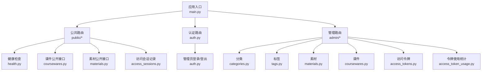
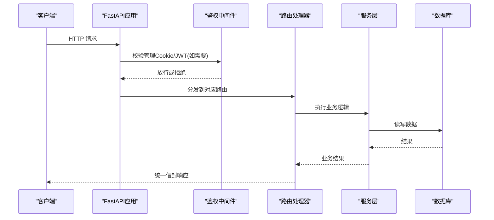
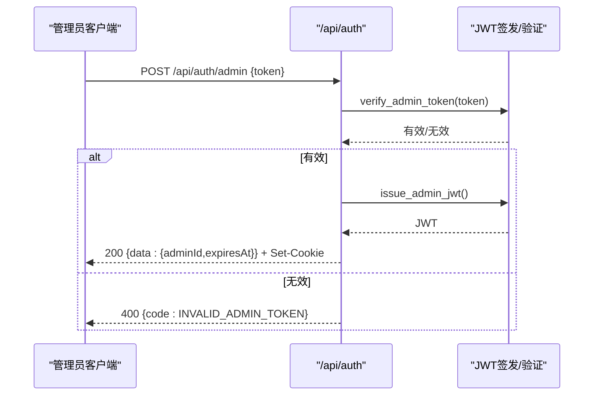
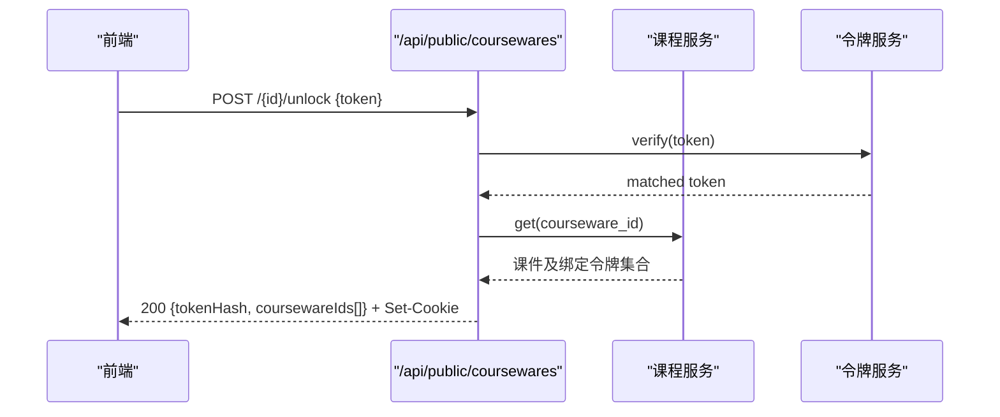
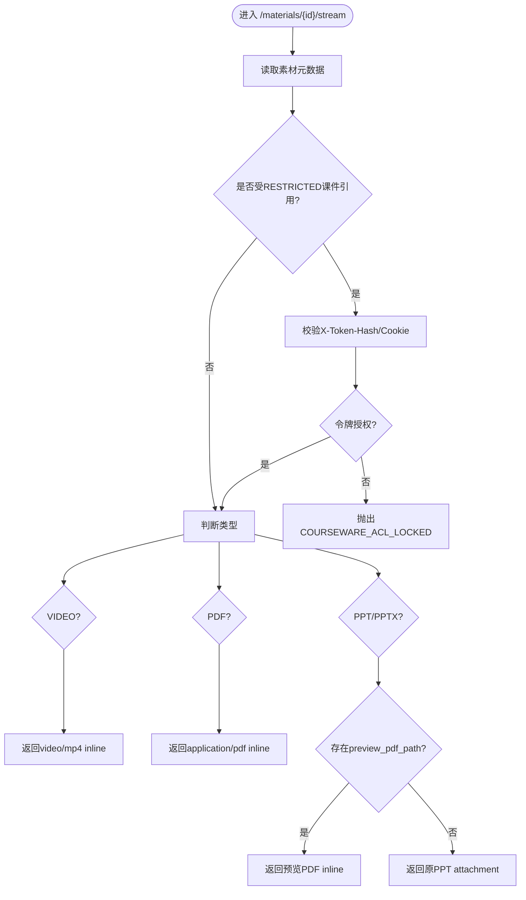
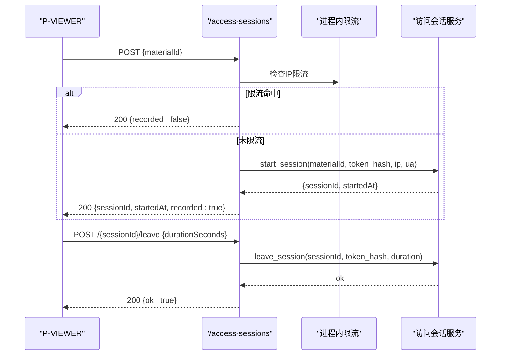
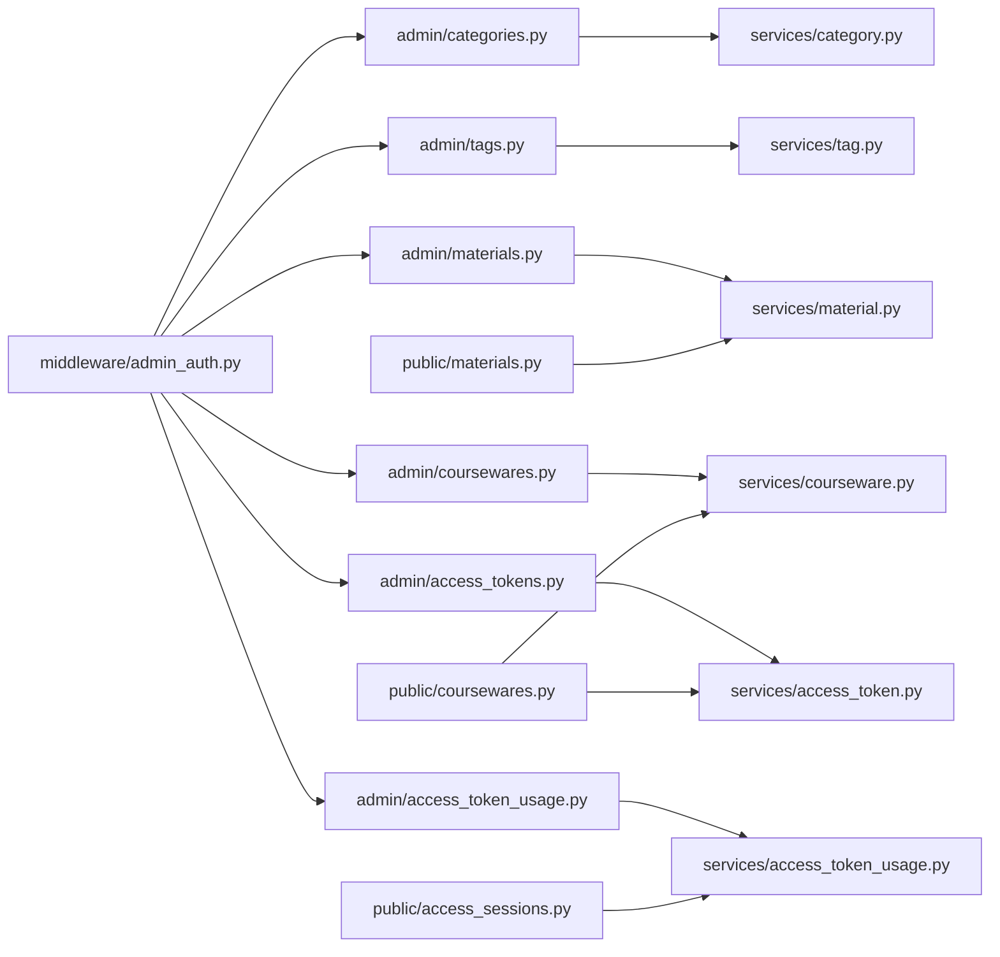

# API接口文档

<cite>
**本文引用的文件**
- [backend/app/main.py](file://backend/app/main.py)
- [backend/app/api/auth.py](file://backend/app/api/auth.py)
- [backend/app/api/admin/access_tokens.py](file://backend/app/api/admin/access_tokens.py)
- [backend/app/api/admin/access_token_usage.py](file://backend/app/api/admin/access_token_usage.py)
- [backend/app/api/admin/categories.py](file://backend/app/api/admin/categories.py)
- [backend/app/api/admin/coursewares.py](file://backend/app/api/admin/coursewares.py)
- [backend/app/api/admin/materials.py](file://backend/app/api/admin/materials.py)
- [backend/app/api/admin/tags.py](file://backend/app/api/admin/tags.py)
- [backend/app/api/public/coursewares.py](file://backend/app/api/public/coursewares.py)
- [backend/app/api/public/materials.py](file://backend/app/api/public/materials.py)
- [backend/app/api/public/access_sessions.py](file://backend/app/api/public/access_sessions.py)
- [backend/app/api/public/health.py](file://backend/app/api/public/health.py)
- [backend/app/core/errors.py](file://backend/app/core/errors.py)
- [backend/app/core/rate_limit.py](file://backend/app/core/rate_limit.py)
- [backend/app/middleware/admin_auth.py](file://backend/app/middleware/admin_auth.py)
</cite>

## 目录
1. [简介](#简介)
2. [项目结构](#项目结构)
3. [核心组件](#核心组件)
4. [架构总览](#架构总览)
5. [详细组件分析](#详细组件分析)
6. [依赖关系分析](#依赖关系分析)
7. [性能与限流](#性能与限流)
8. [错误处理与排障](#错误处理与排障)
9. [版本管理与兼容性](#版本管理与兼容性)
10. [调用示例与最佳实践](#调用示例与最佳实践)
11. [结论](#结论)

## 简介
本文件为 Learning Hub 后端 RESTful API 的完整参考文档。内容覆盖认证、管理后台与公开接口，包含端点说明、请求/响应格式、错误码、鉴权机制、速率限制、安全与性能建议，以及向后兼容与迁移指南。所有端点均以统一信封格式返回数据，便于前端一致化处理。

## 项目结构
后端基于 FastAPI 构建，路由按功能域划分：
- 公共接口：健康检查、课件搜索与详情、素材下载/预览、访问会话记录
- 管理后台接口：分类、标签、素材、课件、访问令牌及其使用统计
- 认证接口：管理员登录/登出（基于 HttpOnly Cookie）

图表来源
- [backend/app/main.py:40-112](file://backend/app/main.py#L40-L112)
- [backend/app/api/public/health.py:11-26](file://backend/app/api/public/health.py#L11-L26)
- [backend/app/api/public/coursewares.py:19-133](file://backend/app/api/public/coursewares.py#L19-L133)
- [backend/app/api/public/materials.py:20-224](file://backend/app/api/public/materials.py#L20-L224)
- [backend/app/api/public/access_sessions.py:24-137](file://backend/app/api/public/access_sessions.py#L24-L137)
- [backend/app/api/auth.py:14-49](file://backend/app/api/auth.py#L14-L49)
- [backend/app/api/admin/categories.py:16-81](file://backend/app/api/admin/categories.py#L16-L81)
- [backend/app/api/admin/tags.py:14-70](file://backend/app/api/admin/tags.py#L14-L70)
- [backend/app/api/admin/materials.py:16-74](file://backend/app/api/admin/materials.py#L16-L74)
- [backend/app/api/admin/coursewares.py:17-115](file://backend/app/api/admin/coursewares.py#L17-L115)
- [backend/app/api/admin/access_tokens.py:21-120](file://backend/app/api/admin/access_tokens.py#L21-L120)
- [backend/app/api/admin/access_token_usage.py:19-101](file://backend/app/api/admin/access_token_usage.py#L19-L101)

章节来源
- [backend/app/main.py:40-112](file://backend/app/main.py#L40-L112)

## 核心组件
- 统一响应信封：所有成功响应均包裹在标准信封中，包含业务数据字段 data；失败响应遵循统一错误信封格式。
- 全局中间件：CORS、请求ID注入、异常处理（业务错误、限流）。
- 鉴权：
  - 管理后台：通过“管理令牌”换取 JWT，写入 HttpOnly Cookie，后续请求由中间件校验。
  - 公开接口：通过 X-Token-Hash 或 Cookie lh_token_hash 进行资源解锁与ACL校验。
- 限流：
  - 全局：SlowAPI 限流器注册与异常处理。
  - 局部：部分公开接口使用装饰器限流；访问会话记录采用进程内滑动窗口限流兜底。

章节来源
- [backend/app/main.py:57-90](file://backend/app/main.py#L57-L90)
- [backend/app/api/auth.py:21-45](file://backend/app/api/auth.py#L21-L45)
- [backend/app/api/public/coursewares.py:24-30](file://backend/app/api/public/coursewares.py#L24-L30)
- [backend/app/api/public/materials.py:23-62](file://backend/app/api/public/materials.py#L23-L62)
- [backend/app/api/public/access_sessions.py:29-55](file://backend/app/api/public/access_sessions.py#L29-L55)

## 架构总览
下图展示关键交互路径：客户端发起请求，经过中间件与鉴权后进入具体路由，再调用服务层完成业务逻辑并返回统一信封。

图表来源
- [backend/app/main.py:70-90](file://backend/app/main.py#L70-L90)
- [backend/app/middleware/admin_auth.py](file://backend/app/middleware/admin_auth.py)

## 详细组件分析

### 认证接口（Admin）
- 基础信息
  - 前缀：/api/auth
  - 鉴权：无需前置鉴权
  - 返回：统一信封 { code, message, data }

- 管理员登录
  - 方法：POST /api/auth/admin
  - 请求体：
    - token: string（管理令牌）
  - 响应体 data：
    - adminId: string
    - expiresAt: string（ISO 8601）
  - 副作用：设置 HttpOnly Cookie LH_ADMIN_SESSION（有效期8小时）
  - 错误码：INVALID_ADMIN_TOKEN

- 管理员登出
  - 方法：POST /api/auth/logout
  - 响应体 data：null
  - 副作用：删除 LH_ADMIN_SESSION Cookie

图表来源
- [backend/app/api/auth.py:21-45](file://backend/app/api/auth.py#L21-L45)
- [backend/app/middleware/admin_auth.py](file://backend/app/middleware/admin_auth.py)

章节来源
- [backend/app/api/auth.py:14-49](file://backend/app/api/auth.py#L14-L49)

### 管理后台接口（Admin）
通用规则
- 前缀：/api/admin/*
- 鉴权：需携带 LH_ADMIN_SESSION Cookie（由中间件校验）
- 分页参数：page（默认1）、size（默认20，范围1..200）
- 关键词过滤：keyword（可选）

#### 分类（Categories）
- GET /api/admin/categories
  - 返回：树形分类列表
- POST /api/admin/categories
  - 请求体：{ name, parentId? }
  - 响应：创建后的分类节点
- PUT /api/admin/categories/{category_id}
  - 请求体：{ name }
  - 响应：更新后的分类节点
- DELETE /api/admin/categories/{category_id}
  - 响应：空数据

章节来源
- [backend/app/api/admin/categories.py:16-81](file://backend/app/api/admin/categories.py#L16-L81)

#### 标签（Tags）
- GET /api/admin/tags
  - 支持 keyword 过滤
- POST /api/admin/tags
  - 请求体：{ name }
- PUT /api/admin/tags/{tag_id}
  - 请求体：{ name }
- DELETE /api/admin/tags/{tag_id}

章节来源
- [backend/app/api/admin/tags.py:14-70](file://backend/app/api/admin/tags.py#L14-L70)

#### 素材（Materials）
- GET /api/admin/materials
  - 查询参数：keyword, type（VIDEO/PDF/PPT），page, size
- POST /api/admin/materials
  - 上传 multipart/form-data，字段 file
  - 响应：{ id, name, type, sizeBytes }
- DELETE /api/admin/materials/{material_id}
- GET /api/admin/materials/{material_id}/file
  - 直接下载原文件（Content-Disposition: attachment）

章节来源
- [backend/app/api/admin/materials.py:16-74](file://backend/app/api/admin/materials.py#L16-L74)

#### 课件（Coursewares）
- GET /api/admin/coursewares
  - 查询参数：keyword, categoryId?, accessMode?, page, size
- GET /api/admin/coursewares/{courseware_id}
- POST /api/admin/coursewares
  - 请求体：{ title, categoryId?, author?, description?, accessMode?, tagIds[], materialIds[], tokenIds[] }
- PUT /api/admin/coursewares/{courseware_id}
  - 请求体：同创建（可部分更新）
- DELETE /api/admin/coursewares/{courseware_id}
- PUT /api/admin/coursewares/{courseware_id}/materials/order
  - 请求体：{ materialIds[] }
  - 作用：按顺序重写素材排序（v1.5新增）

章节来源
- [backend/app/api/admin/coursewares.py:17-115](file://backend/app/api/admin/coursewares.py#L17-L115)

#### 访问令牌（Access Tokens）
- GET /api/admin/access-tokens
  - 查询参数：keyword?, page, size
- POST /api/admin/access-tokens
  - 请求体：{ label }
  - 响应：{ id, label, valueHash, coursewareCount, createdAt, regeneratedAt }
- GET /api/admin/access-tokens/{token_id}
  - 查询参数：withUsage?（布尔，是否附加 usageSummary）
- POST /api/admin/access-tokens/{token_id}/regenerate
  - 重新生成令牌值，返回新 valueHash
- DELETE /api/admin/access-tokens/{token_id}

章节来源
- [backend/app/api/admin/access_tokens.py:21-120](file://backend/app/api/admin/access_tokens.py#L21-L120)

#### 令牌使用统计（Access Token Usage）
- GET /api/admin/access-tokens/{token_id}/access-sessions
  - 查询参数：start, end, materialId?, coursewareId?, page, size
  - 返回：分页访问台账
- GET /api/admin/access-tokens/{token_id}/access-sessions/summary
  - 查询参数：start, end
  - 返回：总停留时长、次数、课件数、素材数
- GET /api/admin/access-tokens/{token_id}/access-sessions/material-summary
  - 查询参数：start, end
  - 返回：按素材聚合的使用情况（分页）

章节来源
- [backend/app/api/admin/access_token_usage.py:19-101](file://backend/app/api/admin/access_token_usage.py#L19-L101)

### 公开接口（Public）
通用规则
- 前缀：/api/public/*
- 鉴权：
  - 通过 X-Token-Hash 请求头或 Cookie lh_token_hash 传递已解锁的令牌哈希
  - 对受保护资源进行 ACL 校验
- 限流：部分接口使用 SlowAPI 装饰器限流；访问会话记录有进程内兜底限流

#### 健康检查
- GET /api/public/health
  - 响应 data：{ status, version, uptimeSec }

章节来源
- [backend/app/api/public/health.py:11-26](file://backend/app/api/public/health.py#L11-L26)

#### 课件（公开）
- GET /api/public/coursewares/search
  - 查询参数：q?, page, size
  - 返回 data：{ items, source, total, page, size }
  - source：embedding 或 keyword（降级）
- GET /api/public/coursewares/{courseware_id}
  - OPEN：直接返回
  - RESTRICTED：需携带已解锁令牌哈希，否则 403
- POST /api/public/coursewares/{courseware_id}/unlock
  - 请求体：{ token }
  - 成功：返回 { tokenHash, coursewareIds[] }，并设置 Cookie lh_token_hash（7天）
  - 失败：INVALID_TOKEN 或 COURSEWARE_ACL_LOCKED

图表来源
- [backend/app/api/public/coursewares.py:79-130](file://backend/app/api/public/coursewares.py#L79-L130)

章节来源
- [backend/app/api/public/coursewares.py:19-133](file://backend/app/api/public/coursewares.py#L19-L133)

#### 素材（公开）
- GET /api/public/materials/{material_id}
  - 返回：id, name, type, sizeBytes, duration, streamUrl, downloadUrl, imageUrls?, imageCount?, previewReady?
- GET /api/public/materials/{material_id}/file
  - 以 attachment 方式返回原文件
- GET /api/public/materials/{material_id}/stream
  - 以 inline 方式返回视频/PDF/PPT预览（PPT优先返回预览PDF，否则降级返回原文件）
  - 限流：60次/分钟
- GET /api/public/materials/{material_id}/image/{page_no}
  - 返回 PPT 第 N 页 PNG（1-indexed）
  - 限流：60次/分钟

图表来源
- [backend/app/api/public/materials.py:84-146](file://backend/app/api/public/materials.py#L84-L146)

章节来源
- [backend/app/api/public/materials.py:20-224](file://backend/app/api/public/materials.py#L20-L224)

#### 访问会话（公开）
- POST /api/public/access-sessions
  - 请求体：{ materialId }
  - 行为：
    - 缺 token_hash → 400 missing_token
    - token 不存在 → 401 invalid_token
    - IP 命中限流 → 200 recorded=false（不阻塞主流程）
    - 素材无引用或全部OPEN → 200 recorded=false
    - 素材被RESTRICTED课件引用但token未授权 → 403
    - 写入失败 → 200 recorded=false（吞错）
  - 响应 data：{ sessionId?, startedAt?, recorded }
- POST /api/public/access-sessions/{session_id}/leave
  - 请求体：{ durationSeconds }
  - 幂等结束会话；token_hash 必须与会话匹配，否则 403（前端静默）

图表来源
- [backend/app/api/public/access_sessions.py:65-133](file://backend/app/api/public/access_sessions.py#L65-L133)

章节来源
- [backend/app/api/public/access_sessions.py:24-137](file://backend/app/api/public/access_sessions.py#L24-L137)

## 依赖关系分析
- 路由层依赖服务层完成业务逻辑，服务层依赖数据库会话。
- 管理后台路由通过中间件 get_admin_principal 强制鉴权。
- 公开接口通过 _resolve_unlocked_token_hash 解析令牌哈希，结合 ACL 策略控制访问。
- 限流器 slowapi 在应用启动时注入，并在特定路由使用装饰器限流。

图表来源
- [backend/app/api/admin/categories.py:16-81](file://backend/app/api/admin/categories.py#L16-L81)
- [backend/app/api/admin/tags.py:14-70](file://backend/app/api/admin/tags.py#L14-L70)
- [backend/app/api/admin/materials.py:16-74](file://backend/app/api/admin/materials.py#L16-L74)
- [backend/app/api/admin/coursewares.py:17-115](file://backend/app/api/admin/coursewares.py#L17-L115)
- [backend/app/api/admin/access_tokens.py:21-120](file://backend/app/api/admin/access_tokens.py#L21-L120)
- [backend/app/api/admin/access_token_usage.py:19-101](file://backend/app/api/admin/access_token_usage.py#L19-L101)
- [backend/app/api/public/coursewares.py:19-133](file://backend/app/api/public/coursewares.py#L19-L133)
- [backend/app/api/public/materials.py:20-224](file://backend/app/api/public/materials.py#L20-L224)
- [backend/app/api/public/access_sessions.py:24-137](file://backend/app/api/public/access_sessions.py#L24-L137)
- [backend/app/middleware/admin_auth.py](file://backend/app/middleware/admin_auth.py)

## 性能与限流
- 全局限流
  - 使用 SlowAPI 注入限流器，并对 RateLimitExceeded 提供统一错误响应（429）。
- 局部限流
  - 公开素材流式预览与图片接口：60次/分钟（装饰器）。
  - 访问会话记录：进程内滑动窗口限流（60次/分钟/IP），多进程部署建议配合反向代理层限流。
- 缓存与降级
  - 分类/标签变更会触发词汇表缓存失效，避免不一致。
  - 搜索接口在 embedding 不可用时自动降级为关键词检索。
- 大文件传输
  - 素材下载/流式预览使用 FileResponse 直出，减少内存占用。

章节来源
- [backend/app/main.py:67-90](file://backend/app/main.py#L67-L90)
- [backend/app/api/public/materials.py:84-150](file://backend/app/api/public/materials.py#L84-L150)
- [backend/app/api/public/access_sessions.py:29-55](file://backend/app/api/public/access_sessions.py#L29-L55)
- [backend/app/api/admin/categories.py:43-45](file://backend/app/api/admin/categories.py#L43-L45)
- [backend/app/api/admin/tags.py:34-36](file://backend/app/api/admin/tags.py#L34-L36)

## 错误处理与排障
- 统一错误信封
  - 所有错误响应遵循统一信封格式，包含 code、message、requestId（可选）。
- 常见错误码
  - INVALID_ADMIN_TOKEN：管理令牌无效
  - INVALID_TOKEN：令牌无效或无权访问
  - COURSEWARE_ACL_LOCKED：课件/素材需要令牌解锁
  - MATERIAL_STORAGE_UNAVAILABLE：素材文件丢失
  - rate_limited：操作过于频繁（429）
- 排查建议
  - 关注响应头 X-Request-Id，用于跨链路追踪。
  - 检查 CORS 配置与 Cookie SameSite 策略。
  - 对于 429，适当退避重试或提示用户稍后再试。

章节来源
- [backend/app/main.py:78-90](file://backend/app/main.py#L78-L90)
- [backend/app/core/errors.py](file://backend/app/core/errors.py)

## 版本管理与兼容性
- 版本标识
  - 根路径返回 service 与 version；OpenAPI 文档暴露于 /api/openapi.json。
- 向后兼容
  - 访问令牌详情接口扩展 withUsage 参数，默认不计算以避免 N+1 问题，保持旧客户端兼容。
- 废弃与迁移
  - 素材顺序调整新增专用接口 PUT /api/admin/coursewares/{id}/materials/order（v1.5），替代批量更新时的隐式排序逻辑。
  - 若未来引入 API 版本前缀（如 /api/v1/...），建议在路由前缀处集中管理，并通过网关做灰度切换。

章节来源
- [backend/app/main.py:48-55](file://backend/app/main.py#L48-L55)
- [backend/app/api/admin/access_tokens.py:80-102](file://backend/app/api/admin/access_tokens.py#L80-L102)
- [backend/app/api/admin/coursewares.py:100-112](file://backend/app/api/admin/coursewares.py#L100-L112)

## 调用示例与最佳实践
- 认证流程（Python）
  - 步骤：
    - 调用 POST /api/auth/admin，提交管理令牌
    - 保存服务端设置的 LH_ADMIN_SESSION Cookie
    - 后续管理接口请求附带该 Cookie
- 解锁课件（JavaScript）
  - 步骤：
    - 调用 POST /api/public/coursewares/{id}/unlock，提交 token
    - 浏览器自动保存 lh_token_hash Cookie
    - 后续 GET /api/public/coursewares/{id} 无需再次提交 token
- 访问会话记录（Python）
  - 步骤：
    - 打开播放器前调用 POST /api/public/access-sessions，传入 materialId
    - 关闭播放器时调用 POST /api/public/access-sessions/{sessionId}/leave，传入 durationSeconds
- 最佳实践
  - 始终携带 X-Request-Id 以便定位问题
  - 对 429 实施指数退避重试
  - 对大文件下载/预览使用分片或断点续传（前端实现）
  - 合理设置 Cookie 的 SameSite 与 Path，确保跨域场景可用

[本节为通用指导，不直接分析具体文件]

## 结论
Learning Hub API 采用分层清晰、职责明确的架构设计，统一信封与错误处理提升了一致性与可维护性。通过管理后台与公开接口的解耦、灵活的令牌解锁机制与完善的限流策略，系统兼顾了安全性与可用性。建议在生产环境结合反向代理层进行更严格的限流与监控，并持续优化搜索与预览的性能体验。