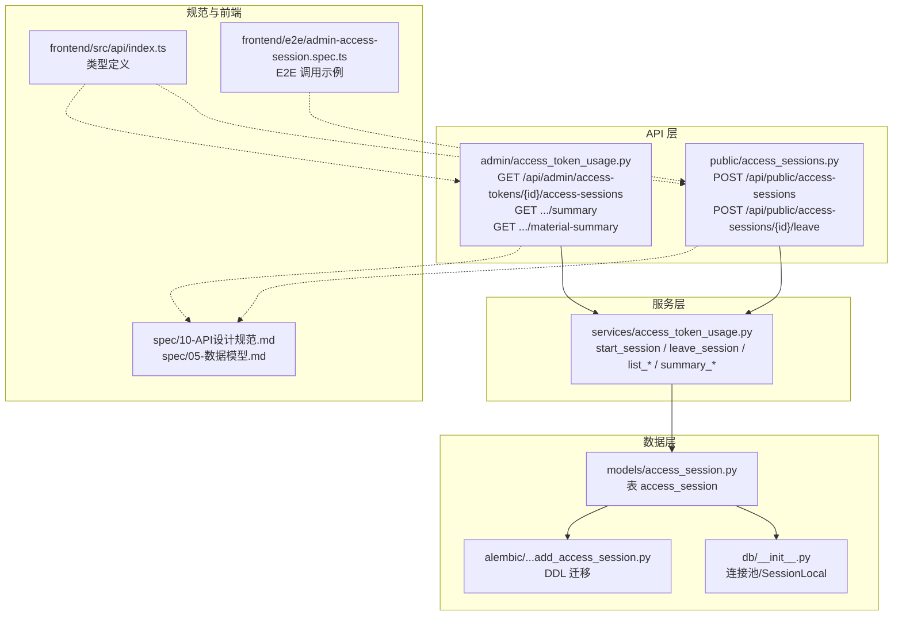
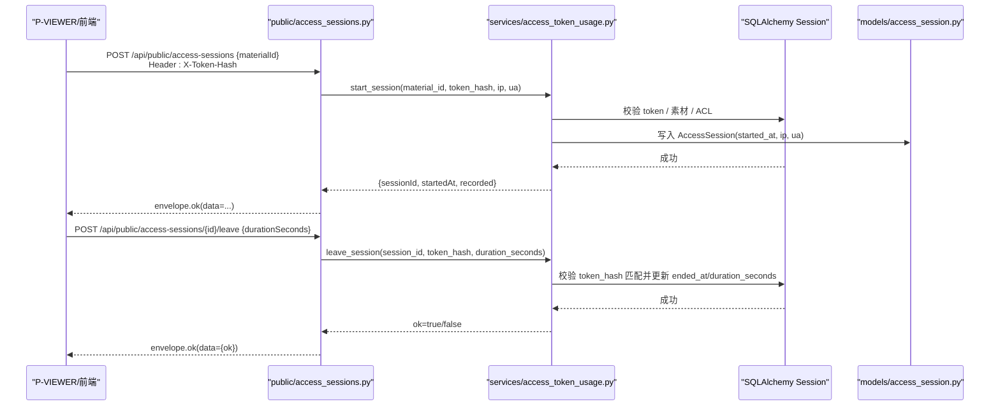
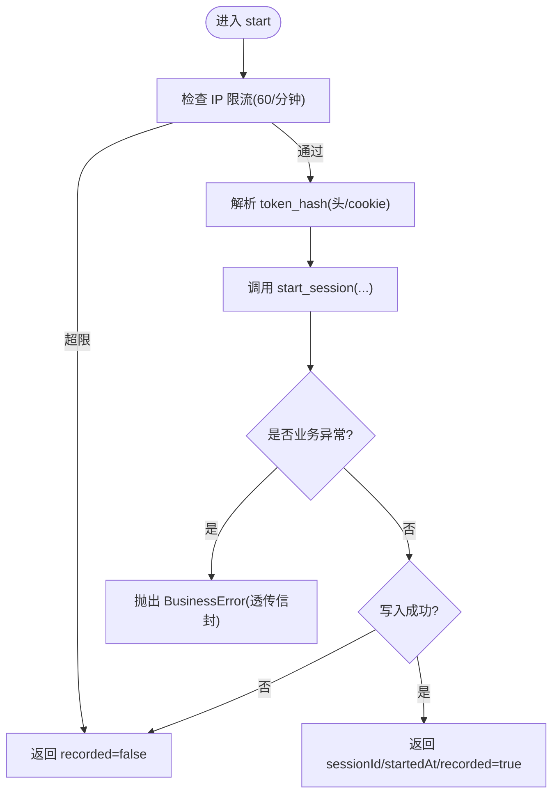
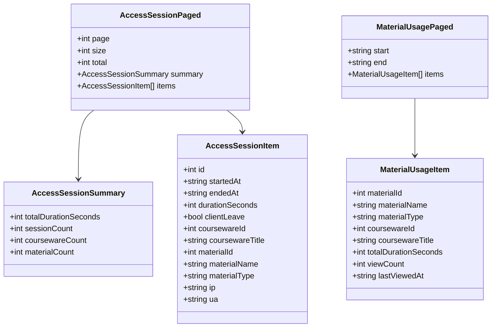
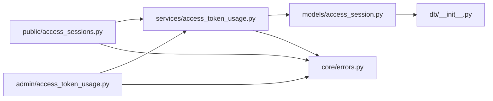

# 会话接口

<cite>
**本文引用的文件**   
- [backend/app/api/public/access_sessions.py](file://backend/app/api/public/access_sessions.py)
- [backend/app/api/admin/access_token_usage.py](file://backend/app/api/admin/access_token_usage.py)
- [backend/app/services/access_token_usage.py](file://backend/app/services/access_token_usage.py)
- [backend/app/models/access_session.py](file://backend/app/models/access_session.py)
- [backend/app/schemas/__init__.py](file://backend/app/schemas/__init__.py)
- [backend/app/schemas/access_token_usage.py](file://backend/app/schemas/access_token_usage.py)
- [backend/app/core/errors.py](file://backend/app/core/errors.py)
- [backend/app/db/__init__.py](file://backend/app/db/__init__.py)
- [backend/alembic/versions/2026_07_10_0930-c1d2e3f4a5b6_add_access_session.py](file://backend/alembic/versions/2026_07_10_0930-c1d2e3f4a5b6_add_access_session.py)
- [doc/spec/10-API设计规范.md](file://doc/spec/10-API设计规范.md)
- [doc/spec/05-数据模型.md](file://doc/spec/05-数据模型.md)
- [frontend/src/api/index.ts](file://frontend/src/api/index.ts)
- [frontend/e2e/admin-access-session.spec.ts](file://frontend/e2e/admin-access-session.spec.ts)
- [backend/tests/test_access_session.py](file://backend/tests/test_access_session.py)
</cite>

## 目录
1. [简介](#简介)
2. [项目结构](#项目结构)
3. [核心组件](#核心组件)
4. [架构总览](#架构总览)
5. [详细组件分析](#详细组件分析)
6. [依赖关系分析](#依赖关系分析)
7. [性能与监控](#性能与监控)
8. [故障排查指南](#故障排查指南)
9. [结论](#结论)
10. [附录：请求/响应示例与错误码](#附录请求响应示例与错误码)

## 简介
本文件为“访问会话”接口的完整 API 文档，覆盖以下能力：
- 用户访问会话的创建、结束（leave）与管理查询
- 会话生命周期管理：创建、自动续期策略说明、过期清理机制说明
- 访问统计：访问次数统计、时间分布分析、用户行为追踪字段
- 安全存储与隐私保护：令牌哈希校验、IP/UA 记录、幂等与容错
- 完整的请求/响应示例：包含会话 ID 生成、状态管理与错误处理
- 监控指标收集与性能优化建议

## 项目结构
访问会话功能由“公共 API + 管理 API + 服务层 + 数据模型 + 迁移 + 规范文档 + 前端类型定义 + 测试用例”组成。

图表来源
- [backend/app/api/public/access_sessions.py:1-137](file://backend/app/api/public/access_sessions.py#L1-L137)
- [backend/app/api/admin/access_token_usage.py:1-101](file://backend/app/api/admin/access_token_usage.py#L1-L101)
- [backend/app/services/access_token_usage.py:1-518](file://backend/app/services/access_token_usage.py#L1-L518)
- [backend/app/models/access_session.py:1-129](file://backend/app/models/access_session.py#L1-L129)
- [backend/app/db/__init__.py:1-50](file://backend/app/db/__init__.py#L1-L50)
- [backend/alembic/versions/2026_07_10_0930-c1d2e3f4a5b6_add_access_session.py:1-41](file://backend/alembic/versions/2026_07_10_0930-c1d2e3f4a5b6_add_access_session.py#L1-L41)
- [doc/spec/10-API设计规范.md:1435-1517](file://doc/spec/10-API设计规范.md#L1435-L1517)
- [doc/spec/05-数据模型.md:263-283](file://doc/spec/05-数据模型.md#L263-L283)
- [frontend/src/api/index.ts:215-275](file://frontend/src/api/index.ts#L215-L275)
- [frontend/e2e/admin-access-session.spec.ts:1-46](file://frontend/e2e/admin-access-session.spec.ts#L1-L46)

章节来源
- [backend/app/api/public/access_sessions.py:1-137](file://backend/app/api/public/access_sessions.py#L1-L137)
- [backend/app/api/admin/access_token_usage.py:1-101](file://backend/app/api/admin/access_token_usage.py#L1-L101)
- [backend/app/services/access_token_usage.py:1-518](file://backend/app/services/access_token_usage.py#L1-L518)
- [backend/app/models/access_session.py:1-129](file://backend/app/models/access_session.py#L1-L129)
- [backend/app/db/__init__.py:1-50](file://backend/app/db/__init__.py#L1-L50)
- [backend/alembic/versions/2026_07_10_0930-c1d2e3f4a5b6_add_access_session.py:1-41](file://backend/alembic/versions/2026_07_10_0930-c1d2e3f4a5b6_add_access_session.py#L1-L41)
- [doc/spec/10-API设计规范.md:1435-1517](file://doc/spec/10-API设计规范.md#L1435-L1517)
- [doc/spec/05-数据模型.md:263-283](file://doc/spec/05-数据模型.md#L263-L283)
- [frontend/src/api/index.ts:215-275](file://frontend/src/api/index.ts#L215-L275)
- [frontend/e2e/admin-access-session.spec.ts:1-46](file://frontend/e2e/admin-access-session.spec.ts#L1-L46)

## 核心组件
- 公共 API：负责 P-VIEWER 侧的会话开始与结束埋点，无需管理员鉴权，仅凭 token_hash 即可调用
- 管理 API：面向后台管理员，提供按时间段分页明细、概览聚合、按素材聚合等查询
- 服务层：封装业务规则（如 OPEN 课件不记录、时长偏差校正、权限校验、聚合计算）
- 数据模型：access_session 表及索引设计，支持多端方言兼容
- 统一信封：所有响应使用 {code, message, data, requestId} 信封格式

章节来源
- [backend/app/api/public/access_sessions.py:1-137](file://backend/app/api/public/access_sessions.py#L1-L137)
- [backend/app/api/admin/access_token_usage.py:1-101](file://backend/app/api/admin/access_token_usage.py#L1-L101)
- [backend/app/services/access_token_usage.py:1-518](file://backend/app/services/access_token_usage.py#L1-L518)
- [backend/app/models/access_session.py:1-129](file://backend/app/models/access_session.py#L1-L129)
- [backend/app/schemas/__init__.py:1-65](file://backend/app/schemas/__init__.py#L1-L65)

## 架构总览
访问会话从客户端到数据库的端到端流程如下：

图表来源
- [backend/app/api/public/access_sessions.py:65-133](file://backend/app/api/public/access_sessions.py#L65-L133)
- [backend/app/services/access_token_usage.py:64-171](file://backend/app/services/access_token_usage.py#L64-L171)
- [backend/app/models/access_session.py:56-129](file://backend/app/models/access_session.py#L56-L129)

## 详细组件分析

### 公共 API：会话开始与结束
- 路径与方法
  - POST /api/public/access-sessions
  - POST /api/public/access-sessions/{session_id}/leave
- 鉴权方式
  - 优先请求头 X-Token-Hash，否则回退 cookie lh_token_hash
- 限流策略
  - 进程内滑动窗口限流：每 IP 每分钟最多 60 次；命中时降级为不记录（recorded=false），不阻塞主流程
- 关键行为
  - 缺 token_hash → 400 missing_token
  - token 无效 → 401 invalid_token
  - 素材仅被 OPEN 课件引用或无引用 → 200 recorded=false（不写库）
  - 素材被 RESTRICTED 课件引用但 token 未授权 → 403 courseware_acl_locked
  - 写入失败 → 200 recorded=false（吞错，不阻塞前台）
  - leave 幂等：不存在 session 视为 ok=true

图表来源
- [backend/app/api/public/access_sessions.py:29-106](file://backend/app/api/public/access_sessions.py#L29-L106)
- [backend/app/services/access_token_usage.py:64-125](file://backend/app/services/access_token_usage.py#L64-L125)

章节来源
- [backend/app/api/public/access_sessions.py:1-137](file://backend/app/api/public/access_sessions.py#L1-L137)
- [backend/app/services/access_token_usage.py:64-125](file://backend/app/services/access_token_usage.py#L64-L125)
- [backend/app/core/errors.py:1-144](file://backend/app/core/errors.py#L1-L144)

### 管理 API：访问台账与聚合
- 路径与方法
  - GET /api/admin/access-tokens/{token_id}/access-sessions
  - GET /api/admin/access-tokens/{token_id}/access-sessions/summary
  - GET /api/admin/access-tokens/{token_id}/access-sessions/material-summary
- 鉴权
  - 需要管理员鉴权（中间件 get_admin_principal）
- 通用参数
  - start/end：YYYY-MM-DD 必填（默认近 7 天）
  - materialId/coursewareId：可选过滤
  - page/size：分页（默认 1/20，size 最大 200）
- 返回内容
  - 明细分页：items + 区间聚合 summary
  - 概览：仅 4 项指标（总停留秒数、会话次数、课件数、素材数）
  - 按素材聚合：按 totalDurationSeconds DESC 排序，含 viewCount、lastViewedAt

图表来源
- [backend/app/schemas/access_token_usage.py:1-90](file://backend/app/schemas/access_token_usage.py#L1-L90)
- [backend/app/api/admin/access_token_usage.py:32-97](file://backend/app/api/admin/access_token_usage.py#L32-L97)

章节来源
- [backend/app/api/admin/access_token_usage.py:1-101](file://backend/app/api/admin/access_token_usage.py#L1-L101)
- [backend/app/schemas/access_token_usage.py:1-90](file://backend/app/schemas/access_token_usage.py#L1-L90)
- [backend/app/services/access_token_usage.py:286-506](file://backend/app/services/access_token_usage.py#L286-L506)

### 数据模型与约束
- 表名：access_session
- 关键字段
  - id：自增主键
  - token_id：所属访问令牌（FK CASCADE）
  - courseware_id：受限课件（取最小 id）
  - material_id：浏览素材
  - started_at：进入时间（UTC）
  - ended_at：离开时间（可为空）
  - duration_seconds：停留秒数（leave 回填，非负）
  - client_leave：是否收到客户端 close 信号
  - ip：客户端 IP（PostgreSQL INET，SQLite 退化 VARCHAR(45)）
  - ua：User-Agent（最长 256）
  - created_at：入库时间
- 索引
  - (token_id, started_at)
  - (token_id, material_id, started_at)
  - (token_id, courseware_id, started_at)
- 约束
  - duration_seconds ≥ 0

章节来源
- [backend/app/models/access_session.py:56-129](file://backend/app/models/access_session.py#L56-L129)
- [backend/alembic/versions/2026_07_10_0930-c1d2e3f4a5b6_add_access_session.py:21-41](file://backend/alembic/versions/2026_07_10_0930-c1d2e3f4a5b6_add_access_session.py#L21-L41)
- [doc/spec/05-数据模型.md:263-283](file://doc/spec/05-数据模型.md#L263-L283)

### 业务规则与算法要点
- B-1：仅当素材被至少一个 RESTRICTED 课件引用时才落库；若全部为 OPEN 则不记录
- B-2：客户端上报 duration_seconds 与服务端计算偏差 > 60s 时，以服务端时间为准进行校正
- B-3：token 重新生成后，旧 token_id 上的历史 session 仍归属该 id
- B-4：删除 token 时通过 FK CASCADE 一并清理其 session
- 时长表达式：进行中（ended_at=NULL）用 now()-started_at 估算；已结束的优先使用 duration_seconds

章节来源
- [backend/app/services/access_token_usage.py:31-32](file://backend/app/services/access_token_usage.py#L31-L32)
- [backend/app/services/access_token_usage.py:44-61](file://backend/app/services/access_token_usage.py#L44-L61)
- [backend/app/services/access_token_usage.py:128-171](file://backend/app/services/access_token_usage.py#L128-L171)
- [backend/app/services/access_token_usage.py:244-259](file://backend/app/services/access_token_usage.py#L244-L259)

## 依赖关系分析
- API 层依赖服务层完成业务逻辑
- 服务层依赖 SQLAlchemy ORM 操作模型
- 模型依赖数据库方言适配（INET/VARCHAR）
- 统一信封与错误码贯穿全链路

图表来源
- [backend/app/api/public/access_sessions.py:1-137](file://backend/app/api/public/access_sessions.py#L1-L137)
- [backend/app/api/admin/access_token_usage.py:1-101](file://backend/app/api/admin/access_token_usage.py#L1-L101)
- [backend/app/services/access_token_usage.py:1-518](file://backend/app/services/access_token_usage.py#L1-L518)
- [backend/app/models/access_session.py:1-129](file://backend/app/models/access_session.py#L1-L129)
- [backend/app/core/errors.py:1-144](file://backend/app/core/errors.py#L1-L144)
- [backend/app/db/__init__.py:1-50](file://backend/app/db/__init__.py#L1-L50)

## 性能与监控
- 限流
  - 进程内滑动窗口限流（60/分钟/IP），多进程部署需结合反向代理（如 nginx limit_req）兜底
- 数据库
  - 连接池：Postgres/MySQL 使用 pool_size=10, max_overflow=20；SQLite 使用 StaticPool
  - 索引：针对 token+时间、token+素材、token+课件的组合索引，提升分页与聚合效率
- 聚合查询
  - 概览接口仅返回 4 个指标，避免拉取全量明细
  - 按素材聚合使用窗口函数 row_number 获取最近一次课件关联
- 监控指标建议
  - 暴露 Prometheus 指标：start/leave 成功率、耗时分位、DB 慢查询计数、限流触发次数
  - 审计日志：写入失败时记录 audit.write（start_failed/leave_failed）
- 优化建议
  - 对高频查询增加缓存（如 Redis 缓存 token 级概览，TTL 短）
  - 将 UA 截断至 256 字符，避免超长值影响索引与存储
  - 在网关层做更严格的限流与熔断

章节来源
- [backend/app/api/public/access_sessions.py:29-54](file://backend/app/api/public/access_sessions.py#L29-L54)
- [backend/app/db/__init__.py:15-25](file://backend/app/db/__init__.py#L15-L25)
- [backend/app/services/access_token_usage.py:262-312](file://backend/app/services/access_token_usage.py#L262-L312)
- [backend/app/services/access_token_usage.py:403-506](file://backend/app/services/access_token_usage.py#L403-L506)
- [backend/app/services/access_token_usage.py:114-119](file://backend/app/services/access_token_usage.py#L114-L119)
- [backend/app/services/access_token_usage.py:165-170](file://backend/app/services/access_token_usage.py#L165-L170)

## 故障排查指南
- 常见问题
  - 缺少 token_hash：检查请求头或 cookie 是否正确传递
  - 令牌无效：确认 token_hash 对应有效且未被撤销
  - 无权访问：确认 token 已被授予对应 RESTRICTED 课件
  - 写入失败：查看审计日志中的 start_failed/leave_failed
  - 跨 token 篡改：leave 必须使用与 session.token_id 对应的 value_hash
- 定位步骤
  - 使用管理 API 的时间范围筛选，快速定位问题时段
  - 通过按素材聚合接口观察异常素材的访问趋势
  - 核对客户端上报的 durationSeconds 与服务端计算差异（阈值 60s）

章节来源
- [backend/app/core/errors.py:9-127](file://backend/app/core/errors.py#L9-L127)
- [backend/app/services/access_token_usage.py:114-119](file://backend/app/services/access_token_usage.py#L114-L119)
- [backend/app/services/access_token_usage.py:165-170](file://backend/app/services/access_token_usage.py#L165-L170)
- [backend/tests/test_access_session.py:206-289](file://backend/tests/test_access_session.py#L206-L289)

## 结论
访问会话接口提供了轻量、健壮的 P-VIEWER 访问埋点与管理查询能力。通过严格的 ACL 校验、时长校正与幂等设计，在保证用户体验的同时确保数据准确性与安全性。配合完善的索引与聚合查询，满足后台运营与分析需求。建议在网关层增强限流与可观测性，进一步提升稳定性与可维护性。

## 附录：请求/响应示例与错误码

### 公共 API 示例
- 开始会话
  - 请求体：{ "materialId": 123 }
  - 成功响应 envelope.data：{ "sessionId": 1024, "startedAt": "...", "recorded": true }
  - 行为：OPEN 课件不记录；写入失败降级 recorded=false
- 结束会话
  - 请求体：{ "durationSeconds": 73 }
  - 成功响应：{ "ok": true }
  - 幂等：不存在 session 视为 ok=true；偏差 > 60s 按服务端校正

章节来源
- [doc/spec/10-API设计规范.md:1435-1470](file://doc/spec/10-API设计规范.md#L1435-L1470)
- [backend/app/api/public/access_sessions.py:65-133](file://backend/app/api/public/access_sessions.py#L65-L133)
- [backend/app/services/access_token_usage.py:128-171](file://backend/app/services/access_token_usage.py#L128-L171)

### 管理 API 示例
- 明细分页
  - 响应 envelope.data：包含 page/size/total/summary/items
- 概览聚合
  - 响应 envelope.data：仅 4 项指标
- 按素材聚合
  - 响应 envelope.data：items 按 totalDurationSeconds DESC 排序

章节来源
- [doc/spec/10-API设计规范.md:1480-1517](file://doc/spec/10-API设计规范.md#L1480-L1517)
- [backend/app/api/admin/access_token_usage.py:32-97](file://backend/app/api/admin/access_token_usage.py#L32-L97)
- [backend/app/services/access_token_usage.py:286-506](file://backend/app/services/access_token_usage.py#L286-L506)

### 错误码与信封
- 统一信封：{ code, message, data, requestId }
- 常见业务码
  - missing_token、invalid_token、courseware_acl_locked、token_not_found、internal_error 等
- HTTP 映射
  - 400/401/403/404/429/500/503 等

章节来源
- [backend/app/schemas/__init__.py:1-65](file://backend/app/schemas/__init__.py#L1-L65)
- [backend/app/core/errors.py:9-127](file://backend/app/core/errors.py#L9-L127)

### 前端类型与 E2E 参考
- 前端类型定义：AccessSessionItem、AccessSessionPaged、MaterialUsageItem 等
- E2E 调用示例：start/leave 调用与 header 设置

章节来源
- [frontend/src/api/index.ts:215-275](file://frontend/src/api/index.ts#L215-L275)
- [frontend/e2e/admin-access-session.spec.ts:1-46](file://frontend/e2e/admin-access-session.spec.ts#L1-L46)