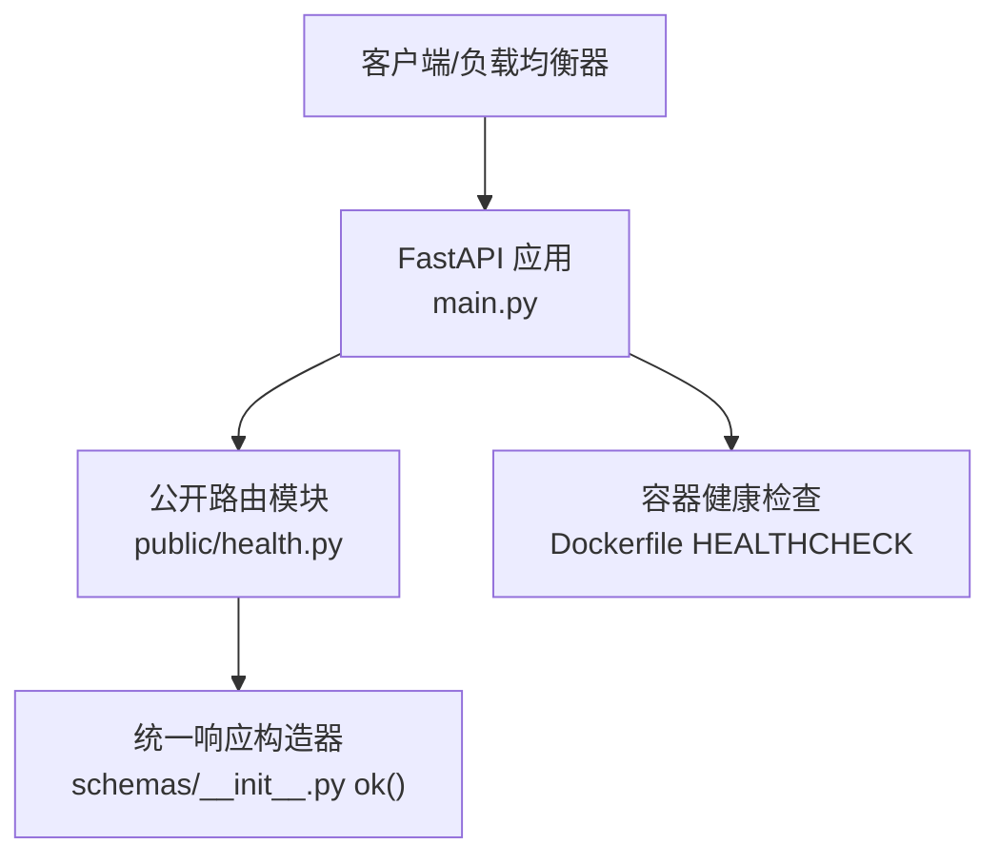
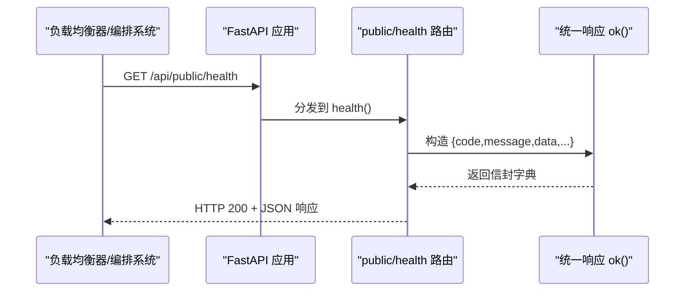
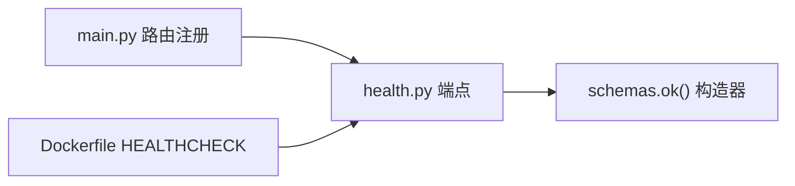

# 健康检查接口

<cite>
**本文引用的文件**
- [backend/app/api/public/health.py](file://backend/app/api/public/health.py)
- [backend/app/main.py](file://backend/app/main.py)
- [backend/app/schemas/__init__.py](file://backend/app/schemas/__init__.py)
- [backend/Dockerfile](file://backend/Dockerfile)
- [deploy/local/tests/test_auth.py](file://deploy/local/tests/test_auth.py)
- [backend/tests/test_auth.py](file://backend/tests/test_auth.py)
</cite>

## 目录
1. [简介](#简介)
2. [项目结构](#项目结构)
3. [核心组件](#核心组件)
4. [架构总览](#架构总览)
5. [详细组件分析](#详细组件分析)
6. [依赖分析](#依赖分析)
7. [性能考虑](#性能考虑)
8. [故障排查指南](#故障排查指南)
9. [结论](#结论)
10. [附录](#附录)

## 简介
本文件为“学习中心”后端的健康检查接口文档，聚焦于系统存活探针与基础运行状态上报。当前实现提供轻量级 Liveness 探针，用于负载均衡器、容器编排（Docker Swarm/Kubernetes）与健康检查工具判定服务是否可用。该端点不依赖数据库或缓存等外部依赖，确保在启动早期即可返回稳定结果。

## 项目结构
健康检查相关代码位于后端 FastAPI 应用中，通过路由注册挂载到应用入口。响应体遵循统一信封格式，便于上层监控与自动化脚本解析。

图表来源
- [backend/app/main.py:91-92](file://backend/app/main.py#L91-L92)
- [backend/app/api/public/health.py:11-25](file://backend/app/api/public/health.py#L11-L25)
- [backend/app/schemas/__init__.py:35-42](file://backend/app/schemas/__init__.py#L35-L42)
- [backend/Dockerfile:81-82](file://backend/Dockerfile#L81-L82)

章节来源
- [backend/app/main.py:91-92](file://backend/app/main.py#L91-L92)
- [backend/app/api/public/health.py:11-25](file://backend/app/api/public/health.py#L11-L25)
- [backend/app/schemas/__init__.py:35-42](file://backend/app/schemas/__init__.py#L35-L42)
- [backend/Dockerfile:81-82](file://backend/Dockerfile#L81-L82)

## 核心组件
- 健康检查端点：GET /api/public/health
  - 作用：返回进程存活与应用基本信息，供负载均衡器与编排系统探测。
  - 特点：无外部依赖、低开销、幂等。
- 统一响应信封：{code, message, data, requestId}
  - 成功时 code=ok；data 中包含具体业务字段。
- 容器健康检查：Dockerfile 内置 HEALTHCHECK 调用同一端点。

章节来源
- [backend/app/api/public/health.py:16-25](file://backend/app/api/public/health.py#L16-L25)
- [backend/app/schemas/__init__.py:35-42](file://backend/app/schemas/__init__.py#L35-L42)
- [backend/Dockerfile:81-82](file://backend/Dockerfile#L81-L82)

## 架构总览
下图展示从客户端到健康检查端点的请求路径，以及容器编排层如何复用该端点进行健康检查。

图表来源
- [backend/app/main.py:91-92](file://backend/app/main.py#L91-L92)
- [backend/app/api/public/health.py:16-25](file://backend/app/api/public/health.py#L16-L25)
- [backend/app/schemas/__init__.py:35-42](file://backend/app/schemas/__init__.py#L35-L42)

## 详细组件分析

### 健康检查端点 API 定义
- 方法：GET
- 路径：/api/public/health
- 鉴权：无需鉴权
- 请求参数：无
- 响应码：
  - 200：服务存活且可处理请求
- 响应体字段：
  - code：固定值 ok
  - message：固定值 ok
  - data：对象，包含以下字段
    - status：固定值 UP
    - version：应用版本字符串
    - uptimeSec：自进程启动以来的秒数（整数）
  - requestId：可选的请求追踪标识（由中间件注入）

章节来源
- [backend/app/api/public/health.py:16-25](file://backend/app/api/public/health.py#L16-L25)
- [backend/app/schemas/__init__.py:35-42](file://backend/app/schemas/__init__.py#L35-L42)
- [backend/app/main.py:70-76](file://backend/app/main.py#L70-L76)

#### 请求/响应示例
- 成功响应（HTTP 200）
  - 说明：表示进程存活并可正常响应。
  - 示例结构（字段含义见上表）：
    - code: "ok"
    - message: "ok"
    - data:
      - status: "UP"
      - version: "<应用版本号>"
      - uptimeSec: <自启动以来的秒数>
    - requestId: "<可选的追踪ID>"

- 失败场景
  - 若进程未启动或端口不可达，负载均衡器/编排系统会收到连接错误或超时，从而判定实例不健康。
  - 注意：当前实现不会因数据库或缓存异常而返回非 200，因为该端点不访问任何外部依赖。

章节来源
- [backend/app/api/public/health.py:16-25](file://backend/app/api/public/health.py#L16-L25)
- [backend/app/schemas/__init__.py:35-42](file://backend/app/schemas/__init__.py#L35-L42)
- [backend/Dockerfile:81-82](file://backend/Dockerfile#L81-L82)

### 容器健康检查集成
- Dockerfile 中定义了 HEALTHCHECK，周期性地通过 curl 访问 /api/public/health。
- 当 HEALTHCHECK 失败时，容器会被标记为不健康，编排系统据此进行重启或剔除流量。

章节来源
- [backend/Dockerfile:81-82](file://backend/Dockerfile#L81-L82)

### 端到端验证用例
- 测试用例断言：
  - 请求 /api/public/health 返回 200
  - 响应信封 code 为 ok
  - data.status 为 UP

章节来源
- [deploy/local/tests/test_auth.py:7-12](file://deploy/local/tests/test_auth.py#L7-L12)
- [backend/tests/test_auth.py:7-12](file://backend/tests/test_auth.py#L7-L12)

## 依赖分析
- 运行时依赖
  - FastAPI 路由与中间件：负责请求分发与请求 ID 注入
  - 统一响应构造器：封装标准信封
- 外部依赖
  - 健康检查端点不依赖数据库、Redis 或其他外部服务，保证最小化故障面
- 编排集成
  - Docker HEALTHCHECK 直接复用该端点，作为容器健康判定依据

图表来源
- [backend/app/api/public/health.py:16-25](file://backend/app/api/public/health.py#L16-L25)
- [backend/app/schemas/__init__.py:35-42](file://backend/app/schemas/__init__.py#L35-L42)
- [backend/app/main.py:91-92](file://backend/app/main.py#L91-L92)
- [backend/Dockerfile:81-82](file://backend/Dockerfile#L81-L82)

章节来源
- [backend/app/api/public/health.py:16-25](file://backend/app/api/public/health.py#L16-L25)
- [backend/app/schemas/__init__.py:35-42](file://backend/app/schemas/__init__.py#L35-L42)
- [backend/app/main.py:91-92](file://backend/app/main.py#L91-L92)
- [backend/Dockerfile:81-82](file://backend/Dockerfile#L81-L82)

## 性能考虑
- 极低开销：仅计算时间差与读取版本常量，无 I/O 操作
- 高并发友好：无锁、无共享可变状态写入
- 建议
  - 健康检查间隔建议 ≥ 10s，避免对网关造成压力
  - 超时阈值建议 ≥ 3s，以容纳网络抖动

[本节为通用指导，不涉及具体文件分析]

## 故障排查指南
- 现象：负载均衡器/编排系统持续将实例标记为不健康
  - 排查步骤
    - 确认端口可达：curl http://localhost:8000/api/public/health
    - 查看容器日志：定位启动错误、依赖初始化失败
    - 检查反向代理配置：确保 /api/public/health 未被拦截或重写
- 现象：响应体缺少 requestId
  - 说明：requestId 由中间件注入，若请求未进入中间件链路可能缺失，不影响健康判定
- 现象：uptimeSec 长时间不变
  - 排查：确认进程是否被重启或热重载导致计时器重置

章节来源
- [backend/app/main.py:70-76](file://backend/app/main.py#L70-L76)
- [backend/Dockerfile:81-82](file://backend/Dockerfile#L81-L82)

## 结论
当前健康检查接口提供轻量、稳定的 Liveness 探针，满足负载均衡与容器编排的基本需求。其不依赖外部服务的特性确保了极高的可用性。后续如需增强 Readiness 能力（如数据库连通性、缓存可用性），可在保持现有 Liveness 语义的前提下扩展新的就绪探针端点。

[本节为总结性内容，不涉及具体文件分析]

## 附录

### 监控指标收集与分析建议
- 现状
  - 当前仓库未暴露独立的指标采集端点（如 /metrics）。健康检查主要用于存活判定。
- 建议方案
  - 新增就绪探针端点：/api/public/ready，用于聚合关键依赖（数据库、缓存等）的状态，并返回整体就绪情况
  - 引入指标采集：基于 Prometheus 客户端库暴露 /metrics，采集 HTTP 延迟、错误率、依赖健康状态等
  - 告警规则：针对健康检查失败、就绪探针失败、错误率突增设置告警

[本节为概念性建议，不涉及具体文件分析]

### 负载均衡配置建议
- 健康检查策略
  - 使用 GET /api/public/health 作为存活探针
  - 建议间隔 10–30s，超时 3–5s，重试 2–3 次
- 流量剔除
  - 连续 N 次失败后剔除实例，恢复成功后再逐步回切
- 灰度发布
  - 结合就绪探针（未来扩展）控制新实例接入流量的时机

[本节为通用实践，不涉及具体文件分析]