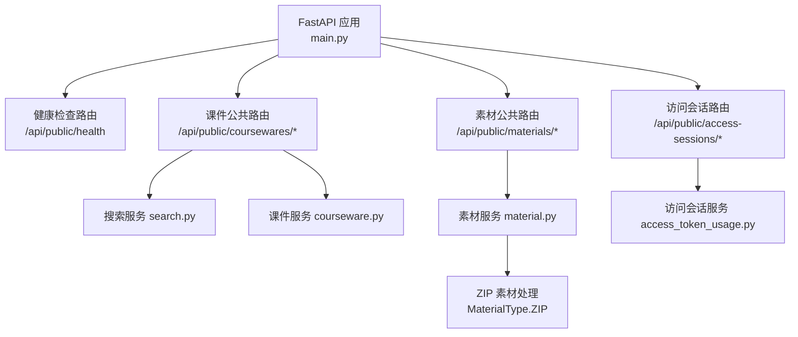
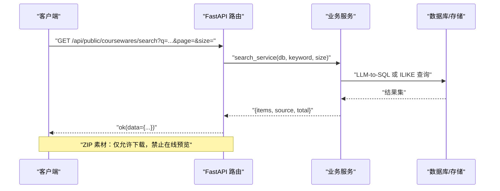
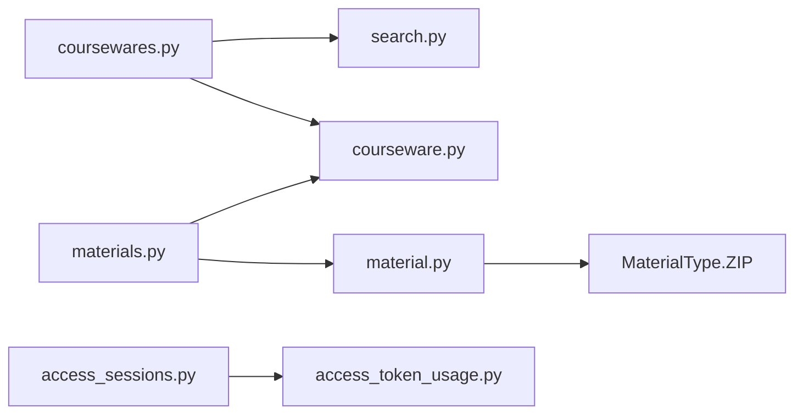

# 公开接口

<cite>
**本文引用的文件**
- [backend/app/main.py](file://backend/app/main.py)
- [backend/app/api/public/health.py](file://backend/app/api/public/health.py)
- [backend/app/api/public/coursewares.py](file://backend/app/api/public/coursewares.py)
- [backend/app/api/public/materials.py](file://backend/app/api/public/materials.py)
- [backend/app/api/public/access_sessions.py](file://backend/app/api/public/access_sessions.py)
- [backend/app/models/material.py](file://backend/app/models/material.py)
- [backend/app/schemas/__init__.py](file://backend/app/schemas/__init__.py)
- [backend/app/core/errors.py](file://backend/app/core/errors.py)
- [backend/app/core/rate_limit.py](file://backend/app/core/rate_limit.py)
- [backend/app/services/search.py](file://backend/app/services/search.py)
- [backend/app/services/courseware.py](file://backend/app/services/courseware.py)
- [backend/app/services/material.py](file://backend/app/services/material.py)
- [backend/app/services/access_token_usage.py](file://backend/app/services/access_token_usage.py)
</cite>

## 更新摘要
**变更内容**
- 新增 ZIP 素材类型支持，实现下载专用访问控制
- 增强 ACL 保护机制，防止 ZIP 文件的在线浏览
- 更新前端交互逻辑，ZIP 素材仅显示下载按钮
- 完善错误处理和用户提示，提供友好的用户体验

## 目录
1. [简介](#简介)
2. [项目结构](#项目结构)
3. [核心组件](#核心组件)
4. [架构总览](#架构总览)
5. [详细接口说明](#详细接口说明)
6. [依赖关系分析](#依赖关系分析)
7. [性能与限流](#性能与限流)
8. [安全与权限控制](#安全与权限控制)
9. [客户端集成示例](#客户端集成示例)
10. [故障排查指南](#故障排查指南)
11. [结论](#结论)

## 简介
本文件面向终端用户，系统化记录 Learning Hub 的公开 API 端点，包括：
- 课件查询与搜索（支持语义召回与关键词兜底）
- 素材访问（下载、在线预览、PPT 图片分页、**ZIP 压缩包下载专用**）
- 访问会话管理（开始/结束，用于统计观看时长）
- 健康检查

文档涵盖请求/响应格式、分页参数、流式传输、鉴权方式、速率限制与安全策略，并提供客户端集成建议与性能优化要点。

**更新** 新增对 ZIP 压缩包的专门支持，实现下载专用访问控制和 ACL 保护，防止在线浏览。

## 项目结构
公开接口位于 FastAPI 应用的路由注册中，统一挂载于 /api/public 前缀下，并通过全局中间件与异常处理器提供统一的信封响应、CORS、请求 ID 注入与限流处理。

图表来源
- [backend/app/main.py:40-116](file://backend/app/main.py#L40-L116)
- [backend/app/api/public/health.py:11-26](file://backend/app/api/public/health.py#L11-L26)
- [backend/app/api/public/coursewares.py:19-133](file://backend/app/api/public/coursewares.py#L19-L133)
- [backend/app/api/public/materials.py:20-224](file://backend/app/api/public/materials.py#L20-L224)
- [backend/app/api/public/access_sessions.py:24-137](file://backend/app/api/public/access_sessions.py#L24-L137)
- [backend/app/models/material.py:14-30](file://backend/app/models/material.py#L14-L30)

章节来源
- [backend/app/main.py:40-116](file://backend/app/main.py#L40-L116)

## 核心组件
- 统一响应信封：所有成功响应均包裹为 {code, message, data, requestId} 结构；错误通过 BusinessError 抛出并由全局异常处理器包装为相同信封。
- 限流机制：基于 SlowAPI 的装饰器限流与进程内滑动窗口限流并存，分别作用于不同接口。
- 访问令牌解锁：通过 POST 解锁接口返回 tokenHash，并写入 Cookie；后续 GET 请求携带 X-Token-Hash 或 Cookie 自动鉴权。
- 搜索服务：优先 LLM-to-SQL 召回，失败时降级为关键词 ILIKE 检索，返回 source 标识当前实现路径。
- **ZIP 素材处理**：新增 MaterialType.ZIP 枚举，实现下载专用访问控制，阻止在线浏览。

**更新** 新增 ZIP 素材类型支持，在素材模型中增加 ZIP 类型定义和扩展名映射。

章节来源
- [backend/app/schemas/__init__.py:24-65](file://backend/app/schemas/__init__.py#L24-L65)
- [backend/app/core/errors.py:130-144](file://backend/app/core/errors.py#L130-L144)
- [backend/app/core/rate_limit.py:40-55](file://backend/app/core/rate_limit.py#L40-55)
- [backend/app/api/public/coursewares.py:24-30](file://backend/app/api/public/coursewares.py#L24-L30)
- [backend/app/services/search.py:210-243](file://backend/app/services/search.py#L210-243)
- [backend/app/models/material.py:14-30](file://backend/app/models/material.py#L14-L30)

## 架构总览
公开接口的调用链路如下：客户端 → FastAPI 路由 → 业务服务 → 数据库/外部存储。统一信封与错误码贯穿全链路，限流在路由层拦截。

图表来源
- [backend/app/api/public/coursewares.py:32-54](file://backend/app/api/public/coursewares.py#L32-L54)
- [backend/app/services/search.py:210-243](file://backend/app/services/search.py#L210-243)

## 详细接口说明

### 健康检查
- 方法：GET
- 路径：/api/public/health
- 功能：返回服务状态、版本与运行时长，供负载均衡与健康探针使用。
- 请求参数：无
- 响应体：{ code, message, data }，data 包含 status、version、uptimeSec。
- 错误码：无（正常返回）。

章节来源
- [backend/app/api/public/health.py:16-26](file://backend/app/api/public/health.py#L16-L26)
- [backend/app/schemas/__init__.py:35-42](file://backend/app/schemas/__init__.py#L35-L42)

### 课件搜索
- 方法：GET
- 路径：/api/public/coursewares/search
- 查询参数：
  - q: 可选关键词（空则返回最新）
  - page: 页码，默认 1
  - size: 每页条数，默认 20，范围 1..50
- 行为：
  - 优先 LLM-to-SQL 召回，source="llm"
  - 若未启用或失败，降级为关键词 ILIKE，source="keyword"
  - 返回 envelope data.items、data.source、data.total、data.page、data.size
- 响应体：{ code, message, data }，data 为搜索结果集合与元信息。
- 错误码：
  - 搜索相关错误（如查询过长等）按 ErrorCode 映射到 HTTP 状态码。

章节来源
- [backend/app/api/public/coursewares.py:32-54](file://backend/app/api/public/coursewares.py#L32-L54)
- [backend/app/services/search.py:210-243](file://backend/app/services/search.py#L210-243)
- [backend/app/core/errors.py:65-71](file://backend/app/core/errors.py#L65-L71)

### 课件详情
- 方法：GET
- 路径：/api/public/coursewares/{courseware_id}
- 鉴权：
  - OPEN：直接返回
  - RESTRICTED：需携带已解锁 token 哈希（X-Token-Hash 或 Cookie lh_token_hash），否则 403
- 响应体：{ code, message, data }，data 包含课件基本信息与材料列表（含 sortOrder、downloadUrl、streamUrl）。
- 错误码：
  - COURSEWARE_NOT_FOUND：404
  - COURSEWARE_ACL_LOCKED：403

章节来源
- [backend/app/api/public/coursewares.py:57-76](file://backend/app/api/public/coursewares.py#L57-L76)
- [backend/app/services/courseware.py:290-332](file://backend/app/services/courseware.py#L290-L332)
- [backend/app/core/errors.py:22-28](file://backend/app/core/errors.py#L22-L28)

### 凭令牌解锁课件
- 方法：POST
- 路径：/api/public/coursewares/{courseware_id}/unlock
- 请求体：{ token }（明文令牌）
- 行为：
  - OPEN 课件无需解锁，仍返回 tokenHash 为空及关联课件 id 列表
  - RESTRICTED 课件校验令牌有效性及绑定关系
  - 成功后将 value_hash 写入 Cookie（lh_token_hash，7 天，httponly，samesite=lax）
- 响应体：{ code, message, data }，data 包含 tokenHash、coursewareIds。
- 错误码：
  - INVALID_TOKEN：401
  - COURSEWARE_ACL_LOCKED：403

章节来源
- [backend/app/api/public/coursewares.py:79-130](file://backend/app/api/public/coursewares.py#L79-L130)
- [backend/app/schemas/courseware.py:91-98](file://backend/app/schemas/courseware.py#L91-L98)
- [backend/app/core/errors.py:54-60](file://backend/app/core/errors.py#L54-L60)

### 素材下载
- 方法：GET
- 路径：/api/public/materials/{material_id}/file
- 鉴权：
  - 若素材仅被 RESTRICTED 课件引用，需携带已解锁 token 哈希；任一引用课件为 OPEN 则放行
- 行为：以 attachment 形式返回原文件，媒体类型根据扩展名推断。
- **ZIP 素材特殊处理**：ZIP 文件始终以下载形式返回，不支持在线预览。
- 错误码：
  - MATERIAL_STORAGE_UNAVAILABLE：500（文件丢失）
  - COURSEWARE_ACL_LOCKED：403（需要解锁）
  - MATERIAL_NOT_FOUND：404（不存在）

**更新** ZIP 素材现在支持下载访问，但仍受 ACL 保护控制。

章节来源
- [backend/app/api/public/materials.py:64-81](file://backend/app/api/public/materials.py#L64-L81)
- [backend/app/api/public/materials.py:31-62](file://backend/app/api/public/materials.py#L31-L62)
- [backend/app/core/errors.py:46-50](file://backend/app/core/errors.py#L46-L50)

### 素材流式预览
- 方法：GET
- 路径：/api/public/materials/{material_id}/stream
- 限流：60/分钟（SlowAPI 装饰器）
- 鉴权：同下载接口 ACL 校验
- 行为：
  - VIDEO：video/mp4 + inline
  - PDF：application/pdf + inline
  - PPT/PPTX：优先返回 preview_pdf_path（inline），否则降级返回原文件（attachment）
  - **ZIP：返回 404 错误，提示该素材仅支持下载**
- 错误码：
  - MATERIAL_STORAGE_UNAVAILABLE：500
  - COURSEWARE_ACL_LOCKED：403
  - MATERIAL_NOT_FOUND：404

**更新** ZIP 素材现在在流式预览接口中被明确拒绝，返回适当的错误信息。

章节来源
- [backend/app/api/public/materials.py:84-146](file://backend/app/api/public/materials.py#L84-L146)
- [backend/app/core/rate_limit.py:49-52](file://backend/app/core/rate_limit.py#L49-L52)

### PPT 预览图片（按页）
- 方法：GET
- 路径：/api/public/materials/{material_id}/image/{page_no}
- 限流：60/分钟（SlowAPI 装饰器）
- 鉴权：同下载接口 ACL 校验
- 行为：返回第 N 张 PNG（1-indexed），越界返回 404。
- 错误码：
  - MATERIAL_NOT_FOUND：404（无可用预览或页码不存在）
  - COURSEWARE_ACL_LOCKED：403

章节来源
- [backend/app/api/public/materials.py:149-180](file://backend/app/api/public/materials.py#L149-L180)
- [backend/app/core/rate_limit.py:49-52](file://backend/app/core/rate_limit.py#L49-L52)

### 素材详情（前端加载用）
- 方法：GET
- 路径：/api/public/materials/{material_id}
- 限流：60/分钟（SlowAPI 装饰器）
- 鉴权：同下载接口 ACL 校验
- 行为：返回 streamUrl、downloadUrl、sizeBytes、duration；PPT 额外返回 imageUrls、imageCount、previewReady。
- **ZIP 素材特殊处理**：返回 type="ZIP"，前端据此判断仅显示下载按钮。
- 错误码：
  - MATERIAL_NOT_FOUND：404
  - COURSEWARE_ACL_LOCKED：403

**更新** ZIP 素材现在在详情接口中正确返回类型信息，供前端进行差异化处理。

章节来源
- [backend/app/api/public/materials.py:183-221](file://backend/app/api/public/materials.py#L183-L221)
- [backend/app/core/rate_limit.py:49-52](file://backend/app/core/rate_limit.py#L49-L52)

### 访问会话开始
- 方法：POST
- 路径：/api/public/access-sessions
- 请求体：{ materialId }
- 鉴权：需携带已解锁 token 哈希（X-Token-Hash 或 Cookie lh_token_hash）
- 行为：
  - 缺 token_hash → 400 missing_token
  - 令牌无效 → 401 invalid_token
  - 命中 IP 限流（60/分钟，进程内滑动窗口）→ recorded=false（不阻塞主流程）
  - 素材无引用或全部 OPEN → recorded=false（不写库）
  - 素材被 RESTRICTED 课件引用但 token 未授权 → 403
  - 写入失败 → recorded=false（吞错，不阻塞前台）
- 响应体：{ code, message, data }，data 包含 sessionId、startedAt、recorded。

章节来源
- [backend/app/api/public/access_sessions.py:65-106](file://backend/app/api/public/access_sessions.py#L65-L106)
- [backend/app/services/access_token_usage.py:64-125](file://backend/app/services/access_token_usage.py#L64-L125)
- [backend/app/core/errors.py:12-20](file://backend/app/core/errors.py#L12-L20)

### 访问会话结束
- 方法：POST
- 路径：/api/public/access-sessions/{session_id}/leave
- 请求体：{ durationSeconds? }
- 鉴权：请求的 token_hash 必须与 session.token_id 对应的 value_hash 一致，否则 403（前端静默失败）
- 行为：幂等结束会话；服务端校正时长偏差（容差 60 秒）。
- 响应体：{ code, message, data }，data 包含 ok。

章节来源
- [backend/app/api/public/access_sessions.py:109-133](file://backend/app/api/public/access_sessions.py#L109-L133)
- [backend/app/services/access_token_usage.py:128-171](file://backend/app/services/access_token_usage.py#L128-L171)

## 依赖关系分析
- 路由层依赖：
  - health：无外部服务依赖
  - coursewares：依赖 search_service、courseware_svc、token_svc
  - materials：依赖 material_svc、courseware_svc
  - access_sessions：依赖 access_token_usage_svc
- 服务层依赖：
  - search：依赖 llm_sql（可配置开关）、SQLAlchemy
  - courseware：依赖 category、tag、access_token、audit
  - material：依赖 storage、ppt_to_images、ffprobe（可选）
  - access_token_usage：依赖 token_svc、courseware_svc、audit
- **ZIP 素材处理**：依赖 MaterialType.ZIP 枚举和扩展名映射。

图表来源
- [backend/app/api/public/coursewares.py:15-17](file://backend/app/api/public/coursewares.py#L15-L17)
- [backend/app/api/public/materials.py:17-18](file://backend/app/api/public/materials.py#L17-L18)
- [backend/app/api/public/access_sessions.py:22](file://backend/app/api/public/access_sessions.py#L22)
- [backend/app/models/material.py:14-30](file://backend/app/models/material.py#L14-L30)

章节来源
- [backend/app/api/public/coursewares.py:15-17](file://backend/app/api/public/coursewares.py#L15-L17)
- [backend/app/api/public/materials.py:17-18](file://backend/app/api/public/materials.py#L17-L18)
- [backend/app/api/public/access_sessions.py:22](file://backend/app/api/public/access_sessions.py#L22)

## 性能与限流
- 搜索性能：
  - LLM-to-SQL 超时保护（默认约 8 秒），失败自动降级至关键词检索
  - 关键词检索对中文进行清洗与去抖，提升命中率
- 流式预览：
  - 视频与 PDF 采用 inline 直出，减少浏览器下载触发
  - PPT 优先返回预览 PDF，避免大文件传输
  - **ZIP 素材直接拒绝流式访问，避免不必要的资源消耗**
- 限流策略：
  - 素材流式预览与图片接口：60/分钟（SlowAPI）
  - 访问会话开始：进程内滑动窗口 60/分钟（IP 维度），多进程部署建议结合网关层限流
- 资源探测：
  - 上传时可选 ffprobe 探测视频时长，失败不阻断流程

**更新** ZIP 素材的流式访问被快速拒绝，减少了服务器资源浪费。

章节来源
- [backend/app/services/search.py:222-242](file://backend/app/services/search.py#L222-L242)
- [backend/app/api/public/materials.py:84-146](file://backend/app/api/public/materials.py#L84-L146)
- [backend/app/api/public/access_sessions.py:29-55](file://backend/app/api/public/access_sessions.py#L29-L55)
- [backend/app/services/material.py:36-76](file://backend/app/services/material.py#L36-L76)

## 安全与权限控制
- 令牌解锁与鉴权：
  - 解锁后返回 tokenHash，并写入 Cookie（lh_token_hash，httponly，samesite=lax，path=/）
  - 后续请求可通过 X-Token-Hash 头或 Cookie 传递已解锁令牌哈希
- ACL 校验：
  - 课件：RESTRICTED 模式需匹配绑定的 token 哈希
  - 素材：若仅被 RESTRICTED 课件引用，需满足上述条件；任一引用课件为 OPEN 则放行
  - **ZIP 素材：同样适用 ACL 保护，确保只有授权的访问者才能下载**
- 错误码与状态码映射：
  - 401：令牌无效或缺失
  - 403：ACL 锁定或令牌无权访问
  - 404：资源不存在
  - 429：操作过于频繁
  - 500/503：内部错误或外部服务不可用

**更新** ZIP 素材现在完全纳入 ACL 保护体系，确保下载访问的安全性。

章节来源
- [backend/app/api/public/coursewares.py:24-30](file://backend/app/api/public/coursewares.py#L24-L30)
- [backend/app/api/public/materials.py:23-62](file://backend/app/api/public/materials.py#L23-L62)
- [backend/app/core/errors.py:73-127](file://backend/app/core/errors.py#L73-L127)

## 客户端集成示例

### 通用请求/响应信封
- 成功响应：
  - { code: "ok", message: "ok", data: {...}, requestId?: string }
- 失败响应：
  - { code: "...", message: "...", data?: any, requestId?: string }

章节来源
- [backend/app/schemas/__init__.py:24-65](file://backend/app/schemas/__init__.py#L24-L65)
- [backend/app/core/errors.py:130-144](file://backend/app/core/errors.py#L130-L144)

### 解锁与后续访问
- 步骤：
  1) POST /api/public/coursewares/{id}/unlock，请求体 { token }
  2) 读取响应 data.tokenHash，并设置 Cookie lh_token_hash（或直接携带 X-Token-Hash 头）
  3) 后续 GET /api/public/coursewares/{id} 与 /api/public/materials/* 自动鉴权
- 注意：
  - Cookie 有效期 7 天，httponly，samesite=lax
  - 若 token 无效或无权访问对应课件/素材，将返回 401/403

章节来源
- [backend/app/api/public/coursewares.py:79-130](file://backend/app/api/public/coursewares.py#L79-L130)
- [backend/app/api/public/materials.py:23-62](file://backend/app/api/public/materials.py#L23-L62)

### 搜索与分页
- 请求：GET /api/public/coursewares/search?q=关键词&page=1&size=20
- 响应 data：
  - items: 课件项列表
  - source: "llm" 或 "keyword"
  - total: 总数
  - page: 当前页
  - size: 每页大小

章节来源
- [backend/app/api/public/coursewares.py:32-54](file://backend/app/api/public/coursewares.py#L32-L54)
- [backend/app/services/search.py:210-243](file://backend/app/services/search.py#L210-243)

### 素材下载与在线预览
- 下载：GET /api/public/materials/{id}/file（attachment）
- 在线预览：GET /api/public/materials/{id}/stream（inline）
- PPT 图片：GET /api/public/materials/{id}/image/{page_no}（PNG）
- 素材详情：GET /api/public/materials/{id}（返回 streamUrl/downloadUrl/imageUrls 等）
- **ZIP 素材处理**：
  - 仅支持下载，不支持在线预览
  - 前端检测到 type="ZIP" 时只显示下载按钮
  - 尝试访问流式接口会收到错误提示

**更新** ZIP 素材现在在前端有专门的交互逻辑，提供更好的用户体验。

章节来源
- [backend/app/api/public/materials.py:64-221](file://backend/app/api/public/materials.py#L64-L221)

### 访问会话统计
- 开始：POST /api/public/access-sessions，请求体 { materialId }
- 结束：POST /api/public/access-sessions/{sessionId}/leave，请求体 { durationSeconds? }
- 行为：
  - 若命中限流或写入失败，返回 recorded=false 或 ok=false，但不阻塞主流程
  - 服务端校正时长偏差（容差 60 秒）

章节来源
- [backend/app/api/public/access_sessions.py:65-133](file://backend/app/api/public/access_sessions.py#L65-L133)
- [backend/app/services/access_token_usage.py:128-171](file://backend/app/services/access_token_usage.py#L128-L171)

## 故障排查指南
- 常见问题定位：
  - 401/403：检查是否携带有效的 X-Token-Hash 或 Cookie lh_token_hash；确认令牌是否绑定目标课件/素材
  - 429：检查是否超过限流阈值（60/分钟），适当降低请求频率或增加间隔
  - 500/503：检查存储服务可用性、数据库连接、外部服务（如 LLM、ffprobe）状态
  - **ZIP 素材问题**：确认是否正确处理了 ZIP 类型的素材，前端是否显示了正确的下载按钮
- 日志与追踪：
  - 每个响应包含 requestId 头，便于跨层追踪
  - 限流异常会返回固定信封，message 提示"操作过于频繁"

**更新** 新增了 ZIP 素材相关的故障排查指导。

章节来源
- [backend/app/main.py:70-89](file://backend/app/main.py#L70-L89)
- [backend/app/core/errors.py:73-127](file://backend/app/core/errors.py#L73-L127)

## 结论
公开接口围绕课件与素材的访问与统计展开，提供健壮的鉴权与限流机制，兼顾用户体验与系统稳定性。通过统一的信封与错误码体系，客户端可稳定集成；通过流式传输与预览优化，有效降低带宽与延迟。

**更新** 新增的 ZIP 素材支持进一步完善了系统的文件处理能力，提供了安全的下载专用访问控制，同时保持了与其他素材类型一致的 ACL 保护机制。建议在部署时结合网关层限流与缓存策略，进一步提升整体性能与可靠性。