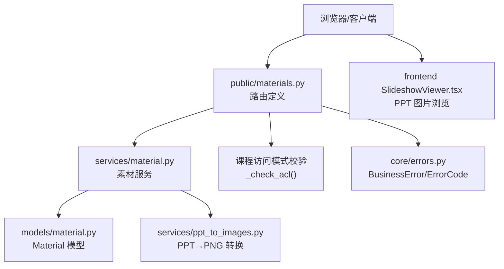
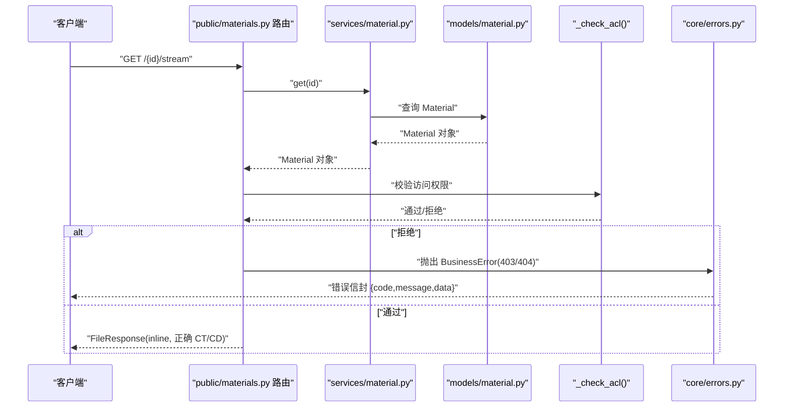

# 素材接口

<cite>
**本文引用的文件列表**
- [backend/app/api/public/materials.py](file://backend/app/api/public/materials.py)
- [backend/app/services/material.py](file://backend/app/services/material.py)
- [backend/app/models/material.py](file://backend/app/models/material.py)
- [backend/app/schemas/material.py](file://backend/app/schemas/material.py)
- [backend/app/core/errors.py](file://backend/app/core/errors.py)
- [backend/app/models/courseware.py](file://backend/app/models/courseware.py)
- [backend/app/services/ppt_to_images.py](file://backend/app/services/ppt_to_images.py)
- [deploy/local/tests/test_stream.py](file://deploy/local/tests/test_stream.py)
- [frontend/src/pages/public/viewer/SlideshowViewer.tsx](file://frontend/src/pages/public/viewer/SlideshowViewer.tsx)
</cite>

## 目录
1. [简介](#简介)
2. [项目结构](#项目结构)
3. [核心组件](#核心组件)
4. [架构总览](#架构总览)
5. [详细组件分析](#详细组件分析)
6. [依赖关系分析](#依赖关系分析)
7. [性能与缓存策略](#性能与缓存策略)
8. [故障排查指南](#故障排查指南)
9. [结论](#结论)
10. [附录：请求/响应示例与兼容性](#附录请求响应示例与兼容性)

## 简介
本文件为“素材公开接口”的完整 API 文档，覆盖多媒体文件的访问端点、流式传输实现、大文件分段下载与在线预览、不同媒体类型的处理逻辑（格式检测、转码、图片预览）、权限控制以及与课件访问模式的一致性。同时提供完整的请求/响应示例（含 HTTP Range 请求、Content-Type 设置、错误处理），并给出浏览器兼容性与性能优化建议。

## 项目结构
与素材公开接口直接相关的后端代码位于以下模块：
- 路由层：public/materials.py
- 业务服务层：services/material.py、services/ppt_to_images.py
- 数据模型：models/material.py、models/courseware.py
- 错误码与统一异常：core/errors.py
- 前端 PPT 图片预览组件：frontend/src/pages/public/viewer/SlideshowViewer.tsx
- 流式与范围请求测试用例：deploy/local/tests/test_stream.py



图表来源
- [backend/app/api/public/materials.py:1-224](file://backend/app/api/public/materials.py#L1-L224)
- [backend/app/services/material.py:1-234](file://backend/app/services/material.py#L1-L234)
- [backend/app/models/material.py:1-69](file://backend/app/models/material.py#L1-L69)
- [backend/app/models/courseware.py:1-74](file://backend/app/models/courseware.py#L1-L74)
- [backend/app/services/ppt_to_images.py:1-185](file://backend/app/services/ppt_to_images.py#L1-L185)
- [backend/app/core/errors.py:1-144](file://backend/app/core/errors.py#L1-L144)
- [frontend/src/pages/public/viewer/SlideshowViewer.tsx:1-31](file://frontend/src/pages/public/viewer/SlideshowViewer.tsx#L1-L31)

章节来源
- [backend/app/api/public/materials.py:1-224](file://backend/app/api/public/materials.py#L1-L224)
- [backend/app/services/material.py:1-234](file://backend/app/services/material.py#L1-L234)
- [backend/app/models/material.py:1-69](file://backend/app/models/material.py#L1-L69)
- [backend/app/models/courseware.py:1-74](file://backend/app/models/courseware.py#L1-L74)
- [backend/app/services/ppt_to_images.py:1-185](file://backend/app/services/ppt_to_images.py#L1-L185)
- [backend/app/core/errors.py:1-144](file://backend/app/core/errors.py#L1-L144)
- [frontend/src/pages/public/viewer/SlideshowViewer.tsx:1-31](file://frontend/src/pages/public/viewer/SlideshowViewer.tsx#L1-L31)

## 核心组件
- 公开素材路由
  - GET /api/public/materials/{material_id}/file：以附件形式返回原文件，支持浏览器原生 Range 分段下载。
  - GET /api/public/materials/{material_id}/stream：行内预览，按类型设置 Content-Type 与 Content-Disposition；视频与 PDF 直接 inline；PPT 优先返回已生成的预览 PDF，否则降级返回原文件。
  - GET /api/public/materials/{material_id}/image/{page_no}：返回 PPT 第 N 页 PNG 图片（1-indexed）。
  - GET /api/public/materials/{material_id}：返回元信息（包含 streamUrl、downloadUrl、sizeBytes、duration、PPT 专属 imageUrls/imageCount/previewReady）。
- 权限控制
  - _check_acl：若素材仅出现在 RESTRICTED 课件中，需携带 X-Token-Hash 或 lh_token_hash Cookie；任一引用课件为 OPEN 则放行。
- 上传与预处理（管理侧）
  - services/material.upload：写入存储、推断类型、探测视频时长、PPT 异步转 PNG 并记录页数。
- 错误与限流
  - core/errors.BusinessError 统一错误信封；/stream 与 /image 接口带每分钟 60 次限流。

章节来源
- [backend/app/api/public/materials.py:64-224](file://backend/app/api/public/materials.py#L64-L224)
- [backend/app/services/material.py:129-202](file://backend/app/services/material.py#L129-L202)
- [backend/app/core/errors.py:130-144](file://backend/app/core/errors.py#L130-L144)

## 架构总览
公开素材接口的调用流程如下：



图表来源
- [backend/app/api/public/materials.py:84-146](file://backend/app/api/public/materials.py#L84-L146)
- [backend/app/services/material.py:122-126](file://backend/app/services/material.py#L122-L126)
- [backend/app/core/errors.py:130-144](file://backend/app/core/errors.py#L130-L144)

## 详细组件分析

### 公开素材详情接口
- 路径：GET /api/public/materials/{material_id}
- 功能：返回素材元信息与可直接用于前端的 URL（streamUrl/downloadUrl），以及 PPT 的图片预览能力。
- 权限：与 /stream 一致，受 _check_acl 保护。
- 返回字段要点：
  - id/name/type/sizeBytes/duration
  - streamUrl/downloadUrl
  - PPT 特有：imageCount/imageUrls/previewReady
- 典型响应体（JSON）：
  - 成功：{ code:"ok", data:{...} }
  - 失败：{ code:"material_not_found" | "courseware_acl_locked", message:"...", data:null }

章节来源
- [backend/app/api/public/materials.py:183-221](file://backend/app/api/public/materials.py#L183-L221)
- [backend/app/models/material.py:44-69](file://backend/app/models/material.py#L44-L69)

### 公开下载接口
- 路径：GET /api/public/materials/{material_id}/file
- 行为：以附件形式返回原始文件，Content-Disposition: attachment，由浏览器触发下载。
- 内容类型：根据文件名自动推断，未知时回退 application/octet-stream。
- 权限：同 _check_acl。
- 错误：
  - 素材不存在 → 404 material_not_found
  - 文件丢失 → 500 material_storage_unavailable
  - 受限且无令牌 → 403 courseware_acl_locked

章节来源
- [backend/app/api/public/materials.py:64-81](file://backend/app/api/public/materials.py#L64-L81)
- [backend/app/core/errors.py:103-109](file://backend/app/core/errors.py#L103-L109)

### 公开流式预览接口
- 路径：GET /api/public/materials/{material_id}/stream
- 行为：
  - VIDEO：video/mp4 + inline，供 <video> 标签播放。
  - PDF：application/pdf + inline，供浏览器/PDF.js 渲染。
  - PPT/PPTX：
    - 若存在预览 PDF → 返回该 PDF（inline，重命名为 .pdf）
    - 否则降级返回原 PPT（attachment，避免浏览器误触发下载）
- 速率限制：60/分钟（同一 IP）。
- 范围请求：FastAPI FileResponse 默认支持 Range，可返回 206 Partial Content。
- 权限：同 _check_acl。
- 错误：同上。

章节来源
- [backend/app/api/public/materials.py:84-146](file://backend/app/api/public/materials.py#L84-L146)
- [deploy/local/tests/test_stream.py:130-145](file://deploy/local/tests/test_stream.py#L130-L145)

### PPT 单页图片接口
- 路径：GET /api/public/materials/{material_id}/image/{page_no}
- 行为：返回第 page_no 张 PNG（1-indexed），命名约定 page-*.png。
- 权限：同 _check_acl。
- 错误：
  - 非 PPT 或未生成预览图 → 404 material_not_found
  - 页码越界 → 404 material_not_found

章节来源
- [backend/app/api/public/materials.py:149-180](file://backend/app/api/public/materials.py#L149-L180)

### 权限控制与课件访问模式一致性
- 规则：
  - 若素材被任意一个 OPEN 课件引用 → 无需令牌即可访问。
  - 若所有引用课件均为 RESTRICTED → 必须携带有效令牌哈希（X-Token-Hash 或 Cookie lh_token_hash）。
- 令牌来源：
  - 通常来自课件解锁流程后返回的 tokenHash，前端在后续请求中携带。
- 与课件访问模式：
  - AccessMode.OPEN/RESTRICTED 决定是否需要令牌；与素材访问保持一致。

章节来源
- [backend/app/api/public/materials.py:31-62](file://backend/app/api/public/materials.py#L31-L62)
- [backend/app/models/courseware.py:14-19](file://backend/app/models/courseware.py#L14-L19)

### 上传与预处理（管理侧）
- 上传：
  - 写入 storage_path，按年月分目录，文件名加时间戳与随机串防冲突。
  - 大小上限：MAX_SIZE_BYTES（与前端/网关对齐）。
  - 类型推断：基于扩展名映射到 VIDEO/PDF/PPT。
- 视频时长探测：
  - 使用 ffprobe 解析 duration，格式化 MM:SS 或 HH:MM:SS，失败不阻断上传。
- PPT 转图片：
  - 调用 LibreOffice 转 PDF，再用 pdftoppm 拆分为 page-1.png、page-2.png…
  - 成功后记录 preview_images_dir 与页数（存入 duration_or_pages 字段，便于前端显示）。
  - 失败仅记录日志，不阻断上传。

章节来源
- [backend/app/services/material.py:129-202](file://backend/app/services/material.py#L129-L202)
- [backend/app/services/ppt_to_images.py:48-181](file://backend/app/services/ppt_to_images.py#L48-L181)
- [backend/app/models/material.py:22-41](file://backend/app/models/material.py#L22-L41)

## 依赖关系分析
- 路由依赖：
  - FastAPI Request/Depends(get_db)
  - mimetypes.guess_type 推断媒体类型
  - limiter 限流装饰器
- 服务依赖：
  - services.material.get/upload/delete
  - services.ppt_to_images.convert
- 模型依赖：
  - models.material.Material/MaterialType/infer_type
  - models.courseware.AccessMode（用于权限判断）
- 错误体系：
  - core.errors.BusinessError/ErrorCode 统一错误码与状态码映射

```mermaid
classDiagram
class PublicMaterialsRouter {
+"/{id}/file"
+"/{id}/stream"
+"/{id}/image/{page_no}"
+"/{id}"
-"_check_acl(request, material_id, db)"
}
class MaterialService {
+get(db, material_id)
+upload(db, upload_file)
+delete(db, material_id)
}
class PPTToImages {
+convert(src, timeout)
}
class MaterialModel {
+name
+type
+size_bytes
+storage_path
+preview_images_dir
+duration_or_pages
}
class CoursewareAccessMode {
<<enum>>
OPEN
RESTRICTED
}
PublicMaterialsRouter --> MaterialService : "读取素材"
PublicMaterialsRouter --> CoursewareAccessMode : "权限判定"
MaterialService --> PPTToImages : "PPT 转图片"
MaterialService --> MaterialModel : "持久化/查询"
```

图表来源
- [backend/app/api/public/materials.py:1-224](file://backend/app/api/public/materials.py#L1-L224)
- [backend/app/services/material.py:1-234](file://backend/app/services/material.py#L1-L234)
- [backend/app/services/ppt_to_images.py:1-185](file://backend/app/services/ppt_to_images.py#L1-L185)
- [backend/app/models/material.py:1-69](file://backend/app/models/material.py#L1-L69)
- [backend/app/models/courseware.py:1-74](file://backend/app/models/courseware.py#L1-L74)

## 性能与缓存策略
- 流式与范围请求
  - 使用 FileResponse 原生支持 Range，减少首屏延迟与大文件内存占用。
  - 视频/PDF 直接 inline 输出，浏览器端利用自身解码与缓存机制。
- 预渲染与分页加载
  - PPT 转换为多张 PNG，前端按需加载当前页与下一页，降低内存峰值。
- 限流
  - /stream 与 /image 接口限流 60/分钟，防止滥用。
- 存储与 I/O
  - 上传分块写入磁盘，避免内存溢出；PPT 转换产物与源文件分离存放。
- 建议
  - 前端对图片资源启用强缓存（Cache-Control/ETag）。
  - 对大视频启用 CDN 边缘缓存与 Range 透传。
  - 对 PPT 图片进行压缩与自适应分辨率（服务端可按需缩放）。

[本节为通用指导，不直接分析具体文件]

## 故障排查指南
- 常见错误码与含义
  - material_not_found：素材不存在或页码越界。
  - courseware_acl_locked：受限课件未携带有效令牌。
  - material_storage_unavailable：文件丢失或不可读。
  - rate_limited：超过 60/分钟限流。
- 定位步骤
  - 检查请求是否携带 X-Token-Hash 或 Cookie lh_token_hash。
  - 确认素材是否存在于至少一个 OPEN 课件中。
  - 查看服务器日志中关于 ffprobe/libreoffice/pdftoppm 的警告信息。
  - 验证文件系统路径与权限。
- 相关测试用例
  - 范围请求与限流断言见 test_stream.py。

章节来源
- [backend/app/core/errors.py:73-127](file://backend/app/core/errors.py#L73-L127)
- [deploy/local/tests/test_stream.py:130-165](file://deploy/local/tests/test_stream.py#L130-L165)

## 结论
公开素材接口围绕“安全可控、体验流畅、可扩展”的目标设计：通过统一的权限校验与课件访问模式保持一致；通过流式与 Range 支持提升大文件体验；通过 PPT 图片预览与前端分页加载优化渲染性能；通过限流与错误封装保障稳定性与可观测性。

[本节为总结，不直接分析具体文件]

## 附录：请求/响应示例与兼容性

### 端点清单与说明
- GET /api/public/materials/{material_id}
  - 用途：获取素材元信息与可用 URL。
  - 权限：同 /stream。
  - 成功响应体字段：id/name/type/sizeBytes/duration/streamUrl/downloadUrl，PPT 额外包含 imageCount/imageUrls/previewReady。
- GET /api/public/materials/{material_id}/file
  - 用途：附件下载。
  - 响应头：Content-Disposition: attachment；Content-Type 由文件名推断。
- GET /api/public/materials/{material_id}/stream
  - 用途：行内预览。
  - 响应头：Content-Disposition: inline；VIDEO→video/mp4，PDF→application/pdf，PPT 优先返回预览 PDF。
  - 支持 Range：Accept-Ranges: bytes；Range 请求可能返回 206。
- GET /api/public/materials/{material_id}/image/{page_no}
  - 用途：PPT 第 N 页 PNG。
  - 响应头：Content-Type: image/png；Content-Disposition: inline。

章节来源
- [backend/app/api/public/materials.py:64-221](file://backend/app/api/public/materials.py#L64-L221)

### 权限与令牌
- 令牌传递方式：
  - 请求头：X-Token-Hash
  - Cookie：lh_token_hash
- 校验逻辑：
  - 任一引用课件为 OPEN → 放行。
  - 全部 RESTRICTED → 令牌哈希需在对应课件的允许集合中。

章节来源
- [backend/app/api/public/materials.py:23-62](file://backend/app/api/public/materials.py#L23-L62)
- [backend/app/models/courseware.py:14-19](file://backend/app/models/courseware.py#L14-L19)

### 错误处理
- 统一错误信封：{ code, message, data }
- 常用错误码：
  - material_not_found（404）
  - courseware_acl_locked（403）
  - material_storage_unavailable（500）
  - rate_limited（429）

章节来源
- [backend/app/core/errors.py:130-144](file://backend/app/core/errors.py#L130-L144)

### 浏览器兼容性
- 视频播放
  - 现代浏览器均支持 video/mp4 与 Range 分段加载。
- PDF 预览
  - 多数浏览器内置 PDF 渲染；也可配合 PDF.js 增强体验。
- PPT 图片预览
  - 前端 SlideshowViewer 直接加载 PNG 图片，兼容性好；关闭右键保存/拖拽以提升安全性。

章节来源
- [frontend/src/pages/public/viewer/SlideshowViewer.tsx:1-31](file://frontend/src/pages/public/viewer/SlideshowViewer.tsx#L1-L31)

### 性能优化建议
- 前端
  - 图片懒加载与预取下一页。
  - 合理设置缓存头，复用静态资源。
- 后端
  - 保持 Range 透传，避免整包传输。
  - 对 PPT 图片进行尺寸与质量调优。
  - 结合 CDN 加速静态资源分发。

[本节为通用指导，不直接分析具体文件]