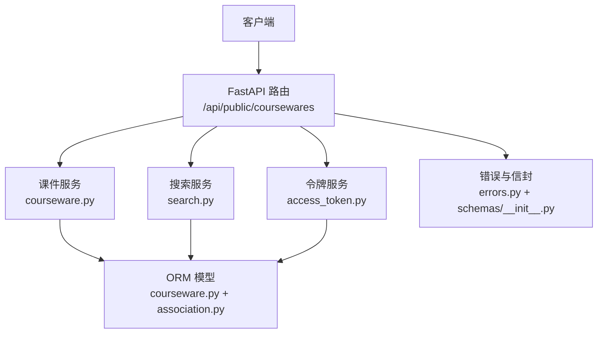
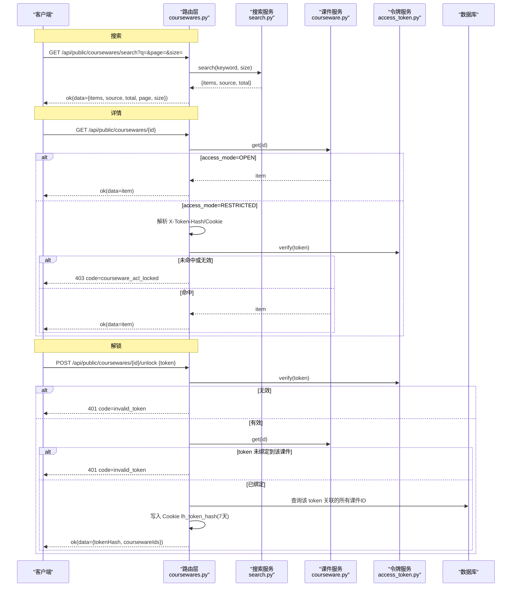
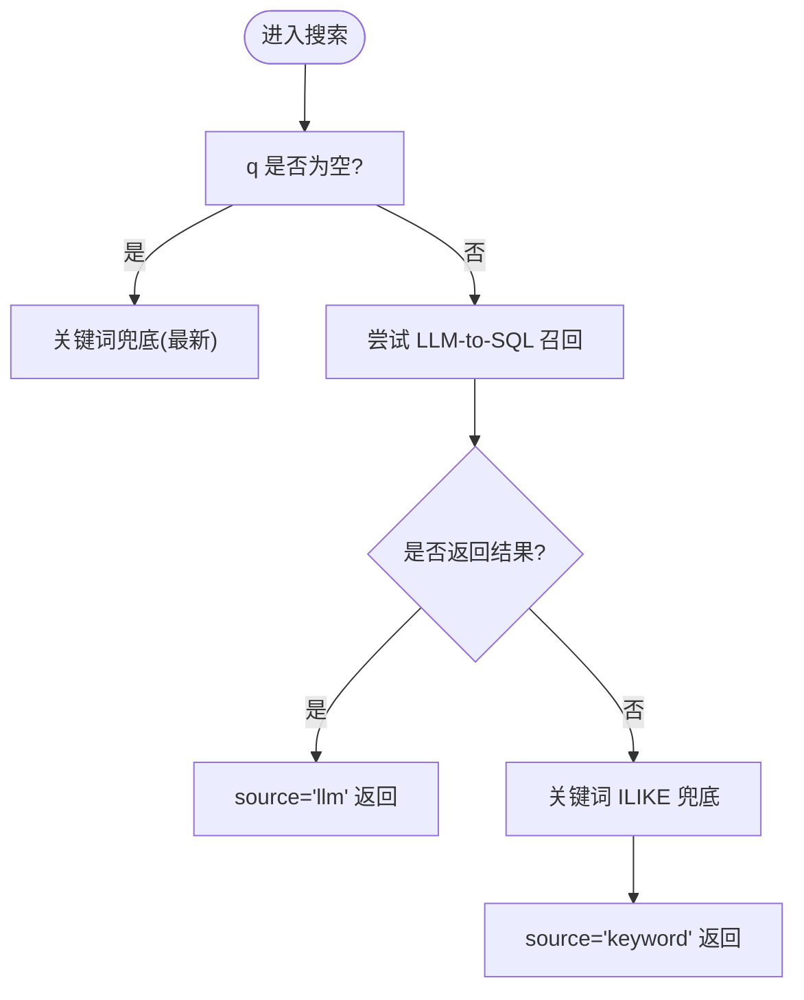
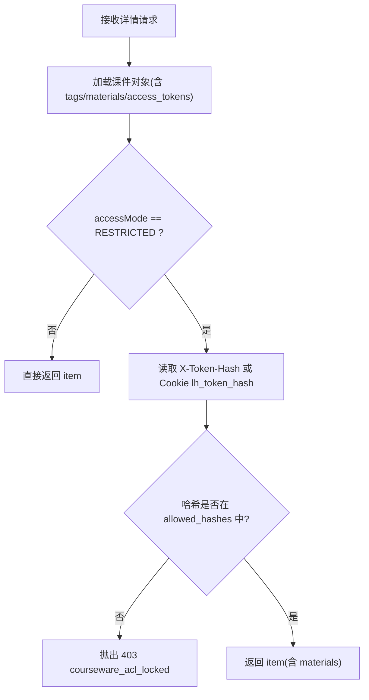
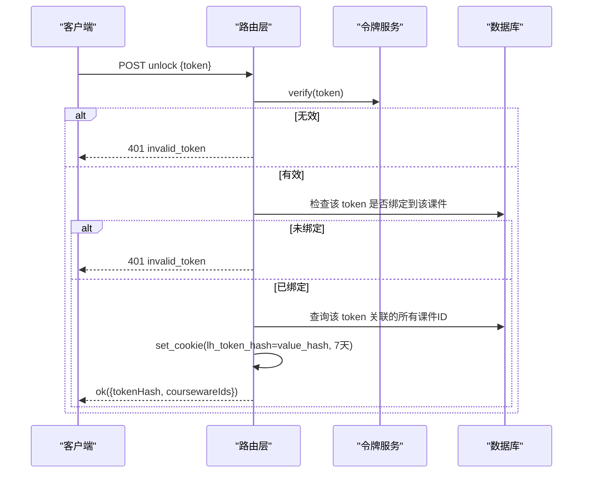

# 课件接口

<cite>
**本文引用的文件**   
- [backend/app/api/public/coursewares.py](file://backend/app/api/public/coursewares.py)
- [backend/app/schemas/courseware.py](file://backend/app/schemas/courseware.py)
- [backend/app/services/courseware.py](file://backend/app/services/courseware.py)
- [backend/app/models/courseware.py](file://backend/app/models/courseware.py)
- [backend/app/services/search.py](file://backend/app/services/search.py)
- [backend/app/core/errors.py](file://backend/app/core/errors.py)
- [backend/app/schemas/__init__.py](file://backend/app/schemas/__init__.py)
- [backend/app/services/access_token.py](file://backend/app/services/access_token.py)
- [backend/app/models/association.py](file://backend/app/models/association.py)
</cite>

## 目录
1. [简介](#简介)
2. [项目结构](#项目结构)
3. [核心组件](#核心组件)
4. [架构总览](#架构总览)
5. [详细组件分析](#详细组件分析)
6. [依赖关系分析](#依赖关系分析)
7. [性能与降级特性](#性能与降级特性)
8. [错误处理与状态码](#错误处理与状态码)
9. [客户端集成示例与最佳实践](#客户端集成示例与最佳实践)
10. [结论](#结论)

## 简介
本文件为“课件公开接口”的权威 API 文档，覆盖以下能力：
- 智能搜索：支持关键词检索、分页参数、统一返回格式与 LLM-to-SQL 优先 + ILIKE 兜底的降级机制。
- 详情获取：区分 OPEN 与 RESTRICTED 两种访问模式；RESTRICTED 需携带已解锁令牌哈希方可访问。
- 解锁：基于明文令牌校验、Cookie 设置（7 天）与多课件关联解锁，后续 GET 自动鉴权。

所有响应均使用统一信封格式 `{code, message, data, requestId}`。

## 项目结构
与课件公开接口相关的后端代码主要分布在以下模块：
- API 路由层：定义 /api/public/coursewares 下的搜索、详情、解锁端点。
- 业务服务层：封装课件查询、排序、材料组装等逻辑。
- 模型层：定义课件主表、访问模式枚举及 M:N 关联表。
- 搜索服务：实现 LLM-to-SQL 召回 + ILIKE 兜底策略。
- 令牌服务：负责令牌验证、哈希比对与关联查询。
- 错误与响应：统一错误码映射与信封构造。



图表来源
- [backend/app/api/public/coursewares.py:1-133](file://backend/app/api/public/coursewares.py#L1-L133)
- [backend/app/services/search.py:1-263](file://backend/app/services/search.py#L1-L263)
- [backend/app/services/courseware.py:1-492](file://backend/app/services/courseware.py#L1-L492)
- [backend/app/models/courseware.py:1-74](file://backend/app/models/courseware.py#L1-L74)
- [backend/app/models/association.py:1-41](file://backend/app/models/association.py#L1-L41)
- [backend/app/core/errors.py:1-144](file://backend/app/core/errors.py#L1-L144)
- [backend/app/schemas/__init__.py:1-65](file://backend/app/schemas/__init__.py#L1-L65)

章节来源
- [backend/app/api/public/coursewares.py:1-133](file://backend/app/api/public/coursewares.py#L1-L133)
- [backend/app/services/search.py:1-263](file://backend/app/services/search.py#L1-L263)
- [backend/app/services/courseware.py:1-492](file://backend/app/services/courseware.py#L1-L492)
- [backend/app/models/courseware.py:1-74](file://backend/app/models/courseware.py#L1-L74)
- [backend/app/models/association.py:1-41](file://backend/app/models/association.py#L1-L41)
- [backend/app/core/errors.py:1-144](file://backend/app/core/errors.py#L1-L144)
- [backend/app/schemas/__init__.py:1-65](file://backend/app/schemas/__init__.py#L1-L65)

## 核心组件
- 路由层
  - 搜索：GET /api/public/coursewares/search
  - 详情：GET /api/public/coursewares/{courseware_id}
  - 解锁：POST /api/public/coursewares/{courseware_id}/unlock
- 数据契约
  - 统一信封：{code, message, data, requestId}
  - 搜索结果 data：{items, source, total, page, size}
  - 解锁请求体：{token}
  - 解锁响应体：{tokenHash, coursewareIds}
- 访问控制
  - OPEN：无需令牌，直接返回
  - RESTRICTED：需携带 X-Token-Hash 或 Cookie lh_token_hash，且该哈希必须命中课件绑定的任一令牌哈希

章节来源
- [backend/app/api/public/coursewares.py:32-76](file://backend/app/api/public/coursewares.py#L32-L76)
- [backend/app/schemas/courseware.py:91-98](file://backend/app/schemas/courseware.py#L91-L98)
- [backend/app/schemas/__init__.py:24-42](file://backend/app/schemas/__init__.py#L24-L42)
- [backend/app/models/courseware.py:14-18](file://backend/app/models/courseware.py#L14-L18)

## 架构总览
下图展示了三个关键端点的调用链路与数据流向。



图表来源
- [backend/app/api/public/coursewares.py:32-130](file://backend/app/api/public/coursewares.py#L32-L130)
- [backend/app/services/search.py:210-242](file://backend/app/services/search.py#L210-L242)
- [backend/app/services/courseware.py:47-63](file://backend/app/services/courseware.py#L47-L63)
- [backend/app/services/access_token.py:193-205](file://backend/app/services/access_token.py#L193-L205)
- [backend/app/models/association.py:28-33](file://backend/app/models/association.py#L28-L33)

## 详细组件分析

### 智能搜索接口
- 端点
  - GET /api/public/coursewares/search
- 请求参数
  - q: string | null，关键词；为空时返回最新结果
  - page: integer ≥ 1，页码
  - size: integer ∈ [1, 50]，每页条数
- 返回结构
  - data.items: 课件项列表（不含下载链接）
  - data.source: "llm" 或 "keyword"
  - data.total: 本次返回条目数
  - data.page: 当前页
  - data.size: 每页大小
- 行为说明
  - 优先走 LLM-to-SQL 召回（可配置超时），若启用且成功返回则 source="llm"
  - 否则降级至关键词 ILIKE 路径，source="keyword"
  - 空关键词时按更新时间倒序返回最新
- 降级机制
  - 当 LLM 未配置、调用失败、SQL 校验拒绝、执行结果为空或超时时，自动回退到 ILIKE 关键词匹配
  - 前端可根据 source 显示“AI 智能搜索 · 正常/降级中”徽标



图表来源
- [backend/app/services/search.py:210-242](file://backend/app/services/search.py#L210-L242)
- [backend/app/services/search.py:115-160](file://backend/app/services/search.py#L115-L160)

章节来源
- [backend/app/api/public/coursewares.py:32-54](file://backend/app/api/public/coursewares.py#L32-L54)
- [backend/app/services/search.py:1-263](file://backend/app/services/search.py#L1-L263)

### 课件详情接口
- 端点
  - GET /api/public/coursewares/{courseware_id}
- 访问控制
  - OPEN：直接返回
  - RESTRICTED：需携带 X-Token-Hash 或 Cookie lh_token_hash，且该哈希必须属于该课件绑定的任一令牌哈希集合；否则返回 403
- 返回结构
  - data：课件详情对象，包含 id、title、author、categoryId、categoryName、description、accessMode、tagIds、tagNames、materialIds、tokenIds、createdAt、updatedAt、materials[]
  - materials[] 包含每个素材的 id、name、type、sizeBytes、duration、downloadUrl、streamUrl、sortOrder
- 注意事项
  - 即使为 OPEN，也允许调用解锁接口并返回空 tokenHash 与该课件 ID 列表（见解锁节）



图表来源
- [backend/app/api/public/coursewares.py:57-76](file://backend/app/api/public/coursewares.py#L57-L76)
- [backend/app/services/courseware.py:290-332](file://backend/app/services/courseware.py#L290-L332)
- [backend/app/models/courseware.py:14-18](file://backend/app/models/courseware.py#L14-L18)

章节来源
- [backend/app/api/public/coursewares.py:57-76](file://backend/app/api/public/coursewares.py#L57-L76)
- [backend/app/services/courseware.py:290-332](file://backend/app/services/courseware.py#L290-L332)
- [backend/app/models/courseware.py:14-18](file://backend/app/models/courseware.py#L14-L18)

### 解锁接口
- 端点
  - POST /api/public/coursewares/{courseware_id}/unlock
- 请求体
  - token: string，长度 1..64
- 返回体
  - tokenHash: string，本次解锁成功的令牌哈希
  - coursewareIds: number[]，该令牌关联的所有课件 ID（升序去重）
- 工作流程
  - OPEN 课件：无需解锁，仍允许调用；返回空 tokenHash 与当前课件 ID 列表
  - RESTRICTED 课件：
    - 校验明文 token 是否存在且激活
    - 校验该 token 是否被此课件绑定
    - 成功后查询该 token 关联的所有课件 ID（通过 M:N 关联表）
    - 写入 Cookie lh_token_hash（httponly, samesite=lax, path=/, max_age=7 天）
    - 返回 tokenHash 与 coursewareIds
- 后续自动鉴权
  - 后续 GET 详情请求将优先从 X-Token-Hash 头读取，其次从 Cookie lh_token_hash 读取，命中即放行



图表来源
- [backend/app/api/public/coursewares.py:79-130](file://backend/app/api/public/coursewares.py#L79-L130)
- [backend/app/services/access_token.py:193-205](file://backend/app/services/access_token.py#L193-L205)
- [backend/app/models/association.py:28-33](file://backend/app/models/association.py#L28-L33)

章节来源
- [backend/app/api/public/coursewares.py:79-130](file://backend/app/api/public/coursewares.py#L79-L130)
- [backend/app/services/access_token.py:193-205](file://backend/app/services/access_token.py#L193-L205)
- [backend/app/models/association.py:28-33](file://backend/app/models/association.py#L28-L33)

## 依赖关系分析
- 路由层依赖
  - 搜索：调用 services.search.search
  - 详情：调用 services.courseware.get 与 _to_item
  - 解锁：调用 services.access_token.verify 与关联表查询
- 模型与关联
  - Courseware 与 Tag/Material/AccessToken 通过 M:N 关联表维护
  - 解锁后根据 access_token_id 查询 courseware_access_token 得到所有关联课件 ID
- 错误与信封
  - BusinessError 统一映射 HTTP 状态码
  - ok/fail 构造统一信封

```mermaid
classDiagram
class Courseware {
+int id
+string title
+string author
+int category_id
+string description
+AccessMode access_mode
+datetime created_at
+datetime updated_at
}
class AccessMode {
<<enum>>
OPEN
RESTRICTED
}
class AccessToken {
+int id
+string label
+string value_hash
+datetime created_at
+datetime regenerated_at
}
class Association {
+courseware_tag
+courseware_material(sort_order)
+courseware_access_token
}
Courseware --> AccessToken : "M : N via courseware_access_token"
Courseware --> Association : "引用"
```

图表来源
- [backend/app/models/courseware.py:14-74](file://backend/app/models/courseware.py#L14-L74)
- [backend/app/models/association.py:1-41](file://backend/app/models/association.py#L1-L41)

章节来源
- [backend/app/models/courseware.py:14-74](file://backend/app/models/courseware.py#L14-L74)
- [backend/app/models/association.py:1-41](file://backend/app/models/association.py#L1-L41)

## 性能与降级特性
- 搜索
  - LLM-to-SQL 路径默认带超时保护，失败或无结果时自动降级至 ILIKE 关键词匹配
  - 关键词路径对中文输入进行清洗与候选生成，提升命中率
- 详情
  - 使用 selectinload 预加载 tags/materials/access_tokens/category，避免 N+1 查询
  - materials.sortOrder 直接从关联表读取，保证顺序正确
- 解锁
  - 仅一次 verify 与一次关联表聚合查询，开销较小
  - Cookie 设置 httponly 与 samesite=lax，兼顾安全与跨域场景

[本节为通用性能讨论，不直接分析具体文件]

## 错误处理与状态码
- 统一信封
  - 成功：{code:"ok", message:"ok", data:..., requestId:?}
  - 失败：由全局异常处理器包装为 {code, message, data, requestId}
- 常见错误码与状态码
  - courseware_not_found → 404
  - courseware_acl_locked → 403
  - invalid_token → 401
  - internal_error → 500
  - service_unavailable → 503
  - rate_limited → 429
- 注意
  - 搜索接口在 LLM 不可用或超时时不会抛错，而是降级并返回 source="keyword"
  - 解锁接口对 OPEN 课件仍返回成功，但 tokenHash 为空

章节来源
- [backend/app/core/errors.py:73-127](file://backend/app/core/errors.py#L73-L127)
- [backend/app/schemas/__init__.py:35-42](file://backend/app/schemas/__init__.py#L35-L42)

## 客户端集成示例与最佳实践

### 请求/响应示例（文本描述）
- 搜索
  - 请求：GET /api/public/coursewares/search?q=项目管理&page=1&size=20
  - 成功响应：{code:"ok", message:"ok", data:{items:[...], source:"llm"| "keyword", total:20, page:1, size:20}, requestId:"..."}
  - 失败响应：{code:"...", message:"...", data:null, requestId:"..."}
- 详情
  - 请求：GET /api/public/coursewares/123
  - 成功响应：{code:"ok", message:"ok", data:{id:123, title:"...", accessMode:"OPEN"| "RESTRICTED", materials:[...], ...}}
  - 受限未解锁：{code:"courseware_acl_locked", message:"该课件需要令牌解锁", data:null, requestId:"..."}
- 解锁
  - 请求：POST /api/public/coursewares/123/unlock {token:"abc..."}
  - 成功响应：{code:"ok", message:"ok", data:{tokenHash:"hash...", coursewareIds:[123,456]}, requestId:"..."}
  - 令牌无效：{code:"invalid_token", message:"令牌无效", data:null, requestId:"..."}
  - 令牌无权访问该课件：{code:"invalid_token", message:"此令牌无权访问该课件", data:null, requestId:"..."}

### 客户端流程建议
- 首次访问受限课件
  - 先调用详情接口；若返回 403 courseware_acl_locked，再调用解锁接口传入 token
  - 解锁成功后，浏览器会自动携带 lh_token_hash Cookie，后续详情请求可直接访问
- 跨域与 Cookie
  - 确保服务端允许跨域并允许携带凭据；lh_token_hash 设置为 samesite=lax，path=/
- 搜索体验
  - 根据 data.source 展示“AI 智能搜索 · 正常/降级中”徽标
  - 合理设置 size（最大 50），避免过大请求体
- 错误处理
  - 针对 401/403/404/5xx 分别提示用户或重试
  - 记录 requestId 便于问题追踪

[本节为通用集成指导，不直接分析具体文件]

## 结论
课件公开接口围绕“智能搜索、详情访问、令牌解锁”三大能力构建，具备完善的降级策略与安全控制。通过统一的信封与错误码体系，客户端可稳定地实现搜索、浏览与受控访问的全链路体验。建议在集成时遵循上述最佳实践，以获得更佳的可用性与安全性。