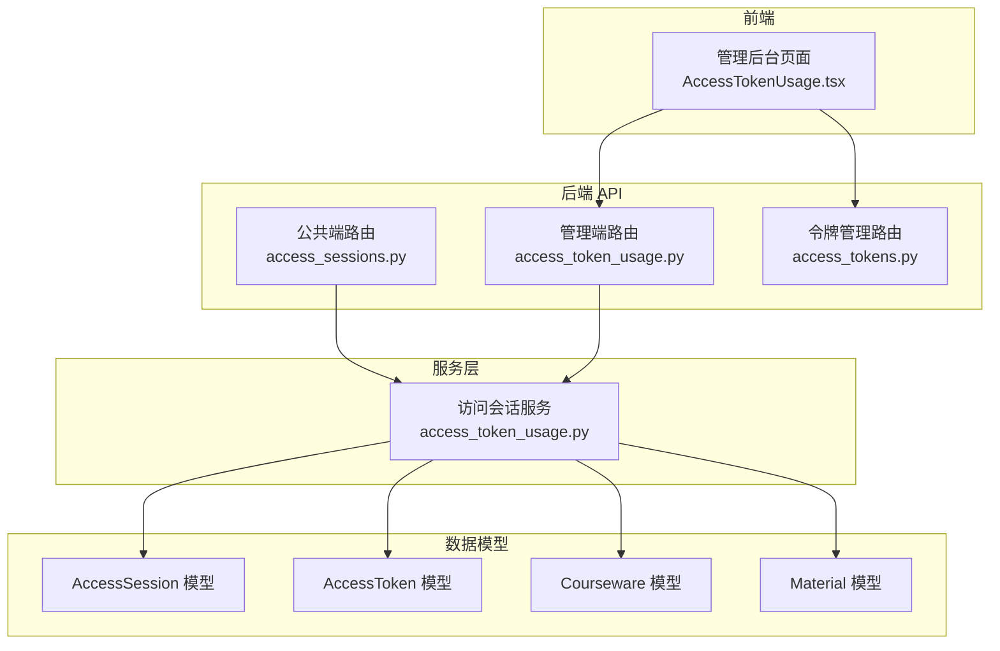
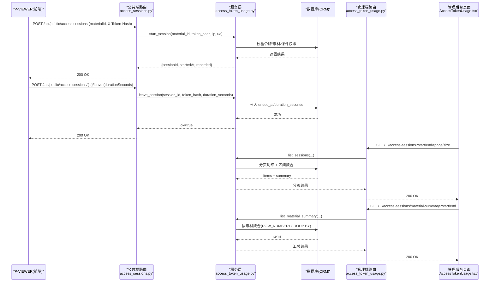
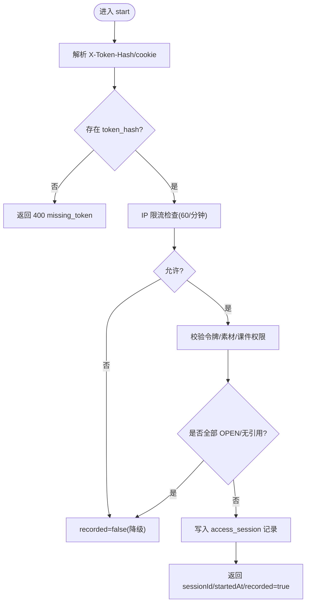
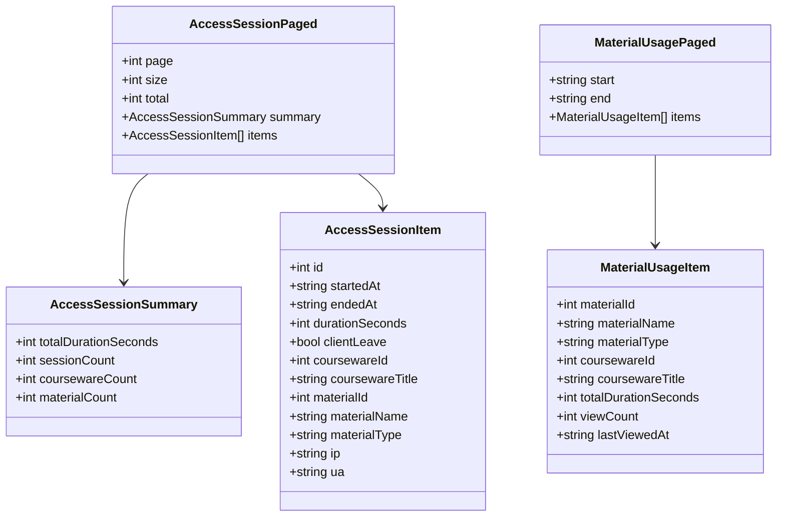
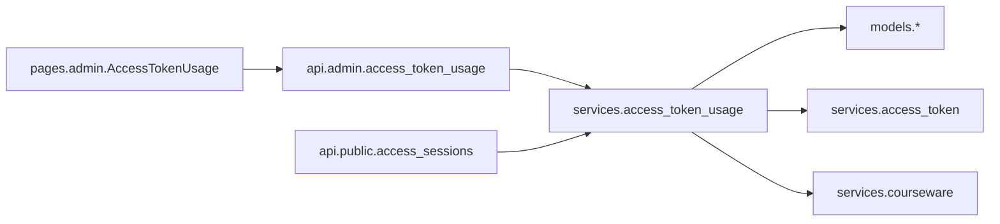

# 令牌使用统计API

<cite>
**本文引用的文件列表**
- [backend/app/api/admin/access_token_usage.py](file://backend/app/api/admin/access_token_usage.py)
- [backend/app/services/access_token_usage.py](file://backend/app/services/access_token_usage.py)
- [backend/app/schemas/access_token_usage.py](file://backend/app/schemas/access_token_usage.py)
- [backend/app/models/access_session.py](file://backend/app/models/access_session.py)
- [backend/app/models/access_token.py](file://backend/app/models/access_token.py)
- [backend/app/models/courseware.py](file://backend/app/models/courseware.py)
- [backend/app/models/material.py](file://backend/app/models/material.py)
- [backend/app/api/public/access_sessions.py](file://backend/app/api/public/access_sessions.py)
- [backend/app/api/admin/access_tokens.py](file://backend/app/api/admin/access_tokens.py)
- [frontend/src/pages/admin/AccessTokenUsage.tsx](file://frontend/src/pages/admin/AccessTokenUsage.tsx)
- [backend/tests/test_access_session.py](file://backend/tests/test_access_session.py)
- [frontend/e2e/admin-access-session.spec.ts](file://frontend/e2e/admin-access-session.spec.ts)
</cite>

## 目录
1. [简介](#简介)
2. [项目结构](#项目结构)
3. [核心组件](#核心组件)
4. [架构总览](#架构总览)
5. [详细组件分析](#详细组件分析)
6. [依赖关系分析](#依赖关系分析)
7. [性能与优化](#性能与优化)
8. [异常检测与告警配置](#异常检测与告警配置)
9. [统计分析示例与可视化集成指南](#统计分析示例与可视化集成指南)
10. [故障排查指南](#故障排查指南)
11. [结论](#结论)

## 简介
本文件面向“令牌使用统计”能力，覆盖以下目标：
- 访问会话的查询、统计与分析接口（管理端）
- 用户访问行为追踪、会话时长统计与访问频率分析（公共端 + 管理端聚合）
- 按时间范围、用户群体（令牌）、课件类型等多维度统计查询
- 异常访问检测与告警配置建议
- 数据聚合算法与性能优化策略
- 完整的统计分析示例与前端可视化集成指南

该功能围绕“访问令牌 → 受限课件 → 素材”的访问链路，记录每次浏览会话的起止时间与停留时长，并提供多维度聚合查询。

## 项目结构
后端采用 FastAPI 分层设计：
- API 层：管理端路由（admin）与公共端路由（public）
- 服务层：业务逻辑（会话开启/结束、分页明细、聚合统计）
- 模型层：ORM 定义（AccessSession、AccessToken、Courseware、Material）
- Schema 层：请求/响应 Pydantic 模型
- 前端：管理后台页面展示统计结果

图表来源
- [backend/app/api/admin/access_token_usage.py:1-101](file://backend/app/api/admin/access_token_usage.py#L1-L101)
- [backend/app/api/public/access_sessions.py:1-137](file://backend/app/api/public/access_sessions.py#L1-L137)
- [backend/app/api/admin/access_tokens.py:1-120](file://backend/app/api/admin/access_tokens.py#L1-L120)
- [backend/app/services/access_token_usage.py:1-518](file://backend/app/services/access_token_usage.py#L1-L518)
- [backend/app/models/access_session.py:1-129](file://backend/app/models/access_session.py#L1-L129)
- [backend/app/models/access_token.py:1-34](file://backend/app/models/access_token.py#L1-L34)
- [backend/app/models/courseware.py:1-74](file://backend/app/models/courseware.py#L1-L74)
- [backend/app/models/material.py:1-69](file://backend/app/models/material.py#L1-L69)

章节来源
- [backend/app/api/admin/access_token_usage.py:1-101](file://backend/app/api/admin/access_token_usage.py#L1-L101)
- [backend/app/api/public/access_sessions.py:1-137](file://backend/app/api/public/access_sessions.py#L1-L137)
- [backend/app/api/admin/access_tokens.py:1-120](file://backend/app/api/admin/access_tokens.py#L1-L120)
- [backend/app/services/access_token_usage.py:1-518](file://backend/app/services/access_token_usage.py#L1-L518)
- [backend/app/models/access_session.py:1-129](file://backend/app/models/access_session.py#L1-L129)
- [backend/app/models/access_token.py:1-34](file://backend/app/models/access_token.py#L1-L34)
- [backend/app/models/courseware.py:1-74](file://backend/app/models/courseware.py#L1-L74)
- [backend/app/models/material.py:1-69](file://backend/app/models/material.py#L1-L69)

## 核心组件
- 公共端会话接口
  - POST /api/public/access-sessions：开启一次访问会话（基于 token_hash 鉴权，支持 IP 限流降级）
  - POST /api/public/access-sessions/{session_id}/leave：结束会话并写入停留时长（服务端校正偏差）
- 管理端统计接口
  - GET /api/admin/access-tokens/{token_id}/access-sessions：分页访问台账 + 区间聚合概览
  - GET /api/admin/access-tokens/{token_id}/access-sessions/summary：仅返回区间内 4 项指标（总停留/次数/课件数/素材数）
  - GET /api/admin/access-tokens/{token_id}/access-sessions/material-summary：按素材聚合（总停留/次数/最近访问时间）
  - GET /api/admin/access-tokens/{token_id}?withUsage=1：令牌详情附加全时段 usageSummary
- 数据模型
  - AccessSession：记录 token_id、courseware_id、material_id、started_at、ended_at、duration_seconds、client_leave、ip、ua
  - AccessToken：label 唯一，value_hash 存储 SHA-256
  - Courseware：OPEN/RESTRICTED 访问模式；与 Material 多对多关联
  - Material：VIDEO/PDF/PPT 等类型元数据

章节来源
- [backend/app/api/public/access_sessions.py:1-137](file://backend/app/api/public/access_sessions.py#L1-L137)
- [backend/app/api/admin/access_token_usage.py:1-101](file://backend/app/api/admin/access_token_usage.py#L1-L101)
- [backend/app/api/admin/access_tokens.py:1-120](file://backend/app/api/admin/access_tokens.py#L1-L120)
- [backend/app/models/access_session.py:1-129](file://backend/app/models/access_session.py#L1-L129)
- [backend/app/models/access_token.py:1-34](file://backend/app/models/access_token.py#L1-L34)
- [backend/app/models/courseware.py:1-74](file://backend/app/models/courseware.py#L1-L74)
- [backend/app/models/material.py:1-69](file://backend/app/models/material.py#L1-L69)

## 架构总览
下图展示了从 P-VIEWER 到后端的完整调用链，以及管理端统计数据的生成路径。

图表来源
- [backend/app/api/public/access_sessions.py:1-137](file://backend/app/api/public/access_sessions.py#L1-L137)
- [backend/app/services/access_token_usage.py:1-518](file://backend/app/services/access_token_usage.py#L1-L518)
- [backend/app/api/admin/access_token_usage.py:1-101](file://backend/app/api/admin/access_token_usage.py#L1-L101)
- [frontend/src/pages/admin/AccessTokenUsage.tsx:1-530](file://frontend/src/pages/admin/AccessTokenUsage.tsx#L1-L530)

## 详细组件分析

### 公共端：访问会话开始/结束
- 开始会话
  - 参数：materialId（必填），X-Token-Hash 或 cookie lh_token_hash
  - 行为：
    - 缺 token_hash → 400 missing_token
    - 无效 token → 401 invalid_token
    - 素材无引用或全部 OPEN → recorded=false（不写库）
    - RESTRICTED 且未授权 → 403 courseware_acl_locked
    - 写入失败 → recorded=false（吞错，不阻塞前台）
    - IP 限流（进程内滑动窗口 60/分钟）→ recorded=false（降级）
- 结束会话
  - 幂等：不存在 session 视为 ok
  - 校验：请求 token_hash 必须与 session.token_id 对应 value_hash 一致，否则 403
  - 时长校正：客户端上报 duration_seconds 与服务端计算偏差 > 60s 时，以服务端为准

图表来源
- [backend/app/api/public/access_sessions.py:1-137](file://backend/app/api/public/access_sessions.py#L1-L137)
- [backend/app/services/access_token_usage.py:1-518](file://backend/app/services/access_token_usage.py#L1-L518)

章节来源
- [backend/app/api/public/access_sessions.py:1-137](file://backend/app/api/public/access_sessions.py#L1-L137)
- [backend/app/services/access_token_usage.py:1-518](file://backend/app/services/access_token_usage.py#L1-L518)

### 管理端：访问台账与聚合
- 分页访问台账
  - 输入：token_id、start/end（YYYY-MM-DD）、可选 materialId/coursewareId、page/size
  - 输出：分页 items + 区间 summary（totalDurationSeconds/sessionCount/coursewareCount/materialCount）
- 区间概览
  - 输入：token_id、start/end
  - 输出：仅 4 项指标（避免拉取全量 items）
- 按素材聚合
  - 输入：token_id、start/end
  - 输出：每个素材的 totalDurationSeconds/viewCount/lastViewedAt，并按 totalDurationSeconds 降序

图表来源
- [backend/app/schemas/access_token_usage.py:1-91](file://backend/app/schemas/access_token_usage.py#L1-L91)

章节来源
- [backend/app/api/admin/access_token_usage.py:1-101](file://backend/app/api/admin/access_token_usage.py#L1-L101)
- [backend/app/schemas/access_token_usage.py:1-91](file://backend/app/schemas/access_token_usage.py#L1-L91)

### 数据模型与约束
- AccessSession
  - 字段：token_id、courseware_id、material_id、started_at、ended_at、duration_seconds、client_leave、ip、ua、created_at
  - 索引：token_id+started_at、token_id+material_id+started_at、token_id+courseware_id+started_at
  - 约束：duration_seconds >= 0
- AccessToken
  - label 全局唯一；value_hash 为 SHA-256
- Courseware
  - access_mode：OPEN/RESTRICTED
  - 与 Material 多对多关联
- Material
  - type：VIDEO/PDF/PPT

章节来源
- [backend/app/models/access_session.py:1-129](file://backend/app/models/access_session.py#L1-L129)
- [backend/app/models/access_token.py:1-34](file://backend/app/models/access_token.py#L1-L34)
- [backend/app/models/courseware.py:1-74](file://backend/app/models/courseware.py#L1-L74)
- [backend/app/models/material.py:1-69](file://backend/app/models/material.py#L1-L69)

## 依赖关系分析
- 服务层依赖
  - 令牌服务：根据 token_hash 获取令牌对象
  - 课件服务：批量获取课件信息用于权限判断
  - 关联表：courseware_material 用于解析素材被哪些课件引用
- 跨方言时间差计算
  - PostgreSQL：EXTRACT(EPOCH FROM (end - start))
  - SQLite：(julianday(end) - julianday(start)) * 86400
- 前端依赖
  - 管理后台页面通过三个接口组合渲染：概览卡片、素材汇总、访问台账

图表来源
- [backend/app/services/access_token_usage.py:1-518](file://backend/app/services/access_token_usage.py#L1-L518)
- [backend/app/api/admin/access_token_usage.py:1-101](file://backend/app/api/admin/access_token_usage.py#L1-L101)
- [backend/app/api/public/access_sessions.py:1-137](file://backend/app/api/public/access_sessions.py#L1-L137)
- [frontend/src/pages/admin/AccessTokenUsage.tsx:1-530](file://frontend/src/pages/admin/AccessTokenUsage.tsx#L1-L530)

章节来源
- [backend/app/services/access_token_usage.py:1-518](file://backend/app/services/access_token_usage.py#L1-L518)
- [backend/app/api/admin/access_token_usage.py:1-101](file://backend/app/api/admin/access_token_usage.py#L1-L101)
- [backend/app/api/public/access_sessions.py:1-137](file://backend/app/api/public/access_sessions.py#L1-L137)
- [frontend/src/pages/admin/AccessTokenUsage.tsx:1-530](file://frontend/src/pages/admin/AccessTokenUsage.tsx#L1-L530)

## 性能与优化
- 索引利用
  - 查询条件主要基于 token_id + started_at，已建立复合索引，可高效过滤时间段
  - 按素材/课件聚合查询也命中相应复合索引
- 聚合 SQL 优化
  - 单条 session 持续时间表达式优先使用留存的 duration_seconds；进行中会话用 now()-started_at 估算
  - 跨方言时间差函数封装，避免应用层拼接差异
  - 按素材聚合使用子查询 + ROW_NUMBER 定位最近一次访问的课件，再 GROUP BY 聚合
- 分页与首屏优化
  - 提供独立 summary 接口，避免首屏拉取全量 items
  - 管理端默认近 7 天时间范围，减少大数据量扫描
- 限流与降级
  - 公共端 start 接口进程内滑动窗口限流（60/分钟），超限降级为 recorded=false，不阻塞主流程
- 前端缓存与懒加载
  - 概览卡片独立于 tab 状态，首屏即拉取；切换 tab 按需加载台账

章节来源
- [backend/app/services/access_token_usage.py:1-518](file://backend/app/services/access_token_usage.py#L1-L518)
- [backend/app/api/public/access_sessions.py:1-137](file://backend/app/api/public/access_sessions.py#L1-L137)
- [backend/app/api/admin/access_token_usage.py:1-101](file://backend/app/api/admin/access_token_usage.py#L1-L101)
- [frontend/src/pages/admin/AccessTokenUsage.tsx:1-530](file://frontend/src/pages/admin/AccessTokenUsage.tsx#L1-L530)

## 异常检测与告警配置
- 异常场景
  - 令牌缺失/无效：400/401
  - 越权访问：403（跨 token 篡改、未授权访问受限素材）
  - 数据库异常：服务层捕获并回滚，公共端降级 recorded=false
  - 客户端时钟漂移：服务端校正 duration_seconds（偏差阈值 60s）
- 审计日志
  - 服务层在写入失败时记录审计事件（如 access_session.start_failed、access_session.leave_failed）
- 告警建议
  - 监控审计日志中错误事件数量与速率
  - 关注 403 比例异常升高（可能遭遇恶意探测）
  - 关注 recorded=false 比例（限流或 DB 异常导致）
  - 结合 IP 维度进行短时突发检测（例如同一 IP 短时间大量 start）

章节来源
- [backend/app/services/access_token_usage.py:1-518](file://backend/app/services/access_token_usage.py#L1-L518)
- [backend/app/api/public/access_sessions.py:1-137](file://backend/app/api/public/access_sessions.py#L1-L137)

## 统计分析示例与可视化集成指南

### 接口清单与用法
- 开启会话
  - POST /api/public/access-sessions
  - 请求体：{ "materialId": <int> }
  - 头部：X-Token-Hash 或 Cookie lh_token_hash
  - 响应：{ data: { sessionId?, startedAt?, recorded: bool } }
- 结束会话
  - POST /api/public/access-sessions/{session_id}/leave
  - 请求体：{ "durationSeconds"?: <int> }
  - 头部：X-Token-Hash 或 Cookie lh_token_hash
  - 响应：{ data: { ok: bool } }
- 管理端分页台账
  - GET /api/admin/access-tokens/{token_id}/access-sessions
  - 查询参数：start/end（YYYY-MM-DD）、materialId、coursewareId、page、size
  - 响应：{ data: { page, size, total, summary, items } }
- 管理端区间概览
  - GET /api/admin/access-tokens/{token_id}/access-sessions/summary
  - 查询参数：start/end
  - 响应：{ data: { totalDurationSeconds, sessionCount, coursewareCount, materialCount } }
- 管理端按素材聚合
  - GET /api/admin/access-tokens/{token_id}/access-sessions/material-summary
  - 查询参数：start/end
  - 响应：{ data: { start, end, items: [{ materialId, materialName, materialType, coursewareId, coursewareTitle, totalDurationSeconds, viewCount, lastViewedAt }] } }
- 令牌详情附加全时段 usageSummary
  - GET /api/admin/access-tokens/{token_id}?withUsage=1
  - 响应：data.usageSummary = { totalDurationSeconds, sessionCount, coursewareCount, materialCount }

### 前端集成要点
- 默认时间范围：近 7 天；快捷按钮支持近 7 天、近 30 天、本月
- 首屏概览卡片：优先调用 summary 接口，若无则回退到台账 summary 或素材汇总
- 素材汇总 Tab：按 totalDurationSeconds 降序展示
- 访问台账 Tab：分页加载，显示开始/结束时间、停留时长、课件/素材名称、类型、状态（已结束/进行中）

章节来源
- [backend/app/api/public/access_sessions.py:1-137](file://backend/app/api/public/access_sessions.py#L1-L137)
- [backend/app/api/admin/access_token_usage.py:1-101](file://backend/app/api/admin/access_token_usage.py#L1-L101)
- [backend/app/api/admin/access_tokens.py:1-120](file://backend/app/api/admin/access_tokens.py#L1-L120)
- [frontend/src/pages/admin/AccessTokenUsage.tsx:1-530](file://frontend/src/pages/admin/AccessTokenUsage.tsx#L1-L530)

### 可视化集成建议
- 概览卡片
  - 总停留时长：格式化 HH:mm:ss
  - 总访问次数、覆盖课件数、覆盖素材数
- 素材汇总图
  - 柱状图：按 totalDurationSeconds 排序
  - 饼图：各素材占比
- 访问趋势图
  - 折线图：按日粒度统计 sessionCount/totalDurationSeconds
  - 可通过扩展 service 层新增按日聚合接口实现
- 交互
  - 时间筛选联动所有图表
  - 点击素材行跳转至台账明细并预填 materialId

[本节为概念性内容，无需源码引用]

## 故障排查指南
- 常见问题
  - 400 missing_token：确认请求头包含 X-Token-Hash 或 Cookie lh_token_hash
  - 401 invalid_token：确认令牌值正确且未被重新生成
  - 403 courseware_acl_locked：确认令牌已绑定当前课件
  - recorded=false：可能被限流或写入失败（查看审计日志）
  - 时长不一致：若客户端上报偏差 > 60s，服务端会校正
- 验证步骤
  - 使用测试用例复现：参考单元测试与 E2E 用例
  - 检查数据库记录：确认 access_session 是否存在、ended_at/duration_seconds 是否正确
  - 观察审计日志：定位写入失败原因

章节来源
- [backend/tests/test_access_session.py:1-640](file://backend/tests/test_access_session.py#L1-L640)
- [frontend/e2e/admin-access-session.spec.ts:1-215](file://frontend/e2e/admin-access-session.spec.ts#L1-L215)

## 结论
令牌使用统计体系通过“公共端采集 + 管理端聚合”的方式，实现了高可用、可扩展的访问行为追踪与多维分析。其关键优势包括：
- 严格的权限控制与健壮的错误处理
- 跨方言的时间差计算与高效的索引设计
- 首屏轻量化的概览接口与按素材聚合的核心能力
- 完善的测试覆盖与前端可视化集成方案

建议在后续迭代中：
- 增加按日/周/月粒度的趋势聚合接口
- 引入更丰富的异常检测规则与告警通道
- 在前端增加更多可视化图表与下钻分析能力