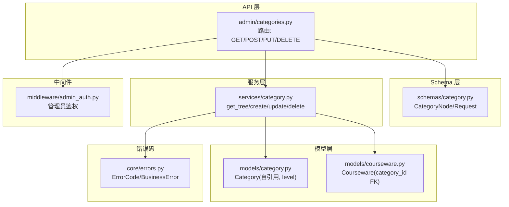
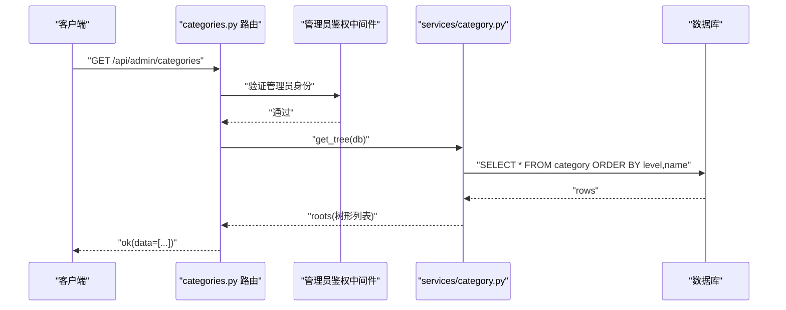
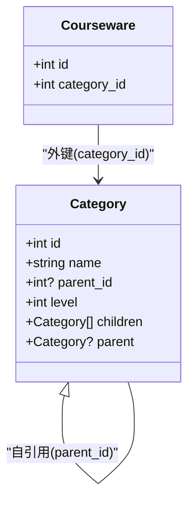
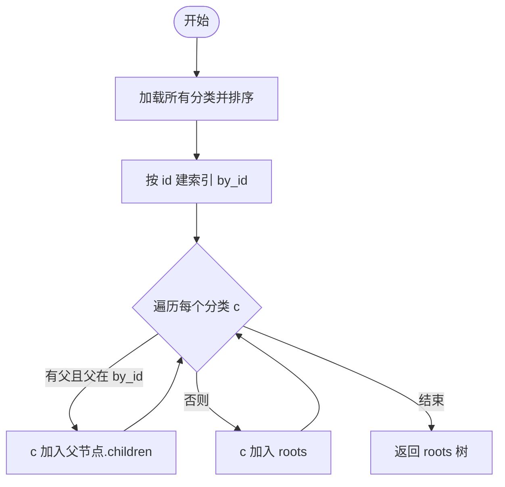
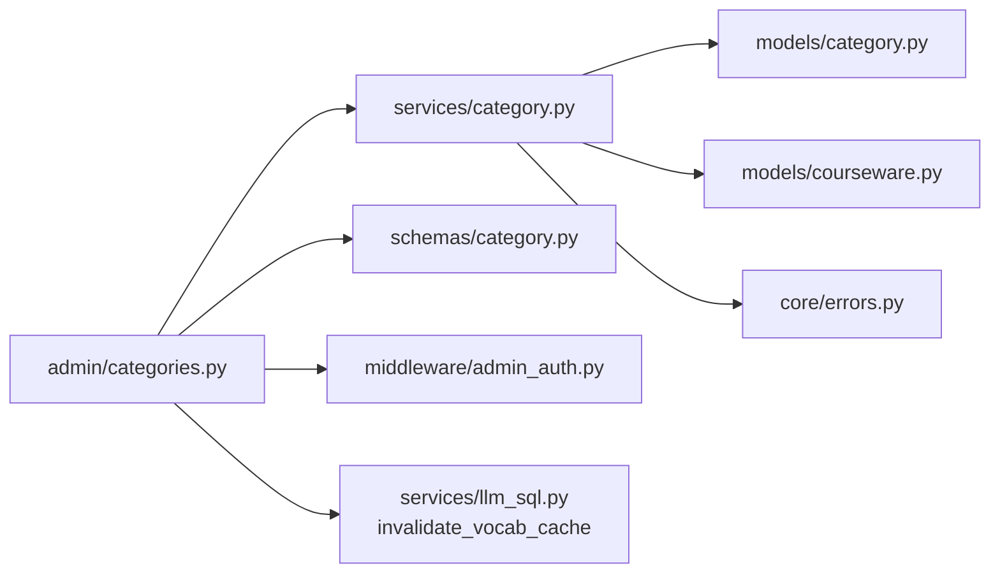

# 分类管理API

<cite>
**本文引用的文件**   
- [backend/app/api/admin/categories.py](file://backend/app/api/admin/categories.py)
- [backend/app/models/category.py](file://backend/app/models/category.py)
- [backend/app/schemas/category.py](file://backend/app/schemas/category.py)
- [backend/app/services/category.py](file://backend/app/services/category.py)
- [backend/app/models/courseware.py](file://backend/app/models/courseware.py)
- [backend/app/core/errors.py](file://backend/app/core/errors.py)
- [backend/app/middleware/admin_auth.py](file://backend/app/middleware/admin_auth.py)
- [backend/app/services/llm_sql.py](file://backend/app/services/llm_sql.py)
- [backend/tests/test_categories.py](file://backend/tests/test_categories.py)
</cite>

## 目录
1. [简介](#简介)
2. [项目结构](#项目结构)
3. [核心组件](#核心组件)
4. [架构总览](#架构总览)
5. [详细组件分析](#详细组件分析)
6. [依赖关系分析](#依赖关系分析)
7. [性能与扩展性](#性能与扩展性)
8. [故障排查指南](#故障排查指南)
9. [结论](#结论)
10. [附录：接口规范与示例](#附录接口规范与示例)

## 简介
本文件面向“分类管理”模块，提供三级分类树结构的完整管理接口说明。内容涵盖：
- 分类的增删改查、层级关系维护
- 排序与移动操作（当前实现状态）
- 树形数据模型与递归查询实现
- 分类与课件关联的约束与级联处理
- 权限控制与数据完整性约束
- 分类统计信息和使用情况查询接口（现状说明）
- 完整的树形结构操作示例与最佳实践

## 项目结构
分类管理相关代码位于后端 FastAPI 应用中，采用分层组织：
- API 层：路由定义与请求/响应封装
- Schema 层：Pydantic 校验与序列化
- 服务层：业务规则与数据库交互
- 模型层：SQLAlchemy ORM 映射与关系
- 中间件：管理员鉴权
- 错误码：统一业务异常与 HTTP 状态映射

图表来源
- [backend/app/api/admin/categories.py:1-81](file://backend/app/api/admin/categories.py#L1-L81)
- [backend/app/schemas/category.py:1-49](file://backend/app/schemas/category.py#L1-L49)
- [backend/app/services/category.py:1-152](file://backend/app/services/category.py#L1-L152)
- [backend/app/models/category.py:1-46](file://backend/app/models/category.py#L1-L46)
- [backend/app/models/courseware.py:1-74](file://backend/app/models/courseware.py#L1-L74)
- [backend/app/middleware/admin_auth.py](file://backend/app/middleware/admin_auth.py)
- [backend/app/core/errors.py:1-144](file://backend/app/core/errors.py#L1-L144)

章节来源
- [backend/app/api/admin/categories.py:1-81](file://backend/app/api/admin/categories.py#L1-L81)
- [backend/app/models/category.py:1-46](file://backend/app/models/category.py#L1-L46)
- [backend/app/schemas/category.py:1-49](file://backend/app/schemas/category.py#L1-L49)
- [backend/app/services/category.py:1-152](file://backend/app/services/category.py#L1-L152)

## 核心组件
- 路由与鉴权
  - 路由前缀：/api/admin/categories
  - 全局依赖：管理员鉴权中间件
  - 返回信封：统一 ok(data=...) 格式
- 数据模型
  - Category：支持 3 级树；level ∈ {1,2,3}；parent_id=NULL 为根；同父节点下 name 唯一
  - Courseware：category_id 外键指向 category.id，删除分类时受 RESTRICT 保护
- 服务逻辑
  - get_tree：一次性加载所有分类，内存中组装成树
  - create/update/delete：包含名称校验、层级限制、唯一性约束、子节点与课件占用检查
- Schema
  - CategoryCreateRequest/CategoryRenameRequest：name 非空且长度 ≤ 30，自动 trim
  - CategoryNode：树形节点 id/name/level/parentId/children

章节来源
- [backend/app/api/admin/categories.py:16-20](file://backend/app/api/admin/categories.py#L16-L20)
- [backend/app/models/category.py:12-40](file://backend/app/models/category.py#L12-L40)
- [backend/app/services/category.py:18-42](file://backend/app/services/category.py#L18-L42)
- [backend/app/schemas/category.py:9-40](file://backend/app/schemas/category.py#L9-L40)

## 架构总览
分类管理 API 的请求流程如下：

图表来源
- [backend/app/api/admin/categories.py:33-36](file://backend/app/api/admin/categories.py#L33-L36)
- [backend/app/services/category.py:27-42](file://backend/app/services/category.py#L27-L42)
- [backend/app/middleware/admin_auth.py](file://backend/app/middleware/admin_auth.py)

## 详细组件分析

### 数据模型与树形结构
- Category 表字段
  - id：主键
  - name：分类名（≤30）
  - parent_id：父分类 id（NULL 表示根）
  - level：层级（1/2/3）
- 约束与索引
  - 唯一约束：同一父节点下 name 唯一
  - 索引：parent_id
  - 自引用外键：ondelete="RESTRICT"，防止误删被引用分类
- 自引用关系
  - children：一对多子节点
  - parent：反向引用父节点

图表来源
- [backend/app/models/category.py:12-40](file://backend/app/models/category.py#L12-L40)
- [backend/app/models/courseware.py:21-32](file://backend/app/models/courseware.py#L21-L32)

章节来源
- [backend/app/models/category.py:12-40](file://backend/app/models/category.py#L12-L40)
- [backend/app/models/courseware.py:21-32](file://backend/app/models/courseware.py#L21-L32)

### 树形构建算法（内存组装）
- 一次性读取全部分类并按 level、name 排序
- 以 id 为键建立字典，遍历行将子节点挂到父节点的 children 上
- 无父节点或父节点不在结果中的作为根节点
- 时间复杂度 O(N)，空间复杂度 O(N)

图表来源
- [backend/app/services/category.py:27-42](file://backend/app/services/category.py#L27-L42)

章节来源
- [backend/app/services/category.py:27-42](file://backend/app/services/category.py#L27-L42)

### 接口清单与行为

- 获取分类树
  - 方法：GET
  - 路径：/api/admin/categories
  - 鉴权：管理员
  - 返回：树形数组，节点含 id/name/level/parentId/children
  - 备注：按 level、name 排序

- 创建分类
  - 方法：POST
  - 路径：/api/admin/categories
  - 请求体：{ name, parentId? }
  - 规则：
    - name 非空且 ≤ 30，自动 trim
    - 若未传 parentId，则 level=1；否则 level=parent.level+1，最大 3
    - 同父节点下 name 唯一
  - 返回：新分类 id/parentId/level/name
  - 副作用：失效词汇缓存

- 重命名分类
  - 方法：PUT
  - 路径：/api/admin/categories/{category_id}
  - 请求体：{ name }
  - 规则：同上名称校验与唯一性
  - 返回：更新后的 id/parentId/level/name
  - 副作用：失效词汇缓存

- 删除分类
  - 方法：DELETE
  - 路径：/api/admin/categories/{category_id}
  - 规则：
    - 存在子节点 → 拒绝
    - 仍有课件直接引用 → 拒绝
  - 返回：空 data
  - 副作用：失效词汇缓存

章节来源
- [backend/app/api/admin/categories.py:33-77](file://backend/app/api/admin/categories.py#L33-L77)
- [backend/app/services/category.py:52-110](file://backend/app/services/category.py#L52-L110)
- [backend/app/schemas/category.py:14-29](file://backend/app/schemas/category.py#L14-L29)

### 权限控制与数据完整性
- 权限控制
  - 路由级别依赖管理员鉴权中间件，未认证或无权限将被拦截
- 数据完整性
  - 唯一性：同一父节点下 name 唯一（数据库约束 + 应用层校验）
  - 层级限制：最多 3 级
  - 删除保护：
    - 存在子节点不可删
    - 仍被课件引用不可删（外键 ondelete="RESTRICT"）

章节来源
- [backend/app/api/admin/categories.py:16-20](file://backend/app/api/admin/categories.py#L16-L20)
- [backend/app/models/category.py:15-26](file://backend/app/models/category.py#L15-L26)
- [backend/app/models/courseware.py:30-32](file://backend/app/models/courseware.py#L30-L32)
- [backend/app/services/category.py:52-110](file://backend/app/services/category.py#L52-L110)

### 与课件的关联与级联处理
- 关联关系
  - Courseware.category_id 外键指向 Category.id
  - 删除分类时，由于外键 ondelete="RESTRICT"，若有课件引用会阻止删除
- 自动更新机制
  - 当前未实现“移动分类后自动更新其下课件的 category_id”
  - 删除分类前需先移除或迁移该分类下的课件
- 子树过滤
  - 课件列表可按分类子树过滤（使用 collect_subtree_ids），但分类管理侧不提供批量移动接口

章节来源
- [backend/app/models/courseware.py:30-32](file://backend/app/models/courseware.py#L30-L32)
- [backend/app/services/category.py:91-110](file://backend/app/services/category.py#L91-L110)
- [backend/app/services/category.py:113-130](file://backend/app/services/category.py#L113-L130)

### 排序与移动操作（当前实现状态）
- 分类排序
  - 当前未提供分类间的排序接口（如交换兄弟节点顺序）
  - 树展示顺序由 level、name 决定
- 分类移动
  - 当前未提供“移动分类到其他父节点”的专用接口
  - 可通过“新建目标父节点 + 重建子树 + 删除旧节点”的组合方式间接实现（需前端配合）

章节来源
- [backend/app/api/admin/categories.py:33-77](file://backend/app/api/admin/categories.py#L33-L77)
- [backend/app/services/category.py:27-42](file://backend/app/services/category.py#L27-L42)

### 分类统计信息和使用情况查询接口
- 现状
  - 分类管理 API 未暴露分类维度的统计接口（如课件数量、访问次数等）
- 建议方案（概念性）
  - 新增接口：GET /api/admin/categories/{id}/stats
  - 返回：子树课件数、最近更新时间、是否被引用等
  - 注意：避免全量扫描，利用子树 id 集合进行聚合计数

[本节为概念性说明，不直接分析具体文件]

## 依赖关系分析

图表来源
- [backend/app/api/admin/categories.py:1-81](file://backend/app/api/admin/categories.py#L1-L81)
- [backend/app/services/category.py:1-152](file://backend/app/services/category.py#L1-L152)
- [backend/app/models/category.py:1-46](file://backend/app/models/category.py#L1-L46)
- [backend/app/models/courseware.py:1-74](file://backend/app/models/courseware.py#L1-L74)
- [backend/app/core/errors.py:1-144](file://backend/app/core/errors.py#L1-L144)
- [backend/app/services/llm_sql.py:158-164](file://backend/app/services/llm_sql.py#L158-L164)

章节来源
- [backend/app/api/admin/categories.py:1-81](file://backend/app/api/admin/categories.py#L1-L81)
- [backend/app/services/category.py:1-152](file://backend/app/services/category.py#L1-L152)

## 性能与扩展性
- 树构建
  - 单次全表扫描 + 内存组装，适合中小规模分类树
  - 若分类数量增长，可考虑分页或按需加载（例如只拉取指定父节点及其子节点）
- 查询优化
  - 已对 level、name 排序；如需频繁按父节点查询，可利用现有 parent_id 索引
- 一致性
  - 名称冲突通过数据库唯一约束兜底，应用层提前校验减少失败重试
- 可扩展点
  - 增加排序字段（如 sort_order）以实现同级排序
  - 增加移动接口，内部事务保证父子关系与 level 同步更新

[本节为通用指导，不直接分析具体文件]

## 故障排查指南
- 常见错误码与含义
  - category_name_required：名称为空或仅空白字符
  - category_name_conflict：同父节点下名称重复
  - category_max_level：超过 3 级
  - category_not_found：分类不存在
  - category_has_children：存在子节点无法删除
  - category_has_coursewares：仍有课件引用无法删除
- 定位步骤
  - 确认请求参数是否符合 Schema 校验（trim、长度）
  - 检查父节点是否存在以及层级是否合法
  - 删除前检查是否有子节点或被课件引用
  - 查看统一错误信封中的 code/message/data

章节来源
- [backend/app/core/errors.py:32-98](file://backend/app/core/errors.py#L32-L98)
- [backend/app/services/category.py:18-110](file://backend/app/services/category.py#L18-L110)

## 结论
- 当前分类管理 API 提供了完整的三级树 CRUD 能力，具备严格的名称与层级约束，以及与课件的强引用保护
- 暂未提供分类排序与移动接口；如需支持，可在现有基础上引入排序字段与移动事务
- 分类统计接口尚未实现，可按概念方案扩展
- 建议在大规模场景下优化树的按需加载与统计聚合查询

[本节为总结，不直接分析具体文件]

## 附录：接口规范与示例

### 接口定义

- 获取分类树
  - 方法：GET
  - 路径：/api/admin/categories
  - 鉴权：管理员
  - 成功响应：{ code:"ok", data:[...] }
  - 失败响应：{ code:"unauthenticated"/"forbidden", ... }

- 创建分类
  - 方法：POST
  - 路径：/api/admin/categories
  - 请求体：{ name, parentId? }
  - 成功响应：{ code:"ok", data:{ id, parentId, level, name } }
  - 失败响应：可能返回 category_name_required / category_name_conflict / category_max_level

- 重命名分类
  - 方法：PUT
  - 路径：/api/admin/categories/{category_id}
  - 请求体：{ name }
  - 成功响应：{ code:"ok", data:{ id, parentId, level, name } }
  - 失败响应：可能返回 category_name_required / category_name_conflict / category_not_found

- 删除分类
  - 方法：DELETE
  - 路径：/api/admin/categories/{category_id}
  - 成功响应：{ code:"ok", data:null }
  - 失败响应：可能返回 category_not_found / category_has_children / category_has_coursewares

章节来源
- [backend/app/api/admin/categories.py:33-77](file://backend/app/api/admin/categories.py#L33-L77)
- [backend/app/schemas/category.py:14-29](file://backend/app/schemas/category.py#L14-L29)
- [backend/app/core/errors.py:32-98](file://backend/app/core/errors.py#L32-L98)

### 典型用例与最佳实践
- 构建 3 级分类
  - 先创建根节点（不传 parentId）
  - 再创建二级节点（传入根 id）
  - 最后创建三级叶子节点（传入二级 id）
- 重命名与删除
  - 重命名遵循名称校验与唯一性
  - 删除前确保无子节点且无课件引用
- 与课件联动
  - 删除分类前，先将课件迁移至其他分类或删除课件
  - 课件列表可按分类子树过滤（使用子树 id 集合）

章节来源
- [backend/tests/test_categories.py:21-32](file://backend/tests/test_categories.py#L21-L32)
- [backend/app/services/category.py:113-130](file://backend/app/services/category.py#L113-L130)