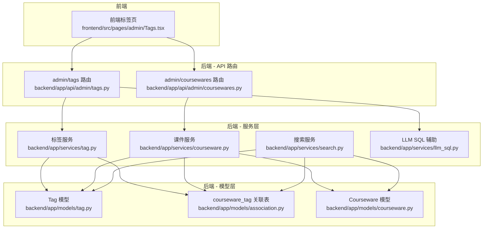
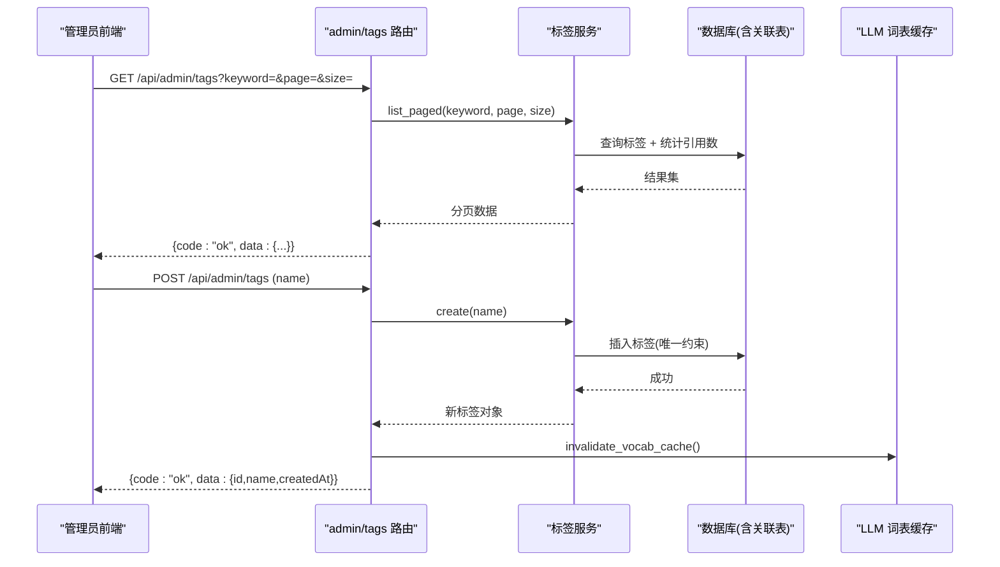
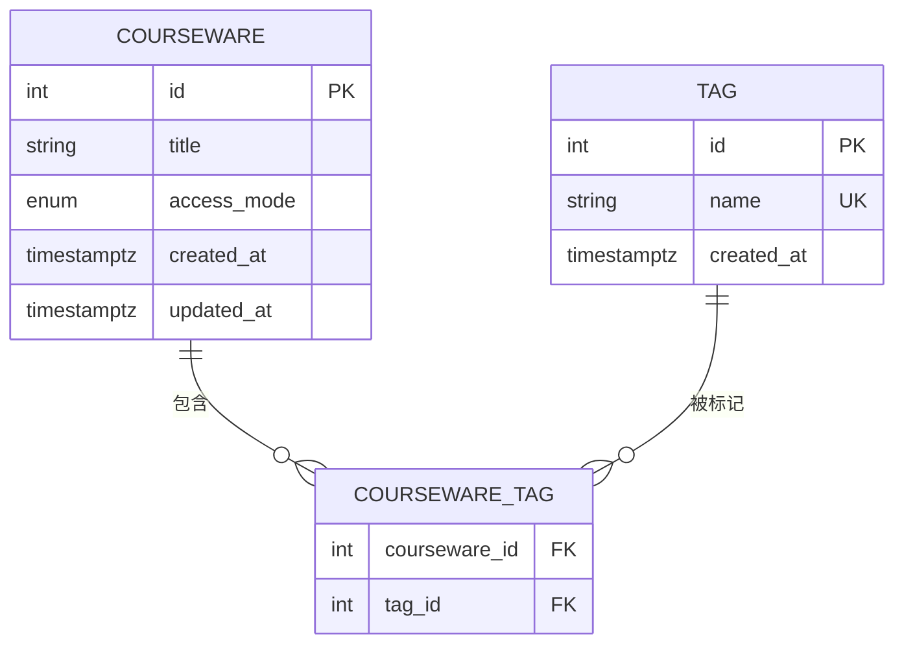
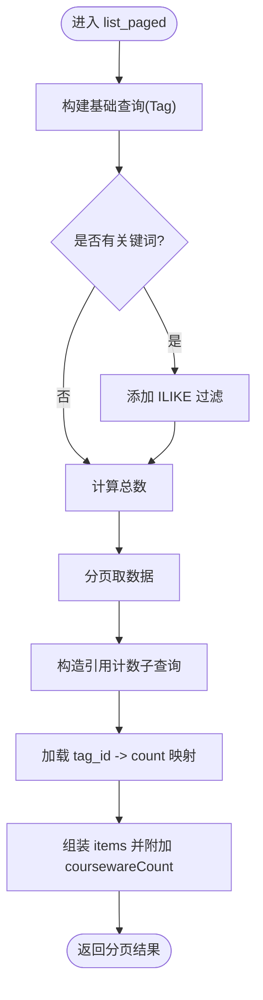
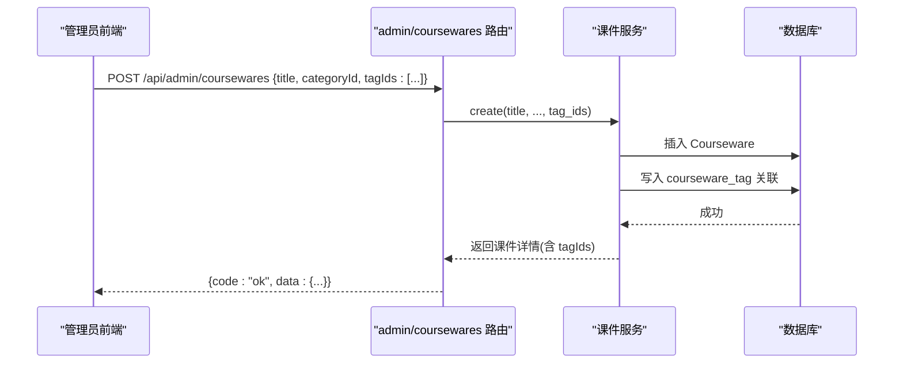
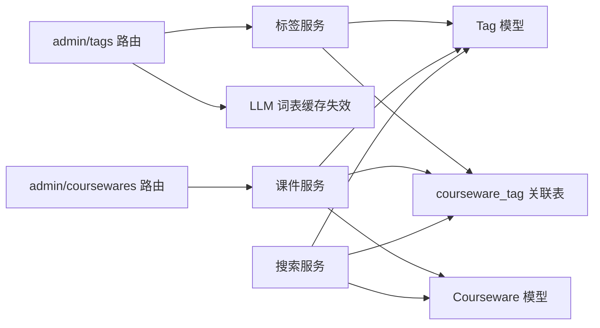

# 标签管理API

<cite>
**本文引用的文件**
- [backend/app/api/admin/tags.py](file://backend/app/api/admin/tags.py)
- [backend/app/services/tag.py](file://backend/app/services/tag.py)
- [backend/app/models/tag.py](file://backend/app/models/tag.py)
- [backend/app/schemas/tag.py](file://backend/app/schemas/tag.py)
- [backend/app/models/association.py](file://backend/app/models/association.py)
- [backend/app/models/courseware.py](file://backend/app/models/courseware.py)
- [backend/app/api/admin/coursewares.py](file://backend/app/api/admin/coursewares.py)
- [backend/app/services/courseware.py](file://backend/app/services/courseware.py)
- [backend/app/services/search.py](file://backend/app/services/search.py)
- [backend/app/services/llm_sql.py](file://backend/app/services/llm_sql.py)
- [frontend/src/pages/admin/Tags.tsx](file://frontend/src/pages/admin/Tags.tsx)
</cite>

## 目录
1. [简介](#简介)
2. [项目结构](#项目结构)
3. [核心组件](#核心组件)
4. [架构总览](#架构总览)
5. [详细组件分析](#详细组件分析)
6. [依赖关系分析](#依赖关系分析)
7. [性能考虑](#性能考虑)
8. [故障排查指南](#故障排查指南)
9. [结论](#结论)
10. [附录](#附录)

## 简介
本文件面向“标签管理”相关接口与实现，覆盖以下目标：
- 标签的完整 CRUD 操作（创建、查询、重命名、删除）
- 标签与课件的多对多关联管理与批量操作
- 标签搜索、统计与智能推荐能力说明
- 标签合并、去重与清理工具接口现状与建议
- 系统扩展性与自定义规则配置建议
- 完整的操作示例与最佳实践

## 项目结构
后端采用 FastAPI + SQLAlchemy ORM 的分层设计：
- API 路由层：负责请求解析、鉴权、响应封装
- 服务层：业务规则、数据访问编排
- 模型层：ORM 实体与 M:N 关联表
- Schema 层：Pydantic 校验与序列化
- 前端页面：管理员后台的标签管理界面

图表来源
- [backend/app/api/admin/tags.py:1-70](file://backend/app/api/admin/tags.py#L1-L70)
- [backend/app/api/admin/coursewares.py:1-115](file://backend/app/api/admin/coursewares.py#L1-L115)
- [backend/app/services/tag.py:1-102](file://backend/app/services/tag.py#L1-L102)
- [backend/app/services/courseware.py:1-492](file://backend/app/services/courseware.py#L1-L492)
- [backend/app/services/search.py:122-159](file://backend/app/services/search.py#L122-L159)
- [backend/app/services/llm_sql.py:158-179](file://backend/app/services/llm_sql.py#L158-L179)
- [backend/app/models/tag.py:1-30](file://backend/app/models/tag.py#L1-L30)
- [backend/app/models/association.py:1-41](file://backend/app/models/association.py#L1-L41)
- [backend/app/models/courseware.py:1-74](file://backend/app/models/courseware.py#L1-L74)

章节来源
- [backend/app/api/admin/tags.py:1-70](file://backend/app/api/admin/tags.py#L1-L70)
- [backend/app/api/admin/coursewares.py:1-115](file://backend/app/api/admin/coursewares.py#L1-L115)
- [backend/app/services/tag.py:1-102](file://backend/app/services/tag.py#L1-L102)
- [backend/app/services/courseware.py:1-492](file://backend/app/services/courseware.py#L1-L492)
- [backend/app/services/search.py:122-159](file://backend/app/services/search.py#L122-L159)
- [backend/app/services/llm_sql.py:158-179](file://backend/app/services/llm_sql.py#L158-L179)
- [backend/app/models/tag.py:1-30](file://backend/app/models/tag.py#L1-L30)
- [backend/app/models/association.py:1-41](file://backend/app/models/association.py#L1-L41)
- [backend/app/models/courseware.py:1-74](file://backend/app/models/courseware.py#L1-L74)

## 核心组件
- 标签模型 Tag：扁平化全局唯一名称，带创建时间。
- 标签服务 tag：提供分页列表、创建、更新、删除等基础能力；在列表时通过子查询统计每个标签被课件引用的次数。
- 标签路由 admin/tags：暴露受保护的 REST 接口，统一返回 ok(data=...) 格式。
- 课件模型 Courseware：与 Tag 存在 M:N 关系，通过 courseware_tag 中间表维护。
- 课件服务 courseware：支持在创建/更新课件时批量设置 tagIds，内部会解析并写入关联。
- 搜索服务 search：在关键词搜索中联合 tag.name 进行匹配，提升召回率。
- LLM SQL 辅助 llm_sql：为标签变更触发词表缓存失效，保障检索一致性。

章节来源
- [backend/app/models/tag.py:1-30](file://backend/app/models/tag.py#L1-L30)
- [backend/app/services/tag.py:1-102](file://backend/app/services/tag.py#L1-L102)
- [backend/app/api/admin/tags.py:1-70](file://backend/app/api/admin/tags.py#L1-L70)
- [backend/app/models/courseware.py:1-74](file://backend/app/models/courseware.py#L1-L74)
- [backend/app/services/courseware.py:1-492](file://backend/app/services/courseware.py#L1-L492)
- [backend/app/services/search.py:122-159](file://backend/app/services/search.py#L122-L159)
- [backend/app/services/llm_sql.py:158-179](file://backend/app/services/llm_sql.py#L158-L179)

## 架构总览
标签管理的关键调用链如下：

图表来源
- [backend/app/api/admin/tags.py:21-42](file://backend/app/api/admin/tags.py#L21-L42)
- [backend/app/services/tag.py:24-80](file://backend/app/services/tag.py#L24-L80)
- [backend/app/services/llm_sql.py:158-179](file://backend/app/services/llm_sql.py#L158-L179)

## 详细组件分析

### 标签模型与数据表
- 字段：id、name（全局唯一）、created_at
- 约束：name 唯一索引，避免重复标签名
- 与课件的 M:N 关系由 courseware_tag 中间表承载

图表来源
- [backend/app/models/tag.py:13-27](file://backend/app/models/tag.py#L13-L27)
- [backend/app/models/association.py:9-14](file://backend/app/models/association.py#L9-L14)
- [backend/app/models/courseware.py:21-74](file://backend/app/models/courseware.py#L21-L74)

章节来源
- [backend/app/models/tag.py:1-30](file://backend/app/models/tag.py#L1-L30)
- [backend/app/models/association.py:1-41](file://backend/app/models/association.py#L1-L41)
- [backend/app/models/courseware.py:1-74](file://backend/app/models/courseware.py#L1-L74)

### 标签服务（tag.py）
- 列表分页：支持 keyword 模糊匹配，按 id 倒序；使用子查询一次性统计每个标签的课件引用数，避免 N+1。
- 创建/更新：校验名称非空且长度 ≤ 30；捕获唯一冲突异常，抛出业务错误。
- 删除：先获取再删除，提交事务。

图表来源
- [backend/app/services/tag.py:24-60](file://backend/app/services/tag.py#L24-L60)

章节来源
- [backend/app/services/tag.py:1-102](file://backend/app/services/tag.py#L1-L102)

### 标签路由（admin/tags）
- GET /api/admin/tags：分页列表，参数 keyword/page/size
- POST /api/admin/tags：创建标签，成功后使 LLM 词表缓存失效
- PUT /api/admin/tags/{tag_id}：重命名标签，成功后使 LLM 词表缓存失效
- DELETE /api/admin/tags/{tag_id}：删除标签，成功后使 LLM 词表缓存失效

章节来源
- [backend/app/api/admin/tags.py:14-66](file://backend/app/api/admin/tags.py#L14-L66)

### 标签与课件的关联管理
- 创建/更新课件时，可传入 tagIds 数组，服务端会解析并写入 M:N 关联。
- 删除课件时，通过外键级联自动清空 courseware_tag。

图表来源
- [backend/app/api/admin/coursewares.py:52-68](file://backend/app/api/admin/coursewares.py#L52-L68)
- [backend/app/services/courseware.py:105-167](file://backend/app/services/courseware.py#L105-L167)

章节来源
- [backend/app/api/admin/coursewares.py:1-115](file://backend/app/api/admin/coursewares.py#L1-L115)
- [backend/app/services/courseware.py:105-167](file://backend/app/services/courseware.py#L105-L167)
- [backend/app/models/association.py:9-14](file://backend/app/models/association.py#L9-L14)

### 标签搜索、统计与智能推荐
- 标签统计：在标签列表中已附带 coursewareCount 引用计数。
- 标签搜索：支持 keyword 模糊匹配。
- 智能推荐：搜索服务在关键词匹配时，额外通过 EXISTS 子句匹配 tag.name，提高命中率。

章节来源
- [backend/app/services/tag.py:24-60](file://backend/app/services/tag.py#L24-L60)
- [backend/app/services/search.py:122-159](file://backend/app/services/search.py#L122-L159)
- [backend/app/services/llm_sql.py:158-179](file://backend/app/services/llm_sql.py#L158-L179)

### 标签合并、去重与清理工具接口
- 当前未提供专门的“标签合并/去重/清理”接口。
- 建议方案：
  - 合并：将旧标签的所有 courseware_tag 迁移到新标签，然后删除旧标签。
  - 去重：基于 name 唯一性，结合列表接口筛选近似名，人工确认后执行合并。
  - 清理：删除未被任何课件引用的标签（可通过 coursewareCount=0 识别）。

[本节为概念性建议，不直接分析具体代码文件]

### 扩展性与自定义规则配置
- 可扩展点：
  - 标签名校验规则：可在服务层 _ensure_name 中增加前缀/后缀、白名单或正则校验。
  - 标签分类/层级：如需引入层级，可在 Tag 上增加 parent_id 或新建 Category 体系，并调整关联逻辑。
  - 批量操作：可在路由层新增批量创建/批量绑定/批量解绑接口，复用现有服务方法。
- 配置项：
  - 名称长度上限、是否允许空白字符等，均可通过配置中心注入到服务层。

[本节为概念性建议，不直接分析具体代码文件]

## 依赖关系分析
- 路由依赖：
  - admin/tags 路由依赖 get_admin_principal 鉴权、get_db 会话、tag 服务、llm_sql 缓存失效。
- 服务依赖：
  - tag 服务依赖 Tag 模型、courseware_tag 关联表、业务错误码。
  - courseware 服务依赖 Courseware 模型、Tag 模型、courseware_tag 关联表。
- 搜索依赖：
  - search 服务在关键词匹配时，联合 Tag 与 courseware_tag 进行 EXISTS 匹配。

图表来源
- [backend/app/api/admin/tags.py:14-18](file://backend/app/api/admin/tags.py#L14-L18)
- [backend/app/services/tag.py:10-12](file://backend/app/services/tag.py#L10-L12)
- [backend/app/services/courseware.py:18-25](file://backend/app/services/courseware.py#L18-L25)
- [backend/app/services/search.py:122-159](file://backend/app/services/search.py#L122-L159)

章节来源
- [backend/app/api/admin/tags.py:14-18](file://backend/app/api/admin/tags.py#L14-L18)
- [backend/app/services/tag.py:10-12](file://backend/app/services/tag.py#L10-L12)
- [backend/app/services/courseware.py:18-25](file://backend/app/services/courseware.py#L18-L25)
- [backend/app/services/search.py:122-159](file://backend/app/services/search.py#L122-L159)

## 性能考虑
- 标签列表统计：使用子查询聚合引用计数，避免 N+1 查询。
- 搜索优化：通过 EXISTS 子句匹配 tag.name，减少大表 JOIN 成本。
- 关联写入：课件更新时显式重写 sort_order，确保顺序一致性与可读性。

章节来源
- [backend/app/services/tag.py:36-60](file://backend/app/services/tag.py#L36-L60)
- [backend/app/services/search.py:147-155](file://backend/app/services/search.py#L147-L155)
- [backend/app/services/courseware.py:210-258](file://backend/app/services/courseware.py#L210-L258)

## 故障排查指南
- 标签名冲突：创建/更新时若 name 重复，将抛出业务错误。检查唯一约束与输入清洗。
- 标签不存在：根据 ID 获取失败时抛出业务错误。确认 ID 有效。
- 关联不一致：删除课件后，courseware_tag 应被级联清空。如出现残留，检查外键约束与事务提交。
- 缓存一致性：标签变更后需使 LLM 词表缓存失效，确保搜索命中正确。

章节来源
- [backend/app/services/tag.py:70-92](file://backend/app/services/tag.py#L70-L92)
- [backend/app/services/tag.py:63-67](file://backend/app/services/tag.py#L63-L67)
- [backend/app/models/association.py:9-14](file://backend/app/models/association.py#L9-L14)
- [backend/app/api/admin/tags.py:32-42](file://backend/app/api/admin/tags.py#L32-L42)

## 结论
- 当前标签系统提供了基础的 CRUD 与与课件的 M:N 关联管理能力，并在搜索中利用标签提升召回率。
- 尚未提供专门的合并/去重/清理接口，但可通过现有接口组合实现。
- 建议在服务层与路由层扩展批量操作与自定义校验规则，以满足更复杂的业务场景。

[本节为总结性内容，不直接分析具体代码文件]

## 附录

### 接口清单与行为说明
- 标签管理
  - GET /api/admin/tags：分页列表，支持 keyword 模糊匹配，返回 total/page/size/items，items 中包含 coursewareCount。
  - POST /api/admin/tags：创建标签，成功后返回 id/name/createdAt，并触发 LLM 词表缓存失效。
  - PUT /api/admin/tags/{tag_id}：重命名标签，成功后返回 id/name/createdAt，并触发 LLM 词表缓存失效。
  - DELETE /api/admin/tags/{tag_id}：删除标签，成功后返回空 data，并触发 LLM 词表缓存失效。
- 标签与课件关联
  - 在创建/更新课件时，通过 tagIds 批量设置标签关联。
  - 删除课件时，courseware_tag 自动级联清空。

章节来源
- [backend/app/api/admin/tags.py:21-66](file://backend/app/api/admin/tags.py#L21-L66)
- [backend/app/api/admin/coursewares.py:52-89](file://backend/app/api/admin/coursewares.py#L52-L89)
- [backend/app/services/courseware.py:105-167](file://backend/app/services/courseware.py#L105-L167)

### 前端集成要点
- 管理员标签页调用标签列表接口，展示 name 与 coursewareCount，并提供创建/重命名/删除交互。
- 课件管理页面在创建/更新时传递 tagIds 完成批量绑定。

章节来源
- [frontend/src/pages/admin/Tags.tsx:1-42](file://frontend/src/pages/admin/Tags.tsx#L1-L42)
- [backend/app/api/admin/coursewares.py:52-89](file://backend/app/api/admin/coursewares.py#L52-L89)