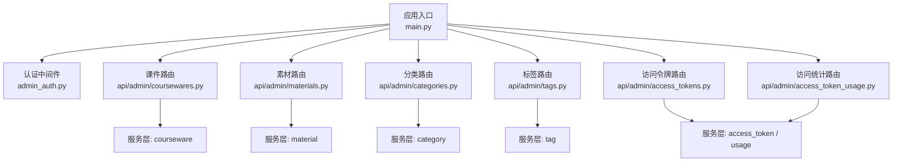
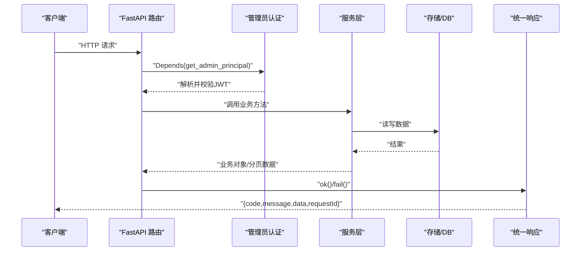
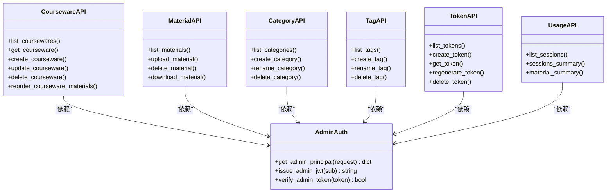

# 管理后台API

<cite>
**本文引用的文件**
- [backend/app/main.py](file://backend/app/main.py)
- [backend/app/middleware/admin_auth.py](file://backend/app/middleware/admin_auth.py)
- [backend/app/core/errors.py](file://backend/app/core/errors.py)
- [backend/app/schemas/__init__.py](file://backend/app/schemas/__init__.py)
- [backend/app/api/admin/coursewares.py](file://backend/app/api/admin/coursewares.py)
- [backend/app/api/admin/materials.py](file://backend/app/api/admin/materials.py)
- [backend/app/api/admin/categories.py](file://backend/app/api/admin/categories.py)
- [backend/app/api/admin/tags.py](file://backend/app/api/admin/tags.py)
- [backend/app/api/admin/access_tokens.py](file://backend/app/api/admin/access_tokens.py)
- [backend/app/api/admin/access_token_usage.py](file://backend/app/api/admin/access_token_usage.py)
- [backend/app/schemas/courseware.py](file://backend/app/schemas/courseware.py)
- [backend/app/schemas/material.py](file://backend/app/schemas/material.py)
- [backend/app/schemas/category.py](file://backend/app/schemas/category.py)
</cite>

## 目录
1. [简介](#简介)
2. [项目结构](#项目结构)
3. [核心组件](#核心组件)
4. [架构总览](#架构总览)
5. [详细接口参考](#详细接口参考)
6. [依赖关系分析](#依赖关系分析)
7. [性能与限流](#性能与限流)
8. [错误码与异常处理](#错误码与异常处理)
9. [故障排查指南](#故障排查指南)
10. [结论](#结论)

## 简介
本文件为学习平台“管理后台”的完整 API 参考文档，覆盖以下功能模块：
- 课件管理（创建、更新、删除、分页查询、素材顺序调整）
- 素材管理（上传、列表、下载、删除）
- 分类管理（树形列表、新增、重命名、删除）
- 标签管理（分页列表、新增、重命名、删除）
- 访问令牌管理（创建、查看、重新生成、删除、引用计数）
- 访问统计（按时间段分页台账、聚合指标、按素材聚合）

所有管理端接口均受管理员认证中间件保护，统一响应信封包含 code/message/data/requestId。

## 项目结构
后端采用 FastAPI 模块化路由组织，管理端路由位于 app/api/admin 下，统一在应用入口中注册并挂载认证依赖。

图示来源
- [backend/app/main.py:40-112](file://backend/app/main.py#L40-L112)
- [backend/app/middleware/admin_auth.py:26-42](file://backend/app/middleware/admin_auth.py#L26-L42)
- [backend/app/api/admin/coursewares.py:17-21](file://backend/app/api/admin/coursewares.py#L17-L21)
- [backend/app/api/admin/materials.py:16-20](file://backend/app/api/admin/materials.py#L16-L20)
- [backend/app/api/admin/categories.py:16-20](file://backend/app/api/admin/categories.py#L16-L20)
- [backend/app/api/admin/tags.py:14-18](file://backend/app/api/admin/tags.py#L14-L18)
- [backend/app/api/admin/access_tokens.py:21-25](file://backend/app/api/admin/access_tokens.py#L21-L25)
- [backend/app/api/admin/access_token_usage.py:19-23](file://backend/app/api/admin/access_token_usage.py#L19-L23)

章节来源
- [backend/app/main.py:40-112](file://backend/app/main.py#L40-L112)

## 核心组件
- 统一响应信封
  - 成功返回使用 ok(data=...)，失败通过全局异常处理器包装为 {code, message, data, requestId}。
- 管理员认证
  - 支持 Authorization: Bearer <JWT> 或 Cookie LH_ADMIN_SESSION；校验 JWT 的 exp/sub 字段，过期/无效返回未认证错误。
- 业务错误
  - 通过 BusinessError(code, message, data) 抛出，由全局异常处理器映射到 HTTP 状态码并输出信封。

章节来源
- [backend/app/schemas/__init__.py:24-61](file://backend/app/schemas/__init__.py#L24-L61)
- [backend/app/middleware/admin_auth.py:26-42](file://backend/app/middleware/admin_auth.py#L26-L42)
- [backend/app/core/errors.py:130-141](file://backend/app/core/errors.py#L130-L141)

## 架构总览
管理端请求流程：客户端 → FastAPI 路由 → 认证中间件(验证JWT) → 控制器(路由) → 服务层 → 数据库/存储 → 统一响应信封。

图示来源
- [backend/app/main.py:70-90](file://backend/app/main.py#L70-L90)
- [backend/app/middleware/admin_auth.py:26-42](file://backend/app/middleware/admin_auth.py#L26-L42)
- [backend/app/schemas/__init__.py:35-61](file://backend/app/schemas/__init__.py#L35-L61)

## 详细接口参考

### 通用约定
- 基础路径
  - 管理端前缀: /api/admin
- 认证方式
  - 请求头: Authorization: Bearer <JWT>
  - 或 Cookie: LH_ADMIN_SESSION=<JWT>
- 统一响应信封
  - 成功: { code:"ok", message:"ok", data:..., requestId:string }
  - 失败: { code:业务码, message:描述, data:任意, requestId:string }
- 分页参数
  - page: 页码(≥1)
  - size: 每页条数(1..200)
  - 返回体包含 page/size/total/items

章节来源
- [backend/app/schemas/__init__.py:24-42](file://backend/app/schemas/__init__.py#L24-L42)
- [backend/app/middleware/admin_auth.py:16-23](file://backend/app/middleware/admin_auth.py#L16-L23)

---

### 课件管理
- 列表
  - 方法: GET
  - 路径: /api/admin/coursewares
  - 查询参数:
    - keyword?: 关键词
    - categoryId?: 分类ID
    - accessMode?: 访问模式
    - page?: 默认1
    - size?: 默认20(1..200)
  - 权限: 管理员
  - 响应: 信封.data = { page, size, total, items:[CoursewareItem] }
- 详情
  - 方法: GET
  - 路径: /api/admin/coursewares/{courseware_id}
  - 权限: 管理员
  - 响应: 信封.data = CoursewareItem(含 materials 列表)
- 创建
  - 方法: POST
  - 路径: /api/admin/coursewares
  - 请求体: CoursewareCreateRequest
  - 权限: 管理员
  - 响应: 信封.data = CoursewareItem
- 更新
  - 方法: PUT
  - 路径: /api/admin/coursewares/{courseware_id}
  - 请求体: CoursewareUpdateRequest
  - 权限: 管理员
  - 响应: 信封.data = CoursewareItem
- 删除
  - 方法: DELETE
  - 路径: /api/admin/coursewares/{courseware_id}
  - 权限: 管理员
  - 响应: 信封.data = null
- 素材顺序调整
  - 方法: PUT
  - 路径: /api/admin/coursewares/{courseware_id}/materials/order
  - 请求体: CoursewareMaterialsReorderRequest { materialIds:number[] }
  - 说明: 按数组顺序重写 sort_order(0..N-1)，校验重复/归属/数量一致性
  - 权限: 管理员
  - 响应: 信封.data = CoursewareItem

章节来源
- [backend/app/api/admin/coursewares.py:24-112](file://backend/app/api/admin/coursewares.py#L24-L112)
- [backend/app/schemas/courseware.py:22-120](file://backend/app/schemas/courseware.py#L22-L120)

---

### 素材管理
- 列表
  - 方法: GET
  - 路径: /api/admin/materials
  - 查询参数:
    - keyword?: 关键词
    - type?: VIDEO/PDF/PPT
    - page?: 默认1
    - size?: 默认20(1..200)
  - 权限: 管理员
  - 响应: 信封.data = { page, size, total, items:[MaterialItem] }
- 上传
  - 方法: POST
  - 路径: /api/admin/materials
  - 表单字段: file (multipart/form-data)
  - 权限: 管理员
  - 响应: 信封.data = { id, name, type, sizeBytes }
- 删除
  - 方法: DELETE
  - 路径: /api/admin/materials/{material_id}
  - 权限: 管理员
  - 响应: 信封.data = null
- 下载
  - 方法: GET
  - 路径: /api/admin/materials/{material_id}/file
  - 权限: 管理员
  - 响应: 二进制文件流(文件名与媒体类型由服务端推断)

章节来源
- [backend/app/api/admin/materials.py:23-70](file://backend/app/api/admin/materials.py#L23-L70)
- [backend/app/schemas/material.py:9-24](file://backend/app/schemas/material.py#L9-L24)

---

### 分类管理
- 列表(树形)
  - 方法: GET
  - 路径: /api/admin/categories
  - 权限: 管理员
  - 响应: 信封.data = CategoryNode[]
- 新增
  - 方法: POST
  - 路径: /api/admin/categories
  - 请求体: CategoryCreateRequest { name, parentId? }
  - 权限: 管理员
  - 响应: 信封.data = { id, parentId, level, name }
- 重命名
  - 方法: PUT
  - 路径: /api/admin/categories/{category_id}
  - 请求体: CategoryRenameRequest { name }
  - 权限: 管理员
  - 响应: 信封.data = { id, parentId, level, name }
- 删除
  - 方法: DELETE
  - 路径: /api/admin/categories/{category_id}
  - 权限: 管理员
  - 响应: 信封.data = null

章节来源
- [backend/app/api/admin/categories.py:33-77](file://backend/app/api/admin/categories.py#L33-L77)
- [backend/app/schemas/category.py:9-40](file://backend/app/schemas/category.py#L9-L40)

---

### 标签管理
- 列表
  - 方法: GET
  - 路径: /api/admin/tags
  - 查询参数:
    - keyword?: 关键词
    - page?: 默认1
    - size?: 默认20(1..200)
  - 权限: 管理员
  - 响应: 信封.data = { page, size, total, items:[TagItem] }
- 新增
  - 方法: POST
  - 路径: /api/admin/tags
  - 请求体: TagNameRequest { name }
  - 权限: 管理员
  - 响应: 信封.data = { id, name, createdAt }
- 重命名
  - 方法: PUT
  - 路径: /api/admin/tags/{tag_id}
  - 请求体: TagNameRequest { name }
  - 权限: 管理员
  - 响应: 信封.data = { id, name, createdAt }
- 删除
  - 方法: DELETE
  - 路径: /api/admin/tags/{tag_id}
  - 权限: 管理员
  - 响应: 信封.data = null

章节来源
- [backend/app/api/admin/tags.py:21-66](file://backend/app/api/admin/tags.py#L21-L66)

---

### 访问令牌管理
- 列表
  - 方法: GET
  - 路径: /api/admin/access-tokens
  - 查询参数:
    - keyword?: 关键词
    - page?: 默认1
    - size?: 默认20(1..200)
  - 权限: 管理员
  - 响应: 信封.data = AccessTokenItem[]
- 创建
  - 方法: POST
  - 路径: /api/admin/access-tokens
  - 请求体: AccessTokenCreateRequest { label }
  - 权限: 管理员
  - 响应: 信封.data = AccessTokenCreatedResponse
- 详情
  - 方法: GET
  - 路径: /api/admin/access-tokens/{token_id}?withUsage=0|1
  - 说明: withUsage=1 时附加 usageSummary(全时段聚合)
  - 权限: 管理员
  - 响应: 信封.data = { id, label, valueHash, coursewareCount, createdAt, regeneratedAt, usageSummary? }
- 重新生成
  - 方法: POST
  - 路径: /api/admin/access-tokens/{token_id}/regenerate
  - 权限: 管理员
  - 响应: 信封.data = AccessTokenCreatedResponse
- 删除
  - 方法: DELETE
  - 路径: /api/admin/access-tokens/{token_id}
  - 权限: 管理员
  - 响应: 信封.data = null

章节来源
- [backend/app/api/admin/access_tokens.py:60-116](file://backend/app/api/admin/access_tokens.py#L60-L116)

---

### 访问统计
- 访问会话(分页)
  - 方法: GET
  - 路径: /api/admin/access-tokens/{token_id}/access-sessions
  - 查询参数:
    - start: YYYY-MM-DD(默认近7天起)
    - end: YYYY-MM-DD(默认近7日止)
    - materialId?: 素材过滤
    - coursewareId?: 课件过滤
    - page?: 默认1
    - size?: 默认20(1..200)
  - 权限: 管理员
  - 响应: 信封.data = AccessSessionPaged
- 会话概览(聚合)
  - 方法: GET
  - 路径: /api/admin/access-tokens/{token_id}/access-sessions/summary
  - 查询参数: start, end(同上)
  - 权限: 管理员
  - 响应: 信封.data = AccessSessionSummary(总停留/次数/课件数/素材数)
- 按素材聚合
  - 方法: GET
  - 路径: /api/admin/access-tokens/{token_id}/access-sessions/material-summary
  - 查询参数: start, end(同上)
  - 权限: 管理员
  - 响应: 信封.data = MaterialUsagePaged(每个素材的累计时长/次数/最近访问时间)

章节来源
- [backend/app/api/admin/access_token_usage.py:32-97](file://backend/app/api/admin/access_token_usage.py#L32-L97)

## 依赖关系分析
- 路由层依赖
  - 所有管理端路由均通过 dependencies=[Depends(get_admin_principal)] 强制管理员鉴权。
- 服务层依赖
  - 各路由调用对应 services.* 完成业务逻辑与数据持久化。
- 错误与响应
  - 全局异常处理器将 BusinessError 转换为信封格式；限流异常也统一封装。

图示来源
- [backend/app/middleware/admin_auth.py:26-42](file://backend/app/middleware/admin_auth.py#L26-L42)
- [backend/app/api/admin/coursewares.py:17-21](file://backend/app/api/admin/coursewares.py#L17-L21)
- [backend/app/api/admin/materials.py:16-20](file://backend/app/api/admin/materials.py#L16-L20)
- [backend/app/api/admin/categories.py:16-20](file://backend/app/api/admin/categories.py#L16-L20)
- [backend/app/api/admin/tags.py:14-18](file://backend/app/api/admin/tags.py#L14-L18)
- [backend/app/api/admin/access_tokens.py:21-25](file://backend/app/api/admin/access_tokens.py#L21-L25)
- [backend/app/api/admin/access_token_usage.py:19-23](file://backend/app/api/admin/access_token_usage.py#L19-L23)

## 性能与限流
- 分页与高级查询
  - 列表接口普遍支持 keyword、type、categoryId、accessMode 等过滤，page/size 控制返回量，避免一次性拉取大量数据。
- 按需聚合
  - 访问令牌详情支持 ?withUsage=1 才计算 usageSummary，减少列表场景的 N+1 开销。
- 限流
  - 集成 SlowAPI，触发 RateLimitExceeded 时返回 429 及统一信封。

章节来源
- [backend/app/api/admin/access_tokens.py:82-102](file://backend/app/api/admin/access_tokens.py#L82-L102)
- [backend/app/main.py:67-89](file://backend/app/main.py#L67-L89)

## 错误码与异常处理
- 统一错误模型
  - 通过 BusinessError(code, message, data) 抛出，全局异常处理器将其转为信封响应。
- 常见错误码(部分)
  - 认证: unauthenticated, forbidden, missing_token, invalid_admin_token
  - 限流: rate_limited
  - 课件: courseware_not_found, courseware_title_required, courseware_category_required, courseware_has_materials, courseware_publish_conflict, courseware_materials_invalid
  - 分类: category_not_found, category_name_required, category_name_conflict, category_max_level, category_has_children, category_has_coursewares
  - 标签: tag_not_found, tag_name_required, tag_name_conflict
  - 素材: material_not_found, material_extension_invalid, material_size_exceeded, material_storage_unavailable, material_referenced, material_upload_failed
  - 令牌: token_not_found, token_label_required, token_label_too_long, token_label_conflict, invalid_token, invalid_token_format, token_revoked, token_required, last_token_required, token_referenced
  - 搜索/AI: search_query_empty, search_query_too_long, llm_timeout, llm_unavailable, search_no_result
- HTTP 状态码映射
  - 例如: unauthenticated→401, forbidden→403, rate_limited→429, internal_error→500, service_unavailable→503 等。

章节来源
- [backend/app/core/errors.py:9-127](file://backend/app/core/errors.py#L9-L127)
- [backend/app/core/errors.py:130-141](file://backend/app/core/errors.py#L130-L141)
- [backend/app/main.py:78-89](file://backend/app/main.py#L78-L89)

## 故障排查指南
- 401 未认证
  - 检查是否携带 Authorization: Bearer 或 Cookie LH_ADMIN_SESSION；确认 JWT 未过期且 sub/exp 有效。
- 429 限流
  - 降低请求频率或联系运维调整限流策略。
- 素材下载失败
  - 若返回 storage_unavailable，表示底层文件丢失，需恢复存储或重建索引。
- 排序失败
  - 素材顺序调整接口会校验 ID 归属、数量一致性与无重复，请确保传入的 materialIds 全部属于该课件且不重复。

章节来源
- [backend/app/middleware/admin_auth.py:26-42](file://backend/app/middleware/admin_auth.py#L26-L42)
- [backend/app/api/admin/materials.py:57-70](file://backend/app/api/admin/materials.py#L57-L70)
- [backend/app/api/admin/coursewares.py:100-112](file://backend/app/api/admin/coursewares.py#L100-L112)

## 结论
管理后台 API 以 FastAPI 路由为中心，结合统一的认证中间件、错误处理与响应信封，提供课件、素材、分类、标签、访问令牌与访问统计的完整管理能力。建议在生产环境严格配置 CORS、JWT 密钥与限流策略，并对大文件上传与统计聚合接口进行容量规划与监控。