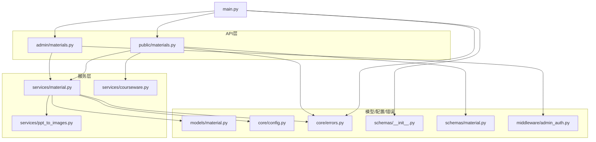
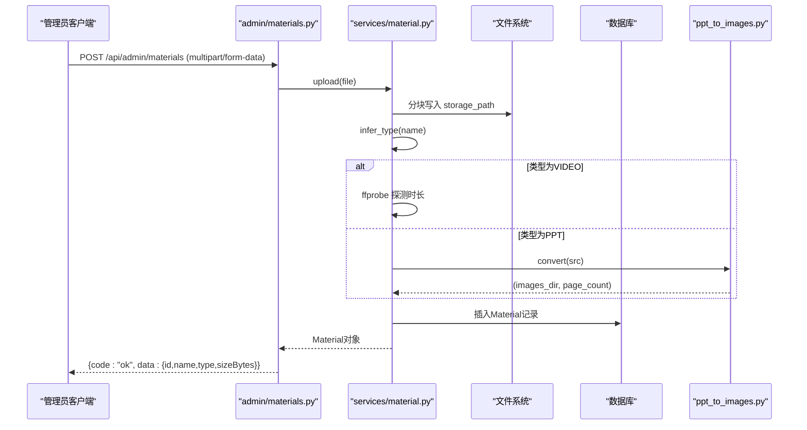
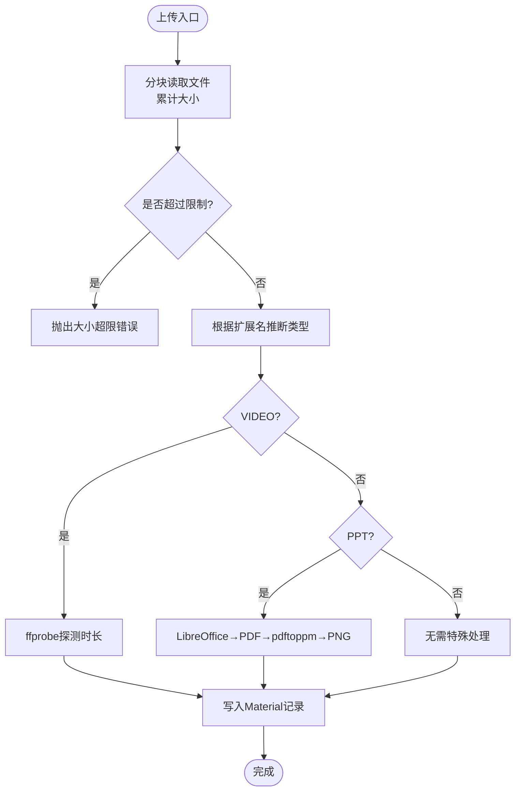
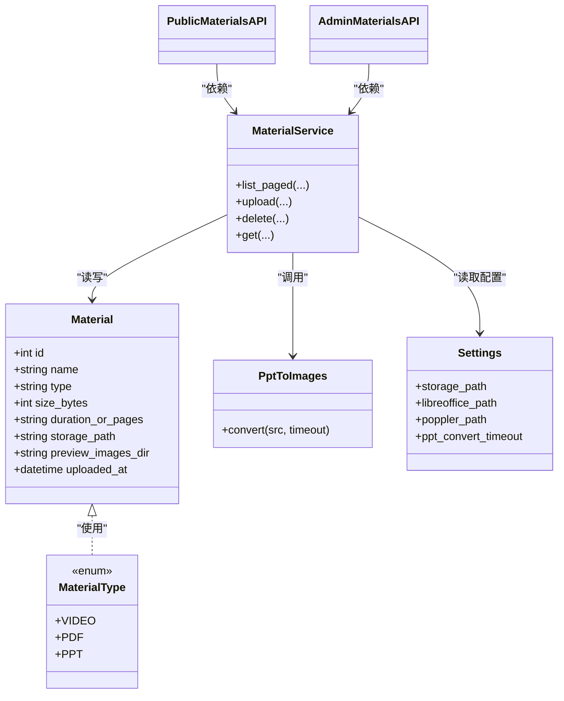

# 素材管理API

<cite>
**本文引用的文件**   
- [backend/app/api/admin/materials.py](file://backend/app/api/admin/materials.py)
- [backend/app/api/public/materials.py](file://backend/app/api/public/materials.py)
- [backend/app/schemas/material.py](file://backend/app/schemas/material.py)
- [backend/app/services/material.py](file://backend/app/services/material.py)
- [backend/app/models/material.py](file://backend/app/models/material.py)
- [backend/app/core/config.py](file://backend/app/core/config.py)
- [backend/app/services/ppt_to_images.py](file://backend/app/services/ppt_to_images.py)
- [backend/app/main.py](file://backend/app/main.py)
- [backend/app/core/errors.py](file://backend/app/core/errors.py)
- [backend/app/schemas/__init__.py](file://backend/app/schemas/__init__.py)
- [backend/app/middleware/admin_auth.py](file://backend/app/middleware/admin_auth.py)
- [backend/app/services/courseware.py](file://backend/app/services/courseware.py)
</cite>

## 目录
1. [简介](#简介)
2. [项目结构](#项目结构)
3. [核心组件](#核心组件)
4. [架构总览](#架构总览)
5. [详细接口说明](#详细接口说明)
6. [依赖关系分析](#依赖关系分析)
7. [性能与扩展性](#性能与扩展性)
8. [安全与合规](#安全与合规)
9. [故障排查指南](#故障排查指南)
10. [结论](#结论)

## 简介
本文件为“素材管理API”的完整技术文档，覆盖以下能力：
- 素材文件的上传、下载、预览（流式）、删除
- 素材元数据的分页查询与单条查询
- 多格式处理：视频(mp4)、PDF、PPT/PPTX 的上传流程与预览生成机制
- 文件类型检测、大小限制、存储路径管理等配置项
- 批量操作与高级查询（基于现有实现）
- 访问控制（令牌解锁）、限流、错误码与统一响应信封
- 请求/响应示例与错误处理指南

## 项目结构
与素材管理相关的后端模块组织如下：
- API层：管理员接口与公共接口分离
- 服务层：业务逻辑（上传、删除、列表、PPT转图片等）
- 模型层：数据库模型与类型推断
- 配置层：环境变量与运行时配置
- 中间件与全局异常：鉴权、限流、统一错误封装

图表来源
- [backend/app/api/admin/materials.py:1-74](file://backend/app/api/admin/materials.py#L1-L74)
- [backend/app/api/public/materials.py:1-224](file://backend/app/api/public/materials.py#L1-L224)
- [backend/app/services/material.py:1-234](file://backend/app/services/material.py#L1-L234)
- [backend/app/services/ppt_to_images.py:1-185](file://backend/app/services/ppt_to_images.py#L1-L185)
- [backend/app/models/material.py:1-69](file://backend/app/models/material.py#L1-L69)
- [backend/app/core/config.py:1-88](file://backend/app/core/config.py#L1-L88)
- [backend/app/core/errors.py:1-144](file://backend/app/core/errors.py#L1-L144)
- [backend/app/schemas/__init__.py:1-65](file://backend/app/schemas/__init__.py#L1-L65)
- [backend/app/schemas/material.py:1-28](file://backend/app/schemas/material.py#L1-L28)
- [backend/app/middleware/admin_auth.py:1-66](file://backend/app/middleware/admin_auth.py#L1-L66)
- [backend/app/services/courseware.py:1-492](file://backend/app/services/courseware.py#L1-L492)
- [backend/app/main.py:1-116](file://backend/app/main.py#L1-L116)

章节来源
- [backend/app/main.py:1-116](file://backend/app/main.py#L1-L116)

## 核心组件
- 管理员接口路由：提供素材上传、列表、下载、删除
- 公共接口路由：提供公开下载、流式预览、PPT图片页获取、单条详情
- 素材服务：文件落盘、类型推断、时长探测、PPT转图片、分页列表、删除校验
- PPT转图片服务：调用外部工具链将PPT转为PNG序列
- 模型与Schema：Material表结构与枚举、统一响应信封
- 配置：存储根路径、外部工具路径、超时、限流等
- 鉴权与错误：Admin JWT校验、统一BusinessError与HTTP状态映射

章节来源
- [backend/app/api/admin/materials.py:1-74](file://backend/app/api/admin/materials.py#L1-L74)
- [backend/app/api/public/materials.py:1-224](file://backend/app/api/public/materials.py#L1-L224)
- [backend/app/services/material.py:1-234](file://backend/app/services/material.py#L1-L234)
- [backend/app/services/ppt_to_images.py:1-185](file://backend/app/services/ppt_to_images.py#L1-L185)
- [backend/app/models/material.py:1-69](file://backend/app/models/material.py#L1-L69)
- [backend/app/schemas/material.py:1-28](file://backend/app/schemas/material.py#L1-L28)
- [backend/app/core/config.py:1-88](file://backend/app/core/config.py#L1-L88)
- [backend/app/core/errors.py:1-144](file://backend/app/core/errors.py#L1-L144)
- [backend/app/schemas/__init__.py:1-65](file://backend/app/schemas/__init__.py#L1-L65)
- [backend/app/middleware/admin_auth.py:1-66](file://backend/app/middleware/admin_auth.py#L1-L66)

## 架构总览
整体数据流与控制流：
- 管理员上传：接收文件 → 写入磁盘 → 类型推断 → 可选时长探测/PPT转图 → 入库
- 公开预览：ACL校验 → 按类型返回inline或attachment → PPT优先返回预览PDF或图片
- 限流：公共接口使用速率限制器
- 错误：统一BusinessError + 全局异常处理器包装信封

图表来源
- [backend/app/api/admin/materials.py:35-48](file://backend/app/api/admin/materials.py#L35-L48)
- [backend/app/services/material.py:129-202](file://backend/app/services/material.py#L129-L202)
- [backend/app/services/ppt_to_images.py:48-181](file://backend/app/services/ppt_to_images.py#L48-L181)
- [backend/app/models/material.py:31-41](file://backend/app/models/material.py#L31-L41)

## 详细接口说明

### 管理员接口：素材管理
基础路径：/api/admin/materials（需管理员JWT）

- 列表（分页、关键词、类型过滤）
  - 方法：GET
  - 路径：/api/admin/materials
  - 查询参数：
    - keyword: 文件名模糊匹配
    - type: VIDEO/PDF/PPT
    - page: 页码(≥1)
    - size: 每页数量(1~200)
  - 成功响应：统一信封，data包含items数组与分页信息
  - 失败：BusinessError（如未认证、系统错误）

- 上传
  - 方法：POST
  - 路径：/api/admin/materials
  - 请求体：multipart/form-data，字段 file
  - 成功响应：{code:"ok", data:{id,name,type,sizeBytes}}
  - 失败：不支持的文件类型、超过大小限制、写入失败等

- 删除
  - 方法：DELETE
  - 路径：/api/admin/materials/{material_id}
  - 成功响应：{code:"ok", data:null}
  - 失败：被课件引用、不存在、存储不可用等

- 下载（原文件，attachment）
  - 方法：GET
  - 路径：/api/admin/materials/{material_id}/file
  - 成功响应：二进制文件流
  - 失败：文件丢失、不存在

鉴权要求
- 所有管理员接口均通过依赖注入进行JWT校验，缺失或过期将返回未认证错误。

章节来源
- [backend/app/api/admin/materials.py:23-70](file://backend/app/api/admin/materials.py#L23-L70)
- [backend/app/middleware/admin_auth.py:26-42](file://backend/app/middleware/admin_auth.py#L26-L42)

### 公共接口：素材访问
基础路径：/api/public/materials

- 公开下载（attachment）
  - 方法：GET
  - 路径：/api/public/materials/{material_id}/file
  - 访问控制：若素材仅出现在RESTRICTED课件中，需提供已解锁token哈希（Header X-Token-Hash 或 Cookie lh_token_hash），否则拒绝
  - 成功响应：原文件二进制流
  - 失败：ACL锁定、文件丢失、不存在

- 流式预览（inline）
  - 方法：GET
  - 路径：/api/public/materials/{material_id}/stream
  - 行为：
    - VIDEO：video/mp4 inline
    - PDF：application/pdf inline，重命名为.pdf
    - PPT：优先返回 preview_pdf_path（若有），否则降级返回原PPT attachment
  - 限流：60次/分钟
  - 失败：ACL锁定、文件丢失、不存在

- PPT图片页（inline PNG）
  - 方法：GET
  - 路径：/api/public/materials/{material_id}/image/{page_no}
  - 条件：仅PPT且存在preview_images_dir；page_no从1开始
  - 失败：无可用预览、页码越界

- 单条详情（供前端播放器/查看器）
  - 方法：GET
  - 路径：/api/public/materials/{material_id}
  - 返回：id、name、type、sizeBytes、duration、streamUrl、downloadUrl；PPT时额外返回 imageCount、imageUrls、previewReady
  - 限流：60次/分钟
  - 失败：ACL锁定、不存在

章节来源
- [backend/app/api/public/materials.py:64-221](file://backend/app/api/public/materials.py#L64-L221)
- [backend/app/services/courseware.py:66-75](file://backend/app/services/courseware.py#L66-L75)

### 上传流程与多格式处理

#### 文件类型检测
- 依据扩展名推断类型：mp4→VIDEO，pdf→PDF，ppt/pptx→PPT
- 不支持的扩展名直接拒绝

#### 大小限制
- 服务端最大限制常量定义在上传服务中（默认500MB）
- 注意：Nginx网关也需设置 client_max_body_size 与之对齐

#### 存储路径管理
- 根路径由配置项 storage_path 指定，默认 /app/storage/documents
- 实际落盘按年月子目录组织，文件名带时间戳与随机串避免冲突

#### 视频时长探测
- 使用ffprobe读取format.duration并格式化MM:SS或HH:MM:SS
- 失败不阻断上传，仅记录日志

#### PPT转图片
- 步骤：LibreOffice导出PDF → pdftoppm拆分为page-1.png...
- 输出目录：与源文件同级，名称为<PPT.stem>
- 失败不阻断上传，仅记录日志；前端走降级策略

图表来源
- [backend/app/services/material.py:129-202](file://backend/app/services/material.py#L129-L202)
- [backend/app/models/material.py:31-41](file://backend/app/models/material.py#L31-L41)
- [backend/app/services/ppt_to_images.py:48-181](file://backend/app/services/ppt_to_images.py#L48-L181)

章节来源
- [backend/app/services/material.py:25-76](file://backend/app/services/material.py#L25-L76)
- [backend/app/services/material.py:129-202](file://backend/app/services/material.py#L129-L202)
- [backend/app/models/material.py:22-41](file://backend/app/models/material.py#L22-L41)
- [backend/app/core/config.py:54-60](file://backend/app/core/config.py#L54-L60)

### 批量操作与高级查询
- 当前素材接口未提供批量上传/删除端点
- 支持高级查询：关键词模糊匹配、类型过滤、分页
- 如需批量操作，可在管理员接口新增对应端点并在服务层实现事务与幂等

章节来源
- [backend/app/api/admin/materials.py:23-32](file://backend/app/api/admin/materials.py#L23-L32)
- [backend/app/services/material.py:78-119](file://backend/app/services/material.py#L78-L119)

## 依赖关系分析

图表来源
- [backend/app/models/material.py:44-69](file://backend/app/models/material.py#L44-L69)
- [backend/app/services/material.py:1-234](file://backend/app/services/material.py#L1-234)
- [backend/app/services/ppt_to_images.py:1-185](file://backend/app/services/ppt_to_images.py#L1-L185)
- [backend/app/core/config.py:9-88](file://backend/app/core/config.py#L9-L88)
- [backend/app/api/public/materials.py:1-224](file://backend/app/api/public/materials.py#L1-L224)
- [backend/app/api/admin/materials.py:1-74](file://backend/app/api/admin/materials.py#L1-L74)

章节来源
- [backend/app/models/material.py:1-69](file://backend/app/models/material.py#L1-L69)
- [backend/app/services/material.py:1-234](file://backend/app/services/material.py#L1-L234)
- [backend/app/services/ppt_to_images.py:1-185](file://backend/app/services/ppt_to_images.py#L1-L185)
- [backend/app/core/config.py:1-88](file://backend/app/core/config.py#L1-L88)

## 性能与扩展性
- 上传分块写入：每次读取固定大小块，降低内存占用
- 外部工具异步化建议：PPT转换与时长探测可改为后台任务队列，避免阻塞上传主流程
- 预览优化：
  - PPT优先返回生成的PDF或图片，减少浏览器解析压力
  - 图片按需加载（image/{page_no}）
- 限流保护：公共接口采用每分钟60次的速率限制
- 存储分层：按年月归档，便于清理与迁移
- 可扩展点：
  - 增加病毒扫描钩子（上传后触发）
  - 引入对象存储（S3/OSS）替代本地磁盘
  - 增加CDN缓存静态资源（PDF/PNG）

[本节为通用指导，不直接分析具体文件]

## 安全与合规
- 管理员鉴权：JWT校验，支持Header与Cookie两种形式
- 访问控制：
  - 若素材仅关联RESTRICTED课件，需携带已解锁token哈希（X-Token-Hash或Cookie lh_token_hash）
  - 任一关联课件为OPEN则放行
- 限流：公共接口限速，防止滥用
- 错误码与统一信封：所有业务错误以统一格式返回，便于前端处理

章节来源
- [backend/app/middleware/admin_auth.py:26-42](file://backend/app/middleware/admin_auth.py#L26-L42)
- [backend/app/api/public/materials.py:31-61](file://backend/app/api/public/materials.py#L31-L61)
- [backend/app/core/errors.py:73-127](file://backend/app/core/errors.py#L73-L127)
- [backend/app/schemas/__init__.py:24-61](file://backend/app/schemas/__init__.py#L24-L61)

## 故障排查指南
常见问题与定位要点：
- 上传失败
  - 检查文件大小是否超过限制
  - 确认存储路径存在且可写
  - 查看日志中“文件写入失败”相关提示
- 预览不可用
  - PPT未生成预览：检查LibreOffice与pdftoppm是否安装并可执行
  - 文件丢失：检查storage_path下对应文件是否存在
- 权限问题
  - 管理员接口：确认JWT有效
  - 公共接口：确认已解锁token哈希正确传递
- 限流触发
  - 公共接口频繁访问将被限流，适当降频或缓存

章节来源
- [backend/app/services/material.py:129-202](file://backend/app/services/material.py#L129-L202)
- [backend/app/services/ppt_to_images.py:69-181](file://backend/app/services/ppt_to_images.py#L69-L181)
- [backend/app/api/public/materials.py:64-146](file://backend/app/api/public/materials.py#L64-L146)
- [backend/app/core/errors.py:103-109](file://backend/app/core/errors.py#L103-L109)

## 结论
素材管理API提供了完整的文件生命周期管理能力，结合严格的类型检测、大小限制、访问控制与限流策略，满足教学平台对多媒体素材的安全与可用性需求。未来可通过异步化转换、对象存储与CDN进一步扩展性能与可靠性。