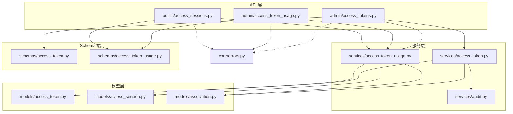
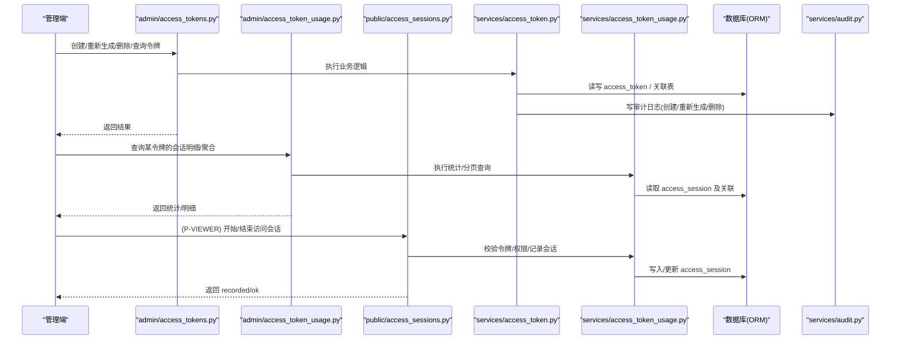
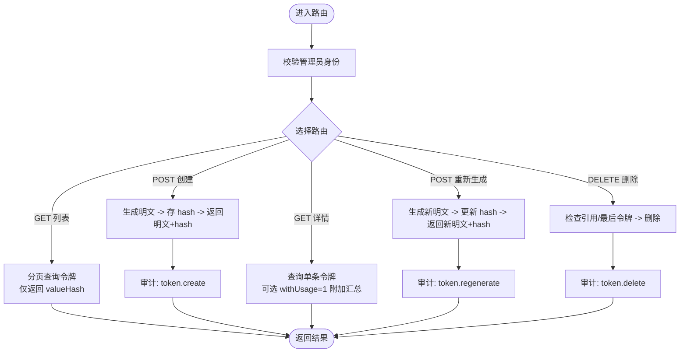
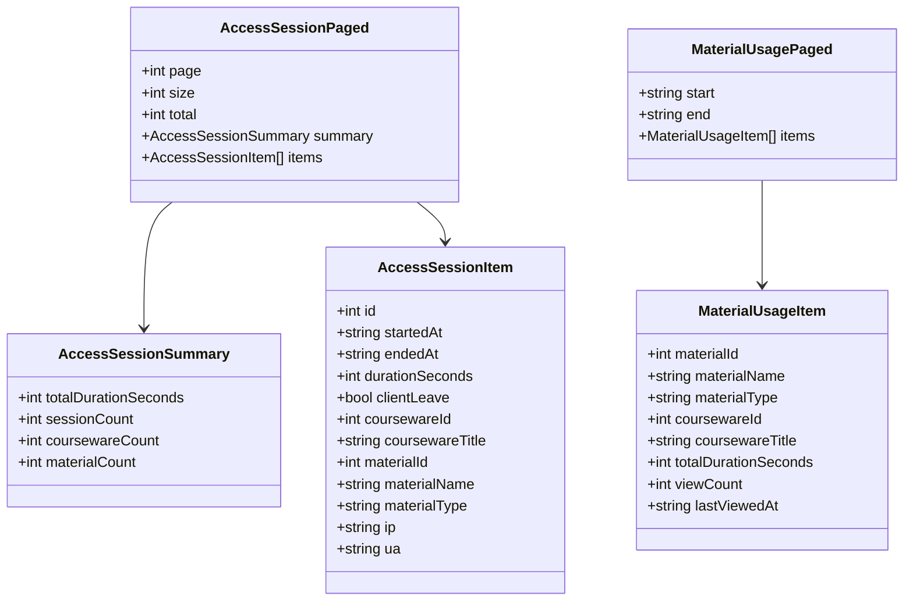
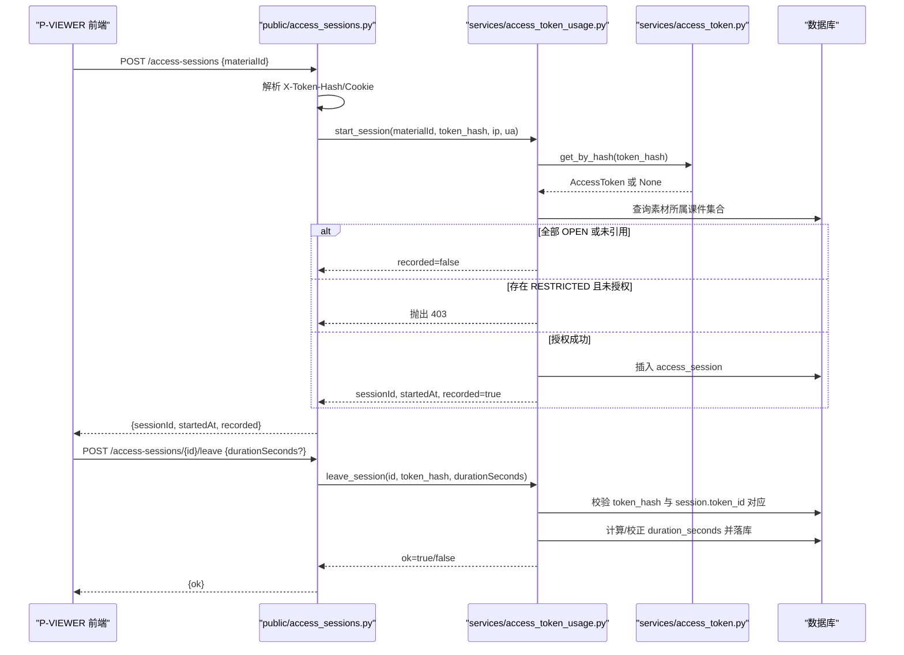
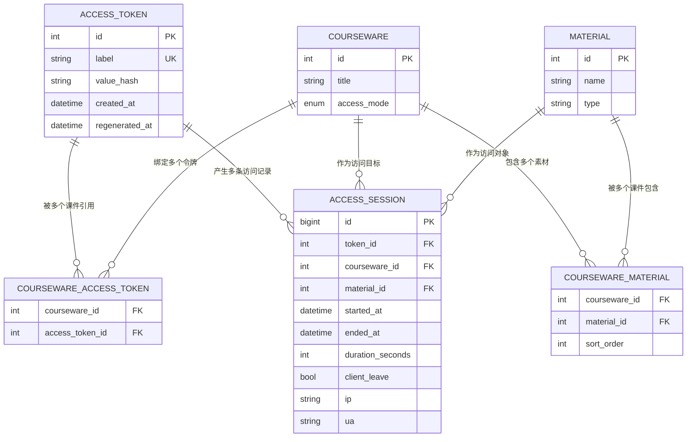
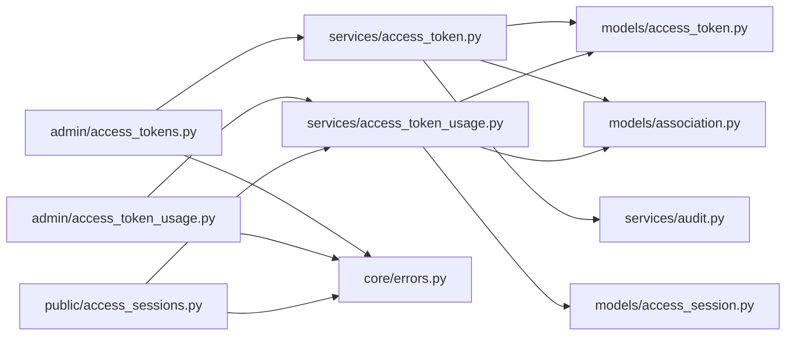

# 访问令牌管理API

<cite>
**本文引用的文件**   
- [backend/app/api/admin/access_tokens.py](file://backend/app/api/admin/access_tokens.py)
- [backend/app/api/admin/access_token_usage.py](file://backend/app/api/admin/access_token_usage.py)
- [backend/app/api/public/access_sessions.py](file://backend/app/api/public/access_sessions.py)
- [backend/app/schemas/access_token.py](file://backend/app/schemas/access_token.py)
- [backend/app/schemas/access_token_usage.py](file://backend/app/schemas/access_token_usage.py)
- [backend/app/services/access_token.py](file://backend/app/services/access_token.py)
- [backend/app/services/access_token_usage.py](file://backend/app/services/access_token_usage.py)
- [backend/app/models/access_token.py](file://backend/app/models/access_token.py)
- [backend/app/models/access_session.py](file://backend/app/models/access_session.py)
- [backend/app/models/association.py](file://backend/app/models/association.py)
- [backend/app/core/errors.py](file://backend/app/core/errors.py)
- [backend/app/services/audit.py](file://backend/app/services/audit.py)
</cite>

## 目录
1. [简介](#简介)
2. [项目结构](#项目结构)
3. [核心组件](#核心组件)
4. [架构总览](#架构总览)
5. [详细组件分析](#详细组件分析)
6. [依赖关系分析](#依赖关系分析)
7. [性能与扩展性](#性能与扩展性)
8. [故障排查指南](#故障排查指南)
9. [结论](#结论)
10. [附录：示例与安全最佳实践](#附录示例与安全最佳实践)

## 简介
本文件面向“访问令牌管理”的完整生命周期与使用场景，覆盖以下能力：
- 令牌的创建、重新生成（等价于刷新）、删除、查询（分页与详情）
- 令牌与课件的绑定关系管理与权限控制机制
- 令牌使用统计与审计日志查询接口
- 令牌生成算法、有效期策略与安全考虑
- 批量操作说明与实现现状
- 安全最佳实践与常见错误处理

## 项目结构
后端采用 FastAPI + SQLAlchemy 的分层架构：
- API 层：路由定义与请求/响应封装
- 服务层：业务规则、数据聚合、鉴权与审计
- 模型层：ORM 实体与关联表
- Schema 层：Pydantic 校验与序列化

图表来源
- [backend/app/api/admin/access_tokens.py:1-120](file://backend/app/api/admin/access_tokens.py#L1-L120)
- [backend/app/api/admin/access_token_usage.py:1-101](file://backend/app/api/admin/access_token_usage.py#L1-L101)
- [backend/app/api/public/access_sessions.py:1-137](file://backend/app/api/public/access_sessions.py#L1-L137)
- [backend/app/services/access_token.py:1-235](file://backend/app/services/access_token.py#L1-L235)
- [backend/app/services/access_token_usage.py:1-518](file://backend/app/services/access_token_usage.py#L1-L518)
- [backend/app/services/audit.py:1-45](file://backend/app/services/audit.py#L1-L45)
- [backend/app/models/access_token.py:1-34](file://backend/app/models/access_token.py#L1-L34)
- [backend/app/models/access_session.py:1-129](file://backend/app/models/access_session.py#L1-L129)
- [backend/app/models/association.py:1-41](file://backend/app/models/association.py#L1-L41)
- [backend/app/schemas/access_token.py:1-53](file://backend/app/schemas/access_token.py#L1-L53)
- [backend/app/schemas/access_token_usage.py:1-91](file://backend/app/schemas/access_token_usage.py#L1-L91)
- [backend/app/core/errors.py:1-144](file://backend/app/core/errors.py#L1-L144)

章节来源
- [backend/app/api/admin/access_tokens.py:1-120](file://backend/app/api/admin/access_tokens.py#L1-L120)
- [backend/app/api/admin/access_token_usage.py:1-101](file://backend/app/api/admin/access_token_usage.py#L1-L101)
- [backend/app/api/public/access_sessions.py:1-137](file://backend/app/api/public/access_sessions.py#L1-L137)

## 核心组件
- 访问令牌模型与存储
  - 仅存储明文令牌的 SHA-256 摘要；明文仅在创建或重新生成时一次性返回。
  - 标签全局唯一，长度限制，去空白处理。
- 令牌服务
  - 提供创建、重新生成、删除、列表分页、按ID获取、验证等能力。
  - 删除前检查是否被课件引用，且至少保留一个活跃令牌。
- 访问会话服务
  - 记录受保护素材的访问会话（开始/结束），支持客户端上报时长与服务端校正。
  - 提供按时间区间、按素材聚合的统计接口。
- 公共访问会话 API
  - 无需管理员鉴权，凭令牌哈希即可开启/结束会话。
  - 内置进程内 IP 限流兜底，失败降级不阻塞前端。
- 审计日志
  - 关键管理操作以 JSON Lines 追加写入本地日志文件。

章节来源
- [backend/app/models/access_token.py:1-34](file://backend/app/models/access_token.py#L1-L34)
- [backend/app/services/access_token.py:1-235](file://backend/app/services/access_token.py#L1-L235)
- [backend/app/services/access_token_usage.py:1-518](file://backend/app/services/access_token_usage.py#L1-L518)
- [backend/app/api/public/access_sessions.py:1-137](file://backend/app/api/public/access_sessions.py#L1-L137)
- [backend/app/services/audit.py:1-45](file://backend/app/services/audit.py#L1-L45)

## 架构总览
下图展示了从管理端到公开端的端到端流程：管理员通过管理 API 维护令牌并查看使用统计；前端 P-VIEWER 在访问受限素材时调用公开 API 记录会话。

图表来源
- [backend/app/api/admin/access_tokens.py:1-120](file://backend/app/api/admin/access_tokens.py#L1-L120)
- [backend/app/api/admin/access_token_usage.py:1-101](file://backend/app/api/admin/access_token_usage.py#L1-L101)
- [backend/app/api/public/access_sessions.py:1-137](file://backend/app/api/public/access_sessions.py#L1-L137)
- [backend/app/services/access_token.py:1-235](file://backend/app/services/access_token.py#L1-L235)
- [backend/app/services/access_token_usage.py:1-518](file://backend/app/services/access_token_usage.py#L1-L518)
- [backend/app/services/audit.py:1-45](file://backend/app/services/audit.py#L1-L45)

## 详细组件分析

### 令牌管理 API（管理端）
- 路由前缀：/api/admin/access-tokens
- 鉴权：需管理员身份（依赖注入）
- 主要接口
  - GET /api/admin/access-tokens：分页列出令牌（仅返回 valueHash）
  - POST /api/admin/access-tokens：创建令牌（返回一次性的明文 value 与 valueHash）
  - GET /api/admin/access-tokens/{token_id}：获取详情，可选附加 usageSummary
  - POST /api/admin/access-tokens/{token_id}/regenerate：重新生成令牌（旧值即刻失效）
  - DELETE /api/admin/access-tokens/{token_id}：删除令牌（受引用与最后令牌约束）

图表来源
- [backend/app/api/admin/access_tokens.py:1-120](file://backend/app/api/admin/access_tokens.py#L1-L120)
- [backend/app/services/access_token.py:1-235](file://backend/app/services/access_token.py#L1-L235)
- [backend/app/services/audit.py:1-45](file://backend/app/services/audit.py#L1-L45)

章节来源
- [backend/app/api/admin/access_tokens.py:1-120](file://backend/app/api/admin/access_tokens.py#L1-L120)
- [backend/app/schemas/access_token.py:1-53](file://backend/app/schemas/access_token.py#L1-L53)
- [backend/app/services/access_token.py:1-235](file://backend/app/services/access_token.py#L1-L235)

### 令牌使用统计与审计（管理端）
- 路由前缀：/api/admin/access-tokens
- 主要接口
  - GET /api/admin/access-tokens/{token_id}/access-sessions：分页访问台账（支持按素材/课件过滤）
  - GET /api/admin/access-tokens/{token_id}/access-sessions/summary：区间聚合指标（总停留/次数/课件数/素材数）
  - GET /api/admin/access-tokens/{token_id}/access-sessions/material-summary：按素材聚合（累计停留/次数/最近访问时间）
  - GET /api/admin/access-tokens/{token_id}?withUsage=1：详情中附带全时段汇总

图表来源
- [backend/app/schemas/access_token_usage.py:1-91](file://backend/app/schemas/access_token_usage.py#L1-L91)
- [backend/app/api/admin/access_token_usage.py:1-101](file://backend/app/api/admin/access_token_usage.py#L1-L101)

章节来源
- [backend/app/api/admin/access_token_usage.py:1-101](file://backend/app/api/admin/access_token_usage.py#L1-L101)
- [backend/app/schemas/access_token_usage.py:1-91](file://backend/app/schemas/access_token_usage.py#L1-L91)
- [backend/app/services/access_token_usage.py:1-518](file://backend/app/services/access_token_usage.py#L1-L518)

### 公开访问会话 API（P-VIEWER 侧）
- 路由前缀：/api/public/access-sessions
- 鉴权：无需管理员鉴权，凭令牌哈希（优先请求头 X-Token-Hash，否则 Cookie lh_token_hash）
- 主要接口
  - POST /api/public/access-sessions：开始访问会话（含权限校验、OPEN 跳过、IP 限流降级）
  - POST /api/public/access-sessions/{session_id}/leave：结束访问会话（幂等，带令牌匹配校验）

图表来源
- [backend/app/api/public/access_sessions.py:1-137](file://backend/app/api/public/access_sessions.py#L1-L137)
- [backend/app/services/access_token_usage.py:1-518](file://backend/app/services/access_token_usage.py#L1-L518)
- [backend/app/services/access_token.py:1-235](file://backend/app/services/access_token.py#L1-L235)

章节来源
- [backend/app/api/public/access_sessions.py:1-137](file://backend/app/api/public/access_sessions.py#L1-L137)
- [backend/app/services/access_token_usage.py:1-518](file://backend/app/services/access_token_usage.py#L1-L518)

### 令牌与课件的绑定与权限控制
- 绑定关系
  - 多对多关联表：courseware_access_token（课件 ↔ 令牌）
  - 删除令牌前需检查是否被课件引用；若被引用则拒绝删除
- 权限控制
  - 开始访问会话时，系统会查找该素材所属的所有课件，若任一为 RESTRICTED，则要求当前令牌必须出现在该课件的允许列表中
  - 若令牌无权访问，返回 403

图表来源
- [backend/app/models/access_token.py:1-34](file://backend/app/models/access_token.py#L1-L34)
- [backend/app/models/access_session.py:1-129](file://backend/app/models/access_session.py#L1-L129)
- [backend/app/models/association.py:1-41](file://backend/app/models/association.py#L1-L41)

章节来源
- [backend/app/models/association.py:1-41](file://backend/app/models/association.py#L1-L41)
- [backend/app/services/access_token_usage.py:1-518](file://backend/app/services/access_token_usage.py#L1-L518)

### 令牌生成算法与有效期策略
- 生成算法
  - 使用密码学安全的随机源生成固定长度的 base36 字符串（小写字母+数字）
  - 明文仅创建/重新生成时返回一次；数据库仅保存其 SHA-256 摘要
- 有效期与续期
  - 当前模型未内置过期时间字段；令牌无自动过期
  - 通过“重新生成”实现等效续期：旧值立即失效，新值生效
- 撤销
  - 当前未提供显式“禁用/启用”开关；可通过“重新生成”使旧值失效，达到撤销效果
  - 删除令牌将级联清理其历史访问会话

章节来源
- [backend/app/services/access_token.py:1-235](file://backend/app/services/access_token.py#L1-L235)
- [backend/app/models/access_token.py:1-34](file://backend/app/models/access_token.py#L1-L34)

### 批量操作
- 当前实现未提供批量创建/批量启用/批量禁用的接口
- 建议：如需批量操作，可在管理端增加批量路由，复用现有服务方法并在事务中保证一致性

[本节为通用说明，不涉及具体代码文件]

## 依赖关系分析
- API 层依赖服务层进行业务处理与数据持久化
- 服务层依赖模型层进行 ORM 操作，并通过审计模块记录关键操作
- 公共会话 API 在服务层完成令牌校验、权限判定与会话落库
- 错误码统一由核心错误模块映射 HTTP 状态码

图表来源
- [backend/app/api/admin/access_tokens.py:1-120](file://backend/app/api/admin/access_tokens.py#L1-L120)
- [backend/app/api/admin/access_token_usage.py:1-101](file://backend/app/api/admin/access_token_usage.py#L1-L101)
- [backend/app/api/public/access_sessions.py:1-137](file://backend/app/api/public/access_sessions.py#L1-L137)
- [backend/app/services/access_token.py:1-235](file://backend/app/services/access_token.py#L1-L235)
- [backend/app/services/access_token_usage.py:1-518](file://backend/app/services/access_token_usage.py#L1-L518)
- [backend/app/models/access_token.py:1-34](file://backend/app/models/access_token.py#L1-L34)
- [backend/app/models/access_session.py:1-129](file://backend/app/models/access_session.py#L1-L129)
- [backend/app/models/association.py:1-41](file://backend/app/models/association.py#L1-L41)
- [backend/app/core/errors.py:1-144](file://backend/app/core/errors.py#L1-L144)
- [backend/app/services/audit.py:1-45](file://backend/app/services/audit.py#L1-L45)

章节来源
- [backend/app/core/errors.py:1-144](file://backend/app/core/errors.py#L1-L144)

## 性能与扩展性
- 列表页避免 N+1：详情中的 usageSummary 默认不加载，需显式 withUsage=1 触发
- 访问会话写入降级：当数据库异常或命中限流时，返回 recorded=false，不阻塞前端主流程
- 跨方言时间差计算：自定义表达式适配 PostgreSQL 与 SQLite，提升可移植性
- 索引优化：访问会话表针对 token_id+started_at、token_id+material_id、token_id+courseware_id 建立索引，提高查询效率

[本节为通用说明，不涉及具体代码文件]

## 故障排查指南
- 常见错误码与含义
  - missing_token：缺少令牌
  - invalid_token：令牌无效
  - courseware_acl_locked：令牌无权访问该素材
  - token_not_found：令牌不存在
  - token_referenced：仍有课件引用此令牌，无法删除
  - last_token_required：至少保留 1 个令牌
- 定位步骤
  - 确认请求是否携带 X-Token-Hash 或 Cookie lh_token_hash
  - 检查令牌是否存在且未被重新生成
  - 检查素材是否被 RESTRICTED 课件引用，且令牌是否在绑定列表
  - 查看审计日志文件（应用存储路径下的 logs/audit.jsonl）

章节来源
- [backend/app/core/errors.py:1-144](file://backend/app/core/errors.py#L1-L144)
- [backend/app/services/audit.py:1-45](file://backend/app/services/audit.py#L1-L45)

## 结论
本方案实现了访问令牌的完整生命周期管理（创建、重新生成、删除、查询），并与课件绑定关系和权限控制紧密集成。通过公开会话 API 记录访问行为，并提供多维度的统计与审计能力。当前未实现显式的启用/禁用开关与批量操作，但可通过重新生成与后续扩展满足需求。整体设计兼顾安全性与可用性，具备较好的可扩展性与可观测性。

[本节为总结性内容，不涉及具体代码文件]

## 附录：示例与安全最佳实践

### 典型操作流程（示例）
- 创建令牌
  - 调用管理端创建接口，保存返回的明文 value 与 valueHash
- 绑定课件
  - 在课件管理中为该课件添加已创建的令牌（多对多关联）
- 前端访问受限素材
  - 在请求头或 Cookie 中携带 X-Token-Hash
  - 调用公开 API 开始/结束会话
- 查看使用统计
  - 管理端按时间段查询会话明细与聚合指标
  - 按需查看按素材聚合的报告

[本节为概念性示例，不涉及具体代码文件]

### 安全最佳实践
- 传输安全
  - 始终通过 HTTPS 传输令牌相关请求
- 令牌存储
  - 服务端仅存储 SHA-256 摘要；客户端妥善保存明文 value，避免泄露
- 令牌轮换
  - 定期重新生成令牌，降低长期暴露风险
- 最小权限
  - 仅将必要课件绑定到令牌，遵循最小授权原则
- 审计与监控
  - 关注审计日志与访问统计，发现异常及时处置
- 限流与降级
  - 利用公开接口的进程内限流与降级策略，保障前端体验

[本节为通用指导，不涉及具体代码文件]