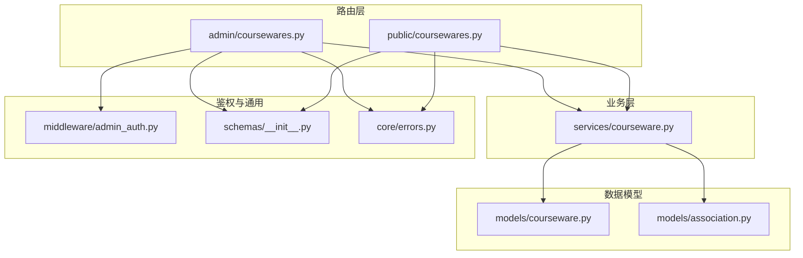
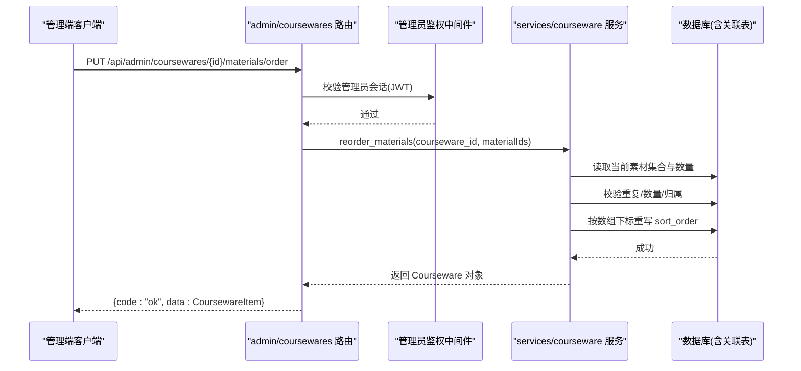
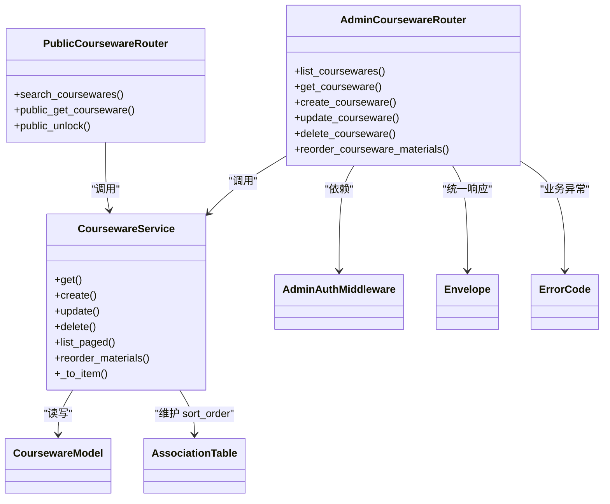
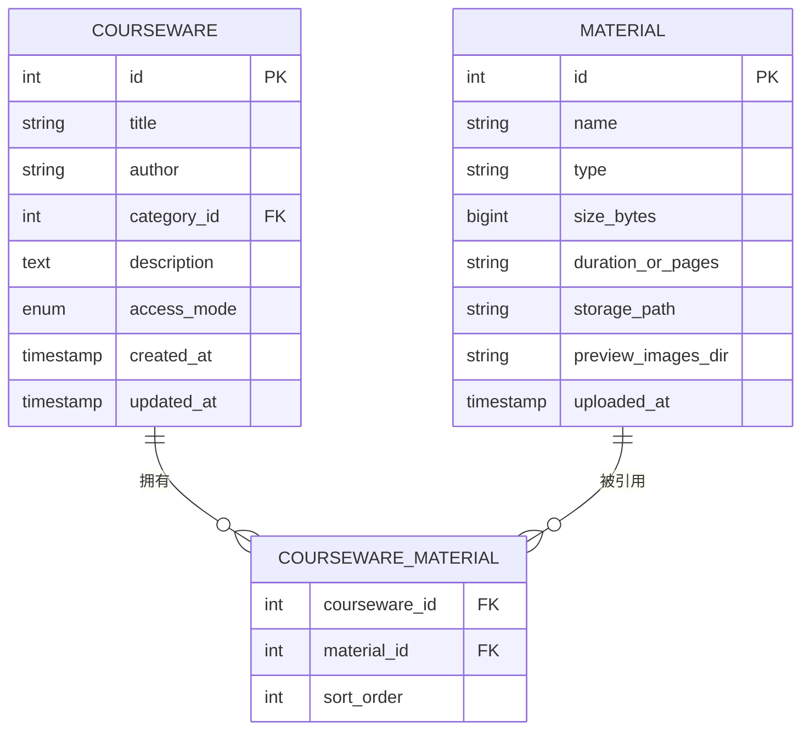

# 课件管理API

<cite>
**本文引用的文件**
- [backend/app/api/admin/coursewares.py](file://backend/app/api/admin/coursewares.py)
- [backend/app/api/public/coursewares.py](file://backend/app/api/public/coursewares.py)
- [backend/app/schemas/courseware.py](file://backend/app/schemas/courseware.py)
- [backend/app/services/courseware.py](file://backend/app/services/courseware.py)
- [backend/app/models/courseware.py](file://backend/app/models/courseware.py)
- [backend/app/models/association.py](file://backend/app/models/association.py)
- [backend/app/middleware/admin_auth.py](file://backend/app/middleware/admin_auth.py)
- [backend/app/core/errors.py](file://backend/app/core/errors.py)
- [backend/app/schemas/__init__.py](file://backend/app/schemas/__init__.py)
- [backend/app/api/admin/materials.py](file://backend/app/api/admin/materials.py)
- [backend/app/services/material.py](file://backend/app/services/material.py)
- [backend/app/models/material.py](file://backend/app/models/material.py)
- [doc/spec/10-API设计规范.md](file://doc/spec/10-API设计规范.md)
</cite>

## 目录
1. [简介](#简介)
2. [项目结构](#项目结构)
3. [核心组件](#核心组件)
4. [架构总览](#架构总览)
5. [详细接口说明](#详细接口说明)
6. [依赖关系分析](#依赖关系分析)
7. [性能与扩展性](#性能与扩展性)
8. [故障排查指南](#故障排查指南)
9. [结论](#结论)
10. [附录：数据模型与排序语义](#附录数据模型与排序语义)

## 简介
本文件面向“课件管理”相关 API，覆盖管理端与公共端的完整能力：
- 管理端（需管理员登录）：课件的列表查询、详情、创建、更新、删除；专用素材顺序调整接口。
- 公共端：统一搜索、公开详情、令牌解锁访问受限课件。
- 重点说明 /materials/order 接口的实现与使用方式，包括请求参数、校验规则、错误码与前后端交互流程。

## 项目结构
围绕课件管理的后端关键路径如下：
- 路由层：admin/coursewares、public/coursewares
- 业务层：services/courseware
- 数据模型：models/courseware、models/association（含 sort_order）
- 鉴权中间件：middleware/admin_auth
- 统一响应信封：schemas/__init__.py
- 错误码映射：core/errors.py

图表来源
- [backend/app/api/admin/coursewares.py:1-115](file://backend/app/api/admin/coursewares.py#L1-L115)
- [backend/app/api/public/coursewares.py:1-133](file://backend/app/api/public/coursewares.py#L1-L133)
- [backend/app/services/courseware.py:1-492](file://backend/app/services/courseware.py#L1-L492)
- [backend/app/models/courseware.py:1-74](file://backend/app/models/courseware.py#L1-L74)
- [backend/app/models/association.py:1-41](file://backend/app/models/association.py#L1-L41)
- [backend/app/middleware/admin_auth.py:1-66](file://backend/app/middleware/admin_auth.py#L1-L66)
- [backend/app/schemas/__init__.py:1-65](file://backend/app/schemas/__init__.py#L1-L65)
- [backend/app/core/errors.py:1-144](file://backend/app/core/errors.py#L1-L144)

章节来源
- [backend/app/api/admin/coursewares.py:1-115](file://backend/app/api/admin/coursewares.py#L1-L115)
- [backend/app/api/public/coursewares.py:1-133](file://backend/app/api/public/coursewares.py#L1-L133)
- [backend/app/services/courseware.py:1-492](file://backend/app/services/courseware.py#L1-L492)
- [backend/app/models/courseware.py:1-74](file://backend/app/models/courseware.py#L1-L74)
- [backend/app/models/association.py:1-41](file://backend/app/models/association.py#L1-L41)
- [backend/app/middleware/admin_auth.py:1-66](file://backend/app/middleware/admin_auth.py#L1-L66)
- [backend/app/schemas/__init__.py:1-65](file://backend/app/schemas/__init__.py#L1-L65)
- [backend/app/core/errors.py:1-144](file://backend/app/core/errors.py#L1-L144)

## 核心组件
- 路由与鉴权
  - 管理端路由挂载在 /api/admin/coursewares，全局依赖管理员鉴权中间件。
  - 公共端路由挂载在 /api/public/coursewares，提供搜索、详情与解锁。
- 业务服务
  - services/courseware 提供 CRUD、分页列表、排序重排、序列化等。
- 数据模型
  - models/courseware 定义课件主表与关联关系。
  - models/association 定义 M:N 关联表，包含 sort_order 字段用于素材顺序。
- 统一响应与错误
  - schemas/__init__.py 提供 ok/fail 信封构造。
  - core/errors.py 集中定义错误码与 HTTP 状态映射。

章节来源
- [backend/app/api/admin/coursewares.py:1-115](file://backend/app/api/admin/coursewares.py#L1-L115)
- [backend/app/api/public/coursewares.py:1-133](file://backend/app/api/public/coursewares.py#L1-L133)
- [backend/app/services/courseware.py:1-492](file://backend/app/services/courseware.py#L1-L492)
- [backend/app/models/courseware.py:1-74](file://backend/app/models/courseware.py#L1-L74)
- [backend/app/models/association.py:1-41](file://backend/app/models/association.py#L1-L41)
- [backend/app/schemas/__init__.py:1-65](file://backend/app/schemas/__init__.py#L1-L65)
- [backend/app/core/errors.py:1-144](file://backend/app/core/errors.py#L1-L144)

## 架构总览
下图展示一次“管理端更新课件并调整素材顺序”的典型调用链。

图表来源
- [backend/app/api/admin/coursewares.py:100-112](file://backend/app/api/admin/coursewares.py#L100-L112)
- [backend/app/middleware/admin_auth.py:26-42](file://backend/app/middleware/admin_auth.py#L26-L42)
- [backend/app/services/courseware.py:335-393](file://backend/app/services/courseware.py#L335-L393)
- [backend/app/models/association.py:16-26](file://backend/app/models/association.py#L16-L26)

## 详细接口说明

### 通用约定
- 统一响应信封
  - 成功：{ code:"ok", message:"ok", data:..., requestId?:string }
  - 失败：{ code:ErrorCode, message:string, data:any?, requestId?:string }
- 认证
  - 管理端接口需要管理员 JWT（Authorization: Bearer 或 Cookie LH_ADMIN_SESSION）。
- 分页参数
  - page ≥ 1；size ∈ [1, 200]（管理端），部分公共接口 size ≤ 50。

章节来源
- [backend/app/schemas/__init__.py:24-42](file://backend/app/schemas/__init__.py#L24-L42)
- [backend/app/middleware/admin_auth.py:16-42](file://backend/app/middleware/admin_auth.py#L16-L42)
- [backend/app/api/admin/coursewares.py:24-41](file://backend/app/api/admin/coursewares.py#L24-L41)

---

### 管理端：课件列表查询
- 方法：GET
- 路径：/api/admin/coursewares
- 认证：需要管理员
- 查询参数
  - keyword: string | null，标题/作者/描述模糊匹配（忽略大小写）
  - categoryId: int | null，分类筛选（支持子树）
  - accessMode: string | null，OPEN/RESTRICTED（非法值忽略）
  - page: int ≥ 1
  - size: int ∈ [1, 200]
- 响应体 data
  - { page, size, total, items: [CoursewareItem...] }
- 错误码
  - 401 unauthenticated：未登录或会话失效
  - 其他由服务层抛出（如 400/404 等）

示例
- 请求
  - GET /api/admin/coursewares?keyword=项目管理&categoryId=7&accessMode=restricted&page=1&size=20
- 响应
  - { code:"ok", message:"ok", data:{ page:1, size:20, total:42, items:[...] }, requestId:"..." }

章节来源
- [backend/app/api/admin/coursewares.py:24-41](file://backend/app/api/admin/coursewares.py#L24-L41)
- [backend/app/services/courseware.py:396-447](file://backend/app/services/courseware.py#L396-L447)
- [backend/app/schemas/courseware.py:84-88](file://backend/app/schemas/courseware.py#L84-L88)

---

### 管理端：获取课件详情
- 方法：GET
- 路径：/api/admin/coursewares/{courseware_id}
- 认证：需要管理员
- 路径参数
  - courseware_id: int
- 响应体 data
  - CoursewareItem（包含 materials 列表，带 sortOrder）
- 错误码
  - 404 courseware_not_found：课件不存在
  - 401 unauthenticated：未登录或会话失效

示例
- 请求
  - GET /api/admin/coursewares/42
- 响应
  - { code:"ok", message:"ok", data:{ id:42, title:"...", materials:[{id,name,type,sizeBytes,duration,downloadUrl,streamUrl,sortOrder}], ... }, requestId:"..." }

章节来源
- [backend/app/api/admin/coursewares.py:44-49](file://backend/app/api/admin/coursewares.py#L44-L49)
- [backend/app/services/courseware.py:47-63](file://backend/app/services/courseware.py#L47-L63)
- [backend/app/services/courseware.py:290-332](file://backend/app/services/courseware.py#L290-L332)

---

### 管理端：创建课件
- 方法：POST
- 路径：/api/admin/coursewares
- 认证：需要管理员
- 请求体（必填/可选见 Schema）
  - title: string，长度 1-100，不可全空白
  - author: string | null，长度 0-50
  - categoryId: int，必须存在
  - description: string | null
  - accessMode: string，默认 OPEN
  - tagIds: int[]，去重
  - materialIds: int[]，去重
  - tokenIds: int[]，去重
  - 当 accessMode=RESTRICTED 时，tokenIds 至少 1 个
- 响应体 data
  - CoursewareItem（含 materials 列表，按传入顺序写入 sort_order）
- 错误码
  - 400 courseware_title_required：标题为空或超长
  - 400 courseware_category_required：分类缺失或不存在
  - 400 courseware_token_required：受限模式但未绑定令牌
  - 401 unauthenticated：未登录或会话失效

示例
- 请求
  - POST /api/admin/coursewares
  - body: { title:"项目管理入门", categoryId:7, accessMode:"RESTRICTED", tokenIds:[11], materialIds:[101] }
- 响应
  - { code:"ok", message:"ok", data:{ id:42, createdAt:"...", updatedAt:"...", materials:[...], ... }, requestId:"..." }

章节来源
- [backend/app/api/admin/coursewares.py:52-68](file://backend/app/api/admin/coursewares.py#L52-L68)
- [backend/app/schemas/courseware.py:22-42](file://backend/app/schemas/courseware.py#L22-L42)
- [backend/app/services/courseware.py:105-167](file://backend/app/services/courseware.py#L105-L167)

---

### 管理端：更新课件
- 方法：PUT
- 路径：/api/admin/coursewares/{courseware_id}
- 认证：需要管理员
- 请求体（所有字段可选，非空表示修改）
  - title, author, categoryId, description, accessMode, tagIds, materialIds, tokenIds
- 重要规则
  - accessMode 从 RESTRICTED → OPEN：自动清空 token 绑定
  - materialIds：按数组下标 0..N-1 完整重写 sort_order；不在传入中的素材 → DELETE 关联行；传入中有但 DB 没有的 ID → INSERT 后参与重排
- 响应体 data
  - CoursewareItem（含最新 materials 与 sortOrder）
- 错误码
  - 400 courseware_token_required：切换为 RESTRICTED 但未传有效 tokenIds
  - 400 courseware_category_required：分类无效
  - 401 unauthenticated：未登录或会话失效

示例
- 请求
  - PUT /api/admin/coursewares/42
  - body: { accessMode:"OPEN", materialIds:[101,102,103] }
- 响应
  - { code:"ok", message:"ok", data:{ ..., materials:[{..., sortOrder:0},{..., sortOrder:1},{..., sortOrder:2}] }, requestId:"..." }

章节来源
- [backend/app/api/admin/coursewares.py:71-89](file://backend/app/api/admin/coursewares.py#L71-L89)
- [backend/app/schemas/courseware.py:45-63](file://backend/app/schemas/courseware.py#L45-L63)
- [backend/app/services/courseware.py:170-278](file://backend/app/services/courseware.py#L170-L278)

---

### 管理端：删除课件
- 方法：DELETE
- 路径：/api/admin/coursewares/{courseware_id}
- 认证：需要管理员
- 行为
  - 级联清空关联表（标签、素材、令牌）
- 响应体 data
  - null
- 错误码
  - 404 courseware_not_found：课件不存在
  - 401 unauthenticated：未登录或会话失效

示例
- 请求
  - DELETE /api/admin/coursewares/42
- 响应
  - { code:"ok", message:"ok", data:null, requestId:"..." }

章节来源
- [backend/app/api/admin/coursewares.py:92-97](file://backend/app/api/admin/coursewares.py#L92-L97)
- [backend/app/services/courseware.py:281-286](file://backend/app/services/courseware.py#L281-L286)

---

### 管理端：素材顺序调整（专用接口）
- 方法：PUT
- 路径：/api/admin/coursewares/{courseware_id}/materials/order
- 认证：需要管理员
- 请求体
  - materialIds: int[]，按目标顺序传入
- 校验规则
  - 课件存在
  - 数量与当前一致
  - 全部 ID 属于该课件
  - 无重复
  - 任一失败 → 400 courseware_materials_invalid
- 行为
  - 按数组下标重写 courseware_material.sort_order（0..N-1）
- 响应体 data
  - CoursewareItem（含最新 materials 与 sortOrder）
- 错误码
  - 400 courseware_materials_invalid：校验失败
  - 404 courseware_not_found：课件不存在
  - 401 unauthenticated：未登录或会话失效

示例
- 请求
  - PUT /api/admin/coursewares/42/materials/order
  - body: { materialIds:[12,7,33,5] }
- 响应
  - { code:"ok", message:"ok", data:{ ..., materials:[{id:12,sortOrder:0},{id:7,sortOrder:1},{id:33,sortOrder:2},{id:5,sortOrder:3}], ... }, requestId:"..." }

章节来源
- [backend/app/api/admin/coursewares.py:100-112](file://backend/app/api/admin/coursewares.py#L100-L112)
- [backend/app/schemas/courseware.py:100-108](file://backend/app/schemas/courseware.py#L100-L108)
- [backend/app/services/courseware.py:335-393](file://backend/app/services/courseware.py#L335-L393)

---

### 公共端：统一搜索
- 方法：GET
- 路径：/api/public/coursewares/search
- 查询参数
  - q: string | null，关键词（空则返回最新）
  - page: int ≥ 1
  - size: int ∈ [1, 50]
- 响应体 data
  - { items, source, total, page, size }
  - source: embedding 或 keyword（降级）
- 错误码
  - 504 LLM_TIMEOUT：语义检索超时
  - 503 LLM_UNAVAILABLE：语义检索不可用
  - 200 SEARCH_NO_RESULT：无结果（仍正常返回）

示例
- 请求
  - GET /api/public/coursewares/search?q=项目管理&page=1&size=20
- 响应
  - { code:"ok", message:"ok", data:{ items:[...], source:"embedding", total:42, page:1, size:20 }, requestId:"..." }

章节来源
- [backend/app/api/public/coursewares.py:32-54](file://backend/app/api/public/coursewares.py#L32-L54)

---

### 公共端：获取课件详情（含 ACL）
- 方法：GET
- 路径：/api/public/coursewares/{courseware_id}
- 认证：无需登录
- 访问控制
  - OPEN：直接返回
  - RESTRICTED：需携带已解锁令牌哈希（优先 Header X-Token-Hash，其次 Cookie lh_token_hash）
- 响应体 data
  - CoursewareItem（含 materials 与 sortOrder）
- 错误码
  - 404 courseware_not_found：课件不存在
  - 403 courseware_acl_locked：未解锁或令牌无效

示例
- 请求
  - GET /api/public/coursewares/42
  - headers: X-Token-Hash: <value>
- 响应
  - { code:"ok", message:"ok", data:{ ..., materials:[...], ... }, requestId:"..." }

章节来源
- [backend/app/api/public/coursewares.py:57-76](file://backend/app/api/public/coursewares.py#L57-L76)

---

### 公共端：凭令牌解锁
- 方法：POST
- 路径：/api/public/coursewares/{courseware_id}/unlock
- 请求体
  - token: string，长度 1-64
- 行为
  - 验证令牌有效性及是否被该课件绑定
  - 成功：返回 tokenHash 与关联的所有课件 ID，并设置 Cookie lh_token_hash（7 天）
- 响应体 data
  - { tokenHash, coursewareIds }
- 错误码
  - 401 invalid_token：令牌无效或未授权
  - 404 courseware_not_found：课件不存在

示例
- 请求
  - POST /api/public/coursewares/42/unlock
  - body: { token:"ABCD1234" }
- 响应
  - { code:"ok", message:"ok", data:{ tokenHash:"...", coursewareIds:[42,...] }, requestId:"..." }

章节来源
- [backend/app/api/public/coursewares.py:79-130](file://backend/app/api/public/coursewares.py#L79-L130)
- [backend/app/schemas/courseware.py:91-98](file://backend/app/schemas/courseware.py#L91-L98)

---

### 管理端：素材库（辅助接口）
- 列表：GET /api/admin/materials
  - 参数：keyword, type(VIDEO/PDF/PPT), page, size
  - 返回：MaterialPaged
- 上传：POST /api/admin/materials
  - multipart/form-data，字段 file
  - 返回：{ id, name, type, sizeBytes }
- 下载：GET /api/admin/materials/{material_id}/file
  - 返回二进制文件流
- 删除：DELETE /api/admin/materials/{material_id}
  - 若被引用则拒绝

章节来源
- [backend/app/api/admin/materials.py:23-73](file://backend/app/api/admin/materials.py#L23-L73)
- [backend/app/services/material.py:78-119](file://backend/app/services/material.py#L78-L119)
- [backend/app/services/material.py:129-202](file://backend/app/services/material.py#L129-L202)
- [backend/app/models/material.py:44-68](file://backend/app/models/material.py#L44-L68)

## 依赖关系分析
- 路由到服务
  - admin/coursewares 路由依赖 services/courseware 完成业务逻辑
  - public/coursewares 路由依赖 services/courseware 与 services/access_token
- 服务到模型
  - services/courseware 使用 models/courseware、models/association 进行读写
  - 素材顺序维护在 association.courseware_material.sort_order
- 鉴权
  - admin 路由通过 middleware/admin_auth 校验 JWT
- 错误与响应
  - core/errors.py 定义错误码与 HTTP 映射
  - schemas/__init__.py 提供 ok/fail 信封

图表来源
- [backend/app/api/admin/coursewares.py:1-115](file://backend/app/api/admin/coursewares.py#L1-L115)
- [backend/app/api/public/coursewares.py:1-133](file://backend/app/api/public/coursewares.py#L1-L133)
- [backend/app/services/courseware.py:1-492](file://backend/app/services/courseware.py#L1-L492)
- [backend/app/models/courseware.py:1-74](file://backend/app/models/courseware.py#L1-L74)
- [backend/app/models/association.py:1-41](file://backend/app/models/association.py#L1-L41)
- [backend/app/middleware/admin_auth.py:1-66](file://backend/app/middleware/admin_auth.py#L1-L66)
- [backend/app/schemas/__init__.py:1-65](file://backend/app/schemas/__init__.py#L1-L65)
- [backend/app/core/errors.py:1-144](file://backend/app/core/errors.py#L1-L144)

## 性能与扩展性
- 列表查询
  - 支持 keyword 模糊匹配、categoryId 子树过滤、accessMode 过滤；分页基于 offset/limit。
  - 建议对常用过滤字段建立索引（例如 category_id、access_mode）。
- 排序重排
  - 专用接口仅做 UPDATE 批量写入 sort_order，避免全量重建。
  - 关联表已建立 (courseware_id, sort_order) 索引，利于有序读取。
- 公共搜索
  - 语义检索失败会回退关键词匹配；注意 LLM 超时与不可用时的降级策略。

[本节为通用指导，不直接分析具体文件]

## 故障排查指南
- 401 unauthenticated
  - 检查管理端是否携带有效的 JWT（Header Authorization 或 Cookie LH_ADMIN_SESSION）。
- 400 courseware_materials_invalid
  - 检查 materialIds 是否存在重复、是否与当前课件素材集合完全一致。
- 403 courseware_acl_locked
  - 公共端受限课件需先解锁，确保携带正确的 X-Token-Hash 或 lh_token_hash Cookie。
- 404 courseware_not_found
  - 确认课程 ID 存在且未被删除。
- 400 courseware_token_required
  - 将 accessMode 设为 RESTRICTED 时必须绑定至少一个有效 tokenIds。

章节来源
- [backend/app/core/errors.py:73-127](file://backend/app/core/errors.py#L73-L127)
- [backend/app/api/public/coursewares.py:57-76](file://backend/app/api/public/coursewares.py#L57-L76)
- [backend/app/services/courseware.py:335-393](file://backend/app/services/courseware.py#L335-L393)

## 结论
本 API 体系以清晰的分层设计实现了课件的完整生命周期管理与素材顺序编排。管理端具备完善的权限控制与数据校验，公共端提供灵活的搜索与解锁机制。专用 /materials/order 接口在保证幂等与强一致性的前提下，提供了高效、直观的拖拽排序体验。

[本节为总结性内容，不直接分析具体文件]

## 附录：数据模型与排序语义
- 课件主表
  - 关键字段：id, title, author, category_id, description, access_mode, created_at, updated_at
  - 访问模式：OPEN / RESTRICTED
- 关联表
  - courseware_material：包含 sort_order，用于同一课件内素材的展示顺序（0..N-1）
- 排序语义
  - 新建/更新时传入 materialIds：按数组下标 0..N-1 重写 sort_order
  - 专用排序接口：仅调整顺序，不做增删，严格校验数量与集合一致性

图表来源
- [backend/app/models/courseware.py:21-73](file://backend/app/models/courseware.py#L21-L73)
- [backend/app/models/material.py:44-68](file://backend/app/models/material.py#L44-L68)
- [backend/app/models/association.py:16-26](file://backend/app/models/association.py#L16-L26)

章节来源
- [backend/app/models/courseware.py:1-74](file://backend/app/models/courseware.py#L1-L74)
- [backend/app/models/material.py:1-69](file://backend/app/models/material.py#L1-L69)
- [backend/app/models/association.py:1-41](file://backend/app/models/association.py#L1-L41)