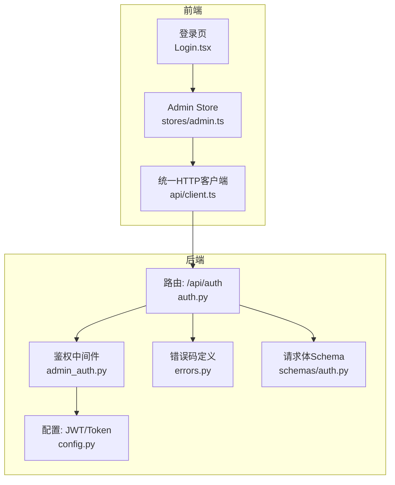
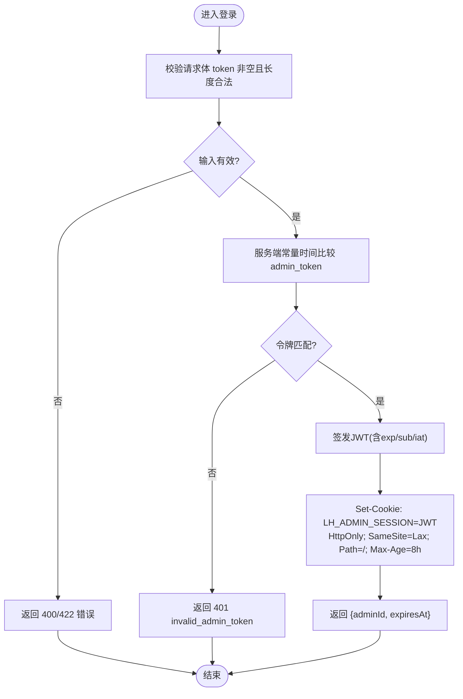
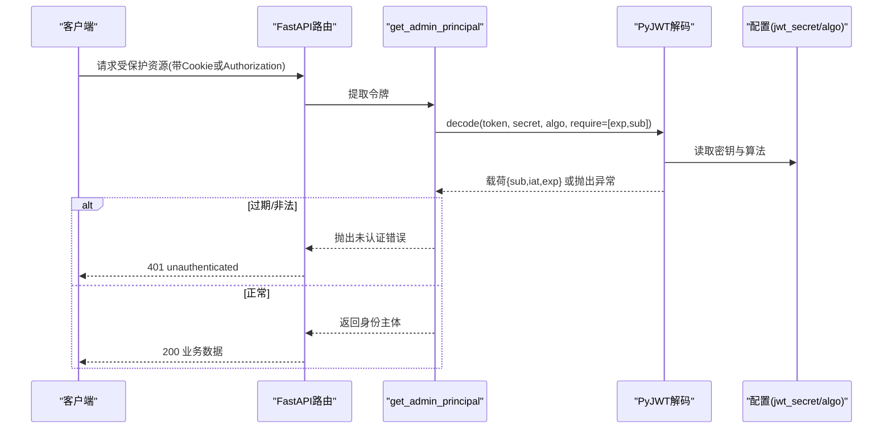
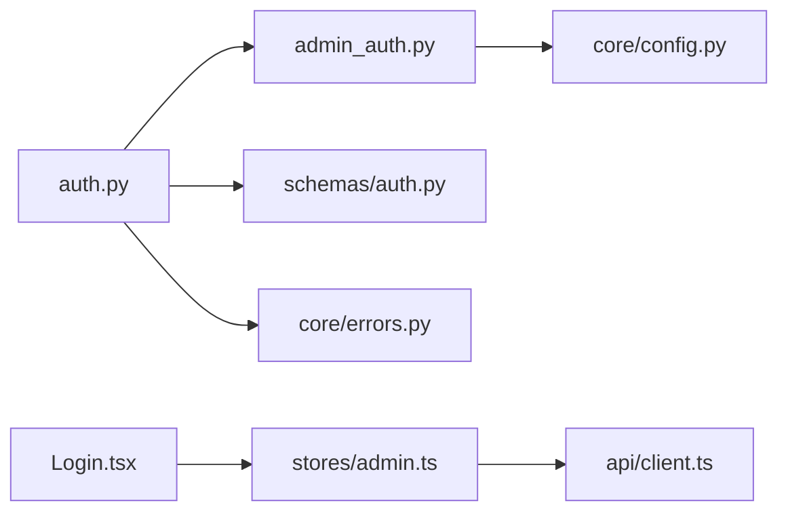

# 认证接口

<cite>
**本文引用的文件**
- [backend/app/api/auth.py](file://backend/app/api/auth.py)
- [backend/app/middleware/admin_auth.py](file://backend/app/middleware/admin_auth.py)
- [backend/app/schemas/auth.py](file://backend/app/schemas/auth.py)
- [backend/app/core/config.py](file://backend/app/core/config.py)
- [backend/app/core/errors.py](file://backend/app/core/errors.py)
- [frontend/src/pages/admin/Login.tsx](file://frontend/src/pages/admin/Login.tsx)
- [frontend/src/stores/admin.ts](file://frontend/src/stores/admin.ts)
- [frontend/src/api/client.ts](file://frontend/src/api/client.ts)
- [doc/spec/10-API设计规范.md](file://doc/spec/10-API设计规范.md)
</cite>

## 目录
1. [简介](#简介)
2. [项目结构](#项目结构)
3. [核心组件](#核心组件)
4. [架构总览](#架构总览)
5. [详细组件分析](#详细组件分析)
6. [依赖关系分析](#依赖关系分析)
7. [性能与安全性考虑](#性能与安全性考虑)
8. [故障排查指南](#故障排查指南)
9. [结论](#结论)
10. [附录：前端集成示例与错误处理](#附录前端集成示例与错误处理)

## 简介
本文件为“学习平台”管理后台的认证接口文档，覆盖管理员登录与登出两个端点：
- POST /api/auth/admin：使用一次性 Admin Token 换取会话 Cookie（JWT），并返回会话过期时间。
- POST /api/auth/logout：清除会话 Cookie，实现登出。

文档包含请求体结构、响应格式、Cookie 设置参数、Token 生命周期与安全最佳实践，并提供前端集成示例与错误处理策略。

## 项目结构
认证相关代码分布在后端路由、中间件、配置与错误码模块，以及前端的登录页面、状态管理与 HTTP 客户端中。



图表来源
- [backend/app/api/auth.py:1-49](file://backend/app/api/auth.py#L1-L49)
- [backend/app/middleware/admin_auth.py:1-66](file://backend/app/middleware/admin_auth.py#L1-L66)
- [backend/app/core/config.py:40-47](file://backend/app/core/config.py#L40-L47)
- [backend/app/core/errors.py:9-20](file://backend/app/core/errors.py#L9-L20)
- [backend/app/schemas/auth.py:1-17](file://backend/app/schemas/auth.py#L1-L17)
- [frontend/src/pages/admin/Login.tsx:1-72](file://frontend/src/pages/admin/Login.tsx#L1-L72)
- [frontend/src/stores/admin.ts:1-71](file://frontend/src/stores/admin.ts#L1-L71)
- [frontend/src/api/client.ts:1-52](file://frontend/src/api/client.ts#L1-L52)

章节来源
- [backend/app/api/auth.py:1-49](file://backend/app/api/auth.py#L1-L49)
- [backend/app/middleware/admin_auth.py:1-66](file://backend/app/middleware/admin_auth.py#L1-L66)
- [backend/app/schemas/auth.py:1-17](file://backend/app/schemas/auth.py#L1-L71)
- [backend/app/core/config.py:40-47](file://backend/app/core/config.py#L40-L47)
- [backend/app/core/errors.py:9-20](file://backend/app/core/errors.py#L9-L20)
- [frontend/src/pages/admin/Login.tsx:1-72](file://frontend/src/pages/admin/Login.tsx#L1-L72)
- [frontend/src/stores/admin.ts:1-71](file://frontend/src/stores/admin.ts#L1-L71)
- [frontend/src/api/client.ts:1-52](file://frontend/src/api/client.ts#L1-L52)

## 核心组件
- 路由层：提供 /api/auth/admin 与 /api/auth/logout 两个端点，负责校验一次性令牌、签发JWT、写入Cookie、删除Cookie。
- 鉴权中间件：从 Authorization 或 Cookie 中提取JWT，解码并校验签名与有效期，提取管理员身份。
- 配置中心：集中管理 admin_token、jwt_secret、jwt_algorithm、jwt_ttl_hours 等敏感配置。
- 错误码体系：统一定义业务错误码及对应HTTP状态码，用于登录失败、未认证等场景。
- 前端集成：登录页收集用户输入的 Admin Token，调用后端接口，成功后持久化会话信息；登出时调用退出接口并清理本地状态。

章节来源
- [backend/app/api/auth.py:14-46](file://backend/app/api/auth.py#L14-L46)
- [backend/app/middleware/admin_auth.py:16-42](file://backend/app/middleware/admin_auth.py#L16-L42)
- [backend/app/core/config.py:40-47](file://backend/app/core/config.py#L40-L47)
- [backend/app/core/errors.py:9-20](file://backend/app/core/errors.py#L9-L20)
- [frontend/src/pages/admin/Login.tsx:18-32](file://frontend/src/pages/admin/Login.tsx#L18-L32)
- [frontend/src/stores/admin.ts:37-68](file://frontend/src/stores/admin.ts#L37-L68)
- [frontend/src/api/client.ts:13-17](file://frontend/src/api/client.ts#L13-L17)

## 架构总览
下图展示了管理员登录与后续受保护资源访问的整体流程，包括Cookie传递、JWT签发与验证。

```mermaid
sequenceDiagram
participant FE as "前端应用"
participant API as "后端路由 /api/auth"
participant MW as "鉴权中间件"
participant CFG as "配置(密钥/TTL)"
participant ERR as "错误码映射"
Note over FE,API : 登录流程
FE->>API : POST /api/auth/admin {token}
API->>MW : verify_admin_token(token)
MW-->>API : true/false
alt 校验通过
API->>MW : issue_admin_jwt(sub="single-admin")
MW->>CFG : jwt_secret/jwt_algorithm/jwt_ttl_hours
MW-->>API : JWT字符串
API-->>FE : Set-Cookie LH_ADMIN_SESSION=JWT; HttpOnly; SameSite=Lax; Path=/
API-->>FE : {code : "ok", data : {adminId, expiresAt}}
else 校验失败
API->>ERR : INVALID_ADMIN_TOKEN
API-->>FE : 401 {code : "invalid_admin_token"}
end
Note over FE,MW : 访问受保护资源
FE->>API : 携带 Cookie LH_ADMIN_SESSION
API->>MW : get_admin_principal()
MW->>CFG : jwt_secret/jwt_algorithm
MW-->>API : {sub, iat, exp} 或抛出未认证错误
```

图表来源
- [backend/app/api/auth.py:21-45](file://backend/app/api/auth.py#L21-L45)
- [backend/app/middleware/admin_auth.py:16-42](file://backend/app/middleware/admin_auth.py#L16-L42)
- [backend/app/core/config.py:40-47](file://backend/app/core/config.py#L40-L47)
- [backend/app/core/errors.py:73-81](file://backend/app/core/errors.py#L73-L81)

## 详细组件分析

### 管理员登录接口 POST /api/auth/admin
- 功能说明
  - 校验一次性 Admin Token（常量时间比较）。
  - 签发JWT会话，写入浏览器Cookie。
  - 返回管理员标识与会话过期时间。
- 请求体结构
  - 字段名：token
  - 类型：string
  - 必填：是
  - 约束：长度 1~255
- 成功响应
  - HTTP 200
  - 响应体包含 code/message/data/requestId 信封，data.adminId 固定为 single-admin，data.expiresAt 为ISO-8601时间字符串。
- 失败响应
  - 401 invalid_admin_token：当一次性令牌无效时。
- Cookie 设置
  - 名称：LH_ADMIN_SESSION
  - 值：JWT字符串
  - max_age：8小时（秒）
  - httponly：true
  - samesite：lax
  - path：/
- 安全要点
  - 一次性令牌与服务端配置的 admin_token 进行常量时间比较，避免时序攻击。
  - JWT使用HS256算法与强密钥，TTL默认8小时。
  - Cookie设置为HttpOnly与SameSite=Lax，降低XSS与跨站风险。

章节来源
- [backend/app/api/auth.py:21-39](file://backend/app/api/auth.py#L21-L39)
- [backend/app/schemas/auth.py:7-13](file://backend/app/schemas/auth.py#L7-L13)
- [backend/app/middleware/admin_auth.py:58-62](file://backend/app/middleware/admin_auth.py#L58-L62)
- [backend/app/core/config.py:40-47](file://backend/app/core/config.py#L40-L47)
- [backend/app/core/errors.py:73-79](file://backend/app/core/errors.py#L73-L79)
- [doc/spec/10-API设计规范.md:142-193](file://doc/spec/10-API设计规范.md#L142-L193)

#### 登录流程图


图表来源
- [backend/app/api/auth.py:21-39](file://backend/app/api/auth.py#L21-L39)
- [backend/app/middleware/admin_auth.py:58-62](file://backend/app/middleware/admin_auth.py#L58-L62)

### 管理员登出接口 POST /api/auth/logout
- 功能说明
  - 删除会话Cookie，使当前会话失效。
- 请求体
  - 无
- 成功响应
  - HTTP 200，返回标准信封，data 可为空。
- 失败响应
  - 通常不会失败；若网络异常由客户端统一拦截器处理。

章节来源
- [backend/app/api/auth.py:42-45](file://backend/app/api/auth.py#L42-L45)
- [doc/spec/10-API设计规范.md:195-207](file://doc/spec/10-API设计规范.md#L195-L207)

### JWT 验证机制与受保护资源访问
- 令牌来源
  - 优先从 Authorization: Bearer <token> 头提取。
  - 其次从 Cookie LH_ADMIN_SESSION 提取。
- 解码与校验
  - 使用配置的 jwt_secret 与 jwt_algorithm 解码。
  - 要求载荷包含 exp 与 sub 字段。
  - 过期或非法令牌将触发未认证错误。
- 返回主体
  - 成功时返回包含 sub、iat、exp 的身份对象，供下游依赖注入使用。

章节来源
- [backend/app/middleware/admin_auth.py:16-42](file://backend/app/middleware/admin_auth.py#L16-L42)
- [backend/app/core/config.py:40-47](file://backend/app/core/config.py#L40-L47)
- [backend/app/core/errors.py:73-79](file://backend/app/core/errors.py#L73-L79)

#### 鉴权序列图


图表来源
- [backend/app/middleware/admin_auth.py:16-42](file://backend/app/middleware/admin_auth.py#L16-L42)
- [backend/app/core/config.py:40-47](file://backend/app/core/config.py#L40-L47)
- [backend/app/core/errors.py:73-79](file://backend/app/core/errors.py#L73-L79)

### 前端集成与状态管理
- 登录页
  - 收集用户输入的 Admin Token，提交到 /api/auth/admin。
  - 成功后跳转到管理首页。
- 状态管理
  - 登录后持久化 expiresAt，标记当前会话来自Cookie。
  - 登出时调用 /api/auth/logout，并清理本地存储与会话状态。
- HTTP客户端
  - 全局启用 withCredentials，确保Cookie随请求发送。
  - 统一拦截器对业务信封进行解析与错误转换。

章节来源
- [frontend/src/pages/admin/Login.tsx:18-32](file://frontend/src/pages/admin/Login.tsx#L18-L32)
- [frontend/src/stores/admin.ts:37-68](file://frontend/src/stores/admin.ts#L37-L68)
- [frontend/src/api/client.ts:13-17](file://frontend/src/api/client.ts#L13-L17)

## 依赖关系分析
- 路由依赖
  - auth.py 依赖 admin_auth.py 中的令牌校验与JWT签发函数，依赖 schemas/auth.py 的请求体验证，依赖 errors.py 的错误码。
- 中间件依赖
  - admin_auth.py 依赖 config.py 获取密钥与算法、TTL，依赖 errors.py 抛出未认证错误。
- 前端依赖
  - Login.tsx 调用 stores/admin.ts 的 login/logout。
  - stores/admin.ts 基于 api/client.ts 发起HTTP请求，withCredentials=true 保证Cookie自动附带。



图表来源
- [backend/app/api/auth.py:1-49](file://backend/app/api/auth.py#L1-L49)
- [backend/app/middleware/admin_auth.py:1-66](file://backend/app/middleware/admin_auth.py#L1-L66)
- [backend/app/schemas/auth.py:1-17](file://backend/app/schemas/auth.py#L1-L17)
- [backend/app/core/config.py:40-47](file://backend/app/core/config.py#L40-L47)
- [backend/app/core/errors.py:9-20](file://backend/app/core/errors.py#L9-L20)
- [frontend/src/pages/admin/Login.tsx:1-72](file://frontend/src/pages/admin/Login.tsx#L1-L72)
- [frontend/src/stores/admin.ts:1-71](file://frontend/src/stores/admin.ts#L1-L71)
- [frontend/src/api/client.ts:1-52](file://frontend/src/api/client.ts#L1-L52)

## 性能与安全性考虑
- 性能
  - 登录接口仅做常量时间比较与JWT编码，开销极低。
  - Cookie TTL 8小时，减少频繁重认证带来的额外请求。
- 安全性
  - 一次性令牌使用常量时间比较，防止时序侧信道攻击。
  - JWT采用强密钥与HS256算法，生产环境务必更换默认密钥。
  - Cookie设置 HttpOnly 与 SameSite=Lax，降低XSS与CSRF风险。
  - 建议配合HTTPS部署，避免明文传输。
  - 建议限制登录尝试频率（可结合限流中间件扩展）。
- 最佳实践
  - 在反向代理层强制HTTPS与严格CORS策略。
  - 定期轮换JWT密钥与一次性令牌。
  - 记录审计日志，追踪登录与登出事件。

[本节为通用指导，不直接分析具体文件]

## 故障排查指南
- 常见错误码
  - unauthenticated：未登录或会话已失效。
  - invalid_admin_token：一次性令牌无效。
- 定位步骤
  - 检查浏览器是否携带 LH_ADMIN_SESSION Cookie。
  - 确认服务器配置 jwt_secret 与 jwt_algorithm 一致。
  - 查看前端控制台与网络面板，确认请求是否被拦截器转换为业务错误。
  - 核对expiresAt是否已过期，必要时重新登录。

章节来源
- [backend/app/core/errors.py:73-81](file://backend/app/core/errors.py#L73-L81)
- [backend/app/middleware/admin_auth.py:26-42](file://backend/app/middleware/admin_auth.py#L26-L42)
- [frontend/src/api/client.ts:25-49](file://frontend/src/api/client.ts#L25-L49)

## 结论
本认证方案以一次性令牌换取短期JWT会话为核心，结合HttpOnly与SameSite策略保障基本安全。前后端职责清晰：后端负责令牌校验与会话管理，前端负责UI交互与状态同步。生产环境需强化密钥管理、HTTPS与限流策略，以提升整体安全性与稳定性。

[本节为总结性内容，不直接分析具体文件]

## 附录：前端集成示例与错误处理

### 登录流程（前端）
- 用户在登录页输入 Admin Token。
- 调用 /api/auth/admin，成功后跳转管理首页。
- 本地持久化 expiresAt，标记会话来源于Cookie。

章节来源
- [frontend/src/pages/admin/Login.tsx:18-32](file://frontend/src/pages/admin/Login.tsx#L18-L32)
- [frontend/src/stores/admin.ts:37-58](file://frontend/src/stores/admin.ts#L37-L58)

### 登出流程（前端）
- 调用 /api/auth/logout。
- 清理本地存储与会话状态。

章节来源
- [frontend/src/stores/admin.ts:60-68](file://frontend/src/stores/admin.ts#L60-L68)

### 统一错误处理（前端）
- 响应拦截器将业务信封转换为错误对象，包含 code、message、status。
- 调用方可根据 code 进行差异化提示与重试策略。

章节来源
- [frontend/src/api/client.ts:25-49](file://frontend/src/api/client.ts#L25-L49)

### 请求/响应示例（参考规范）
- 登录成功
  - 请求：POST /api/auth/admin，Content-Type: application/json，Body: {token}
  - 响应：200 OK，信封中包含 adminId 与 expiresAt，同时Set-Cookie LH_ADMIN_SESSION。
- 登录失败
  - 401 invalid_admin_token：一次性令牌无效。
- 登出成功
  - 请求：POST /api/auth/logout
  - 响应：200 OK，信封中 data 为空。

章节来源
- [doc/spec/10-API设计规范.md:142-207](file://doc/spec/10-API设计规范.md#L142-L207)