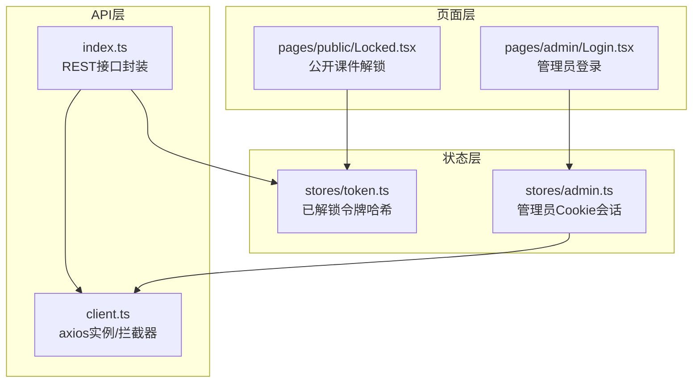
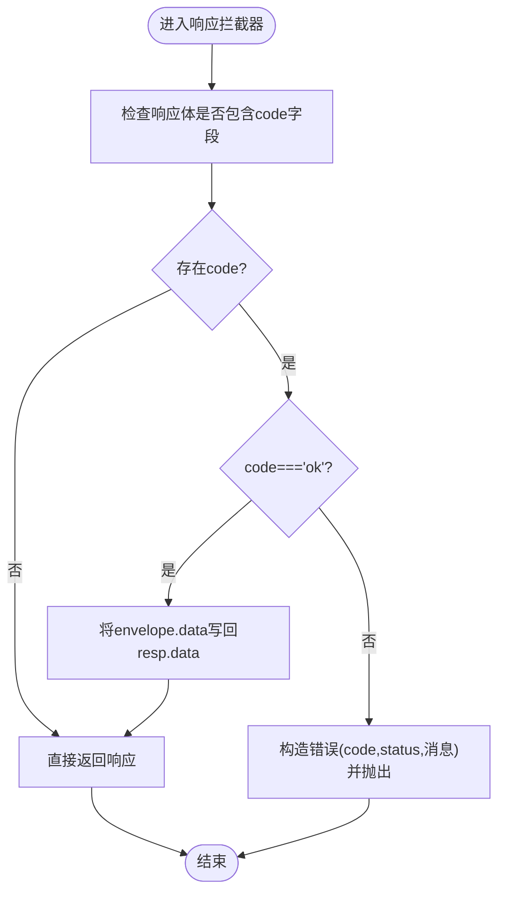
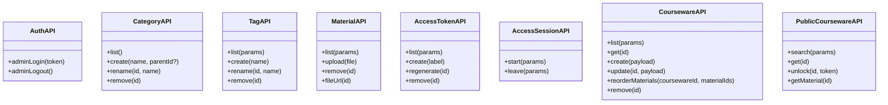
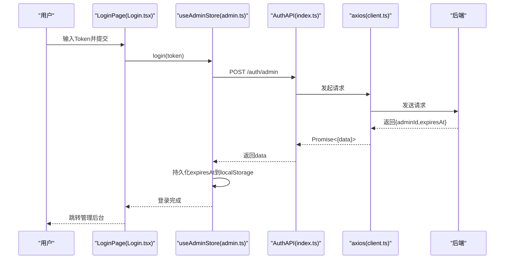
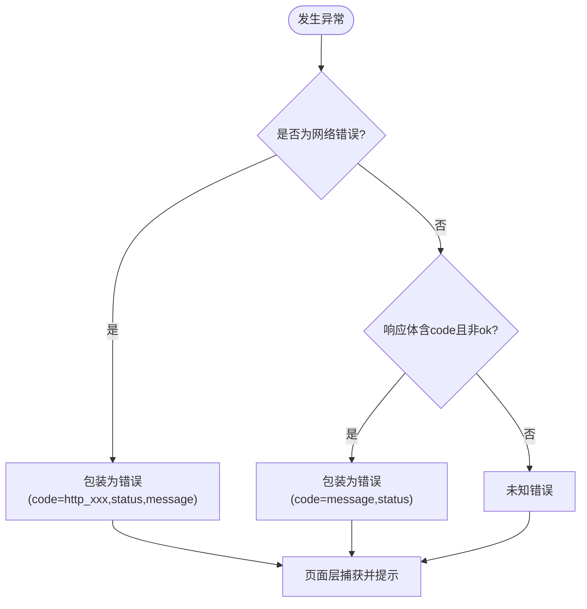
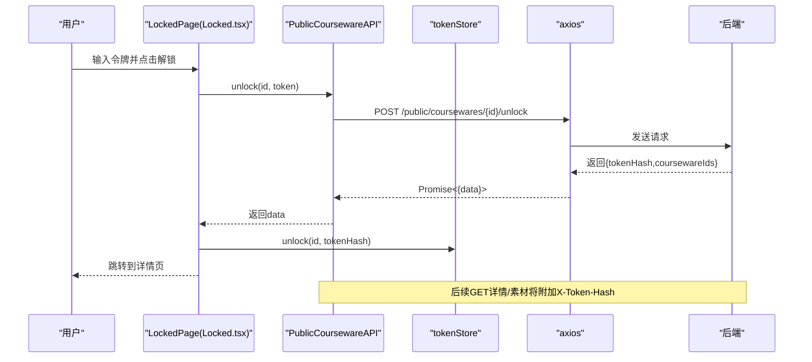
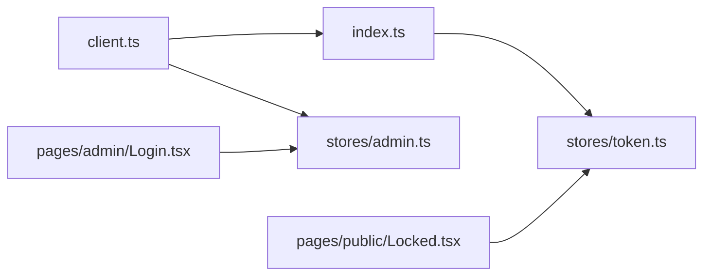

# API集成

<cite>
**本文引用的文件**
- [client.ts](file://frontend/src/api/client.ts)
- [index.ts](file://frontend/src/api/index.ts)
- [token.ts](file://frontend/src/stores/token.ts)
- [admin.ts](file://frontend/src/stores/admin.ts)
- [Login.tsx](file://frontend/src/pages/admin/Login.tsx)
- [Locked.tsx](file://frontend/src/pages/public/Locked.tsx)
</cite>

## 目录
1. [简介](#简介)
2. [项目结构](#项目结构)
3. [核心组件](#核心组件)
4. [架构总览](#架构总览)
5. [详细组件分析](#详细组件分析)
6. [依赖关系分析](#依赖关系分析)
7. [性能考虑](#性能考虑)
8. [故障排查指南](#故障排查指南)
9. [结论](#结论)
10. [附录](#附录)

## 简介
本指南面向 Learning Hub 前端，聚焦于与后端 API 的集成方式。内容涵盖：
- HTTP 客户端封装（请求拦截、响应处理、错误模型）
- API 接口定义的组织结构与 RESTful 调用约定
- 认证机制（管理员 Cookie 会话、公开课件令牌解锁）
- 请求取消、并发控制与性能优化策略
- 错误处理机制与用户友好提示
- 最佳实践、缓存策略与 Mock 开发模式
- API 版本管理与向后兼容

## 项目结构
前端 API 相关代码集中在以下位置：
- HTTP 客户端与统一响应解包：frontend/src/api/client.ts
- 业务 API 模块（管理后台/公开接口）：frontend/src/api/index.ts
- 状态存储（令牌哈希记忆、管理员会话）：frontend/src/stores/token.ts、frontend/src/stores/admin.ts
- 登录与解锁页面（认证流程入口）：frontend/src/pages/admin/Login.tsx、frontend/src/pages/public/Locked.tsx



图表来源
- [client.ts:1-52](file://frontend/src/api/client.ts#L1-L52)
- [index.ts:1-443](file://frontend/src/api/index.ts#L1-L443)
- [token.ts:1-54](file://frontend/src/stores/token.ts#L1-L54)
- [admin.ts:1-71](file://frontend/src/stores/admin.ts#L1-L71)
- [Login.tsx:1-72](file://frontend/src/pages/admin/Login.tsx#L1-L72)
- [Locked.tsx:1-113](file://frontend/src/pages/public/Locked.tsx#L1-L113)

章节来源
- [client.ts:1-52](file://frontend/src/api/client.ts#L1-L52)
- [index.ts:1-443](file://frontend/src/api/index.ts#L1-L443)
- [token.ts:1-54](file://frontend/src/stores/token.ts#L1-L54)
- [admin.ts:1-71](file://frontend/src/stores/admin.ts#L1-L71)
- [Login.tsx:1-72](file://frontend/src/pages/admin/Login.tsx#L1-L72)
- [Locked.tsx:1-113](file://frontend/src/pages/public/Locked.tsx#L1-L113)

## 核心组件
- HTTP 客户端（client.ts）
  - 统一 baseURL、超时、凭据携带
  - 请求拦截：注入 X-Request-Id
  - 响应拦截：统一业务信封解析、非 ok 抛错、网络错误标准化
  - 导出 ApiEnvelope 类型供上层使用
- API 模块（index.ts）
  - 按领域分组：Auth、Categories、Tags、Materials、AccessTokens、AccessSessions、Coursewares、Public
  - 统一 unwrap 将 envelope.data 透传为返回值
  - 公开接口在需要时附加 X-Token-Hash 头以绕过 Set-Cookie 时序问题
- 状态存储
  - token.ts：持久化“已解锁课件 -> tokenHash”映射，支持刷新与初始化
  - admin.ts：管理员登录/登出，基于 Cookie 会话，本地仅存过期时间用于恢复判断

章节来源
- [client.ts:1-52](file://frontend/src/api/client.ts#L1-L52)
- [index.ts:1-443](file://frontend/src/api/index.ts#L1-L443)
- [token.ts:1-54](file://frontend/src/stores/token.ts#L1-L54)
- [admin.ts:1-71](file://frontend/src/stores/admin.ts#L1-L71)

## 架构总览
整体数据流：页面调用 API 模块 -> axios 实例拦截器处理 -> 后端返回信封 -> 响应拦截器校验并解包 -> 业务方法返回 data -> 页面消费数据或展示错误。

```mermaid
sequenceDiagram
participant P as "页面/组件"
participant API as "API模块(index.ts)"
participant AX as "axios实例(client.ts)"
participant S as "状态(token.ts/admin.ts)"
participant B as "后端服务"
P->>API : 调用具体接口(如 unlock/get/list)
API->>AX : 发起HTTP请求(可能附加X-Token-Hash)
AX->>AX : 请求拦截 : 注入X-Request-Id
AX->>B : 发送请求
B-->>AX : 返回{code,message,data}
AX->>AX : 响应拦截 : code!=ok则抛错;否则resp.data=data
AX-->>API : Promise<{data}>
API-->>P : 直接返回data
Note over API,S : 某些接口会读写store(如unlock写入tokenHash)
```

图表来源
- [client.ts:19-49](file://frontend/src/api/client.ts#L19-L49)
- [index.ts:25-443](file://frontend/src/api/index.ts#L25-L443)
- [token.ts:38-48](file://frontend/src/stores/token.ts#L38-L48)
- [admin.ts:34-70](file://frontend/src/stores/admin.ts#L34-L70)

## 详细组件分析

### HTTP 客户端封装（client.ts）
- 基础配置
  - baseURL 指向 /api，withCredentials 开启跨域凭据传递
  - 默认超时 30s；上传场景可覆盖
- 请求拦截器
  - 生成唯一 X-Request-Id 便于链路追踪
- 响应拦截器
  - 若响应体包含 code 字段且不为 ok，构造带 code/status 的错误抛出
  - 成功时将 envelope.data 写回 resp.data，调用方 .then(r => r.data) 可直接拿到业务数据
  - 网络错误统一包装为 Error，附带 code 与 status
- 类型
  - 导出 ApiEnvelope<T> 描述后端信封结构



图表来源
- [client.ts:25-49](file://frontend/src/api/client.ts#L25-L49)

章节来源
- [client.ts:1-52](file://frontend/src/api/client.ts#L1-L52)

### API 接口组织与调用约定（index.ts）
- 组织结构
  - AuthAPI：管理员登录/登出
  - CategoryAPI/TagAPI/MaterialAPI/AccessTokenAPI/CoursewareAPI：管理后台 CRUD
  - AccessSessionAPI：公开访问会话埋点（开始/离开）
  - PublicCoursewareAPI：公开搜索、详情、解锁、素材详情
- 参数与分页
  - list 类接口通过 params 传入 keyword/page/size 等筛选条件
  - 返回结构多为 { page, size, total, items } 的分页对象
- 特殊头部
  - 对受限课件的 GET/GET 素材接口，自动从 store 读取对应 coursewareId 的 tokenHash，并以 X-Token-Hash 头传递，避免与 Set-Cookie 时序耦合
- 上传
  - MaterialAPI.upload 使用 FormData，设置 multipart/form-data，并覆盖超时至 15 分钟，提供 onUploadProgress 回调占位



图表来源
- [index.ts:25-443](file://frontend/src/api/index.ts#L25-L443)

章节来源
- [index.ts:1-443](file://frontend/src/api/index.ts#L1-L443)

### 认证机制与权限检查
- 管理员登录（Cookie 会话）
  - Login.tsx 收集 Token 后调用 useAdminStore.login
  - admin.ts 调用 /auth/admin，成功后将 expiresAt 持久化到 localStorage，实际会话由后端 Set-Cookie 维护
  - 退出时调用 /auth/logout 并清理本地状态
- 公开课件解锁（令牌哈希）
  - Locked.tsx 输入明文令牌，调用 PublicCoursewareAPI.unlock
  - 成功后将 tokenHash 写入 token.ts 的 unlockedByCourseware，后续 GET 详情/素材自动附加 X-Token-Hash 头
  - AccessSessionAPI.leave 优先使用 sendBeacon，失败回退 fetch keepalive，确保页面关闭也能上报



图表来源
- [Login.tsx:18-32](file://frontend/src/pages/admin/Login.tsx#L18-L32)
- [admin.ts:37-58](file://frontend/src/stores/admin.ts#L37-L58)
- [index.ts:26-32](file://frontend/src/api/index.ts#L26-L32)
- [client.ts:19-49](file://frontend/src/api/client.ts#L19-L49)

章节来源
- [Login.tsx:1-72](file://frontend/src/pages/admin/Login.tsx#L1-L72)
- [admin.ts:1-71](file://frontend/src/stores/admin.ts#L1-L71)
- [index.ts:25-32](file://frontend/src/api/index.ts#L25-L32)
- [client.ts:1-52](file://frontend/src/api/client.ts#L1-L52)

### 请求取消、并发控制与性能优化
- 请求取消
  - 当前未实现 AbortController 取消逻辑。可在 apiClient 基础上扩展，或在调用处传入 signal 并通过 axios 配置进行取消
- 并发控制
  - 当前无全局并发限制。建议结合 React Query 或自定义队列实现限流与重试合并
- 性能优化
  - 大文件上传：MaterialAPI.upload 覆盖超时至 15 分钟，并提供 onUploadProgress 回调占位，可用于进度条
  - 访问上报：AccessSessionAPI.leave 优先 sendBeacon，失败回退 fetch keepalive，提高可靠性
  - 减少重复请求：可引入内存/持久化缓存（如按 URL+params 键控），配合版本号与失效策略

章节来源
- [index.ts:92-115](file://frontend/src/api/index.ts#L92-L115)
- [index.ts:168-216](file://frontend/src/api/index.ts#L168-L216)

### 错误处理机制
- 网络错误
  - 响应拦截器将 AxiosError 包装为统一错误，附带 code 与 status
- 业务错误
  - 当 envelope.code !== 'ok' 时抛出错误，message 来自后端 message 或 code
- 用户提示
  - 页面层捕获错误并展示（例如 LoginPage 与 LockedPage 均捕获并显示 message）



图表来源
- [client.ts:40-49](file://frontend/src/api/client.ts#L40-L49)
- [client.ts:25-39](file://frontend/src/api/client.ts#L25-L39)
- [Login.tsx:25-31](file://frontend/src/pages/admin/Login.tsx#L25-L31)
- [Locked.tsx:34-43](file://frontend/src/pages/public/Locked.tsx#L34-L43)

章节来源
- [client.ts:25-49](file://frontend/src/api/client.ts#L25-L49)
- [Login.tsx:18-32](file://frontend/src/pages/admin/Login.tsx#L18-L32)
- [Locked.tsx:29-44](file://frontend/src/pages/public/Locked.tsx#L29-L44)

### 认证流程与权限检查（公开课件）
- 解锁流程
  - 用户输入令牌 -> unlock -> 写入 tokenHash -> 后续 GET 详情/素材自动附加 X-Token-Hash
- 权限检查
  - 后端根据 X-Token-Hash 判定访问权限；前端不主动做鉴权分支，而是依赖服务端返回的业务码与状态



图表来源
- [Locked.tsx:29-44](file://frontend/src/pages/public/Locked.tsx#L29-L44)
- [index.ts:422-428](file://frontend/src/api/index.ts#L422-L428)
- [token.ts:38-48](file://frontend/src/stores/token.ts#L38-L48)

章节来源
- [Locked.tsx:1-113](file://frontend/src/pages/public/Locked.tsx#L1-L113)
- [index.ts:405-440](file://frontend/src/api/index.ts#L405-L440)
- [token.ts:1-54](file://frontend/src/stores/token.ts#L1-L54)

## 依赖关系分析
- client.ts 被 index.ts 与 stores/admin.ts 共同依赖
- index.ts 依赖 token.ts 获取 X-Token-Hash
- pages 层依赖各自 store 与 API 模块



图表来源
- [client.ts:1-52](file://frontend/src/api/client.ts#L1-L52)
- [index.ts:1-443](file://frontend/src/api/index.ts#L1-L443)
- [token.ts:1-54](file://frontend/src/stores/token.ts#L1-L54)
- [admin.ts:1-71](file://frontend/src/stores/admin.ts#L1-L71)
- [Login.tsx:1-72](file://frontend/src/pages/admin/Login.tsx#L1-L72)
- [Locked.tsx:1-113](file://frontend/src/pages/public/Locked.tsx#L1-L113)

章节来源
- [client.ts:1-52](file://frontend/src/api/client.ts#L1-L52)
- [index.ts:1-443](file://frontend/src/api/index.ts#L1-L443)
- [token.ts:1-54](file://frontend/src/stores/token.ts#L1-L54)
- [admin.ts:1-71](file://frontend/src/stores/admin.ts#L1-L71)
- [Login.tsx:1-72](file://frontend/src/pages/admin/Login.tsx#L1-L72)
- [Locked.tsx:1-113](file://frontend/src/pages/public/Locked.tsx#L1-L113)

## 性能考虑
- 超时与重试
  - 默认 30s 超时；上传场景覆盖为 15 分钟
  - 当前未实现自动重试，建议在调用层或中间件增加指数退避重试（针对幂等 GET/HEAD）
- 并发与去重
  - 建议引入请求去重与并发上限，避免短时间内大量重复请求
- 资源加载
  - 视频/PPT/PDF 等大资源建议使用分片/懒加载/预取策略
- 上报优化
  - leave 使用 sendBeacon/fetch keepalive 提升可靠性

[本节为通用指导，无需源码引用]

## 故障排查指南
- 登录失败
  - 检查浏览器是否允许 Cookie（withCredentials=true）
  - 查看控制台错误信息中的 code 与 status
- 解锁失败
  - 确认输入的令牌是否正确
  - 检查 tokenStore 中是否已写入 tokenHash
  - 观察后续 GET 请求是否携带 X-Token-Hash
- 上传中断
  - 检查网络状况与服务器超时配置
  - 关注 onUploadProgress 回调是否触发
- 访问上报丢失
  - 检查 sendBeacon 是否可用，必要时回退路径是否执行

章节来源
- [client.ts:25-49](file://frontend/src/api/client.ts#L25-L49)
- [index.ts:92-115](file://frontend/src/api/index.ts#L92-L115)
- [index.ts:168-216](file://frontend/src/api/index.ts#L168-L216)
- [Login.tsx:25-31](file://frontend/src/pages/admin/Login.tsx#L25-L31)
- [Locked.tsx:34-43](file://frontend/src/pages/public/Locked.tsx#L34-L43)

## 结论
本集成方案通过统一的 axios 客户端与响应拦截器，实现了稳定的信封解析与错误标准化；API 模块按领域划分，清晰表达 RESTful 语义；认证采用“管理员 Cookie + 公开令牌哈希”的双轨模式，兼顾安全与易用性。后续可在请求取消、并发控制、缓存与重试方面进一步增强，以提升鲁棒性与用户体验。

[本节为总结，无需源码引用]

## 附录

### API 版本管理与向后兼容
- 字段可选化
  - 部分返回字段标注为可选（如 downloadUrl），以便后续剥离时保持类型合法
- 排序与顺序
  - 课件素材列表新增 sortOrder 字段，并按该顺序返回，便于前端渲染稳定顺序
- 兼容性建议
  - 新增字段应声明为可选
  - 删除字段需保留一段时间并给出迁移指引
  - 接口路径变更需保留旧路由转发或提供版本前缀

章节来源
- [index.ts:301-355](file://frontend/src/api/index.ts#L301-L355)
- [index.ts:357-402](file://frontend/src/api/index.ts#L357-L402)

### 最佳实践清单
- 统一错误处理
  - 在页面层捕获 Error，依据 code/status 区分网络/业务错误，并展示友好提示
- 幂等请求重试
  - 对 GET/HEAD 等幂等请求，在网络错误时可尝试有限次数的指数退避重试
- 请求取消
  - 使用 AbortController 在组件卸载或路由切换时取消未完成请求
- 并发控制
  - 对批量操作（如批量上传/查询）实施并发上限与队列调度
- 缓存策略
  - 对静态或低频变化数据使用短期缓存（内存/IndexedDB），并设置失效时间与更新策略
- Mock 开发模式
  - 在开发环境通过 Vite 代理或本地 Mock Server 模拟后端响应，屏蔽真实网络依赖
  - 使用与生产一致的信封格式与错误码，保证联调一致性

[本节为通用指导，无需源码引用]