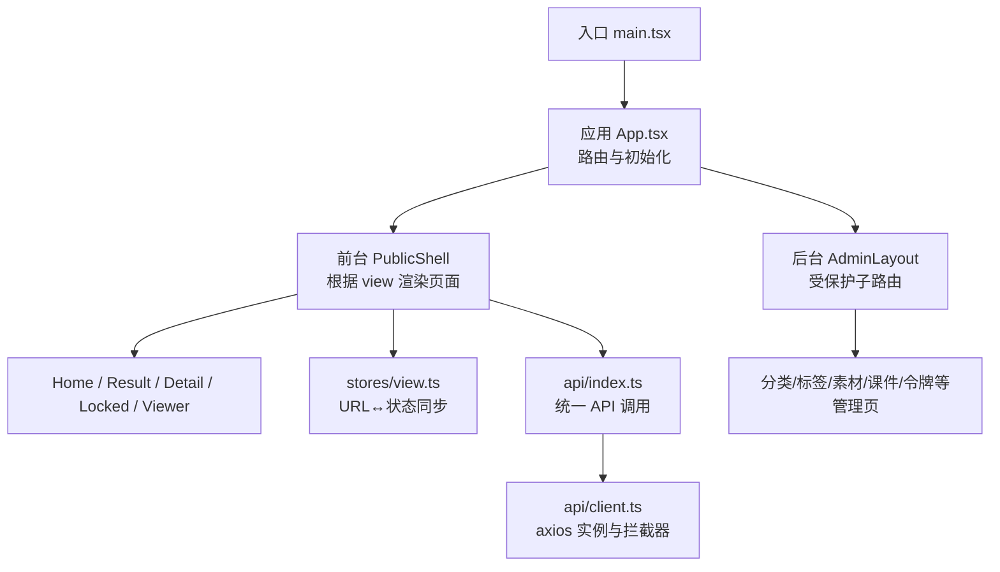
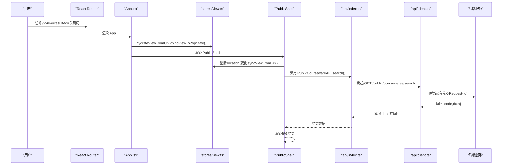
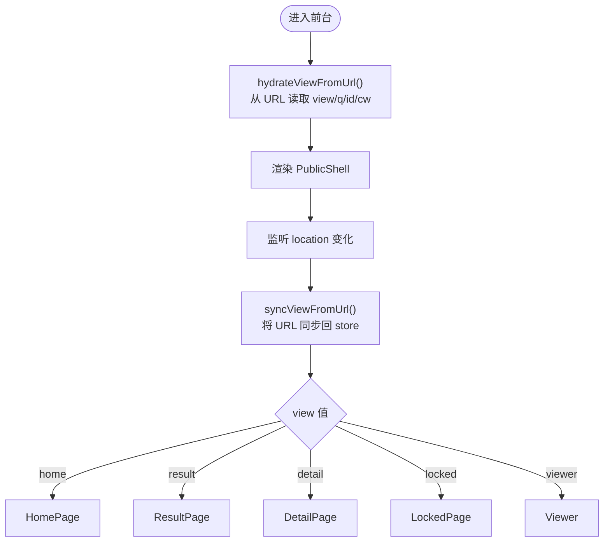
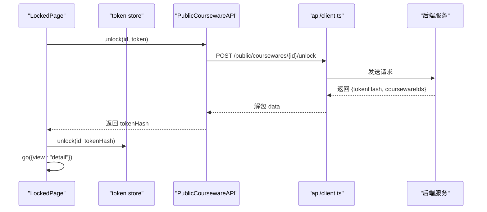
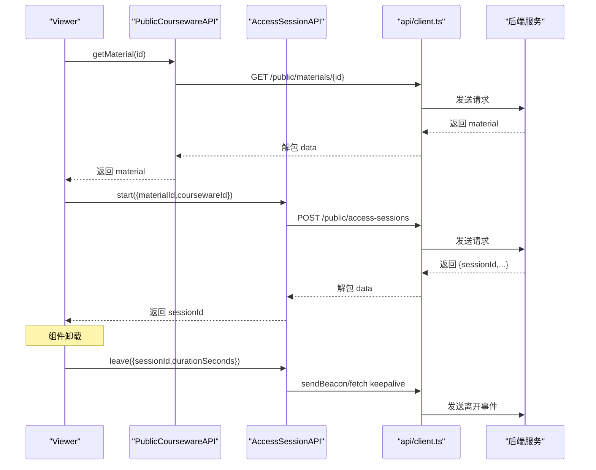
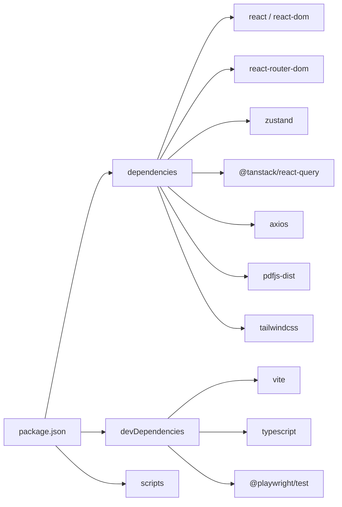

# 前端开发指南

<cite>
**本文引用的文件**   
- [frontend/package.json](file://frontend/package.json)
- [frontend/vite.config.ts](file://frontend/vite.config.ts)
- [frontend/postcss.config.js](file://frontend/postcss.config.js)
- [frontend/tailwind.config.js](file://frontend/tailwind.config.js)
- [frontend/src/main.tsx](file://frontend/src/main.tsx)
- [frontend/src/App.tsx](file://frontend/src/App.tsx)
- [frontend/src/api/client.ts](file://frontend/src/api/client.ts)
- [frontend/src/api/index.ts](file://frontend/src/api/index.ts)
- [frontend/src/stores/view.ts](file://frontend/src/stores/view.ts)
- [frontend/src/stores/token.ts](file://frontend/src/stores/token.ts)
- [frontend/src/stores/admin.ts](file://frontend/src/stores/admin.ts)
- [frontend/src/stores/toast.ts](file://frontend/src/stores/toast.ts)
- [frontend/src/layouts/AdminLayout.tsx](file://frontend/src/layouts/AdminLayout.tsx)
- [frontend/src/pages/public/Home.tsx](file://frontend/src/pages/public/Home.tsx)
- [frontend/src/pages/public/Result.tsx](file://frontend/src/pages/public/Result.tsx)
- [frontend/src/pages/public/Detail.tsx](file://frontend/src/pages/public/Detail.tsx)
- [frontend/src/pages/public/Locked.tsx](file://frontend/src/pages/public/Locked.tsx)
- [frontend/src/pages/public/Viewer.tsx](file://frontend/src/pages/public/Viewer.tsx)
</cite>

## 目录
1. [简介](#简介)
2. [项目结构](#项目结构)
3. [核心组件](#核心组件)
4. [架构总览](#架构总览)
5. [详细组件分析](#详细组件分析)
6. [依赖分析](#依赖分析)
7. [性能考虑](#性能考虑)
8. [故障排查指南](#故障排查指南)
9. [结论](#结论)
10. [附录](#附录)

## 简介
本指南面向 Learning Hub 前端的开发者，基于 React + TypeScript + Vite 技术栈，系统阐述前端架构、状态管理（Zustand）、样式与响应式策略（TailwindCSS）、API 客户端封装与错误处理、路由与页面组织、测试方法与性能优化实践。文档以仓库现有实现为依据，提供可落地的规范与最佳实践，帮助团队高效协作与持续演进。

## 项目结构
前端位于 frontend 目录，采用“功能域 + 分层”的组织方式：
- src/api：HTTP 客户端与 API 方法封装
- src/components：通用 UI 组件（如 Toast、Logo）
- src/layouts：布局组件（如 AdminLayout）
- src/pages：页面级组件，按 public 与 admin 划分
- src/stores：全局状态（Zustand），包括前台视图、令牌记忆、管理员会话、Toast 提示
- 构建与工程化：vite.config.ts、tailwind.config.js、postcss.config.js、package.json



图表来源
- [frontend/src/main.tsx:1-26](file://frontend/src/main.tsx#L1-L26)
- [frontend/src/App.tsx:1-110](file://frontend/src/App.tsx#L1-L110)
- [frontend/src/stores/view.ts:1-127](file://frontend/src/stores/view.ts#L1-L127)
- [frontend/src/api/client.ts:1-52](file://frontend/src/api/client.ts#L1-L52)
- [frontend/src/api/index.ts:1-443](file://frontend/src/api/index.ts#L1-L443)

章节来源
- [frontend/package.json:1-40](file://frontend/package.json#L1-L40)
- [frontend/vite.config.ts:1-39](file://frontend/vite.config.ts#L1-L39)
- [frontend/postcss.config.js:1-7](file://frontend/postcss.config.js#L1-L7)
- [frontend/tailwind.config.js:1-21](file://frontend/tailwind.config.js#L1-L21)
- [frontend/src/main.tsx:1-26](file://frontend/src/main.tsx#L1-L26)
- [frontend/src/App.tsx:1-110](file://frontend/src/App.tsx#L1-L110)

## 核心组件
- 应用壳与路由
  - App.tsx 负责前台 SPA 的 URL 驱动视图切换（?view=...）与后台受保护路由；挂载 Toast 根节点并执行 store 初始化。
  - main.tsx 注入 QueryClient、BrowserRouter 与 StrictMode。
- 前台视图状态（Zustand）
  - stores/view.ts 维护当前视图、搜索词、资源 ID 与课件 ID，并提供 go() 同步到 URL；支持 hydrate/sync/popstate 双向同步。
- 令牌记忆（Zustand）
  - stores/token.ts 持久化已解锁课件的 tokenHash，供后续请求自动附加 X-Token-Hash 头。
- 管理员会话（Zustand）
  - stores/admin.ts 管理登录态、过期校验与退出；配合 AdminGuard 守卫后台路由。
- 通知（Zustand）
  - stores/toast.ts 提供 push/dismiss 与自动消失逻辑，UI 由 ToastViewport 渲染。
- 布局
  - layouts/AdminLayout.tsx 提供导航、退出登录与 Outlet 占位。

章节来源
- [frontend/src/App.tsx:1-110](file://frontend/src/App.tsx#L1-L110)
- [frontend/src/main.tsx:1-26](file://frontend/src/main.tsx#L1-L26)
- [frontend/src/stores/view.ts:1-127](file://frontend/src/stores/view.ts#L1-L127)
- [frontend/src/stores/token.ts:1-54](file://frontend/src/stores/token.ts#L1-L54)
- [frontend/src/stores/admin.ts:1-71](file://frontend/src/stores/admin.ts#L1-L71)
- [frontend/src/stores/toast.ts:1-30](file://frontend/src/stores/toast.ts#L1-L30)
- [frontend/src/layouts/AdminLayout.tsx:1-61](file://frontend/src/layouts/AdminLayout.tsx#L1-L61)

## 架构总览
整体采用“单页应用 + URL 驱动前台视图 + 独立后台子路由”的混合模式：
- 前台通过 ?view 参数在单一 URL 下切换 Home/Result/Detail/Locked/Viewer
- 后台使用 react-router-dom 的子路由与守卫，结合 Zustand 的 session 进行鉴权
- HTTP 层基于 axios 封装，统一解包 envelope、注入 requestId、业务码校验与错误标准化
- 数据缓存与重试策略由 @tanstack/react-query 提供（默认关闭重试与焦点重拉）



图表来源
- [frontend/src/App.tsx:1-110](file://frontend/src/App.tsx#L1-L110)
- [frontend/src/stores/view.ts:1-127](file://frontend/src/stores/view.ts#L1-L127)
- [frontend/src/api/index.ts:1-443](file://frontend/src/api/index.ts#L1-L443)
- [frontend/src/api/client.ts:1-52](file://frontend/src/api/client.ts#L1-L52)

## 详细组件分析

### 前台路由与视图切换（URL 驱动）
- 设计要点
  - 单 URL 多视图：通过 ?view 控制 Home/Result/Detail/Locked/Viewer
  - 白名单校验与启发式推断：无显式 view 时根据 id/q/cw 推断
  - 双向同步：go() 同步 URL；location 变化与 popstate 回写 store
  - 返回首页修复：当切换到 home 时清空 q/id/cw，避免被再次推断为 viewer/detail
- 关键流程
  - App 启动时 hydrateViewFromUrl() 与 bindViewToPopState()
  - PublicShell 监听 location 变化并 syncViewFromUrl()
  - 各页面通过 useViewStore().go() 触发导航



图表来源
- [frontend/src/App.tsx:1-110](file://frontend/src/App.tsx#L1-L110)
- [frontend/src/stores/view.ts:1-127](file://frontend/src/stores/view.ts#L1-L127)
- [frontend/src/pages/public/Home.tsx:1-55](file://frontend/src/pages/public/Home.tsx#L1-L55)
- [frontend/src/pages/public/Result.tsx:1-149](file://frontend/src/pages/public/Result.tsx#L1-L149)
- [frontend/src/pages/public/Detail.tsx:1-188](file://frontend/src/pages/public/Detail.tsx#L1-L188)
- [frontend/src/pages/public/Locked.tsx:1-113](file://frontend/src/pages/public/Locked.tsx#L1-L113)
- [frontend/src/pages/public/Viewer.tsx:1-170](file://frontend/src/pages/public/Viewer.tsx#L1-L170)

章节来源
- [frontend/src/stores/view.ts:1-127](file://frontend/src/stores/view.ts#L1-L127)
- [frontend/src/App.tsx:1-110](file://frontend/src/App.tsx#L1-L110)

### 受限课件解锁流程（P-LOCKED → P-DETAIL）
- 设计要点
  - 输入明文 token 调用 unlock，成功后将 tokenHash 写入本地记忆
  - 后续请求自动附加 X-Token-Hash 头，避免 Set-Cookie 时序问题导致二次解锁
- 关键流程
  - Locked 提交后调用 PublicCoursewareAPI.unlock(id, token)
  - 写入 token store 并跳转 detail
  - Detail 获取课件详情时若未解锁则跳回 locked



图表来源
- [frontend/src/pages/public/Locked.tsx:1-113](file://frontend/src/pages/public/Locked.tsx#L1-L113)
- [frontend/src/stores/token.ts:1-54](file://frontend/src/stores/token.ts#L1-L54)
- [frontend/src/api/index.ts:1-443](file://frontend/src/api/index.ts#L1-L443)
- [frontend/src/api/client.ts:1-52](file://frontend/src/api/client.ts#L1-L52)

章节来源
- [frontend/src/pages/public/Locked.tsx:1-113](file://frontend/src/pages/public/Locked.tsx#L1-L113)
- [frontend/src/stores/token.ts:1-54](file://frontend/src/stores/token.ts#L1-L54)
- [frontend/src/api/index.ts:1-443](file://frontend/src/api/index.ts#L1-L443)

### 在线浏览与会话埋点（P-VIEWER）
- 设计要点
  - 根据素材类型分发到 VideoPlayer/PdfReader/SlideshowViewer
  - 加载成功后 start 访问会话；卸载时 leave（优先 sendBeacon，回退 fetch keepalive）
  - 屏蔽 downloadUrl 透传，防止下载入口泄露
- 关键流程
  - getMaterial 成功后记录 sessionId 与开始时间
  - unmount 计算时长并 best-effort 上报



图表来源
- [frontend/src/pages/public/Viewer.tsx:1-170](file://frontend/src/pages/public/Viewer.tsx#L1-L170)
- [frontend/src/api/index.ts:1-443](file://frontend/src/api/index.ts#L1-L443)
- [frontend/src/api/client.ts:1-52](file://frontend/src/api/client.ts#L1-L52)

章节来源
- [frontend/src/pages/public/Viewer.tsx:1-170](file://frontend/src/pages/public/Viewer.tsx#L1-L170)
- [frontend/src/api/index.ts:1-443](file://frontend/src/api/index.ts#L1-L443)

### 管理后台布局与导航
- 设计要点
  - 顶部 Logo + 导航链接 + 退出登录按钮
  - 使用 NavLink 高亮当前项，Outlet 渲染子路由
- 关键流程
  - 点击退出调用 admin store 的 logout，再跳转到 /admin

```mermaid
classDiagram
class AdminLayout {
+NAV : Array<{to,label}>
+onLogout() : Promise<void>
}
class AdminStore {
+session : AdminSession | null
+logout() : Promise<void>
}
AdminLayout --> AdminStore : "调用 logout()"
```

图表来源
- [frontend/src/layouts/AdminLayout.tsx:1-61](file://frontend/src/layouts/AdminLayout.tsx#L1-L61)
- [frontend/src/stores/admin.ts:1-71](file://frontend/src/stores/admin.ts#L1-L71)

章节来源
- [frontend/src/layouts/AdminLayout.tsx:1-61](file://frontend/src/layouts/AdminLayout.tsx#L1-L61)
- [frontend/src/stores/admin.ts:1-71](file://frontend/src/stores/admin.ts#L1-L71)

## 依赖分析
- 运行时依赖
  - React 18、react-router-dom 6、zustand 5、@tanstack/react-query 5、axios 1.x、pdfjs-dist、tailwindcss 3.x、dnd-kit 系列
- 开发依赖
  - vite 5、@vitejs/plugin-react、typescript、playwright、eslint、autoprefixer、postcss
- 脚本
  - dev/build/preview/lint/typecheck/test:e2e



图表来源
- [frontend/package.json:1-40](file://frontend/package.json#L1-L40)

章节来源
- [frontend/package.json:1-40](file://frontend/package.json#L1-L40)

## 性能考虑
- 构建与打包
  - Vite 目标 es2022，关闭 sourcemap，减少产物体积
  - optimizeDeps 排除 pdfjs-dist，避免大型库影响 HMR
  - worker 输出格式设为 ES，利于异步 worker 动态加载
- 网络与缓存
  - 默认关闭查询重试与窗口聚焦重拉，避免不必要的重复请求
  - 大文件上传覆盖超时至 15 分钟，匹配后端/代理限制
- 资源优化
  - 按需引入第三方库（如 dnd-kit、pdfjs-dist）
  - 图片与静态资源走 CDN 或浏览器缓存（部署侧配置）
- 代码分割与懒加载
  - 建议对重型页面或组件使用 React.lazy + Suspense 拆分
  - 对 PDF/PPT 预览相关模块按需加载，降低首屏体积
- 渲染优化
  - 列表长列表使用虚拟滚动（如 react-window）
  - 避免在高频回调中创建新对象，必要时 memo/useMemo/useCallback

[本节为通用指导，不直接分析具体文件]

## 故障排查指南
- 网络与错误
  - api/client.ts 统一拦截：
    - 请求：注入 X-Request-Id
    - 响应：业务码非 ok 抛错并携带 code/status；网络异常包装为统一错误
  - 建议在页面层捕获错误并展示 Toast 或错误页
- 受限课件反复锁定
  - 现象：输入令牌两次才能打开课件
  - 原因：Set-Cookie 写入时机与后续请求存在窗口期
  - 解决：通过 token store 读取 tokenHash 并以 X-Token-Hash 头传递，见 api/index.ts 的 tokenHashHeaders
- 前台首页返回需点击两次
  - 现象：P-RESULT/P-DETAIL/P-LOCKED 返回首页需要两次点击
  - 原因：go({view:"home"}) 未重置 id/cw，readUrl 仍推断为 viewer
  - 解决：切换到 home 时显式清空 q/id/cw，确保 URL 完全清空
- 会话埋点丢失
  - 现象：离开 P-VIEWER 未上报
  - 原因：sendBeacon 不可用或失败
  - 解决：已内置 fallback 到 fetch keepalive；检查浏览器兼容性与跨域

章节来源
- [frontend/src/api/client.ts:1-52](file://frontend/src/api/client.ts#L1-L52)
- [frontend/src/api/index.ts:1-443](file://frontend/src/api/index.ts#L1-L443)
- [frontend/src/stores/view.ts:1-127](file://frontend/src/stores/view.ts#L1-L127)
- [frontend/src/pages/public/Viewer.tsx:1-170](file://frontend/src/pages/public/Viewer.tsx#L1-L170)

## 结论
本项目以前台 URL 驱动为核心，结合 Zustand 轻量状态管理与统一的 API 客户端封装，实现了清晰的前后台边界与稳定的用户体验。通过 Vite 与 TailwindCSS 的工程化配置，兼顾了开发体验与构建效率。建议在后续迭代中继续完善代码分割、懒加载与测试覆盖率，进一步提升性能与质量保障能力。

[本节为总结性内容，不直接分析具体文件]

## 附录

### 构建与运行
- 开发
  - npm run dev：启动 Vite 开发服务器，端口 5173，启用 /api 与 /admin 代理
- 构建
  - npm run build：类型检查 + Vite 构建 + 复制 PDF.js worker
- 预览
  - npm run preview：本地预览构建产物
- 类型检查与 lint
  - npm run typecheck / npm run lint
- 端到端测试
  - npm run test:e2e：Playwright 执行 e2e 用例

章节来源
- [frontend/package.json:1-40](file://frontend/package.json#L1-L40)
- [frontend/vite.config.ts:1-39](file://frontend/vite.config.ts#L1-L39)

### 样式与主题
- Tailwind 配置
  - 自定义主色 primary 家族与字体族（苹方/微软雅黑/system-ui）
  - content 扫描 index.html 与 src 下的 ts/tsx
- PostCSS
  - 启用 tailwindcss 与 autoprefixer

章节来源
- [frontend/tailwind.config.js:1-21](file://frontend/tailwind.config.js#L1-L21)
- [frontend/postcss.config.js:1-7](file://frontend/postcss.config.js#L1-L7)

### 组件开发规范
- 命名与组织
  - 页面组件放在 pages 下，按 public/admin 分目录；通用组件放 components
- 状态与副作用
  - 使用 Zustand 管理全局状态；页面内局部状态使用 useState/useRef
  - 数据请求统一通过 api/index.ts 暴露的方法，避免直接使用 axios
- 错误与提示
  - 捕获 API 错误并转换为友好消息；使用 toast 提示成功/失败
- 可访问性与测试
  - 为关键交互元素添加 data-testid，便于 E2E 定位

[本节为通用规范，不直接分析具体文件]

### 单元测试与端到端测试
- 单元测试
  - 建议使用 Vitest + React Testing Library（可在 package.json 中添加依赖与脚本）
  - 对纯函数、工具类与 store 方法进行断言
- 端到端测试
  - 使用 Playwright（已在 devDependencies 中）
  - 参考 frontend/e2e 目录中的用例结构与 fixtures
  - 利用 data-testid 选择器定位元素，编写稳定可靠的场景

[本节为通用指导，不直接分析具体文件]

### API 客户端与错误处理
- 统一客户端
  - baseURL=/api，withCredentials=true，timeout=30s
  - 请求拦截：注入 X-Request-Id
  - 响应拦截：业务码校验、解包 data、错误标准化
- 业务 API
  - 按领域导出 API 对象（Auth/Category/Tag/Material/AccessToken/Courseware/Public 等）
  - 受限课件解锁与访问会话埋点均通过 header 传递 tokenHash，避免 Cookie 时序问题

章节来源
- [frontend/src/api/client.ts:1-52](file://frontend/src/api/client.ts#L1-L52)
- [frontend/src/api/index.ts:1-443](file://frontend/src/api/index.ts#L1-L443)

### 路由与导航
- 前台
  - 单 URL 多视图：/?view=... 控制页面切换
  - 通过 useViewStore.go() 更新状态与 URL
- 后台
  - 使用 react-router-dom 子路由与 AdminGuard 守卫
  - AdminLayout 提供导航与 Outlet

章节来源
- [frontend/src/App.tsx:1-110](file://frontend/src/App.tsx#L1-L110)
- [frontend/src/layouts/AdminLayout.tsx:1-61](file://frontend/src/layouts/AdminLayout.tsx#L1-L61)
- [frontend/src/stores/view.ts:1-127](file://frontend/src/stores/view.ts#L1-L127)