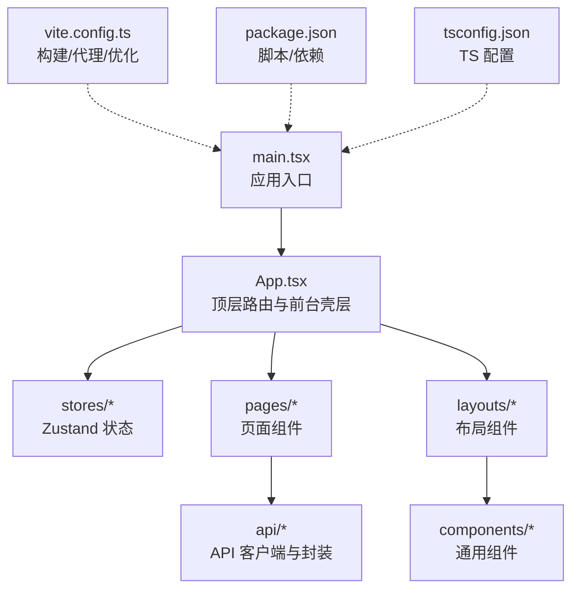
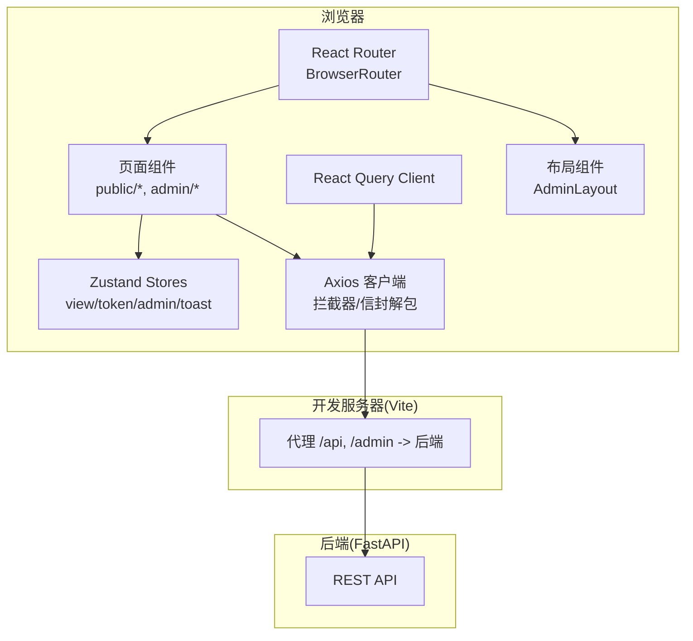
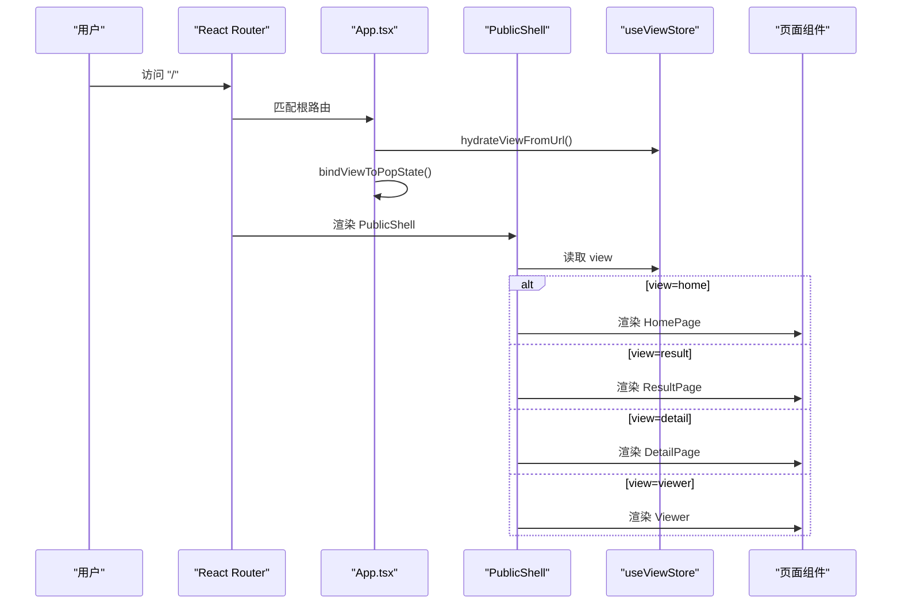
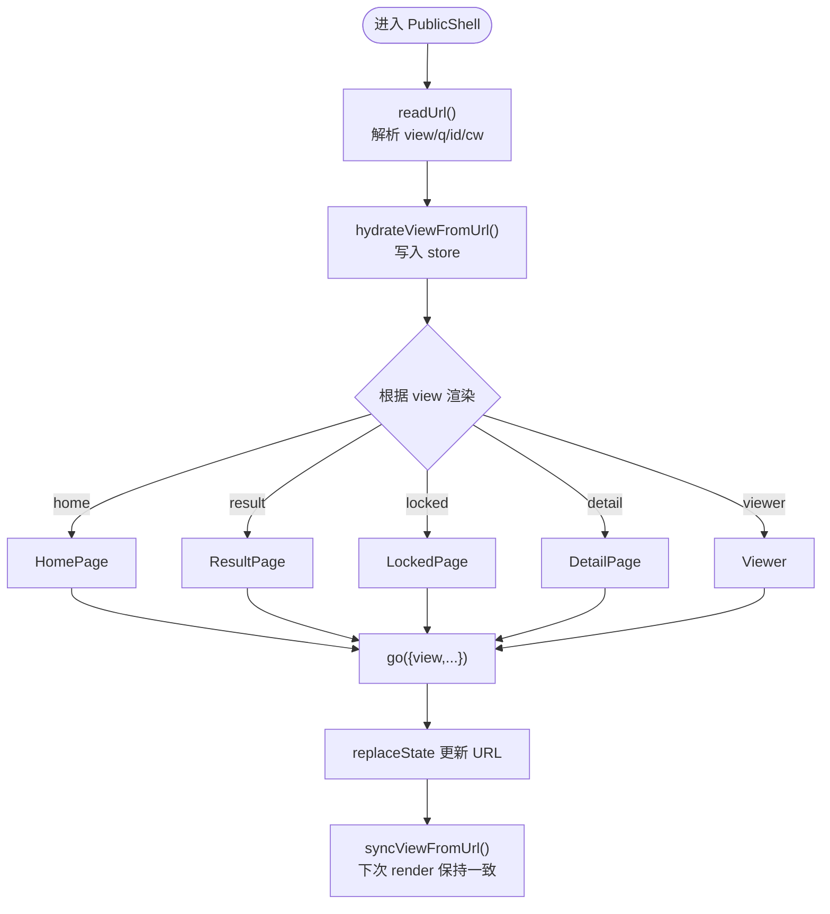
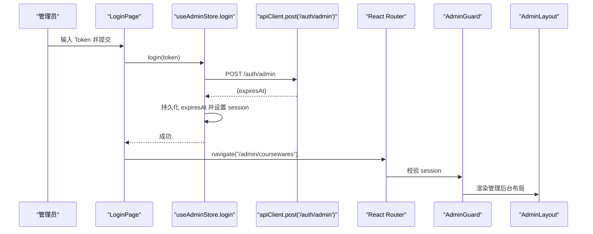
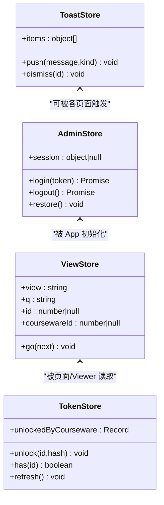
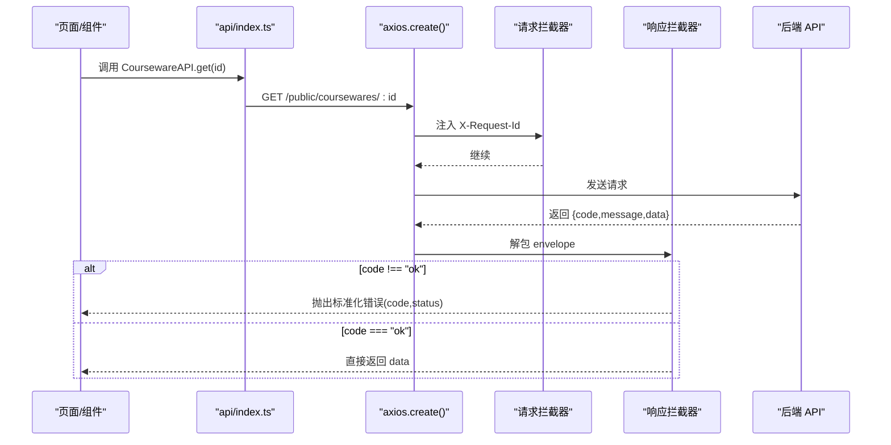
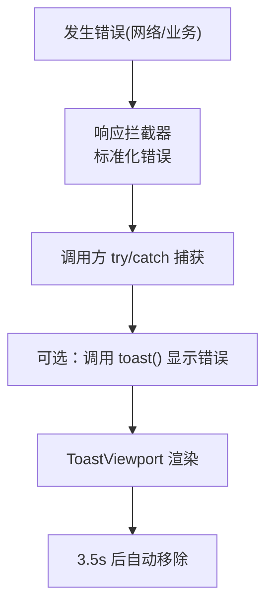
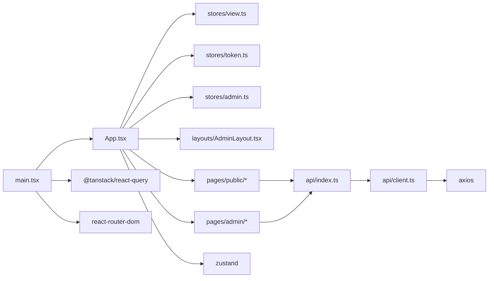

# 应用架构概览

<cite>
**本文引用的文件**   
- [frontend/src/main.tsx](file://frontend/src/main.tsx)
- [frontend/src/App.tsx](file://frontend/src/App.tsx)
- [frontend/vite.config.ts](file://frontend/vite.config.ts)
- [frontend/package.json](file://frontend/package.json)
- [frontend/tsconfig.json](file://frontend/tsconfig.json)
- [frontend/src/stores/view.ts](file://frontend/src/stores/view.ts)
- [frontend/src/stores/token.ts](file://frontend/src/stores/token.ts)
- [frontend/src/stores/admin.ts](file://frontend/src/stores/admin.ts)
- [frontend/src/stores/toast.ts](file://frontend/src/stores/toast.ts)
- [frontend/src/api/client.ts](file://frontend/src/api/client.ts)
- [frontend/src/api/index.ts](file://frontend/src/api/index.ts)
- [frontend/src/layouts/AdminLayout.tsx](file://frontend/src/layouts/AdminLayout.tsx)
- [frontend/src/components/Toast.tsx](file://frontend/src/components/Toast.tsx)
- [frontend/src/pages/public/Home.tsx](file://frontend/src/pages/public/Home.tsx)
- [frontend/src/pages/admin/Login.tsx](file://frontend/src/pages/admin/Login.tsx)
</cite>

## 目录
1. [简介](#简介)
2. [项目结构](#项目结构)
3. [核心组件](#核心组件)
4. [架构总览](#架构总览)
5. [详细组件分析](#详细组件分析)
6. [依赖关系分析](#依赖关系分析)
7. [性能考虑](#性能考虑)
8. [故障排查指南](#故障排查指南)
9. [结论](#结论)
10. [附录](#附录)

## 简介
本文件面向 Learning Hub 前端（React + TypeScript + Vite）的架构概览，聚焦以下目标：
- 单页应用入口、路由与组件层次结构
- 前台用户界面与管理后台的分离设计，以及“单 URL 多视图”的实现模式
- 基于 Zustand 的状态管理组织与数据流
- API 客户端架构与请求处理流程
- 错误处理机制与用户反馈系统
- 组件通信模式与事件处理策略
- 性能优化与代码分割策略

## 项目结构
前端采用按领域分层与功能域混合的组织方式：
- src/main.tsx：应用启动与全局 Provider 注入
- src/App.tsx：顶层路由与前台“单 URL 多视图”壳层
- src/stores：Zustand store（前台视图、令牌解锁、管理员会话、提示消息）
- src/api：Axios 客户端与业务 API 封装
- src/pages：页面级组件（public 前台、admin 后台）
- src/layouts：布局组件（如 AdminLayout）
- src/components：通用 UI 组件（Toast、Logo 等）
- vite.config.ts：构建与开发服务器配置（别名、代理、优化）
- package.json：脚本与依赖声明
- tsconfig.json：TypeScript 编译与路径别名

图表来源
- [frontend/src/main.tsx:1-26](file://frontend/src/main.tsx#L1-L26)
- [frontend/src/App.tsx:1-110](file://frontend/src/App.tsx#L1-L110)
- [frontend/vite.config.ts:1-39](file://frontend/vite.config.ts#L1-L39)
- [frontend/package.json:1-40](file://frontend/package.json#L1-L40)
- [frontend/tsconfig.json:1-27](file://frontend/tsconfig.json#L1-L27)

章节来源
- [frontend/src/main.tsx:1-26](file://frontend/src/main.tsx#L1-L26)
- [frontend/src/App.tsx:1-110](file://frontend/src/App.tsx#L1-L110)
- [frontend/vite.config.ts:1-39](file://frontend/vite.config.ts#L1-L39)
- [frontend/package.json:1-40](file://frontend/package.json#L1-L40)
- [frontend/tsconfig.json:1-27](file://frontend/tsconfig.json#L1-L27)

## 核心组件
- 应用入口与全局上下文
  - main.tsx 创建 React Query Client、BrowserRouter，并挂载 App。
  - App.tsx 负责初始化前台视图状态、Token 记忆、浏览器历史监听，并定义前台与后台的路由树。
- 前台“单 URL 多视图”
  - PublicShell 根据 stores/view 中的 view 参数渲染不同页面（home/result/locked/detail/viewer），并通过 go() 同步到 URL 查询串。
- 管理后台
  - /admin 登录页与受保护的管理后台路由，AdminGuard 校验会话，AdminLayout 提供导航与退出登录。
- 状态管理
  - view.ts：前台视图与 URL 双向同步；token.ts：已解锁课件的 tokenHash 持久化；admin.ts：管理员会话与登录/登出；toast.ts：全局提示消息。
- API 客户端
  - client.ts：统一 axios 实例、拦截器、业务信封解包与错误标准化；index.ts：按模块封装 API 调用，自动附加 X-Token-Hash 头与会话 Cookie。

章节来源
- [frontend/src/main.tsx:1-26](file://frontend/src/main.tsx#L1-L26)
- [frontend/src/App.tsx:1-110](file://frontend/src/App.tsx#L1-L110)
- [frontend/src/stores/view.ts:1-127](file://frontend/src/stores/view.ts#L1-L127)
- [frontend/src/stores/token.ts:1-54](file://frontend/src/stores/token.ts#L1-L54)
- [frontend/src/stores/admin.ts:1-71](file://frontend/src/stores/admin.ts#L1-L71)
- [frontend/src/stores/toast.ts:1-30](file://frontend/src/stores/toast.ts#L1-L30)
- [frontend/src/api/client.ts:1-52](file://frontend/src/api/client.ts#L1-L52)
- [frontend/src/api/index.ts:1-443](file://frontend/src/api/index.ts#L1-L443)

## 架构总览
整体为典型的 React SPA 架构：Vite 构建产物由 Nginx 静态托管，开发期通过 Vite dev server 代理 /api 与 /admin 至后端。前台以“单 URL 多视图”驱动页面切换，后台使用独立子路由与守卫。

图表来源
- [frontend/src/main.tsx:1-26](file://frontend/src/main.tsx#L1-L26)
- [frontend/src/App.tsx:1-110](file://frontend/src/App.tsx#L1-L110)
- [frontend/vite.config.ts:1-39](file://frontend/vite.config.ts#L1-L39)
- [frontend/src/api/client.ts:1-52](file://frontend/src/api/client.ts#L1-L52)
- [frontend/src/api/index.ts:1-443](file://frontend/src/api/index.ts#L1-L443)

## 详细组件分析

### 应用入口与路由架构
- 入口挂载顺序：React.StrictMode → QueryClientProvider → BrowserRouter → App
- App 初始化：
  - 从 URL 恢复前台视图状态
  - 从 localStorage 恢复 Token 解锁记忆
  - 绑定 popstate 监听，保证前进后退时视图与 URL 一致
- 路由划分：
  - 前台：根路径 / 下由 PublicShell 根据 view 参数渲染不同页面
  - 后台：/admin 登录，/admin/* 受 AdminGuard 保护，嵌套在 AdminLayout 中

图表来源
- [frontend/src/main.tsx:1-26](file://frontend/src/main.tsx#L1-L26)
- [frontend/src/App.tsx:1-110](file://frontend/src/App.tsx#L1-L110)
- [frontend/src/stores/view.ts:1-127](file://frontend/src/stores/view.ts#L1-L127)

章节来源
- [frontend/src/main.tsx:1-26](file://frontend/src/main.tsx#L1-L26)
- [frontend/src/App.tsx:1-110](file://frontend/src/App.tsx#L1-L110)
- [frontend/src/stores/view.ts:1-127](file://frontend/src/stores/view.ts#L1-L127)

### 前台“单 URL 多视图”实现
- 视图枚举：home、result、locked、detail、viewer
- URL 与 Store 双向同步：
  - readUrl/hydrateViewFromUrl：将当前 URL 查询串解析为视图状态
  - syncViewFromUrl：在 location 变化时重新同步
  - bindViewToPopState：监听浏览器前进/后退
  - go(next)：合并字段后写入 store，并同步更新 URL（replaceState）
- 启发式推断：当未显式指定 view 时，根据 id/q/cw 推断 detail/viewer/result/home

图表来源
- [frontend/src/stores/view.ts:1-127](file://frontend/src/stores/view.ts#L1-L127)
- [frontend/src/App.tsx:1-110](file://frontend/src/App.tsx#L1-L110)
- [frontend/src/pages/public/Home.tsx:1-55](file://frontend/src/pages/public/Home.tsx#L1-L55)

章节来源
- [frontend/src/stores/view.ts:1-127](file://frontend/src/stores/view.ts#L1-L127)
- [frontend/src/App.tsx:1-110](file://frontend/src/App.tsx#L1-L110)
- [frontend/src/pages/public/Home.tsx:1-55](file://frontend/src/pages/public/Home.tsx#L1-L55)

### 管理后台与权限控制
- 登录流程：
  - LoginPage 提交 token 给 /auth/admin
  - useAdminStore.login 保存 expiresAt 到本地存储，设置 session
  - AdminGuard 检查 session，未登录重定向到 /admin
- 导航与退出：
  - AdminLayout 提供导航菜单与退出按钮，退出后清理本地存储并跳转登录页

图表来源
- [frontend/src/pages/admin/Login.tsx:1-72](file://frontend/src/pages/admin/Login.tsx#L1-L72)
- [frontend/src/stores/admin.ts:1-71](file://frontend/src/stores/admin.ts#L1-L71)
- [frontend/src/layouts/AdminLayout.tsx:1-61](file://frontend/src/layouts/AdminLayout.tsx#L1-L61)
- [frontend/src/App.tsx:1-110](file://frontend/src/App.tsx#L1-L110)

章节来源
- [frontend/src/pages/admin/Login.tsx:1-72](file://frontend/src/pages/admin/Login.tsx#L1-L72)
- [frontend/src/stores/admin.ts:1-71](file://frontend/src/stores/admin.ts#L1-L71)
- [frontend/src/layouts/AdminLayout.tsx:1-61](file://frontend/src/layouts/AdminLayout.tsx#L1-L61)
- [frontend/src/App.tsx:1-110](file://frontend/src/App.tsx#L1-L110)

### 状态管理架构（Zustand）
- view store：维护前台视图与 URL 查询参数，提供 go() 方法同步到 URL
- token store：记录已解锁课件的 tokenHash，支持 unlock/has/refresh，持久化到 localStorage
- admin store：管理管理员会话，提供 login/logout/restore
- toast store：集中管理提示消息，push/dismiss 并提供便捷函数

图表来源
- [frontend/src/stores/view.ts:1-127](file://frontend/src/stores/view.ts#L1-L127)
- [frontend/src/stores/token.ts:1-54](file://frontend/src/stores/token.ts#L1-L54)
- [frontend/src/stores/admin.ts:1-71](file://frontend/src/stores/admin.ts#L1-L71)
- [frontend/src/stores/toast.ts:1-30](file://frontend/src/stores/toast.ts#L1-L30)

章节来源
- [frontend/src/stores/view.ts:1-127](file://frontend/src/stores/view.ts#L1-L127)
- [frontend/src/stores/token.ts:1-54](file://frontend/src/stores/token.ts#L1-L54)
- [frontend/src/stores/admin.ts:1-71](file://frontend/src/stores/admin.ts#L1-L71)
- [frontend/src/stores/toast.ts:1-30](file://frontend/src/stores/toast.ts#L1-L30)

### API 客户端与请求处理流程
- Axios 实例
  - baseURL=/api，withCredentials=true，超时 30s
  - 请求拦截：注入 X-Request-Id
  - 响应拦截：对业务信封进行解包，非 ok 抛错并携带 code/status
- 业务 API 封装
  - 统一 unwrap 返回 data，减少样板代码
  - 受限资源访问：通过 tokenHashHeaders 自动附加 X-Token-Hash 头，避免与 Set-Cookie 时序耦合
  - 访问会话埋点：start/leave 接口，leave 优先 sendBeacon，回退 keepalive fetch
  - 公开与后台 API 分类清晰，类型完备

图表来源
- [frontend/src/api/client.ts:1-52](file://frontend/src/api/client.ts#L1-L52)
- [frontend/src/api/index.ts:1-443](file://frontend/src/api/index.ts#L1-L443)

章节来源
- [frontend/src/api/client.ts:1-52](file://frontend/src/api/client.ts#L1-L52)
- [frontend/src/api/index.ts:1-443](file://frontend/src/api/index.ts#L1-L443)

### 错误处理与用户反馈
- 网络与业务错误
  - 响应拦截器将后端 code/message 映射为标准错误对象，包含 code 与 status
  - 调用方可捕获错误并展示给用户（例如登录失败信息）
- 用户反馈
  - ToastViewport 全局渲染提示消息，支持 info/success/error 三种样式
  - toast 便捷函数可直接推送消息，store 内自动定时消失

图表来源
- [frontend/src/api/client.ts:1-52](file://frontend/src/api/client.ts#L1-L52)
- [frontend/src/stores/toast.ts:1-30](file://frontend/src/stores/toast.ts#L1-L30)
- [frontend/src/components/Toast.tsx:1-38](file://frontend/src/components/Toast.tsx#L1-L38)

章节来源
- [frontend/src/api/client.ts:1-52](file://frontend/src/api/client.ts#L1-L52)
- [frontend/src/stores/toast.ts:1-30](file://frontend/src/stores/toast.ts#L1-L30)
- [frontend/src/components/Toast.tsx:1-38](file://frontend/src/components/Toast.tsx#L1-L38)

### 组件通信与事件处理
- 路由与视图切换
  - 前台通过 useViewStore.go() 修改视图并同步 URL，PublicShell 监听变更渲染对应页面
  - 后台通过 React Router 的 Navigate 与 Outlet 组合完成导航与内容渲染
- 跨组件通知
  - 使用 toast 全局提示，无需层层透传 props
- 表单与交互
  - 页面组件内部维护局部 state，提交时调用 store 或 API，成功后再导航或提示

章节来源
- [frontend/src/stores/view.ts:1-127](file://frontend/src/stores/view.ts#L1-L127)
- [frontend/src/App.tsx:1-110](file://frontend/src/App.tsx#L1-L110)
- [frontend/src/pages/public/Home.tsx:1-55](file://frontend/src/pages/public/Home.tsx#L1-L55)
- [frontend/src/layouts/AdminLayout.tsx:1-61](file://frontend/src/layouts/AdminLayout.tsx#L1-L61)

### 性能优化与代码分割
- 构建与依赖优化
  - Vite 排除 pdfjs-dist 预优化，避免 HMR 卡顿
  - worker 输出格式设置为 ES，利于异步加载
  - 构建目标 es2022，关闭 sourcemap 以提升体积与速度
- 运行时优化建议
  - 使用 React.lazy + Suspense 对大页面（如 Viewer/PDF/PPT）进行按需加载
  - 对 PDF.js worker 动态导入，仅在需要时加载
  - 列表分页与虚拟滚动结合，减少首屏渲染压力
  - 图片与媒体资源使用懒加载与 CDN

章节来源
- [frontend/vite.config.ts:1-39](file://frontend/vite.config.ts#L1-L39)
- [frontend/package.json:1-40](file://frontend/package.json#L1-L40)

## 依赖关系分析
- 关键依赖
  - react/react-dom：UI 框架
  - react-router-dom：路由
  - zustand：轻量状态管理
  - @tanstack/react-query：服务端状态缓存与请求生命周期
  - axios：HTTP 客户端
  - tailwindcss：样式原子化
  - pdfjs-dist：PDF 预览（构建期排除预优化）
- 模块依赖图

图表来源
- [frontend/src/main.tsx:1-26](file://frontend/src/main.tsx#L1-L26)
- [frontend/src/App.tsx:1-110](file://frontend/src/App.tsx#L1-L110)
- [frontend/src/api/client.ts:1-52](file://frontend/src/api/client.ts#L1-L52)
- [frontend/src/api/index.ts:1-443](file://frontend/src/api/index.ts#L1-L443)
- [frontend/src/stores/view.ts:1-127](file://frontend/src/stores/view.ts#L1-L127)
- [frontend/src/stores/token.ts:1-54](file://frontend/src/stores/token.ts#L1-L54)
- [frontend/src/stores/admin.ts:1-71](file://frontend/src/stores/admin.ts#L1-L71)
- [frontend/src/layouts/AdminLayout.tsx:1-61](file://frontend/src/layouts/AdminLayout.tsx#L1-L61)

章节来源
- [frontend/package.json:1-40](file://frontend/package.json#L1-L40)
- [frontend/vite.config.ts:1-39](file://frontend/vite.config.ts#L1-L39)

## 性能考虑
- 构建期
  - 排除 pdfjs-dist 预优化，避免大型依赖影响 HMR
  - 构建目标 es2022，关闭 sourcemap，缩短构建时间
- 运行期
  - 使用 React.lazy/Suspense 对重型页面与第三方库进行延迟加载
  - 对长列表使用分页与虚拟滚动
  - 媒体资源懒加载与 CDN 加速
  - 合理设置 axios 超时与重试策略（当前默认不重试，可按需调整）

[本节为通用指导，不直接分析具体文件]

## 故障排查指南
- 登录失败
  - 检查 /auth/admin 响应是否返回有效 expiresAt
  - 确认 withCredentials 与 Cookie 同源策略
- 受限课件无法打开
  - 确认 X-Token-Hash 头是否正确附加（来自 token store）
  - 检查 unlock 成功后 store 是否刷新
- 视图跳转异常
  - 检查 go() 是否重置 home 相关参数
  - 确认 PublicShell 的 useEffect 与 replaceState 的时序一致性
- 上传失败或超时
  - 检查 MaterialAPI.upload 的超时配置与后端/nginx 限制
- 提示消息不显示
  - 确认 ToastViewport 已挂载且 toast 调用正确

章节来源
- [frontend/src/stores/admin.ts:1-71](file://frontend/src/stores/admin.ts#L1-L71)
- [frontend/src/api/index.ts:1-443](file://frontend/src/api/index.ts#L1-L443)
- [frontend/src/stores/view.ts:1-127](file://frontend/src/stores/view.ts#L1-L127)
- [frontend/src/App.tsx:1-110](file://frontend/src/App.tsx#L1-L110)
- [frontend/src/components/Toast.tsx:1-38](file://frontend/src/components/Toast.tsx#L1-L38)

## 结论
Learning Hub 前端采用清晰的 React SPA 架构：以 Vite 构建、React Router 路由、Zustand 状态管理与 Axios 客户端为核心，前台通过“单 URL 多视图”实现简洁的用户体验，后台通过独立子路由与守卫保障安全。API 层统一信封解包与错误标准化，配合全局 Toast 提升用户体验。构建与运行期均具备明确的优化点，便于后续扩展与性能调优。

[本节为总结性内容，不直接分析具体文件]

## 附录
- 环境变量与代理
  - 开发期通过 Vite 代理 /api 与 /admin 到后端服务
- TypeScript 配置
  - 启用严格模式与路径别名 @/* 指向 src
- 样式体系
  - TailwindCSS 主题扩展 primary 色系与字体族

章节来源
- [frontend/vite.config.ts:1-39](file://frontend/vite.config.ts#L1-L39)
- [frontend/tsconfig.json:1-27](file://frontend/tsconfig.json#L1-L27)
- [frontend/tailwind.config.js:1-21](file://frontend/tailwind.config.js#L1-L21)