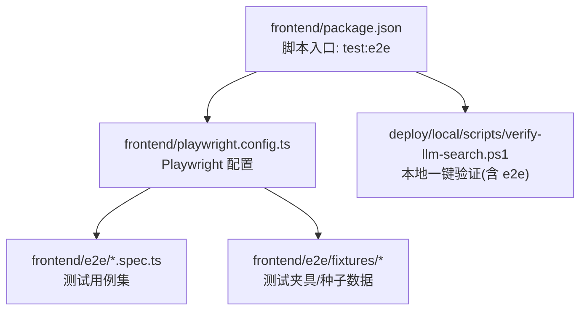
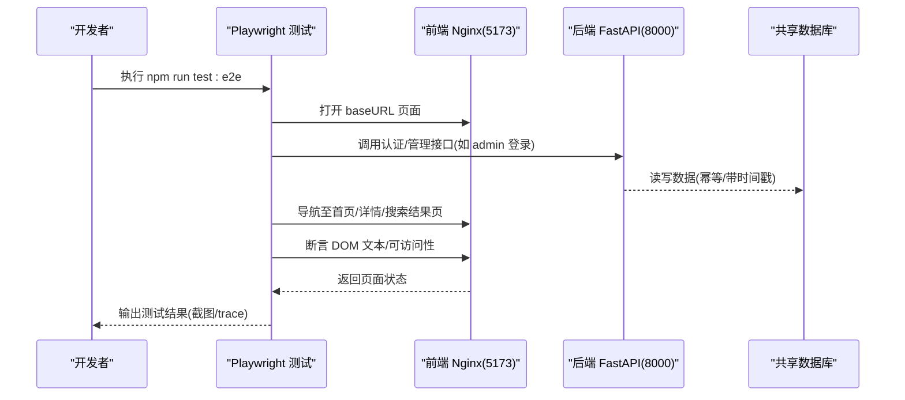
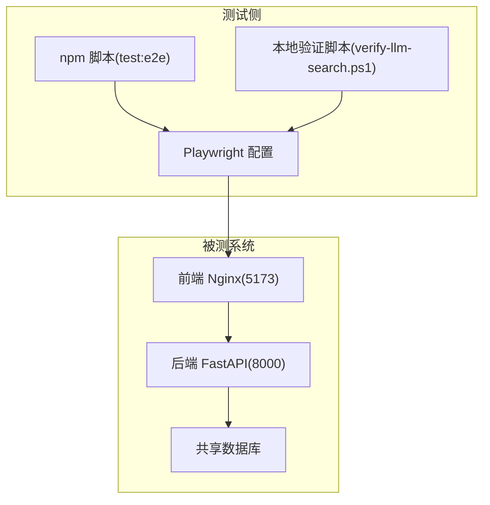

# 测试指南

<cite>
**本文引用的文件**
- [frontend/playwright.config.ts](file://frontend/playwright.config.ts)
- [frontend/e2e/README.md](file://frontend/e2e/README.md)
- [frontend/package.json](file://frontend/package.json)
- [deploy/local/scripts/verify-llm-search.ps1](file://deploy/local/scripts/verify-llm-search.ps1)
- [doc/test/README.md](file://doc/test/README.md)
</cite>

## 目录
1. [简介](#简介)
2. [项目结构](#项目结构)
3. [核心组件](#核心组件)
4. [架构总览](#架构总览)
5. [详细组件分析](#详细组件分析)
6. [依赖分析](#依赖分析)
7. [性能考虑](#性能考虑)
8. [故障排查指南](#故障排查指南)
9. [结论](#结论)
10. [附录](#附录)

## 简介
本指南面向 Learning Hub 前端端到端（E2E）测试，聚焦基于 Playwright 的自动化测试框架配置与使用。内容涵盖：
- 测试环境与服务依赖
- 用例组织、命名规范与覆盖范围
- 关键功能流程的自动化实现要点（用户搜索、课件浏览、管理后台操作等）
- 测试数据准备与管理策略（幂等创建、时间戳去重、共享夹具）
- 执行方式、结果分析与持续集成
- 最佳实践（覆盖率、性能、跨浏览器兼容）
- 调试技巧与问题排查

## 项目结构
前端 E2E 测试位于 frontend/e2e 目录，采用 Playwright 作为运行器；配置文件为 playwright.config.ts；package.json 提供脚本入口；本地验证脚本 deploy/local/scripts/verify-llm-search.ps1 演示了 CI 风格的安装与执行流程。

图示来源
- [frontend/package.json:1-40](file://frontend/package.json#L1-L40)
- [frontend/playwright.config.ts:1-34](file://frontend/playwright.config.ts#L1-L34)
- [deploy/local/scripts/verify-llm-search.ps1:165-201](file://deploy/local/scripts/verify-llm-search.ps1#L165-L201)

章节来源
- [frontend/playwright.config.ts:1-34](file://frontend/playwright.config.ts#L1-L34)
- [frontend/e2e/README.md:1-51](file://frontend/e2e/README.md#L1-L51)
- [frontend/package.json:1-40](file://frontend/package.json#L1-L40)
- [deploy/local/scripts/verify-llm-search.ps1:165-201](file://deploy/local/scripts/verify-llm-search.ps1#L165-L201)

## 核心组件
- 运行器与配置
  - 测试目录：frontend/e2e
  - 浏览器：Chromium（通过系统 Chrome channel 运行）
  - 并行：关闭全并行，单 worker，降低并发对共享数据库的影响
  - 失败重试：CI 环境下启用一次重试
  - 报告：CI 使用 line，本地使用 list
  - 截图/追踪：失败时保留截图与 trace，视频关闭
  - 超时：全局 60s，断言默认 10s
  - baseURL：优先环境变量 LH_BASE_URL，否则 http://localhost:5173
- 脚本入口
  - npm run test:e2e 调用 playwright test
- 本地验证脚本
  - 自动安装 Chromium（可设置国内镜像加速）
  - 仅运行 front-search-llm.spec.ts 进行冒烟验证

章节来源
- [frontend/playwright.config.ts:1-34](file://frontend/playwright.config.ts#L1-L34)
- [frontend/package.json:1-40](file://frontend/package.json#L1-L40)
- [deploy/local/scripts/verify-llm-search.ps1:165-201](file://deploy/local/scripts/verify-llm-search.ps1#L165-L201)

## 架构总览
E2E 测试针对已部署的 docker-compose 服务，前端由 nginx 提供 SPA 静态资源（5173），后端 FastAPI（8000）经 Vite 代理转发 /api/*。测试在 headless 模式下运行，通过 API 完成幂等数据准备，再在 UI 层断言文本与可访问性。

图示来源
- [frontend/playwright.config.ts:1-34](file://frontend/playwright.config.ts#L1-L34)
- [frontend/e2e/README.md:23-33](file://frontend/e2e/README.md#L23-L33)

## 详细组件分析

### 测试环境与依赖
- 前置条件
  - 启动 docker-compose，确保 lh-frontend(5173) 与 lh-backend(8000) 可用
  - 首次运行需安装 Chromium（可设置 PLAYWRIGHT_DOWNLOAD_HOST 加速）
- 服务发现
  - baseURL 默认 http://localhost:5173，可通过环境变量 LH_BASE_URL 覆盖
- 运行模式
  - headless 模式，失败时生成截图与 trace，便于定位问题

章节来源
- [frontend/e2e/README.md:1-21](file://frontend/e2e/README.md#L1-L21)
- [frontend/playwright.config.ts:17-23](file://frontend/playwright.config.ts#L17-L23)

### 用例组织与命名规范
- 文件组织
  - 前台门户：front-home.spec.ts、front-detail.spec.ts、front-viewer.spec.ts、front-search-llm.spec.ts
  - 管理后台：admin-auth.spec.ts、admin-access-session.spec.ts、admin-courseware-order.spec.ts
  - 公共辅助：api-helpers.ts（共享 API fixture）
- 命名规范
  - 参考 doc/test/README.md 的用例前缀体系（F-、A-、C-、T-、M-、TKN-、INT-V-、FTK-、AUTH-、ERR-、SR-、DI-、N- 等）
  - 建议将 spec 文件名与用例 ID 对应，便于检索与统计

章节来源
- [frontend/e2e/README.md:34-41](file://frontend/e2e/README.md#L34-L41)
- [doc/test/README.md:111-131](file://doc/test/README.md#L111-L131)

### 关键功能测试实现要点
- 用户搜索
  - 首页输入关键词并跳转结果页，断言命中项可见性与来源徽标（LLM/关键词）
  - 无 LLM key 时走降级路径，短关键词仍按 ILIKE 命中
- 课件浏览
  - 开放课件直接预览；受限课件进入锁定页，输入有效 Token 解锁后进入详情页
  - PPT/PDF/Video 三种素材类型在 viewer 子组件中的交互与加载
- 管理后台操作
  - 管理员登录、受保护路由校验、分类/标签/素材/Token 的增删改查
  - 幂等创建：所有 title/label 带时间戳避免冲突

章节来源
- [frontend/e2e/README.md:28-33](file://frontend/e2e/README.md#L28-L33)
- [doc/test/README.md:19-23](file://doc/test/README.md#L19-L23)
- [doc/test/README.md:204-206](file://doc/test/README.md#L204-L206)

### 测试数据准备与管理策略
- 幂等创建
  - 通过 API 夹具在数据库中幂等创建 3 级分类、AccessToken、课件
  - 标题/标签统一附加时间戳，避免重复冲突
- 夹具与种子
  - fixtures/pptx-20slides.py 用于生成 PPT 种子数据
  - api-helpers.ts 暴露 adminLogin、ensureLeafCategory、ensureAccessToken、createCourseware 等能力
- 环境配置
  - 通过环境变量注入 BASE URL、LLM Key 等开关，控制不同分支行为

章节来源
- [frontend/e2e/README.md:28-33](file://frontend/e2e/README.md#L28-L33)
- [frontend/e2e/README.md:34-41](file://frontend/e2e/README.md#L34-L41)
- [doc/test/README.md:19-23](file://doc/test/README.md#L19-L23)

### 执行与结果分析
- 本地执行
  - npm run test:e2e 或 npx playwright test
  - 指定单文件：npx playwright test e2e/front-home.spec.ts
- 本地验证脚本
  - 自动安装 Chromium（支持国内镜像）、仅运行 front-search-llm.spec.ts 做冒烟
- 结果产物
  - 失败截图、trace 文件保存在 test-results 目录，便于回放与定位

章节来源
- [frontend/e2e/README.md:6-21](file://frontend/e2e/README.md#L6-L21)
- [deploy/local/scripts/verify-llm-search.ps1:165-201](file://deploy/local/scripts/verify-llm-search.ps1#L165-L201)
- [frontend/playwright.config.ts:14-22](file://frontend/playwright.config.ts#L14-L22)

### 持续集成配置
- CI 行为
  - forbidOnly 开启，禁止仅标记用例
  - retries=1，失败自动重试一次
  - reporter=line，便于日志聚合
- 本地脚本示例
  - verify-llm-search.ps1 展示了“安装浏览器 → 执行指定用例”的流水线片段

章节来源
- [frontend/playwright.config.ts:14-16](file://frontend/playwright.config.ts#L14-L16)
- [deploy/local/scripts/verify-llm-search.ps1:165-201](file://deploy/local/scripts/verify-llm-search.ps1#L165-L201)

### 最佳实践
- 稳定性
  - 关闭全并行、单 worker，减少共享资源竞争
  - 失败重试 + 截图/trace，提升定位效率
- 选择器
  - 优先 data-testid 与文本断言，弱化 CSS 类名耦合
- 数据
  - 幂等创建 + 时间戳去重，保证多次运行一致性
- 兼容性
  - 使用系统 Chrome channel 运行 Chromium，降低环境差异
- 覆盖率与性能
  - 结合 doc/test/README.md 的非功能用例（N-*）与集成验收（INT-V-*）补充性能与健壮性验证

章节来源
- [frontend/playwright.config.ts:12-22](file://frontend/playwright.config.ts#L12-L22)
- [frontend/e2e/README.md:28-33](file://frontend/e2e/README.md#L28-L33)
- [doc/test/README.md:111-131](file://doc/test/README.md#L111-L131)

## 依赖分析
- 运行时依赖
  - 前端 Nginx(5173) 提供 SPA
  - 后端 FastAPI(8000) 提供 REST API
  - 共享数据库（docker-compose 共用）
- 工具链
  - Playwright 测试框架
  - Node/npm 脚本入口
  - 可选：本地 PowerShell 验证脚本

图示来源
- [frontend/playwright.config.ts:1-34](file://frontend/playwright.config.ts#L1-L34)
- [frontend/package.json:1-40](file://frontend/package.json#L1-L40)
- [deploy/local/scripts/verify-llm-search.ps1:165-201](file://deploy/local/scripts/verify-llm-search.ps1#L165-L201)

章节来源
- [frontend/playwright.config.ts:1-34](file://frontend/playwright.config.ts#L1-L34)
- [frontend/package.json:1-40](file://frontend/package.json#L1-L40)
- [deploy/local/scripts/verify-llm-search.ps1:165-201](file://deploy/local/scripts/verify-llm-search.ps1#L165-L201)

## 性能考虑
- 关闭全并行与单 worker，降低并发对共享数据库的压力
- 仅在失败时生成截图与 trace，避免 I/O 开销影响整体耗时
- 视频录制关闭，进一步减少磁盘写入
- 对于搜索链路，结合 doc/test/README.md 中非功能用例（N-*）与集成验收（INT-V-*）进行回归与压力验证

章节来源
- [frontend/playwright.config.ts:12-22](file://frontend/playwright.config.ts#L12-L22)
- [doc/test/README.md:111-131](file://doc/test/README.md#L111-L131)

## 故障排查指南
- 常见问题
  - Chromium 下载慢或失败：设置 PLAYWRIGHT_DOWNLOAD_HOST 使用国内镜像
  - 端口占用或服务未就绪：确认 docker-compose 已启动且 5173/8000 可达
  - 选择器不稳定：优先使用 data-testid 与文本断言，避免强依赖 CSS 类名
- 定位手段
  - 查看失败截图与 trace 文件（test-results）
  - 使用本地验证脚本快速复现特定用例
- 数据问题
  - 检查是否因幂等创建导致数据冲突（时间戳是否生效）
  - 清理或重置共享数据库需谨慎，遵循“删除走管理后台”的建议

章节来源
- [frontend/e2e/README.md:6-21](file://frontend/e2e/README.md#L6-L21)
- [frontend/e2e/README.md:28-33](file://frontend/e2e/README.md#L28-L33)
- [frontend/playwright.config.ts:14-22](file://frontend/playwright.config.ts#L14-L22)

## 结论
本指南梳理了 Learning Hub 前端 E2E 测试的整体方案与实践要点。通过合理的配置、稳定的数据准备策略与清晰的用例组织，可在共享数据库与多模块联动的复杂场景下，保障搜索、浏览与管理后台等核心流程的自动化质量。配合本地验证脚本与 CI 行为，可实现从开发到交付的全链路质量门禁。

## 附录
- 快速开始
  - 安装依赖与浏览器：npm install；npx playwright install chromium
  - 运行全部用例：npm run test:e2e
  - 运行单个用例：npx playwright test e2e/front-home.spec.ts
- 相关文档
  - 用例与选择器约定、测试数据与环境依赖详见 doc/test/README.md

章节来源
- [frontend/e2e/README.md:6-21](file://frontend/e2e/README.md#L6-L21)
- [doc/test/README.md:1-206](file://doc/test/README.md#L1-206)