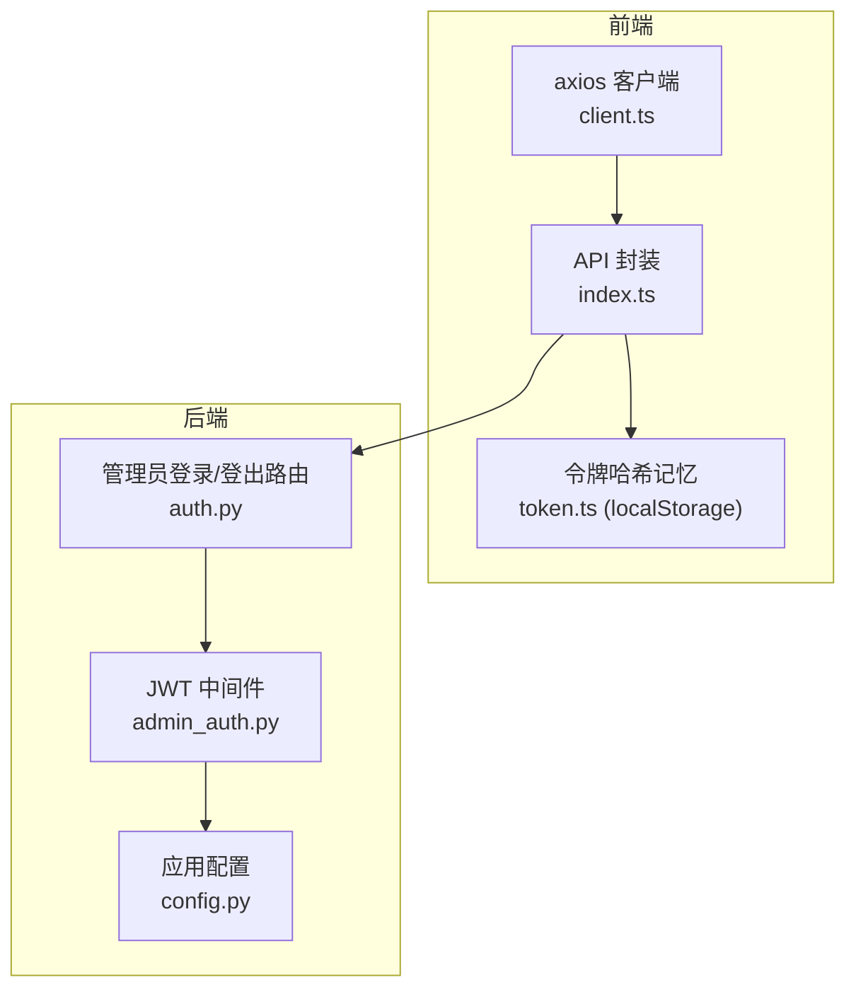
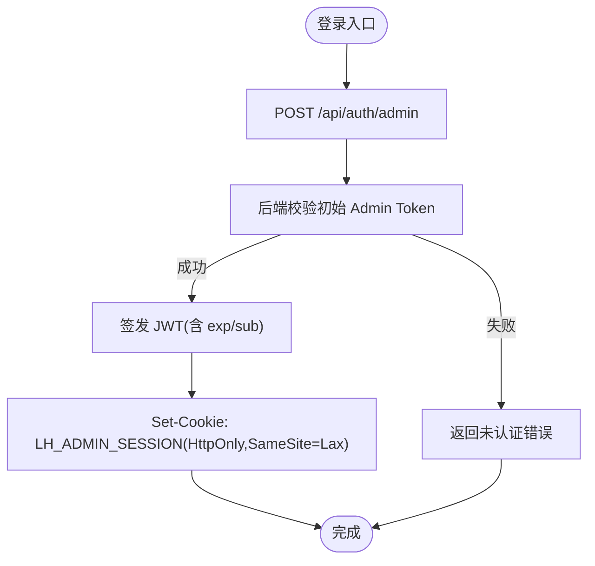
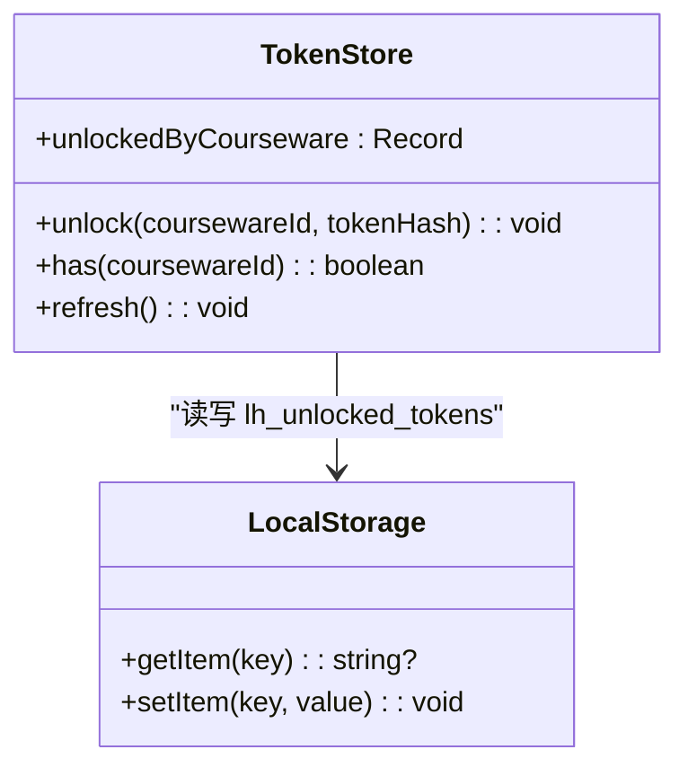
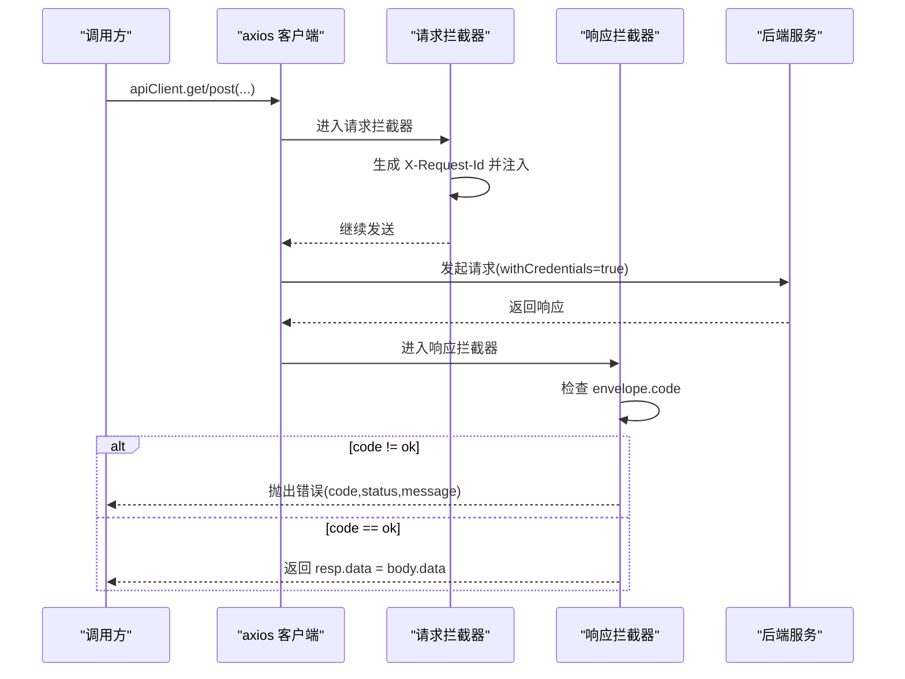
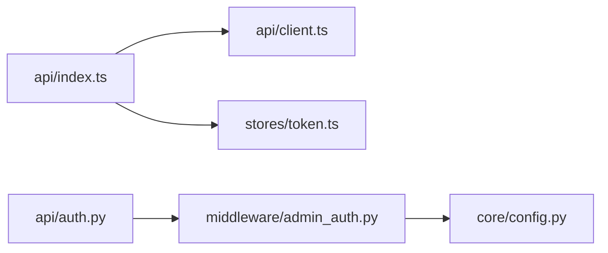

# 令牌管理机制

<cite>
**本文引用的文件列表**
- [frontend/src/stores/token.ts](file://frontend/src/stores/token.ts)
- [frontend/src/api/client.ts](file://frontend/src/api/client.ts)
- [frontend/src/api/index.ts](file://frontend/src/api/index.ts)
- [backend/app/middleware/admin_auth.py](file://backend/app/middleware/admin_auth.py)
- [backend/app/api/auth.py](file://backend/app/api/auth.py)
- [backend/app/core/config.py](file://backend/app/core/config.py)
- [deploy/local/docker-compose.yml](file://deploy/local/docker-compose.yml)
</cite>

## 目录
1. [简介](#简介)
2. [项目结构](#项目结构)
3. [核心组件](#核心组件)
4. [架构总览](#架构总览)
5. [详细组件分析](#详细组件分析)
6. [依赖关系分析](#依赖关系分析)
7. [性能考虑](#性能考虑)
8. [故障排查指南](#故障排查指南)
9. [结论](#结论)
10. [附录](#附录)

## 简介
本文件围绕“令牌管理机制”展开，聚焦以下目标：
- JWT 令牌的存储策略与安全性（含 localStorage 使用与 Cookie 方案对比）
- 自动刷新机制（过期检测、刷新请求、错误重试）
- 令牌生命周期管理（生成、存储、更新、清理）
- 安全防护措施（XSS 防护、CSRF 保护）
- HTTP 请求中的注入方式（拦截器实现与请求头设置）
- 最佳实践（错误处理、调试技巧、性能优化建议）

本项目采用双通道鉴权设计：
- 管理员会话：后端签发 JWT，通过 HttpOnly Cookie 下发；前端不直接持有 JWT。
- 公开课件访问：通过“访问令牌哈希”（X-Token-Hash）进行资源解锁与访问控制，该哈希由前端在本地持久化并随请求注入。

## 项目结构
与令牌管理相关的前后端关键位置如下：
- 前端
  - 状态与持久化：已解锁的访问令牌哈希记忆（localStorage）
  - HTTP 客户端：统一 axios 实例、请求/响应拦截器
  - API 封装：按业务域组织，自动注入 X-Token-Hash 等头部
- 后端
  - 管理员登录/登出路由：校验初始 Admin Token，签发 JWT，写入 Cookie
  - 中间件：从 Authorization 或 Cookie 提取并验证 JWT
  - 配置：JWT 密钥、算法、TTL、CORS 等



图表来源
- [frontend/src/api/client.ts:1-52](file://frontend/src/api/client.ts#L1-L52)
- [frontend/src/api/index.ts:1-443](file://frontend/src/api/index.ts#L1-L443)
- [frontend/src/stores/token.ts:1-54](file://frontend/src/stores/token.ts#L1-L54)
- [backend/app/api/auth.py:1-49](file://backend/app/api/auth.py#L1-L49)
- [backend/app/middleware/admin_auth.py:1-66](file://backend/app/middleware/admin_auth.py#L1-L66)
- [backend/app/core/config.py:1-88](file://backend/app/core/config.py#L1-L88)

章节来源
- [frontend/src/api/client.ts:1-52](file://frontend/src/api/client.ts#L1-L52)
- [frontend/src/api/index.ts:1-443](file://frontend/src/api/index.ts#L1-L443)
- [frontend/src/stores/token.ts:1-54](file://frontend/src/stores/token.ts#L1-L54)
- [backend/app/api/auth.py:1-49](file://backend/app/api/auth.py#L1-L49)
- [backend/app/middleware/admin_auth.py:1-66](file://backend/app/middleware/admin_auth.py#L1-L66)
- [backend/app/core/config.py:1-88](file://backend/app/core/config.py#L1-L88)

## 核心组件
- 管理员会话（JWT + HttpOnly Cookie）
  - 登录：校验初始 Admin Token，签发 JWT，写入 Set-Cookie（HttpOnly, SameSite=Lax）
  - 鉴权：中间件优先读取 Authorization: Bearer，其次读取 Cookie LH_ADMIN_SESSION，解码并校验 exp/sub
  - 配置：jwt_secret/jwt_algorithm/jwt_ttl_hours 来自环境变量
- 公开课件访问（访问令牌哈希）
  - 解锁：调用 unlock 接口后，前端将 tokenHash 持久化到 localStorage
  - 注入：后续公开接口请求自动附加 X-Token-Hash 头
  - 清理：页面刷新时从 localStorage 恢复；隐私模式回退内存

章节来源
- [backend/app/api/auth.py:1-49](file://backend/app/api/auth.py#L1-L49)
- [backend/app/middleware/admin_auth.py:1-66](file://backend/app/middleware/admin_auth.py#L1-L66)
- [backend/app/core/config.py:1-88](file://backend/app/core/config.py#L1-L88)
- [frontend/src/stores/token.ts:1-54](file://frontend/src/stores/token.ts#L1-L54)
- [frontend/src/api/index.ts:1-443](file://frontend/src/api/index.ts#L1-L443)

## 架构总览
下图展示管理员登录与会话维持、以及公开课件访问的令牌注入流程。

```mermaid
sequenceDiagram
participant U as "用户浏览器"
participant FE as "前端 API 封装"
participant AX as "axios 客户端"
participant BE as "后端路由 /api/auth"
participant MW as "JWT 中间件"
participant CFG as "配置(环境变量)"
U->>FE : 输入 Admin Token 并提交登录
FE->>AX : POST /api/auth/admin {token}
AX-->>BE : 携带 withCredentials=true
BE->>MW : 校验初始 Admin Token
MW-->>BE : 校验结果
BE->>CFG : 读取 jwt_* 配置
BE-->>U : Set-Cookie : LH_ADMIN_SESSION=JWT; HttpOnly; SameSite=Lax
Note over U,BE : 后续请求自动附带 Cookie
U->>FE : 打开受保护的公开课件
FE->>AX : GET /public/coursewares/ : id {headers : X-Token-Hash}
AX-->>BE : 同源请求，withCredentials=true
BE->>MW : 解析 Authorization/Cookie 中的 JWT
MW-->>BE : 返回主体信息
BE-->>FE : 返回课件详情
```

图表来源
- [backend/app/api/auth.py:1-49](file://backend/app/api/auth.py#L1-L49)
- [backend/app/middleware/admin_auth.py:1-66](file://backend/app/middleware/admin_auth.py#L1-L66)
- [backend/app/core/config.py:1-88](file://backend/app/core/config.py#L1-L88)
- [frontend/src/api/client.ts:1-52](file://frontend/src/api/client.ts#L1-L52)
- [frontend/src/api/index.ts:1-443](file://frontend/src/api/index.ts#L1-L443)

## 详细组件分析

### 组件一：管理员会话（JWT + HttpOnly Cookie）
- 登录流程
  - 前端调用 /api/auth/admin，提交初始 Admin Token
  - 后端校验通过后签发 JWT，并通过 Set-Cookie 下发（HttpOnly, SameSite=Lax, path=/）
  - 前端无需保存 JWT，仅记录 expiresAt 用于 UI 提示
- 鉴权流程
  - 中间件优先从 Authorization: Bearer 取 token，否则从 Cookie LH_ADMIN_SESSION 取
  - 使用配置的 jwt_secret/jwt_algorithm 解码，要求包含 exp/sub
  - 过期或无效则返回未认证错误
- 登出流程
  - 删除 Cookie LH_ADMIN_SESSION



图表来源
- [backend/app/api/auth.py:1-49](file://backend/app/api/auth.py#L1-L49)
- [backend/app/middleware/admin_auth.py:1-66](file://backend/app/middleware/admin_auth.py#L1-L66)
- [backend/app/core/config.py:1-88](file://backend/app/core/config.py#L1-L88)

章节来源
- [backend/app/api/auth.py:1-49](file://backend/app/api/auth.py#L1-L49)
- [backend/app/middleware/admin_auth.py:1-66](file://backend/app/middleware/admin_auth.py#L1-L66)
- [backend/app/core/config.py:1-88](file://backend/app/core/config.py#L1-L88)

### 组件二：公开课件访问令牌（X-Token-Hash）
- 存储策略
  - 使用 localStorage 持久化 coursewareId -> tokenHash 映射
  - 初始化时 hydrate 到内存 store；隐私模式捕获异常回退内存
- 注入方式
  - 所有需要解锁的公开接口，在请求头中附加 X-Token-Hash
  - 通过 API 封装层统一注入，避免在各处重复逻辑
- 生命周期
  - 解锁成功后立即写入 store 并持久化
  - 页面刷新时从 localStorage 恢复
  - 无显式过期字段，依赖服务端对 tokenHash 的有效性校验



图表来源
- [frontend/src/stores/token.ts:1-54](file://frontend/src/stores/token.ts#L1-L54)
- [frontend/src/api/index.ts:1-443](file://frontend/src/api/index.ts#L1-L443)

章节来源
- [frontend/src/stores/token.ts:1-54](file://frontend/src/stores/token.ts#L1-L54)
- [frontend/src/api/index.ts:1-443](file://frontend/src/api/index.ts#L1-L443)

### 组件三：HTTP 客户端与拦截器
- 基础配置
  - baseURL 指向 /api，启用 withCredentials=true（允许跨域携带 Cookie）
  - 超时默认 30s，上传场景可覆盖
- 请求拦截器
  - 为每个请求注入 X-Request-Id，便于追踪
- 响应拦截器
  - 统一解包 envelope：若 code !== ok 则抛出带 code/status 的错误对象
  - 成功时将 data 写回 resp.data，简化调用方处理



图表来源
- [frontend/src/api/client.ts:1-52](file://frontend/src/api/client.ts#L1-L52)

章节来源
- [frontend/src/api/client.ts:1-52](file://frontend/src/api/client.ts#L1-L52)

### 组件四：令牌生命周期管理
- 生成
  - 管理员 JWT：后端根据配置签发，包含 exp/sub
  - 访问令牌哈希：由后端生成并返回，前端持久化
- 存储
  - 管理员 JWT：保存在浏览器 Cookie（HttpOnly），前端不可读
  - 访问令牌哈希：保存在 localStorage（键 lh_unlocked_tokens）
- 更新
  - 管理员 JWT：通过重新登录刷新 Cookie
  - 访问令牌哈希：解锁成功后覆盖对应 coursewareId 的条目
- 清理
  - 管理员登出：删除 Cookie
  - 访问令牌哈希：当前未提供显式清理入口，可在登出或退出课件时按需移除

章节来源
- [backend/app/api/auth.py:1-49](file://backend/app/api/auth.py#L1-L49)
- [backend/app/middleware/admin_auth.py:1-66](file://backend/app/middleware/admin_auth.py#L1-L66)
- [frontend/src/stores/token.ts:1-54](file://frontend/src/stores/token.ts#L1-L54)
- [frontend/src/api/index.ts:1-443](file://frontend/src/api/index.ts#L1-L443)

### 组件五：安全防护措施
- XSS 防护
  - 管理员 JWT 通过 HttpOnly Cookie 下发，前端无法通过脚本读取，降低 XSS 窃取风险
  - 访问令牌哈希以哈希形式存储和传输，避免明文泄露
- CSRF 保护
  - 管理员 Cookie 设置 SameSite=Lax，限制跨站携带
  - 前端 axios 启用 withCredentials=true，确保同源请求能携带 Cookie
  - 公开接口通过 X-Token-Hash 头进行细粒度授权，减少仅依赖 Cookie 的风险面
- CORS 与配置
  - 后端支持 cors_allow_origins 白名单，生产环境应严格配置
  - JWT 密钥与算法通过环境变量注入，避免硬编码

章节来源
- [backend/app/api/auth.py:1-49](file://backend/app/api/auth.py#L1-L49)
- [backend/app/middleware/admin_auth.py:1-66](file://backend/app/middleware/admin_auth.py#L1-L66)
- [backend/app/core/config.py:1-88](file://backend/app/core/config.py#L1-L88)
- [frontend/src/api/client.ts:1-52](file://frontend/src/api/client.ts#L1-L52)
- [deploy/local/docker-compose.yml:44-45](file://deploy/local/docker-compose.yml#L44-L45)

### 组件六：自动刷新机制（现状与建议）
- 现状
  - 管理员 JWT：前端不持有，不存在主动刷新逻辑；过期后由中间件返回未认证错误，引导重新登录
  - 访问令牌哈希：无内置过期检测与刷新逻辑；依赖后端对 tokenHash 的有效性校验
- 建议（可选增强）
  - 管理员 JWT 刷新
    - 在响应拦截器中检测 401/未认证错误，触发静默刷新（如调用 /api/auth/admin 或使用后台任务续期）
    - 刷新期间对并发请求去重，避免风暴
  - 访问令牌哈希刷新
    - 当解锁失败或 403 时，提示用户重新输入令牌并再次调用 unlock
    - 增加本地 TTL 与后端校验双重保障

[本节为通用建议，不直接分析具体代码文件]

## 依赖关系分析
- 前端
  - api/index.ts 依赖 api/client.ts 提供的 axios 实例
  - api/index.ts 依赖 stores/token.ts 获取 X-Token-Hash
- 后端
  - auth.py 依赖 middleware/admin_auth.py 的签发与校验函数
  - admin_auth.py 依赖 core/config.py 的 jwt_* 配置



图表来源
- [frontend/src/api/index.ts:1-443](file://frontend/src/api/index.ts#L1-L443)
- [frontend/src/api/client.ts:1-52](file://frontend/src/api/client.ts#L1-L52)
- [frontend/src/stores/token.ts:1-54](file://frontend/src/stores/token.ts#L1-L54)
- [backend/app/api/auth.py:1-49](file://backend/app/api/auth.py#L1-L49)
- [backend/app/middleware/admin_auth.py:1-66](file://backend/app/middleware/admin_auth.py#L1-L66)
- [backend/app/core/config.py:1-88](file://backend/app/core/config.py#L1-L88)

章节来源
- [frontend/src/api/index.ts:1-443](file://frontend/src/api/index.ts#L1-L443)
- [frontend/src/api/client.ts:1-52](file://frontend/src/api/client.ts#L1-L52)
- [frontend/src/stores/token.ts:1-54](file://frontend/src/stores/token.ts#L1-L54)
- [backend/app/api/auth.py:1-49](file://backend/app/api/auth.py#L1-L49)
- [backend/app/middleware/admin_auth.py:1-66](file://backend/app/middleware/admin_auth.py#L1-L66)
- [backend/app/core/config.py:1-88](file://backend/app/core/config.py#L1-L88)

## 性能考虑
- 请求追踪
  - 通过 X-Request-Id 提升前后端联调效率，便于定位慢请求与错误链路
- 大文件上传
  - 针对素材上传，前端覆盖超时时间，与后端/nginx 对齐，避免误判超时
- 网络与缓存
  - 合理设置 axios 超时与重试策略（建议结合业务幂等性）
  - 对于频繁读取的元数据，可引入缓存层（如 React Query）减少重复请求

[本节为通用建议，不直接分析具体代码文件]

## 故障排查指南
- 常见问题
  - 登录后仍提示未认证：检查 Cookie 是否被浏览器拒绝（隐私模式/第三方 Cookie 限制）、SameSite 策略是否满足跨站场景
  - 公开课件需输入两次令牌：确认 unlock 后是否正确注入 X-Token-Hash 头；避免依赖 Set-Cookie 时序
  - 401/403 错误：查看响应拦截器抛出的 code/status/message，定位是 JWT 过期还是 tokenHash 无效
- 调试技巧
  - 利用 X-Request-Id 在后端日志中关联请求
  - 在浏览器开发者工具中检查 Cookie 与请求头
  - 核对环境变量 JWT_SECRET/JWT_ALGORITHM/JWT_TTL_HOURS 是否与部署一致

章节来源
- [frontend/src/api/client.ts:1-52](file://frontend/src/api/client.ts#L1-L52)
- [frontend/src/api/index.ts:1-443](file://frontend/src/api/index.ts#L1-L443)
- [backend/app/middleware/admin_auth.py:1-66](file://backend/app/middleware/admin_auth.py#L1-L66)
- [backend/app/core/config.py:1-88](file://backend/app/core/config.py#L1-L88)

## 结论
本项目采用“管理员 JWT + HttpOnly Cookie”与“公开课件访问令牌哈希 + X-Token-Hash 头”的双通道鉴权模型：
- 管理员会话安全且简洁，前端不直接持有敏感令牌
- 公开课件访问通过哈希头精确授权，避免 Cookie 时序问题
- 通过统一的 axios 拦截器与 API 封装，保证一致性、可观测性与可维护性
- 建议在现有基础上补充自动刷新与更完善的错误重试策略，以提升用户体验与健壮性

[本节为总结性内容，不直接分析具体代码文件]

## 附录
- 环境变量参考（示例）
  - JWT_SECRET：JWT 签名密钥（生产环境必须强随机且保密）
  - JWT_ALGORITHM：签名算法（如 HS256）
  - JWT_TTL_HOURS：JWT 有效期（小时）
  - CORS_ALLOW_ORIGINS：允许的源（生产环境建议严格白名单）

章节来源
- [backend/app/core/config.py:1-88](file://backend/app/core/config.py#L1-L88)
- [deploy/local/docker-compose.yml:44-45](file://deploy/local/docker-compose.yml#L44-L45)