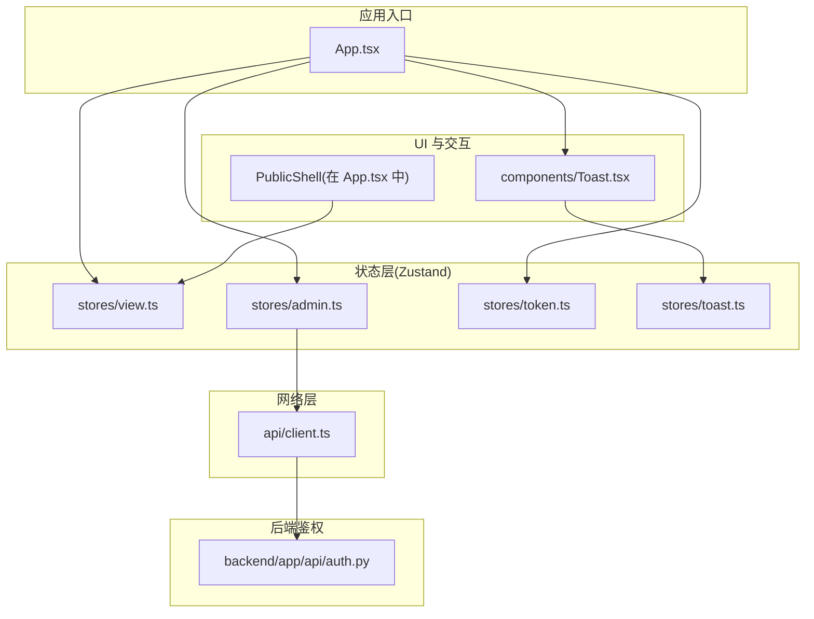
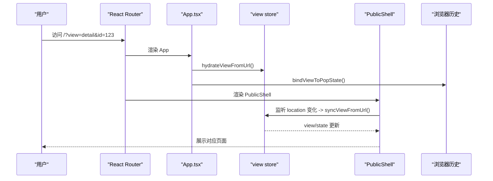
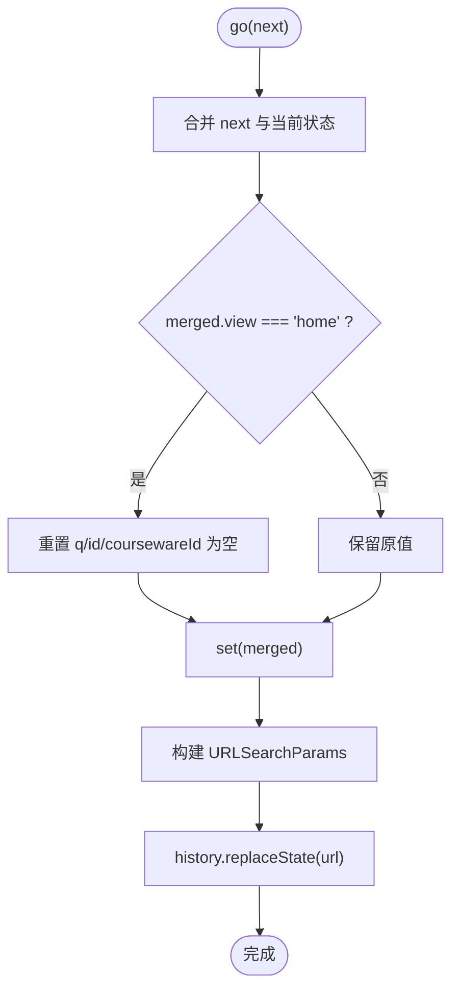
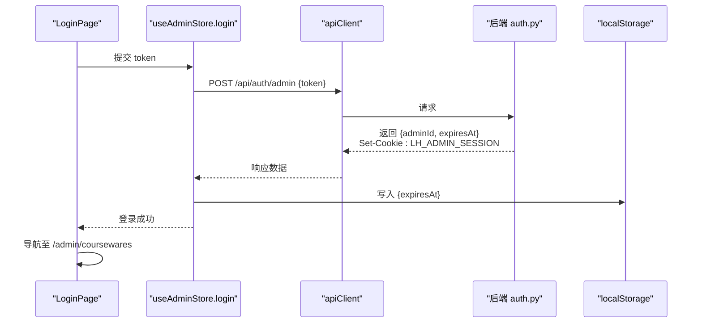
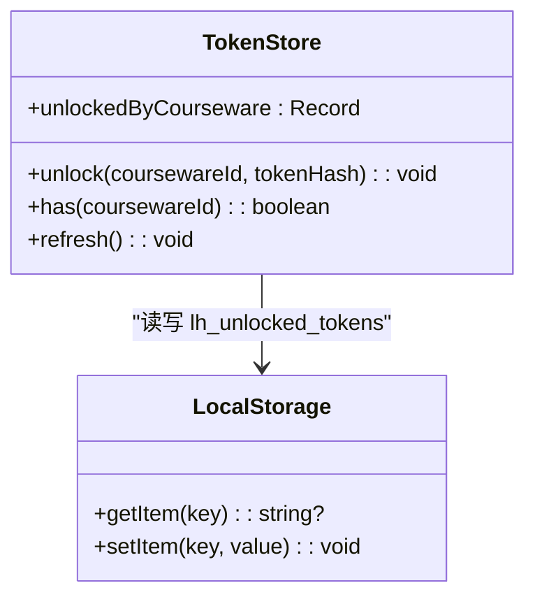
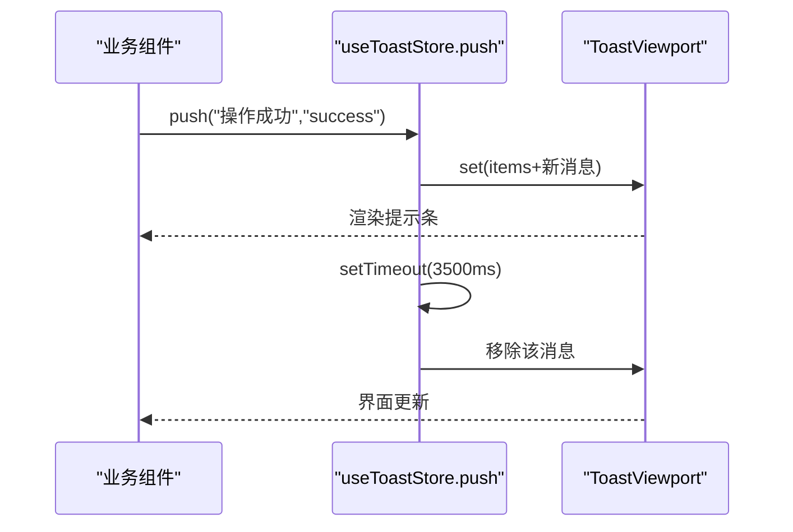
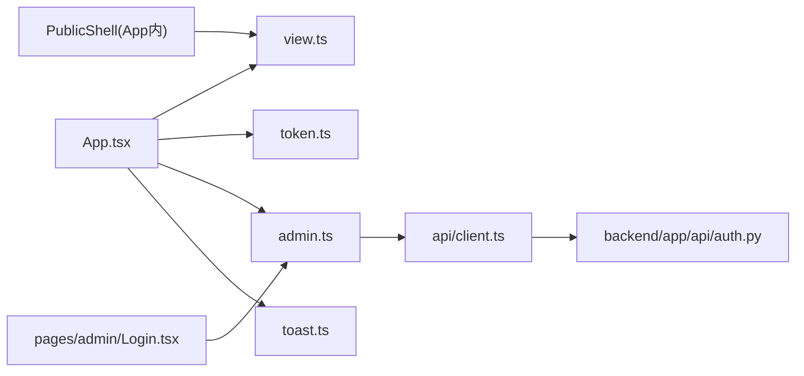

# 状态管理

<cite>
**本文引用的文件**
- [frontend/src/stores/view.ts](file://frontend/src/stores/view.ts)
- [frontend/src/stores/admin.ts](file://frontend/src/stores/admin.ts)
- [frontend/src/stores/token.ts](file://frontend/src/stores/token.ts)
- [frontend/src/stores/toast.ts](file://frontend/src/stores/toast.ts)
- [frontend/src/App.tsx](file://frontend/src/App.tsx)
- [frontend/src/api/client.ts](file://frontend/src/api/client.ts)
- [frontend/src/components/Toast.tsx](file://frontend/src/components/Toast.tsx)
- [backend/app/api/auth.py](file://backend/app/api/auth.py)
</cite>

## 目录
1. [简介](#简介)
2. [项目结构](#项目结构)
3. [核心组件](#核心组件)
4. [架构总览](#架构总览)
5. [详细组件分析](#详细组件分析)
6. [依赖关系分析](#依赖关系分析)
7. [性能与优化](#性能与优化)
8. [故障排查指南](#故障排查指南)
9. [结论](#结论)

## 简介
本指南聚焦 Learning Hub 前端基于 Zustand 的轻量级状态管理方案，覆盖以下关键能力：
- 视图状态管理（view.ts）：URL 同步、页面切换、历史记录兼容
- 管理员认证状态管理（admin.ts）：登录会话、权限控制、状态持久化
- 令牌记忆机制（token.ts）：已解锁课件哈希缓存、自动刷新
- 通知系统（toast.ts）：消息队列、显示控制与用户体验优化
- 最佳实践、性能优化技巧与调试方法

## 项目结构
前端状态相关代码集中在 stores 目录，配合 App 入口完成初始化与路由联动；API 客户端提供统一拦截与错误处理；Toast 组件负责渲染通知。

图表来源
- [frontend/src/App.tsx:1-110](file://frontend/src/App.tsx#L1-L110)
- [frontend/src/stores/view.ts:1-127](file://frontend/src/stores/view.ts#L1-L127)
- [frontend/src/stores/admin.ts:1-71](file://frontend/src/stores/admin.ts#L1-L71)
- [frontend/src/stores/token.ts:1-54](file://frontend/src/stores/token.ts#L1-L54)
- [frontend/src/stores/toast.ts:1-30](file://frontend/src/stores/toast.ts#L1-L30)
- [frontend/src/api/client.ts:1-52](file://frontend/src/api/client.ts#L1-L52)
- [backend/app/api/auth.py:1-48](file://backend/app/api/auth.py#L1-L48)

章节来源
- [frontend/src/App.tsx:1-110](file://frontend/src/App.tsx#L1-L110)

## 核心组件
- 视图状态 store：以 URL query 为单一事实源，提供 go/hydrate/sync/popstate 绑定等工具
- 管理员认证 store：封装登录/登出/恢复，结合 Cookie 与会话过期时间进行持久化
- 令牌记忆 store：记录“已解锁”的课件 token 哈希，支持本地存储与刷新
- 通知 store：简易消息队列，支持自动消失与手动关闭

章节来源
- [frontend/src/stores/view.ts:1-127](file://frontend/src/stores/view.ts#L1-L127)
- [frontend/src/stores/admin.ts:1-71](file://frontend/src/stores/admin.ts#L1-L71)
- [frontend/src/stores/token.ts:1-54](file://frontend/src/stores/token.ts#L1-L54)
- [frontend/src/stores/toast.ts:1-30](file://frontend/src/stores/toast.ts#L1-L30)

## 架构总览
前台采用单 URL 多视图模式：根路径下通过 view 参数切换 home/result/locked/detail/viewer；后台使用独立子路由并受 AdminGuard 保护。

图表来源
- [frontend/src/App.tsx:40-72](file://frontend/src/App.tsx#L40-L72)
- [frontend/src/stores/view.ts:99-127](file://frontend/src/stores/view.ts#L99-L127)

## 详细组件分析

### 视图状态管理（view.ts）
职责
- 将前台 UI 状态映射到 URL query：view、q、id、coursewareId
- 提供 go(next) 原子更新并同步 URL
- 提供 hydrate/sync/popstate 生命周期工具，保证前后端一致性与浏览器前进后退兼容

实现要点
- readUrl：从 window.location.search 解析参数，白名单校验 view，启发式推断默认页
- go：合并当前状态，进入 home 时显式清空 q/id/coursewareId，避免“返回首页需点两次”的问题；同步调用 history.replaceState 避免时序竞争
- hydrateViewFromUrl：应用启动时将 URL 灌入 store
- syncViewFromUrl：location 变化时对比差异后更新 store
- bindViewToPopState：监听 popstate，保持与浏览器历史一致

图表来源
- [frontend/src/stores/view.ts:58-96](file://frontend/src/stores/view.ts#L58-L96)

章节来源
- [frontend/src/stores/view.ts:1-127](file://frontend/src/stores/view.ts#L1-L127)
- [frontend/src/App.tsx:40-72](file://frontend/src/App.tsx#L40-L72)

### 管理员认证状态管理（admin.ts）
职责
- 维护登录会话（session），包含 token 与 expiresAt
- 提供 login/logout/restore 操作
- 与后端 /api/auth/* 协作，Cookie 由后端设置，前端仅保存过期时间用于本地判断

流程说明
- login(token)：调用 POST /api/auth/admin，成功后写入本地过期时间并设置 session
- logout：调用 POST /api/logout 清除服务端 Cookie，同时清理本地状态
- restore：应用启动时尝试从本地读取过期时间，若未过期则视为已登录

图表来源
- [frontend/src/stores/admin.ts:34-70](file://frontend/src/stores/admin.ts#L34-L70)
- [frontend/src/api/client.ts:1-52](file://frontend/src/api/client.ts#L1-L52)
- [backend/app/api/auth.py:21-45](file://backend/app/api/auth.py#L21-L45)

章节来源
- [frontend/src/stores/admin.ts:1-71](file://frontend/src/stores/admin.ts#L1-L71)
- [frontend/src/api/client.ts:1-52](file://frontend/src/api/client.ts#L1-L52)
- [backend/app/api/auth.py:1-48](file://backend/app/api/auth.py#L1-L48)

### 令牌管理机制（token.ts）
职责
- 记录“已解锁”的课件 ID 与其 token 哈希，避免重复解锁
- 支持本地持久化（隐私模式下回退内存）
- 提供 unlock/has/refresh 接口与应用启动时的 hydrateTokenStore

设计要点
- unlockedByCourseware：键为课件 ID，值为 token 哈希
- load/save：JSON 序列化，异常捕获确保隐私模式可用
- refresh：从本地重新加载，供需要刷新状态的时机调用

图表来源
- [frontend/src/stores/token.ts:1-54](file://frontend/src/stores/token.ts#L1-L54)

章节来源
- [frontend/src/stores/token.ts:1-54](file://frontend/src/stores/token.ts#L1-L54)

### 通知系统状态管理（toast.ts）
职责
- 维护消息队列 items
- push(message, kind)：追加消息，3.5 秒后自动移除
- dismiss(id)：手动关闭指定消息
- 暴露便捷函数 toast(...) 以便全局触发

渲染
- ToastViewport 订阅 items，按 kind 渲染不同样式，并提供关闭按钮

图表来源
- [frontend/src/stores/toast.ts:1-30](file://frontend/src/stores/toast.ts#L1-L30)
- [frontend/src/components/Toast.tsx:1-38](file://frontend/src/components/Toast.tsx#L1-L38)

章节来源
- [frontend/src/stores/toast.ts:1-30](file://frontend/src/stores/toast.ts#L1-L30)
- [frontend/src/components/Toast.tsx:1-38](file://frontend/src/components/Toast.tsx#L1-L38)

## 依赖关系分析
- App 作为入口，负责：
  - 初始化 view/token 状态
  - 绑定 popstate 事件
  - 恢复 admin 会话
  - 挂载 ToastViewport
- PublicShell 根据 view 渲染具体页面，并在 location 变化时同步 store
- admin/login 流程依赖 apiClient，后者对请求/响应进行拦截与标准化
- 后端 auth.py 负责签发与管理 LH_ADMIN_SESSION Cookie

图表来源
- [frontend/src/App.tsx:1-110](file://frontend/src/App.tsx#L1-L110)
- [frontend/src/stores/view.ts:1-127](file://frontend/src/stores/view.ts#L1-L127)
- [frontend/src/stores/admin.ts:1-71](file://frontend/src/stores/admin.ts#L1-L71)
- [frontend/src/stores/token.ts:1-54](file://frontend/src/stores/token.ts#L1-L54)
- [frontend/src/stores/toast.ts:1-30](file://frontend/src/stores/toast.ts#L1-L30)
- [frontend/src/api/client.ts:1-52](file://frontend/src/api/client.ts#L1-L52)
- [backend/app/api/auth.py:1-48](file://backend/app/api/auth.py#L1-L48)

章节来源
- [frontend/src/App.tsx:1-110](file://frontend/src/App.tsx#L1-L110)
- [frontend/src/api/client.ts:1-52](file://frontend/src/api/client.ts#L1-L52)
- [backend/app/api/auth.py:1-48](file://backend/app/api/auth.py#L1-L48)

## 性能与优化
- 最小化重渲染
  - 使用 selector 订阅最小状态切片，例如只订阅 view 或 items
  - 避免在高频回调中创建对象导致不必要的 re-render
- URL 同步策略
  - go 内部同步更新 URL，避免 useEffect 与 commit 之间的竞态
  - 仅在字段发生变化时 setState，减少无效更新
- 本地存储
  - 对 localStorage 读写做 try/catch，防止隐私模式报错
  - 批量更新前先计算最终结果再一次性 set
- 通知系统
  - 固定超时时间，避免过多消息堆积
  - 可考虑去重策略（相同 message 合并）以提升体验

[本节为通用建议，不直接分析具体文件]

## 故障排查指南
- 首页跳转问题
  - 现象：从 detail/result/locked 点击“返回首页”需多次点击
  - 原因：未重置 id/coursewareId，readUrl 启发式仍判定为 viewer
  - 解决：go({view:"home"}) 会显式清空相关字段，确保 URL 完全清空
- 返回上一页卡顿
  - 现象：从 viewer 返回 detail 需点击两次
  - 原因：异步更新 URL 导致 useEffect 读到旧 search
  - 解决：go 内部同步 replaceState，消除时序竞争
- 登录后无权限
  - 检查后端是否成功 Set-Cookie LH_ADMIN_SESSION
  - 确认 withCredentials 已开启（apiClient 默认启用）
  - 检查本地 expiresAt 是否过期
- 通知不显示
  - 确认 ToastViewport 已在 App 顶层渲染
  - 检查 push/dismiss 是否正确调用

章节来源
- [frontend/src/stores/view.ts:71-96](file://frontend/src/stores/view.ts#L71-L96)
- [frontend/src/App.tsx:40-72](file://frontend/src/App.tsx#L40-L72)
- [frontend/src/api/client.ts:13-17](file://frontend/src/api/client.ts#L13-L17)
- [frontend/src/stores/admin.ts:34-70](file://frontend/src/stores/admin.ts#L34-L70)
- [frontend/src/components/Toast.tsx:1-38](file://frontend/src/components/Toast.tsx#L1-L38)

## 结论
本方案以 Zustand 为核心，围绕“URL 即状态”的前台视图模型，结合 Cookie 驱动的管理员会话与本地化的令牌记忆，实现了简洁、可维护且高性能的状态管理。通过统一的 API 客户端拦截与通知系统，提升了整体用户体验与可观测性。建议在后续迭代中继续遵循最小订阅、同步更新与健壮的错误处理原则，以保持系统的稳定与可扩展性。