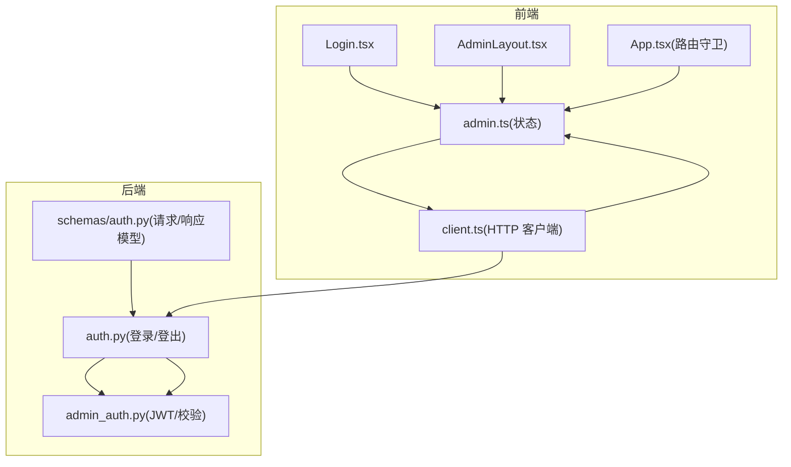
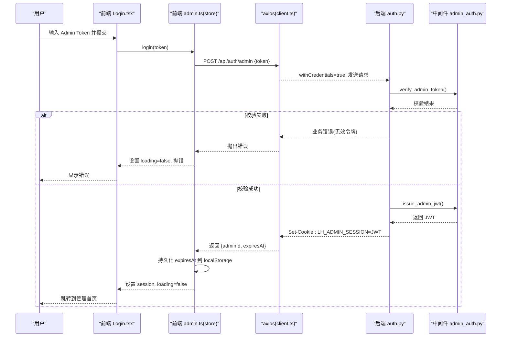
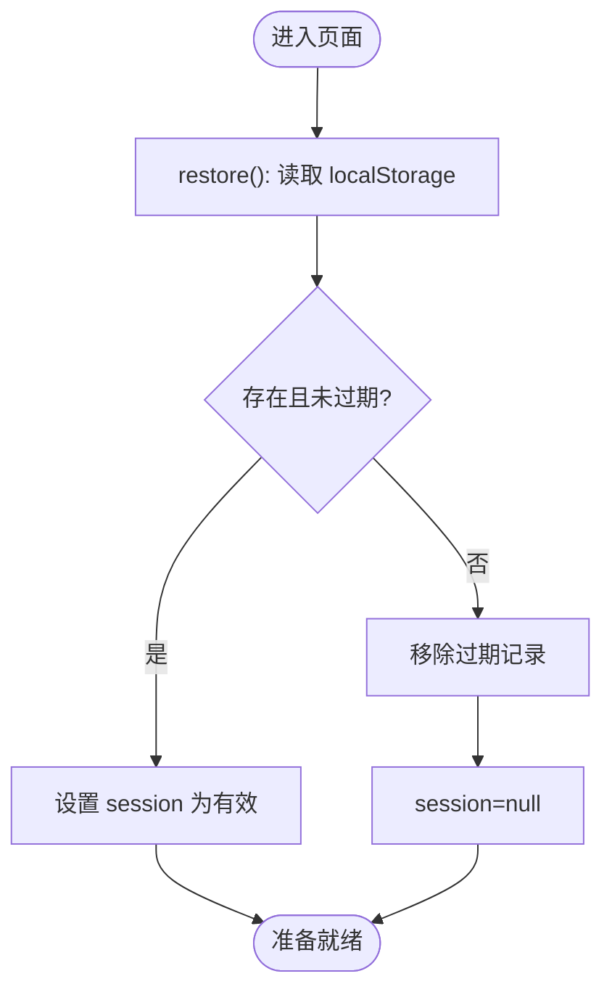
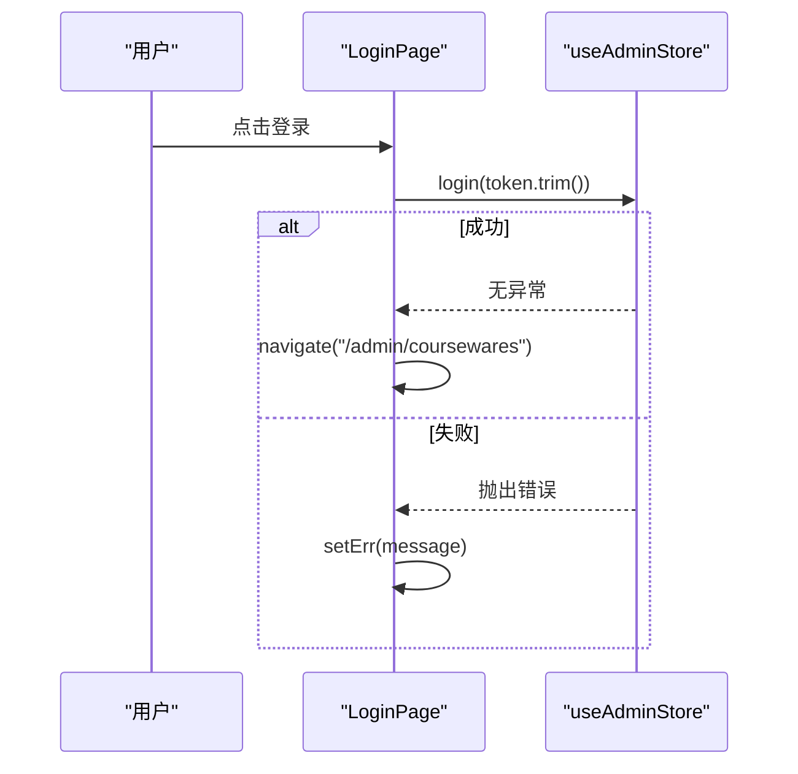
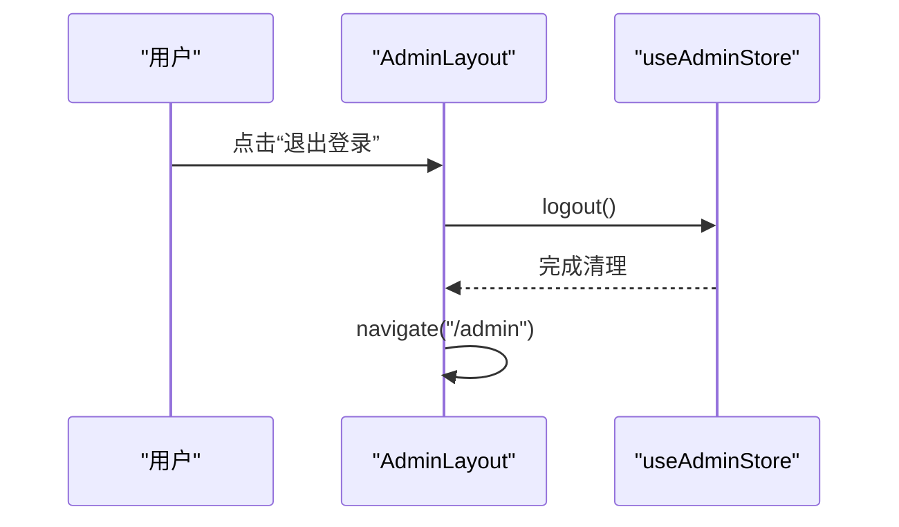
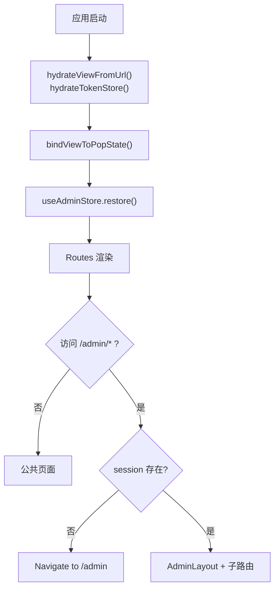
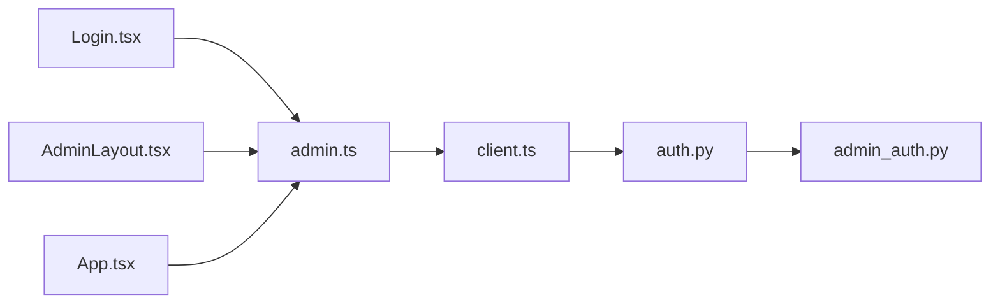

# 管理员认证状态

<cite>
**本文引用的文件**
- [frontend/src/stores/admin.ts](file://frontend/src/stores/admin.ts)
- [frontend/src/pages/admin/Login.tsx](file://frontend/src/pages/admin/Login.tsx)
- [frontend/src/layouts/AdminLayout.tsx](file://frontend/src/layouts/AdminLayout.tsx)
- [frontend/src/App.tsx](file://frontend/src/App.tsx)
- [frontend/src/api/client.ts](file://frontend/src/api/client.ts)
- [backend/app/api/auth.py](file://backend/app/api/auth.py)
- [backend/app/middleware/admin_auth.py](file://backend/app/middleware/admin_auth.py)
- [backend/app/schemas/auth.py](file://backend/app/schemas/auth.py)
</cite>

## 目录
1. [简介](#简介)
2. [项目结构](#项目结构)
3. [核心组件](#核心组件)
4. [架构总览](#架构总览)
5. [详细组件分析](#详细组件分析)
6. [依赖关系分析](#依赖关系分析)
7. [性能与安全性考虑](#性能与安全性考虑)
8. [故障排查指南](#故障排查指南)
9. [结论](#结论)
10. [附录：API 定义与错误码](#附录api-定义与错误码)

## 简介
本文件围绕“管理员认证状态管理”进行系统化说明，覆盖以下主题：
- 登录会话的状态设计：用户信息存储、权限控制、会话生命周期
- 登录流程实现：身份验证、令牌获取、状态持久化
- 登出机制与安全：令牌清理、会话失效处理
- 权限检查逻辑：角色验证与访问控制（基于 JWT）
- 前端使用示例：在组件中订阅认证状态、登录跳转与错误处理
- 后端 API 集成与错误处理策略

## 项目结构
与管理员认证相关的前后端关键位置如下：
- 前端状态与页面
  - 状态管理：stores/admin.ts
  - 登录页：pages/admin/Login.tsx
  - 布局与退出：layouts/AdminLayout.tsx
  - 路由守卫与恢复：App.tsx
  - HTTP 客户端封装：api/client.ts
- 后端鉴权
  - 登录/登出路由：app/api/auth.py
  - 中间件与工具：app/middleware/admin_auth.py
  - 请求/响应模型：app/schemas/auth.py

图表来源
- [frontend/src/stores/admin.ts:1-71](file://frontend/src/stores/admin.ts#L1-L71)
- [frontend/src/pages/admin/Login.tsx:1-72](file://frontend/src/pages/admin/Login.tsx#L1-L72)
- [frontend/src/layouts/AdminLayout.tsx:1-61](file://frontend/src/layouts/AdminLayout.tsx#L1-L61)
- [frontend/src/App.tsx:1-110](file://frontend/src/App.tsx#L1-L110)
- [frontend/src/api/client.ts:1-52](file://frontend/src/api/client.ts#L1-L52)
- [backend/app/api/auth.py:1-49](file://backend/app/api/auth.py#L1-L49)
- [backend/app/middleware/admin_auth.py:1-66](file://backend/app/middleware/admin_auth.py#L1-L66)
- [backend/app/schemas/auth.py:1-17](file://backend/app/schemas/auth.py#L1-L17)

章节来源
- [frontend/src/stores/admin.ts:1-71](file://frontend/src/stores/admin.ts#L1-L71)
- [frontend/src/pages/admin/Login.tsx:1-72](file://frontend/src/pages/admin/Login.tsx#L1-L72)
- [frontend/src/layouts/AdminLayout.tsx:1-61](file://frontend/src/layouts/AdminLayout.tsx#L1-L61)
- [frontend/src/App.tsx:1-110](file://frontend/src/App.tsx#L1-L110)
- [frontend/src/api/client.ts:1-52](file://frontend/src/api/client.ts#L1-L52)
- [backend/app/api/auth.py:1-49](file://backend/app/api/auth.py#L1-L49)
- [backend/app/middleware/admin_auth.py:1-66](file://backend/app/middleware/admin_auth.py#L1-L66)
- [backend/app/schemas/auth.py:1-17](file://backend/app/schemas/auth.py#L1-L17)

## 核心组件
- 前端认证状态 store
  - 提供 login/logout/restore 方法，维护 session 与 loading 状态
  - 通过 localStorage 持久化过期时间，用于前端快速判断是否已登录
  - 调用 /api/auth/admin 完成登录，调用 /api/auth/logout 完成登出
- 登录页面
  - 收集 Admin Token，提交到 store.login，成功后跳转到管理首页
  - 捕获并展示错误信息
- 管理后台布局
  - 提供“退出登录”按钮，调用 store.logout 后回到登录页
- 路由守卫
  - 未登录时重定向到 /admin；已登录则渲染 AdminLayout 及其子路由
- HTTP 客户端
  - 统一 baseURL、withCredentials、业务信封解析与错误包装
- 后端鉴权
  - 登录接口校验静态 Admin Token，签发 JWT，写入 HttpOnly Cookie
  - 登出接口删除 Cookie
  - 中间件从 Authorization 或 Cookie 提取 JWT 并解码，返回 principal

章节来源
- [frontend/src/stores/admin.ts:1-71](file://frontend/src/stores/admin.ts#L1-L71)
- [frontend/src/pages/admin/Login.tsx:1-72](file://frontend/src/pages/admin/Login.tsx#L1-L72)
- [frontend/src/layouts/AdminLayout.tsx:1-61](file://frontend/src/layouts/AdminLayout.tsx#L1-L61)
- [frontend/src/App.tsx:1-110](file://frontend/src/App.tsx#L1-L110)
- [frontend/src/api/client.ts:1-52](file://frontend/src/api/client.ts#L1-L52)
- [backend/app/api/auth.py:1-49](file://backend/app/api/auth.py#L1-L49)
- [backend/app/middleware/admin_auth.py:1-66](file://backend/app/middleware/admin_auth.py#L1-L66)

## 架构总览
管理员认证采用“静态凭据 + JWT + HttpOnly Cookie”的无状态方案。前端仅保存过期时间，JWT 由浏览器自动随请求携带（同源），后端中间件负责校验并注入管理员身份。

图表来源
- [frontend/src/pages/admin/Login.tsx:18-32](file://frontend/src/pages/admin/Login.tsx#L18-L32)
- [frontend/src/stores/admin.ts:37-58](file://frontend/src/stores/admin.ts#L37-L58)
- [frontend/src/api/client.ts:13-49](file://frontend/src/api/client.ts#L13-L49)
- [backend/app/api/auth.py:21-39](file://backend/app/api/auth.py#L21-L39)
- [backend/app/middleware/admin_auth.py:45-55](file://backend/app/middleware/admin_auth.py#L45-L55)

## 详细组件分析

### 前端认证状态 store（admin.ts）
- 数据结构
  - session: 包含 token 占位与 expiresAt（ISO 字符串）
  - loading: 登录请求进行中标志
- 关键方法
  - login(token): 调用 /api/auth/admin，成功后将 expiresAt 持久化到 localStorage，并更新 store
  - logout(): 调用 /api/auth/logout，清理本地状态与持久化数据
  - restore(): 应用启动时从 localStorage 恢复 session（若未过期）
- 持久化策略
  - 仅持久化 expiresAt，不保存敏感 token（JWT 由浏览器 Cookie 自动携带）
  - 读取时比较 expiresAt 与当前时间，过期则清除本地记录

图表来源
- [frontend/src/stores/admin.ts:19-32](file://frontend/src/stores/admin.ts#L19-L32)
- [frontend/src/stores/admin.ts:34-70](file://frontend/src/stores/admin.ts#L34-L70)

章节来源
- [frontend/src/stores/admin.ts:1-71](file://frontend/src/stores/admin.ts#L1-L71)

### 登录页面（Login.tsx）
- 交互流程
  - 表单提交时先做非空校验
  - 调用 store.login，成功后导航至 /admin/coursewares
  - 捕获异常并在 UI 上展示错误信息
- 错误处理
  - 将 axios 拦截器抛出的 Error 对象 message 直接展示

图表来源
- [frontend/src/pages/admin/Login.tsx:18-32](file://frontend/src/pages/admin/Login.tsx#L18-L32)
- [frontend/src/stores/admin.ts:37-58](file://frontend/src/stores/admin.ts#L37-L58)

章节来源
- [frontend/src/pages/admin/Login.tsx:1-72](file://frontend/src/pages/admin/Login.tsx#L1-L72)

### 管理后台布局与退出（AdminLayout.tsx）
- 提供顶部导航与“退出登录”按钮
- 退出流程：调用 store.logout，随后导航回 /admin

图表来源
- [frontend/src/layouts/AdminLayout.tsx:18-21](file://frontend/src/layouts/AdminLayout.tsx#L18-L21)
- [frontend/src/stores/admin.ts:60-68](file://frontend/src/stores/admin.ts#L60-L68)

章节来源
- [frontend/src/layouts/AdminLayout.tsx:1-61](file://frontend/src/layouts/AdminLayout.tsx#L1-L61)

### 路由守卫与恢复（App.tsx）
- 应用启动时执行：
  - 初始化前台 view 状态
  - 初始化解锁 token 缓存
  - 绑定 URL 变化同步 view
  - 调用 useAdminStore.restore 恢复管理员会话
- 路由保护：
  - 所有 /admin/* 子路由被 AdminGuard 包裹，未登录重定向到 /admin

图表来源
- [frontend/src/App.tsx:60-72](file://frontend/src/App.tsx#L60-L72)
- [frontend/src/App.tsx:31-35](file://frontend/src/App.tsx#L31-L35)
- [frontend/src/App.tsx:77-105](file://frontend/src/App.tsx#L77-L105)

章节来源
- [frontend/src/App.tsx:1-110](file://frontend/src/App.tsx#L1-L110)

### HTTP 客户端（client.ts）
- 配置
  - baseURL=/api，withCredentials=true（允许携带 Cookie）
  - 超时 30s
- 拦截器
  - 请求：附加 X-Request-Id
  - 响应：对业务信封 code !== "ok" 的情况抛出带 code/status 的 Error；成功时将 data 解包到 resp.data
- 作用
  - 统一错误形态，便于上层组件一致处理

章节来源
- [frontend/src/api/client.ts:1-52](file://frontend/src/api/client.ts#L1-L52)

### 后端鉴权路由（auth.py）
- 登录 /api/auth/admin
  - 校验静态 Admin Token
  - 签发 JWT，写入 HttpOnly Cookie（名称 LH_ADMIN_SESSION，max_age 8h，SameSite=lax，path=/）
  - 返回 {adminId, expiresAt}
- 登出 /api/auth/logout
  - 删除 Cookie

章节来源
- [backend/app/api/auth.py:1-49](file://backend/app/api/auth.py#L1-L49)

### 中间件与工具（admin_auth.py）
- get_admin_principal(request)
  - 从 Authorization(Bearer) 或 Cookie(LH_ADMIN_SESSION) 提取 JWT
  - 解码并校验 exp/sub，失败抛出未认证错误
  - 返回 principal 字典（sub/iat/exp）
- issue_admin_jwt(sub)
  - 生成 JWT，TTL 由配置 jwt_ttl_hours 决定
- verify_admin_token(token)
  - 常量时间比较静态 Admin Token，防止时序攻击

章节来源
- [backend/app/middleware/admin_auth.py:1-66](file://backend/app/middleware/admin_auth.py#L1-L66)

### 请求/响应模型（schemas/auth.py）
- AdminLoginRequest: 字段 token（必填，长度限制）
- AdminLoginResponse: adminId（默认 single-admin）、expiresAt（ISO-8601）

章节来源
- [backend/app/schemas/auth.py:1-17](file://backend/app/schemas/auth.py#L1-L17)

## 依赖关系分析
- 前端
  - Login.tsx 依赖 useAdminStore
  - AdminLayout.tsx 依赖 useAdminStore
  - App.tsx 依赖 useAdminStore 与路由
  - stores/admin.ts 依赖 api/client.ts
  - api/client.ts 为全局 HTTP 基础设施
- 后端
  - auth.py 依赖 admin_auth.py 的工具函数
  - admin_auth.py 依赖配置与错误模块

图表来源
- [frontend/src/pages/admin/Login.tsx:1-72](file://frontend/src/pages/admin/Login.tsx#L1-L72)
- [frontend/src/layouts/AdminLayout.tsx:1-61](file://frontend/src/layouts/AdminLayout.tsx#L1-L61)
- [frontend/src/App.tsx:1-110](file://frontend/src/App.tsx#L1-L110)
- [frontend/src/stores/admin.ts:1-71](file://frontend/src/stores/admin.ts#L1-L71)
- [frontend/src/api/client.ts:1-52](file://frontend/src/api/client.ts#L1-L52)
- [backend/app/api/auth.py:1-49](file://backend/app/api/auth.py#L1-L49)
- [backend/app/middleware/admin_auth.py:1-66](file://backend/app/middleware/admin_auth.py#L1-L66)

## 性能与安全性考虑
- 性能
  - 前端仅持久化 expiresAt，避免每次请求都解析 JWT，减少开销
  - 路由守卫在渲染前快速判断 session，避免不必要的网络请求
- 安全
  - JWT 存储在 HttpOnly Cookie，降低 XSS 窃取风险
  - SameSite=lax 与 path=/ 平衡跨站与路径范围
  - 静态 Admin Token 使用常量时间比较，防时序攻击
  - 前端不保存敏感 token，仅保存过期时间用于 UI 判断
  - 建议部署 HTTPS，确保 Cookie 传输安全

[本节为通用指导，无需代码引用]

## 故障排查指南
- 登录失败
  - 现象：登录按钮报错或提示“令牌无效”
  - 排查：确认静态 Admin Token 是否正确；查看后端日志与错误码
- 登录后仍被重定向到登录页
  - 现象：刷新后无法进入管理后台
  - 排查：检查浏览器是否携带 LH_ADMIN_SESSION Cookie；确认 expiresAt 是否过期；确认 withCredentials 是否开启
- 401 未认证
  - 现象：访问受保护路由或 API 返回未认证
  - 排查：确认中间件是否能正确解析 Authorization/Bearer 或 Cookie；确认 JWT 是否过期或签名无效
- 登出不生效
  - 现象：退出后仍可访问管理后台
  - 排查：确认登出接口是否成功删除 Cookie；确认前端是否清除了本地状态与 localStorage

章节来源
- [frontend/src/stores/admin.ts:60-68](file://frontend/src/stores/admin.ts#L60-L68)
- [backend/app/api/auth.py:42-45](file://backend/app/api/auth.py#L42-L45)
- [backend/app/middleware/admin_auth.py:26-42](file://backend/app/middleware/admin_auth.py#L26-L42)

## 结论
本方案以“静态凭据 + JWT + HttpOnly Cookie”为核心，实现了简洁而安全的管理员认证体系。前端通过轻量状态管理实现登录态恢复与 UI 控制，后端通过中间件集中校验与身份注入，整体耦合度低、可维护性强。后续可在需要时扩展多角色与细粒度权限控制。

[本节为总结性内容，无需代码引用]

## 附录：API 定义与错误码

### 管理员认证 API
- POST /api/auth/admin
  - 请求体：{ token }
  - 响应体：{ adminId, expiresAt }
  - 副作用：Set-Cookie LH_ADMIN_SESSION=JWT（HttpOnly, SameSite=lax, max_age=8h）
- POST /api/auth/logout
  - 副作用：删除 LH_ADMIN_SESSION Cookie
  - 响应体：null

章节来源
- [backend/app/api/auth.py:21-45](file://backend/app/api/auth.py#L21-L45)
- [backend/app/schemas/auth.py:7-16](file://backend/app/schemas/auth.py#L7-L16)

### 错误码与消息（节选）
- UNAUTHENTICATED：未登录或会话已失效/过期/无效
- INVALID_ADMIN_TOKEN：管理令牌无效

章节来源
- [backend/app/middleware/admin_auth.py:26-42](file://backend/app/middleware/admin_auth.py#L26-L42)
- [backend/app/api/auth.py:24-25](file://backend/app/api/auth.py#L24-L25)