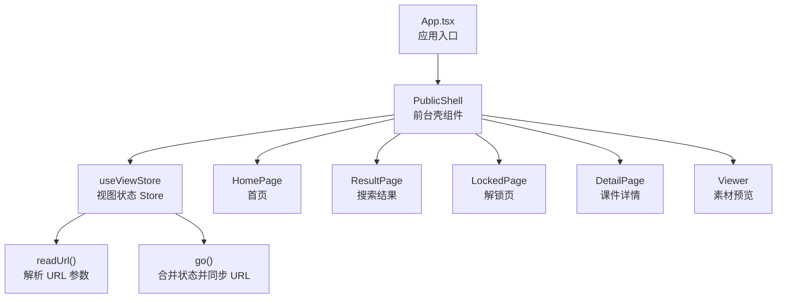
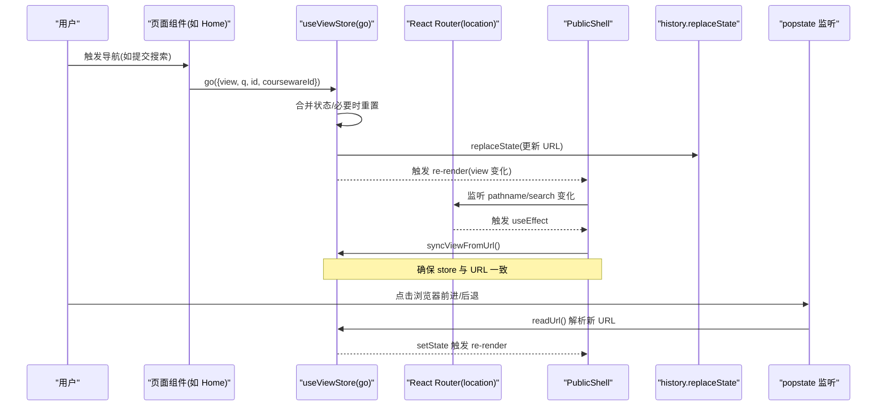
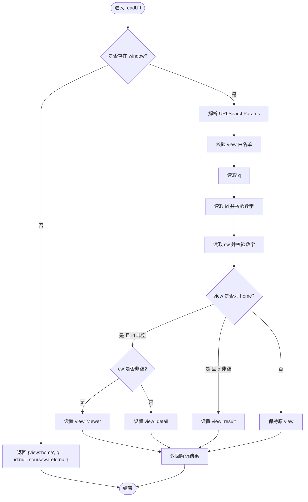
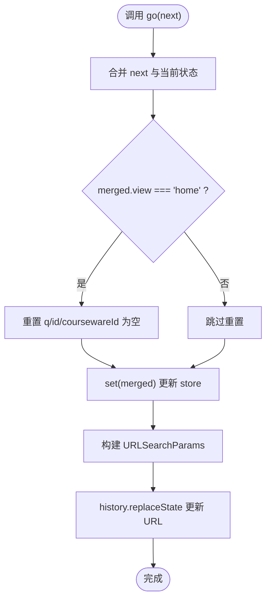
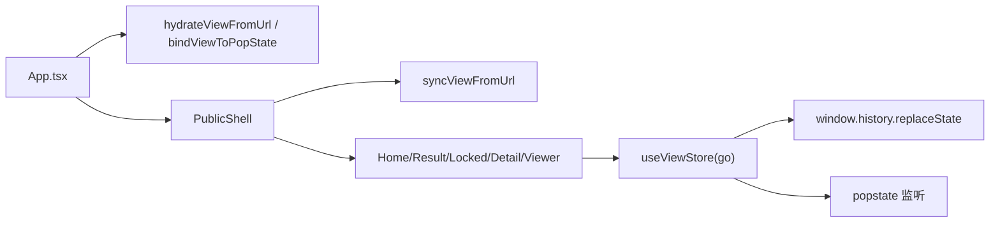

# 视图状态管理

<cite>
**本文引用的文件**
- [frontend/src/stores/view.ts](file://frontend/src/stores/view.ts)
- [frontend/src/App.tsx](file://frontend/src/App.tsx)
- [frontend/src/pages/public/Home.tsx](file://frontend/src/pages/public/Home.tsx)
- [frontend/src/pages/public/Result.tsx](file://frontend/src/pages/public/Result.tsx)
- [frontend/src/pages/public/Locked.tsx](file://frontend/src/pages/public/Locked.tsx)
- [frontend/src/pages/public/Detail.tsx](file://frontend/src/pages/public/Detail.tsx)
- [frontend/src/pages/public/Viewer.tsx](file://frontend/src/pages/public/Viewer.tsx)
- [frontend/src/stores/token.ts](file://frontend/src/stores/token.ts)
</cite>

## 目录
1. [简介](#简介)
2. [项目结构](#项目结构)
3. [核心组件](#核心组件)
4. [架构总览](#架构总览)
5. [详细组件分析](#详细组件分析)
6. [依赖关系分析](#依赖关系分析)
7. [性能考虑](#性能考虑)
8. [故障排查指南](#故障排查指南)
9. [结论](#结论)
10. [附录：使用示例与最佳实践](#附录使用示例与最佳实践)

## 简介
本文件聚焦前台“基于 URL 同步的视图状态管理”机制，围绕单一根路径下的多页面切换（home、result、locked、detail、viewer）展开。核心思路是：
- 将视图状态（view、q、id、coursewareId）映射到 URL query 参数；
- 通过 store 提供 go 方法合并状态并同步到 URL；
- 在应用启动时从 URL 初始化 store，并在浏览器前进后退时自动同步；
- 各页面组件仅消费 store 提供的状态与方法，不直接操作路由或 URL。

该设计实现了“URL 即状态源”，具备可分享链接、可书签、可回退等特性，同时避免 React Router 与自定义状态之间的竞态问题。

## 项目结构
前端采用单页应用（SPA），所有前台页面共享一个根路径 /，通过 store/view 的 view 字段进行内部路由分发。管理后台使用独立子路由 /admin/*。

图表来源
- [frontend/src/App.tsx:40-58](file://frontend/src/App.tsx#L40-L58)
- [frontend/src/stores/view.ts:58-97](file://frontend/src/stores/view.ts#L58-L97)

章节来源
- [frontend/src/App.tsx:1-110](file://frontend/src/App.tsx#L1-L110)
- [frontend/src/stores/view.ts:1-127](file://frontend/src/stores/view.ts#L1-L127)

## 核心组件
- View 类型定义与白名单：限定允许的视图值，防止非法输入导致异常路由。
- 状态结构：包含 view、q、id、coursewareId 四个字段，分别对应当前视图、搜索关键词、资源 ID、课件 ID。
- readUrl：从 window.location.search 解析参数，执行白名单校验、数字格式校验，以及启发式推断默认视图。
- go：合并传入的部分状态，必要时重置无关字段，并同步更新 URL（replaceState）。
- hydrateViewFromUrl：应用启动时将 URL 状态灌入 store。
- syncViewFromUrl：监听 location 变化后重新同步 store。
- bindViewToPopState：监听 popstate 事件以支持浏览器前进后退。

章节来源
- [frontend/src/stores/view.ts:4-12](file://frontend/src/stores/view.ts#L4-L12)
- [frontend/src/stores/view.ts:14-24](file://frontend/src/stores/view.ts#L14-L24)
- [frontend/src/stores/view.ts:26-56](file://frontend/src/stores/view.ts#L26-L56)
- [frontend/src/stores/view.ts:58-97](file://frontend/src/stores/view.ts#L58-L97)
- [frontend/src/stores/view.ts:100-103](file://frontend/src/stores/view.ts#L100-L103)
- [frontend/src/stores/view.ts:106-117](file://frontend/src/stores/view.ts#L106-L117)
- [frontend/src/stores/view.ts:120-127](file://frontend/src/stores/view.ts#L120-L127)

## 架构总览
下图展示了从用户交互到状态同步再到页面渲染的完整流程，包括 URL 解析、状态合并、历史记录更新和浏览器前进后退监听。

图表来源
- [frontend/src/stores/view.ts:58-97](file://frontend/src/stores/view.ts#L58-L97)
- [frontend/src/App.tsx:44-47](file://frontend/src/App.tsx#L44-L47)
- [frontend/src/App.tsx:63-68](file://frontend/src/App.tsx#L63-L68)
- [frontend/src/stores/view.ts:106-117](file://frontend/src/stores/view.ts#L106-L117)
- [frontend/src/stores/view.ts:120-127](file://frontend/src/stores/view.ts#L120-L127)

## 详细组件分析

### 视图类型与状态结构
- View 类型：home、result、locked、detail、viewer。
- 白名单校验：仅允许上述五种视图，否则回退为 home。
- 状态字段：
  - view：当前视图名。
  - q：搜索关键词。
  - id：资源 ID（课件或素材）。
  - coursewareId：课件 ID，主要用于 viewer 返回 detail。

章节来源
- [frontend/src/stores/view.ts:4-12](file://frontend/src/stores/view.ts#L4-L12)
- [frontend/src/stores/view.ts:14-24](file://frontend/src/stores/view.ts#L14-L24)

### readUrl：URL 解析逻辑
- 服务端渲染保护：当 window 不存在时返回默认 home 状态。
- 参数解析：
  - view：白名单校验，非法则回退为 home。
  - q：字符串，空串表示无查询。
  - id：正则匹配纯数字，否则为 null。
  - cw：正则匹配纯数字，否则为 null。
- 启发式推断：
  - 若未显式指定 view 且存在 id：优先 viewer（当 cw 存在），否则 detail。
  - 若存在 q：推断为 result。
  - 其他情况保持 home。

图表来源
- [frontend/src/stores/view.ts:26-56](file://frontend/src/stores/view.ts#L26-L56)

章节来源
- [frontend/src/stores/view.ts:26-56](file://frontend/src/stores/view.ts#L26-L56)

### go：状态合并与 URL 同步
- 合并策略：只覆盖传入的字段，其余保留当前值。
- 返回首页语义修复：当目标 view 为 home 时，显式清空 q、id、coursewareId，避免残留参数导致下次 readUrl 误判为 viewer/detail。
- URL 同步：
  - 构建新的 search 字符串，仅在非空时追加。
  - 使用 history.replaceState 同步 URL，避免 pushState 造成多余历史项。
  - 同步更新以避免 React commit 与 useEffect 之间的时序竞争。

图表来源
- [frontend/src/stores/view.ts:58-97](file://frontend/src/stores/view.ts#L58-L97)

章节来源
- [frontend/src/stores/view.ts:58-97](file://frontend/src/stores/view.ts#L58-L97)

### hydrateViewFromUrl 与 syncViewFromUrl：初始化与再同步
- hydrateViewFromUrl：应用启动时调用，将当前 URL 的状态灌入 store。
- syncViewFromUrl：在 PublicShell 中监听 location 变化后调用，比较新旧状态，仅在差异时更新 store，减少不必要的重渲染。

章节来源
- [frontend/src/stores/view.ts:100-103](file://frontend/src/stores/view.ts#L100-L103)
- [frontend/src/stores/view.ts:106-117](file://frontend/src/stores/view.ts#L106-L117)
- [frontend/src/App.tsx:44-47](file://frontend/src/App.tsx#L44-L47)

### bindViewToPopState：浏览器前进后退监听
- 注册 popstate 事件监听器，每次前进/后退都重新解析 URL 并更新 store。
- 返回解绑函数，用于组件卸载时清理监听器，避免内存泄漏。

章节来源
- [frontend/src/stores/view.ts:120-127](file://frontend/src/stores/view.ts#L120-L127)
- [frontend/src/App.tsx:63-68](file://frontend/src/App.tsx#L63-L68)

### 页面组件与状态联动
- HomePage：提交搜索时，先通过 router 跳转至带参数的 URL，再调用 go 同步 store，保证两者一致。
- ResultPage：根据访问模式决定跳转到 locked 或 detail。
- LockedPage：解锁成功后跳转到 detail，并保留 q 以便返回搜索。
- DetailPage：加载课件详情，受限课件请求失败时跳转到 locked；点击“在线浏览”跳转到 viewer，并携带 coursewareId。
- Viewer：根据素材类型渲染不同播放器；离开时上报访问会话时长；返回时根据 coursewareId 回到 detail 或 home。

章节来源
- [frontend/src/pages/public/Home.tsx:17-23](file://frontend/src/pages/public/Home.tsx#L17-L23)
- [frontend/src/pages/public/Result.tsx:102-107](file://frontend/src/pages/public/Result.tsx#L102-L107)
- [frontend/src/pages/public/Locked.tsx:35-38](file://frontend/src/pages/public/Locked.tsx#L35-L38)
- [frontend/src/pages/public/Detail.tsx:45-46](file://frontend/src/pages/public/Detail.tsx#L45-L46)
- [frontend/src/pages/public/Detail.tsx:57-60](file://frontend/src/pages/public/Detail.tsx#L57-L60)
- [frontend/src/pages/public/Viewer.tsx:109-120](file://frontend/src/pages/public/Viewer.tsx#L109-L120)

## 依赖关系分析
- App.tsx 负责应用初始化：
  - 启动时调用 hydrateViewFromUrl 与 bindViewToPopState。
  - PublicShell 监听 location 变化并调用 syncViewFromUrl。
- 各页面组件通过 useViewStore 获取状态与 go 方法，实现声明式导航。
- token 存储与视图状态解耦，但被 Locked 与 Detail 等页面组合使用。

图表来源
- [frontend/src/App.tsx:63-68](file://frontend/src/App.tsx#L63-L68)
- [frontend/src/App.tsx:44-47](file://frontend/src/App.tsx#L44-L47)
- [frontend/src/stores/view.ts:58-97](file://frontend/src/stores/view.ts#L58-L97)
- [frontend/src/stores/view.ts:120-127](file://frontend/src/stores/view.ts#L120-L127)

章节来源
- [frontend/src/App.tsx:1-110](file://frontend/src/App.tsx#L1-L110)
- [frontend/src/stores/view.ts:1-127](file://frontend/src/stores/view.ts#L1-L127)
- [frontend/src/stores/token.ts:1-54](file://frontend/src/stores/token.ts#L1-L54)

## 性能考虑
- 最小化重渲染：syncViewFromUrl 仅在状态发生变化时更新 store，避免无效渲染。
- 同步更新 URL：go 中使用 replaceState 同步更新，避免异步导致的时序竞争与重复渲染。
- 返回首页语义修复：清空无关字段，避免后续 readUrl 误判，减少额外跳转。
- 按需渲染：各页面组件根据状态条件渲染，减少 DOM 节点数量。
- 埋点 best-effort：Viewer 的 leave 调用不阻塞主流程，避免影响用户体验。

[本节为通用指导，无需引用具体文件]

## 故障排查指南
- 返回首页需点击两次：
  - 原因：go({view:"home"}) 未重置 id/cw，导致 URL 仍带参数，readUrl 再次推断为 viewer/detail。
  - 解决：go 中对 view==="home" 的情况显式清空 q/id/coursewareId。
- 从 Viewer 返回 Detail 需点击两次：
  - 原因：URL 同步与 React commit 之间存在时序竞争。
  - 解决：go 中同步调用 replaceState，确保下次 render 时 location 与 store 一致。
- 非法 view 值：
  - 现象：页面显示 home。
  - 原因：白名单校验失败回退为 home。
  - 建议：检查外部链接或手动修改 URL 的参数。
- 数字参数错误：
  - 现象：id/cw 被忽略。
  - 原因：正则校验失败。
  - 建议：确保传递的是纯数字字符串。

章节来源
- [frontend/src/stores/view.ts:71-81](file://frontend/src/stores/view.ts#L71-L81)
- [frontend/src/stores/view.ts:83-96](file://frontend/src/stores/view.ts#L83-L96)
- [frontend/src/stores/view.ts:36-45](file://frontend/src/stores/view.ts#L36-L45)

## 结论
本方案通过“URL 即状态源”的设计，结合 Zustand store 与浏览器历史 API，实现了稳定、可预测的前台视图状态管理。其优势在于：
- 可分享、可书签、可回退；
- 避免路由与状态不一致；
- 易于扩展新的视图类型与参数；
- 对性能与用户体验友好。

[本节为总结性内容，无需引用具体文件]

## 附录：使用示例与最佳实践

### 基本用法
- 在页面组件中订阅状态与导航方法：
  - 使用 useViewStore 获取 view/q/id/coursewareId 与 go。
  - 通过 go({view, q, id, coursewareId}) 触发导航与 URL 同步。
- 示例路径参考：
  - 首页提交搜索：[frontend/src/pages/public/Home.tsx:17-23](file://frontend/src/pages/public/Home.tsx#L17-L23)
  - 搜索结果跳转：[frontend/src/pages/public/Result.tsx:102-107](file://frontend/src/pages/public/Result.tsx#L102-L107)
  - 解锁后跳转详情：[frontend/src/pages/public/Locked.tsx:35-38](file://frontend/src/pages/public/Locked.tsx#L35-L38)
  - 详情进入预览：[frontend/src/pages/public/Detail.tsx:57-60](file://frontend/src/pages/public/Detail.tsx#L57-L60)
  - 预览返回逻辑：[frontend/src/pages/public/Viewer.tsx:109-120](file://frontend/src/pages/public/Viewer.tsx#L109-L120)

### 处理页面跳转
- 统一使用 go 进行导航，避免直接操作 window.location 或 router.push，以确保状态与 URL 一致。
- 返回首页时使用 go({view:"home"})，系统会自动清空无关参数。

### 状态持久化
- 视图状态由 URL 持久化，刷新页面后可恢复。
- 令牌哈希持久化在 localStorage，受隐私模式限制会回退到内存。
- 相关初始化：
  - 视图状态：[frontend/src/App.tsx:63-68](file://frontend/src/App.tsx#L63-L68)
  - 令牌状态：[frontend/src/stores/token.ts:50-53](file://frontend/src/stores/token.ts#L50-L53)

### 性能优化技巧
- 只在必要处调用 go，避免频繁更新导致多次渲染。
- 利用 syncViewFromUrl 的差异检测，减少不必要 setState。
- 对于耗时操作（如网络请求），做好取消与错误处理，避免组件卸载后的副作用。

[本节为实践指导，无需引用具体文件]