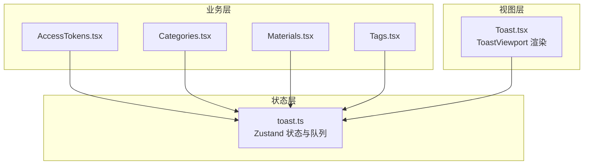
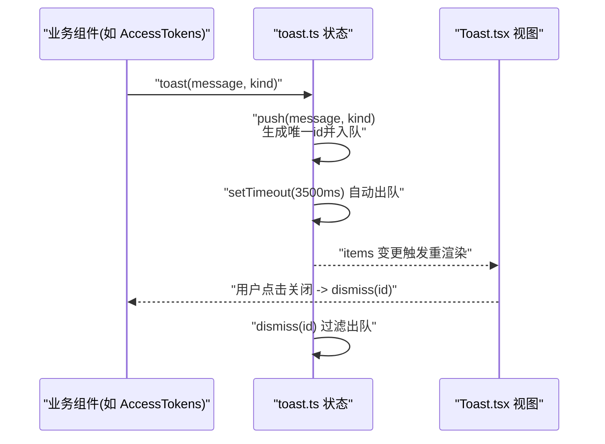
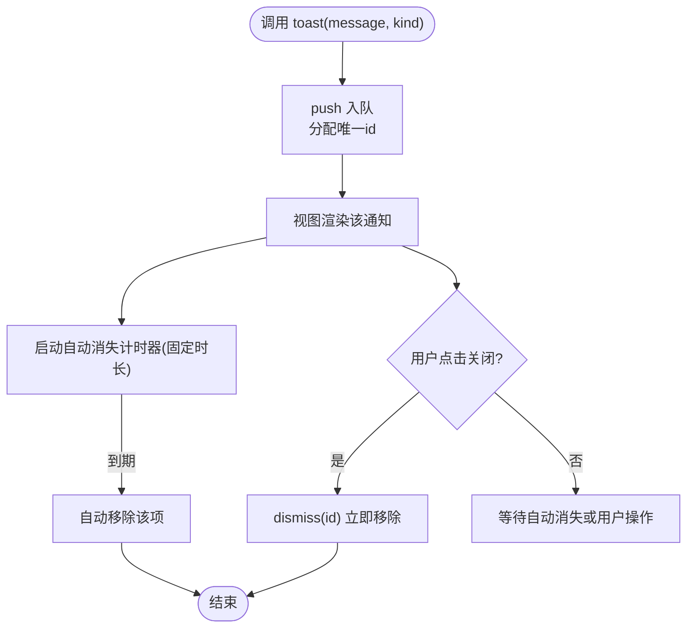
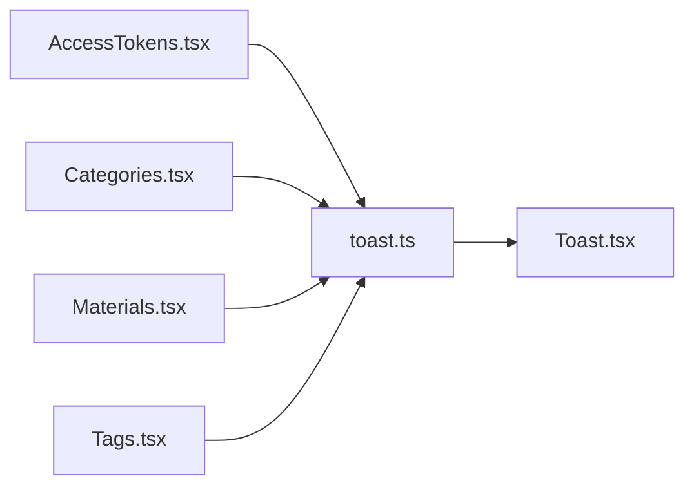

# 通知系统状态

<cite>
**本文引用的文件**   
- [frontend/src/stores/toast.ts](file://frontend/src/stores/toast.ts)
- [frontend/src/components/Toast.tsx](file://frontend/src/components/Toast.tsx)
- [frontend/src/pages/admin/AccessTokens.tsx](file://frontend/src/pages/admin/AccessTokens.tsx)
- [frontend/src/pages/admin/Categories.tsx](file://frontend/src/pages/admin/Categories.tsx)
- [frontend/src/pages/admin/Materials.tsx](file://frontend/src/pages/admin/Materials.tsx)
- [frontend/src/pages/admin/Tags.tsx](file://frontend/src/pages/admin/Tags.tsx)
</cite>

## 目录
1. [简介](#简介)
2. [项目结构](#项目结构)
3. [核心组件](#核心组件)
4. [架构总览](#架构总览)
5. [详细组件分析](#详细组件分析)
6. [依赖关系分析](#依赖关系分析)
7. [性能与体验优化](#性能与体验优化)
8. [故障排查指南](#故障排查指南)
9. [结论](#结论)
10. [附录：集成示例与最佳实践](#附录集成示例与最佳实践)

## 简介
本文件围绕前端通知系统的状态管理进行系统化说明，重点覆盖以下方面：
- Toast 通知的状态设计与消息队列管理
- 显示控制逻辑（创建、显示、自动消失、手动关闭）
- 通知类型体系（成功、错误、信息）的样式与行为差异
- 优先级与去重机制现状与扩展建议
- 国际化支持与自定义配置选项的现状与扩展建议
- 在业务组件中的集成方式、事件处理与全局错误处理对接的最佳实践

## 项目结构
通知系统由“状态存储 + 渲染视图 + 调用入口”三部分构成，位于前端源码中：
- 状态存储：stores/toast.ts
- 渲染视图：components/Toast.tsx
- 使用示例：多个 admin 页面通过导入 toast 函数触发通知



图表来源
- [frontend/src/stores/toast.ts:1-30](file://frontend/src/stores/toast.ts#L1-L30)
- [frontend/src/components/Toast.tsx:1-38](file://frontend/src/components/Toast.tsx#L1-L38)
- [frontend/src/pages/admin/AccessTokens.tsx:1-269](file://frontend/src/pages/admin/AccessTokens.tsx#L1-L269)
- [frontend/src/pages/admin/Categories.tsx:1-270](file://frontend/src/pages/admin/Categories.tsx#L1-L270)
- [frontend/src/pages/admin/Materials.tsx:1-276](file://frontend/src/pages/admin/Materials.tsx#L1-L276)
- [frontend/src/pages/admin/Tags.tsx:1-197](file://frontend/src/pages/admin/Tags.tsx#L1-L197)

章节来源
- [frontend/src/stores/toast.ts:1-30](file://frontend/src/stores/toast.ts#L1-L30)
- [frontend/src/components/Toast.tsx:1-38](file://frontend/src/components/Toast.tsx#L1-L38)

## 核心组件
- 状态存储（Zustand）
  - 维护 items 数组作为消息队列，元素包含 id、kind、message。
  - push(message, kind?)：入队并设置定时器自动出队。
  - dismiss(id)：根据 id 移除指定项。
  - 导出便捷函数 toast(message, kind?)，供业务代码直接调用。
- 渲染组件
  - ToastViewport 订阅 items，按 kind 映射不同样式类名，提供关闭按钮触发 dismiss。

章节来源
- [frontend/src/stores/toast.ts:1-30](file://frontend/src/stores/toast.ts#L1-L30)
- [frontend/src/components/Toast.tsx:1-38](file://frontend/src/components/Toast.tsx#L1-L38)

## 架构总览
下图展示了从业务组件到状态再到视图的完整数据流。



图表来源
- [frontend/src/stores/toast.ts:15-29](file://frontend/src/stores/toast.ts#L15-L29)
- [frontend/src/components/Toast.tsx:9-37](file://frontend/src/components/Toast.tsx#L9-L37)
- [frontend/src/pages/admin/AccessTokens.tsx:20-51](file://frontend/src/pages/admin/AccessTokens.tsx#L20-L51)

## 详细组件分析

### 状态设计：消息队列与生命周期
- 数据结构
  - items: 通知项数组，每项含 id、kind、message。
  - id 采用模块级自增序列，保证唯一性。
- 生命周期
  - 创建：push 将新项追加到末尾。
  - 显示：视图层基于 items 列表渲染。
  - 自动消失：push 内部使用 setTimeout 在固定时长后自动移除该项。
  - 手动关闭：视图层关闭按钮调用 dismiss(id) 立即移除。



图表来源
- [frontend/src/stores/toast.ts:15-25](file://frontend/src/stores/toast.ts#L15-L25)
- [frontend/src/components/Toast.tsx:25-31](file://frontend/src/components/Toast.tsx#L25-L31)

章节来源
- [frontend/src/stores/toast.ts:1-30](file://frontend/src/stores/toast.ts#L1-L30)
- [frontend/src/components/Toast.tsx:1-38](file://frontend/src/components/Toast.tsx#L1-L38)

### 类型系统：成功、错误、信息
- 类型定义
  - kind 为枚举字符串："info" | "success" | "error"。
- 样式映射
  - 每种 kind 对应不同的背景色与文字颜色，便于语义化识别。
- 默认值
  - 未传入 kind 时默认为 "info"。

```mermaid
classDiagram
class ToastKind {
<<enum>>
"info"
"success"
"error"
}
class ToastItem {
+number id
+ToastKind kind
+string message
}
class ToastState {
+ToastItem[] items
+push(message, kind) void
+dismiss(id) void
}
class ToastViewport {
+render(items) JSX
+onClickDismiss(id) void
}
ToastState --> ToastItem : "维护队列"
ToastViewport --> ToastState : "读取/更新"
ToastItem --> ToastKind : "引用"
```

图表来源
- [frontend/src/stores/toast.ts:3-11](file://frontend/src/stores/toast.ts#L3-L11)
- [frontend/src/components/Toast.tsx:3-7](file://frontend/src/components/Toast.tsx#L3-L7)

章节来源
- [frontend/src/stores/toast.ts:1-11](file://frontend/src/stores/toast.ts#L1-L11)
- [frontend/src/components/Toast.tsx:1-7](file://frontend/src/components/Toast.tsx#L1-L7)

### 显示控制与交互
- 位置与布局
  - 固定在右上角，纵向堆叠，限制最大宽度，避免遮挡主要内容。
- 关闭交互
  - 每个通知右侧提供关闭按钮，点击即调用 dismiss(id)。
- 可访问性
  - 关闭按钮提供 aria-label，提升无障碍体验。

章节来源
- [frontend/src/components/Toast.tsx:9-37](file://frontend/src/components/Toast.tsx#L9-L37)

### 优先级与去重机制
- 当前实现
  - 无内置去重策略；相同内容可能重复出现。
  - 无优先级排序；新通知追加至队列末尾。
- 影响
  - 高频场景下可能出现大量重复或低价值通知，影响用户体验。
- 扩展建议（概念性）
  - 去重键：以 kind + message 作为去重键，或在一定时间窗口内合并同类消息。
  - 优先级：为每条通知附加 priority 字段，插入时按优先级调整位置。
  - 批量合并：对短时间内的同类型消息进行聚合展示。

[本节为概念性建议，不直接分析具体文件]

### 国际化与自定义配置
- 当前实现
  - 文本硬编码于业务组件中，未引入 i18n 库。
  - 自动消失时长、最大可见数量等均为固定值。
- 扩展建议（概念性）
  - 引入 i18n 资源文件，将 message 替换为 key，并在调用处传入参数。
  - 暴露配置对象（如 defaultDuration、maxVisible、position），支持运行时覆盖。

[本节为概念性建议，不直接分析具体文件]

## 依赖关系分析
- 组件依赖
  - 各 admin 页面通过 import { toast } from "@/stores/toast" 直接调用。
  - ToastViewport 通过 useToastStore 订阅状态变化并渲染。
- 外部依赖
  - Zustand 用于轻量状态管理。
  - Tailwind CSS 用于样式。



图表来源
- [frontend/src/stores/toast.ts:1-30](file://frontend/src/stores/toast.ts#L1-L30)
- [frontend/src/components/Toast.tsx:1-38](file://frontend/src/components/Toast.tsx#L1-L38)
- [frontend/src/pages/admin/AccessTokens.tsx:1-269](file://frontend/src/pages/admin/AccessTokens.tsx#L1-L269)
- [frontend/src/pages/admin/Categories.tsx:1-270](file://frontend/src/pages/admin/Categories.tsx#L1-L270)
- [frontend/src/pages/admin/Materials.tsx:1-276](file://frontend/src/pages/admin/Materials.tsx#L1-L276)
- [frontend/src/pages/admin/Tags.tsx:1-197](file://frontend/src/pages/admin/Tags.tsx#L1-L197)

章节来源
- [frontend/src/stores/toast.ts:1-30](file://frontend/src/stores/toast.ts#L1-L30)
- [frontend/src/components/Toast.tsx:1-38](file://frontend/src/components/Toast.tsx#L1-L38)
- [frontend/src/pages/admin/AccessTokens.tsx:1-269](file://frontend/src/pages/admin/AccessTokens.tsx#L1-L269)
- [frontend/src/pages/admin/Categories.tsx:1-270](file://frontend/src/pages/admin/Categories.tsx#L1-L270)
- [frontend/src/pages/admin/Materials.tsx:1-276](file://frontend/src/pages/admin/Materials.tsx#L1-L276)
- [frontend/src/pages/admin/Tags.tsx:1-197](file://frontend/src/pages/admin/Tags.tsx#L1-L197)

## 性能与体验优化
- 渲染性能
  - 当前 items 数组较小，map 渲染开销可接受。若未来增加大量通知，可考虑虚拟滚动或分页显示。
- 定时器管理
  - 每次 push 都会创建定时器，建议在扩展中加入清理逻辑（例如组件卸载时取消相关定时器）。
- 内存占用
  - 自动出队会释放内存，但频繁创建/销毁定时器仍有一定开销。可通过批处理或节流减少定时器数量。
- 视觉拥挤
  - 建议限制同时可见的最大数量，超出时丢弃最旧或合并提示。

[本节为通用指导，不直接分析具体文件]

## 故障排查指南
- 常见问题
  - 通知未显示：确认 ToastViewport 已挂载且 zustand store 正确初始化。
  - 无法关闭：检查关闭按钮是否绑定 dismiss 回调，以及 id 是否正确传递。
  - 重复通知过多：当前无去重，可在业务侧自行合并或扩展 store 去重逻辑。
- 定位方法
  - 在浏览器控制台查看 zustand store 的 items 快照，确认队列内容与定时任务。
  - 在关键路径添加日志，追踪 toast 调用栈与错误来源。

章节来源
- [frontend/src/stores/toast.ts:15-29](file://frontend/src/stores/toast.ts#L15-L29)
- [frontend/src/components/Toast.tsx:25-31](file://frontend/src/components/Toast.tsx#L25-L31)

## 结论
当前通知系统以极简的方式实现了基础能力：状态集中、渲染解耦、自动消失与手动关闭。对于生产环境，建议逐步完善去重、优先级、国际化与可配置化，以提升一致性与可维护性。

[本节为总结性内容，不直接分析具体文件]

## 附录：集成示例与最佳实践

### 在组件中使用通知
- 基本用法
  - 在业务组件中导入 toast 函数，在成功或失败分支调用，并传入合适的 kind。
- 常见模式
  - 加载失败：统一捕获异常，调用 toast(error.message || "加载失败", "error")。
  - 操作成功：在 API 成功后调用 toast("已保存", "success")。
  - 输入校验：在表单提交前校验必填项，不满足则 toast("请填写标签", "error")。

章节来源
- [frontend/src/pages/admin/AccessTokens.tsx:20-51](file://frontend/src/pages/admin/AccessTokens.tsx#L20-L51)
- [frontend/src/pages/admin/Categories.tsx:36-55](file://frontend/src/pages/admin/Categories.tsx#L36-L55)
- [frontend/src/pages/admin/Materials.tsx:76-112](file://frontend/src/pages/admin/Materials.tsx#L76-L112)
- [frontend/src/pages/admin/Tags.tsx:36-77](file://frontend/src/pages/admin/Tags.tsx#L36-L77)

### 自定义样式与主题
- 修改样式
  - 在 Toast.tsx 的 KIND_CLS 映射中添加新的 kind 或调整现有样式。
- 主题适配
  - 结合 Tailwind 的 dark mode 或 CSS 变量，实现明暗主题切换。

章节来源
- [frontend/src/components/Toast.tsx:3-7](file://frontend/src/components/Toast.tsx#L3-L7)

### 事件处理与反馈
- 关闭事件
  - 关闭按钮触发 dismiss(id)，适合在需要记录用户行为的场景中埋点。
- 组合交互
  - 与 ConfirmDialog 配合，在危险操作前先提示，再执行并给出结果反馈。

章节来源
- [frontend/src/components/Toast.tsx:25-31](file://frontend/src/components/Toast.tsx#L25-L31)
- [frontend/src/pages/admin/AccessTokens.tsx:240-265](file://frontend/src/pages/admin/AccessTokens.tsx#L240-L265)

### 与全局错误处理的集成
- 统一错误提示
  - 在 API 客户端或请求拦截器中捕获网络与服务器错误，统一调用 toast("网络异常，请稍后重试", "error")。
- 友好提示
  - 针对特定错误码（如上传超限、超时）进行本地化映射，提高可读性。

章节来源
- [frontend/src/pages/admin/Materials.tsx:22-41](file://frontend/src/pages/admin/Materials.tsx#L22-L41)
- [frontend/src/pages/admin/Materials.tsx:82-94](file://frontend/src/pages/admin/Materials.tsx#L82-L94)