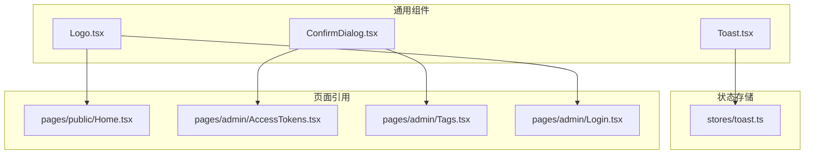
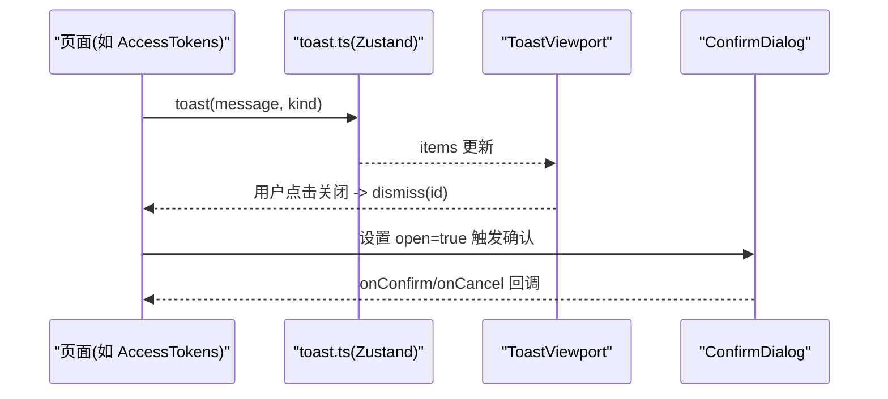
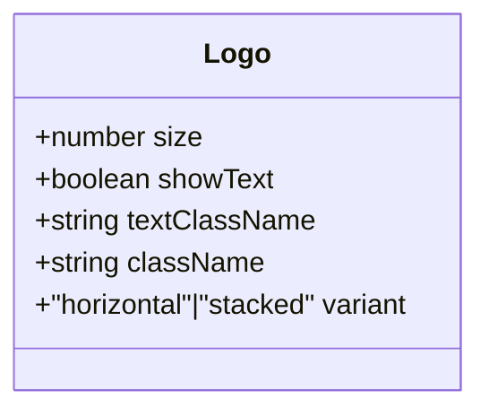
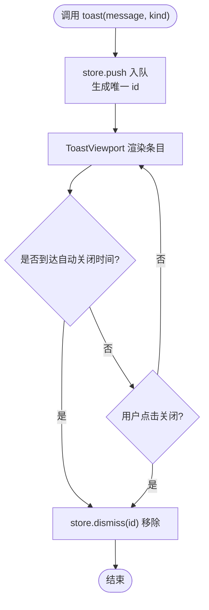
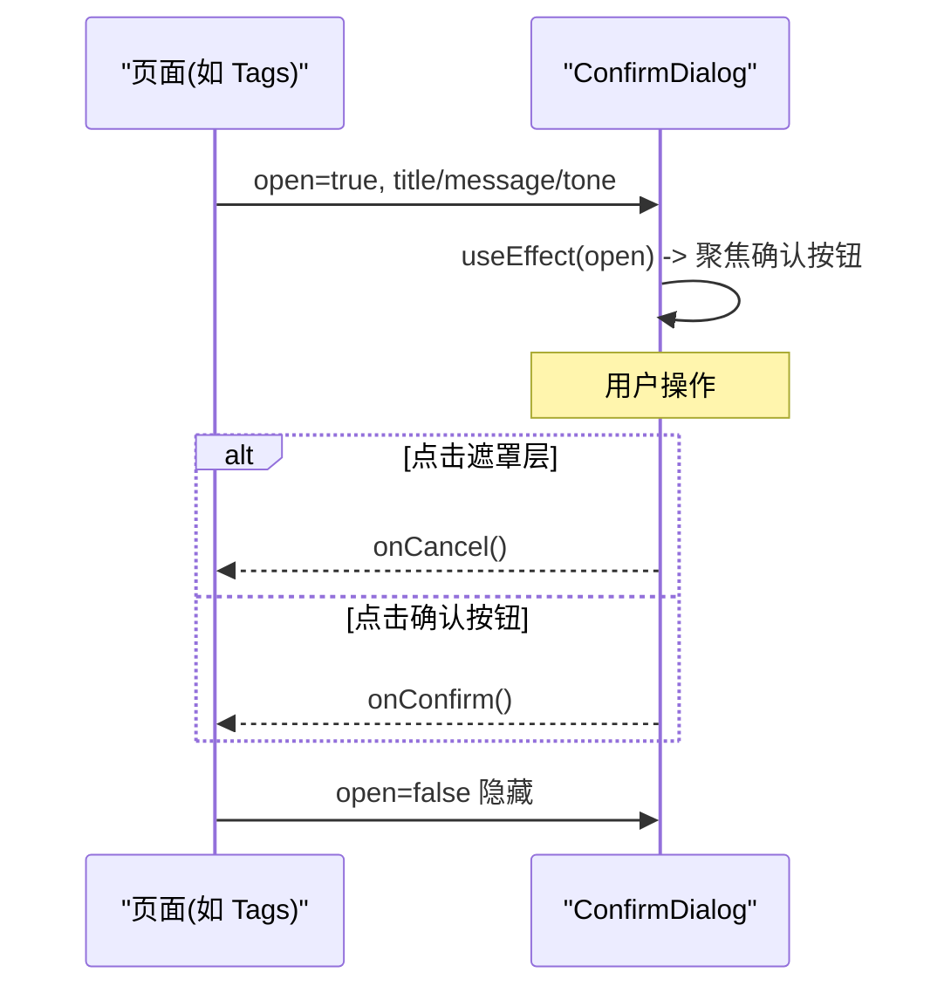
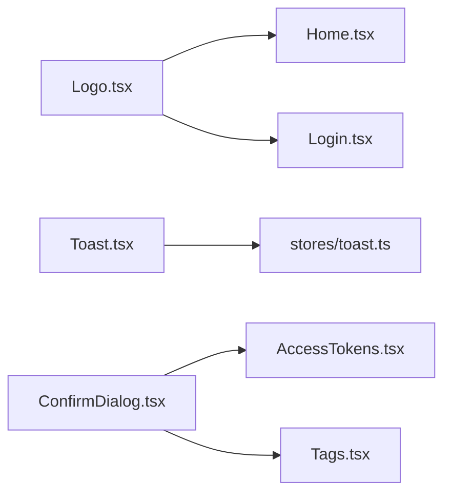

# UI通用组件

<cite>
**本文引用的文件**
- [Logo.tsx](file://frontend/src/components/Logo.tsx)
- [Toast.tsx](file://frontend/src/components/Toast.tsx)
- [ConfirmDialog.tsx](file://frontend/src/components/ConfirmDialog.tsx)
- [toast.ts](file://frontend/src/stores/toast.ts)
- [AccessTokens.tsx](file://frontend/src/pages/admin/AccessTokens.tsx)
- [Tags.tsx](file://frontend/src/pages/admin/Tags.tsx)
- [Home.tsx](file://frontend/src/pages/public/Home.tsx)
- [Login.tsx](file://frontend/src/pages/admin/Login.tsx)
- [index.css](file://frontend/src/index.css)
</cite>

## 目录
1. [简介](#简介)
2. [项目结构](#项目结构)
3. [核心组件](#核心组件)
4. [架构总览](#架构总览)
5. [详细组件分析](#详细组件分析)
6. [依赖关系分析](#依赖关系分析)
7. [性能考虑](#性能考虑)
8. [故障排查指南](#故障排查指南)
9. [结论](#结论)
10. [附录：Props 接口与使用示例](#附录props-接口与使用示例)

## 简介
本文件面向 Learning Hub 前端通用 UI 组件，聚焦以下三个基础组件的设计与实现：
- Logo 品牌标识：SVG 图标绘制、尺寸自适应、横向/纵向变体、可访问性。
- Toast 通知：消息类型、显示控制、自动关闭机制、样式定制。
- ConfirmDialog 确认对话框：模态框管理、用户交互处理、键盘事件支持、可访问性。

文档同时提供每个组件的 Props 接口定义、使用示例、最佳实践、样式策略、响应式适配与跨浏览器兼容性说明，并给出测试编写指南与性能优化建议。

## 项目结构
与通用组件相关的代码主要位于 frontend/src/components 与 frontend/src/stores 下，并在多个页面中复用。

图表来源
- [Logo.tsx:1-76](file://frontend/src/components/Logo.tsx#L1-L76)
- [Toast.tsx:1-38](file://frontend/src/components/Toast.tsx#L1-L38)
- [ConfirmDialog.tsx:1-92](file://frontend/src/components/ConfirmDialog.tsx#L1-L92)
- [toast.ts:1-30](file://frontend/src/stores/toast.ts#L1-L30)
- [Home.tsx:1-55](file://frontend/src/pages/public/Home.tsx#L1-L55)
- [AccessTokens.tsx:1-269](file://frontend/src/pages/admin/AccessTokens.tsx#L1-L269)
- [Tags.tsx:1-197](file://frontend/src/pages/admin/Tags.tsx#L1-L197)
- [Login.tsx:1-39](file://frontend/src/pages/admin/Login.tsx#L1-L39)

章节来源
- [Logo.tsx:1-76](file://frontend/src/components/Logo.tsx#L1-L76)
- [Toast.tsx:1-38](file://frontend/src/components/Toast.tsx#L1-L38)
- [ConfirmDialog.tsx:1-92](file://frontend/src/components/ConfirmDialog.tsx#L1-L92)
- [toast.ts:1-30](file://frontend/src/stores/toast.ts#L1-L30)
- [Home.tsx:1-55](file://frontend/src/pages/public/Home.tsx#L1-L55)
- [AccessTokens.tsx:1-269](file://frontend/src/pages/admin/AccessTokens.tsx#L1-L269)
- [Tags.tsx:1-197](file://frontend/src/pages/admin/Tags.tsx#L1-L197)
- [Login.tsx:1-39](file://frontend/src/pages/admin/Login.tsx#L1-L39)

## 核心组件
本节对三个通用组件进行概览性说明，后续章节将深入展开。

- Logo 品牌标识
  - 通过 SVG 绘制品牌图形（圆角矩形背景、节点网络、书本），支持 size 控制整体尺寸，文字大小按比例缩放。
  - 支持 variant 切换布局方向（horizontal 横向、stacked 纵向堆叠）。
  - 提供 showText、textClassName、className 等扩展能力。
  - 具备 role="img" 与 aria-label 的可访问性属性。

- Toast 通知
  - 基于 Zustand store 集中管理消息队列，支持 info/success/error 三种类型。
  - 提供 push/dismiss API，默认 3.5 秒自动关闭。
  - 渲染在右上角固定视口区域，支持点击关闭。

- ConfirmDialog 确认对话框
  - 受控 open 属性控制显隐，支持 destructive 兼容字段与 tone 语义色。
  - 打开时自动聚焦确认按钮，支持点击遮罩层取消。
  - 提供 role="dialog" 与 aria-modal="true" 的基础可访问性。

章节来源
- [Logo.tsx:1-76](file://frontend/src/components/Logo.tsx#L1-L76)
- [Toast.tsx:1-38](file://frontend/src/components/Toast.tsx#L1-L38)
- [ConfirmDialog.tsx:1-92](file://frontend/src/components/ConfirmDialog.tsx#L1-L92)
- [toast.ts:1-30](file://frontend/src/stores/toast.ts#L1-L30)

## 架构总览
组件间数据流与调用关系如下：

图表来源
- [AccessTokens.tsx:1-269](file://frontend/src/pages/admin/AccessTokens.tsx#L1-L269)
- [Tags.tsx:1-197](file://frontend/src/pages/admin/Tags.tsx#L1-L197)
- [toast.ts:1-30](file://frontend/src/stores/toast.ts#L1-L30)
- [Toast.tsx:1-38](file://frontend/src/components/Toast.tsx#L1-L38)
- [ConfirmDialog.tsx:1-92](file://frontend/src/components/ConfirmDialog.tsx#L1-L92)

## 详细组件分析

### Logo 品牌标识组件
- 设计要点
  - SVG 矢量图：圆角矩形背景、顶部节点连线与中心点、底部书本轮廓。
  - 尺寸自适应：size 决定 SVG 宽高，文本字号按 size*0.65 计算，间距按 size*0.3 计算。
  - 变体模式：variant 为 horizontal 或 stacked，分别对应行/列布局。
  - 可访问性：根容器 data-testid 便于测试；SVG 设置 role="img" 与 aria-label。
- 关键实现细节
  - 通过内联 style 动态设置 gap 与 flexDirection，避免额外 CSS 类。
  - 文本使用 Tailwind 类名组合，支持外部 textClassName 覆盖颜色。
- 使用场景
  - 登录页标题区、首页品牌展示、结果页顶导等。

图表来源
- [Logo.tsx:1-76](file://frontend/src/components/Logo.tsx#L1-L76)

章节来源
- [Logo.tsx:1-76](file://frontend/src/components/Logo.tsx#L1-L76)
- [Home.tsx:1-55](file://frontend/src/pages/public/Home.tsx#L1-L55)
- [Login.tsx:1-39](file://frontend/src/pages/admin/Login.tsx#L1-L39)

#### 使用示例与最佳实践
- 在首页以较大尺寸展示品牌：
  - 参考路径：[Home.tsx:25-30](file://frontend/src/pages/public/Home.tsx#L25-L30)
- 在登录页居中展示品牌：
  - 参考路径：[Login.tsx:34-39](file://frontend/src/pages/admin/Login.tsx#L34-L39)
- 最佳实践
  - 根据上下文选择 size，保持视觉比例一致。
  - 需要深色背景时通过 textClassName 调整文字颜色。
  - 在小屏或紧凑空间使用 stacked 变体以获得更好的可读性。

### Toast 通知组件
- 功能特性
  - 消息类型：info、success、error，不同背景色区分。
  - 显示控制：push 添加消息，dismiss 移除指定消息。
  - 自动关闭：push 后 3.5 秒自动移除。
  - 样式定制：KIND_CLS 映射 Tailwind 类名，可按需扩展。
- 数据流
  - 页面调用 toast() 或 useToastStore.getState().push() 入队。
  - ToastViewport 订阅 items 列表并渲染。
  - 用户点击关闭或超时自动关闭时调用 dismiss。

图表来源
- [toast.ts:1-30](file://frontend/src/stores/toast.ts#L1-L30)
- [Toast.tsx:1-38](file://frontend/src/components/Toast.tsx#L1-L38)

章节来源
- [toast.ts:1-30](file://frontend/src/stores/toast.ts#L1-L30)
- [Toast.tsx:1-38](file://frontend/src/components/Toast.tsx#L1-L38)
- [AccessTokens.tsx:1-269](file://frontend/src/pages/admin/AccessTokens.tsx#L1-L269)
- [Tags.tsx:1-197](file://frontend/src/pages/admin/Tags.tsx#L1-L197)

#### 使用示例与最佳实践
- 在创建/删除等操作成功后提示成功：
  - 参考路径：[AccessTokens.tsx:42-51](file://frontend/src/pages/admin/AccessTokens.tsx#L42-L51)、[Tags.tsx:42-50](file://frontend/src/pages/admin/Tags.tsx#L42-L50)
- 在错误分支提示错误信息：
  - 参考路径：[AccessTokens.tsx:25-30](file://frontend/src/pages/admin/AccessTokens.tsx#L25-L30)、[Tags.tsx:25-30](file://frontend/src/pages/admin/Tags.tsx#L25-L30)
- 最佳实践
  - 统一使用 toast(message, kind) 便捷函数，减少样板代码。
  - 对长消息进行截断或换行，避免溢出。
  - 如需自定义样式，可在 KIND_CLS 中新增映射或在组件外层包裹自定义容器。

### ConfirmDialog 确认对话框
- 实现原理
  - 受控 open 属性控制显隐，open=false 直接返回 null 不渲染 DOM。
  - 打开时通过 useRef 获取确认按钮并 focus，提升键盘可达性。
  - 点击遮罩层触发 onCancel，阻止冒泡确保内容区点击不关闭。
  - 支持 destructive 兼容字段，等价于 tone='danger'。
- 可访问性
  - 根容器 role="dialog" 与 aria-modal="true"，辅助技术可识别为模态框。
  - 标题与消息分别用 h3/p 语义标签，便于屏幕阅读器朗读。
- 交互流程

图表来源
- [ConfirmDialog.tsx:1-92](file://frontend/src/components/ConfirmDialog.tsx#L1-L92)
- [Tags.tsx:181-193](file://frontend/src/pages/admin/Tags.tsx#L181-L193)
- [AccessTokens.tsx:240-265](file://frontend/src/pages/admin/AccessTokens.tsx#L240-L265)

章节来源
- [ConfirmDialog.tsx:1-92](file://frontend/src/components/ConfirmDialog.tsx#L1-L92)
- [Tags.tsx:181-193](file://frontend/src/pages/admin/Tags.tsx#L181-L193)
- [AccessTokens.tsx:240-265](file://frontend/src/pages/admin/AccessTokens.tsx#L240-L265)

#### 使用示例与最佳实践
- 删除操作前弹出危险风格确认：
  - 参考路径：[Tags.tsx:181-193](file://frontend/src/pages/admin/Tags.tsx#L181-L193)
- 重新生成令牌前弹出警告风格确认：
  - 参考路径：[AccessTokens.tsx:240-252](file://frontend/src/pages/admin/AccessTokens.tsx#L240-L252)
- 最佳实践
  - 始终传入明确的 title 与 message，避免空字符串导致无意义弹窗。
  - 对 destructive 场景优先使用 destructive 或 tone='danger'。
  - 若 onConfirm 为异步，建议在回调内部处理 loading 与错误提示。

## 依赖关系分析
- 组件耦合度
  - Logo 无外部依赖，纯展示型组件，高内聚低耦合。
  - Toast 与 toast.ts 强耦合，通过 Zustand 共享状态。
  - ConfirmDialog 无外部依赖，由页面负责状态管理与回调。
- 外部依赖
  - React、Tailwind CSS、Zustand。
- 潜在循环依赖
  - 当前组件之间无相互导入，不存在循环依赖风险。

图表来源
- [Logo.tsx:1-76](file://frontend/src/components/Logo.tsx#L1-L76)
- [Home.tsx:1-55](file://frontend/src/pages/public/Home.tsx#L1-L55)
- [Login.tsx:1-39](file://frontend/src/pages/admin/Login.tsx#L1-L39)
- [Toast.tsx:1-38](file://frontend/src/components/Toast.tsx#L1-L38)
- [toast.ts:1-30](file://frontend/src/stores/toast.ts#L1-L30)
- [ConfirmDialog.tsx:1-92](file://frontend/src/components/ConfirmDialog.tsx#L1-L92)
- [AccessTokens.tsx:1-269](file://frontend/src/pages/admin/AccessTokens.tsx#L1-L269)
- [Tags.tsx:1-197](file://frontend/src/pages/admin/Tags.tsx#L1-L197)

章节来源
- [Logo.tsx:1-76](file://frontend/src/components/Logo.tsx#L1-L76)
- [Toast.tsx:1-38](file://frontend/src/components/Toast.tsx#L1-L38)
- [ConfirmDialog.tsx:1-92](file://frontend/src/components/ConfirmDialog.tsx#L1-L92)
- [toast.ts:1-30](file://frontend/src/stores/toast.ts#L1-L30)
- [Home.tsx:1-55](file://frontend/src/pages/public/Home.tsx#L1-L55)
- [AccessTokens.tsx:1-269](file://frontend/src/pages/admin/AccessTokens.tsx#L1-L269)
- [Tags.tsx:1-197](file://frontend/src/pages/admin/Tags.tsx#L1-L197)

## 性能考虑
- Logo
  - SVG 为轻量矢量图，渲染开销极低；通过 size 控制实际像素尺寸，避免大图缩放带来的重绘。
  - 建议将常用尺寸缓存为常量，减少重复计算。
- Toast
  - 自动关闭使用 setTimeout，注意在高并发场景下避免过多定时器；必要时可引入队列或节流。
  - 大量消息时，建议限制最大显示数量，超出则丢弃最旧项。
- ConfirmDialog
  - 仅在 open=true 时渲染，避免不必要的 DOM 挂载。
  - 焦点管理使用 useRef，开销极小；若存在多层模态，需维护焦点栈。

[本节为通用性能建议，不直接分析具体文件]

## 故障排查指南
- Toast 未显示
  - 检查是否在应用入口挂载了 ToastViewport 容器。
  - 确认 toast.ts 的 push/dismiss 被正确调用。
  - 参考路径：[toast.ts:15-25](file://frontend/src/stores/toast.ts#L15-L25)、[Toast.tsx:9-37](file://frontend/src/components/Toast.tsx#L9-L37)
- ConfirmDialog 无法关闭
  - 检查 open 状态是否被父组件正确更新。
  - 确认 onClick 事件未被其他元素拦截。
  - 参考路径：[ConfirmDialog.tsx:53-64](file://frontend/src/components/ConfirmDialog.tsx#L53-L64)
- Logo 尺寸异常
  - 检查传入 size 是否为正数。
  - 确认外层容器未强制覆盖 width/height。
  - 参考路径：[Logo.tsx:23-36](file://frontend/src/components/Logo.tsx#L23-L36)

章节来源
- [toast.ts:15-25](file://frontend/src/stores/toast.ts#L15-L25)
- [Toast.tsx:9-37](file://frontend/src/components/Toast.tsx#L9-L37)
- [ConfirmDialog.tsx:53-64](file://frontend/src/components/ConfirmDialog.tsx#L53-L64)
- [Logo.tsx:23-36](file://frontend/src/components/Logo.tsx#L23-L36)

## 结论
三个通用组件覆盖了品牌展示、用户反馈与关键操作确认的核心场景。它们遵循受控/非受控结合、最小依赖、可访问性与可测试性的原则，具备良好的复用性与扩展性。在实际使用中，建议遵循本文档的 Props 约定与最佳实践，以确保一致的体验与可维护性。

[本节为总结性内容，不直接分析具体文件]

## 附录：Props 接口与使用示例

### Logo Props
- 字段
  - size?: number — 图标尺寸（像素），同时按比例决定文字大小
  - showText?: boolean — 是否显示文字
  - textClassName?: string — 文字颜色类名（Tailwind）
  - className?: string — 根节点额外类名
  - variant?: "horizontal" | "stacked" — 整体风格变体
- 使用示例
  - 首页大尺寸展示：参考路径 [Home.tsx:25-30](file://frontend/src/pages/public/Home.tsx#L25-L30)
  - 登录页居中展示：参考路径 [Login.tsx:34-39](file://frontend/src/pages/admin/Login.tsx#L34-L39)

章节来源
- [Logo.tsx:3-14](file://frontend/src/components/Logo.tsx#L3-L14)
- [Home.tsx:25-30](file://frontend/src/pages/public/Home.tsx#L25-L30)
- [Login.tsx:34-39](file://frontend/src/pages/admin/Login.tsx#L34-L39)

### Toast 相关
- 状态接口（stores/toast.ts）
  - items: ToastItem[]
  - push(message: string, kind?: ToastKind): void
  - dismiss(id: number): void
  - ToastKind = "info" | "success" | "error"
  - ToastItem = { id: number; kind: ToastKind; message: string }
- 便捷函数
  - toast(message: string, kind?: ToastKind): void
- 使用示例
  - 成功提示：参考路径 [AccessTokens.tsx:42-51](file://frontend/src/pages/admin/AccessTokens.tsx#L42-L51)
  - 错误提示：参考路径 [AccessTokens.tsx:25-30](file://frontend/src/pages/admin/AccessTokens.tsx#L25-L30)

章节来源
- [toast.ts:1-30](file://frontend/src/stores/toast.ts#L1-L30)
- [AccessTokens.tsx:25-51](file://frontend/src/pages/admin/AccessTokens.tsx#L25-L51)

### ConfirmDialog Props
- 字段
  - open: boolean — 控制显隐
  - title: string — 标题
  - message: string — 消息内容
  - confirmText?: string — 确认按钮文案
  - cancelText?: string — 取消按钮文案
  - destructive?: boolean — 兼容 destructive 风格标识，等价于 tone='danger'
  - tone?: Tone — 语义色 'primary' | 'warning' | 'danger' | string
  - onConfirm: () => void | Promise<void> — 确认回调
  - onCancel: () => void — 取消回调
- 使用示例
  - 危险删除：参考路径 [Tags.tsx:181-193](file://frontend/src/pages/admin/Tags.tsx#L181-L193)
  - 警告重新生成：参考路径 [AccessTokens.tsx:240-252](file://frontend/src/pages/admin/AccessTokens.tsx#L240-L252)

章节来源
- [ConfirmDialog.tsx:5-17](file://frontend/src/components/ConfirmDialog.tsx#L5-L17)
- [Tags.tsx:181-193](file://frontend/src/pages/admin/Tags.tsx#L181-L193)
- [AccessTokens.tsx:240-252](file://frontend/src/pages/admin/AccessTokens.tsx#L240-L252)

### 样式策略与响应式适配
- 样式体系
  - 全局启用 Tailwind base/components/utilities，并通过 index.css 注入。
  - 组件采用 Tailwind 原子类组合，避免自定义样式冲突。
- 响应式适配
  - Logo 通过 size 与 flexDirection 适配不同布局。
  - Toast 使用 fixed 定位与 max-w-sm 保证移动端可读性。
  - ConfirmDialog 使用固定遮罩与居中布局，适配多尺寸屏幕。
- 跨浏览器兼容性
  - SVG viewBox 与基本形状在所有现代浏览器均良好支持。
  - Tailwind 工具类广泛兼容，必要时可通过构建阶段补齐前缀。

章节来源
- [index.css:1-24](file://frontend/src/index.css#L1-L24)
- [Logo.tsx:38-73](file://frontend/src/components/Logo.tsx#L38-L73)
- [Toast.tsx:12-36](file://frontend/src/components/Toast.tsx#L12-L36)
- [ConfirmDialog.tsx:53-89](file://frontend/src/components/ConfirmDialog.tsx#L53-L89)

### 可访问性实现
- Logo
  - SVG 设置 role="img" 与 aria-label，便于屏幕阅读器识别。
- Toast
  - 关闭按钮提供 aria-label="关闭"，明确操作意图。
- ConfirmDialog
  - 根容器 role="dialog" 与 aria-modal="true"，打开时自动聚焦确认按钮。

章节来源
- [Logo.tsx:44-51](file://frontend/src/components/Logo.tsx#L44-L51)
- [Toast.tsx:25-29](file://frontend/src/components/Toast.tsx#L25-L29)
- [ConfirmDialog.tsx:54-58](file://frontend/src/components/ConfirmDialog.tsx#L54-L58)
- [ConfirmDialog.tsx:45-49](file://frontend/src/components/ConfirmDialog.tsx#L45-L49)

### 测试编写指南
- 选择器与断言
  - Logo：data-testid="brand-logo"
  - Toast：data-testid="toast-viewport"、data-testid={`toast-${kind}`}
  - ConfirmDialog：data-testid="confirm-dialog"、data-testid="confirm-title"、data-testid="confirm-message"、data-testid="confirm-cancel"、data-testid="confirm-ok"
- 推荐用例
  - Logo 尺寸与变体：验证不同 size 与 variant 下的布局与文本可见性。
  - Toast 生命周期：push 后自动消失、手动关闭、多消息叠加。
  - ConfirmDialog 交互：打开聚焦、遮罩点击取消、确认回调执行。
- 参考现有 E2E 用例风格
  - 前台搜索与 Toast 行为：参考路径 [test-cases-front.md:551-559](file://doc/test/test-cases-front.md#L551-L559)

章节来源
- [Logo.tsx:42](file://frontend/src/components/Logo.tsx#L42-L42)
- [Toast.tsx:14-21](file://frontend/src/components/Toast.tsx#L14-L21)
- [ConfirmDialog.tsx:55-83](file://frontend/src/components/ConfirmDialog.tsx#L55-L83)
- [test-cases-front.md:551-559](file://doc/test/test-cases-front.md#L551-L559)