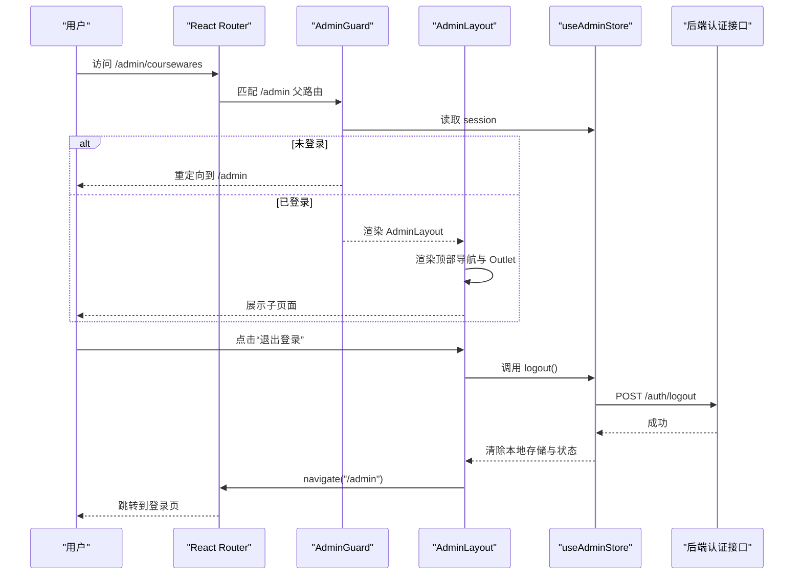
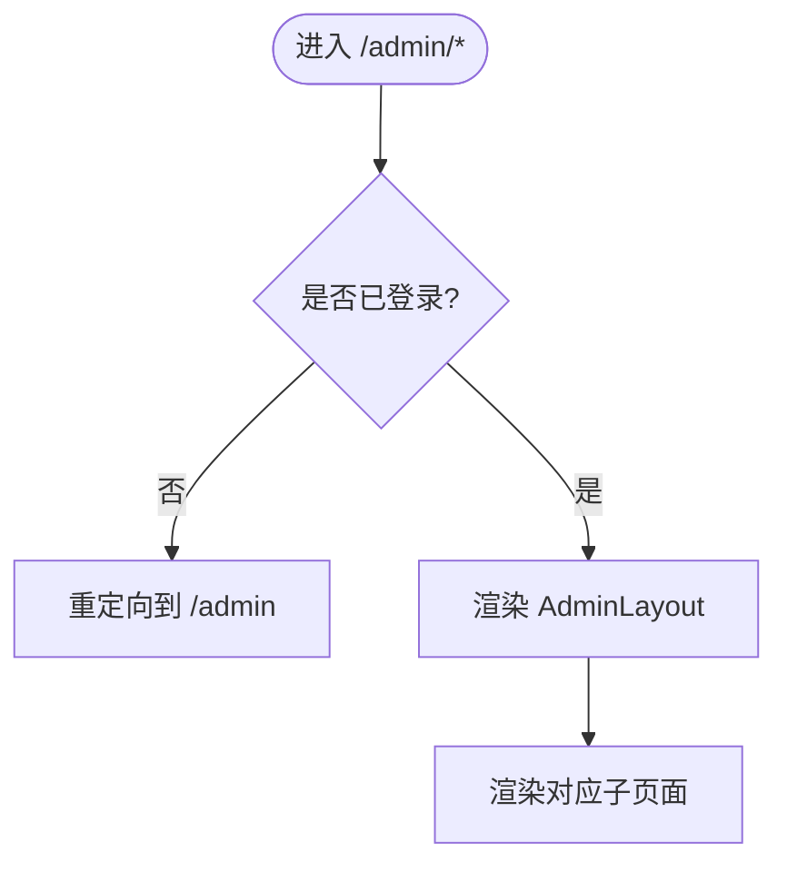
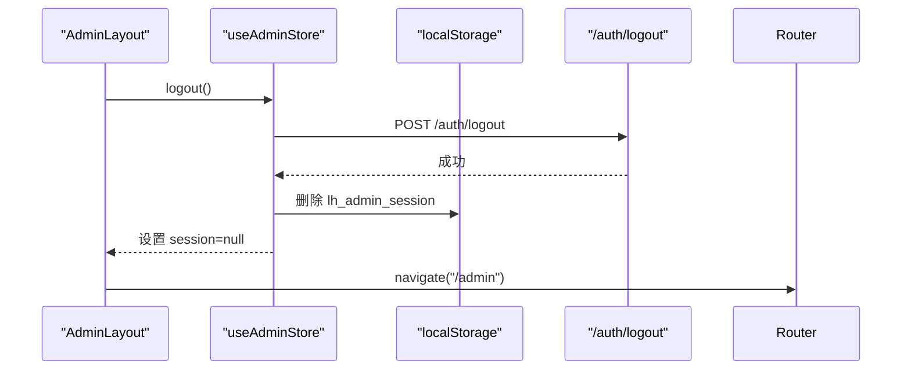
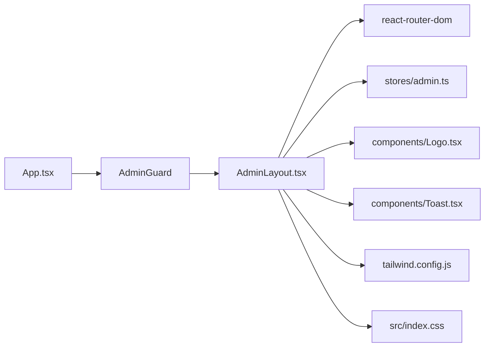

# 布局组件

<cite>
**本文引用的文件**
- [AdminLayout.tsx](file://frontend/src/layouts/AdminLayout.tsx)
- [App.tsx](file://frontend/src/App.tsx)
- [admin.ts](file://frontend/src/stores/admin.ts)
- [view.ts](file://frontend/src/stores/view.ts)
- [token.ts](file://frontend/src/stores/token.ts)
- [Logo.tsx](file://frontend/src/components/Logo.tsx)
- [Toast.tsx](file://frontend/src/components/Toast.tsx)
- [tailwind.config.js](file://frontend/tailwind.config.js)
- [index.css](file://frontend/src/index.css)
- [04-管理后台规格.md](file://doc/spec/04-管理后台规格.md)
- [09-UI规格.md](file://doc/spec/09-UI规格.md)
</cite>

## 目录
1. [简介](#简介)
2. [项目结构](#项目结构)
3. [核心组件](#核心组件)
4. [架构总览](#架构总览)
5. [详细组件分析](#详细组件分析)
6. [依赖关系分析](#依赖关系分析)
7. [性能与优化](#性能与优化)
8. [故障排查指南](#故障排查指南)
9. [结论](#结论)
10. [附录：扩展与最佳实践](#附录扩展与最佳实践)

## 简介
本规范聚焦于 Learning Hub 管理后台的布局组件 AdminLayout，围绕其架构设计、状态管理、路由集成、响应式实现、可扩展性（动态菜单、主题切换、多语言）、自定义扩展路径以及性能优化策略进行系统化说明。文档面向前端开发者与维护者，兼顾可读性与可落地性。

## 项目结构
管理后台布局位于前端 src/layouts 下，由 App 作为路由入口统一挂载；状态通过 Zustand store 管理；样式基于 Tailwind CSS 配置与全局 CSS 变量。

```mermaid
graph TB
A["App.tsx<br/>路由与守卫"] --> B["AdminLayout.tsx<br/>顶部导航+内容区"]
B --> C["Outlet<br/>子页面渲染"]
B --> D["Logo.tsx<br/>品牌标识"]
B --> E["ToastViewport<br/>全局消息"]
B --> F["useAdminStore<br/>登录态/退出"]
A --> G["stores/view.ts<br/>前台视图同步(非后台)"]
A --> H["stores/token.ts<br/>解锁令牌记忆(非后台)"]
I["tailwind.config.js<br/>主题色/字体"] --> B
J["index.css<br/>CSS变量/基础样式"] --> B
```



图表来源
- [App.tsx:74-109](file://frontend/src/App.tsx#L74-L109)
- [AdminLayout.tsx:1-61](file://frontend/src/layouts/AdminLayout.tsx#L1-L61)
- [Logo.tsx:1-76](file://frontend/src/components/Logo.tsx#L1-L76)
- [Toast.tsx:1-38](file://frontend/src/components/Toast.tsx#L1-L38)
- [admin.ts:1-71](file://frontend/src/stores/admin.ts#L1-L71)
- [view.ts:1-127](file://frontend/src/stores/view.ts#L1-L127)
- [token.ts:1-54](file://frontend/src/stores/token.ts#L1-L54)
- [tailwind.config.js:1-20](file://frontend/tailwind.config.js#L1-L20)
- [index.css:1-24](file://frontend/src/index.css#L1-L24)

章节来源
- [App.tsx:74-109](file://frontend/src/App.tsx#L74-L109)
- [AdminLayout.tsx:1-61](file://frontend/src/layouts/AdminLayout.tsx#L1-L61)
- [tailwind.config.js:1-20](file://frontend/tailwind.config.js#L1-L20)
- [index.css:1-24](file://frontend/src/index.css#L1-L24)

## 核心组件
- AdminLayout：管理后台通用外壳，包含顶部 Logo、模块导航、退出按钮与内容区域 Outlet。
- App：应用根路由，负责前台 SPA 视图同步、后台鉴权守卫与后台子路由挂载。
- useAdminStore：管理后台会话状态（登录/退出/恢复），持久化到 localStorage。
- Logo：品牌图标与文字组合的可复用组件。
- ToastViewport：全局消息提示容器。
- Tailwind 配置与全局 CSS：定义主色调、字体族与头部高度等基础样式。

章节来源
- [AdminLayout.tsx:1-61](file://frontend/src/layouts/AdminLayout.tsx#L1-L61)
- [App.tsx:31-109](file://frontend/src/App.tsx#L31-L109)
- [admin.ts:1-71](file://frontend/src/stores/admin.ts#L1-L71)
- [Logo.tsx:1-76](file://frontend/src/components/Logo.tsx#L1-L76)
- [Toast.tsx:1-38](file://frontend/src/components/Toast.tsx#L1-L38)
- [tailwind.config.js:1-20](file://frontend/tailwind.config.js#L1-L20)
- [index.css:1-24](file://frontend/src/index.css#L1-L24)

## 架构总览
管理后台采用“单页应用 + 子路由”模式：
- App 中通过 Routes 定义 /admin 为登录页，/admin/* 在 AdminGuard 保护下使用 AdminLayout 包裹，并在其内部挂载各管理页面。
- AdminLayout 提供顶部导航与内容区，子页面通过 Outlet 渲染。
- 登录态由 useAdminStore 维护，退出时调用后端接口并清理本地存储，随后跳转回登录页。



图表来源
- [App.tsx:74-109](file://frontend/src/App.tsx#L74-L109)
- [AdminLayout.tsx:14-21](file://frontend/src/layouts/AdminLayout.tsx#L14-L21)
- [admin.ts:60-68](file://frontend/src/stores/admin.ts#L60-L68)

章节来源
- [App.tsx:74-109](file://frontend/src/App.tsx#L74-L109)
- [AdminLayout.tsx:14-21](file://frontend/src/layouts/AdminLayout.tsx#L14-L21)
- [admin.ts:60-68](file://frontend/src/stores/admin.ts#L60-L68)

## 详细组件分析

### AdminLayout 组件
职责
- 渲染顶部导航栏（Logo、模块链接、退出按钮）。
- 根据当前路由高亮激活项。
- 承载子页面内容（Outlet）。
- 触发退出登录流程。

关键实现要点
- 导航数据集中声明，便于后续扩展为动态配置。
- 使用 NavLink 的 isActive 回调实现激活态样式。
- 退出逻辑先调用 store.logout，再导航至登录页。

```mermaid
classDiagram
class AdminLayout {
+render() JSX
-NAV : {to, label}[]
-onLogout() : Promise~void~
}
class Logo {
+props : size, showText, textClassName, variant
}
class ToastViewport {
+items : Array
+dismiss(id) : void
}
class useAdminStore {
+session
+logout() : Promise~void~
}
AdminLayout --> Logo : "使用"
AdminLayout --> ToastViewport : "挂载"
AdminLayout --> useAdminStore : "调用退出"
```

图表来源
- [AdminLayout.tsx:6-21](file://frontend/src/layouts/AdminLayout.tsx#L6-L21)
- [Logo.tsx:1-76](file://frontend/src/components/Logo.tsx#L1-L76)
- [Toast.tsx:1-38](file://frontend/src/components/Toast.tsx#L1-L38)
- [admin.ts:34-71](file://frontend/src/stores/admin.ts#L34-L71)

章节来源
- [AdminLayout.tsx:6-21](file://frontend/src/layouts/AdminLayout.tsx#L6-L21)
- [Logo.tsx:1-76](file://frontend/src/components/Logo.tsx#L1-L76)
- [Toast.tsx:1-38](file://frontend/src/components/Toast.tsx#L1-L38)
- [admin.ts:34-71](file://frontend/src/stores/admin.ts#L34-L71)

### 路由与守卫
- App 中定义 /admin 登录页与 /admin/* 受保护路由。
- AdminGuard 检查 useAdminStore.session，未登录则重定向到 /admin。
- 子路由包括课件、分类、标签、素材、访问令牌及其用量详情等。



图表来源
- [App.tsx:31-35](file://frontend/src/App.tsx#L31-L35)
- [App.tsx:74-109](file://frontend/src/App.tsx#L74-L109)
- [AdminLayout.tsx:23-56](file://frontend/src/layouts/AdminLayout.tsx#L23-L56)

章节来源
- [App.tsx:31-35](file://frontend/src/App.tsx#L31-L35)
- [App.tsx:74-109](file://frontend/src/App.tsx#L74-L109)
- [AdminLayout.tsx:23-56](file://frontend/src/layouts/AdminLayout.tsx#L23-L56)

### 状态管理与权限控制
- useAdminStore 维护 session 与 loading，支持 login、logout、restore。
- 登录成功后将 expiresAt 持久化到 localStorage（实际 token 通过 Cookie 下发）。
- 退出时调用后端 /auth/logout，清理本地存储并重置状态。
- 权限控制通过 AdminGuard 在路由层拦截未登录访问。



图表来源
- [admin.ts:60-68](file://frontend/src/stores/admin.ts#L60-L68)
- [admin.ts:17-32](file://frontend/src/stores/admin.ts#L17-L32)
- [AdminLayout.tsx:18-21](file://frontend/src/layouts/AdminLayout.tsx#L18-L21)

章节来源
- [admin.ts:17-32](file://frontend/src/stores/admin.ts#L17-L32)
- [admin.ts:60-68](file://frontend/src/stores/admin.ts#L60-L68)
- [AdminLayout.tsx:18-21](file://frontend/src/layouts/AdminLayout.tsx#L18-L21)

### 响应式布局与移动端适配
- 当前 AdminLayout 使用 Flex 布局与 Tailwind 工具类，未内置侧边栏折叠或断点切换逻辑。
- 项目 UI 规格定义了 sm/md/lg 断点的设计要求，但后台布局在 v1.0 最小实现中未强制要求复杂响应式行为。
- 建议在需要时引入 Tailwind 断点类（如 md:flex-col）或媒体查询 Hook 实现移动端折叠导航。

章节来源
- [09-UI规格.md:380-388](file://doc/spec/09-UI规格.md#L380-L388)
- [AdminLayout.tsx:23-56](file://frontend/src/layouts/AdminLayout.tsx#L23-L56)

### 可扩展性设计
- 动态菜单：当前 NAV 为静态数组，建议抽取为配置文件或从后端获取，结合权限过滤后渲染。
- 主题切换：通过 tailwind.config.js 的 colors 与 index.css 的 CSS 变量统一管理，可在运行时注入主题类名或切换 data-theme。
- 多语言支持：可将 NAV.label 与界面文案抽离为 i18n 资源，按当前语言加载。

章节来源
- [AdminLayout.tsx:6-12](file://frontend/src/layouts/AdminLayout.tsx#L6-L12)
- [tailwind.config.js:1-20](file://frontend/tailwind.config.js#L1-L20)
- [index.css:5-7](file://frontend/src/index.css#L5-L7)

## 依赖关系分析
- AdminLayout 依赖 React Router（NavLink、Outlet、useNavigate）、useAdminStore、Logo、ToastViewport。
- App 依赖路由与多个页面组件，并通过 AdminGuard 与 AdminLayout 组合形成受保护的后台壳。
- 样式依赖 Tailwind 配置与全局 CSS。



图表来源
- [App.tsx:74-109](file://frontend/src/App.tsx#L74-L109)
- [AdminLayout.tsx:1-61](file://frontend/src/layouts/AdminLayout.tsx#L1-L61)
- [tailwind.config.js:1-20](file://frontend/tailwind.config.js#L1-L20)
- [index.css:1-24](file://frontend/src/index.css#L1-L24)

章节来源
- [App.tsx:74-109](file://frontend/src/App.tsx#L74-L109)
- [AdminLayout.tsx:1-61](file://frontend/src/layouts/AdminLayout.tsx#L1-L61)
- [tailwind.config.js:1-20](file://frontend/tailwind.config.js#L1-L20)
- [index.css:1-24](file://frontend/src/index.css#L1-L24)

## 性能与优化
- 避免不必要的重渲染：AdminLayout 仅依赖少量状态（session、navigate），保持轻量。
- 导航项渲染：当前为小量静态数据，若未来扩展为大量动态菜单，建议使用 memo 或虚拟列表。
- 退出流程：先异步请求后端，再清理本地状态与跳转，避免竞态导致的状态不一致。
- 样式与主题：通过 Tailwind 原子类减少自定义 CSS 体积；主题切换尽量使用 CSS 变量与类名切换，避免全量重建 DOM。

[本节为通用指导，不直接分析具体文件]

## 故障排查指南
- 登录后仍被重定向到登录页
  - 检查 useAdminStore.restore 是否在 App 启动时执行，确保 session 正确恢复。
  - 确认后端 Set-Cookie 是否正确下发且未被浏览器策略阻止。
- 退出登录后未跳转
  - 检查 onLogout 中 logout 完成后是否调用 navigate("/admin")。
- 导航高亮异常
  - 确认 NavLink 的 to 与路由 path 一致，且未出现重复前缀或大小写差异。
- 主题颜色不生效
  - 检查 tailwind.config.js 的 primary 色值与组件使用的类名是否匹配。

章节来源
- [App.tsx:60-72](file://frontend/src/App.tsx#L60-L72)
- [AdminLayout.tsx:18-21](file://frontend/src/layouts/AdminLayout.tsx#L18-L21)
- [tailwind.config.js:5-12](file://frontend/tailwind.config.js#L5-L12)

## 结论
AdminLayout 以简洁的顶部导航与内容区为核心，配合 App 的路由守卫与 useAdminStore 的会话管理，实现了管理后台的基础能力。当前版本未内置复杂的响应式与权限细化，具备良好的扩展空间。建议后续按规范逐步引入动态菜单、主题与多语言支持，并结合 UI 规格完善移动端适配。

[本节为总结性内容，不直接分析具体文件]

## 附录：扩展与最佳实践

### 新增页面布局
- 在 App 的 /admin 子路由中添加新 Route，并确保 AdminLayout 的导航项与之对应。
- 如需独立布局，可新建 Layout 组件并在路由中使用。

章节来源
- [App.tsx:86-104](file://frontend/src/App.tsx#L86-L104)
- [AdminLayout.tsx:28-43](file://frontend/src/layouts/AdminLayout.tsx#L28-L43)

### 修改导航结构
- 将 NAV 数组迁移至配置文件或后端返回，支持按角色/权限过滤。
- 为每个导航项增加 icon、权限标识、国际化 key 等元信息。

章节来源
- [AdminLayout.tsx:6-12](file://frontend/src/layouts/AdminLayout.tsx#L6-L12)

### 集成第三方组件
- 在 AdminLayout 中按需引入第三方组件（如日期选择器、富文本编辑器），并通过 props 传递主题与语言配置。
- 注意组件的样式隔离与事件冒泡，避免影响全局布局。

[本节为通用指导，不直接分析具体文件]

### 主题切换与多语言支持
- 主题：在 tailwind.config.js 中扩展主题色，在 index.css 中定义 CSS 变量；在运行时切换 data-theme 或 root 类名。
- 多语言：建立 i18n 资源文件，将导航文案与界面文案替换为键值引用，并提供语言切换入口。

章节来源
- [tailwind.config.js:5-16](file://frontend/tailwind.config.js#L5-L16)
- [index.css:5-7](file://frontend/src/index.css#L5-L7)

### 响应式布局实现建议
- 在小屏设备下，将顶部横向导航折叠为汉堡菜单，展开显示模块列表。
- 使用 Tailwind 断点类（sm/md/lg）控制布局变化，或在必要时引入媒体查询 Hook。

章节来源
- [09-UI规格.md:380-388](file://doc/spec/09-UI规格.md#L380-L388)