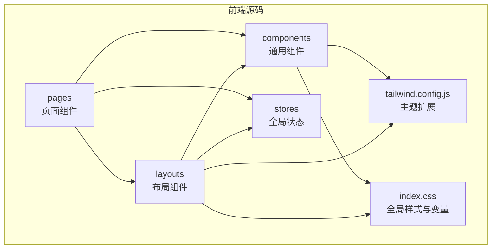
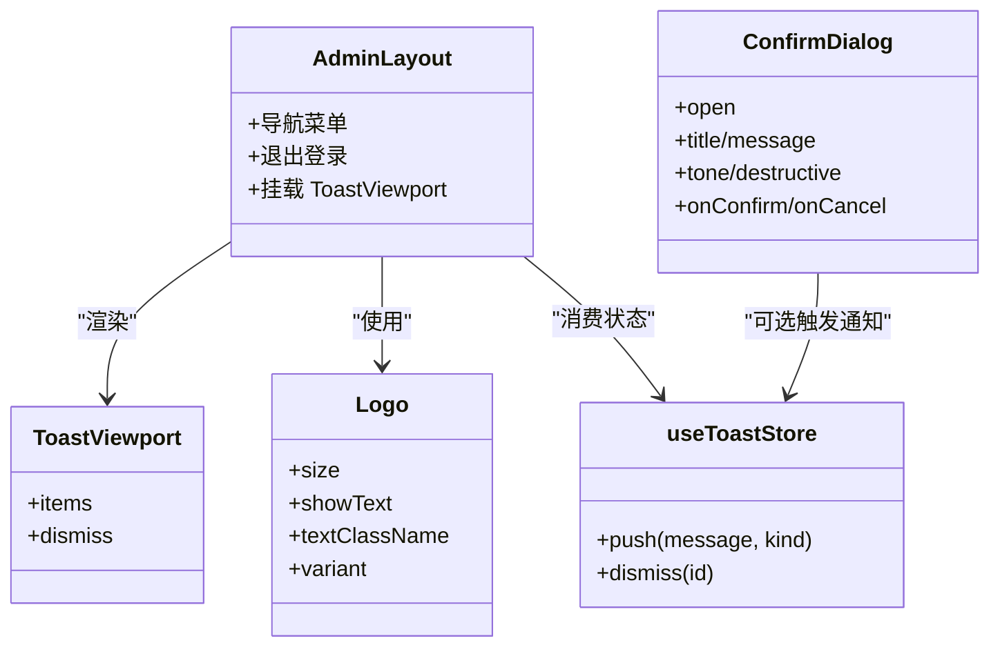
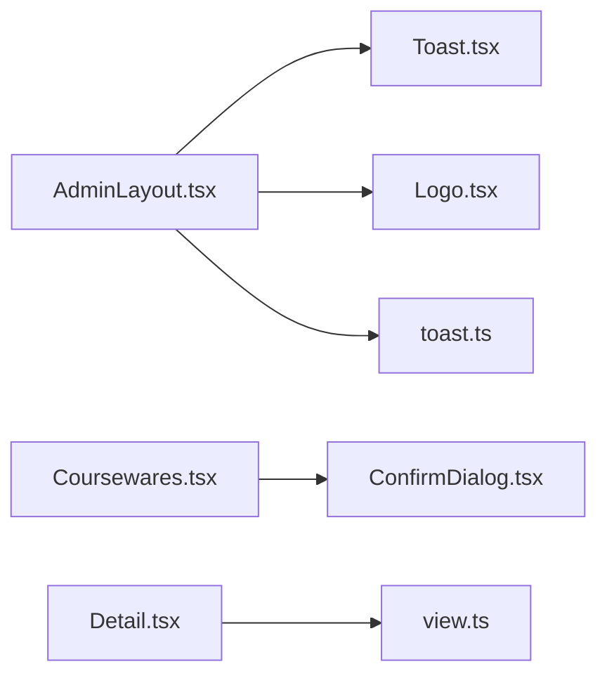

# 组件开发标准

<cite>
**本文引用的文件**   
- [ConfirmDialog.tsx](file://frontend/src/components/ConfirmDialog.tsx)
- [Logo.tsx](file://frontend/src/components/Logo.tsx)
- [Toast.tsx](file://frontend/src/components/Toast.tsx)
- [toast.ts](file://frontend/src/stores/toast.ts)
- [AdminLayout.tsx](file://frontend/src/layouts/AdminLayout.tsx)
- [tailwind.config.js](file://frontend/tailwind.config.js)
- [index.css](file://frontend/src/index.css)
- [tsconfig.json](file://frontend/tsconfig.json)
- [postcss.config.js](file://frontend/postcss.config.js)
- [Coursewares.tsx](file://frontend/src/pages/admin/Coursewares.tsx)
- [Detail.tsx](file://frontend/src/pages/public/Detail.tsx)
- [view.ts](file://frontend/src/stores/view.ts)
- [selectors.md](file://doc/test/selectors.md)
- [UI规格.md](file://doc/spec/09-UI规格.md)
</cite>

## 目录
1. [引言](#引言)
2. [项目结构](#项目结构)
3. [核心组件](#核心组件)
4. [架构总览](#架构总览)
5. [详细组件分析](#详细组件分析)
6. [依赖关系分析](#依赖关系分析)
7. [性能考量](#性能考量)
8. [故障排查指南](#故障排查指南)
9. [结论](#结论)
10. [附录](#附录)

## 引言
本规范面向 Learning Hub 前端（React + TypeScript + TailwindCSS）的组件开发，目标是建立统一的命名、组织、接口、事件、状态、样式、可访问性与测试标准，确保团队一致性与可维护性。

## 项目结构
- 组件与布局分层清晰：通用组件位于 components，业务页面位于 pages，布局位于 layouts，全局状态位于 stores，样式与主题通过 Tailwind 配置与 CSS 变量管理。
- 路径别名统一使用 @/* 指向 src，便于跨模块引用。

**图表来源** 
- [AdminLayout.tsx:1-61](file://frontend/src/layouts/AdminLayout.tsx#L1-L61)
- [tailwind.config.js:1-21](file://frontend/tailwind.config.js#L1-L21)
- [index.css:1-25](file://frontend/src/index.css#L1-L25)

**章节来源**
- [tsconfig.json:1-26](file://frontend/tsconfig.json#L1-L26)
- [postcss.config.js:1-6](file://frontend/postcss.config.js#L1-L6)

## 核心组件
本节总结现有通用组件的实现要点，作为后续开发的参考基准。

- ConfirmDialog（二次确认弹窗）
  - Props 设计：受控 open、语义色 tone/destructive、文案、回调 onConfirm/onCancel；默认值集中声明。
  - 交互与可访问性：打开时自动聚焦确认按钮；role="dialog"、aria-modal="true"；点击遮罩关闭。
  - 样式：基于 Tailwind 语义化类名组合，按 tone 动态切换主色。
  - 导出模式：具名导出函数式组件。

- Logo（品牌标识）
  - Props 设计：尺寸 size、是否显示文字 showText、文字颜色 textClassName、根容器 className、变体 variant。
  - 可访问性：SVG 设置 role="img" 与 aria-label。
  - 样式：内联 style 控制布局方向与间距，Tailwind 控制字体与颜色。
  - 导出模式：具名导出函数式组件。

- ToastViewport（消息提示视口）
  - 数据来源：Zustand toast store；渲染 items 列表，支持 dismiss。
  - 可访问性：关闭按钮提供 aria-label。
  - 样式：固定定位右上角，按 kind 映射不同背景色。
  - 导出模式：具名导出函数式组件。

**章节来源**
- [ConfirmDialog.tsx:1-92](file://frontend/src/components/ConfirmDialog.tsx#L1-L92)
- [Logo.tsx:1-76](file://frontend/src/components/Logo.tsx#L1-L76)
- [Toast.tsx:1-38](file://frontend/src/components/Toast.tsx#L1-L38)

## 架构总览
组件与状态、布局、样式的协作关系如下：

**图表来源** 
- [AdminLayout.tsx:1-61](file://frontend/src/layouts/AdminLayout.tsx#L1-L61)
- [ConfirmDialog.tsx:1-92](file://frontend/src/components/ConfirmDialog.tsx#L1-L92)
- [Logo.tsx:1-76](file://frontend/src/components/Logo.tsx#L1-L76)
- [Toast.tsx:1-38](file://frontend/src/components/Toast.tsx#L1-L38)
- [toast.ts:1-30](file://frontend/src/stores/toast.ts#L1-L30)

## 详细组件分析

### 命名与导出约定
- 文件命名
  - 组件文件采用 PascalCase，如 ConfirmDialog.tsx、Logo.tsx。
  - 布局文件以 Layout 后缀，如 AdminLayout.tsx。
  - Store 文件以 ts 结尾，使用小驼峰，如 toast.ts、view.ts。
- 组件类名与导出
  - 组件为函数式组件，使用具名导出 export function Xxx(...)。
  - 不暴露内部实现细节，仅导出对外 API。
- 路径别名
  - 统一使用 @/* 导入 src 下资源，避免相对路径嵌套过深。

**章节来源**
- [tsconfig.json:1-26](file://frontend/tsconfig.json#L1-L26)
- [ConfirmDialog.tsx:1-92](file://frontend/src/components/ConfirmDialog.tsx#L1-L92)
- [Logo.tsx:1-76](file://frontend/src/components/Logo.tsx#L1-L76)
- [AdminLayout.tsx:1-61](file://frontend/src/layouts/AdminLayout.tsx#L1-L61)

### 目录组织结构
- components：通用 UI 组件（ConfirmDialog、Logo、Toast）。
- layouts：页面级布局（AdminLayout）。
- pages：业务页面（admin、public 子目录）。
- stores：全局状态（toast、view、token、admin）。
- lib：第三方库封装（pdfjs.ts）。
- api：API 客户端与类型定义。

建议新增组件遵循上述分层，保持单一职责与高内聚。

**章节来源**
- [AdminLayout.tsx:1-61](file://frontend/src/layouts/AdminLayout.tsx#L1-L61)
- [Coursewares.tsx:1-800](file://frontend/src/pages/admin/Coursewares.tsx#L1-L800)
- [Detail.tsx:1-188](file://frontend/src/pages/public/Detail.tsx#L1-L188)

### Props 接口设计规范
- 类型定义
  - 使用 interface 或 type 明确 Props，字段顺序：必填在前、可选在后。
  - 枚举型字段优先使用字面量联合类型，如 "primary" | "warning" | "danger"。
- 默认值
  - 在解构参数中直接赋默认值，保证调用方无需显式传入。
- 验证规则
  - 对关键输入进行边界校验（如长度、格式），失败时返回友好错误信息。
- 文档注释
  - 每个 Props 使用 JSDoc 风格注释说明用途、取值范围与示例。

示例参考路径：
- [ConfirmDialog.tsx:5-17](file://frontend/src/components/ConfirmDialog.tsx#L5-L17)
- [Logo.tsx:3-14](file://frontend/src/components/Logo.tsx#L3-L14)

**章节来源**
- [ConfirmDialog.tsx:5-17](file://frontend/src/components/ConfirmDialog.tsx#L5-L17)
- [Logo.tsx:3-14](file://frontend/src/components/Logo.tsx#L3-L14)

### 组件事件处理标准
- 事件命名
  - 回调使用 onXxx 形式，如 onConfirm、onCancel、onChange。
  - 事件参数尽量简单，必要时传递结构化对象。
- 异步处理
  - 支持 Promise 返回的回调（如 onConfirm 可为 async），调用方负责 catch 并展示错误。
- 错误处理
  - 组件层只负责触发与基础反馈，具体错误文案由上层或 toast 统一管理。

示例参考路径：
- [ConfirmDialog.tsx:15-16](file://frontend/src/components/ConfirmDialog.tsx#L15-L16)
- [Coursewares.tsx:600-611](file://frontend/src/pages/admin/Coursewares.tsx#L600-L611)

**章节来源**
- [ConfirmDialog.tsx:15-16](file://frontend/src/components/ConfirmDialog.tsx#L15-L16)
- [Coursewares.tsx:600-611](file://frontend/src/pages/admin/Coursewares.tsx#L600-L611)

### 组件状态管理最佳实践
- 本地状态
  - 使用 useState/useRef 管理组件内部状态，避免不必要的提升。
- 全局状态
  - 使用 Zustand 管理跨组件共享状态（如 toast、view）。
  - 将状态与行为（actions）一起导出，避免直接修改 state。
- 异步状态
  - 在 useEffect 中发起请求，结合 loading/error 状态管理 UI。
  - 取消未完成请求（如 AbortController 或标志位）避免竞态。

示例参考路径：
- [toast.ts:1-30](file://frontend/src/stores/toast.ts#L1-L30)
- [view.ts:1-47](file://frontend/src/stores/view.ts#L1-L47)
- [Detail.tsx:25-55](file://frontend/src/pages/public/Detail.tsx#L25-L55)

**章节来源**
- [toast.ts:1-30](file://frontend/src/stores/toast.ts#L1-L30)
- [view.ts:1-47](file://frontend/src/stores/view.ts#L1-L47)
- [Detail.tsx:25-55](file://frontend/src/pages/public/Detail.tsx#L25-L55)

### 组件样式规范
- Tailwind 使用约定
  - 优先使用原子类，复杂样式通过 tailwind.config.js 扩展主题（如 primary 色系、字体族）。
  - 禁止在组件内写大量重复样式，抽取到主题或公共类。
- 自定义样式扩展
  - 在 tailwind.config.js 中 extend colors/fontFamily 等主题。
  - 在全局 index.css 中定义 CSS 变量与少量必要的全局样式。
- 主题变量管理
  - 使用 CSS 变量（如 --header-height）供布局计算高度。
  - 品牌色与字体族集中在 tailwind 配置，便于统一替换。

示例参考路径：
- [tailwind.config.js:1-21](file://frontend/tailwind.config.js#L1-L21)
- [index.css:1-25](file://frontend/src/index.css#L1-L25)

**章节来源**
- [tailwind.config.js:1-21](file://frontend/tailwind.config.js#L1-L21)
- [index.css:1-25](file://frontend/src/index.css#L1-L25)

### 可访问性实现指南
- ARIA 属性
  - 对话框使用 role="dialog"、aria-modal="true"。
  - 图标使用 role="img" 并提供 aria-label。
  - 关闭按钮提供明确的 aria-label。
- 键盘导航
  - 打开弹窗时自动聚焦关键操作按钮。
  - 列表项与控件具备可见 focus 样式。
- 屏幕阅读器支持
  - 动态更新区域使用 aria-live 提示（如页码指示器）。
  - 表单错误与输入框通过 aria-invalid 关联提示。

示例参考路径：
- [ConfirmDialog.tsx:45-49](file://frontend/src/components/ConfirmDialog.tsx#L45-L49)
- [Logo.tsx:44-51](file://frontend/src/components/Logo.tsx#L44-L51)
- [Toast.tsx:25-29](file://frontend/src/components/Toast.tsx#L25-L29)
- [UI规格.md:361-372](file://doc/spec/09-UI规格.md#L361-L372)

**章节来源**
- [ConfirmDialog.tsx:45-49](file://frontend/src/components/ConfirmDialog.tsx#L45-L49)
- [Logo.tsx:44-51](file://frontend/src/components/Logo.tsx#L44-L51)
- [Toast.tsx:25-29](file://frontend/src/components/Toast.tsx#L25-L29)
- [UI规格.md:361-372](file://doc/spec/09-UI规格.md#L361-L372)

### 测试标准与单元测试编写规范
- 选择器与断言
  - 使用 data-testid 作为首选定位策略，遵循 selectors.md 的命名空间与层级约定。
  - 文本内容仅在断言时使用，不作为定位依据。
- 用例组织
  - 前台 p-*、后台 a-*、全局 g-* 前缀；元素命名稳定且可读。
- 自动化要求
  - 所有交互入口必须提供稳定的 testid，以便 E2E 用例覆盖。

示例参考路径：
- [selectors.md:1-170](file://doc/test/selectors.md#L1-L170)
- [Coursewares.tsx:647-654](file://frontend/src/pages/admin/Coursewares.tsx#L647-L654)
- [Detail.tsx:153-181](file://frontend/src/pages/public/Detail.tsx#L153-L181)

**章节来源**
- [selectors.md:1-170](file://doc/test/selectors.md#L1-L170)
- [Coursewares.tsx:647-654](file://frontend/src/pages/admin/Coursewares.tsx#L647-L654)
- [Detail.tsx:153-181](file://frontend/src/pages/public/Detail.tsx#L153-L181)

## 依赖关系分析
- 组件间耦合
  - AdminLayout 依赖 ToastViewport 与 Logo，体现布局对通用组件的组合。
  - 页面组件通过 stores 获取全局状态，避免深层 props 透传。
- 外部依赖
  - Tailwind 与 PostCSS 构建样式链；Zustand 管理轻量全局状态。
- 潜在循环依赖
  - 当前未发现循环导入；建议继续保持单向依赖（pages → components/stores）。

**图表来源** 
- [AdminLayout.tsx:1-61](file://frontend/src/layouts/AdminLayout.tsx#L1-L61)
- [Toast.tsx:1-38](file://frontend/src/components/Toast.tsx#L1-L38)
- [Logo.tsx:1-76](file://frontend/src/components/Logo.tsx#L1-L76)
- [toast.ts:1-30](file://frontend/src/stores/toast.ts#L1-L30)
- [Coursewares.tsx:1-800](file://frontend/src/pages/admin/Coursewares.tsx#L1-L800)
- [ConfirmDialog.tsx:1-92](file://frontend/src/components/ConfirmDialog.tsx#L1-L92)
- [Detail.tsx:1-188](file://frontend/src/pages/public/Detail.tsx#L1-L188)
- [view.ts:1-47](file://frontend/src/stores/view.ts#L1-L47)

**章节来源**
- [AdminLayout.tsx:1-61](file://frontend/src/layouts/AdminLayout.tsx#L1-L61)
- [Coursewares.tsx:1-800](file://frontend/src/pages/admin/Coursewares.tsx#L1-L800)
- [Detail.tsx:1-188](file://frontend/src/pages/public/Detail.tsx#L1-L188)

## 性能考量
- 减少重渲染
  - 使用 useMemo/useCallback 缓存计算结果与回调，避免父组件频繁重渲染导致子组件重建。
- 列表优化
  - 列表项使用稳定 key（如 id），避免无意义重新渲染。
- 网络请求
  - 合理分页与去抖搜索，避免频繁请求；加载态与错误态及时切换。
- 样式体积
  - 利用 Tailwind 按需生成样式，避免引入未使用的类。

[本节为通用指导，不直接分析具体文件]

## 故障排查指南
- 常见问题
  - 弹窗无法聚焦：检查打开时机与 ref 绑定是否正确。
  - Toast 不消失：确认 store 的 dismiss 逻辑与定时器未被中断。
  - 路由跳转异常：检查 URL 同步与视图状态一致性。
- 调试建议
  - 使用浏览器开发者工具查看 data-testid 与 ARIA 属性。
  - 关注控制台错误与网络响应，结合 API 错误码定位问题。

**章节来源**
- [ConfirmDialog.tsx:45-49](file://frontend/src/components/ConfirmDialog.tsx#L45-L49)
- [toast.ts:17-25](file://frontend/src/stores/toast.ts#L17-L25)
- [view.ts:26-47](file://frontend/src/stores/view.ts#L26-L47)

## 结论
通过统一的命名、组织、接口、事件、状态、样式、可访问性与测试规范，Learning Hub 前端组件具备良好的一致性、可维护性与可测试性。建议在后续迭代中持续对齐本规范，并在代码评审中严格执行。

## 附录
- 相关规范文档
  - 选择器与元素命名规范：selectors.md
  - UI 规格与可访问性要求：UI规格.md

**章节来源**
- [selectors.md:1-170](file://doc/test/selectors.md#L1-L170)
- [UI规格.md:350-396](file://doc/spec/09-UI规格.md#L350-L396)