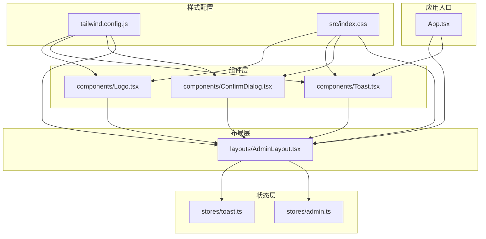
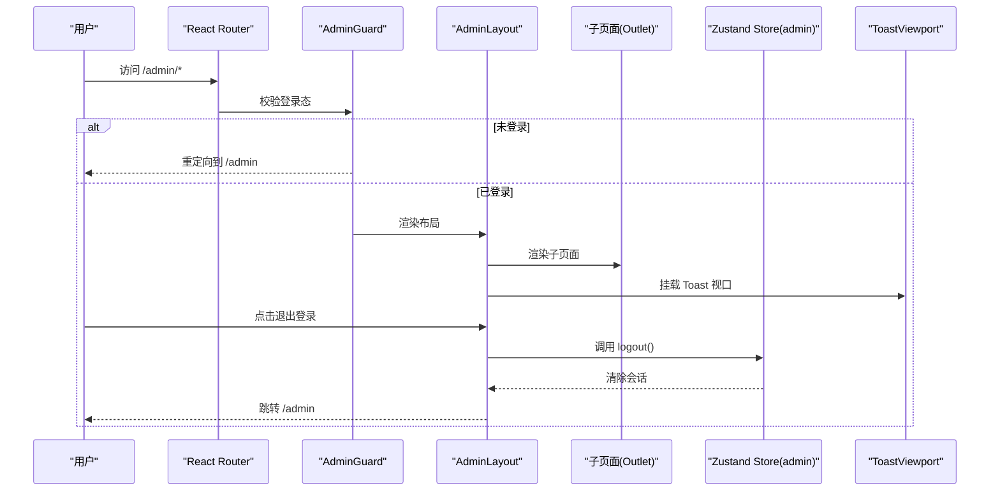
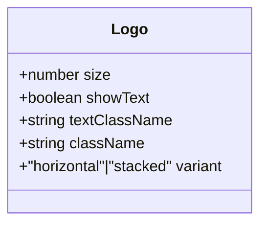
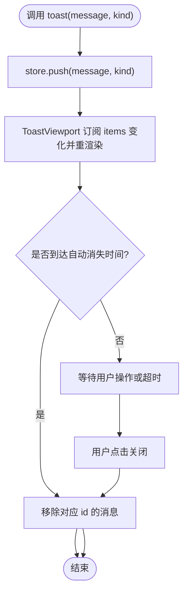
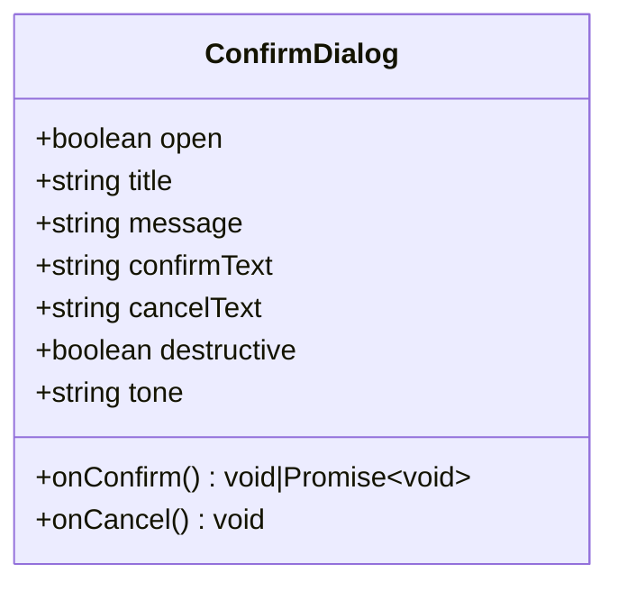
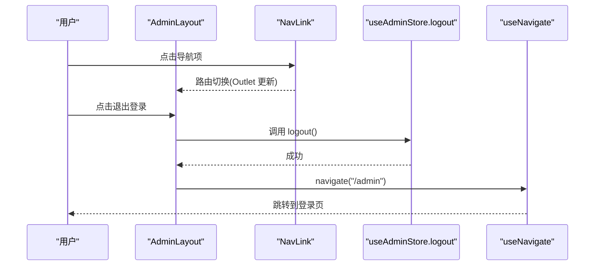
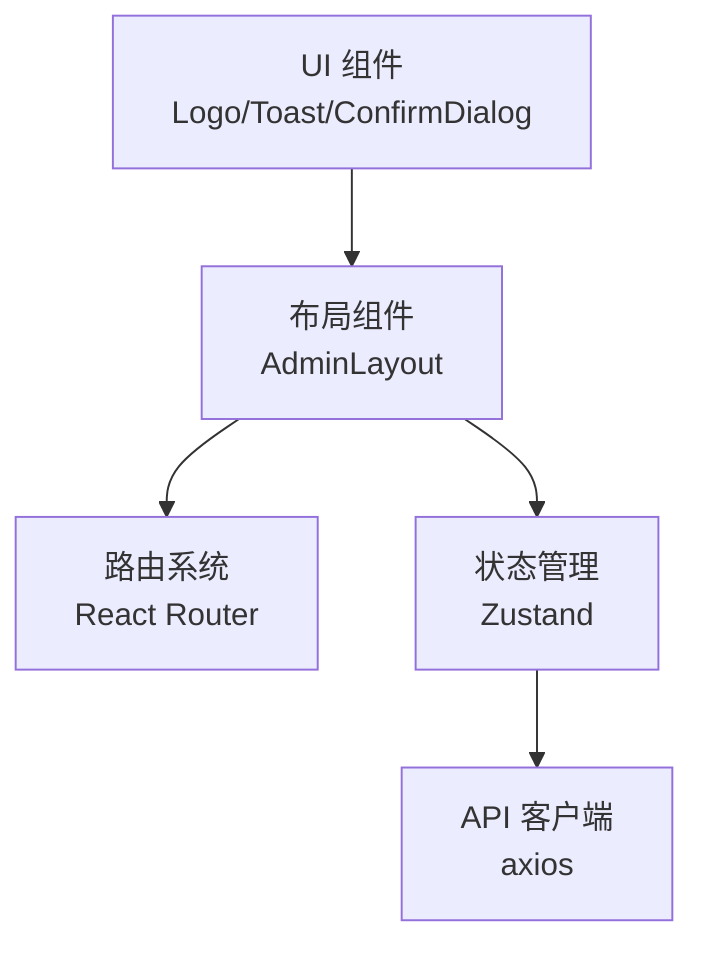
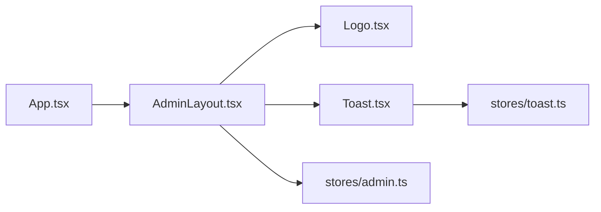

# 组件开发规范

<cite>
**本文引用的文件**
- [frontend/src/components/Logo.tsx](file://frontend/src/components/Logo.tsx)
- [frontend/src/components/Toast.tsx](file://frontend/src/components/Toast.tsx)
- [frontend/src/components/ConfirmDialog.tsx](file://frontend/src/components/ConfirmDialog.tsx)
- [frontend/src/layouts/AdminLayout.tsx](file://frontend/src/layouts/AdminLayout.tsx)
- [frontend/src/stores/toast.ts](file://frontend/src/stores/toast.ts)
- [frontend/src/stores/admin.ts](file://frontend/src/stores/admin.ts)
- [frontend/src/App.tsx](file://frontend/src/App.tsx)
- [frontend/tailwind.config.js](file://frontend/tailwind.config.js)
- [frontend/src/index.css](file://frontend/src/index.css)
- [frontend/package.json](file://frontend/package.json)
- [frontend/e2e/front-home.spec.ts](file://frontend/e2e/front-home.spec.ts)
- [frontend/e2e/admin-auth.spec.ts](file://frontend/e2e/admin-auth.spec.ts)
</cite>

## 目录
1. [引言](#引言)
2. [项目结构](#项目结构)
3. [核心组件](#核心组件)
4. [架构总览](#架构总览)
5. [详细组件分析](#详细组件分析)
6. [依赖分析](#依赖分析)
7. [性能考虑](#性能考虑)
8. [故障排查指南](#故障排查指南)
9. [结论](#结论)
10. [附录](#附录)

## 引言
本规范面向 Learning Hub 前端组件开发，聚焦通用组件与布局组件的设计原则、实现模式与最佳实践。文档覆盖以下要点：
- 通用组件：Logo、Toast 通知、确认对话框的 Props 接口、事件处理与状态管理
- 布局组件：AdminLayout 管理后台布局的实现模式
- 命名约定、文件组织与目录结构
- 样式策略：TailwindCSS 使用模式与自定义扩展
- 可访问性与响应式适配
- 测试编写指南与示例（端到端）

## 项目结构
前端采用按“功能域 + 职责”划分的目录组织方式：
- components：通用 UI 组件（Logo、Toast、ConfirmDialog）
- layouts：页面级布局容器（AdminLayout）
- stores：基于 Zustand 的全局状态（toast、admin、token、view）
- pages：前台与后台页面
- api：HTTP 客户端封装
- lib：第三方库桥接（如 PDF.js）
- e2e：Playwright 端到端测试

图表来源
- [frontend/src/components/Logo.tsx:1-76](file://frontend/src/components/Logo.tsx#L1-L76)
- [frontend/src/components/Toast.tsx:1-38](file://frontend/src/components/Toast.tsx#L1-L38)
- [frontend/src/components/ConfirmDialog.tsx:1-92](file://frontend/src/components/ConfirmDialog.tsx#L1-L92)
- [frontend/src/layouts/AdminLayout.tsx:1-61](file://frontend/src/layouts/AdminLayout.tsx#L1-L61)
- [frontend/src/stores/toast.ts:1-30](file://frontend/src/stores/toast.ts#L1-L30)
- [frontend/src/stores/admin.ts:1-71](file://frontend/src/stores/admin.ts#L1-L71)
- [frontend/src/App.tsx:1-110](file://frontend/src/App.tsx#L1-L110)
- [frontend/tailwind.config.js:1-21](file://frontend/tailwind.config.js#L1-L21)
- [frontend/src/index.css:1-25](file://frontend/src/index.css#L1-L25)

章节来源
- [frontend/src/App.tsx:1-110](file://frontend/src/App.tsx#L1-L110)
- [frontend/tailwind.config.js:1-21](file://frontend/tailwind.config.js#L1-L21)
- [frontend/src/index.css:1-25](file://frontend/src/index.css#L1-L25)

## 核心组件
本节定义通用组件的 Props 接口设计、事件处理与状态管理最佳实践，并给出使用建议。

### Logo 品牌标识
- 职责：展示品牌图标与可选文字，支持尺寸、文本显隐、变体与样式覆盖
- Props 设计要点
  - size：控制图标与字号比例
  - showText：是否显示文字
  - textClassName：文字 Tailwind 类名
  - className：根节点额外类名
  - variant：horizontal | stacked 布局变体
- 可访问性：SVG 设置 role="img" 与 aria-label；对外提供 data-testid 便于测试
- 样式策略：通过 Tailwind 类名与内联 style 组合，保持主题色一致
- 使用建议：在 Header、登录页、Favicon 等场景复用

章节来源
- [frontend/src/components/Logo.tsx:1-76](file://frontend/src/components/Logo.tsx#L1-L76)

### Toast 通知
- 职责：全局消息提示，支持 info/success/error 三种类型
- 状态管理：基于 Zustand store（toast.ts），提供 push/dismiss 方法
- 渲染：ToastViewport 订阅 store 列表，固定定位右上角堆叠显示
- 交互：点击关闭按钮触发 dismiss；自动定时消失
- 可访问性：关闭按钮提供 aria-label；data-testid 用于 E2E 断言
- 使用建议：业务侧调用 toast(message, kind) 或 store.push(...)

章节来源
- [frontend/src/components/Toast.tsx:1-38](file://frontend/src/components/Toast.tsx#L1-L38)
- [frontend/src/stores/toast.ts:1-30](file://frontend/src/stores/toast.ts#L1-L30)

### ConfirmDialog 确认对话框
- 职责：二次确认弹窗，支持主色调、警告、危险风格
- Props 设计要点
  - open：控制显隐
  - title/message：标题与正文
  - confirmText/cancelText：按钮文案
  - destructive/tone：语义色（danger/warning/primary）
  - onConfirm/onCancel：回调（onConfirm 支持异步 Promise）
- 可访问性：role="dialog"、aria-modal="true"；打开时自动聚焦确认按钮
- 交互：点击遮罩取消；阻止冒泡避免误触
- 使用建议：在删除、重置等高风险操作前弹出

章节来源
- [frontend/src/components/ConfirmDialog.tsx:1-92](file://frontend/src/components/ConfirmDialog.tsx#L1-L92)

## 架构总览
整体架构遵循“组件 -> 布局 -> 路由 -> 状态”的分层模式：
- App 作为 SPA 入口，注册前台与后台路由，并在后台路由下包裹 AdminGuard 与 AdminLayout
- AdminLayout 负责顶部导航、退出登录、内容区与全局 Toast 挂载
- 组件通过 Zustand store 进行跨组件通信（如 Toast）
- 样式由 Tailwind 统一管理与扩展

图表来源
- [frontend/src/App.tsx:60-110](file://frontend/src/App.tsx#L60-L110)
- [frontend/src/layouts/AdminLayout.tsx:14-61](file://frontend/src/layouts/AdminLayout.tsx#L14-L61)
- [frontend/src/stores/admin.ts:34-71](file://frontend/src/stores/admin.ts#L34-L71)
- [frontend/src/components/Toast.tsx:9-37](file://frontend/src/components/Toast.tsx#L9-L37)

## 详细组件分析

### 组件 A：Logo 品牌标识
- 设计模式：无状态函数组件，通过 props 驱动外观与行为
- 复杂度：O(1)，仅计算尺寸与布局参数
- 依赖链：不依赖外部状态，纯展示
- 优化点：可通过 memo 缓存避免父组件重渲染时的重复计算（当前规模较小，非必需）
- 错误处理：无需异常分支
- 性能影响：极小

图表来源
- [frontend/src/components/Logo.tsx:3-14](file://frontend/src/components/Logo.tsx#L3-L14)

章节来源
- [frontend/src/components/Logo.tsx:1-76](file://frontend/src/components/Logo.tsx#L1-L76)

### 组件 B：Toast 通知
- 设计模式：视图与状态分离，ToastViewport 只负责渲染，逻辑集中在 store
- 复杂度：push/dismiss O(n)（n 为当前 toast 数量），默认 n 很小
- 依赖链：ToastViewport -> useToastStore -> items/dismiss
- 优化点：可引入去抖/合并同类消息策略；对大量消息做虚拟滚动
- 错误处理：store 内部使用 setTimeout 清理，避免内存泄漏
- 性能影响：低；注意频繁 push 导致的重渲染

图表来源
- [frontend/src/stores/toast.ts:15-25](file://frontend/src/stores/toast.ts#L15-L25)
- [frontend/src/components/Toast.tsx:9-37](file://frontend/src/components/Toast.tsx#L9-L37)

章节来源
- [frontend/src/components/Toast.tsx:1-38](file://frontend/src/components/Toast.tsx#L1-L38)
- [frontend/src/stores/toast.ts:1-30](file://frontend/src/stores/toast.ts#L1-L30)

### 组件 C：ConfirmDialog 确认对话框
- 设计模式：受控组件，open 由父组件控制；tone/destructive 决定视觉语义
- 复杂度：O(1)
- 依赖链：无外部状态依赖
- 优化点：可结合 Portal 提升 z-index 隔离；键盘 ESC 关闭增强体验
- 错误处理：onConfirm 返回 Promise 时，建议在父组件中处理 loading 与错误反馈
- 性能影响：极低

图表来源
- [frontend/src/components/ConfirmDialog.tsx:5-17](file://frontend/src/components/ConfirmDialog.tsx#L5-L17)

章节来源
- [frontend/src/components/ConfirmDialog.tsx:1-92](file://frontend/src/components/ConfirmDialog.tsx#L1-L92)

### 布局组件：AdminLayout 管理后台布局
- 职责：顶部导航、Logo、退出登录、内容区 Outlet、全局 Toast 视口
- 状态集成：从 admin store 读取 session 并调用 logout；配合 App 中的 AdminGuard 完成鉴权
- 路由集成：使用 NavLink 高亮当前项；Outlet 渲染子页面
- 可访问性：导航链接具备语义化标签；退出按钮提供清晰文案
- 响应式：使用 Flex 布局与基础间距，适配不同屏幕宽度

图表来源
- [frontend/src/layouts/AdminLayout.tsx:14-61](file://frontend/src/layouts/AdminLayout.tsx#L14-L61)
- [frontend/src/stores/admin.ts:60-71](file://frontend/src/stores/admin.ts#L60-L71)
- [frontend/src/App.tsx:80-104](file://frontend/src/App.tsx#L80-L104)

章节来源
- [frontend/src/layouts/AdminLayout.tsx:1-61](file://frontend/src/layouts/AdminLayout.tsx#L1-L61)
- [frontend/src/stores/admin.ts:1-71](file://frontend/src/stores/admin.ts#L1-L71)
- [frontend/src/App.tsx:60-110](file://frontend/src/App.tsx#L60-L110)

### 概念总览
下图为概念性工作流，不直接映射具体源码文件，用于帮助理解组件协作关系。

[此图为概念示意，无需图表来源]

## 依赖分析
- 组件耦合
  - AdminLayout 依赖 Logo、ToastViewport、admin store 与 react-router-dom
  - ToastViewport 依赖 toast store
  - ConfirmDialog 无外部状态依赖
- 外部依赖
  - React、react-router-dom、zustand、tailwindcss、autoprefixer
- 潜在循环依赖
  - 当前未发现循环引用；组件单向依赖 store 与路由

图表来源
- [frontend/src/App.tsx:60-110](file://frontend/src/App.tsx#L60-L110)
- [frontend/src/layouts/AdminLayout.tsx:1-61](file://frontend/src/layouts/AdminLayout.tsx#L1-L61)
- [frontend/src/components/Logo.tsx:1-76](file://frontend/src/components/Logo.tsx#L1-L76)
- [frontend/src/components/Toast.tsx:1-38](file://frontend/src/components/Toast.tsx#L1-L38)
- [frontend/src/stores/admin.ts:1-71](file://frontend/src/stores/admin.ts#L1-L71)
- [frontend/src/stores/toast.ts:1-30](file://frontend/src/stores/toast.ts#L1-L30)

章节来源
- [frontend/package.json:1-40](file://frontend/package.json#L1-L40)

## 性能考虑
- 组件粒度：通用组件保持轻量，避免在组件内进行昂贵计算
- 状态更新：Toast 自动消失使用定时器，注意批量更新与去重
- 渲染优化：必要时对高频更新的组件使用 memo 或拆分更细粒度的组件
- 样式构建：Tailwind 按需生成，确保 content 路径正确，减少产物体积
- 首屏加载：合理拆分路由与懒加载页面，减少初始包体

[本节为通用指导，无需章节来源]

## 故障排查指南
- Toast 不显示
  - 检查是否在应用树中挂载了 ToastViewport
  - 确认 store.push 被调用且 items 有数据
- 确认对话框无法关闭
  - 检查 open 状态是否正确由父组件控制
  - 确认 onCancel 回调未被拦截
- 退出登录后仍停留在后台页面
  - 检查 AdminGuard 与路由守卫是否生效
  - 确认 logout 后 navigate 到登录页
- 样式未生效
  - 检查 tailwind.config.js 的 content 路径
  - 确认 index.css 引入了 @tailwind 指令

章节来源
- [frontend/src/components/Toast.tsx:9-37](file://frontend/src/components/Toast.tsx#L9-L37)
- [frontend/src/stores/toast.ts:15-25](file://frontend/src/stores/toast.ts#L15-L25)
- [frontend/src/components/ConfirmDialog.tsx:45-51](file://frontend/src/components/ConfirmDialog.tsx#L45-L51)
- [frontend/src/layouts/AdminLayout.tsx:18-22](file://frontend/src/layouts/AdminLayout.tsx#L18-L22)
- [frontend/src/App.tsx:80-104](file://frontend/src/App.tsx#L80-L104)
- [frontend/tailwind.config.js:1-21](file://frontend/tailwind.config.js#L1-L21)
- [frontend/src/index.css:1-25](file://frontend/src/index.css#L1-L25)

## 结论
本规范明确了 Learning Hub 前端通用组件与布局组件的设计原则与实现模式，强调：
- 清晰的 Props 接口与受控模式
- 基于 Zustand 的状态解耦
- Tailwind 主题与样式的统一管理
- 可访问性与响应式适配
- 以 E2E 为主的测试策略与断言约定

遵循上述规范有助于提升代码一致性、可维护性与用户体验。

[本节为总结，无需章节来源]

## 附录

### 命名约定与文件组织
- 组件命名：PascalCase，文件名与导出名一致（如 Logo.tsx 导出 Logo）
- 布局命名：以 Layout 结尾（如 AdminLayout.tsx）
- 状态模块：以 store 后缀命名（如 toast.ts、admin.ts）
- 目录结构：按功能域划分，组件、布局、页面、状态分层清晰

[本节为通用约定，无需章节来源]

### 样式策略与 Tailwind 使用
- 主题色：在 tailwind.config.js 中扩展 primary 色系
- 字体：在 theme.extend.fontFamily 中配置中文字体栈
- 全局变量：在 index.css 中定义 CSS 变量与基础样式
- 自定义类：尽量使用 Tailwind 原子类，必要时在 index.css 中补充少量全局样式

章节来源
- [frontend/tailwind.config.js:1-21](file://frontend/tailwind.config.js#L1-L21)
- [frontend/src/index.css:1-25](file://frontend/src/index.css#L1-L25)

### 可访问性与响应式适配
- 可访问性
  - 图标提供 role 与 aria-label
  - 对话框使用 role="dialog" 与 aria-modal
  - 关闭按钮提供 aria-label
- 响应式
  - 使用 Flex 布局与相对单位
  - 通过 Tailwind 断点与间距控制在不同屏幕下的表现

章节来源
- [frontend/src/components/Logo.tsx:44-51](file://frontend/src/components/Logo.tsx#L44-L51)
- [frontend/src/components/ConfirmDialog.tsx:54-64](file://frontend/src/components/ConfirmDialog.tsx#L54-L64)
- [frontend/src/components/Toast.tsx:12-35](file://frontend/src/components/Toast.tsx#L12-L35)

### 组件测试编写指南与示例
- 选择器约定：优先使用 data-testid 进行稳定定位
- 端到端测试：使用 Playwright，覆盖关键用户流程
- 示例参考
  - 首页搜索与空态：参见 frontend/e2e/front-home.spec.ts
  - 后台登录与权限：参见 frontend/e2e/admin-auth.spec.ts

章节来源
- [frontend/e2e/front-home.spec.ts:1-46](file://frontend/e2e/front-home.spec.ts#L1-L46)
- [frontend/e2e/admin-auth.spec.ts:1-60](file://frontend/e2e/admin-auth.spec.ts#L1-L60)