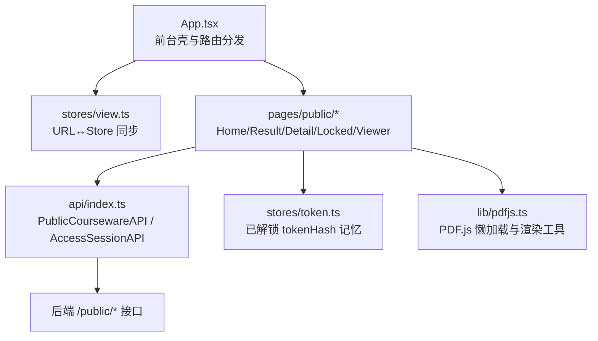
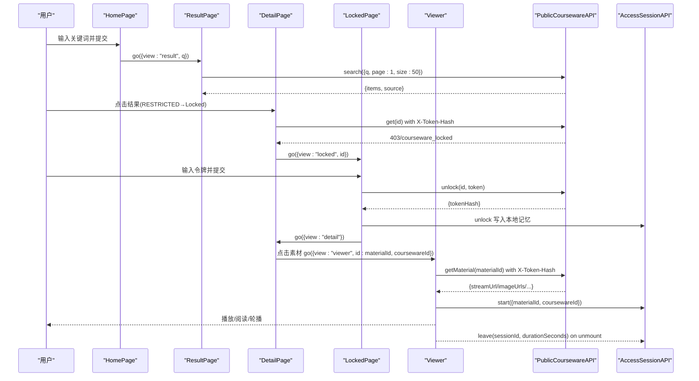
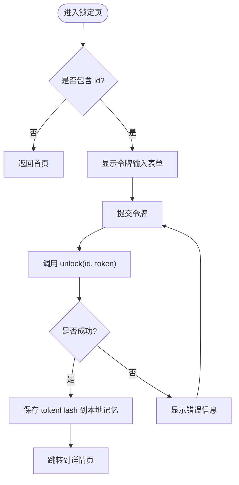
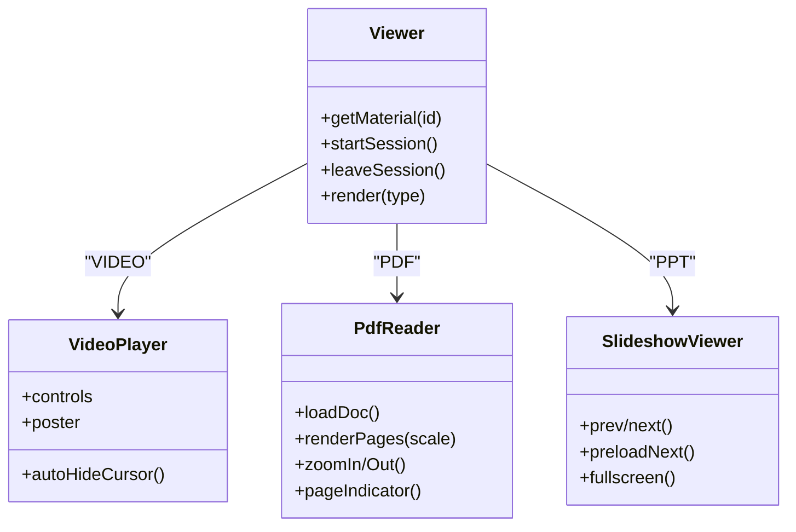
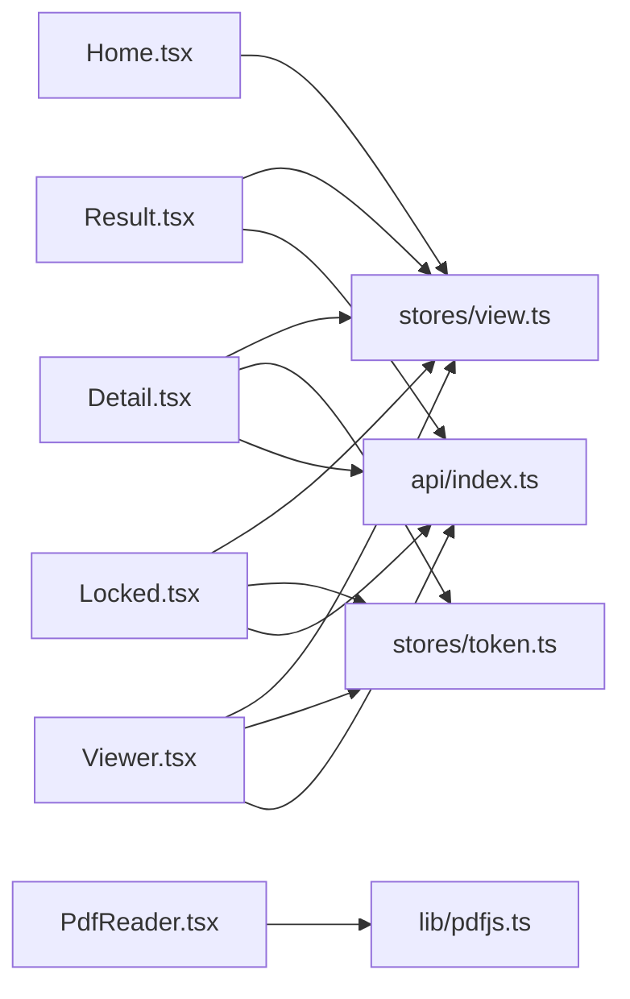

# 前台页面开发

<cite>
**本文引用的文件列表**
- [App.tsx](file://frontend/src/App.tsx)
- [Home.tsx](file://frontend/src/pages/public/Home.tsx)
- [Result.tsx](file://frontend/src/pages/public/Result.tsx)
- [Detail.tsx](file://frontend/src/pages/public/Detail.tsx)
- [Locked.tsx](file://frontend/src/pages/public/Locked.tsx)
- [Viewer.tsx](file://frontend/src/pages/public/Viewer.tsx)
- [VideoPlayer.tsx](file://frontend/src/pages/public/viewer/VideoPlayer.tsx)
- [PdfReader.tsx](file://frontend/src/pages/public/viewer/PdfReader.tsx)
- [SlideshowViewer.tsx](file://frontend/src/pages/public/viewer/SlideshowViewer.tsx)
- [view.ts](file://frontend/src/stores/view.ts)
- [token.ts](file://frontend/src/stores/token.ts)
- [api/index.ts](file://frontend/src/api/index.ts)
- [pdfjs.ts](file://frontend/src/lib/pdfjs.ts)
</cite>

## 目录
1. [简介](#简介)
2. [项目结构](#项目结构)
3. [核心组件](#核心组件)
4. [架构总览](#架构总览)
5. [详细组件分析](#详细组件分析)
6. [依赖关系分析](#依赖关系分析)
7. [性能与体验优化](#性能与体验优化)
8. [故障排查指南](#故障排查指南)
9. [结论](#结论)

## 简介
本指南面向 Learning Hub 前台页面的前端开发者，聚焦以下目标：
- 首页搜索界面：搜索框交互、表单处理与路由跳转逻辑
- 课件详情页：数据获取、权限验证与展示逻辑
- 在线播放器：视频播放、PDF 阅读、PPT 轮播的实现要点
- 搜索结果页：数据渲染与分页策略说明
- 锁定页：访问控制机制与用户引导流程
- 状态管理、错误处理与用户体验最佳实践
- 响应式设计与移动端适配技巧

## 项目结构
前台采用单 URL 多视图模式：所有前台页面共享根路径，通过查询参数 view 切换。状态由 Zustand store 维护并与 URL 双向同步；API 调用统一封装在 api/index.ts 中，并自动注入解锁令牌头。

图表来源
- [App.tsx:40-58](file://frontend/src/App.tsx#L40-L58)
- [view.ts:58-97](file://frontend/src/stores/view.ts#L58-L97)
- [api/index.ts:404-440](file://frontend/src/api/index.ts#L404-L440)

章节来源
- [App.tsx:1-110](file://frontend/src/App.tsx#L1-L110)
- [view.ts:1-127](file://frontend/src/stores/view.ts#L1-L127)

## 核心组件
- 视图状态管理（stores/view.ts）
  - 维护 view、q、id、coursewareId 四个字段，提供 go() 方法同步更新 Store 与 URL。
  - 支持初始化 hydrateViewFromUrl 与 popstate 监听 bindViewToPopState，保证前进后退一致。
  - 当跳转到 home 时显式清空 q/id/cw，避免启发式推断导致误跳 viewer。
- 令牌记忆（stores/token.ts）
  - 以 coursewareId -> tokenHash 的映射持久化到 localStorage，刷新后恢复。
  - unlock 写入后立即生效，供 API 层读取为 X-Token-Hash 请求头。
- API 封装（api/index.ts）
  - PublicCoursewareAPI.search/get/unlock/getMaterial 等公开接口。
  - AccessSessionAPI.start/leave 用于 P-VIEWER 访问会话埋点，leave 优先 sendBeacon，失败回退 fetch keepalive。
  - 自动从 useTokenStore 取对应课件的 tokenHash 注入 X-Token-Hash 头，避免 Set-Cookie 时序问题。
- PDF 工具（lib/pdfjs.ts）
  - 懒加载 pdfjs-dist，统一 worker 路径，提供 renderPageToCanvas 高 DPI 渲染辅助。

章节来源
- [view.ts:58-97](file://frontend/src/stores/view.ts#L58-L97)
- [token.ts:38-48](file://frontend/src/stores/token.ts#L38-L48)
- [api/index.ts:156-216](file://frontend/src/api/index.ts#L156-L216)
- [api/index.ts:404-440](file://frontend/src/api/index.ts#L404-L440)
- [pdfjs.ts:18-30](file://frontend/src/lib/pdfjs.ts#L18-L30)

## 架构总览
前台 SPA 入口 App.tsx 根据 stores/view.ts 的 view 值渲染对应页面。各页面通过 PublicCoursewareAPI 与后端交互，遇到受限课件时进入 Locked 页输入令牌解锁，成功后继续访问 Detail 或 Viewer。

图表来源
- [Home.tsx:17-23](file://frontend/src/pages/public/Home.tsx#L17-L23)
- [Result.tsx:24-42](file://frontend/src/pages/public/Result.tsx#L24-L42)
- [Detail.tsx:25-55](file://frontend/src/pages/public/Detail.tsx#L25-L55)
- [Locked.tsx:29-44](file://frontend/src/pages/public/Locked.tsx#L29-L44)
- [Viewer.tsx:57-106](file://frontend/src/pages/public/Viewer.tsx#L57-L106)
- [api/index.ts:404-440](file://frontend/src/api/index.ts#L404-L440)
- [api/index.ts:156-216](file://frontend/src/api/index.ts#L156-L216)

## 详细组件分析

### 首页搜索界面（Home.tsx）
- 交互与表单
  - 使用受控 input 绑定 q，提交时 trim 非空校验。
  - 阻止默认提交行为，构造 URL 并跳转。
- 路由跳转
  - 通过 router(`/?view=result&q=...`) 同步 URL。
  - 同时调用 go({ view: "result", q }) 更新 Store，确保后续页面能读到 q。
- 可访问性与测试
  - 提供 data-testid 便于自动化测试定位。

章节来源
- [Home.tsx:17-23](file://frontend/src/pages/public/Home.tsx#L17-L23)
- [Home.tsx:32-51](file://frontend/src/pages/public/Home.tsx#L32-L51)

### 搜索结果页（Result.tsx）
- 数据获取
  - 从 stores/view.ts 读取 q，调用 PublicCoursewareAPI.search({ q, page:1, size:50 })。
  - 返回 items 与 source（llm 或 keyword），用于 UI 标注“AI 智能搜索”与降级提示。
- 渲染与导航
  - 列表项点击时根据 accessMode 决定跳转 detail 或 locked。
  - 无结果时给出友好提示。
- 分页说明
  - 当前实现固定 size=50，未提供翻页控件；如需分页，可在 API 层扩展并增加 UI 分页器。

章节来源
- [Result.tsx:24-42](file://frontend/src/pages/public/Result.tsx#L24-L42)
- [Result.tsx:96-145](file://frontend/src/pages/public/Result.tsx#L96-L145)
- [api/index.ts:404-415](file://frontend/src/api/index.ts#L404-L415)

### 课件详情页（Detail.tsx）
- 数据获取
  - 从 stores/view.ts 读取 id，调用 PublicCoursewareAPI.get(id)。
  - 若返回 403 或 code=courseware_locked，则跳转 Locked 页并携带 id。
- 展示逻辑
  - 显示标题、作者、标签、简介、素材列表。
  - v1.5+ 按 sortOrder 升序展示素材，多于 1 个素材时提示“由管理员设定的学习顺序”。
- 跳转逻辑
  - 点击“在线浏览”跳转到 Viewer，携带 materialId 与 coursewareId。

章节来源
- [Detail.tsx:25-55](file://frontend/src/pages/public/Detail.tsx#L25-L55)
- [Detail.tsx:136-182](file://frontend/src/pages/public/Detail.tsx#L136-L182)
- [api/index.ts:416-421](file://frontend/src/api/index.ts#L416-L421)

### 锁定页（Locked.tsx）
- 访问控制机制
  - 接收 ?id 与可选 ?q，用于定位课件与返回搜索上下文。
  - 提交明文 token 调用 unlock，成功后将 tokenHash 写入本地记忆。
- 用户引导流程
  - 成功解锁后跳转 Detail；失败显示错误信息；提供返回搜索与返回首页按钮。

图表来源
- [Locked.tsx:29-44](file://frontend/src/pages/public/Locked.tsx#L29-L44)
- [token.ts:40-45](file://frontend/src/stores/token.ts#L40-L45)
- [api/index.ts:422-428](file://frontend/src/api/index.ts#L422-L428)

章节来源
- [Locked.tsx:29-44](file://frontend/src/pages/public/Locked.tsx#L29-L44)
- [token.ts:38-48](file://frontend/src/stores/token.ts#L38-L48)
- [api/index.ts:422-428](file://frontend/src/api/index.ts#L422-L428)

### 在线播放器（Viewer.tsx 与子组件）
- 总体流程
  - 根据 materialId 调用 PublicCoursewareAPI.getMaterial 获取素材元信息与预览资源。
  - 素材加载成功后调用 AccessSessionAPI.start 记录访问会话；组件卸载时调用 leave 上报停留时长。
  - 屏蔽 downloadUrl 透传，防止子组件泄露下载入口。
- 视频播放（VideoPlayer.tsx）
  - 使用 HTML5 video 原生 controls，禁用右键菜单与 Picture-in-Picture。
  - 首帧可见前显示占位，避免黑屏闪烁；播放时自动隐藏光标提升沉浸感。
- PDF 阅读（PdfReader.tsx）
  - 懒加载 pdfjs-dist，worker 路径生产/开发区分。
  - 全量渲染每页到 canvas，支持缩放、双击放大、滚动驱动页码指示。
  - 错误分类：密码保护、未授权、网络失败等，给出明确提示。
- PPT 轮播（SlideshowViewer.tsx）
  - 基于后端预生成的 PNG 图片序列，逐页加载，后台预加载下一页，切换时无闪烁。
  - 支持键盘左右键、全屏、拖拽与右键禁用。

图表来源
- [Viewer.tsx:57-106](file://frontend/src/pages/public/Viewer.tsx#L57-L106)
- [VideoPlayer.tsx:118-246](file://frontend/src/pages/public/viewer/VideoPlayer.tsx#L118-L246)
- [PdfReader.tsx:37-82](file://frontend/src/pages/public/viewer/PdfReader.tsx#L37-L82)
- [SlideshowViewer.tsx:70-88](file://frontend/src/pages/public/viewer/SlideshowViewer.tsx#L70-L88)

章节来源
- [Viewer.tsx:57-106](file://frontend/src/pages/public/Viewer.tsx#L57-L106)
- [VideoPlayer.tsx:118-246](file://frontend/src/pages/public/viewer/VideoPlayer.tsx#L118-L246)
- [PdfReader.tsx:37-82](file://frontend/src/pages/public/viewer/PdfReader.tsx#L37-L82)
- [SlideshowViewer.tsx:70-88](file://frontend/src/pages/public/viewer/SlideshowViewer.tsx#L70-L88)
- [api/index.ts:430-439](file://frontend/src/api/index.ts#L430-L439)
- [api/index.ts:156-216](file://frontend/src/api/index.ts#L156-L216)

## 依赖关系分析
- 页面与 Store
  - 所有前台页面依赖 stores/view.ts 进行路由与参数传递。
  - Locked/Detail/Viewer 依赖 stores/token.ts 管理已解锁课件的 tokenHash。
- 页面与 API
  - Home/Result/Detail/Locked/Viewer 均通过 api/index.ts 中的 PublicCoursewareAPI 与后端通信。
  - Viewer 额外使用 AccessSessionAPI 进行访问会话埋点。
- 第三方库
  - PdfReader 依赖 lib/pdfjs.ts 提供的 pdfjs-dist 懒加载与渲染工具。

图表来源
- [App.tsx:40-58](file://frontend/src/App.tsx#L40-L58)
- [view.ts:58-97](file://frontend/src/stores/view.ts#L58-L97)
- [token.ts:38-48](file://frontend/src/stores/token.ts#L38-L48)
- [api/index.ts:404-440](file://frontend/src/api/index.ts#L404-L440)
- [pdfjs.ts:18-30](file://frontend/src/lib/pdfjs.ts#L18-L30)

章节来源
- [App.tsx:40-58](file://frontend/src/App.tsx#L40-L58)
- [view.ts:58-97](file://frontend/src/stores/view.ts#L58-L97)
- [token.ts:38-48](file://frontend/src/stores/token.ts#L38-L48)
- [api/index.ts:404-440](file://frontend/src/api/index.ts#L404-L440)
- [pdfjs.ts:18-30](file://frontend/src/lib/pdfjs.ts#L18-L30)

## 性能与体验优化
- 首屏与加载体验
  - 视频占位最小展示时长，避免首帧过快触发导致的闪烁。
  - PDF 全量渲染但单页失败不阻塞整体；IntersectionObserver 驱动页码更新。
  - PPT 后台预加载下一页，切换时一次性替换，避免中间态闪烁。
- 内存与资源
  - PDF.js 懒加载，按需配置 workerSrc；渲染前清理 canvas 上下文。
  - PPT 仅加载当前页与下一页，减少内存占用。
- 网络与可靠性
  - AccessSession.leave 优先 sendBeacon，失败回退 fetch keepalive，确保离开上报成功率。
  - 错误分类与提示：如 PDF 密码保护、未授权、网络失败等，便于用户理解与重试。
- 响应式与移动端
  - 使用 Tailwind 栅格与断点，视频区在移动端自适应高度；PDF 允许横向滚动查看完整内容。
  - 禁止右键、拖拽与下载入口，提升移动端防误触与版权保护。

[本节为通用指导，无需特定文件引用]

## 故障排查指南
- 解锁需输入两次的问题
  - 现象：输入令牌后仍跳回锁定页，需要再次输入。
  - 原因：Set-Cookie 写入时机与后续 GET 请求存在窗口期，导致后端读不到 lh_token_hash。
  - 解决：API 层直接从 useTokenStore 读取 tokenHash 作为 X-Token-Hash 头，避免依赖 Cookie 时序。
- PDF 加载失败
  - 检查 worker 路径是否正确（生产/开发不同）。
  - 关注错误类型：PasswordException、401/403 未授权、网络错误等。
- 视频无法播放
  - 检查 streamUrl 是否有效、浏览器是否支持相应编码。
  - 确认禁用了右键与 Picture-in-Picture，避免被拦截。
- PPT 无预览图
  - 检查 imageUrls 是否为空，若为空表示尚未生成预览，提示稍后重试。

章节来源
- [api/index.ts:18-23](file://frontend/src/api/index.ts#L18-L23)
- [PdfReader.tsx:49-68](file://frontend/src/pages/public/viewer/PdfReader.tsx#L49-L68)
- [VideoPlayer.tsx:202-215](file://frontend/src/pages/public/viewer/VideoPlayer.tsx#L202-L215)
- [SlideshowViewer.tsx:102-147](file://frontend/src/pages/public/viewer/SlideshowViewer.tsx#L102-L147)

## 结论
Learning Hub 前台采用单 URL 多视图架构，结合 Zustand 状态管理与 URL 同步，实现了简洁而健壮的前端路由与状态流转。通过统一的 API 封装与令牌头注入，解决了解锁时序问题；在播放器层面，针对不同媒体类型提供了良好的加载与交互体验，并通过访问会话埋点完善数据统计。建议在后续迭代中补充搜索结果的分页 UI，并持续优化移动端表现与错误提示的可操作性。