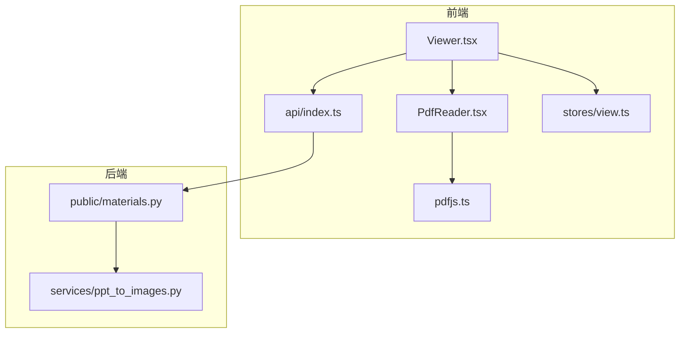
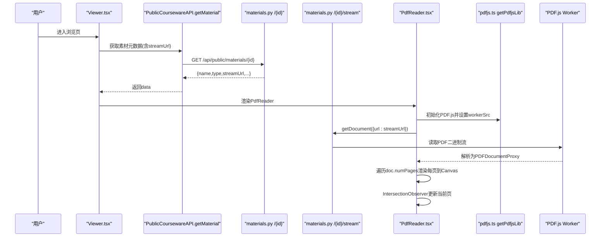
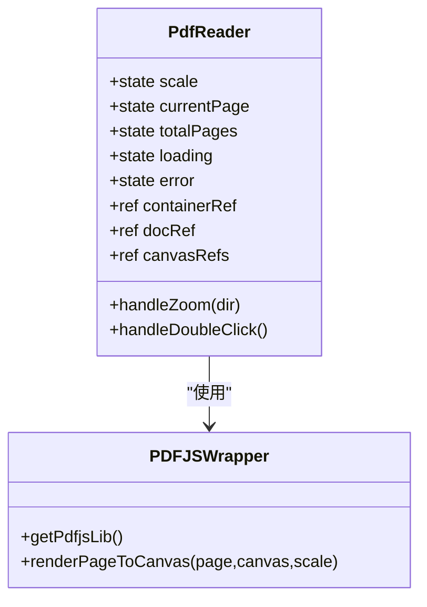
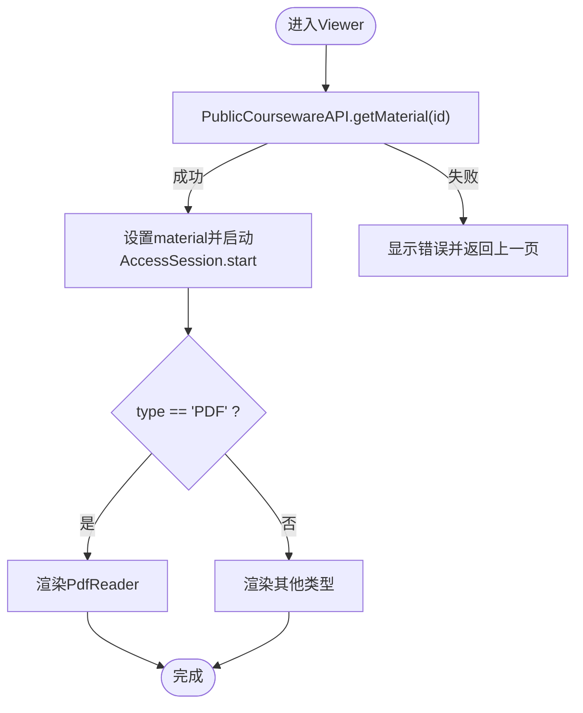
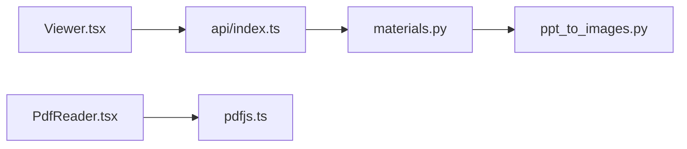
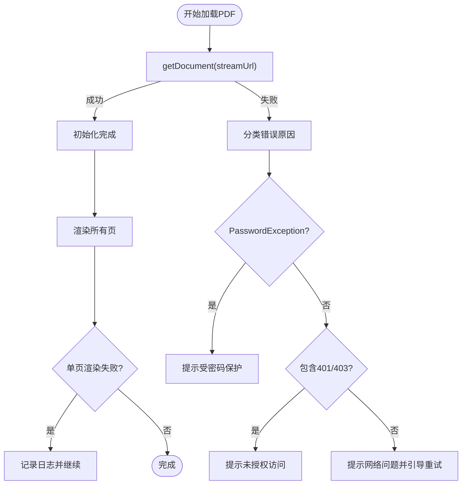
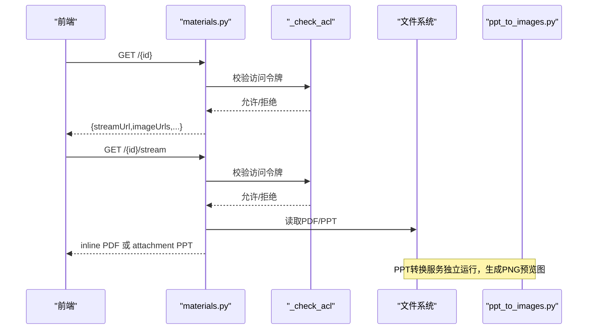

# PDF阅读器组件

<cite>
**本文引用的文件列表**
- [PdfReader.tsx](file://frontend/src/pages/public/viewer/PdfReader.tsx)
- [pdfjs.ts](file://frontend/src/lib/pdfjs.ts)
- [Viewer.tsx](file://frontend/src/pages/public/Viewer.tsx)
- [index.ts](file://frontend/src/api/index.ts)
- [materials.py](file://backend/app/api/public/materials.py)
- [ppt_to_images.py](file://backend/app/services/ppt_to_images.py)
- [view.ts](file://frontend/src/stores/view.ts)
- [front-viewer.spec.ts](file://frontend/e2e/front-viewer.spec.ts)
- [test_materials_stream.py](file://backend/tests/test_materials_stream.py)
- [test-stream.py](file://deploy/local/tests/test_stream.py)
</cite>

## 目录
1. [简介](#简介)
2. [项目结构](#项目结构)
3. [核心组件](#核心组件)
4. [架构总览](#架构总览)
5. [详细组件分析](#详细组件分析)
6. [依赖关系分析](#依赖关系分析)
7. [性能与内存优化](#性能与内存优化)
8. [错误处理与故障排查](#错误处理与故障排查)
9. [移动端与手势支持](#移动端与手势支持)
10. [水印保护与下载限制](#水印保护与下载限制)
11. [后端集成：预览图生成与访问控制](#后端集成预览图生成与访问控制)
12. [结论](#结论)

## 简介
本文件面向Learning Hub的PDF阅读器组件，聚焦基于PDF.js的前端渲染实现、页面加载与缩放、导航与可见性跟踪、大文档分页策略与内存优化、文本搜索与高亮（现状与扩展建议）、移动端触摸手势（现状与扩展建议）、水印与下载限制策略、性能优化方案、错误处理机制以及与后端的集成点（流式预览、访问令牌校验、PPT预览图生成等）。

## 项目结构
前端侧围绕“素材浏览页”和“PDF阅读子组件”组织；后端提供公共素材接口，负责权限校验与流式返回。关键路径如下：
- 前台路由与分发：Viewer 根据素材类型选择 PdfReader
- PDF渲染：PdfReader 使用 pdfjs 单例封装进行文档加载与逐页 Canvas 渲染
- 后端接口：/api/public/materials/{id}/stream 返回 inline PDF，/api/public/materials/{id} 返回元数据（含 streamUrl）

图表来源
- [Viewer.tsx:1-170](file://frontend/src/pages/public/Viewer.tsx#L1-L170)
- [PdfReader.tsx:1-270](file://frontend/src/pages/public/viewer/PdfReader.tsx#L1-L270)
- [pdfjs.ts:1-57](file://frontend/src/lib/pdfjs.ts#L1-L57)
- [index.ts:404-443](file://frontend/src/api/index.ts#L404-L443)
- [materials.py:84-146](file://backend/app/api/public/materials.py#L84-L146)
- [ppt_to_images.py:48-181](file://backend/app/services/ppt_to_images.py#L48-L181)

章节来源
- [Viewer.tsx:1-170](file://frontend/src/pages/public/Viewer.tsx#L1-L170)
- [PdfReader.tsx:1-270](file://frontend/src/pages/public/viewer/PdfReader.tsx#L1-L270)
- [pdfjs.ts:1-57](file://frontend/src/lib/pdfjs.ts#L1-L57)
- [index.ts:404-443](file://frontend/src/api/index.ts#L404-L443)
- [materials.py:84-146](file://backend/app/api/public/materials.py#L84-L146)
- [ppt_to_images.py:48-181](file://backend/app/services/ppt_to_images.py#L48-L181)

## 核心组件
- Viewer：按素材类型分发到视频、PDF、幻灯片三种阅读器；屏蔽 downloadUrl 透传；记录访问会话埋点。
- PdfReader：基于PDF.js的Word式连续滚动阅读体验，包含缩放工具栏、双击放大/还原、IntersectionObserver驱动的当前页指示器。
- pdfjs.ts：PDF.js单例封装，统一worker路径配置与高DPI渲染辅助函数。
- 后端 materials.py：公开素材查询与流式预览接口，含ACL校验与PPT图片预览能力。

章节来源
- [Viewer.tsx:1-170](file://frontend/src/pages/public/Viewer.tsx#L1-L170)
- [PdfReader.tsx:1-270](file://frontend/src/pages/public/viewer/PdfReader.tsx#L1-L270)
- [pdfjs.ts:1-57](file://frontend/src/lib/pdfjs.ts#L1-L57)
- [materials.py:84-146](file://backend/app/api/public/materials.py#L84-L146)

## 架构总览
从用户点击“浏览”到PDF在浏览器中渲染的关键调用链如下：

图表来源
- [Viewer.tsx:57-106](file://frontend/src/pages/public/Viewer.tsx#L57-L106)
- [index.ts:429-439](file://frontend/src/api/index.ts#L429-L439)
- [materials.py:183-221](file://backend/app/api/public/materials.py#L183-L221)
- [materials.py:84-146](file://backend/app/api/public/materials.py#L84-L146)
- [PdfReader.tsx:36-82](file://frontend/src/pages/public/viewer/PdfReader.tsx#L36-L82)
- [pdfjs.ts:18-30](file://frontend/src/lib/pdfjs.ts#L18-L30)

## 详细组件分析

### PdfReader 组件
- 功能要点
  - 顶部工具条：缩放 −/+、百分比显示、返回与首页按钮
  - 主体区域：居中、最大宽度、连续滚动布局
  - 右下角页码气泡：实时反映当前可见页
  - 双击页面：在较小与较大缩放之间切换
- 状态与生命周期
  - 加载阶段：通过 getPdfjsLib 初始化PDF.js，getDocument 拉取流式PDF，失败时区分密码保护、未授权、网络错误等
  - 渲染阶段：scale或totalPages变化时，遍历所有页调用 renderPageToCanvas 重绘
  - 可见性驱动：IntersectionObserver监听每个页面的可见比例，更新currentPage
  - 清理：组件卸载时销毁PDF文档实例，避免内存泄漏
- 交互细节
  - 缩放档位：预设档位数组，+/- 步进切换
  - 双击缩放：在阈值内递增，超过阈值回退至默认
  - 无障碍：页码气泡带 aria-live="polite"

图表来源
- [PdfReader.tsx:25-157](file://frontend/src/pages/public/viewer/PdfReader.tsx#L25-L157)
- [pdfjs.ts:18-55](file://frontend/src/lib/pdfjs.ts#L18-L55)

章节来源
- [PdfReader.tsx:1-270](file://frontend/src/pages/public/viewer/PdfReader.tsx#L1-L270)
- [pdfjs.ts:1-57](file://frontend/src/lib/pdfjs.ts#L1-L57)

### Viewer 分发与访问会话埋点
- 分发逻辑：根据 material.type 选择 VideoPlayer / PdfReader / SlideshowViewer
- 安全策略：显式剥离 downloadUrl，防止子组件误用导致下载入口泄露
- 访问会话：成功加载素材后调用 AccessSessionAPI.start；组件卸载时 best-effort 调用 leave（优先 sendBeacon，回退 fetch keepalive）

图表来源
- [Viewer.tsx:57-106](file://frontend/src/pages/public/Viewer.tsx#L57-L106)
- [Viewer.tsx:137-166](file://frontend/src/pages/public/Viewer.tsx#L137-L166)
- [index.ts:168-216](file://frontend/src/api/index.ts#L168-L216)

章节来源
- [Viewer.tsx:1-170](file://frontend/src/pages/public/Viewer.tsx#L1-L170)
- [index.ts:168-216](file://frontend/src/api/index.ts#L168-L216)

### PDF.js 单例与高DPI渲染
- worker路径：生产固定路径，开发动态URL；末尾带缓存破坏参数
- 渲染函数：根据 devicePixelRatio 计算viewport尺寸，确保高清显示；每次渲染前清空画布

章节来源
- [pdfjs.ts:1-57](file://frontend/src/lib/pdfjs.ts#L1-L57)

## 依赖关系分析
- 前端
  - Viewer 依赖 PublicCoursewareAPI 获取素材元数据
  - PdfReader 依赖 pdfjs.ts 提供的 getPdfjsLib 与 renderPageToCanvas
  - api/index.ts 中的 tokenHashHeaders 将已解锁的X-Token-Hash注入请求头
- 后端
  - materials.py 的 _check_acl 校验是否需令牌解锁；/stream 对PDF返回inline application/pdf；/image/{page_no}用于PPT预览图
  - ppt_to_images.py 负责PPT→PNG转换，供SlideshowViewer使用

图表来源
- [Viewer.tsx:57-106](file://frontend/src/pages/public/Viewer.tsx#L57-L106)
- [index.ts:404-443](file://frontend/src/api/index.ts#L404-L443)
- [materials.py:31-62](file://backend/app/api/public/materials.py#L31-L62)
- [ppt_to_images.py:48-181](file://backend/app/services/ppt_to_images.py#L48-L181)

章节来源
- [index.ts:404-443](file://frontend/src/api/index.ts#L404-L443)
- [materials.py:31-62](file://backend/app/api/public/materials.py#L31-L62)
- [ppt_to_images.py:48-181](file://backend/app/services/ppt_to_images.py#L48-L181)

## 性能与内存优化
- 当前实现
  - 全量渲染：当scale或totalPages变化时，循环遍历所有页重新渲染，适合中小文档
  - 高DPI适配：按设备像素比提升清晰度，但会增大Canvas内存占用
  - 文档销毁：组件卸载时调用 destroy，释放PDF.js内部资源
- 可扩展优化方向（建议）
  - 虚拟滚动：仅渲染可视区域及前后若干页，减少DOM与Canvas数量
  - 按需加载：懒加载非首屏页，结合 IntersectionObserver 预取相邻页
  - 图片压缩与缓存：对超大PDF可考虑服务端降采样或客户端缓存缩略图
  - 并发控制：批量渲染时使用队列限制并发，避免阻塞主线程
  - 内存回收：对不可见页的Canvas及时置空引用，必要时主动销毁对应页面对象

章节来源
- [PdfReader.tsx:84-107](file://frontend/src/pages/public/viewer/PdfReader.tsx#L84-L107)
- [pdfjs.ts:39-55](file://frontend/src/lib/pdfjs.ts#L39-L55)

## 错误处理与故障排查
- 加载失败分类
  - 密码保护：提示受密码保护
  - 未授权：消息中包含401/403时提示未授权访问
  - 其他错误：提示网络问题并引导刷新重试
- 控制台诊断：打印错误名、消息、堆栈与streamUrl，便于定位worker加载失败、PDF损坏或权限问题
- 单页渲染异常：捕获并记录日志，不阻断整体渲染流程
- 会话埋点容错：start/leave均为best-effort，失败不影响浏览体验

图表来源
- [PdfReader.tsx:36-82](file://frontend/src/pages/public/viewer/PdfReader.tsx#L36-L82)
- [PdfReader.tsx:84-107](file://frontend/src/pages/public/viewer/PdfReader.tsx#L84-L107)

章节来源
- [PdfReader.tsx:36-107](file://frontend/src/pages/public/viewer/PdfReader.tsx#L36-L107)

## 移动端与手势支持
- 当前实现
  - 双击页面放大/还原
  - 缩放工具栏按钮
  - 无原生双指缩放与滑动翻页实现
- 可扩展建议
  - 双指缩放：监听 touchstart/touchmove/touchend，计算两指距离变化映射到缩放档位
  - 滑动翻页：在容器上监听水平滑动事件，结合 IntersectionObserver 判断目标页并平滑滚动
  - 触控反馈：缩放过渡动画与页码气泡联动更新

[本节为概念性说明，不涉及具体代码文件]

## 水印保护与下载限制
- 下载限制
  - Viewer 在透传给子组件前显式剥离 downloadUrl，避免子组件直接引用下载链接
  - 测试用例验证：E2E断言不存在任何下载目标元素
- 水印保护
  - 当前未在PDF渲染层叠加水印
  - 建议方案：在每页渲染后于Canvas上层绘制半透明文字水印（如用户名/时间戳），或使用PDF.js的overlay机制

章节来源
- [Viewer.tsx:137-141](file://frontend/src/pages/public/Viewer.tsx#L137-L141)
- [front-viewer.spec.ts:288-290](file://frontend/e2e/front-viewer.spec.ts#L288-L290)

## 后端集成：预览图生成与访问控制
- 公开素材查询
  - /api/public/materials/{id} 返回 streamUrl、downloadUrl（可选）、previewReady、imageUrls/imageCount（PPT专属）
- 流式预览
  - /api/public/materials/{id}/stream 对PDF返回 inline application/pdf，文件名强制以.pdf结尾，规避浏览器嗅探
  - 对PPT：若存在预览PDF则返回该PDF；否则降级返回原PPT且attachment
- 访问控制
  - _check_acl：若素材仅出现在RESTRICTED课件中，需要X-Token-Hash或cookie lh_token_hash命中至少一个token
  - 未命中返回403并附带业务错误码
- PPT预览图生成
  - services/ppt_to_images.py：libreoffice转PDF → pdftoppm拆页PNG，输出 page-1.png 等，供前端直接展示

图表来源
- [materials.py:183-221](file://backend/app/api/public/materials.py#L183-L221)
- [materials.py:84-146](file://backend/app/api/public/materials.py#L84-L146)
- [materials.py:31-62](file://backend/app/api/public/materials.py#L31-L62)
- [ppt_to_images.py:48-181](file://backend/app/services/ppt_to_images.py#L48-L181)

章节来源
- [materials.py:84-146](file://backend/app/api/public/materials.py#L84-L146)
- [materials.py:183-221](file://backend/app/api/public/materials.py#L183-L221)
- [ppt_to_images.py:48-181](file://backend/app/services/ppt_to_images.py#L48-L181)

## 结论
当前PDF阅读器实现了稳定的Word式连续滚动阅读体验，具备基础缩放、双击缩放、当前页指示与完善的错误分类提示；通过Viewer层剥离下载链接保障下载限制；后端提供安全的流式预览与访问控制。针对大文档场景，建议引入虚拟滚动与按需加载以提升性能；如需增强安全性，可在渲染层叠加水印；移动端手势可按建议逐步完善。