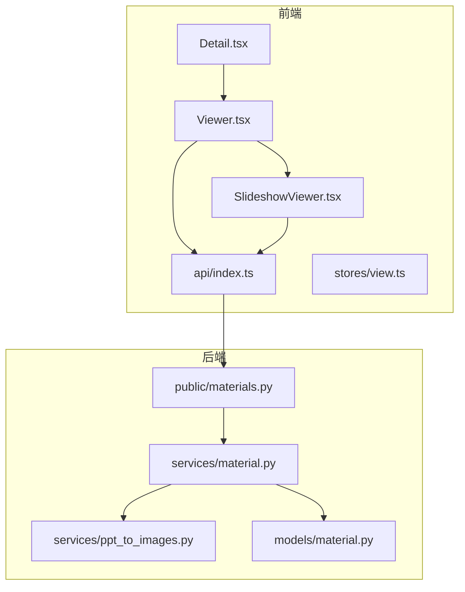
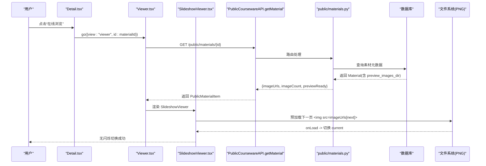
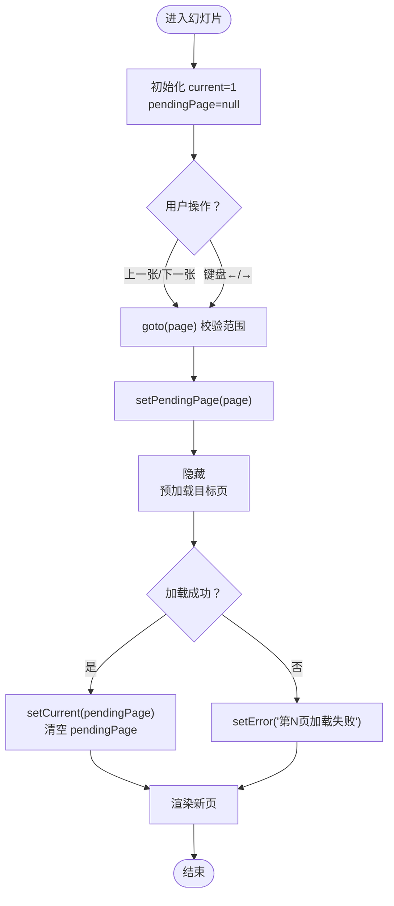
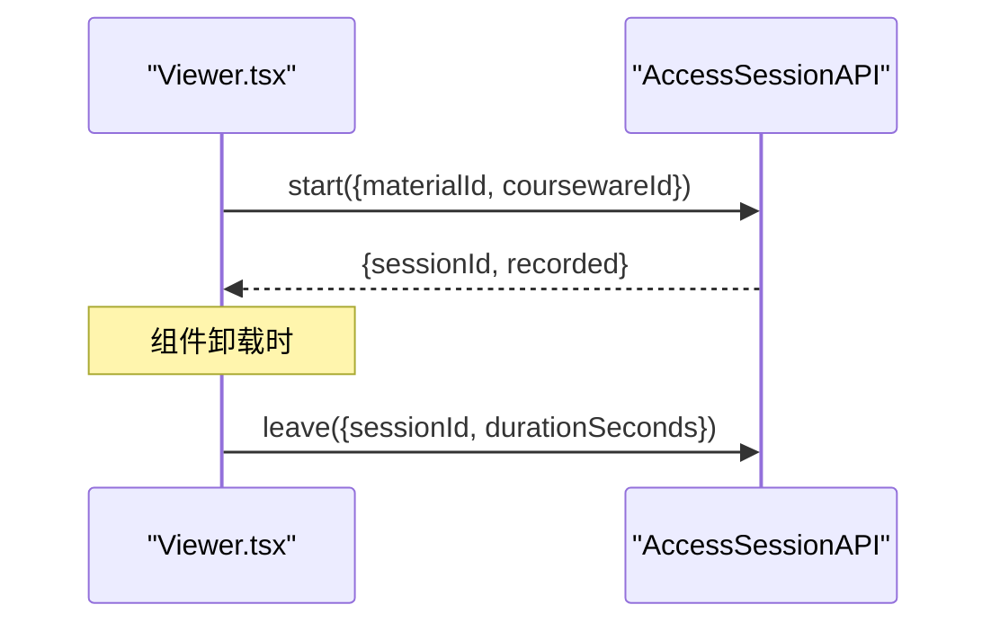
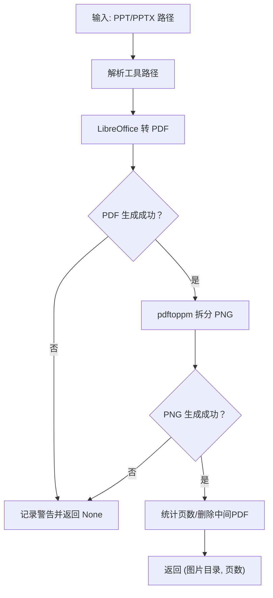
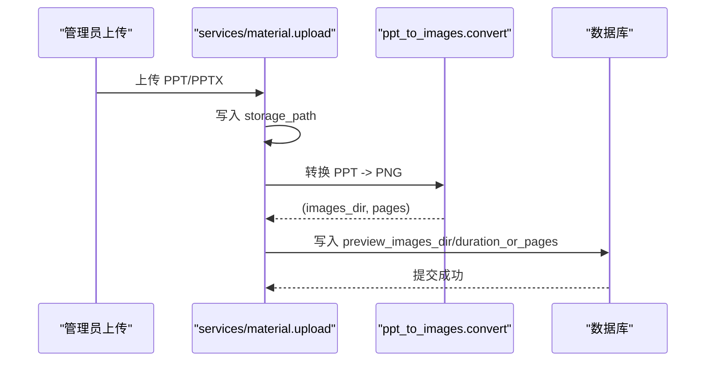
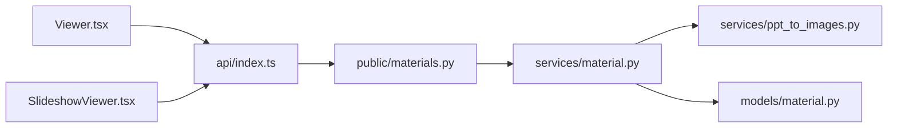

# PPT幻灯片查看器

<cite>
**本文引用的文件**   
- [SlideshowViewer.tsx](file://frontend/src/pages/public/viewer/SlideshowViewer.tsx)
- [Viewer.tsx](file://frontend/src/pages/public/Viewer.tsx)
- [view.ts](file://frontend/src/stores/view.ts)
- [index.ts](file://frontend/src/api/index.ts)
- [materials.py](file://backend/app/api/public/materials.py)
- [ppt_to_images.py](file://backend/app/services/ppt_to_images.py)
- [material.py](file://backend/app/models/material.py)
- [material.py](file://backend/app/services/material.py)
- [Detail.tsx](file://frontend/src/pages/public/Detail.tsx)
</cite>

## 目录
1. [简介](#简介)
2. [项目结构](#项目结构)
3. [核心组件](#核心组件)
4. [架构总览](#架构总览)
5. [详细组件分析](#详细组件分析)
6. [依赖关系分析](#依赖关系分析)
7. [性能与优化](#性能与优化)
8. [故障排查指南](#故障排查指南)
9. [结论](#结论)

## 简介
本文件面向 Learning Hub 的“PPT 幻灯片查看器”（P-VIEWER-PPT），系统性说明从后端 PPT 转图片的预处理流程，到前端轮播展示、预加载策略、键盘与鼠标交互、响应式布局、错误处理与重试、访问会话埋点、以及与素材管理系统的集成方式。文档同时给出架构图与流程图，帮助读者快速理解端到端数据流与关键实现细节。

## 项目结构
围绕 PPT 预览的关键路径：
- 前端
  - 路由与状态：[view.ts](file://frontend/src/stores/view.ts)
  - 页面分发：[Viewer.tsx](file://frontend/src/pages/public/Viewer.tsx)
  - 幻灯片子组件：[SlideshowViewer.tsx](file://frontend/src/pages/public/viewer/SlideshowViewer.tsx)
  - API 封装与类型：[index.ts](file://frontend/src/api/index.ts)
  - 课件详情入口：[Detail.tsx](file://frontend/src/pages/public/Detail.tsx)
- 后端
  - 公开素材接口（含图片列表与逐页图片）：[materials.py](file://backend/app/api/public/materials.py)
  - PPT 转 PNG 服务：[ppt_to_images.py](file://backend/app/services/ppt_to_images.py)
  - 素材模型与上传流程：[material.py](file://backend/app/models/material.py)、[material.py](file://backend/app/services/material.py)



**图表来源** 
- [Viewer.tsx:140-166](file://frontend/src/pages/public/Viewer.tsx#L140-L166)
- [SlideshowViewer.tsx:18-38](file://frontend/src/pages/public/viewer/SlideshowViewer.tsx#L18-L38)
- [index.ts:430-439](file://frontend/src/api/index.ts#L430-L439)
- [materials.py:183-221](file://backend/app/api/public/materials.py#L183-L221)
- [material.py:129-202](file://backend/app/services/material.py#L129-L202)
- [ppt_to_images.py:48-181](file://backend/app/services/ppt_to_images.py#L48-L181)
- [material.py:44-69](file://backend/app/models/material.py#L44-L69)

**章节来源**
- [Viewer.tsx:1-170](file://frontend/src/pages/public/Viewer.tsx#L1-L170)
- [SlideshowViewer.tsx:1-277](file://frontend/src/pages/public/viewer/SlideshowViewer.tsx#L1-L277)
- [index.ts:1-443](file://frontend/src/api/index.ts#L1-L443)
- [materials.py:1-224](file://backend/app/api/public/materials.py#L1-L224)
- [ppt_to_images.py:1-185](file://backend/app/services/ppt_to_images.py#L1-L185)
- [material.py:1-69](file://backend/app/models/material.py#L1-L69)
- [material.py:1-234](file://backend/app/services/material.py#L1-L234)
- [Detail.tsx:1-188](file://frontend/src/pages/public/Detail.tsx#L1-L188)

## 核心组件
- 幻灯片查看器（SlideshowViewer）
  - 负责单页图片居中显示、上一张/下一张切换、键盘左右键导航、全屏、错误提示与加载中提示。
  - 采用“后台预加载下一页 + 完成后一次性替换当前页”的策略，避免中间闪烁。
- 视图分发（Viewer）
  - 根据素材类型（VIDEO/PDF/PPT）选择对应子组件；屏蔽下载入口；发起访问会话埋点。
- 公开素材 API（public/materials）
  - 返回 imageUrls 列表与逐页图片接口；对 PPT 提供按页获取 PNG 的能力。
- PPT 转图片服务（ppt_to_images）
  - 调用 LibreOffice 将 PPT/PPTX 转为 PDF，再用 pdftoppm 拆分为多张 PNG，落盘并记录目录与页数。
- 素材模型与上传流程（models/material, services/material）
  - 定义 preview_images_dir 字段；上传时触发转换并持久化结果。

**章节来源**
- [SlideshowViewer.tsx:18-100](file://frontend/src/pages/public/viewer/SlideshowViewer.tsx#L18-L100)
- [Viewer.tsx:140-166](file://frontend/src/pages/public/Viewer.tsx#L140-L166)
- [materials.py:183-221](file://backend/app/api/public/materials.py#L183-L221)
- [ppt_to_images.py:48-181](file://backend/app/services/ppt_to_images.py#L48-L181)
- [material.py:44-69](file://backend/app/models/material.py#L44-L69)
- [material.py:174-202](file://backend/app/services/material.py#L174-L202)

## 架构总览
下图展示了从用户点击“在线浏览”到 PPT 图片展示的完整链路，包括访问会话埋点与图片预加载。



**图表来源** 
- [Detail.tsx:57-60](file://frontend/src/pages/public/Detail.tsx#L57-L60)
- [Viewer.tsx:66-80](file://frontend/src/pages/public/Viewer.tsx#L66-L80)
- [index.ts:430-439](file://frontend/src/api/index.ts#L430-L439)
- [materials.py:183-221](file://backend/app/api/public/materials.py#L183-L221)
- [SlideshowViewer.tsx:70-81](file://frontend/src/pages/public/viewer/SlideshowViewer.tsx#L70-L81)

## 详细组件分析

### 幻灯片查看器（SlideshowViewer）
- 状态设计
  - current：当前可见页码
  - pendingPage：待切换的目标页（未加载完成前不更新 current）
  - error：加载失败提示
- 交互逻辑
  - 上一张/下一张按钮与键盘左右键统一走 goto(page)，边界判断后设置 pendingPage
  - 通过隐藏的  预加载目标页，onLoad 后一次性 setCurrent，避免闪烁
  - onError 时设置错误提示，允许用户刷新重试
  - 支持全屏切换
- 响应式布局
  - 使用 flex 居中与 max-w/max-h 约束，适配不同屏幕尺寸
- 无障碍与可测试性
  - aria-live 提示加载状态
  - data-testid 便于 E2E 定位



**图表来源** 
- [SlideshowViewer.tsx:28-81](file://frontend/src/pages/public/viewer/SlideshowViewer.tsx#L28-L81)

**章节来源**
- [SlideshowViewer.tsx:18-100](file://frontend/src/pages/public/viewer/SlideshowViewer.tsx#L18-L100)
- [SlideshowViewer.tsx:183-233](file://frontend/src/pages/public/viewer/SlideshowViewer.tsx#L183-L233)

### 视图分发与访问会话埋点（Viewer）
- 根据素材类型分发到 VideoPlayer/PdfReader/SlideshowViewer
- 屏蔽 downloadUrl 透传，防止泄露下载入口
- 在素材加载成功后调用 AccessSessionAPI.start，离开时 best-effort 上报 leave（优先 sendBeacon，回退 fetch keepalive）



**图表来源** 
- [Viewer.tsx:71-105](file://frontend/src/pages/public/Viewer.tsx#L71-L105)
- [index.ts:168-216](file://frontend/src/api/index.ts#L168-L216)

**章节来源**
- [Viewer.tsx:140-166](file://frontend/src/pages/public/Viewer.tsx#L140-L166)
- [Viewer.tsx:66-105](file://frontend/src/pages/public/Viewer.tsx#L66-L105)
- [index.ts:168-216](file://frontend/src/api/index.ts#L168-L216)

### 公开素材 API（public/materials）
- 返回 imageUrls 列表与 imageCount，供 SlideshowViewer 直接渲染
- 提供 /{material_id}/image/{page_no} 逐页获取 PNG
- 对 RESTRICTED 课件进行令牌校验（X-Token-Hash 或 Cookie）

```mermaid
classDiagram
class PublicMaterialItem {
+number id
+string name
+string type
+number sizeBytes
+string streamUrl
+boolean previewReady
+string[] imageUrls
+number imageCount
}
class MaterialsAPI {
+GET /{material_id}
+GET /{material_id}/image/{page_no}
}
PublicMaterialItem <.. MaterialsAPI : "返回"
```

**图表来源** 
- [materials.py:183-221](file://backend/app/api/public/materials.py#L183-L221)
- [materials.py:149-180](file://backend/app/api/public/materials.py#L149-L180)
- [index.ts:316-332](file://frontend/src/api/index.ts#L316-L332)

**章节来源**
- [materials.py:183-221](file://backend/app/api/public/materials.py#L183-L221)
- [materials.py:149-180](file://backend/app/api/public/materials.py#L149-L180)

### PPT 转图片服务（ppt_to_images）
- 步骤
  - 解析二进制路径（LibreOffice/pdftoppm）
  - 调用 LibreOffice 将 PPT/PPTX 转为 PDF
  - 调用 pdftoppm 将 PDF 每页导出为 page-N.png
  - 统计 PNG 数量，删除中间 PDF，返回目录与页数
- 健壮性
  - 超时/异常仅记录日志，不抛异常，避免阻塞上传流程
  - 兼容 Windows 本地开发环境变量覆盖



**图表来源** 
- [ppt_to_images.py:48-181](file://backend/app/services/ppt_to_images.py#L48-L181)

**章节来源**
- [ppt_to_images.py:48-181](file://backend/app/services/ppt_to_images.py#L48-L181)

### 素材模型与上传流程（models/material, services/material）
- 模型
  - preview_images_dir：保存 PPT 生成的 PNG 目录路径
- 上传
  - 写入存储目录
  - 若类型为 PPT，异步调用 ppt_to_images.convert，成功则更新 preview_images_dir 与页数
  - 入库失败清理已写文件与图片目录



**图表来源** 
- [material.py:129-202](file://backend/app/services/material.py#L129-L202)
- [ppt_to_images.py:48-181](file://backend/app/services/ppt_to_images.py#L48-L181)
- [material.py:44-69](file://backend/app/models/material.py#L44-L69)

**章节来源**
- [material.py:129-202](file://backend/app/services/material.py#L129-L202)
- [material.py:44-69](file://backend/app/models/material.py#L44-L69)

## 依赖关系分析
- 前端
  - Viewer 依赖 api/index.ts 的 PublicCoursewareAPI.getMaterial
  - SlideshowViewer 依赖 imageUrls 列表与浏览器原生  预加载能力
  - view.ts 维护 URL 与 store 同步，保证返回/首页跳转正确
- 后端
  - public/materials.py 依赖 models/material 与 services/material
  - services/material.py 依赖 ppt_to_images.py 执行外部命令
  - 对外暴露 /public/materials/{id} 与 /public/materials/{id}/image/{page_no}



**图表来源** 
- [Viewer.tsx:66-80](file://frontend/src/pages/public/Viewer.tsx#L66-L80)
- [index.ts:430-439](file://frontend/src/api/index.ts#L430-L439)
- [materials.py:183-221](file://backend/app/api/public/materials.py#L183-L221)
- [material.py:129-202](file://backend/app/services/material.py#L129-L202)
- [ppt_to_images.py:48-181](file://backend/app/services/ppt_to_images.py#L48-L181)
- [material.py:44-69](file://backend/app/models/material.py#L44-L69)

**章节来源**
- [view.ts:58-96](file://frontend/src/stores/view.ts#L58-L96)
- [Detail.tsx:57-60](file://frontend/src/pages/public/Detail.tsx#L57-L60)

## 性能与优化
- 图片序列加载策略
  - 预加载下一页：通过隐藏的  提前下载，onLoad 后才切换 current，避免闪烁与二次请求
  - 延迟加载后续页面：仅当用户请求时才加载目标页，减少首屏压力
- 网络与缓存
  - 浏览器默认会对相同 URL 的图片进行缓存，重复翻页命中缓存更快
  - 建议结合 CDN 静态资源加速（部署层配置），降低跨域与带宽成本
- 格式与体积
  - 当前使用 PNG，清晰度好但体积较大；可在构建阶段引入 WebP 转换与自适应分辨率以减小体积（需后端新增转换管线与前端适配）
- 内存与渲染
  - 使用原生  替代 PDF.js，降低移动端内存占用与渲染开销
- 监控指标（建议）
  - 页面切换时间：在 goto 前后打点，计算 onLoad 耗时
  - 内存使用：利用 PerformanceObserver 观察长任务与内存峰值
  - 错误率：记录 onError 次数与失败页号，辅助定位问题

[本节为通用指导，无需特定文件引用]

## 故障排查指南
- 预览尚未生成
  - 现象：total === 0，显示“预览尚未生成，请稍后重试”
  - 原因：PPT 未成功转换为 PNG（preview_images_dir 为空）
  - 处理：检查上传流程是否调用 convert；必要时使用脚本重新生成图片
- 某页加载失败
  - 现象：显示“第 N 页加载失败，请刷新重试”
  - 原因：/image/N 返回错误或资源不可用
  - 处理：确认 preview_images_dir 下存在 page-N.png；检查 ACL 与令牌头
- 受限课件无法访问
  - 现象：403 或提示需要令牌解锁
  - 原因：RESTRICTED 课件缺少有效 X-Token-Hash
  - 处理：确保解锁后 tokenHash 被记忆并在请求中携带
- 返回详情页异常
  - 现象：返回首页需多次点击
  - 原因：URL 与 store 不同步导致启发式推断错误
  - 处理：使用 go({view:"home"}) 显式重置 q/id/cw，保持 URL 干净

**章节来源**
- [SlideshowViewer.tsx:102-147](file://frontend/src/pages/public/viewer/SlideshowViewer.tsx#L102-L147)
- [SlideshowViewer.tsx:77-81](file://frontend/src/pages/public/viewer/SlideshowViewer.tsx#L77-L81)
- [materials.py:31-62](file://backend/app/api/public/materials.py#L31-L62)
- [view.ts:71-96](file://frontend/src/stores/view.ts#L71-L96)

## 结论
PPT 幻灯片查看器通过“后端离线转图 + 前端按需预加载”的组合，实现了流畅、低内存占用的幻灯片体验。配合访问会话埋点与严格的下载入口屏蔽，既满足学习场景的易用性，也兼顾了安全与可观测性。未来可在图片格式与 CDN 层面进一步优化，以提升大规模并发下的首屏与切换性能。