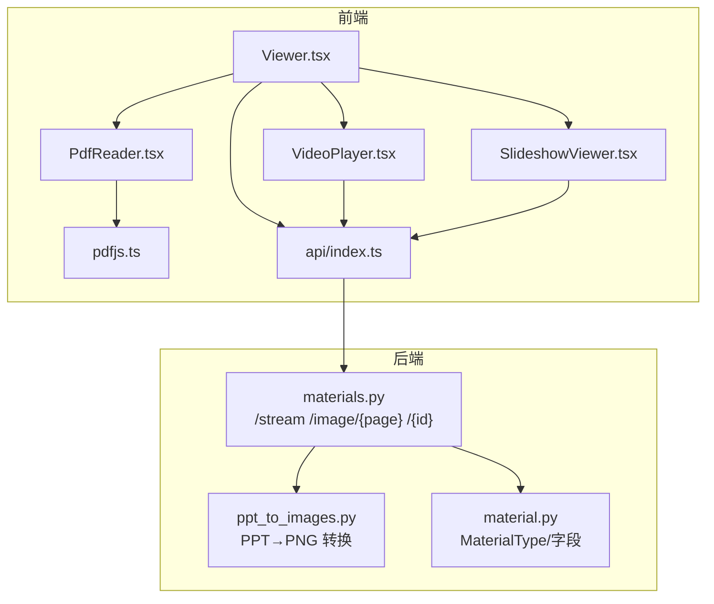
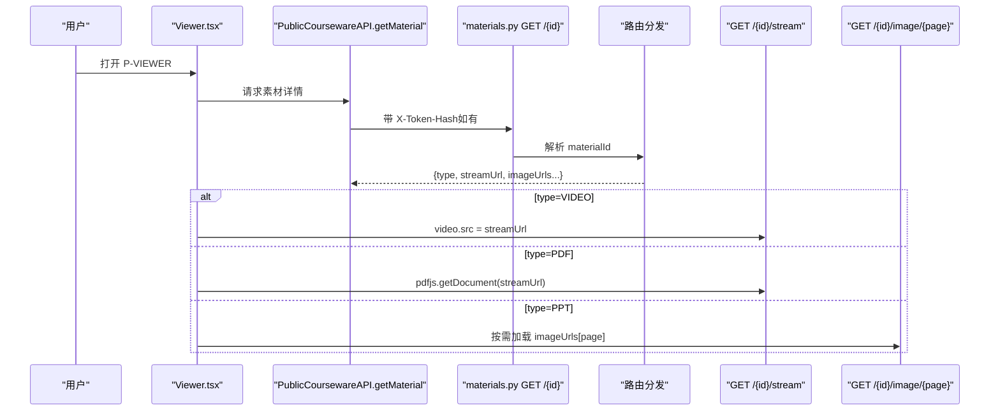
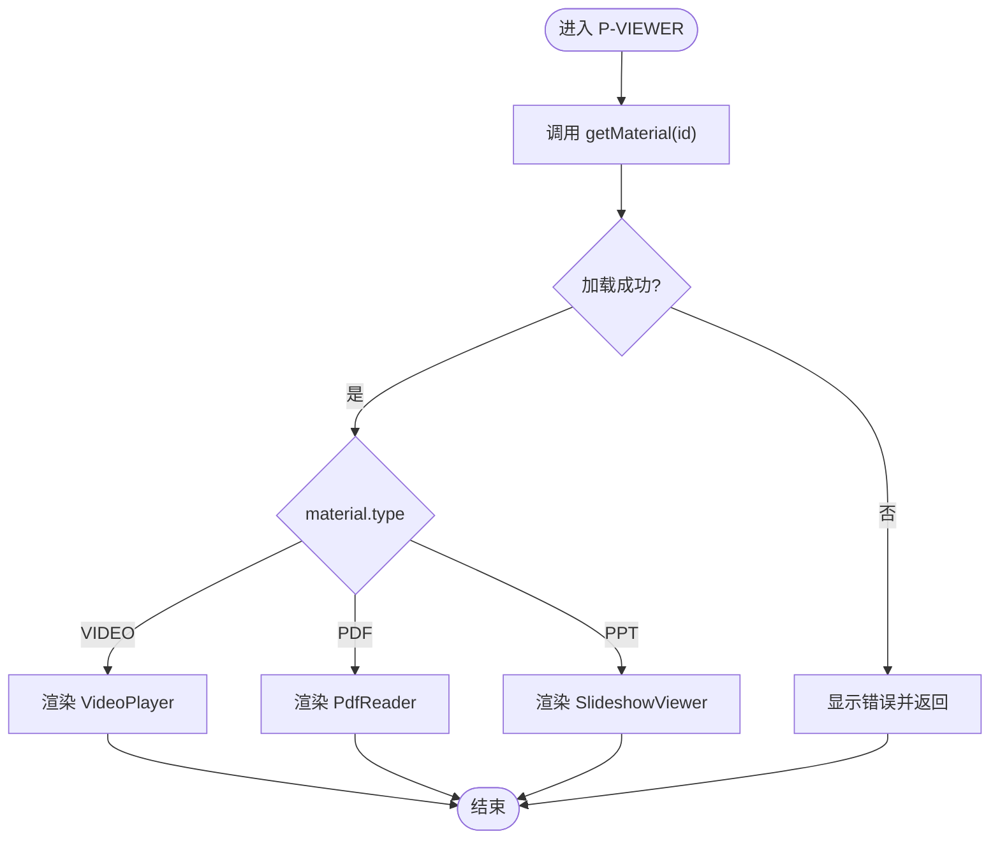
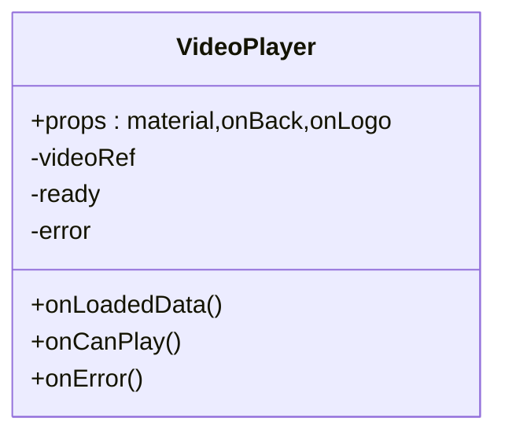
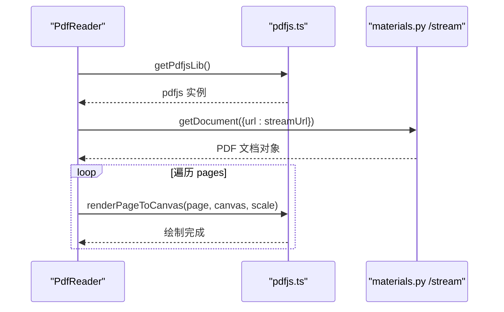
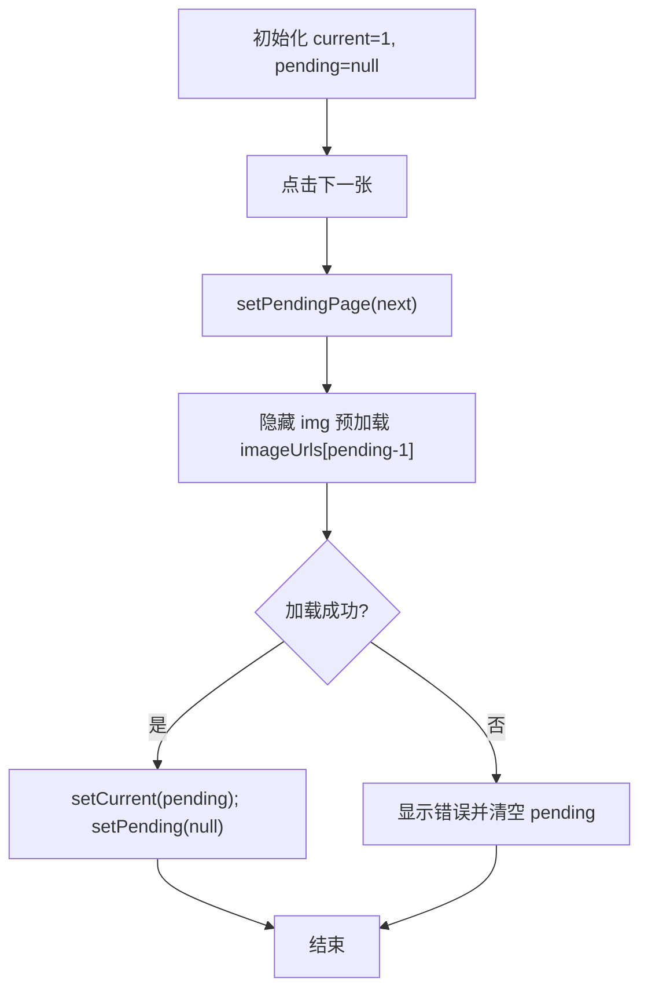
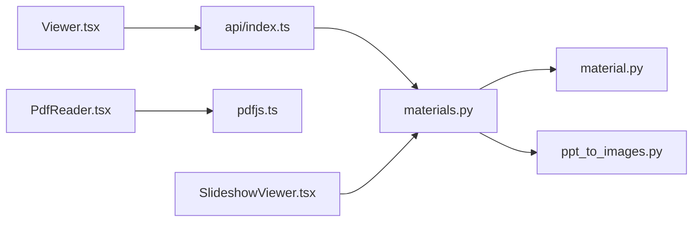

# 在线播放器页面

<cite>
**本文引用的文件列表**
- [Viewer.tsx](file://frontend/src/pages/public/Viewer.tsx)
- [VideoPlayer.tsx](file://frontend/src/pages/public/viewer/VideoPlayer.tsx)
- [PdfReader.tsx](file://frontend/src/pages/public/viewer/PdfReader.tsx)
- [SlideshowViewer.tsx](file://frontend/src/pages/public/viewer/SlideshowViewer.tsx)
- [pdfjs.ts](file://frontend/src/lib/pdfjs.ts)
- [index.ts（前端 API）](file://frontend/src/api/index.ts)
- [materials.py（后端素材公共接口）](file://backend/app/api/public/materials.py)
- [ppt_to_images.py（PPT 转图片服务）](file://backend/app/services/ppt_to_images.py)
- [material.py（素材模型）](file://backend/app/models/material.py)
</cite>

## 目录
1. [简介](#简介)
2. [项目结构](#项目结构)
3. [核心组件](#核心组件)
4. [架构总览](#架构总览)
5. [详细组件分析](#详细组件分析)
6. [依赖关系分析](#依赖关系分析)
7. [性能与内存优化](#性能与内存优化)
8. [错误处理与用户反馈](#错误处理与用户反馈)
9. [跨浏览器兼容性与移动端适配](#跨浏览器兼容性与移动端适配)
10. [结论](#结论)

## 简介
本文件面向 Learning Hub 的“在线播放器页面”（P-VIEWER），系统性阐述多格式媒体播放器的统一架构设计，包括视频播放器、PDF 阅读器与 PPT 轮播器的集成方案。文档覆盖以下要点：
- 媒体类型检测与播放器选择策略
- 流式传输与大文件高效加载、内存管理
- 播放器控制功能（播放/暂停、进度条、全屏切换等）
- 跨浏览器兼容性与移动端适配
- 预加载、缓存策略与资源清理
- 完整的错误处理与用户交互反馈机制

## 项目结构
P-VIEWER 由一个统一的入口组件根据素材类型分发到三个子组件；后端提供统一的素材查询与流式预览接口，并对 PPT 提供逐页图片预览能力。

图表来源
- [Viewer.tsx:1-170](file://frontend/src/pages/public/Viewer.tsx#L1-L170)
- [VideoPlayer.tsx:1-250](file://frontend/src/pages/public/viewer/VideoPlayer.tsx#L1-L250)
- [PdfReader.tsx:1-270](file://frontend/src/pages/public/viewer/PdfReader.tsx#L1-L270)
- [SlideshowViewer.tsx:1-277](file://frontend/src/pages/public/viewer/SlideshowViewer.tsx#L1-L277)
- [pdfjs.ts:1-57](file://frontend/src/lib/pdfjs.ts#L1-L57)
- [index.ts（前端 API）:1-443](file://frontend/src/api/index.ts#L1-L443)
- [materials.py:1-224](file://backend/app/api/public/materials.py#L1-L224)
- [ppt_to_images.py:1-185](file://backend/app/services/ppt_to_images.py#L1-L185)
- [material.py:1-69](file://backend/app/models/material.py#L1-L69)

章节来源
- [Viewer.tsx:1-170](file://frontend/src/pages/public/Viewer.tsx#L1-L170)
- [materials.py:1-224](file://backend/app/api/public/materials.py#L1-L224)

## 核心组件
- Viewer：统一入口，负责获取素材元数据、按 type 分发到具体播放器、访问会话埋点、返回导航。
- VideoPlayer：基于 HTML5 video 的简化流媒体播放器，含首帧占位、自动隐藏光标、禁用下载与右键。
- PdfReader：基于 PDF.js 的连续滚动阅读体验，支持缩放、双击放大、IntersectionObserver 驱动当前页显示。
- SlideshowViewer：将 PPT 渲染为 PNG 序列，实现上一张/下一张、键盘导航、全屏、后台预加载下一页。

章节来源
- [Viewer.tsx:1-170](file://frontend/src/pages/public/Viewer.tsx#L1-L170)
- [VideoPlayer.tsx:1-250](file://frontend/src/pages/public/viewer/VideoPlayer.tsx#L1-L250)
- [PdfReader.tsx:1-270](file://frontend/src/pages/public/viewer/PdfReader.tsx#L1-L270)
- [SlideshowViewer.tsx:1-277](file://frontend/src/pages/public/viewer/SlideshowViewer.tsx#L1-L277)

## 架构总览
P-VIEWER 采用“统一入口 + 类型分发 + 专用渲染器”的架构。前端通过公开 API 获取素材信息（包含 streamUrl、imageUrls 等），再交由对应播放器消费。后端对 VIDEO/PDF/PPT 分别提供 inline 流式响应或逐页图片接口，并内置 ACL 校验与限流。

图表来源
- [Viewer.tsx:1-170](file://frontend/src/pages/public/Viewer.tsx#L1-L170)
- [index.ts（前端 API）:405-443](file://frontend/src/api/index.ts#L405-L443)
- [materials.py:183-224](file://backend/app/api/public/materials.py#L183-L224)
- [materials.py:84-146](file://backend/app/api/public/materials.py#L84-L146)
- [materials.py:149-181](file://backend/app/api/public/materials.py#L149-L181)

## 详细组件分析

### 统一入口：Viewer
- 职责
  - 从 PublicCoursewareAPI.getMaterial 拉取素材元数据
  - 屏蔽 downloadUrl，避免泄露下载入口
  - 根据 material.type 分发到 VideoPlayer/PdfReader/SlideshowViewer
  - 访问会话埋点：成功加载后 start，unmount 时 leave（best-effort）
- 关键流程
  - 参数校验与错误态展示
  - 返回逻辑：携带 coursewareId 回课件详情，否则返回首页
- 安全与合规
  - 透传 tokenHash 头以通过 ACL 校验
  - 剥离 downloadUrl，仅保留 streamUrl/imageUrls 等必要字段

图表来源
- [Viewer.tsx:1-170](file://frontend/src/pages/public/Viewer.tsx#L1-L170)
- [index.ts（前端 API）:405-443](file://frontend/src/api/index.ts#L405-L443)

章节来源
- [Viewer.tsx:1-170](file://frontend/src/pages/public/Viewer.tsx#L1-L170)
- [index.ts（前端 API）:156-216](file://frontend/src/api/index.ts#L156-L216)

### 视频播放器：VideoPlayer
- 功能
  - 使用原生 controls 实现播放/暂停、进度条、音量、全屏等
  - 禁止下载与右键菜单
  - 首帧可见前显示占位，避免黑屏闪烁
  - 播放中自动隐藏鼠标光标
- 流式与兼容性
  - 直接设置 video.src 为后端 streamUrl（inline）
  - 利用 loadeddata/canplay 事件判定首帧可见
  - preload="auto" 提升首开速度
- 错误处理
  - onError 提示网络问题
  - 切换素材时重置状态

图表来源
- [VideoPlayer.tsx:1-250](file://frontend/src/pages/public/viewer/VideoPlayer.tsx#L1-L250)

章节来源
- [VideoPlayer.tsx:1-250](file://frontend/src/pages/public/viewer/VideoPlayer.tsx#L1-L250)

### PDF 阅读器：PdfReader
- 功能
  - 顶部工具栏缩放（预设档位）、双击放大/还原
  - 连续滚动布局，右下角显示“第 N/M 页”
  - IntersectionObserver 驱动当前页更新
- 渲染与性能
  - 懒加载 PDF.js worker，统一 workerSrc
  - 高 DPI 适配：按 devicePixelRatio 计算 canvas 尺寸
  - scale 变化时重渲染所有页
  - 单页渲染失败不阻塞整体
- 错误处理
  - 区分密码保护、未授权、网络错误等场景
  - 卸载时销毁 PDF 文档释放内存

图表来源
- [PdfReader.tsx:1-270](file://frontend/src/pages/public/viewer/PdfReader.tsx#L1-L270)
- [pdfjs.ts:1-57](file://frontend/src/lib/pdfjs.ts#L1-L57)
- [materials.py:84-146](file://backend/app/api/public/materials.py#L84-L146)

章节来源
- [PdfReader.tsx:1-270](file://frontend/src/pages/public/viewer/PdfReader.tsx#L1-L270)
- [pdfjs.ts:1-57](file://frontend/src/lib/pdfjs.ts#L1-L57)

### PPT 轮播器：SlideshowViewer
- 功能
  - 上一张/下一张、键盘左右键、全屏
  - 后台预加载下一页，完成后一次性替换，避免闪烁
  - 无可用预览时显示“尚未生成”
- 数据来源
  - 后端在 GET /{id} 返回 imageUrls（每页 PNG URL）
  - 按需通过 GET /{id}/image/{page_no} 获取图片
- 错误处理
  - 单页加载失败提示刷新重试
  - 切页时保持 current 不变直到 pending 就绪

图表来源
- [SlideshowViewer.tsx:1-277](file://frontend/src/pages/public/viewer/SlideshowViewer.tsx#L1-L277)
- [materials.py:183-224](file://backend/app/api/public/materials.py#L183-L224)
- [materials.py:149-181](file://backend/app/api/public/materials.py#L149-L181)

章节来源
- [SlideshowViewer.tsx:1-277](file://frontend/src/pages/public/viewer/SlideshowViewer.tsx#L1-L277)
- [materials.py:149-181](file://backend/app/api/public/materials.py#L149-L181)

## 依赖关系分析
- 前端
  - Viewer 依赖 PublicCoursewareAPI 获取素材元数据
  - PdfReader 依赖 pdfjs.ts 提供的 PDF.js 封装
  - 各播放器均依赖后端 materials.py 的 /stream 与 /image 接口
- 后端
  - materials.py 根据 MaterialType 分流：
    - VIDEO/PDF：FileResponse inline 流式返回
    - PPT：优先返回 preview_pdf_path（若存在），否则降级原文件 attachment
    - 图片：按 page-*.png 排序后按 1-indexed 返回
  - ppt_to_images.py 负责 PPT→PDF→PNG 的离线转换，供前端图片预览使用

图表来源
- [Viewer.tsx:1-170](file://frontend/src/pages/public/Viewer.tsx#L1-L170)
- [index.ts（前端 API）:405-443](file://frontend/src/api/index.ts#L405-L443)
- [materials.py:1-224](file://backend/app/api/public/materials.py#L1-L224)
- [ppt_to_images.py:1-185](file://backend/app/services/ppt_to_images.py#L1-L185)
- [material.py:1-69](file://backend/app/models/material.py#L1-L69)

章节来源
- [materials.py:1-224](file://backend/app/api/public/materials.py#L1-L224)
- [ppt_to_images.py:1-185](file://backend/app/services/ppt_to_images.py#L1-L185)
- [material.py:1-69](file://backend/app/models/material.py#L1-L69)

## 性能与内存优化
- 预加载与缓存
  - 视频：preload="auto"，浏览器 HTTP 缓存命中可显著缩短首帧时间
  - PDF：worker 路径带 cache-bust 参数，避免旧版本缓存导致 404
  - PPT：后台隐藏  预加载下一页，减少切换延迟
- 渲染与内存
  - PDF：按设备像素比渲染 canvas，scale 变化时全量重绘；卸载时销毁文档释放内存
  - PPT：仅维护当前页与待加载页两张图，避免大量 DOM 节点
- 网络与限流
  - 后端 /stream 与 /image 接口启用速率限制，防止滥用
- 建议
  - 大体积 PDF 可考虑分页懒渲染（当前已全量渲染，适合中小页数）
  - 视频可结合 Range 请求（后端 FileResponse 默认支持）提升跳转效率

章节来源
- [VideoPlayer.tsx:1-250](file://frontend/src/pages/public/viewer/VideoPlayer.tsx#L1-L250)
- [PdfReader.tsx:1-270](file://frontend/src/pages/public/viewer/PdfReader.tsx#L1-L270)
- [pdfjs.ts:1-57](file://frontend/src/lib/pdfjs.ts#L1-L57)
- [SlideshowViewer.tsx:1-277](file://frontend/src/pages/public/viewer/SlideshowViewer.tsx#L1-L277)
- [materials.py:84-181](file://backend/app/api/public/materials.py#L84-L181)

## 错误处理与用户反馈
- 统一入口
  - 缺少参数、素材不存在、不支持的类型均给出友好提示并提供返回按钮
- 视频
  - onError 提示网络问题；切换素材时重置 ready/error
- PDF
  - 区分密码保护、未授权、网络错误等错误原因并提示
  - 单页渲染失败不影响其他页
- PPT
  - 无预览时提示“尚未生成”
  - 单页加载失败提示刷新重试
- 访问会话埋点
  - start 失败/leave 失败均为 best-effort，不影响主流程

章节来源
- [Viewer.tsx:1-170](file://frontend/src/pages/public/Viewer.tsx#L1-L170)
- [VideoPlayer.tsx:1-250](file://frontend/src/pages/public/viewer/VideoPlayer.tsx#L1-L250)
- [PdfReader.tsx:1-270](file://frontend/src/pages/public/viewer/PdfReader.tsx#L1-L270)
- [SlideshowViewer.tsx:1-277](file://frontend/src/pages/public/viewer/SlideshowViewer.tsx#L1-L277)
- [index.ts（前端 API）:156-216](file://frontend/src/api/index.ts#L156-L216)

## 跨浏览器兼容性与移动端适配
- 浏览器特性
  - 全屏：使用 requestFullscreen/exitFullscreen，兼容主流浏览器
  - 右键与拖拽：禁用 contextmenu 与 draggable，降低误操作
  - sendBeacon：离开埋点优先使用，不可用时回退 fetch keepalive
- 移动端
  - 视频：controls 原生控件在移动端可用
  - PDF：允许横向滚动查看完整内容，双击缩放提升可读性
  - PPT：触摸滑动可通过系统手势配合全屏获得良好体验

章节来源
- [SlideshowViewer.tsx:1-277](file://frontend/src/pages/public/viewer/SlideshowViewer.tsx#L1-L277)
- [VideoPlayer.tsx:1-250](file://frontend/src/pages/public/viewer/VideoPlayer.tsx#L1-L250)
- [PdfReader.tsx:1-270](file://frontend/src/pages/public/viewer/PdfReader.tsx#L1-L270)
- [index.ts（前端 API）:182-216](file://frontend/src/api/index.ts#L182-L216)

## 结论
P-VIEWER 通过统一入口与类型分发，将视频、PDF、PPT 三种媒体类型整合到一致的浏览体验中。后端提供安全的流式与图片接口，前端针对每种媒体进行专门的渲染与交互优化，并在错误处理、性能与兼容性方面做了充分考量。该架构具备良好的扩展性，便于后续接入更多媒体类型或增强现有能力。