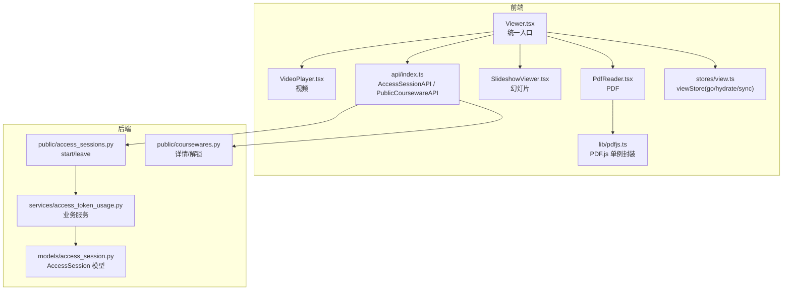
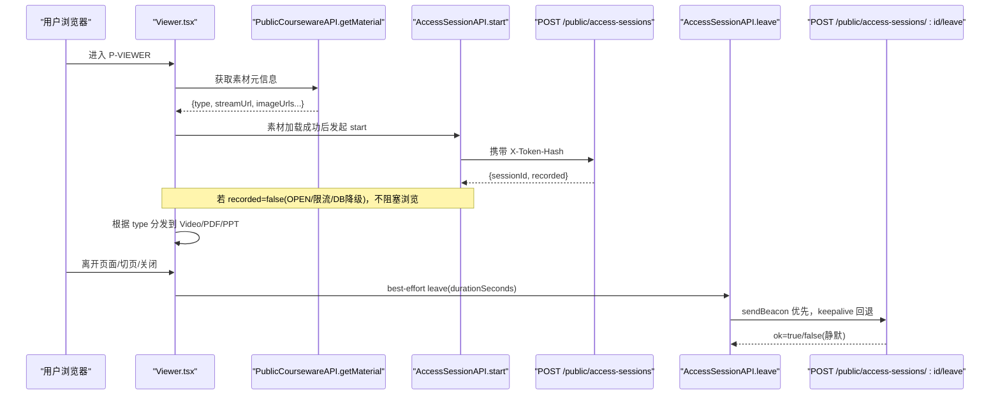
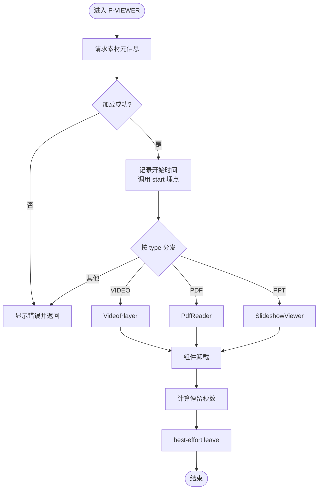
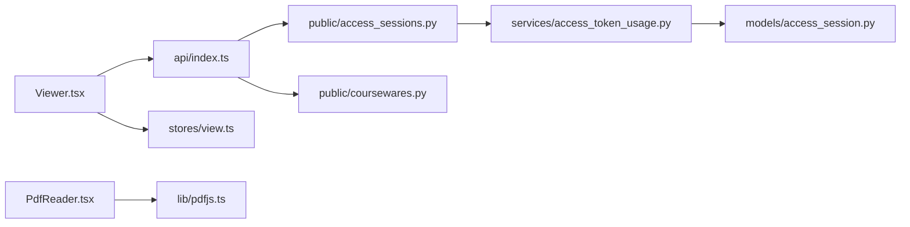

# 播放器架构设计

<cite>
**本文引用的文件**   
- [Viewer.tsx](file://frontend/src/pages/public/Viewer.tsx)
- [VideoPlayer.tsx](file://frontend/src/pages/public/viewer/VideoPlayer.tsx)
- [PdfReader.tsx](file://frontend/src/pages/public/viewer/PdfReader.tsx)
- [SlideshowViewer.tsx](file://frontend/src/pages/public/viewer/SlideshowViewer.tsx)
- [api/index.ts](file://frontend/src/api/index.ts)
- [stores/view.ts](file://frontend/src/stores/view.ts)
- [access_sessions.py](file://backend/app/api/public/access_sessions.py)
- [access_token_usage.py](file://backend/app/services/access_token_usage.py)
- [access_session.py](file://backend/app/models/access_session.py)
- [coursewares.py](file://backend/app/api/public/coursewares.py)
- [pdfjs.ts](file://frontend/src/lib/pdfjs.ts)
</cite>

## 目录
1. [引言](#引言)
2. [项目结构](#项目结构)
3. [核心组件](#核心组件)
4. [架构总览](#架构总览)
5. [详细组件分析](#详细组件分析)
6. [依赖关系分析](#依赖关系分析)
7. [性能考量](#性能考量)
8. [故障排查指南](#故障排查指南)
9. [结论](#结论)
10. [附录](#附录)

## 引言
本文件面向 Learning Hub 的“统一播放器入口”（P-VIEWER）与访问会话追踪系统，系统性阐述其架构设计与实现要点。内容覆盖：
- 统一播放器入口的设计模式：媒体类型检测、组件路由分发与状态管理
- 访问会话追踪：开始、持续记录与结束清理
- 错误处理框架：加载失败、网络异常与用户友好提示
- 组件生命周期管理：资源清理与事件监听器卸载
- 性能监控与埋点：用户行为数据与性能指标采集
- 扩展机制：支持新媒体类型的快速集成
- 安全考虑：URL 校验、XSS 防护与访问权限控制
- 测试策略：单元、集成与端到端用例

## 项目结构
前端以 React + Zustand 构建，P-VIEWER 作为统一入口，根据素材类型将渲染任务分派到三个子组件；后端基于 FastAPI 提供公开 API，并维护访问会话表。



图表来源
- [Viewer.tsx:1-170](file://frontend/src/pages/public/Viewer.tsx#L1-L170)
- [VideoPlayer.tsx:1-250](file://frontend/src/pages/public/viewer/VideoPlayer.tsx#L1-L250)
- [PdfReader.tsx:1-270](file://frontend/src/pages/public/viewer/PdfReader.tsx#L1-L270)
- [SlideshowViewer.tsx:1-277](file://frontend/src/pages/public/viewer/SlideshowViewer.tsx#L1-L277)
- [api/index.ts:1-443](file://frontend/src/api/index.ts#L1-L443)
- [stores/view.ts:1-127](file://frontend/src/stores/view.ts#L1-L127)
- [access_sessions.py:1-137](file://backend/app/api/public/access_sessions.py#L1-L137)
- [access_token_usage.py:1-518](file://backend/app/services/access_token_usage.py#L1-L518)
- [access_session.py:1-129](file://backend/app/models/access_session.py#L1-L129)
- [coursewares.py:1-133](file://backend/app/api/public/coursewares.py#L1-L133)
- [pdfjs.ts:1-57](file://frontend/src/lib/pdfjs.ts#L1-L57)

章节来源
- [Viewer.tsx:1-170](file://frontend/src/pages/public/Viewer.tsx#L1-L170)
- [api/index.ts:156-216](file://frontend/src/api/index.ts#L156-L216)
- [stores/view.ts:1-127](file://frontend/src/stores/view.ts#L1-L127)
- [access_sessions.py:1-137](file://backend/app/api/public/access_sessions.py#L1-L137)
- [access_token_usage.py:64-172](file://backend/app/services/access_token_usage.py#L64-L172)
- [access_session.py:56-129](file://backend/app/models/access_session.py#L56-L129)
- [coursewares.py:57-133](file://backend/app/api/public/coursewares.py#L57-L133)
- [pdfjs.ts:1-57](file://frontend/src/lib/pdfjs.ts#L1-L57)

## 核心组件
- 统一入口 Viewer：负责从公共接口获取素材元信息、按 type 分发到具体播放器、启动/结束访问会话、屏蔽下载入口。
- 视频播放器 VideoPlayer：HTML5 video 播放，首帧可见占位、自动隐藏光标、禁用右键与下载。
- PDF 阅读器 PdfReader：懒加载 PDF.js worker，逐页渲染至 canvas，IntersectionObserver 驱动当前页码，销毁时释放文档。
- 幻灯片 SlideshowViewer：后端预生成 PNG 序列，前台通过隐藏 img 预加载下一页，切换无闪烁。
- 访问会话 API：前端 AccessSessionAPI.start/leave 调用后端 public/access-sessions，后端限流、ACL 校验、best-effort 落库。
- 视图状态 stores/view：URL 与 store 双向同步，go() 更新 URL，popstate 回写 store。

章节来源
- [Viewer.tsx:45-166](file://frontend/src/pages/public/Viewer.tsx#L45-L166)
- [VideoPlayer.tsx:34-248](file://frontend/src/pages/public/viewer/VideoPlayer.tsx#L34-L248)
- [PdfReader.tsx:25-268](file://frontend/src/pages/public/viewer/PdfReader.tsx#L25-L268)
- [SlideshowViewer.tsx:18-275](file://frontend/src/pages/public/viewer/SlideshowViewer.tsx#L18-L275)
- [api/index.ts:156-216](file://frontend/src/api/index.ts#L156-L216)
- [access_sessions.py:65-133](file://backend/app/api/public/access_sessions.py#L65-L133)
- [stores/view.ts:58-127](file://frontend/src/stores/view.ts#L58-L127)

## 架构总览
P-VIEWER 采用“入口分发 + 专用渲染器”的模式，结合统一的访问会话埋点与健壮的错误处理，形成高内聚、低耦合的前端播放器体系。后端通过独立的服务层实现 B-1/B-2 等业务规则，并以进程内滑动窗口限流保护 start/leave 接口。



图表来源
- [Viewer.tsx:57-106](file://frontend/src/pages/public/Viewer.tsx#L57-L106)
- [api/index.ts:168-216](file://frontend/src/api/index.ts#L168-L216)
- [access_sessions.py:65-133](file://backend/app/api/public/access_sessions.py#L65-L133)

## 详细组件分析

### 统一入口 Viewer：媒体类型检测与组件路由分发
- 数据来源：PublicCoursewareAPI.getMaterial(id) 返回 PublicMaterialItem，包含 type/streamUrl/imageUrls 等字段。
- 路由分发：switch(material.type) 选择 VideoPlayer/PdfReader/SlideshowViewer；未知类型显示错误页。
- 安全剥离：透传前剔除 downloadUrl，避免子组件误用导致下载泄露。
- 访问会话：
  - 成功加载后调用 AccessSessionAPI.start({materialId, coursewareId})，记录 sessionId 与开始时间戳。
  - 组件卸载时计算 durationSeconds，调用 leave(sessionId, coursewareId, durationSeconds)。
- 返回逻辑：根据 coursewareId 决定返回 P-DETAIL 或 P-HOME。



图表来源
- [Viewer.tsx:66-106](file://frontend/src/pages/public/Viewer.tsx#L66-L106)
- [Viewer.tsx:142-166](file://frontend/src/pages/public/Viewer.tsx#L142-L166)
- [api/index.ts:430-439](file://frontend/src/api/index.ts#L430-L439)

章节来源
- [Viewer.tsx:45-166](file://frontend/src/pages/public/Viewer.tsx#L45-L166)
- [api/index.ts:315-332](file://frontend/src/api/index.ts#L315-L332)

### 视频播放器 VideoPlayer：首帧可见与交互优化
- 首帧可见策略：监听 loadeddata/canplay，使用最小展示时长 POSTER_MIN_MS 防止“一闪而过”。
- 光标自动隐藏：播放/暂停/鼠标移动重置定时器，提升沉浸体验。
- 安全与防下载：controlsList="nodownload"、禁用 Picture-in-Picture、阻止 contextmenu。
- 错误处理：onError 设置友好提示。

章节来源
- [VideoPlayer.tsx:52-84](file://frontend/src/pages/public/viewer/VideoPlayer.tsx#L52-L84)
- [VideoPlayer.tsx:87-116](file://frontend/src/pages/public/viewer/VideoPlayer.tsx#L87-L116)
- [VideoPlayer.tsx:202-216](file://frontend/src/pages/public/viewer/VideoPlayer.tsx#L202-L216)

### PDF 阅读器 PdfReader：懒加载与资源清理
- Worker 配置：通过 getPdfjsLib 懒加载并设置 workerSrc，生产/开发路径不同。
- 文档加载：getDocument(url).promise 加载 PDF，捕获 PasswordException/401/403 等错误并给出中文提示。
- 渲染策略：按 scale 重渲染所有页，单页失败不阻塞整体。
- 当前页码：IntersectionObserver 观察各页可见性，取最靠近视口中心的页。
- 资源清理：unmount 时 doc.destroy()，避免内存泄漏。

章节来源
- [pdfjs.ts:18-30](file://frontend/src/lib/pdfjs.ts#L18-L30)
- [PdfReader.tsx:37-82](file://frontend/src/pages/public/viewer/PdfReader.tsx#L37-L82)
- [PdfReader.tsx:85-107](file://frontend/src/pages/public/viewer/PdfReader.tsx#L85-L107)
- [PdfReader.tsx:110-134](file://frontend/src/pages/public/viewer/PdfReader.tsx#L110-L134)

### 幻灯片 SlideshowViewer：预加载与无闪烁切换
- 预加载策略：pendingPage 指向目标页，后台隐藏  预加载，onLoad 才替换 current，避免中间态闪烁。
- 键盘导航：←/→ 切换上一页/下一页，忽略输入框事件。
- 全屏支持：requestFullscreen/exitFullscreen 兼容处理。
- 错误处理：单页加载失败提示刷新重试。

章节来源
- [SlideshowViewer.tsx:30-88](file://frontend/src/pages/public/viewer/SlideshowViewer.tsx#L30-L88)
- [SlideshowViewer.tsx:44-58](file://frontend/src/pages/public/viewer/SlideshowViewer.tsx#L44-L58)
- [SlideshowViewer.tsx:60-68](file://frontend/src/pages/public/viewer/SlideshowViewer.tsx#L60-L68)
- [SlideshowViewer.tsx:72-81](file://frontend/src/pages/public/viewer/SlideshowViewer.tsx#L72-L81)

### 访问会话追踪系统：开始、持续记录与结束清理
- 前端埋点：
  - start：在素材加载成功后调用 AccessSessionAPI.start，附带 coursewareId 用于 tokenHash 注入。
  - leave：组件卸载时计算 durationSeconds，优先 sendBeacon，回退 fetch keepalive，失败静默。
- 后端处理：
  - start：IP 限流（60/分钟），token_hash 解析（Header/Cookie），B-1 仅 RESTRICTED 课件落库，DB 异常降级为 recorded=false。
  - leave：幂等结束，B-2 客户端 duration 与服务端差值 > 60s 则校正为服务端时间。
- 数据模型：AccessSession 含 token_id/courseware_id/material_id/started_at/ended_at/duration_seconds/ip/ua 等字段，索引优化查询。

```mermaid
classDiagram
class AccessSession {
+int id
+int token_id
+int courseware_id
+int material_id
+datetime started_at
+datetime ended_at
+int duration_seconds
+bool client_leave
+string ip
+string ua
}
class AccessSessionAPI {
+start(params)
+leave(params)
}
class AccessSessionsRouter {
+POST ""
+POST "/{session_id}/leave"
}
class AccessTokenUsageService {
+start_session(...)
+leave_session(...)
}
AccessSessionAPI --> AccessSessionsRouter : "HTTP 调用"
AccessSessionsRouter --> AccessTokenUsageService : "业务逻辑"
AccessTokenUsageService --> AccessSession : "写入/更新"
```

图表来源
- [access_session.py:56-129](file://backend/app/models/access_session.py#L56-L129)
- [api/index.ts:168-216](file://frontend/src/api/index.ts#L168-L216)
- [access_sessions.py:65-133](file://backend/app/api/public/access_sessions.py#L65-L133)
- [access_token_usage.py:64-172](file://backend/app/services/access_token_usage.py#L64-L172)

章节来源
- [api/index.ts:168-216](file://frontend/src/api/index.ts#L168-L216)
- [access_sessions.py:29-106](file://backend/app/api/public/access_sessions.py#L29-L106)
- [access_token_usage.py:64-172](file://backend/app/services/access_token_usage.py#L64-L172)
- [access_session.py:56-129](file://backend/app/models/access_session.py#L56-L129)

### 错误处理框架：加载失败、网络异常与用户提示
- 入口级错误：Viewer 捕获 getMaterial 失败，显示“预览加载失败”并提供返回按钮。
- 视频错误：onError 设置“视频加载失败，请检查网络”。
- PDF 错误：区分密码保护、未授权、网络问题，给出明确中文提示。
- 幻灯片错误：单页加载失败提示刷新重试。
- 会话埋点容错：start/leave 均 best-effort，不影响主流程。

章节来源
- [Viewer.tsx:81-87](file://frontend/src/pages/public/Viewer.tsx#L81-L87)
- [VideoPlayer.tsx:212-215](file://frontend/src/pages/public/viewer/VideoPlayer.tsx#L212-L215)
- [PdfReader.tsx:49-68](file://frontend/src/pages/public/viewer/PdfReader.tsx#L49-L68)
- [SlideshowViewer.tsx:77-81](file://frontend/src/pages/public/viewer/SlideshowViewer.tsx#L77-L81)
- [api/index.ts:177-215](file://frontend/src/api/index.ts#L177-L215)

### 组件生命周期管理：资源清理与事件卸载
- VideoPlayer：移除 loadeddata/canplay/play/pause/mousemove 监听，清除定时器。
- PdfReader：doc.destroy()，取消渲染任务，断开 IntersectionObserver。
- SlideshowViewer：window.removeEventListener("keydown")，清理 pending 状态。
- Viewer：useEffect 返回函数中置 cancelled=true，确保异步回调不再更新状态。

章节来源
- [VideoPlayer.tsx:79-84](file://frontend/src/pages/public/viewer/VideoPlayer.tsx#L79-L84)
- [VideoPlayer.tsx:110-116](file://frontend/src/pages/public/viewer/VideoPlayer.tsx#L110-L116)
- [PdfReader.tsx:70-82](file://frontend/src/pages/public/viewer/PdfReader.tsx#L70-L82)
- [PdfReader.tsx:104-107](file://frontend/src/pages/public/viewer/PdfReader.tsx#L104-L107)
- [PdfReader.tsx:132-134](file://frontend/src/pages/public/viewer/PdfReader.tsx#L132-L134)
- [SlideshowViewer.tsx:56-58](file://frontend/src/pages/public/viewer/SlideshowViewer.tsx#L56-L58)
- [Viewer.tsx:88-106](file://frontend/src/pages/public/Viewer.tsx#L88-L106)

### 性能监控与埋点系统：用户行为与性能指标
- 访问会话埋点：start/leave 记录 session 起止与停留时长，供管理后台聚合统计。
- 前端可观测性：可在关键节点追加 performance.mark/markEvent 收集首帧时间、渲染耗时等（建议扩展）。
- 后端限流：start/leave 接口对 IP 做 60/minute 滑动窗口限流，保护服务稳定性。

章节来源
- [access_sessions.py:29-54](file://backend/app/api/public/access_sessions.py#L29-L54)
- [access_token_usage.py:286-312](file://backend/app/services/access_token_usage.py#L286-L312)

### 扩展机制：支持新媒体类型的快速集成
- 新增类型步骤：
  1) 在 Viewer 的 switch 分支增加新类型映射到新组件。
  2) 新建 NewTypeViewer 组件，遵循“禁止下载、错误处理、生命周期清理”规范。
  3) 确保 PublicMaterialItem 包含必要字段（如 streamUrl/imageUrls 等）。
  4) 如需特殊鉴权或 ACL，复用 tokenHashHeaders 注入 X-Token-Hash。
- 参考现有三种类型实现，保持 UI 一致性与埋点一致性。

章节来源
- [Viewer.tsx:142-166](file://frontend/src/pages/public/Viewer.tsx#L142-L166)
- [api/index.ts:315-332](file://frontend/src/api/index.ts#L315-L332)

### 安全考虑：URL 校验、XSS 防护与访问权限控制
- URL 校验：stores/view.ts 对 view/id/coursewareId 进行白名单与正则校验，防止非法参数。
- 访问权限：
  - 课件详情：RESTRICTED 需 X-Token-Hash 或 Cookie lh_token_hash，否则 403。
  - 素材访问：P-VIEWER 剥离 downloadUrl，子组件不可直接下载。
  - 会话埋点：start/leave 校验 token_hash 与 ACL，越权返回 403。
- XSS 防护：前端默认 JSX 转义；后端对敏感输入有校验（见非功能需求）。

章节来源
- [stores/view.ts:35-56](file://frontend/src/stores/view.ts#L35-L56)
- [coursewares.py:57-76](file://backend/app/api/public/coursewares.py#L57-L76)
- [Viewer.tsx:137-141](file://frontend/src/pages/public/Viewer.tsx#L137-L141)
- [access_sessions.py:57-63](file://backend/app/api/public/access_sessions.py#L57-L63)

### 测试策略：单元、集成与端到端
- 单元测试：后端 services 层（如 access_token_usage）可针对 start/leave 与聚合逻辑编写断言。
- 集成测试：验证 public/access-sessions 的限流、ACL、DB 降级行为；PDF.js worker 静态资源可达。
- 端到端：Playwright 用例覆盖 viewer 跳转、错误提示、会话埋点链路（参考 e2e 目录与测试文档）。

章节来源
- [access_token_usage.py:286-312](file://backend/app/services/access_token_usage.py#L286-L312)
- [access_sessions.py:65-133](file://backend/app/api/public/access_sessions.py#L65-L133)
- [pdfjs.ts:18-30](file://frontend/src/lib/pdfjs.ts#L18-L30)

## 依赖关系分析
- 前端依赖：
  - Viewer 依赖 PublicCoursewareAPI 与 AccessSessionAPI，以及 stores/view 的状态同步。
  - PdfReader 依赖 lib/pdfjs 单例封装。
- 后端依赖：
  - access_sessions 路由依赖 services/access_token_usage 与 models/access_session。
  - coursewares 路由负责解锁与 ACL 校验，与会话埋点共享 token_hash 解析逻辑。



图表来源
- [Viewer.tsx:1-170](file://frontend/src/pages/public/Viewer.tsx#L1-L170)
- [api/index.ts:1-443](file://frontend/src/api/index.ts#L1-L443)
- [stores/view.ts:1-127](file://frontend/src/stores/view.ts#L1-L127)
- [pdfjs.ts:1-57](file://frontend/src/lib/pdfjs.ts#L1-L57)
- [access_sessions.py:1-137](file://backend/app/api/public/access_sessions.py#L1-L137)
- [access_token_usage.py:1-518](file://backend/app/services/access_token_usage.py#L1-L518)
- [access_session.py:1-129](file://backend/app/models/access_session.py#L1-L129)
- [coursewares.py:1-133](file://backend/app/api/public/coursewares.py#L1-L133)

## 性能考量
- 首帧可见：VideoPlayer 使用 loadeddata/canplay 与最小展示时长，避免黑屏闪烁。
- 渲染优化：PdfReader 按 scale 批量渲染，单页失败不阻塞；SlideshowViewer 预加载下一页，切换无闪烁。
- 网络优化：leave 优先 sendBeacon，保证切页/关页可靠上报；keepalive 回退。
- 后端限流：start/leave 60/minute/IP，避免滥用影响主业务。

[本节为通用指导，无需特定文件引用]

## 故障排查指南
- 无法打开 P-VIEWER：检查 PublicCoursewareAPI.getMaterial 是否返回有效 data；确认 coursewareId 是否正确传入。
- 视频无法播放：查看 onerror 提示；确认 streamUrl 可访问且浏览器支持格式。
- PDF 加载失败：核对 pdf.worker.min.mjs 是否可达；检查 401/403 与密码保护情况。
- 幻灯片空白：确认 imageUrls 非空；检查第 N 页图片是否存在。
- 会话未记录：检查 recorded 是否为 false（OPEN/限流/DB 降级）；确认 X-Token-Hash 是否正确注入。

章节来源
- [Viewer.tsx:81-87](file://frontend/src/pages/public/Viewer.tsx#L81-L87)
- [VideoPlayer.tsx:212-215](file://frontend/src/pages/public/viewer/VideoPlayer.tsx#L212-L215)
- [PdfReader.tsx:49-68](file://frontend/src/pages/public/viewer/PdfReader.tsx#L49-L68)
- [SlideshowViewer.tsx:77-81](file://frontend/src/pages/public/viewer/SlideshowViewer.tsx#L77-L81)
- [api/index.ts:177-215](file://frontend/src/api/index.ts#L177-L215)

## 结论
P-VIEWER 通过统一入口分发、严格的错误处理与最佳实践的生命周期管理，实现了稳定、可扩展的多媒体播放体验。访问会话追踪系统在 best-effort 原则下兼顾可用性与准确性，配合后端限流与 ACL 校验，保障安全与性能。未来可按扩展机制快速接入新媒体类型，并在关键路径补充前端性能埋点，进一步提升可观测性。

[本节为总结，无需特定文件引用]

## 附录
- 术语说明：
  - OPEN/RESTRICTED：课件访问模式
  - X-Token-Hash：令牌哈希头，用于免 Cookie 鉴权
  - best-effort：尽力而为，失败不阻塞主流程
- 相关规范：
  - 非功能需求与安全基线（限流、HTTPS、XSS、SQL 注入）
  - 测试用例矩阵与验收标准

[本节为概念性内容，无需特定文件引用]