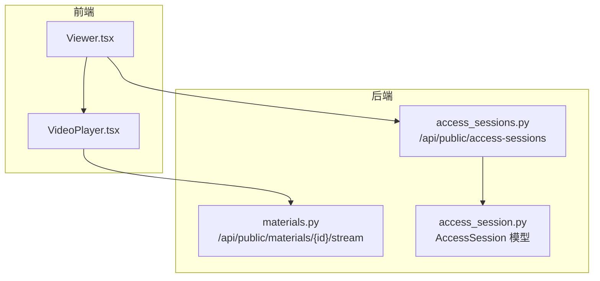
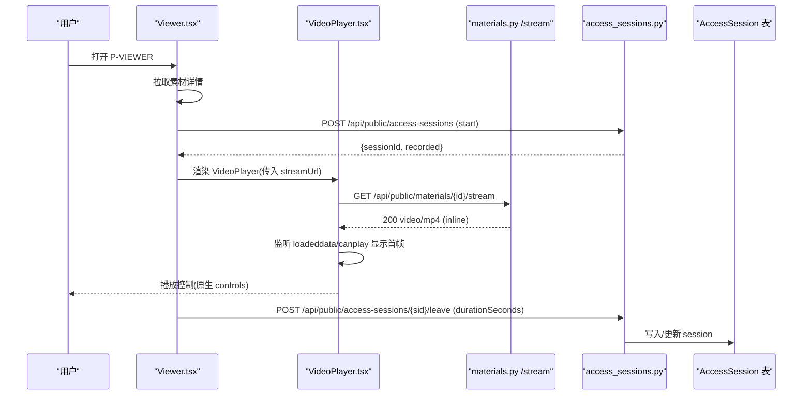
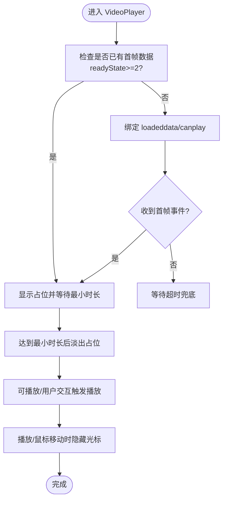
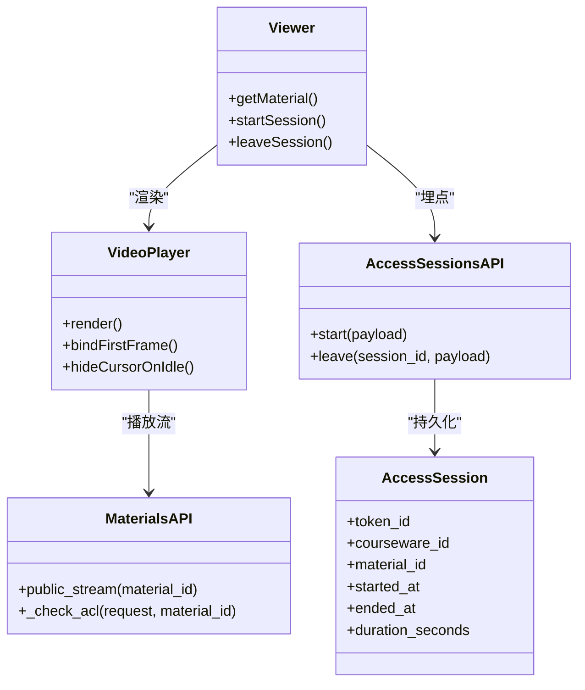
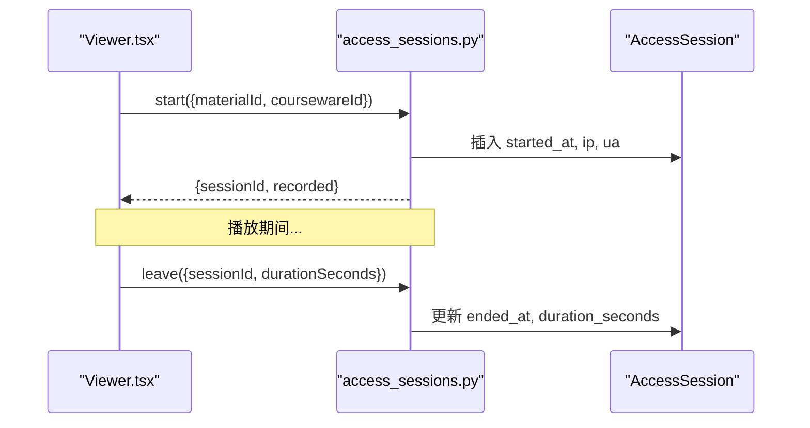

# 视频播放器组件

<cite>
**本文引用的文件**   
- [VideoPlayer.tsx](file://frontend/src/pages/public/viewer/VideoPlayer.tsx)
- [Viewer.tsx](file://frontend/src/pages/public/Viewer.tsx)
- [materials.py](file://backend/app/api/public/materials.py)
- [access_sessions.py](file://backend/app/api/public/access_sessions.py)
- [access_session.py](file://backend/app/models/access_session.py)
</cite>

## 目录
1. [简介](#简介)
2. [项目结构](#项目结构)
3. [核心组件](#核心组件)
4. [架构总览](#架构总览)
5. [详细组件分析](#详细组件分析)
6. [依赖关系分析](#依赖关系分析)
7. [性能与内存优化](#性能与内存优化)
8. [跨浏览器兼容性与移动端适配](#跨浏览器兼容性与移动端适配)
9. [错误处理与恢复](#错误处理与恢复)
10. [流式传输与自适应码率说明](#流式传输与自适应码率说明)
11. [访问会话与行为埋点集成](#访问会话与行为埋点集成)
12. [故障排查指南](#故障排查指南)
13. [结论](#结论)

## 简介
本文件面向 Learning Hub 的“视频播放器组件”，聚焦以下目标：
- HTML5 Video 元素的封装实现与交互细节（占位、首帧可见、光标隐藏等）
- 后端流式预览接口与前端播放链路
- 预加载策略与内存管理
- 跨浏览器兼容与移动端适配要点
- 错误处理机制与最佳实践
- 访问会话系统对接，记录用户观看时长与行为分析
- 关于 HLS/DASH 与自适应码率的现状与建议

## 项目结构
学习平台的前端采用 React + TypeScript，视频播放位于公开浏览页 P-VIEWER 中；后端基于 FastAPI 提供素材流式预览与会话记录 API。

图表来源
- [VideoPlayer.tsx:1-250](file://frontend/src/pages/public/viewer/VideoPlayer.tsx#L1-L250)
- [Viewer.tsx:1-170](file://frontend/src/pages/public/Viewer.tsx#L1-L170)
- [materials.py:84-146](file://backend/app/api/public/materials.py#L84-L146)
- [access_sessions.py:1-137](file://backend/app/api/public/access_sessions.py#L1-L137)
- [access_session.py:56-125](file://backend/app/models/access_session.py#L56-L125)

章节来源
- [VideoPlayer.tsx:1-250](file://frontend/src/pages/public/viewer/VideoPlayer.tsx#L1-L250)
- [Viewer.tsx:1-170](file://frontend/src/pages/public/Viewer.tsx#L1-L170)
- [materials.py:84-146](file://backend/app/api/public/materials.py#L84-L146)
- [access_sessions.py:1-137](file://backend/app/api/public/access_sessions.py#L1-L137)
- [access_session.py:56-125](file://backend/app/models/access_session.py#L56-L125)

## 核心组件
- 视频播放器子组件：负责渲染 HTML5 video、首帧可见占位、自动隐藏光标、基础错误提示、右侧信息面板。
- 浏览页容器：负责拉取素材元数据、分发到具体类型组件、发起访问会话开始/结束埋点。
- 后端流式接口：返回 inline 的 mp4 流，供浏览器直接播放。
- 访问会话接口：记录受限课件的访问起止时间与停留时长。

章节来源
- [VideoPlayer.tsx:34-248](file://frontend/src/pages/public/viewer/VideoPlayer.tsx#L34-L248)
- [Viewer.tsx:45-166](file://frontend/src/pages/public/Viewer.tsx#L45-L166)
- [materials.py:84-146](file://backend/app/api/public/materials.py#L84-L146)
- [access_sessions.py:65-133](file://backend/app/api/public/access_sessions.py#L65-L133)

## 架构总览
P-VIEWER 在加载时获取素材详情并开启访问会话；视频组件通过 streamUrl 请求后端 /stream 接口，由后端以 inline 方式返回 mp4 字节流，浏览器原生解码播放。

图表来源
- [Viewer.tsx:57-106](file://frontend/src/pages/public/Viewer.tsx#L57-L106)
- [VideoPlayer.tsx:52-84](file://frontend/src/pages/public/viewer/VideoPlayer.tsx#L52-L84)
- [materials.py:84-146](file://backend/app/api/public/materials.py#L84-L146)
- [access_sessions.py:65-133](file://backend/app/api/public/access_sessions.py#L65-L133)
- [access_session.py:56-125](file://backend/app/models/access_session.py#L56-L125)

## 详细组件分析

### 视频播放器组件（VideoPlayer）
职责与特性
- 使用 HTML5 <video> 元素，启用原生 controls，禁用下载与画中画，屏蔽右键菜单。
- 首帧可见占位：监听 loadeddata/canplay，结合最小展示时长避免“一闪而过”。
- 自动隐藏光标：播放/暂停/鼠标移动时重置计时器，2 秒无操作隐藏。
- 错误提示：onError 设置错误文案，覆盖占位背景与文案。
- 右侧信息面板：展示名称、类型、时长、大小。

关键实现要点
- 首帧可见判定：优先利用 readyState >= 2 的缓存命中路径；否则监听 loadeddata/canplay，确保第一帧已渲染再隐藏占位。
- 事件清理：组件卸载或 material.id 变化时移除事件与定时器，避免泄漏。
- 资源释放：切换素材时重置状态，防止旧引用残留。

图表来源
- [VideoPlayer.tsx:52-84](file://frontend/src/pages/public/viewer/VideoPlayer.tsx#L52-L84)
- [VideoPlayer.tsx:86-116](file://frontend/src/pages/public/viewer/VideoPlayer.tsx#L86-L116)
- [VideoPlayer.tsx:202-215](file://frontend/src/pages/public/viewer/VideoPlayer.tsx#L202-L215)

章节来源
- [VideoPlayer.tsx:34-248](file://frontend/src/pages/public/viewer/VideoPlayer.tsx#L34-L248)

### 浏览页容器（Viewer）
职责与特性
- 根据素材类型分发到对应子组件（VIDEO/PDF/PPT）。
- 访问会话埋点：成功加载素材后调用 start，组件卸载时调用 leave，使用 best-effort 策略不阻塞主流程。
- 屏蔽下载入口：从透传对象中剥离 downloadUrl，避免子组件误用。

章节来源
- [Viewer.tsx:45-166](file://frontend/src/pages/public/Viewer.tsx#L45-L166)

### 后端流式预览接口（materials.py）
职责与特性
- /{material_id}/stream：按素材类型返回 inline 内容；视频类型为 video/mp4，PDF 为 application/pdf，PPT 优先返回预览 PDF，否则降级返回原文件 attachment。
- ACL 校验：若素材仅出现在 RESTRICTED 课件中，需携带有效 token hash，否则拒绝访问。
- 限流：接口带速率限制装饰器。

章节来源
- [materials.py:84-146](file://backend/app/api/public/materials.py#L84-L146)
- [materials.py:31-62](file://backend/app/api/public/materials.py#L31-L62)

### 访问会话接口与模型（access_sessions.py / access_session.py）
职责与特性
- start：创建访问会话，支持 IP 滑动窗口限流；OPEN 课件不记录；业务异常透传；数据库异常降级不记录。
- leave：幂等结束会话，校验 token_hash 一致性；数据库异常降级 ok=false。
- 模型 AccessSession：包含 token/courseware/material 外键、起止时间、停留秒数、客户端离开标记、IP/UA 等字段，含多索引与约束。

章节来源
- [access_sessions.py:65-133](file://backend/app/api/public/access_sessions.py#L65-L133)
- [access_session.py:56-125](file://backend/app/models/access_session.py#L56-L125)

## 依赖关系分析
- 前端 Viewer 依赖 PublicCoursewareAPI 获取素材详情，并依赖 AccessSessionAPI 进行会话埋点。
- VideoPlayer 依赖浏览器原生 <video> 能力与 DOM 事件。
- 后端 materials.py 依赖 ORM 查询 Material、ACL 校验逻辑与 FileResponse 流式输出。
- 访问会话模块依赖 SQLAlchemy 事务与进程内限流队列。

图表来源
- [Viewer.tsx:57-106](file://frontend/src/pages/public/Viewer.tsx#L57-L106)
- [VideoPlayer.tsx:52-84](file://frontend/src/pages/public/viewer/VideoPlayer.tsx#L52-L84)
- [materials.py:84-146](file://backend/app/api/public/materials.py#L84-L146)
- [access_sessions.py:65-133](file://backend/app/api/public/access_sessions.py#L65-L133)
- [access_session.py:56-125](file://backend/app/models/access_session.py#L56-L125)

## 性能与内存优化
- 首帧可见占位与最小展示时长：避免 loadedmetadata 过早隐藏占位导致黑屏闪烁，提升感知性能。
- 事件与定时器清理：在 effect 清理函数中移除事件监听与 clearTimeout，防止内存泄漏。
- 切换素材重置：当 material.id 变化时重置 ready 与 error 状态，避免旧状态污染。
- 预加载策略：使用 preload="auto"，由浏览器决定缓冲策略；如需更精细控制，可在后续扩展为按需预加载或分段预取。
- 资源释放：组件卸载时移除事件与定时器，必要时可考虑主动清空 video src 与 load()（当前未显式调用，但可通过 ref 在 unmount 时执行）。

章节来源
- [VideoPlayer.tsx:52-84](file://frontend/src/pages/public/viewer/VideoPlayer.tsx#L52-L84)
- [VideoPlayer.tsx:86-116](file://frontend/src/pages/public/viewer/VideoPlayer.tsx#L86-L116)
- [VideoPlayer.tsx:40-44](file://frontend/src/pages/public/viewer/VideoPlayer.tsx#L40-L44)
- [VideoPlayer.tsx:202-215](file://frontend/src/pages/public/viewer/VideoPlayer.tsx#L202-L215)

## 跨浏览器兼容性与移动端适配
- Safari autoplay 限制：当前组件未启用自动播放，用户交互触发播放，规避了 Safari 对自动播放的限制。
- 移动端适配：使用 Tailwind 响应式布局，视频区域最大高度限制，保证在小屏设备上的可读性。
- 兼容性回退：<video> 内部提供不支持时的文本提示，便于降级体验。
- 右键与下载屏蔽：禁用 contextmenu、controlsList nodownload、disablePictureInPicture，降低非预期下载风险。

章节来源
- [VideoPlayer.tsx:202-215](file://frontend/src/pages/public/viewer/VideoPlayer.tsx#L202-L215)
- [VideoPlayer.tsx:152-245](file://frontend/src/pages/public/viewer/VideoPlayer.tsx#L152-L245)

## 错误处理与恢复
- 网络中断与格式不支持：onError 回调设置错误文案，占位层显示错误样式与提示。
- 素材不存在或存储不可用：后端在 /stream 中对文件存在性进行检查，抛出业务错误；前端在 Viewer 层捕获并展示错误页面。
- 访问会话失败：start/leave 均为 best-effort，数据库异常降级不记录，不阻塞主流程。

章节来源
- [VideoPlayer.tsx:212-215](file://frontend/src/pages/public/viewer/VideoPlayer.tsx#L212-L215)
- [Viewer.tsx:81-87](file://frontend/src/pages/public/Viewer.tsx#L81-L87)
- [materials.py:99-111](file://backend/app/api/public/materials.py#L99-L111)
- [access_sessions.py:100-106](file://backend/app/api/public/access_sessions.py#L100-L106)

## 流式传输与自适应码率说明
现状
- 当前后端 /stream 针对 VIDEO 类型返回 video/mp4 的 inline 流，前端使用原生 <video> 播放。
- 代码库中未发现 HLS/DASH 播放器或自适应码率切换的实现。

建议方案（概念性）
- 引入 HLS/DASH 播放器（如 hls.js、dash.js），将 m3u8/dash 清单作为 src，由播放器负责分片请求与码率自适应。
- 服务端可生成多码率版本并通过 CDN 分发，前端根据网络状况动态切换。
- 若保持单码率 mp4，可利用 Range 请求实现断点续播与跳转，HTML5 <video> 默认支持。

[本节为概念性说明，不直接分析具体源码文件]

## 访问会话与行为埋点集成
- 开始会话：Viewer 在素材加载成功后调用 start，后端根据 B-1 规则判断是否记录（OPEN 不记录）。
- 结束会话：组件卸载时调用 leave，上报 durationSeconds；后端校验 token_hash 一致性，幂等更新。
- 指标用途：用于管理后台查看某 token 的访问台账与素材聚合统计。

图表来源
- [Viewer.tsx:71-106](file://frontend/src/pages/public/Viewer.tsx#L71-L106)
- [access_sessions.py:65-133](file://backend/app/api/public/access_sessions.py#L65-L133)
- [access_session.py:56-125](file://backend/app/models/access_session.py#L56-L125)

章节来源
- [Viewer.tsx:71-106](file://frontend/src/pages/public/Viewer.tsx#L71-L106)
- [access_sessions.py:65-133](file://backend/app/api/public/access_sessions.py#L65-L133)
- [access_session.py:56-125](file://backend/app/models/access_session.py#L56-L125)

## 故障排查指南
- 无法播放/黑屏
  - 检查 /stream 是否返回 200 且 Content-Type 为 video/mp4。
  - 确认浏览器控制台是否有 CORS 或 MIME 类型错误。
  - 验证 ACL 校验是否通过（受限课件需携带有效 X-Token-Hash 或 cookie）。
- 访问会话未记录
  - 检查 start 是否返回 recorded=false（OPEN 课件或不记录场景）。
  - 查看 leave 是否被调用（组件是否卸载），以及 durationSeconds 是否正确。
- 移动端异常
  - 确认未尝试自动播放；用户交互触发播放。
  - 检查全屏与手势冲突，必要时调整 CSS 与事件冒泡。

章节来源
- [materials.py:84-146](file://backend/app/api/public/materials.py#L84-L146)
- [access_sessions.py:65-133](file://backend/app/api/public/access_sessions.py#L65-L133)
- [VideoPlayer.tsx:202-215](file://frontend/src/pages/public/viewer/VideoPlayer.tsx#L202-L215)

## 结论
当前视频播放器组件以 HTML5 <video> 为核心，配合简洁的占位与光标隐藏逻辑，满足基本播放需求；后端提供 inline 的 mp4 流式接口，并在受限课件场景下实施 ACL 校验。访问会话埋点实现了基本的观看时长与行为记录。对于 HLS/DASH 与自适应码率，当前仓库未实现，可按建议方案引入播放器与多码率资源以提升用户体验。