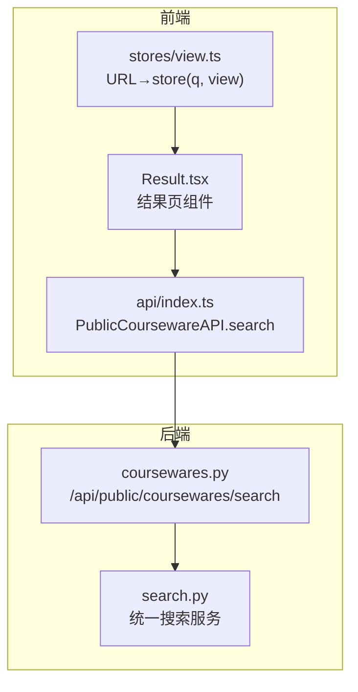
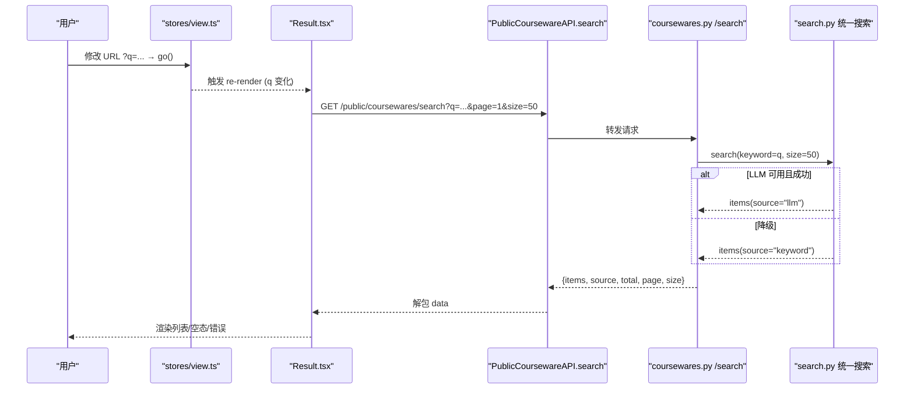
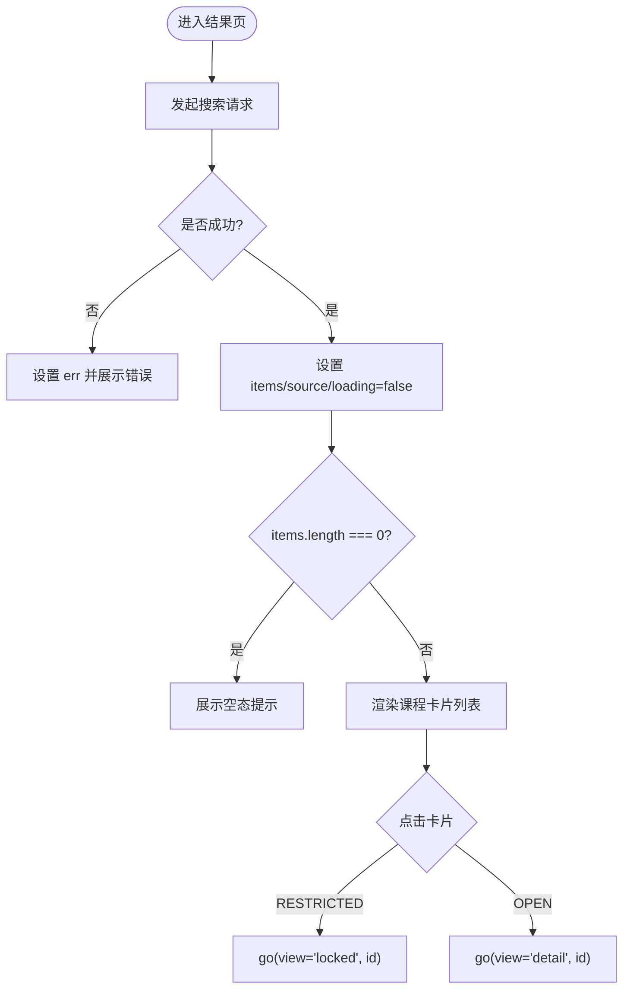
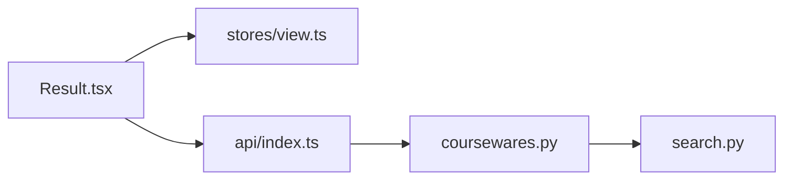

# 搜索结果页面

<cite>
**本文引用的文件**   
- [Result.tsx](file://frontend/src/pages/public/Result.tsx)
- [index.ts](file://frontend/src/api/index.ts)
- [coursewares.py](file://backend/app/api/public/coursewares.py)
- [search.py](file://backend/app/services/search.py)
- [view.ts](file://frontend/src/stores/view.ts)
</cite>

## 目录
1. [简介](#简介)
2. [项目结构](#项目结构)
3. [核心组件](#核心组件)
4. [架构总览](#架构总览)
5. [详细组件分析](#详细组件分析)
6. [依赖关系分析](#依赖关系分析)
7. [性能与优化](#性能与优化)
8. [故障排查指南](#故障排查指南)
9. [结论](#结论)
10. [附录](#附录)

## 简介
本文件面向 Learning Hub 的“搜索结果页面”（P-RESULT），系统性说明前端渲染逻辑、数据绑定、分页能力、排序与过滤机制、空状态处理、搜索历史管理，以及性能优化与错误重试策略。后端统一搜索服务支持“LLM-to-SQL 语义召回 + 关键词 ILIKE 兜底”，并返回 source 字段用于前端展示“AI 智能搜索 / 降级中”。

## 项目结构
搜索结果页面涉及前后端关键文件如下：
- 前端页面：public/Result.tsx
- 前端 API 封装：api/index.ts（PublicCoursewareAPI.search）
- 路由与视图状态：stores/view.ts（q 参数驱动 result 页）
- 后端公开接口：app/api/public/coursewares.py（GET /api/public/coursewares/search）
- 后端搜索服务：app/services/search.py（统一搜索：LLM 优先，keyword 兜底）

图表来源
- [Result.tsx:1-149](file://frontend/src/pages/public/Result.tsx#L1-L149)
- [index.ts:404-415](file://frontend/src/api/index.ts#L404-L415)
- [coursewares.py:32-54](file://backend/app/api/public/coursewares.py#L32-L54)
- [search.py:210-242](file://backend/app/services/search.py#L210-L242)
- [view.ts:58-96](file://frontend/src/stores/view.ts#L58-L96)

章节来源
- [Result.tsx:1-149](file://frontend/src/pages/public/Result.tsx#L1-L149)
- [index.ts:404-415](file://frontend/src/api/index.ts#L404-L415)
- [coursewares.py:32-54](file://backend/app/api/public/coursewares.py#L32-L54)
- [search.py:210-242](file://backend/app/services/search.py#L210-L242)
- [view.ts:58-96](file://frontend/src/stores/view.ts#L58-L96)

## 核心组件
- 结果页组件 ResultPage
  - 从全局 store 读取 q，调用 PublicCoursewareAPI.search({ q, page: 1, size: 50 })
  - 维护 items、source、loading、err 等状态；根据 source 显示“AI 智能搜索 / 降级中”徽标
  - 点击卡片按 accessMode 跳转 detail 或 locked
- 公共搜索 API
  - GET /api/public/coursewares/search?q=&page=1&size=50
  - 响应 envelope data: { items, source, total, page, size }
- 统一搜索服务
  - LLM-to-SQL 召回优先，失败/超时/校验拒绝则回退到 keyword ILIKE
  - 返回 source="llm" 或 "keyword"

章节来源
- [Result.tsx:14-42](file://frontend/src/pages/public/Result.tsx#L14-L42)
- [index.ts:404-415](file://frontend/src/api/index.ts#L404-L415)
- [coursewares.py:32-54](file://backend/app/api/public/coursewares.py#L32-L54)
- [search.py:210-242](file://backend/app/services/search.py#L210-L242)

## 架构总览
下图展示了从 URL 变化到搜索结果渲染的完整链路，包括 LLM 与 keyword 两条路径。

图表来源
- [view.ts:58-96](file://frontend/src/stores/view.ts#L58-L96)
- [Result.tsx:24-42](file://frontend/src/pages/public/Result.tsx#L24-L42)
- [index.ts:404-415](file://frontend/src/api/index.ts#L404-L415)
- [coursewares.py:32-54](file://backend/app/api/public/coursewares.py#L32-L54)
- [search.py:210-242](file://backend/app/services/search.py#L210-L242)

## 详细组件分析

### 搜索结果渲染与数据绑定
- 数据来源
  - 通过 PublicCoursewareAPI.search 获取 data.items 与 data.source
  - source 为 "llm" 或 "keyword"，用于徽标提示
- 卡片设计
  - 标题、作者、描述（最多两行截断）、标签名列表
  - 访问模式徽章：RESTRICTED 显示“受限”，OPEN 显示“开放”
  - 点击行为：RESTRICTED → 跳转 locked；OPEN → 跳转 detail
- 交互与导航
  - 使用 useViewStore.go 进行页面跳转，自动同步 URL

图表来源
- [Result.tsx:24-42](file://frontend/src/pages/public/Result.tsx#L24-L42)
- [Result.tsx:96-145](file://frontend/src/pages/public/Result.tsx#L96-L145)

章节来源
- [Result.tsx:14-42](file://frontend/src/pages/public/Result.tsx#L14-L42)
- [Result.tsx:96-145](file://frontend/src/pages/public/Result.tsx#L96-L145)

### 分页功能实现
- 当前实现
  - 前端固定 page=1、size=50，仅加载首屏
  - 后端返回 total/page/size，便于后续扩展
- 建议的分页方案
  - 计算总页数：Math.ceil(total / size)
  - 监听滚动或使用“加载更多”按钮，递增 page 并追加 items
  - 防抖与去重：基于 lastLoadedPage 与唯一 key（id）避免重复加载
  - 边界条件：当 page > totalPages 时停止加载；网络异常时保留已加载数据并提示重试

章节来源
- [index.ts:404-415](file://frontend/src/api/index.ts#L404-L415)
- [coursewares.py:32-54](file://backend/app/api/public/coursewares.py#L32-L54)

### 排序与过滤机制
- 默认排序
  - LLM 路径：由 LLM 生成的 SQL 决定排序（业务侧可配置）
  - Keyword 路径：默认按 updated_at 降序（最新优先）
- 过滤维度
  - 当前未暴露前端筛选参数；可在后端新增 category/tag/accessMode 等过滤项，并在前端增加筛选 UI
- 相关性排序
  - LLM 路径可结合命中分数或自定义权重；Keyword 路径可按匹配度启发式加权（需后端改造）

章节来源
- [search.py:115-160](file://backend/app/services/search.py#L115-L160)
- [search.py:210-242](file://backend/app/services/search.py#L210-L242)

### 空状态与用户引导
- 无结果时展示友好文案，并建议缩短关键词
- 可扩展：提供“热门搜索词”、“推荐课件”或“清空搜索”快捷操作

章节来源
- [Result.tsx:87-94](file://frontend/src/pages/public/Result.tsx#L87-L94)

### 搜索历史保存与管理
- 现状
  - 当前未持久化搜索历史；URL 中的 q 可作为临时记忆
- 建议方案
  - 使用 localStorage 存储最近 N 条历史，支持删除与一键回填
  - 在输入框下方展示历史下拉，点击即回填并触发搜索
  - 注意隐私与容量限制，定期清理过期条目

[本节为概念性内容，不直接分析具体文件]

### 错误处理与重试机制
- 前端
  - 捕获异常并设置 err；loading 在 finally 中关闭
  - 建议：对网络错误提供“重试”按钮；对服务端错误映射友好提示
- 后端
  - LLM 超时/异常均会降级至 keyword；返回 source 标识
  - 建议：对 5xx 返回标准错误码，前端据此区分重试策略

章节来源
- [Result.tsx:24-42](file://frontend/src/pages/public/Result.tsx#L24-L42)
- [search.py:222-242](file://backend/app/services/search.py#L222-L242)

## 依赖关系分析
- 前端
  - Result.tsx 依赖 stores/view.ts（q 与 go）与 api/index.ts（PublicCoursewareAPI.search）
- 后端
  - coursewares.py 的 /search 路由依赖 services/search.py 的统一搜索服务
- 外部依赖
  - LLM-to-SQL 路径依赖 dashscope 与 SQL 安全校验（由 search.py 内部调用）

图表来源
- [Result.tsx:1-149](file://frontend/src/pages/public/Result.tsx#L1-L149)
- [index.ts:404-415](file://frontend/src/api/index.ts#L404-L415)
- [coursewares.py:32-54](file://backend/app/api/public/coursewares.py#L32-L54)
- [search.py:210-242](file://backend/app/services/search.py#L210-L242)
- [view.ts:58-96](file://frontend/src/stores/view.ts#L58-L96)

章节来源
- [Result.tsx:1-149](file://frontend/src/pages/public/Result.tsx#L1-L149)
- [index.ts:404-415](file://frontend/src/api/index.ts#L404-L415)
- [coursewares.py:32-54](file://backend/app/api/public/coursewares.py#L32-L54)
- [search.py:210-242](file://backend/app/services/search.py#L210-L242)
- [view.ts:58-96](file://frontend/src/stores/view.ts#L58-L96)

## 性能与优化
- 请求合并与防抖
  - 建议在输入变更时使用防抖（如 300ms）再触发搜索，减少频繁请求
  - 若同时存在多个并发请求，使用 AbortController 取消过时请求
- 缓存策略
  - 对相同 q 的结果做短期内存缓存（Map<q, {items, source}>），切换回相同关键词时直接复用
- 渲染优化
  - 大数据量场景采用虚拟列表（只渲染可视区域）
  - 图片懒加载与占位图提升首屏体验
- 后端优化
  - LLM 超时阈值可调（默认约 8s），keyword 路径走数据库索引与 EXISTS 子查询优化
  - 合理设置 size 上限（当前最大 50），避免过大响应体

章节来源
- [search.py:222-242](file://backend/app/services/search.py#L222-L242)
- [coursewares.py:32-54](file://backend/app/api/public/coursewares.py#L32-L54)

## 故障排查指南
- 现象：搜索结果始终显示“降级中”
  - 检查 LLM 配置与可用性；查看后端日志中“LLM SQL search timeout/fallback to keyword”
- 现象：点击受限课件无法打开
  - 确认解锁流程是否正确写入 X-Token-Hash 头或 Cookie；后端校验 token 哈希是否匹配
- 现象：空结果过多
  - 调整关键词清洗规则与候选生成策略；扩大 keyword 匹配字段或引入同义词库

章节来源
- [search.py:222-242](file://backend/app/services/search.py#L222-L242)
- [coursewares.py:57-76](file://backend/app/api/public/coursewares.py#L57-L76)

## 结论
搜索结果页面以简洁的数据流实现了“LLM 优先、keyword 兜底”的统一搜索体验。当前版本聚焦首屏加载与基础交互，具备良好扩展性：可通过分页、排序/过滤、历史管理与性能优化进一步提升用户体验与系统稳定性。

## 附录
- 关键数据结构
  - CoursewareItem：包含 id/title/author/description/accessMode/tagNames/materials 等
  - 搜索结果 envelope：{ items, source, total, page, size }
- 相关类型定义位置
  - CoursewareItem 类型：见 api/index.ts 中类型声明
  - 搜索响应类型：见 PublicCoursewareAPI.search 的类型注解

章节来源
- [index.ts:333-355](file://frontend/src/api/index.ts#L333-L355)
- [index.ts:404-415](file://frontend/src/api/index.ts#L404-L415)