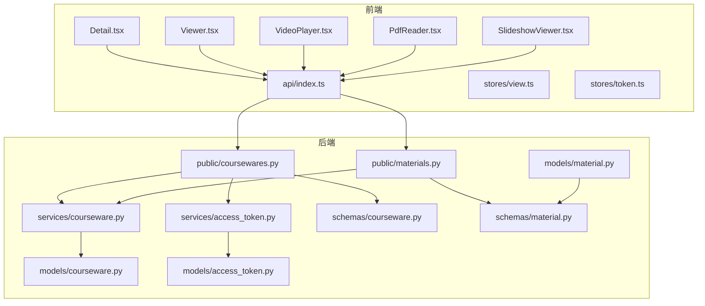
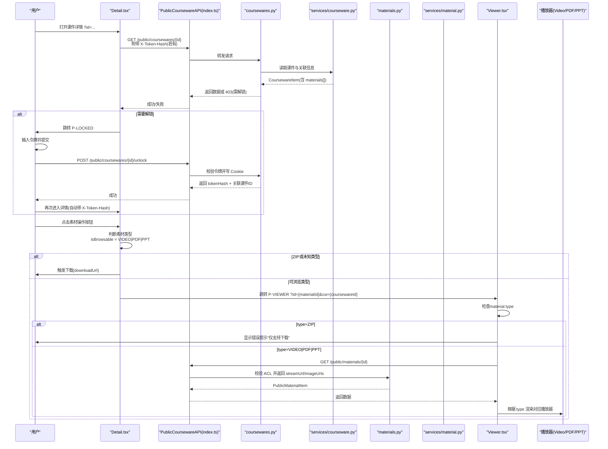
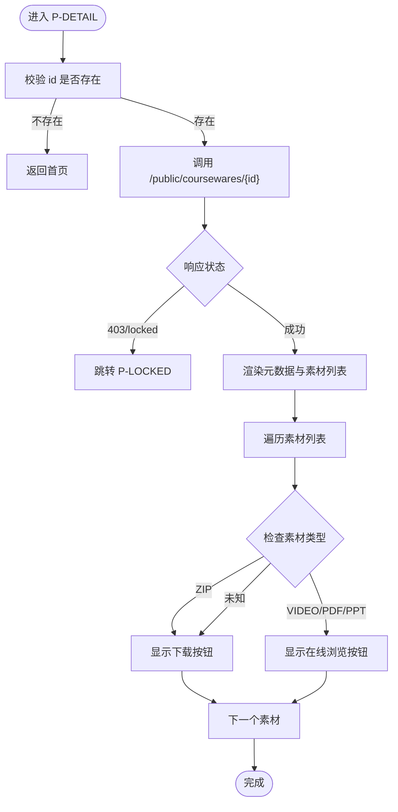
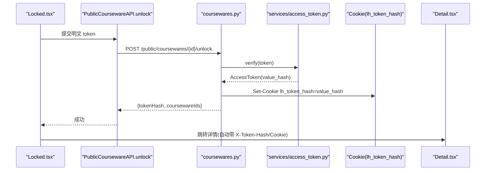
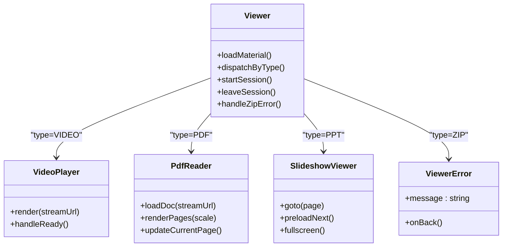
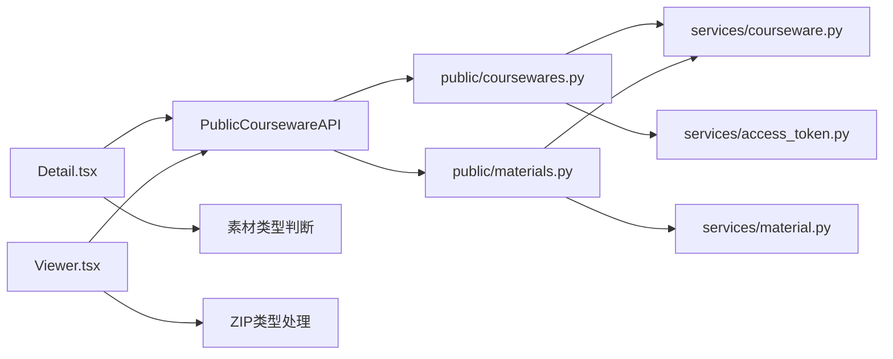

# 课件详情页面

<cite>
**本文引用的文件**   
- [Detail.tsx](file://frontend/src/pages/public/Detail.tsx)
- [Viewer.tsx](file://frontend/src/pages/public/Viewer.tsx)
- [VideoPlayer.tsx](file://frontend/src/pages/public/viewer/VideoPlayer.tsx)
- [PdfReader.tsx](file://frontend/src/pages/public/viewer/PdfReader.tsx)
- [SlideshowViewer.tsx](file://frontend/src/pages/public/viewer/SlideshowViewer.tsx)
- [index.ts](file://frontend/src/api/index.ts)
- [view.ts](file://frontend/src/stores/view.ts)
- [token.ts](file://frontend/src/stores/token.ts)
- [coursewares.py](file://backend/app/api/public/coursewares.py)
- [materials.py](file://backend/app/api/public/materials.py)
- [courseware.py](file://backend/app/services/courseware.py)
- [access_token.py](file://backend/app/services/access_token.py)
- [courseware.py](file://backend/app/models/courseware.py)
- [access_token.py](file://backend/app/models/access_token.py)
- [courseware.py](file://backend/app/schemas/courseware.py)
- [material.py](file://backend/app/schemas/material.py)
- [material.py](file://backend/app/models/material.py)
</cite>

## 更新摘要
**变更内容**   
- 更新了素材列表渲染逻辑，支持ZIP材料的条件渲染
- 新增ZIP材料类型处理，显示下载按钮而非在线浏览按钮
- 完善了Viewer组件对ZIP类型的错误处理
- 更新了相关测试用例和文档说明

## 目录
1. [简介](#简介)
2. [项目结构](#项目结构)
3. [核心组件](#核心组件)
4. [架构总览](#架构总览)
5. [详细组件分析](#详细组件分析)
6. [依赖关系分析](#依赖关系分析)
7. [性能与缓存策略](#性能与缓存策略)
8. [错误边界与用户反馈](#错误边界与用户反馈)
9. [结论](#结论)
10. [附录：API 契约与数据模型](#附录api-契约与数据模型)

## 简介
本文件面向"Learning Hub"前台的课件详情页面（P-DETAIL）及其在线预览能力（P-VIEWER），系统性说明以下方面：
- 课件数据的获取、解析与错误处理
- 权限验证机制（访问令牌检查与解锁流程）
- 课件元数据展示逻辑（标题、作者、分类、标签等）
- 多媒体素材在线预览（视频、PDF、PPT）
- ZIP材料特殊处理与下载功能
- 用户交互（收藏、分享、下载）现状与建议
- 数据缓存策略与性能优化
- 完整的错误边界与用户反馈机制

## 项目结构
前端侧关键路径：
- 详情页：frontend/src/pages/public/Detail.tsx
- 预览页：frontend/src/pages/public/Viewer.tsx 及子组件 VideoPlayer/PdfReader/SlideshowViewer
- API 封装与类型：frontend/src/api/index.ts
- 路由与状态：frontend/src/stores/view.ts
- 令牌记忆：frontend/src/stores/token.ts

后端侧关键路径：
- 公开课件接口：backend/app/api/public/coursewares.py
- 公开素材接口：backend/app/api/public/materials.py
- 课件服务层：backend/app/services/courseware.py
- 令牌服务层：backend/app/services/access_token.py
- 数据模型与 Schema：backend/app/models/*.py, backend/app/schemas/*.py

图表来源
- [Detail.tsx:1-204](file://frontend/src/pages/public/Detail.tsx#L1-L204)
- [Viewer.tsx:1-170](file://frontend/src/pages/public/Viewer.tsx#L1-L170)
- [VideoPlayer.tsx:1-250](file://frontend/src/pages/public/viewer/VideoPlayer.tsx#L1-L250)
- [PdfReader.tsx:1-270](file://frontend/src/pages/public/viewer/PdfReader.tsx#L1-L270)
- [SlideshowViewer.tsx:1-277](file://frontend/src/pages/public/viewer/SlideshowViewer.tsx#L1-L277)
- [index.ts:1-443](file://frontend/src/api/index.ts#L1-L443)
- [view.ts:1-127](file://frontend/src/stores/view.ts#L1-L127)
- [token.ts:1-54](file://frontend/src/stores/token.ts#L1-L54)
- [coursewares.py:1-133](file://backend/app/api/public/coursewares.py#L1-L133)
- [materials.py:1-224](file://backend/app/api/public/materials.py#L1-L224)
- [courseware.py:1-492](file://backend/app/services/courseware.py#L1-L492)
- [access_token.py:1-235](file://backend/app/services/access_token.py#L1-L235)
- [courseware.py:1-74](file://backend/app/models/courseware.py#L1-L74)
- [access_token.py:1-34](file://backend/app/models/access_token.py#L1-L34)
- [courseware.py:1-120](file://backend/app/schemas/courseware.py#L1-L120)
- [material.py:1-28](file://backend/app/schemas/material.py#L1-L28)
- [material.py:1-71](file://backend/app/models/material.py#L1-L71)

章节来源
- [Detail.tsx:1-204](file://frontend/src/pages/public/Detail.tsx#L1-L204)
- [Viewer.tsx:1-170](file://frontend/src/pages/public/Viewer.tsx#L1-L170)
- [index.ts:1-443](file://frontend/src/api/index.ts#L1-L443)
- [view.ts:1-127](file://frontend/src/stores/view.ts#L1-L127)
- [token.ts:1-54](file://frontend/src/stores/token.ts#L1-L54)
- [coursewares.py:1-133](file://backend/app/api/public/coursewares.py#L1-L133)
- [materials.py:1-224](file://backend/app/api/public/materials.py#L1-L224)
- [courseware.py:1-492](file://backend/app/services/courseware.py#L1-L492)
- [access_token.py:1-235](file://backend/app/services/access_token.py#L1-L235)
- [courseware.py:1-74](file://backend/app/models/courseware.py#L1-L74)
- [access_token.py:1-34](file://backend/app/models/access_token.py#L1-L34)
- [courseware.py:1-120](file://backend/app/schemas/courseware.py#L1-L120)
- [material.py:1-28](file://backend/app/schemas/material.py#L1-L28)
- [material.py:1-71](file://backend/app/models/material.py#L1-L71)

## 核心组件
- 课件详情（P-DETAIL）
  - 负责通过 /public/coursewares/{id} 拉取课件详情，按 accessMode 判断是否受限；若受限且未携带有效 tokenHash，则跳转至 P-LOCKED。
  - 渲染课件元数据（标题、作者、分类、标签、描述）与素材列表（按 sortOrder 升序）。
  - **更新**：根据素材类型动态渲染操作按钮，ZIP材料显示下载按钮，其他可浏览类型显示在线浏览按钮。
- 在线预览（P-VIEWER）
  - 根据素材类型分发到 VideoPlayer/PdfReader/SlideshowViewer。
  - **更新**：对ZIP类型进行特殊处理，显示友好提示信息而非尝试预览。
  - 在加载成功后发起访问会话埋点，离开时上报停留时长。
- 令牌记忆（P-TOKEN）
  - 使用 localStorage 持久化 coursewareId -> tokenHash 映射，供后续请求以 X-Token-Hash 头携带。
- 路由与视图状态（P-VIEW）
  - 基于 URL query 同步 view/q/id/cw，提供 go() 导航并维护浏览器历史。

章节来源
- [Detail.tsx:1-204](file://frontend/src/pages/public/Detail.tsx#L1-L204)
- [Viewer.tsx:1-170](file://frontend/src/pages/public/Viewer.tsx#L1-L170)
- [token.ts:1-54](file://frontend/src/stores/token.ts#L1-L54)
- [view.ts:1-127](file://frontend/src/stores/view.ts#L1-L127)

## 架构总览
下图展示了从用户点击操作按钮到最终处理的完整流程，包括ZIP材料的特殊处理逻辑。

图表来源
- [Detail.tsx:1-204](file://frontend/src/pages/public/Detail.tsx#L1-L204)
- [Viewer.tsx:1-170](file://frontend/src/pages/public/Viewer.tsx#L1-L170)
- [index.ts:1-443](file://frontend/src/api/index.ts#L1-L443)
- [coursewares.py:1-133](file://backend/app/api/public/coursewares.py#L1-L133)
- [materials.py:1-224](file://backend/app/api/public/materials.py#L1-L224)
- [courseware.py:1-492](file://backend/app/services/courseware.py#L1-L492)

## 详细组件分析

### 课件详情（P-DETAIL）
- 数据获取
  - 调用 PublicCoursewareAPI.get(id)，自动附加 X-Token-Hash（来自 useTokenStore）。
  - 若服务端返回 403 或 code=courseware_locked，则跳转 P-LOCKED。
- 元数据渲染
  - 标题、作者、分类名、标签集合、描述均直接渲染。
  - 受保护标识：RESTRICTED 显示"受限"，OPEN 显示"开放"。
- 素材列表
  - 按 sortOrder 升序展示；当素材数 > 1 时提示"由管理员设定的学习顺序"。
  - **更新**：实现条件渲染逻辑，根据素材类型显示不同操作按钮：
    - ZIP材料：显示"下载"按钮，直接链接到 downloadUrl
    - VIDEO/PDF/PPT：显示"在线浏览"按钮，跳转到预览页面
    - 未知类型：默认显示"下载"按钮作为兜底
- 错误处理
  - 统一捕获异常，区分锁定与非锁定错误，分别引导解锁或展示错误信息。

图表来源
- [Detail.tsx:1-204](file://frontend/src/pages/public/Detail.tsx#L1-L204)
- [index.ts:1-443](file://frontend/src/api/index.ts#L1-L443)
- [coursewares.py:1-133](file://backend/app/api/public/coursewares.py#L1-L133)

章节来源
- [Detail.tsx:1-204](file://frontend/src/pages/public/Detail.tsx#L1-L204)
- [index.ts:1-443](file://frontend/src/api/index.ts#L1-L443)
- [coursewares.py:1-133](file://backend/app/api/public/coursewares.py#L1-L133)
- [courseware.py:1-492](file://backend/app/services/courseware.py#L1-L492)

### 权限验证与解锁流程
- 前端
  - useTokenStore 持久化 coursewareId -> tokenHash，并在每次公共请求中注入 X-Token-Hash 头。
  - Locked 页面提交明文 token 后，调用 unlock 接口，成功后写入 store 并跳转详情。
- 后端
  - GET /public/coursewares/{id}：对 RESTRICTED 课件校验 X-Token-Hash 或 Cookie lh_token_hash，不匹配则 403。
  - POST /public/coursewares/{id}/unlock：校验明文 token，命中绑定课件后将 value_hash 写入 Cookie（7 天），并返回 tokenHash 与关联课件 ID 集合。
  - 素材接口同样执行 ACL 校验：若素材仅被 RESTRICTED 课件引用，需命中任一绑定令牌。

图表来源
- [token.ts:1-54](file://frontend/src/stores/token.ts#L1-L54)
- [index.ts:1-443](file://frontend/src/api/index.ts#L1-L443)
- [coursewares.py:1-133](file://backend/app/api/public/coursewares.py#L1-L133)
- [access_token.py:1-235](file://backend/app/services/access_token.py#L1-L235)

章节来源
- [token.ts:1-54](file://frontend/src/stores/token.ts#L1-L54)
- [index.ts:1-443](file://frontend/src/api/index.ts#L1-L443)
- [coursewares.py:1-133](file://backend/app/api/public/coursewares.py#L1-L133)
- [materials.py:1-224](file://backend/app/api/public/materials.py#L1-L224)
- [access_token.py:1-235](file://backend/app/services/access_token.py#L1-L235)

### 多媒体素材预览（P-VIEWER）
- 路由分发
  - Viewer 根据 material.type 分发到 VideoPlayer/PdfReader/SlideshowViewer。
  - **更新**：新增ZIP类型的特殊处理，显示友好错误提示。
- 视频（VIDEO）
  - 使用 HTML5 video 播放 streamUrl，禁用右键与下载控件，首帧出现前显示占位。
- PDF（PDF）
  - 使用 pdfjs 将每页渲染为 canvas，支持缩放与双击放大，IntersectionObserver 更新当前页码。
- PPT（PPT）
  - 后端已生成 PNG 预览图，前端按 imageUrls 逐页加载，后台预加载下一页避免闪烁。
- ZIP材料处理
  - **新增**：当检测到ZIP类型时，显示错误卡片提示"该素材仅支持下载，请在课件详情页使用「下载」按钮获取文件"。
  - 提供"返回详情"按钮，引导用户回到正确的操作流程。
- 访问会话埋点
  - 素材加载成功后 start(session)，组件卸载时 leave(session, durationSeconds)。

图表来源
- [Viewer.tsx:1-170](file://frontend/src/pages/public/Viewer.tsx#L1-L170)
- [VideoPlayer.tsx:1-250](file://frontend/src/pages/public/viewer/VideoPlayer.tsx#L1-L250)
- [PdfReader.tsx:1-270](file://frontend/src/pages/public/viewer/PdfReader.tsx#L1-L270)
- [SlideshowViewer.tsx:1-277](file://frontend/src/pages/public/viewer/SlideshowViewer.tsx#L1-L277)

章节来源
- [Viewer.tsx:1-170](file://frontend/src/pages/public/Viewer.tsx#L1-L170)
- [VideoPlayer.tsx:1-250](file://frontend/src/pages/public/viewer/VideoPlayer.tsx#L1-L250)
- [PdfReader.tsx:1-270](file://frontend/src/pages/public/viewer/PdfReader.tsx#L1-L270)
- [SlideshowViewer.tsx:1-277](file://frontend/src/pages/public/viewer/SlideshowViewer.tsx#L1-L277)
- [materials.py:1-224](file://backend/app/api/public/materials.py#L1-L224)

### 用户交互功能现状与建议
- 收藏/分享
  - 当前代码未实现收藏与分享功能。可在 Detail 顶部增加操作区，调用新增的收藏/分享 API，并通过 Toast 组件反馈结果。
- 下载
  - **更新**：v1.2 起前台不再提供任何"下载到本地"入口，但ZIP材料作为例外情况保留下载功能。
  - v1.6+：ZIP材料在课件详情页直接显示"下载"按钮，点击后触发浏览器原生下载行为。
  - 后端 /api/public/materials/{id}/file 仍保留用于管理后台与调试。
  - 建议：如需恢复其他类型的下载功能，应在 UI 显式提示风险并记录审计日志，同时复用现有 ACL 校验。

章节来源
- [Detail.tsx:1-204](file://frontend/src/pages/public/Detail.tsx#L1-L204)
- [materials.py:1-224](file://backend/app/api/public/materials.py#L1-L224)

## 依赖关系分析
- 前端耦合
  - Detail.tsx 依赖 PublicCoursewareAPI 与 useViewStore/useTokenStore。
  - **更新**：Detail.tsx 新增对素材类型的条件判断逻辑，影响按钮渲染。
  - Viewer.tsx 依赖 PublicCoursewareAPI.getMaterial 与 AccessSessionAPI。
  - **更新**：Viewer.tsx 新增对ZIP类型的错误处理分支。
  - 各播放器组件仅依赖 viewerMaterial 字段，屏蔽 downloadUrl 防止泄露。
- 后端耦合
  - public/coursewares.py 依赖 services/courseware.py 与 services/access_token.py。
  - public/materials.py 依赖 services/material.py 与 courseware_svc.get_many 做 ACL 聚合校验。
  - data models 与 Schema 清晰分离，便于扩展。
  - **更新**：MaterialType 枚举包含 ZIP 类型，支持新的材料格式。

图表来源
- [Detail.tsx:1-204](file://frontend/src/pages/public/Detail.tsx#L1-L204)
- [Viewer.tsx:1-170](file://frontend/src/pages/public/Viewer.tsx#L1-L170)
- [index.ts:1-443](file://frontend/src/api/index.ts#L1-L443)
- [coursewares.py:1-133](file://backend/app/api/public/coursewares.py#L1-L133)
- [materials.py:1-224](file://backend/app/api/public/materials.py#L1-L224)
- [courseware.py:1-492](file://backend/app/services/courseware.py#L1-L492)
- [access_token.py:1-235](file://backend/app/services/access_token.py#L1-L235)

章节来源
- [index.ts:1-443](file://frontend/src/api/index.ts#L1-L443)
- [coursewares.py:1-133](file://backend/app/api/public/coursewares.py#L1-L133)
- [materials.py:1-224](file://backend/app/api/public/materials.py#L1-L224)
- [courseware.py:1-492](file://backend/app/services/courseware.py#L1-L492)
- [access_token.py:1-235](file://backend/app/services/access_token.py#L1-L235)

## 性能与缓存策略
- 前端缓存
  - 令牌哈希：useTokenStore 使用 localStorage 持久化，避免重复解锁。
  - 路由状态：useViewStore 同步 URL，减少不必要的重渲染。
- 网络与资源
  - 视频：HTML5 video 原生缓冲与浏览器 HTTP 缓存可显著降低带宽。
  - PDF：pdfjs 按需渲染页面，结合 IntersectionObserver 提升滚动性能。
  - PPT：后端预生成 PNG 图片，前端后台预加载下一页，避免切换闪烁。
  - ZIP：直接浏览器下载，无需额外网络请求处理。
- 速率限制
  - 后端对流式与图片接口启用限流（60/分钟），防止滥用。
- 建议
  - 对课件详情与素材元数据引入短期内存缓存（如 React Query 或自定义 Map），配合版本号失效。
  - 对大体积 PDF 采用分页懒加载与离屏渲染控制。
  - 对 PPT 图片启用 CDN 与强缓存策略。
  - 对ZIP下载添加进度反馈和错误重试机制。

[本节为通用指导，无需源码引用]

## 错误边界与用户反馈
- 前端错误边界
  - Detail：捕获 403/locked 与非锁定错误，分别跳转解锁或展示错误信息。
  - **更新**：Viewer：对ZIP类型显示友好的错误提示，引导用户使用正确的下载流程。
  - 播放器：各自内部错误处理（视频 onError、PDF 加载失败原因分类、PPT 单页失败提示）。
- 用户反馈
  - 可使用全局 Toast 组件进行成功/失败提示（当前未集成于详情/解锁流程，可按需接入）。
  - **更新**：ZIP材料下载失败时提供明确的错误信息和解决建议。
- 后端错误
  - 业务错误通过 BusinessError 抛出，包含错误码与消息，前端据此差异化处理。

章节来源
- [Detail.tsx:1-204](file://frontend/src/pages/public/Detail.tsx#L1-L204)
- [Viewer.tsx:1-170](file://frontend/src/pages/public/Viewer.tsx#L1-L170)
- [VideoPlayer.tsx:1-250](file://frontend/src/pages/public/viewer/VideoPlayer.tsx#L1-L250)
- [PdfReader.tsx:1-270](file://frontend/src/pages/public/viewer/PdfReader.tsx#L1-L270)
- [SlideshowViewer.tsx:1-277](file://frontend/src/pages/public/viewer/SlideshowViewer.tsx#L1-L277)

## 结论
P-DETAIL 与 P-VIEWER 形成了"详情—解锁—预览"的完整闭环。**更新后的版本**增强了对ZIP材料的支持，实现了基于素材类型的条件渲染逻辑。前端通过 X-Token-Hash 与 Cookie 双通道确保鉴权稳定，后端在服务层集中实现 ACL 校验与排序语义。多媒体预览针对四种类型（VIDEO、PDF、PPT、ZIP）做了针对性优化，其中ZIP材料专门处理下载场景，整体具备良好的用户体验与可扩展性。建议在后续迭代中补充收藏/分享能力，并完善统一的错误提示与埋点统计。

[本节为总结，无需源码引用]

## 附录：API 契约与数据模型

### 公开课件 API
- GET /api/public/coursewares/search
  - 参数：q/page/size
  - 返回：{ items[], source?, total?, page, size }
- GET /api/public/coursewares/{id}
  - 头部：X-Token-Hash（可选）
  - 返回：CoursewareItem（含 materials[]）
- POST /api/public/coursewares/{id}/unlock
  - 请求体：{ token }
  - 返回：{ tokenHash, coursewareIds[] }
  - 副作用：Set-Cookie lh_token_hash=value_hash(max_age=7d)

章节来源
- [coursewares.py:1-133](file://backend/app/api/public/coursewares.py#L1-L133)
- [courseware.py:1-120](file://backend/app/schemas/courseware.py#L1-L120)

### 公开素材 API
- GET /api/public/materials/{id}
  - 头部：X-Token-Hash（可选）
  - 返回：PublicMaterialItem（含 streamUrl/downloadUrl/imageUrls/imageCount/previewReady）
- GET /api/public/materials/{id}/stream
  - 行为：inline 返回视频/PDF/PPT 预览（PPT 优先 preview_pdf_path，否则降级 attachment）
- GET /api/public/materials/{id}/image/{page_no}
  - 行为：返回第 N 张 PNG（1-indexed）
- GET /api/public/materials/{id}/file
  - 行为：attachment 返回原文件（管理后台/调试用，ZIP材料的主要下载入口）

章节来源
- [materials.py:1-224](file://backend/app/api/public/materials.py#L1-L224)
- [material.py:1-28](file://backend/app/schemas/material.py#L1-L28)

### 数据模型要点
- Courseware
  - access_mode: OPEN | RESTRICTED
  - 多对多：tags, materials(sort_order), access_tokens
- AccessToken
  - 仅存储 value_hash(SHA-256)，label 唯一
- CoursewareItem
  - 包含 categoryName/tagNames/materials(sortOrder 升序)
- **更新**：MaterialType 枚举
  - 新增 ZIP 类型支持
  - 支持的扩展名映射：mp4→VIDEO, pdf→PDF, ppt/pptx→PPT, zip→ZIP

章节来源
- [courseware.py:1-74](file://backend/app/models/courseware.py#L1-L74)
- [access_token.py:1-34](file://backend/app/models/access_token.py#L1-L34)
- [courseware.py:1-120](file://backend/app/schemas/courseware.py#L1-L120)
- [material.py:1-71](file://backend/app/models/material.py#L1-L71)
- [material.py:1-28](file://backend/app/schemas/material.py#L1-L28)