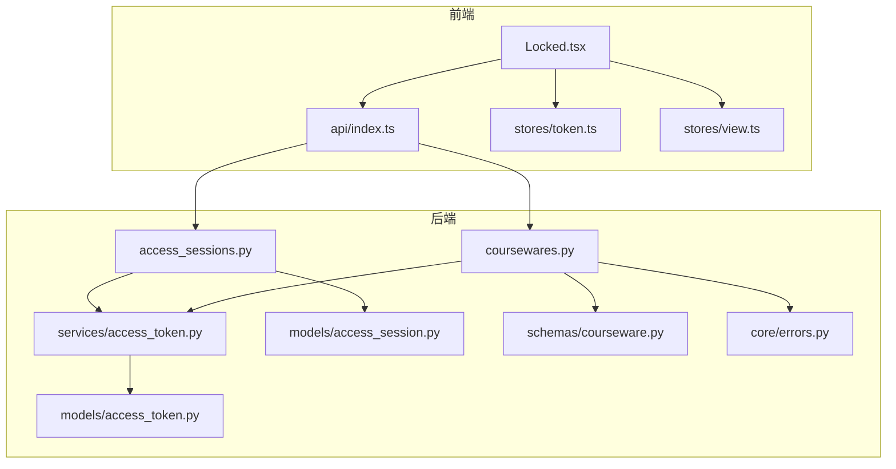
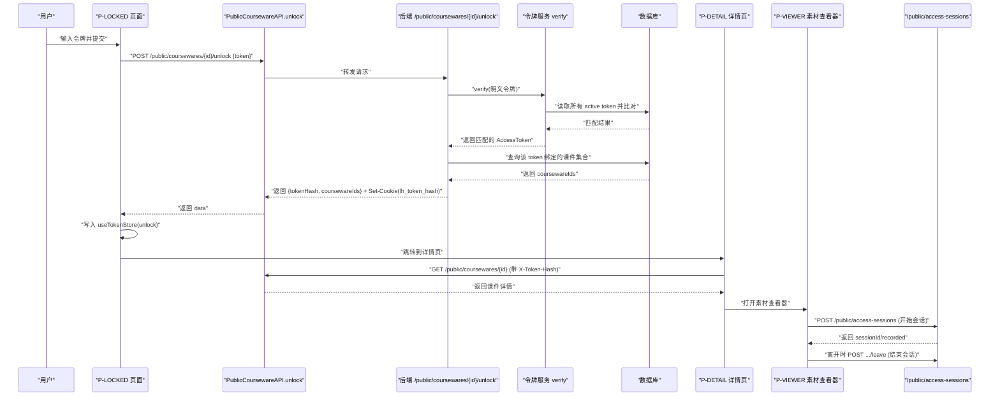
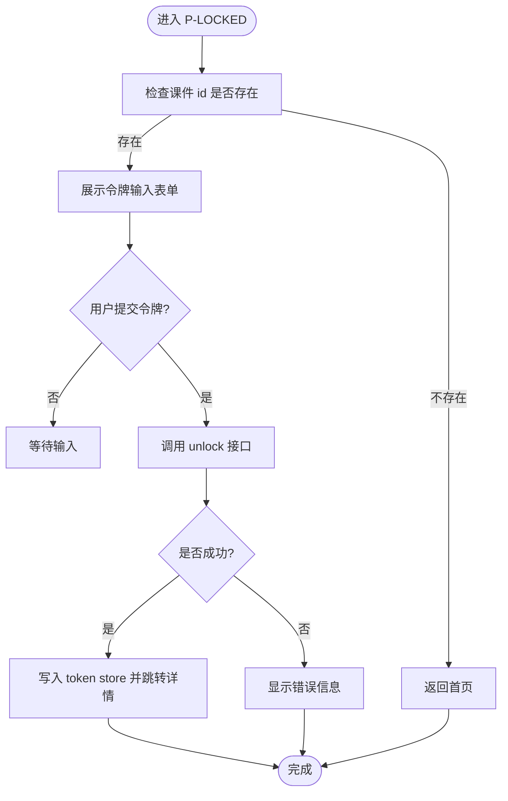
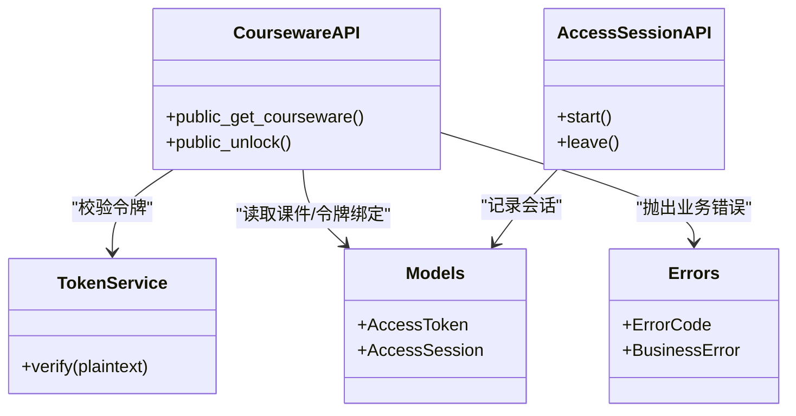
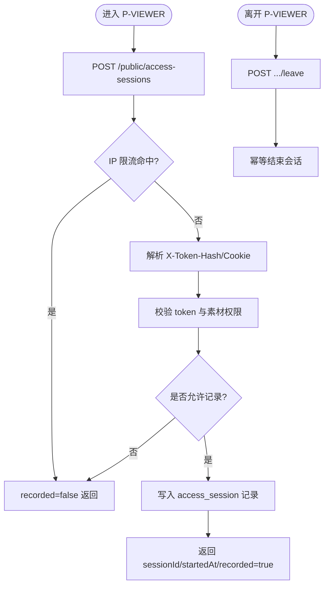
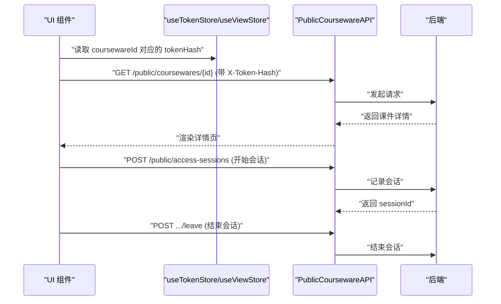
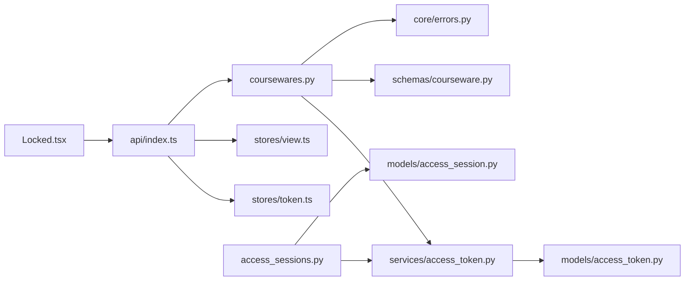

# 锁定访问页面

<cite>
**本文引用的文件**   
- [frontend/src/pages/public/Locked.tsx](file://frontend/src/pages/public/Locked.tsx)
- [frontend/src/api/index.ts](file://frontend/src/api/index.ts)
- [frontend/src/stores/token.ts](file://frontend/src/stores/token.ts)
- [frontend/src/stores/view.ts](file://frontend/src/stores/view.ts)
- [backend/app/api/public/coursewares.py](file://backend/app/api/public/coursewares.py)
- [backend/app/api/public/access_sessions.py](file://backend/app/api/public/access_sessions.py)
- [backend/app/services/access_token.py](file://backend/app/services/access_token.py)
- [backend/app/models/access_token.py](file://backend/app/models/access_token.py)
- [backend/app/models/access_session.py](file://backend/app/models/access_session.py)
- [backend/app/schemas/courseware.py](file://backend/app/schemas/courseware.py)
- [backend/app/core/errors.py](file://backend/app/core/errors.py)
- [backend/tests/test_access_tokens.py](file://backend/tests/test_access_tokens.py)
- [frontend/e2e/front-detail.spec.ts](file://frontend/e2e/front-detail.spec.ts)
</cite>

## 目录
1. [简介](#简介)
2. [项目结构](#项目结构)
3. [核心组件](#核心组件)
4. [架构总览](#架构总览)
5. [详细组件分析](#详细组件分析)
6. [依赖关系分析](#依赖关系分析)
7. [性能与可用性](#性能与可用性)
8. [故障排查指南](#故障排查指南)
9. [结论](#结论)
10. [附录](#附录)

## 简介
本文件面向“Learning Hub”的锁定访问页面（P-LOCKED）及其相关解锁流程，提供从前端到后端的完整开发文档。内容覆盖：
- 访问控制实现机制：权限检查逻辑、锁定条件判断
- 解锁流程的用户体验设计：令牌输入界面、验证过程
- 错误处理策略：无效令牌、网络异常、限流降级等
- 安全考虑：令牌哈希存储、常量时间比对、防暴力破解
- 用户引导：如何获取访问权限、友好提示与解决方案建议
- 状态管理与反馈：前端 store 持久化、URL 同步、会话埋点

## 项目结构
围绕锁定访问功能的关键代码分布如下：
- 前端
  - 页面：public/Locked.tsx（锁定页 UI 与交互）
  - API 封装：api/index.ts（公共接口调用、X-Token-Hash 头注入、会话埋点）
  - 状态管理：stores/token.ts（已解锁 token 哈希记忆）、stores/view.ts（视图路由与 URL 同步）
- 后端
  - 公开 API：api/public/coursewares.py（课件详情鉴权、解锁接口）
  - 会话埋点：api/public/access_sessions.py（开始/结束浏览会话，含 IP 限流）
  - 业务服务：services/access_token.py（令牌创建/校验/重生成等）
  - 数据模型：models/access_token.py、models/access_session.py
  - Schema：schemas/courseware.py（解锁请求/响应）
  - 错误码：core/errors.py（统一错误码映射）

图表来源
- [frontend/src/pages/public/Locked.tsx:1-113](file://frontend/src/pages/public/Locked.tsx#L1-L113)
- [frontend/src/api/index.ts:1-443](file://frontend/src/api/index.ts#L1-L443)
- [frontend/src/stores/token.ts:1-54](file://frontend/src/stores/token.ts#L1-L54)
- [frontend/src/stores/view.ts:1-127](file://frontend/src/stores/view.ts#L1-L127)
- [backend/app/api/public/coursewares.py:1-133](file://backend/app/api/public/coursewares.py#L1-L133)
- [backend/app/api/public/access_sessions.py:1-137](file://backend/app/api/public/access_sessions.py#L1-L137)
- [backend/app/services/access_token.py:1-235](file://backend/app/services/access_token.py#L1-L235)
- [backend/app/models/access_token.py:1-34](file://backend/app/models/access_token.py#L1-L34)
- [backend/app/models/access_session.py:1-129](file://backend/app/models/access_session.py#L1-L129)
- [backend/app/schemas/courseware.py:1-120](file://backend/app/schemas/courseware.py#L1-L120)
- [backend/app/core/errors.py:1-144](file://backend/app/core/errors.py#L1-L144)

章节来源
- [frontend/src/pages/public/Locked.tsx:1-113](file://frontend/src/pages/public/Locked.tsx#L1-L113)
- [frontend/src/api/index.ts:1-443](file://frontend/src/api/index.ts#L1-L443)
- [frontend/src/stores/token.ts:1-54](file://frontend/src/stores/token.ts#L1-L54)
- [frontend/src/stores/view.ts:1-127](file://frontend/src/stores/view.ts#L1-L127)
- [backend/app/api/public/coursewares.py:1-133](file://backend/app/api/public/coursewares.py#L1-L133)
- [backend/app/api/public/access_sessions.py:1-137](file://backend/app/api/public/access_sessions.py#L1-L137)
- [backend/app/services/access_token.py:1-235](file://backend/app/services/access_token.py#L1-L235)
- [backend/app/models/access_token.py:1-34](file://backend/app/models/access_token.py#L1-L34)
- [backend/app/models/access_session.py:1-129](file://backend/app/models/access_session.py#L1-L129)
- [backend/app/schemas/courseware.py:1-120](file://backend/app/schemas/courseware.py#L1-L120)
- [backend/app/core/errors.py:1-144](file://backend/app/core/errors.py#L1-L144)

## 核心组件
- 锁定页面（P-LOCKED）
  - 负责展示锁定提示、接收明文令牌、调用解锁接口、保存 token 哈希并跳转详情页
  - 关键交互：表单提交、禁用态按钮、错误信息展示、返回搜索/首页导航
- 公共 API（课程件）
  - 详情接口：根据课件访问模式进行鉴权（OPEN 直接放行；RESTRICTED 需携带有效 token_hash）
  - 解锁接口：校验明文令牌、绑定关系、写入 Cookie 并返回 token_hash 与关联课件 ID 列表
- 令牌服务
  - 明文令牌仅创建/重新生成时一次性返回；数据库仅存 SHA-256 摘要
  - 校验采用常量时间比较，防止时序侧信道攻击
- 访问会话埋点
  - 记录受限素材的浏览起止时间与停留时长，支持 IP 限流与失败降级
- 前端状态管理
  - token store：按课件维度记忆已解锁的 token_hash，持久化至 localStorage
  - view store：URL 与视图状态双向同步，保证导航一致性

章节来源
- [frontend/src/pages/public/Locked.tsx:1-113](file://frontend/src/pages/public/Locked.tsx#L1-L113)
- [backend/app/api/public/coursewares.py:1-133](file://backend/app/api/public/coursewares.py#L1-L133)
- [backend/app/services/access_token.py:1-235](file://backend/app/services/access_token.py#L1-L235)
- [backend/app/api/public/access_sessions.py:1-137](file://backend/app/api/public/access_sessions.py#L1-L137)
- [frontend/src/stores/token.ts:1-54](file://frontend/src/stores/token.ts#L1-L54)
- [frontend/src/stores/view.ts:1-127](file://frontend/src/stores/view.ts#L1-L127)

## 架构总览
下图展示了从用户输入令牌到成功进入课件详情的端到端流程，包括前后端交互、Cookie 与 Header 协同、以及后续会话埋点。

图表来源
- [frontend/src/pages/public/Locked.tsx:1-113](file://frontend/src/pages/public/Locked.tsx#L1-L113)
- [frontend/src/api/index.ts:1-443](file://frontend/src/api/index.ts#L1-L443)
- [backend/app/api/public/coursewares.py:1-133](file://backend/app/api/public/coursewares.py#L1-L133)
- [backend/app/services/access_token.py:1-235](file://backend/app/services/access_token.py#L1-L235)
- [backend/app/api/public/access_sessions.py:1-137](file://backend/app/api/public/access_sessions.py#L1-L137)

## 详细组件分析

### 前端锁定页面（P-LOCKED）
- 功能要点
  - 从视图 store 读取当前课件 id 与返回查询 q，若缺失则返回首页
  - 表单提交：清空错误、置提交中、调用解锁接口、成功后写入 token store 并跳转详情页
  - 错误处理：捕获异常并显示友好提示
  - 导航：返回搜索、返回首页
- 用户体验设计
  - 明确提示“该课件受访问限制”，并提供清晰的输入框与按钮
  - 提交过程中按钮禁用与文案变化，避免重复提交
  - 错误信息以醒目样式呈现，便于快速定位问题
- 状态与导航
  - 使用 useViewStore.go 更新 URL 与视图状态，确保浏览器前进后退一致
  - 使用 useTokenStore.unlock 将 token_hash 与课件 id 绑定并持久化

图表来源
- [frontend/src/pages/public/Locked.tsx:1-113](file://frontend/src/pages/public/Locked.tsx#L1-L113)
- [frontend/src/stores/view.ts:1-127](file://frontend/src/stores/view.ts#L1-L127)
- [frontend/src/stores/token.ts:1-54](file://frontend/src/stores/token.ts#L1-L54)

章节来源
- [frontend/src/pages/public/Locked.tsx:1-113](file://frontend/src/pages/public/Locked.tsx#L1-L113)
- [frontend/src/stores/view.ts:1-127](file://frontend/src/stores/view.ts#L1-L127)
- [frontend/src/stores/token.ts:1-54](file://frontend/src/stores/token.ts#L1-L54)

### 后端解锁与鉴权（/public/coursewares）
- 详情接口鉴权
  - OPEN：直接返回详情
  - RESTRICTED：从请求头或 Cookie 解析已解锁的 token_hash；未提供或不在允许集合内则返回 403
- 解锁接口
  - 校验明文令牌是否有效且属于该课件绑定的 token 集合
  - 成功后设置 lh_token_hash Cookie（HttpOnly、SameSite=Lax、7 天），并返回 token_hash 与关联课件 ID 列表
  - 为后续 GET 详情与素材接口自动鉴权提供凭据
- 错误处理
  - 使用统一 BusinessError 与 ErrorCode 映射 HTTP 状态码
  - 常见错误：令牌无效、无权访问该课件、缺少令牌等

图表来源
- [backend/app/api/public/coursewares.py:1-133](file://backend/app/api/public/coursewares.py#L1-L133)
- [backend/app/services/access_token.py:1-235](file://backend/app/services/access_token.py#L1-L235)
- [backend/app/models/access_token.py:1-34](file://backend/app/models/access_token.py#L1-L34)
- [backend/app/models/access_session.py:1-129](file://backend/app/models/access_session.py#L1-L129)
- [backend/app/core/errors.py:1-144](file://backend/app/core/errors.py#L1-L144)

章节来源
- [backend/app/api/public/coursewares.py:1-133](file://backend/app/api/public/coursewares.py#L1-L133)
- [backend/app/services/access_token.py:1-235](file://backend/app/services/access_token.py#L1-L235)
- [backend/app/core/errors.py:1-144](file://backend/app/core/errors.py#L1-L144)

### 访问会话埋点（/public/access-sessions）
- 开始会话
  - 基于 IP 滑动窗口限流（进程内 60/分钟），命中则降级不记录但不阻塞主流程
  - 通过 X-Token-Hash 或 Cookie 解析已解锁令牌；若 token 未授权或素材无引用/全部开放，则 recorded=false
  - 数据库异常吞错降级，确保前台不受影响
- 结束会话
  - 幂等结束；token_hash 必须与会话对应 token 的 value_hash 一致，否则静默失败
- 数据结构
  - 记录 token_id、courseware_id、material_id、started_at、ended_at、duration_seconds、ip、ua 等

图表来源
- [backend/app/api/public/access_sessions.py:1-137](file://backend/app/api/public/access_sessions.py#L1-L137)
- [backend/app/models/access_session.py:1-129](file://backend/app/models/access_session.py#L1-L129)

章节来源
- [backend/app/api/public/access_sessions.py:1-137](file://backend/app/api/public/access_sessions.py#L1-L137)
- [backend/app/models/access_session.py:1-129](file://backend/app/models/access_session.py#L1-L129)

### 前端 API 封装与状态管理
- API 封装
  - PublicCoursewareAPI.unlock：调用解锁接口，返回 token_hash 与关联课件 ID
  - PublicCoursewareAPI.get/getMaterial：在请求头注入 X-Token-Hash，避免依赖 Set-Cookie 的时序问题
  - AccessSessionAPI.start/leave：优先 sendBeacon，回退 fetch keepalive，失败不抛异常
- 状态管理
  - token store：按课件维度记忆已解锁的 token_hash，持久化到 localStorage，初始化时 hydrate
  - view store：URL 与 store 双向同步，go 方法在切换 home 时重置 id/cw/q，避免导航不一致

图表来源
- [frontend/src/api/index.ts:1-443](file://frontend/src/api/index.ts#L1-L443)
- [frontend/src/stores/token.ts:1-54](file://frontend/src/stores/token.ts#L1-L54)
- [frontend/src/stores/view.ts:1-127](file://frontend/src/stores/view.ts#L1-L127)

章节来源
- [frontend/src/api/index.ts:1-443](file://frontend/src/api/index.ts#L1-L443)
- [frontend/src/stores/token.ts:1-54](file://frontend/src/stores/token.ts#L1-L54)
- [frontend/src/stores/view.ts:1-127](file://frontend/src/stores/view.ts#L1-L127)

## 依赖关系分析
- 前端依赖
  - Locked.tsx 依赖 api/index.ts、stores/token.ts、stores/view.ts
  - api/index.ts 依赖 stores/token.ts、stores/view.ts 以注入 X-Token-Hash
- 后端依赖
  - coursewares.py 依赖 services/access_token.py、schemas/courseware.py、core/errors.py
  - access_sessions.py 依赖 services/access_token_usage（会话服务）、models/access_session.py
- 数据模型
  - AccessToken：label 唯一、value_hash 索引
  - AccessSession：多索引优化查询，外键级联清理

图表来源
- [frontend/src/pages/public/Locked.tsx:1-113](file://frontend/src/pages/public/Locked.tsx#L1-L113)
- [frontend/src/api/index.ts:1-443](file://frontend/src/api/index.ts#L1-L443)
- [frontend/src/stores/token.ts:1-54](file://frontend/src/stores/token.ts#L1-L54)
- [frontend/src/stores/view.ts:1-127](file://frontend/src/stores/view.ts#L1-L127)
- [backend/app/api/public/coursewares.py:1-133](file://backend/app/api/public/coursewares.py#L1-L133)
- [backend/app/api/public/access_sessions.py:1-137](file://backend/app/api/public/access_sessions.py#L1-L137)
- [backend/app/services/access_token.py:1-235](file://backend/app/services/access_token.py#L1-L235)
- [backend/app/models/access_token.py:1-34](file://backend/app/models/access_token.py#L1-L34)
- [backend/app/models/access_session.py:1-129](file://backend/app/models/access_session.py#L1-L129)

章节来源
- [frontend/src/pages/public/Locked.tsx:1-113](file://frontend/src/pages/public/Locked.tsx#L1-L113)
- [frontend/src/api/index.ts:1-443](file://frontend/src/api/index.ts#L1-L443)
- [frontend/src/stores/token.ts:1-54](file://frontend/src/stores/token.ts#L1-L54)
- [frontend/src/stores/view.ts:1-127](file://frontend/src/stores/view.ts#L1-L127)
- [backend/app/api/public/coursewares.py:1-133](file://backend/app/api/public/coursewares.py#L1-L133)
- [backend/app/api/public/access_sessions.py:1-137](file://backend/app/api/public/access_sessions.py#L1-L137)
- [backend/app/services/access_token.py:1-235](file://backend/app/services/access_token.py#L1-L235)
- [backend/app/models/access_token.py:1-34](file://backend/app/models/access_token.py#L1-L34)
- [backend/app/models/access_session.py:1-129](file://backend/app/models/access_session.py#L1-L129)

## 性能与可用性
- 前端
  - 使用 X-Token-Hash 头避免 Cookie 写入时序竞争，减少二次解锁
  - 会话埋点优先 sendBeacon，失败回退 keepalive，降低丢包率
- 后端
  - 会话记录失败降级，不影响主流程
  - IP 限流采用滑动窗口，进程内兜底，结合 nginx 可跨 worker 防护
- 数据库
  - 多索引优化查询（token+started_at、token+material、token+courseware）
  - 外键级联清理，保持数据一致性

[本节为通用指导，无需特定文件来源]

## 故障排查指南
- 常见问题
  - 输入令牌两次才能打开课件：通常由 Cookie 写入时机导致，已通过 X-Token-Hash 头解决
  - 解锁后仍提示锁定：确认后端是否正确设置 lh_token_hash Cookie，以及前端是否在后续请求携带 X-Token-Hash
  - 会话未记录：检查 IP 限流是否命中、token 是否授权、素材是否被 RESTRICTED 课件引用
- 错误码与提示
  - 令牌无效：INVALID_TOKEN → 401
  - 无权访问该课件：COURSEWARE_ACL_LOCKED → 403
  - 缺少令牌：MISSING_TOKEN → 400
  - 速率限制：RATE_LIMITED → 429
- 测试用例参考
  - 后端单元测试：令牌创建/重生成/删除约束
  - 前端 E2E：受限课件锁定与解锁流程、错误提示、开放课件正常显示

章节来源
- [backend/app/core/errors.py:1-144](file://backend/app/core/errors.py#L1-L144)
- [backend/tests/test_access_tokens.py:1-111](file://backend/tests/test_access_tokens.py#L1-L111)
- [frontend/e2e/front-detail.spec.ts:1-106](file://frontend/e2e/front-detail.spec.ts#L1-L106)

## 结论
锁定访问页面通过清晰的前端交互与稳健的后端鉴权机制，实现了安全的受限课件访问控制。前端采用 X-Token-Hash 头与本地持久化提升用户体验，后端通过常量时间比对、会话埋点与限流降级保障安全性与可用性。整体方案兼顾了易用性、健壮性与可扩展性。

[本节为总结，无需特定文件来源]

## 附录
- 用户引导建议
  - 在锁定页提供“如何获取访问令牌”的链接或说明，指引用户联系管理员或在管理后台创建令牌
  - 对错误信息进行友好提示，如“请确认令牌是否正确、是否已被重新生成或失效”
- 最佳实践
  - 前端避免依赖 Cookie 时序，始终优先使用 X-Token-Hash 头
  - 后端严格校验令牌与课件绑定关系，拒绝越权访问
  - 会话埋点失败降级，确保主流程不受影响

[本节为概念性内容，无需特定文件来源]