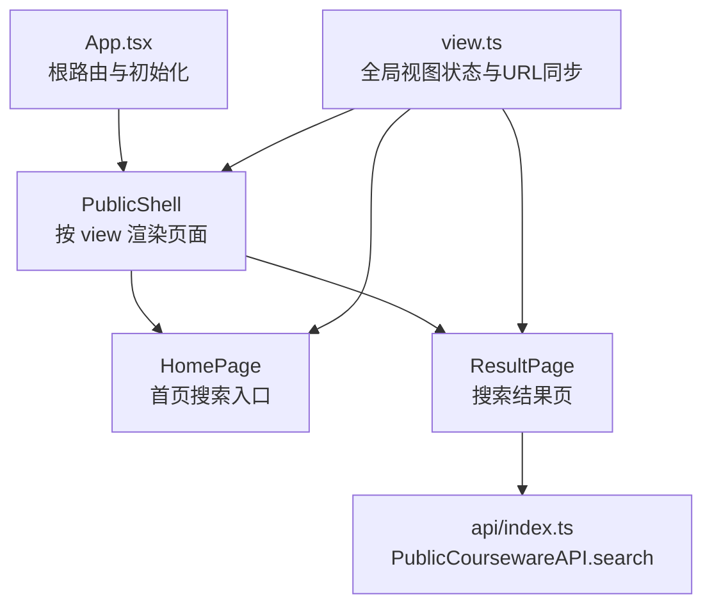
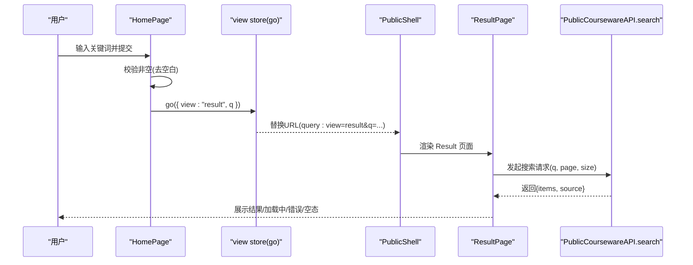
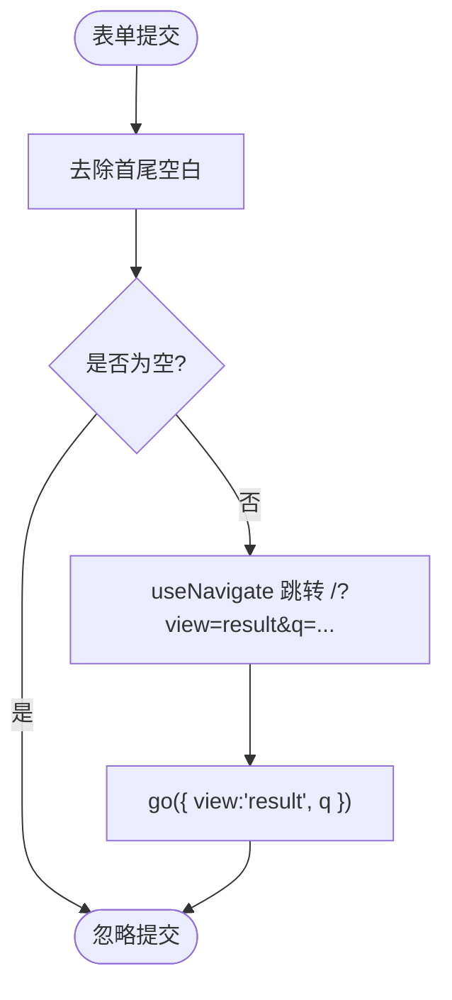
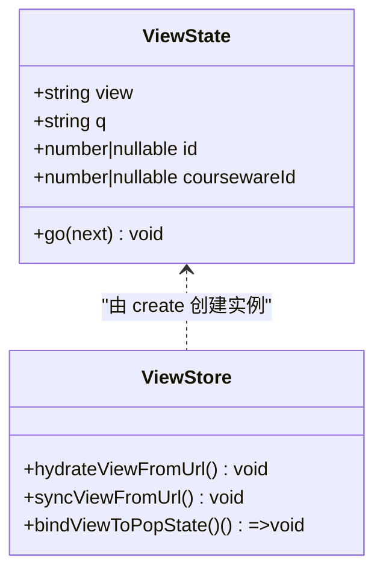
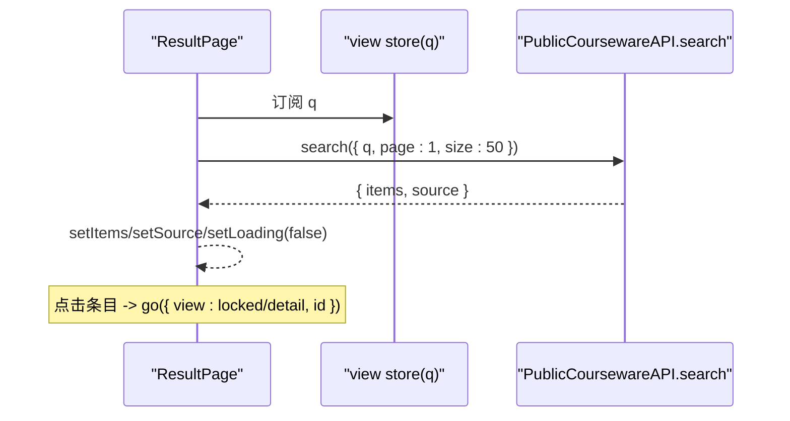
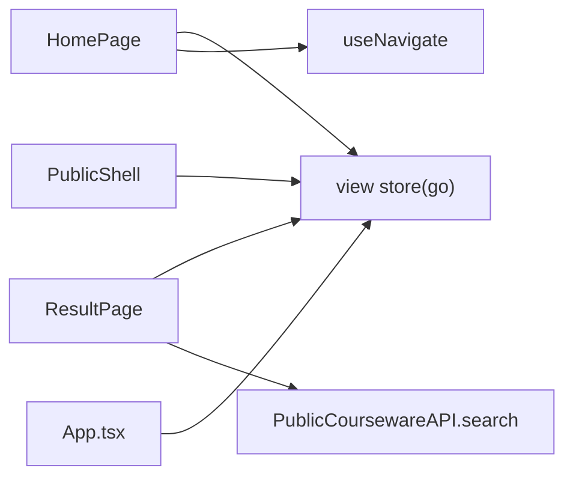

# 首页搜索界面

<cite>
**本文引用的文件**   
- [frontend/src/pages/public/Home.tsx](file://frontend/src/pages/public/Home.tsx)
- [frontend/src/stores/view.ts](file://frontend/src/stores/view.ts)
- [frontend/src/App.tsx](file://frontend/src/App.tsx)
- [frontend/src/pages/public/Result.tsx](file://frontend/src/pages/public/Result.tsx)
- [frontend/src/api/index.ts](file://frontend/src/api/index.ts)
</cite>

## 目录
1. [简介](#简介)
2. [项目结构](#项目结构)
3. [核心组件](#核心组件)
4. [架构总览](#架构总览)
5. [详细组件分析](#详细组件分析)
6. [依赖关系分析](#依赖关系分析)
7. [性能与体验优化](#性能与体验优化)
8. [故障排查指南](#故障排查指南)
9. [结论](#结论)

## 简介
本文件聚焦 Learning Hub 前台首页的极简搜索界面，系统性说明其设计理念、用户交互流程、URL 同步机制、React Hooks 使用模式、全局状态 store 集成方式以及响应式设计与用户体验优化要点。文档同时覆盖表单提交处理、路由跳转逻辑、错误处理与加载状态等关键实现细节，帮助开发者快速理解并扩展该功能。

## 项目结构
首页搜索界面属于前台公共页面，采用单 URL（/）多视图切换的 SPA 架构：通过全局 view 状态驱动不同页面渲染，配合 URL query 参数进行双向同步。

图表来源
- [frontend/src/App.tsx:40-58](file://frontend/src/App.tsx#L40-L58)
- [frontend/src/stores/view.ts:58-97](file://frontend/src/stores/view.ts#L58-L97)
- [frontend/src/pages/public/Home.tsx:12-23](file://frontend/src/pages/public/Home.tsx#L12-L23)
- [frontend/src/pages/public/Result.tsx:14-42](file://frontend/src/pages/public/Result.tsx#L14-L42)
- [frontend/src/api/index.ts:405-415](file://frontend/src/api/index.ts#L405-L415)

章节来源
- [frontend/src/App.tsx:1-110](file://frontend/src/App.tsx#L1-L110)
- [frontend/src/stores/view.ts:1-127](file://frontend/src/stores/view.ts#L1-L127)
- [frontend/src/pages/public/Home.tsx:1-55](file://frontend/src/pages/public/Home.tsx#L1-L55)
- [frontend/src/pages/public/Result.tsx:1-149](file://frontend/src/pages/public/Result.tsx#L1-L149)
- [frontend/src/api/index.ts:405-415](file://frontend/src/api/index.ts#L405-L415)

## 核心组件
- 首页搜索入口（Home）
  - 职责：提供极简搜索框与按钮；捕获输入、校验非空；触发路由跳转与全局状态更新。
  - 关键交互：表单提交时，将 q 编码后写入 URL 的 q 参数，同时将 view 设置为 result。
- 全局视图状态（view store）
  - 职责：维护当前视图（home/result/detail/viewer/locked）及关联参数（q/id/coursewareId），并提供 go 方法用于统一变更与 URL 同步。
  - 关键能力：readUrl/hydrate/sync/bind popstate，保证浏览器前进后退与 URL 一致。
- 结果列表（Result）
  - 职责：根据 q 调用后端搜索接口，展示课件列表；支持返回首页、进入详情或受限页。
  - 关键交互：点击“返回首页”调用 go({ view: "home" })，清空相关参数。
- API 封装（PublicCoursewareAPI）
  - 职责：封装公开课程搜索接口，返回 items 与 source（llm/keyword）。

章节来源
- [frontend/src/pages/public/Home.tsx:12-23](file://frontend/src/pages/public/Home.tsx#L12-L23)
- [frontend/src/stores/view.ts:58-97](file://frontend/src/stores/view.ts#L58-L97)
- [frontend/src/pages/public/Result.tsx:14-42](file://frontend/src/pages/public/Result.tsx#L14-L42)
- [frontend/src/api/index.ts:405-415](file://frontend/src/api/index.ts#L405-L415)

## 架构总览
首页搜索界面的数据流与路由流转如下：

图表来源
- [frontend/src/pages/public/Home.tsx:17-23](file://frontend/src/pages/public/Home.tsx#L17-L23)
- [frontend/src/stores/view.ts:63-96](file://frontend/src/stores/view.ts#L63-L96)
- [frontend/src/App.tsx:44-57](file://frontend/src/App.tsx#L44-L57)
- [frontend/src/pages/public/Result.tsx:24-42](file://frontend/src/pages/public/Result.tsx#L24-L42)
- [frontend/src/api/index.ts:405-415](file://frontend/src/api/index.ts#L405-L415)

## 详细组件分析

### 首页搜索入口（HomePage）
- 设计目标
  - 极简：仅保留 Logo、引导文案、搜索框与按钮，主体内容居中偏上对齐。
  - 无侵入：不引入复杂布局，专注搜索行为。
- 交互流程
  - 监听表单 submit，阻止默认行为。
  - 对输入进行 trim 校验，为空则直接返回。
  - 使用 React Router 的 useNavigate 跳转到 /?view=result&q=...，确保 URL 可分享、可回退。
  - 同时调用 view store 的 go 方法，设置 view=result 与 q，完成全局状态与 URL 的双向同步。
- React Hooks 使用模式
  - useState：管理本地输入值 q，避免不必要的重渲染。
  - useNavigate：执行客户端路由跳转，保持浏览器历史栈正确。
  - 组合策略：先写 URL，再写 store，保证 PublicShell 的 useEffect 在下次渲染读取到的 location.search 与 store 一致，避免覆盖问题。
- 表单验证与错误处理
  - 前端基础校验：trim 后非空才提交。
  - 错误处理：由 Result 页面负责网络异常与空结果提示。
- 加载状态
  - 首页本身无异步操作，无需 loading。
- 响应式与可访问性
  - 使用 Tailwind 类名控制宽度与间距，适配移动端。
  - 为输入框与按钮添加 data-testid，便于自动化测试。

图表来源
- [frontend/src/pages/public/Home.tsx:17-23](file://frontend/src/pages/public/Home.tsx#L17-L23)

章节来源
- [frontend/src/pages/public/Home.tsx:12-23](file://frontend/src/pages/public/Home.tsx#L12-L23)

### 全局视图状态（view store）
- 状态模型
  - view：当前视图枚举（home/result/locked/detail/viewer）。
  - q：搜索关键词。
  - id：课件 ID（detail/viewer 使用）。
  - coursewareId：课件 ID（viewer 返回 detail 时使用）。
- URL 同步机制
  - readUrl：从 window.location.search 解析 view/q/id/cw，白名单校验 view，启发式推断默认视图。
  - hydrateViewFromUrl：应用启动时将 URL 状态灌入 store。
  - syncViewFromUrl：当 pathname/search 变化时重新同步。
  - bindViewToPopState：监听 popstate，保证前进后退与 store 一致。
- go 方法
  - 合并新旧状态，若目标为 home，显式重置 q/id/coursewareId，避免残留参数导致误判。
  - 构造新的 search 字符串，使用 history.replaceState 同步 URL，避免异步时序竞争。
- 复杂度与性能
  - 每次 go 仅做对象合并与少量字符串拼接，时间复杂度 O(1)。
  - 避免频繁 DOM 操作，使用 replaceState 最小化浏览器历史记录影响。

图表来源
- [frontend/src/stores/view.ts:14-24](file://frontend/src/stores/view.ts#L14-L24)
- [frontend/src/stores/view.ts:58-97](file://frontend/src/stores/view.ts#L58-L97)
- [frontend/src/stores/view.ts:100-127](file://frontend/src/stores/view.ts#L100-L127)

章节来源
- [frontend/src/stores/view.ts:1-127](file://frontend/src/stores/view.ts#L1-L127)

### 结果列表（ResultPage）
- 数据来源
  - 从 view store 读取 q，调用 PublicCoursewareAPI.search 获取 items 与 source。
- 状态管理
  - items：搜索结果列表。
  - source：搜索来源（llm/keyword），用于 UI 标注。
  - loading：请求进行中。
  - err：错误信息。
- 生命周期与取消
  - useEffect 依赖 q，q 变化时发起新请求。
  - 使用 cancel 标志防止组件卸载后的状态更新。
- 导航与交互
  - “返回首页”按钮：go({ view: "home" })，清空 URL 参数。
  - 点击条目：根据 accessMode 决定跳转 locked 或 detail，并携带 id。
- 错误与空态
  - 错误：显示错误消息。
  - 空结果：提示尝试更短关键词。
  - 加载中：显示占位文本。

图表来源
- [frontend/src/pages/public/Result.tsx:14-42](file://frontend/src/pages/public/Result.tsx#L14-L42)
- [frontend/src/pages/public/Result.tsx:47-107](file://frontend/src/pages/public/Result.tsx#L47-L107)
- [frontend/src/api/index.ts:405-415](file://frontend/src/api/index.ts#L405-L415)

章节来源
- [frontend/src/pages/public/Result.tsx:14-107](file://frontend/src/pages/public/Result.tsx#L14-L107)

### 路由与壳层（PublicShell）
- 职责
  - 监听 location 变化，同步 view store。
  - 根据 view 渲染对应页面（home/result/locked/detail/viewer）。
- 同步策略
  - 在 pathname/search 变化时调用 syncViewFromUrl，确保 store 与 URL 一致。
  - App 启动时 hydrateViewFromUrl，并绑定 popstate 事件。

章节来源
- [frontend/src/App.tsx:40-58](file://frontend/src/App.tsx#L40-L58)
- [frontend/src/App.tsx:63-68](file://frontend/src/App.tsx#L63-L68)

## 依赖关系分析
- HomePage 依赖
  - React Hooks：useState、useNavigate。
  - view store：go 方法用于状态与 URL 同步。
  - Logo 组件：品牌标识。
- ResultPage 依赖
  - view store：读取 q、go 导航。
  - PublicCoursewareAPI：search 接口。
- view store 依赖
  - window.location、history API。
  - 被 App 初始化与监听。

图表来源
- [frontend/src/pages/public/Home.tsx:12-23](file://frontend/src/pages/public/Home.tsx#L12-L23)
- [frontend/src/pages/public/Result.tsx:14-42](file://frontend/src/pages/public/Result.tsx#L14-L42)
- [frontend/src/stores/view.ts:58-97](file://frontend/src/stores/view.ts#L58-L97)
- [frontend/src/App.tsx:40-58](file://frontend/src/App.tsx#L40-L58)

章节来源
- [frontend/src/pages/public/Home.tsx:12-23](file://frontend/src/pages/public/Home.tsx#L12-L23)
- [frontend/src/pages/public/Result.tsx:14-42](file://frontend/src/pages/public/Result.tsx#L14-L42)
- [frontend/src/stores/view.ts:58-97](file://frontend/src/stores/view.ts#L58-L97)
- [frontend/src/App.tsx:40-58](file://frontend/src/App.tsx#L40-L58)

## 性能与体验优化
- 输入与提交
  - 仅在提交时校验，避免输入阶段频繁计算。
  - 使用 encodeURIComponent 编码 q，避免特殊字符导致的 URL 异常。
- 路由与状态同步
  - go 方法内同步更新 URL，避免与 PublicShell 的 useEffect 产生竞态。
  - 返回 home 时显式清空 q/id/coursewareId，避免残留参数导致误判。
- 网络请求
  - Result 页面使用 cancel 标志防止卸载后更新状态。
  - 合理分页参数（page/size）减少单次数据量。
- 响应式设计
  - 使用 Tailwind 的 flex、max-w-*、px-4 等类名，适配移动端与小屏设备。
  - 输入框与按钮圆角、阴影提升视觉层次与触控友好度。
- 可访问性与测试
  - 为关键元素添加 data-testid，便于端到端测试定位。
  - 语义化标签（main、header、h1）提升可访问性。

[本节为通用指导，不直接分析具体文件]

## 故障排查指南
- 搜索无结果
  - 检查 q 是否被正确传递到 URL 与 view store。
  - 确认 PublicCoursewareAPI.search 返回的 items 是否为空。
- 返回首页需点击两次
  - 已修复：go({ view: "home" }) 会重置 q/id/coursewareId，避免 readUrl 启发式推断为 viewer。
- 浏览器前进后退异常
  - 确认 bindViewToPopState 已绑定，且 syncViewFromUrl 在 location 变化时被调用。
- 网络错误
  - Result 页面会在 catch 分支设置 err，并在 finally 中关闭 loading。
  - 建议增加重试或降级策略（如 keyword 源）。

章节来源
- [frontend/src/stores/view.ts:71-96](file://frontend/src/stores/view.ts#L71-L96)
- [frontend/src/pages/public/Result.tsx:24-42](file://frontend/src/pages/public/Result.tsx#L24-L42)
- [frontend/src/App.tsx:44-47](file://frontend/src/App.tsx#L44-L47)

## 结论
首页搜索界面以极简设计为核心，通过 React Hooks 与全局 view store 的组合，实现了简洁而健壮的搜索流程。URL 同步机制保证了可分享性与浏览器历史一致性，Result 页面完善了加载、错误与空态的用户反馈。整体方案具备良好的可扩展性与可维护性，适合进一步接入更多搜索策略与个性化推荐。