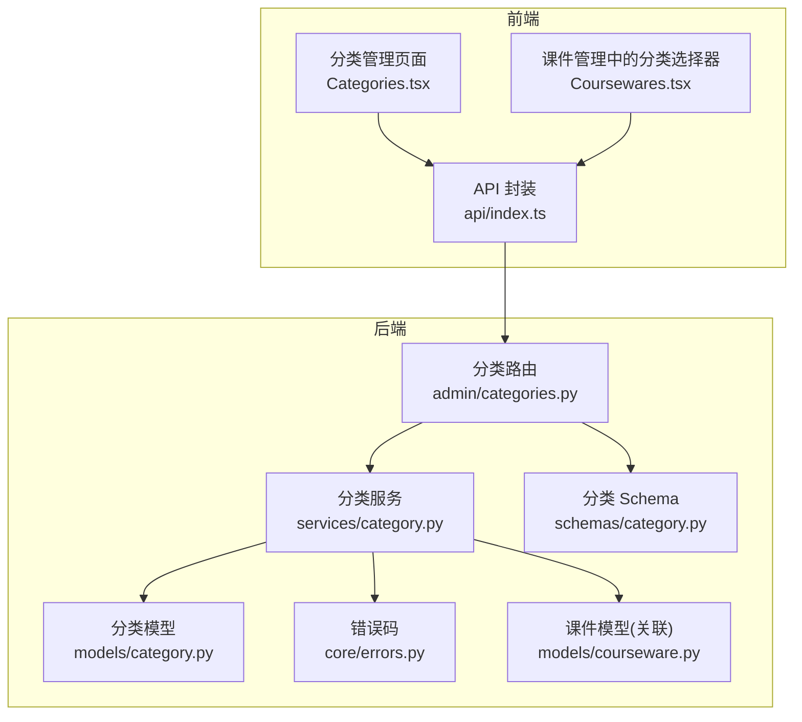
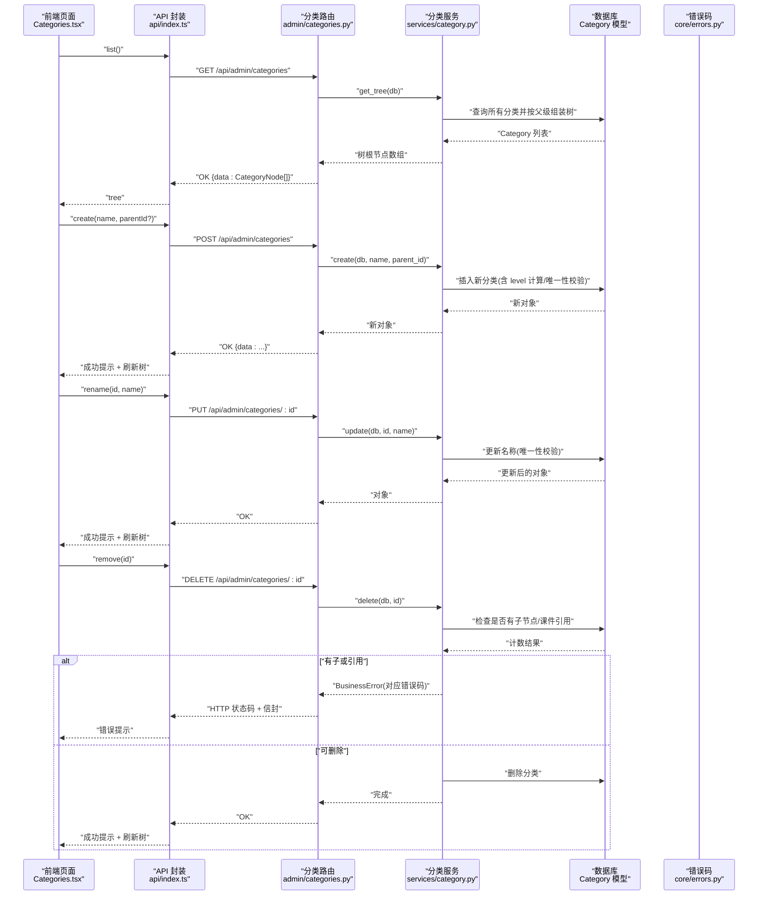
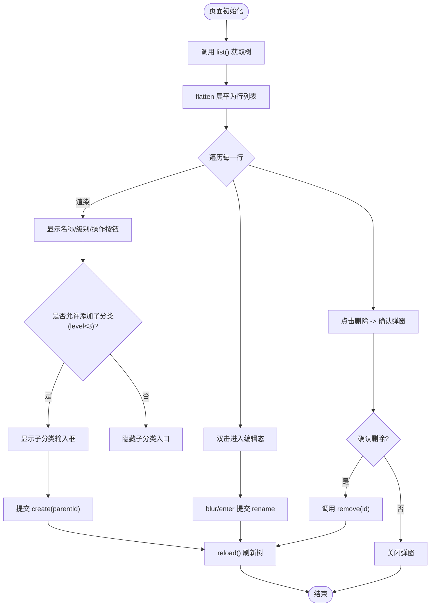
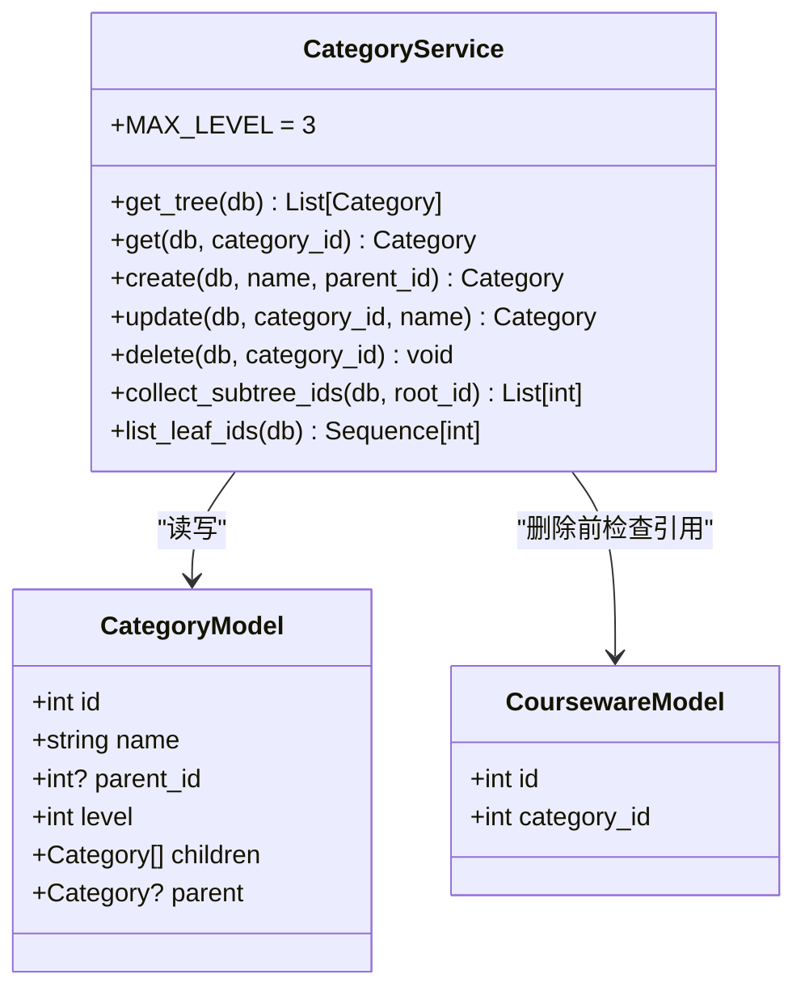
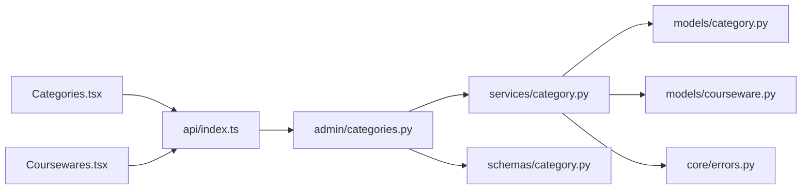

# 分类管理页面

<cite>
**本文引用的文件列表**
- [Categories.tsx](file://frontend/src/pages/admin/Categories.tsx)
- [index.ts](file://frontend/src/api/index.ts)
- [categories.py](file://backend/app/api/admin/categories.py)
- [category.py](file://backend/app/models/category.py)
- [category.py](file://backend/app/schemas/category.py)
- [category.py](file://backend/app/services/category.py)
- [courseware.py](file://backend/app/models/courseware.py)
- [Coursewares.tsx](file://frontend/src/pages/admin/Coursewares.tsx)
- [errors.py](file://backend/app/core/errors.py)
- [test_categories.py](file://backend/tests/test_categories.py)
</cite>

## 目录
1. [简介](#简介)
2. [项目结构](#项目结构)
3. [核心组件](#核心组件)
4. [架构总览](#架构总览)
5. [详细组件分析](#详细组件分析)
6. [依赖关系分析](#依赖关系分析)
7. [性能考虑](#性能考虑)
8. [故障排查指南](#故障排查指南)
9. [结论](#结论)
10. [附录](#附录)

## 简介
本文件面向“分类管理”页面的前后端实现，围绕三级分类树结构的增删改查、层级关系维护、前端树形渲染与交互、数据验证规则与业务约束、与课件/标签等实体的关联处理，以及性能优化策略（懒加载、虚拟滚动）进行系统化说明。目标是帮助开发者快速理解并扩展该功能。

## 项目结构
分类管理涉及前后端多个模块：
- 前端页面：分类树展示与操作入口
- 前端 API 封装：统一请求与类型定义
- 后端路由：RESTful 接口
- 服务层：业务规则与树构建
- 模型层：数据库表结构与自引用关系
- 模式层：请求/响应数据结构校验
- 错误码：统一的业务异常映射

图表来源
- [Categories.tsx:1-270](file://frontend/src/pages/admin/Categories.tsx#L1-L270)
- [index.ts:34-50](file://frontend/src/api/index.ts#L34-L50)
- [categories.py:1-81](file://backend/app/api/admin/categories.py#L1-L81)
- [category.py:1-152](file://backend/app/services/category.py#L1-L152)
- [category.py:1-46](file://backend/app/models/category.py#L1-L46)
- [category.py:1-49](file://backend/app/schemas/category.py#L1-L49)
- [errors.py:1-144](file://backend/app/core/errors.py#L1-L144)
- [courseware.py:21-74](file://backend/app/models/courseware.py#L21-L74)

章节来源
- [Categories.tsx:1-270](file://frontend/src/pages/admin/Categories.tsx#L1-L270)
- [index.ts:34-50](file://frontend/src/api/index.ts#L34-L50)
- [categories.py:1-81](file://backend/app/api/admin/categories.py#L1-L81)
- [category.py:1-152](file://backend/app/services/category.py#L1-L152)
- [category.py:1-46](file://backend/app/models/category.py#L1-L46)
- [category.py:1-49](file://backend/app/schemas/category.py#L1-L49)
- [errors.py:1-144](file://backend/app/core/errors.py#L1-L144)
- [courseware.py:21-74](file://backend/app/models/courseware.py#L21-L74)

## 核心组件
- 前端分类管理页面：提供根分类创建、子分类添加、重命名、删除、树形展示与层级缩进。
- 前端 API 封装：定义 CategoryNode 类型与 list/create/rename/remove 方法。
- 后端分类路由：暴露 /api/admin/categories 的 GET/POST/PUT/DELETE。
- 分类服务：实现树构建、CRUD、业务规则校验（名称唯一、最大层级、存在子节点/课件时禁止删除）。
- 分类模型：自引用树结构，支持 parent_id 与 level 字段。
- 分类 Schema：对 name 长度与空白字符进行校验与清洗。
- 错误码：将业务异常映射为 HTTP 状态码与信封格式。

章节来源
- [Categories.tsx:1-270](file://frontend/src/pages/admin/Categories.tsx#L1-L270)
- [index.ts:34-50](file://frontend/src/api/index.ts#L34-L50)
- [categories.py:1-81](file://backend/app/api/admin/categories.py#L1-L81)
- [category.py:1-152](file://backend/app/services/category.py#L1-L152)
- [category.py:1-46](file://backend/app/models/category.py#L1-L46)
- [category.py:1-49](file://backend/app/schemas/category.py#L1-L49)
- [errors.py:1-144](file://backend/app/core/errors.py#L1-L144)

## 架构总览
分类管理的端到端流程如下：
- 前端页面发起 CRUD 请求，调用 api/index.ts 中封装的方法。
- FastAPI 路由接收请求，调用 services/category.py 执行业务逻辑。
- 服务层通过 SQLAlchemy 访问 models/category.py 的 Category 模型，必要时检查 models/courseware.py 的关联。
- 返回的数据经 schemas/category.py 的 Pydantic 模型序列化后由路由返回。
- 业务异常经 core/errors.py 的错误码映射为统一信封响应。

图表来源
- [Categories.tsx:1-270](file://frontend/src/pages/admin/Categories.tsx#L1-L270)
- [index.ts:34-50](file://frontend/src/api/index.ts#L34-L50)
- [categories.py:1-81](file://backend/app/api/admin/categories.py#L1-L81)
- [category.py:1-152](file://backend/app/services/category.py#L1-L152)
- [category.py:1-46](file://backend/app/models/category.py#L1-L46)
- [errors.py:1-144](file://backend/app/core/errors.py#L1-L144)

## 详细组件分析

### 前端分类管理页面（Categories.tsx）
- 树形数据结构：使用 CategoryNode 递归结构，包含 id、name、level、parentId、children。
- 扁平化渲染：通过 flatten 函数将树展平为带 depth 的行列表，用于一次性渲染与缩进控制。
- 新增根分类：顶部表单提交，调用 create(null)。
- 新增子分类：每行右侧“+ 子分类”，在 level < 3 时显示，调用 create(parentId)。
- 重命名：双击名称进入编辑态，失焦或回车提交 rename；取消则恢复原值。
- 删除：点击删除弹出确认框，确认后调用 remove。
- 视觉标识：左侧显示 L{level} 文本，缩进按 depth * 24px 控制层级深度。
- 路径显示：当前页面未直接显示路径，但复用 CategoryNode 的 level 与 parentId 可用于构造路径。

图表来源
- [Categories.tsx:1-270](file://frontend/src/pages/admin/Categories.tsx#L1-L270)

章节来源
- [Categories.tsx:1-270](file://frontend/src/pages/admin/Categories.tsx#L1-L270)

### 前端 API 封装（api/index.ts）
- 类型定义：CategoryNode 与后端一致，便于 TypeScript 类型安全。
- 方法封装：
  - list(): GET /admin/categories
  - create(name, parentId?): POST /admin/categories
  - rename(id, name): PUT /admin/categories/:id
  - remove(id): DELETE /admin/categories/:id
- 统一解包：unwrap 将后端信封 {data} 解包为 data，简化上层调用。

章节来源
- [index.ts:34-50](file://frontend/src/api/index.ts#L34-L50)

### 后端分类路由（admin/categories.py）
- 路由前缀：/api/admin/categories，需管理员鉴权。
- 列表：GET "" 调用 get_tree 并序列化为 CategoryNode 数组。
- 创建：POST "" 调用 create，成功后返回新对象的 id、parentId、level、name。
- 重命名：PUT "/{category_id}" 调用 update。
- 删除：DELETE "/{category_id}" 调用 delete。
- 缓存失效：每次变更均触发词汇表缓存失效（与搜索相关）。

章节来源
- [categories.py:1-81](file://backend/app/api/admin/categories.py#L1-L81)

### 分类服务（services/category.py）
- 树构建：get_tree 读取全量分类，按 parent_id 组装 children，返回根节点数组。
- 创建：create 校验名称非空且长度 ≤ 30；根据 parent_id 计算 level，限制最大层级为 3；同父下名称唯一；捕获 IntegrityError 转换为业务错误。
- 更新：update 校验名称并更新，重复名称冲突抛出业务错误。
- 删除：delete 先检查是否存在子节点或被课件引用，任一条件满足则拒绝删除。
- 辅助：collect_subtree_ids 用于按分类过滤课件；list_leaf_ids 返回所有叶子分类 ID。

图表来源
- [category.py:1-152](file://backend/app/services/category.py#L1-L152)
- [category.py:1-46](file://backend/app/models/category.py#L1-L46)
- [courseware.py:21-74](file://backend/app/models/courseware.py#L21-L74)

章节来源
- [category.py:1-152](file://backend/app/services/category.py#L1-L152)
- [category.py:1-46](file://backend/app/models/category.py#L1-L46)
- [courseware.py:21-74](file://backend/app/models/courseware.py#L21-L74)

### 分类模型（models/category.py）
- 自引用关系：parent_id 外键指向自身 id，ondelete="RESTRICT" 防止误删被引用节点。
- 唯一约束：同一父节点下名称唯一（uq_category_parent_name）。
- 索引：parent_id 建立索引以加速父子查询。
- 层级：level ∈ {1,2,3}，parent_id=NULL 表示根。

章节来源
- [category.py:1-46](file://backend/app/models/category.py#L1-L46)

### 分类 Schema（schemas/category.py）
- CategoryBase：name 必填且长度 1–30，parentId 可选。
- CategoryCreateRequest：继承 Base，并在 model_validator 中去除 name 两端空白。
- CategoryRenameRequest：同上。
- CategoryNode：树节点结构，children 递归引用自身，model_rebuild 解决前向引用。

章节来源
- [category.py:1-49](file://backend/app/schemas/category.py#L1-L49)

### 错误码（core/errors.py）
- 分类相关错误码：CATEGORY_NOT_FOUND、CATEGORY_NAME_REQUIRED、CATEGORY_NAME_CONFLICT、CATEGORY_MAX_LEVEL、CATEGORY_HAS_CHILDREN、CATEGORY_HAS_COURSEWARES。
- 映射到 HTTP 状态码：如 400/404/409/422 等，配合 BusinessError 输出统一信封。

章节来源
- [errors.py:1-144](file://backend/app/core/errors.py#L1-L144)

### 与课件、标签等实体的关联关系
- 课件与分类：Courseware.category_id 外键指向 Category.id，删除分类时需检查是否仍有课件引用。
- 课件与标签：多对多关系（中间表），不影响分类删除逻辑，但课件筛选时可结合分类与标签联合过滤。
- 前端课件管理中的分类选择器：支持任意级别选择并以路径形式回显（例如：“工程能力 / 软件工程 / 需求分析”），同时用色块区分级别。

章节来源
- [courseware.py:21-74](file://backend/app/models/courseware.py#L21-L74)
- [Coursewares.tsx:39-202](file://frontend/src/pages/admin/Coursewares.tsx#L39-L202)

### 拖拽排序功能的现状与建议
- 现状：当前分类管理页面未实现节点间拖拽排序，仅支持增删改与层级展示。
- 建议方案：
  - 引入拖拽库（如 @dnd-kit），在树节点上启用拖拽手柄。
  - 拖拽目标包括同级插入与作为子节点放置，需根据拖拽位置判断 isDropOnParent/isDropBefore/isDropAfter。
  - 后端新增 reorder 接口，接收 fromId、toId、position 参数，重新计算 level 与 parent_id，并批量更新受影响节点的 level。
  - 防环检测：禁止将祖先节点拖入其子孙节点下。
  - 事务与一致性：在单个事务内更新 parent_id 与 level，失败时回滚。
  - 前端乐观更新：拖拽完成后立即更新本地树结构，失败时回滚并提示。

[本节为概念性建议，不直接分析具体文件]

### 分类级别的视觉标识与路径显示
- 视觉标识：
  - 分类管理页面：左侧显示 “L{level}” 文本，缩进随 depth 递增。
  - 课件管理中的分类选择器：不同级别使用不同色块（浅米黄/中黄/紫）直观区分。
- 路径显示：
  - 分类管理页面：可通过 node.level 与 node.parentId 在前端构造路径字符串（参考课件管理中的 categoryPath 实现）。
  - 课件管理：已实现路径回显，选中项以 “父 / 子 / 孙” 的形式展示。

章节来源
- [Categories.tsx:1-270](file://frontend/src/pages/admin/Categories.tsx#L1-L270)
- [Coursewares.tsx:39-202](file://frontend/src/pages/admin/Coursewares.tsx#L39-L202)

### 数据验证规则与业务约束
- 名称规则：
  - 必填且去除首尾空白。
  - 长度限制 1–30。
  - 同一父节点下名称唯一（服务端唯一约束 + 业务校验）。
- 层级规则：
  - 最多 3 层，level ∈ {1,2,3}。
  - 根节点 parent_id 为空，level=1。
- 删除约束：
  - 存在子节点不可删除。
  - 仍被课件引用不可删除。
- 前端校验：
  - 输入框 maxLength=30，空值提示。
  - 仅在 level < 3 时显示“+ 子分类”。

章节来源
- [category.py:1-49](file://backend/app/schemas/category.py#L1-L49)
- [category.py:1-152](file://backend/app/services/category.py#L1-L152)
- [category.py:1-46](file://backend/app/models/category.py#L1-L46)
- [Categories.tsx:1-270](file://frontend/src/pages/admin/Categories.tsx#L1-L270)
- [test_categories.py:1-83](file://backend/tests/test_categories.py#L1-L83)

### 与课件、标签等实体的关联处理
- 删除分类前的引用检查：
  - 检查是否存在子分类。
  - 检查是否存在课件引用（category_id 外键）。
- 课件筛选：
  - 课件列表可按 categoryId 过滤，结合标签进行多维筛选。
- 标签：
  - 标签为全局唯一名称，与分类无直接外键关系，但可在课件维度组合筛选。

章节来源
- [category.py:1-152](file://backend/app/services/category.py#L1-L152)
- [courseware.py:21-74](file://backend/app/models/courseware.py#L21-L74)

## 依赖关系分析
- 前端依赖：
  - Categories.tsx 依赖 api/index.ts 的 CategoryAPI。
  - Coursewares.tsx 复用 CategoryNode 类型与分类树选择器。
- 后端依赖：
  - admin/categories.py 依赖 services/category.py、schemas/category.py、models/category.py。
  - services/category.py 依赖 models/category.py 与 models/courseware.py。
  - 错误码集中管理于 core/errors.py。

图表来源
- [Categories.tsx:1-270](file://frontend/src/pages/admin/Categories.tsx#L1-L270)
- [index.ts:34-50](file://frontend/src/api/index.ts#L34-L50)
- [categories.py:1-81](file://backend/app/api/admin/categories.py#L1-L81)
- [category.py:1-152](file://backend/app/services/category.py#L1-L152)
- [category.py:1-46](file://backend/app/models/category.py#L1-L46)
- [courseware.py:21-74](file://backend/app/models/courseware.py#L21-L74)
- [category.py:1-49](file://backend/app/schemas/category.py#L1-L49)
- [errors.py:1-144](file://backend/app/core/errors.py#L1-L144)

章节来源
- [Categories.tsx:1-270](file://frontend/src/pages/admin/Categories.tsx#L1-L270)
- [index.ts:34-50](file://frontend/src/api/index.ts#L34-L50)
- [categories.py:1-81](file://backend/app/api/admin/categories.py#L1-L81)
- [category.py:1-152](file://backend/app/services/category.py#L1-L152)
- [category.py:1-46](file://backend/app/models/category.py#L1-L46)
- [courseware.py:21-74](file://backend/app/models/courseware.py#L21-L74)
- [category.py:1-49](file://backend/app/schemas/category.py#L1-L49)
- [errors.py:1-144](file://backend/app/core/errors.py#L1-L144)

## 性能考虑
- 当前实现：
  - 后端 get_tree 一次性加载全部分类并组装树，适合中小规模数据。
  - 前端 flatten 展平后一次性渲染，DOM 节点数等于分类总数。
- 优化建议：
  - 懒加载：
    - 后端增加分页或按需加载子节点接口（如 GET /api/admin/categories/:id/children）。
    - 前端在展开节点时再请求子节点，减少初始负载。
  - 虚拟滚动：
    - 当分类数量较大时，使用虚拟滚动（如 react-window）只渲染可视区域节点，提升滚动性能。
  - 增量更新：
    - 创建/重命名/删除后，尽量局部更新树结构而非全量 reload，减少网络与渲染开销。
  - 索引与查询优化：
    - 确保 parent_id 索引有效，避免 N+1 查询。
    - 若需要按分类过滤课件，可使用 collect_subtree_ids 预计算后代 ID 集合，减少多次查询。

[本节提供通用指导，不直接分析具体文件]

## 故障排查指南
- 常见错误码与场景：
  - category_name_required：名称为空或仅空白。
  - category_name_conflict：同一父节点下名称重复。
  - category_max_level：超过 3 层。
  - category_has_children：存在子节点无法删除。
  - category_has_coursewares：仍有课件引用无法删除。
- 定位步骤：
  - 查看浏览器控制台的网络请求与响应信封，关注 code 与 message。
  - 核对前端输入是否符合长度与必填要求。
  - 检查数据库中是否存在子节点或课件引用。
  - 复测用例：参考 test_categories.py 中的断言覆盖关键分支。

章节来源
- [errors.py:1-144](file://backend/app/core/errors.py#L1-L144)
- [test_categories.py:1-83](file://backend/tests/test_categories.py#L1-L83)

## 结论
分类管理页面实现了完整的三级分类树 CRUD 与基础业务约束，前后端职责清晰、数据结构一致。建议在后续迭代中补充拖拽排序、懒加载与虚拟滚动等能力，以提升用户体验与系统性能。

## 附录
- 相关测试用例：
  - 三层树构建、名称必填、同名冲突、最大层级、重命名、删除保护等场景均已覆盖。

章节来源
- [test_categories.py:1-83](file://backend/tests/test_categories.py#L1-L83)