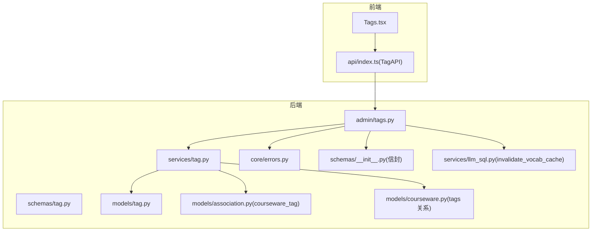
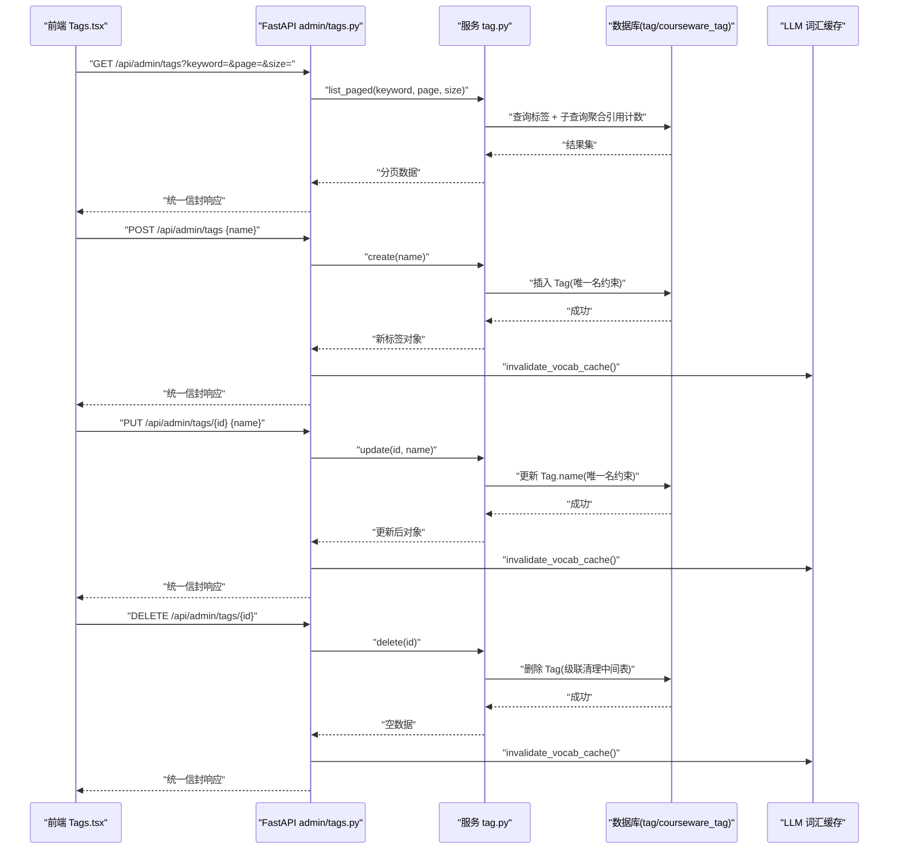
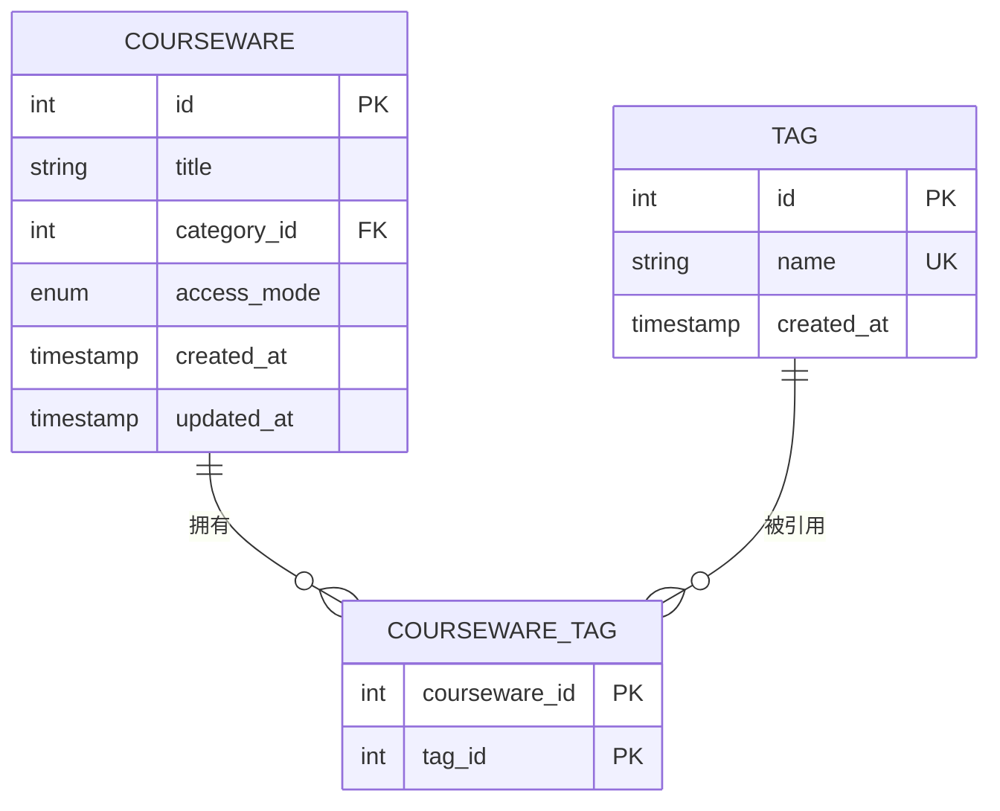
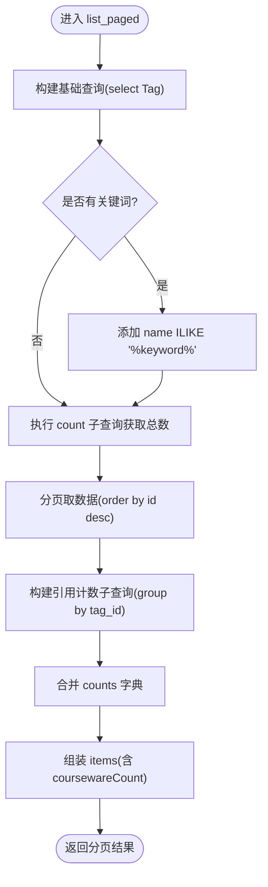
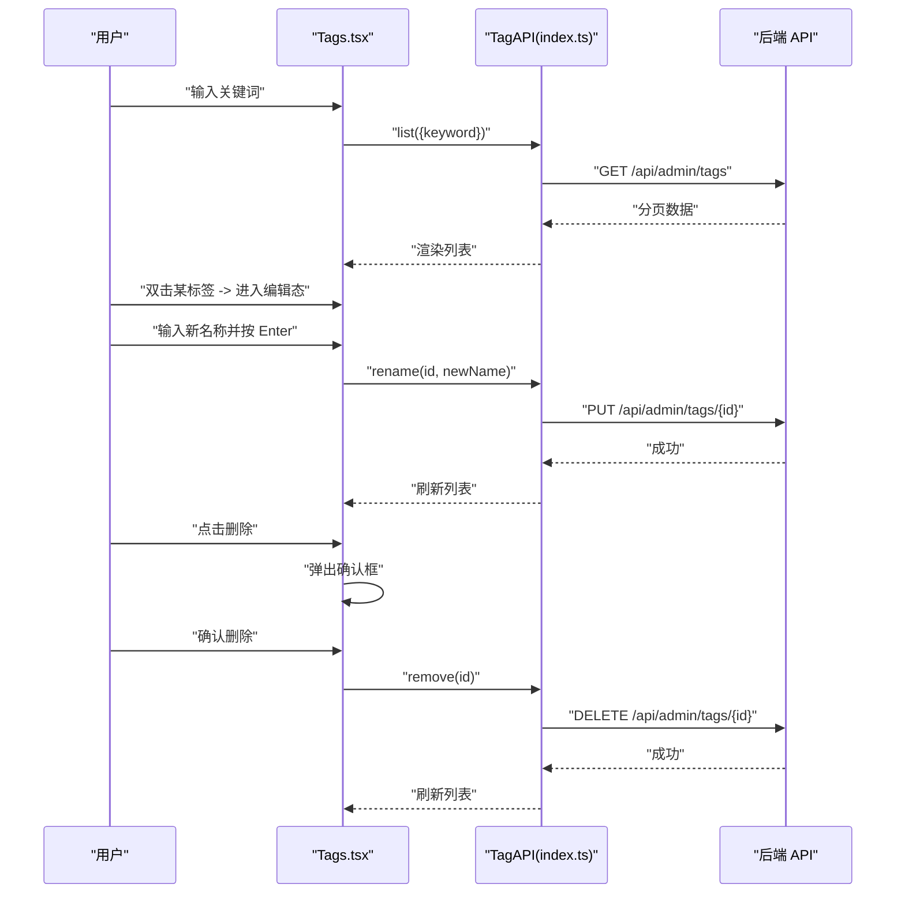
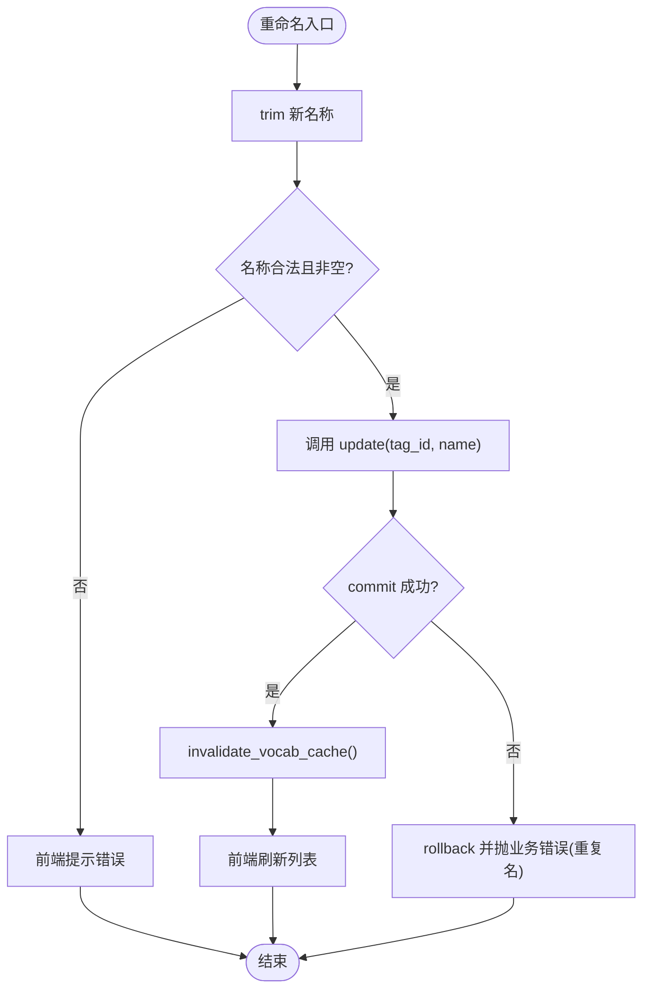
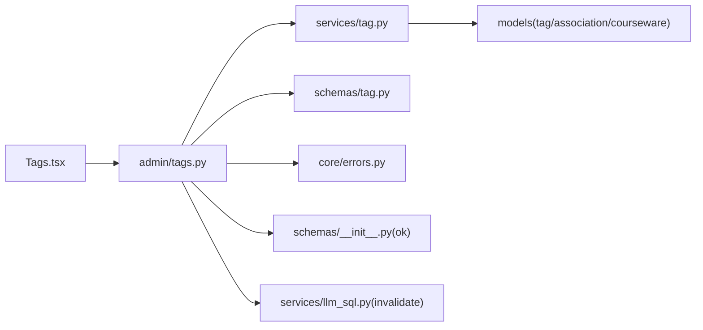

# 标签管理页面

<cite>
**本文引用的文件**
- [backend/app/models/tag.py](file://backend/app/models/tag.py)
- [backend/app/models/association.py](file://backend/app/models/association.py)
- [backend/app/models/courseware.py](file://backend/app/models/courseware.py)
- [backend/app/schemas/tag.py](file://backend/app/schemas/tag.py)
- [backend/app/services/tag.py](file://backend/app/services/tag.py)
- [backend/app/api/admin/tags.py](file://backend/app/api/admin/tags.py)
- [backend/app/core/errors.py](file://backend/app/core/errors.py)
- [backend/app/schemas/__init__.py](file://backend/app/schemas/__init__.py)
- [backend/app/services/llm_sql.py](file://backend/app/services/llm_sql.py)
- [frontend/src/pages/admin/Tags.tsx](file://frontend/src/pages/admin/Tags.tsx)
- [frontend/src/api/index.ts](file://frontend/src/api/index.ts)
</cite>

## 目录
1. [简介](#简介)
2. [项目结构](#项目结构)
3. [核心组件](#核心组件)
4. [架构总览](#架构总览)
5. [详细组件分析](#详细组件分析)
6. [依赖关系分析](#依赖关系分析)
7. [性能考虑](#性能考虑)
8. [故障排查指南](#故障排查指南)
9. [结论](#结论)
10. [附录](#附录)

## 简介
本指南面向“标签管理页面”的实现与扩展，覆盖以下目标：
- 标签的增删改查（CRUD）与批量管理能力
- 标签与课件的多对多关联维护与同步更新机制
- 标签颜色主题配置与视觉样式定制方案
- 标签搜索、筛选与统计功能实现
- 标签重命名时的数据一致性保证
- 标签使用的实时统计与引用计数
- 用户体验优化：自动完成与智能推荐

## 项目结构
后端采用 FastAPI + SQLAlchemy ORM，前端使用 React + TypeScript。标签相关的关键路径如下：
- 模型层：Tag 表定义、courseware_tag 多对多中间表、Courseware 的 tags 关系
- 服务层：标签分页查询、创建、更新、删除；包含引用计数计算
- API 层：管理员接口，统一信封响应，错误码映射
- 前端：标签列表页、搜索输入、新增表单、重命名交互、删除确认对话框
- 搜索缓存：LLM 词汇缓存失效策略，确保后台变更后搜索提示词及时刷新



图表来源
- [frontend/src/pages/admin/Tags.tsx:1-197](file://frontend/src/pages/admin/Tags.tsx#L1-L197)
- [frontend/src/api/index.ts:52-68](file://frontend/src/api/index.ts#L52-L68)
- [backend/app/api/admin/tags.py:1-70](file://backend/app/api/admin/tags.py#L1-L70)
- [backend/app/services/tag.py:1-102](file://backend/app/services/tag.py#L1-L102)
- [backend/app/schemas/tag.py:1-34](file://backend/app/schemas/tag.py#L1-L34)
- [backend/app/core/errors.py:40-102](file://backend/app/core/errors.py#L40-L102)
- [backend/app/schemas/__init__.py:1-65](file://backend/app/schemas/__init__.py#L1-L65)
- [backend/app/services/llm_sql.py:107-113](file://backend/app/services/llm_sql.py#L107-L113)
- [backend/app/models/tag.py:1-30](file://backend/app/models/tag.py#L1-L30)
- [backend/app/models/association.py:9-14](file://backend/app/models/association.py#L9-L14)
- [backend/app/models/courseware.py:51-54](file://backend/app/models/courseware.py#L51-L54)

章节来源
- [backend/app/models/tag.py:1-30](file://backend/app/models/tag.py#L1-L30)
- [backend/app/models/association.py:9-14](file://backend/app/models/association.py#L9-L14)
- [backend/app/models/courseware.py:51-54](file://backend/app/models/courseware.py#L51-L54)
- [backend/app/schemas/tag.py:1-34](file://backend/app/schemas/tag.py#L1-L34)
- [backend/app/services/tag.py:1-102](file://backend/app/services/tag.py#L1-L102)
- [backend/app/api/admin/tags.py:1-70](file://backend/app/api/admin/tags.py#L1-L70)
- [backend/app/core/errors.py:40-102](file://backend/app/core/errors.py#L40-L102)
- [backend/app/schemas/__init__.py:1-65](file://backend/app/schemas/__init__.py#L1-L65)
- [backend/app/services/llm_sql.py:107-113](file://backend/app/services/llm_sql.py#L107-L113)
- [frontend/src/pages/admin/Tags.tsx:1-197](file://frontend/src/pages/admin/Tags.tsx#L1-L197)
- [frontend/src/api/index.ts:52-68](file://frontend/src/api/index.ts#L52-L68)

## 核心组件
- 数据模型
  - Tag：扁平全局唯一名称，带创建时间
  - courseware_tag：多对多中间表，外键级联删除
  - Courseware.tags：通过 secondary 指向 courseware_tag
- 请求/响应 Schema
  - TagNameRequest：校验并去除首尾空白
  - TagItem/TagPaged：返回 id、name、引用数、创建时间等
- 业务服务
  - list_paged：支持关键词模糊匹配、分页、引用计数一次性聚合
  - create/update/delete：含唯一性约束冲突处理
- API 路由
  - GET /api/admin/tags：列表与搜索
  - POST /api/admin/tags：创建
  - PUT /api/admin/tags/{tag_id}：重命名
  - DELETE /api/admin/tags/{tag_id}：删除
  - 每次写操作后调用 invalidate_vocab_cache() 使 LLM 词汇缓存失效
- 前端页面
  - 新增、搜索、重命名（双击或点击按钮）、删除（二次确认）
  - 展示每个标签的课件引用数量
  - 统一错误提示（toast）

章节来源
- [backend/app/models/tag.py:13-26](file://backend/app/models/tag.py#L13-L26)
- [backend/app/models/association.py:9-14](file://backend/app/models/association.py#L9-L14)
- [backend/app/models/courseware.py:51-54](file://backend/app/models/courseware.py#L51-L54)
- [backend/app/schemas/tag.py:9-33](file://backend/app/schemas/tag.py#L9-L33)
- [backend/app/services/tag.py:24-60](file://backend/app/services/tag.py#L24-L60)
- [backend/app/services/tag.py:70-92](file://backend/app/services/tag.py#L70-L92)
- [backend/app/services/tag.py:95-99](file://backend/app/services/tag.py#L95-L99)
- [backend/app/api/admin/tags.py:21-66](file://backend/app/api/admin/tags.py#L21-L66)
- [frontend/src/pages/admin/Tags.tsx:6-77](file://frontend/src/pages/admin/Tags.tsx#L6-L77)
- [frontend/src/pages/admin/Tags.tsx:79-197](file://frontend/src/pages/admin/Tags.tsx#L79-L197)
- [frontend/src/api/index.ts:52-68](file://frontend/src/api/index.ts#L52-L68)

## 架构总览
下图展示了从前端到数据库的完整调用链，以及写操作后的缓存失效流程。



图表来源
- [backend/app/api/admin/tags.py:21-66](file://backend/app/api/admin/tags.py#L21-L66)
- [backend/app/services/tag.py:24-99](file://backend/app/services/tag.py#L24-L99)
- [backend/app/services/llm_sql.py:107-113](file://backend/app/services/llm_sql.py#L107-L113)
- [backend/app/models/association.py:9-14](file://backend/app/models/association.py#L9-L14)

## 详细组件分析

### 数据模型与多对多关系
- Tag 表字段：id、name（全局唯一）、created_at
- courseware_tag 中间表：courseware_id、tag_id，均设置 ondelete=CASCADE
- Courseware.tags 通过 secondary 指向 courseware_tag，ORM 提供双向关系



图表来源
- [backend/app/models/tag.py:13-26](file://backend/app/models/tag.py#L13-L26)
- [backend/app/models/association.py:9-14](file://backend/app/models/association.py#L9-L14)
- [backend/app/models/courseware.py:51-54](file://backend/app/models/courseware.py#L51-L54)

章节来源
- [backend/app/models/tag.py:13-26](file://backend/app/models/tag.py#L13-L26)
- [backend/app/models/association.py:9-14](file://backend/app/models/association.py#L9-L14)
- [backend/app/models/courseware.py:51-54](file://backend/app/models/courseware.py#L51-L54)

### 服务层：分页、搜索与引用计数
- 关键词过滤：基于 name 的 ILIKE 模糊匹配
- 引用计数：通过子查询按 tag_id 分组统计 courseware_tag 中对应记录数，避免 N+1
- 分页：offset/limit 配合 count 子查询获取 total



图表来源
- [backend/app/services/tag.py:24-60](file://backend/app/services/tag.py#L24-L60)

章节来源
- [backend/app/services/tag.py:24-60](file://backend/app/services/tag.py#L24-L60)

### API 层：统一信封与错误码
- 统一信封：ok/fail 构造标准 JSON 结构
- 错误码：标签相关错误码包括未找到、必填、重复名等，映射为 HTTP 状态码
- 写操作后触发 LLM 词汇缓存失效，保障前台自然语言搜索能识别最新标签名

```mermaid
classDiagram
class Envelope {
+string code
+string message
+data
+string requestId
}
class ErrorCode {
+TAG_NOT_FOUND
+TAG_NAME_REQUIRED
+TAG_NAME_CONFLICT
}
class AdminTagsAPI {
+GET "/api/admin/tags"
+POST "/api/admin/tags"
+PUT "/api/admin/tags/{id}"
+DELETE "/api/admin/tags/{id}"
}
AdminTagsAPI --> Envelope : "返回统一信封"
AdminTagsAPI --> ErrorCode : "抛出业务错误"
```

图表来源
- [backend/app/schemas/__init__.py:24-42](file://backend/app/schemas/__init__.py#L24-L42)
- [backend/app/core/errors.py:40-102](file://backend/app/core/errors.py#L40-L102)
- [backend/app/api/admin/tags.py:21-66](file://backend/app/api/admin/tags.py#L21-L66)

章节来源
- [backend/app/schemas/__init__.py:24-42](file://backend/app/schemas/__init__.py#L24-L42)
- [backend/app/core/errors.py:40-102](file://backend/app/core/errors.py#L40-L102)
- [backend/app/api/admin/tags.py:21-66](file://backend/app/api/admin/tags.py#L21-L66)

### 前端页面：交互与状态
- 新增：提交前进行非空校验，成功后清空输入并刷新列表
- 搜索：输入关键词即时触发 reload，显示总数
- 重命名：双击文本或点击“重命名”进入编辑态，Enter 提交，Escape 取消
- 删除：弹出确认框，提示将自动解绑所有引用该标签的课件
- 错误提示：统一 toast 显示后端返回的错误信息



图表来源
- [frontend/src/pages/admin/Tags.tsx:6-77](file://frontend/src/pages/admin/Tags.tsx#L6-L77)
- [frontend/src/pages/admin/Tags.tsx:79-197](file://frontend/src/pages/admin/Tags.tsx#L79-L197)
- [frontend/src/api/index.ts:52-68](file://frontend/src/api/index.ts#L52-L68)
- [backend/app/api/admin/tags.py:21-66](file://backend/app/api/admin/tags.py#L21-L66)

章节来源
- [frontend/src/pages/admin/Tags.tsx:6-77](file://frontend/src/pages/admin/Tags.tsx#L6-L77)
- [frontend/src/pages/admin/Tags.tsx:79-197](file://frontend/src/pages/admin/Tags.tsx#L79-L197)
- [frontend/src/api/index.ts:52-68](file://frontend/src/api/index.ts#L52-L68)

### 标签与课件的关联维护与同步更新
- 删除标签时，由于 courseware_tag 的外键设置了 ondelete=CASCADE，数据库会自动清理所有关联记录，无需额外逻辑
- 在课件编辑界面（不在本页面范围内），可通过传递 tagIds 数组来维护多对多关系；本页面仅负责标签本身的 CRUD 与引用计数展示

章节来源
- [backend/app/models/association.py:9-14](file://backend/app/models/association.py#L9-L14)
- [backend/app/models/courseware.py:51-54](file://backend/app/models/courseware.py#L51-L54)

### 标签颜色主题与视觉样式定制
当前代码库未内置标签颜色字段与主题配置。建议方案：
- 数据层扩展
  - 在 Tag 模型增加 color 字段（如十六进制字符串或 Tailwind 色板索引）
  - 在 TagItem Schema 中暴露 color 字段
- 服务层适配
  - create/update 时校验 color 格式（如正则匹配 #RRGGBB）
  - list_paged 返回 color 字段
- API 层适配
  - 保持现有路由不变，仅扩展请求/响应体字段
- 前端适配
  - 在 Tags.tsx 中根据 color 渲染标签名背景或边框
  - 提供颜色选择器（可复用系统色板）
  - 在重命名/删除交互旁保留颜色预览

注意：以上为扩展建议，当前仓库未实现颜色字段。

[本节为概念性扩展建议，不直接分析具体文件]

### 标签搜索、筛选与统计
- 搜索：关键词参数 keyword 用于 name 的 ILIKE 模糊匹配
- 筛选：可在 list_paged 基础上扩展（如按创建时间范围、按引用数阈值）
- 统计：已返回 total 与每项的 coursewareCount；可扩展返回 topN 热门标签

章节来源
- [backend/app/services/tag.py:24-60](file://backend/app/services/tag.py#L24-L60)
- [backend/app/schemas/tag.py:19-33](file://backend/app/schemas/tag.py#L19-L33)
- [frontend/src/pages/admin/Tags.tsx:101-114](file://frontend/src/pages/admin/Tags.tsx#L101-L114)

### 标签重命名的数据一致性保证
- 唯一性约束：Tag.name 全局唯一，数据库层面防止重复
- 事务与回滚：服务层在 commit 失败时显式 rollback，并抛出业务错误
- 前端校验：提交前 trim 并检查非空，减少无效请求
- 缓存一致性：写操作后调用 invalidate_vocab_cache()，确保 LLM 搜索提示词立即生效



图表来源
- [backend/app/services/tag.py:83-92](file://backend/app/services/tag.py#L83-L92)
- [backend/app/api/admin/tags.py:45-59](file://backend/app/api/admin/tags.py#L45-L59)
- [backend/app/services/llm_sql.py:107-113](file://backend/app/services/llm_sql.py#L107-L113)
- [frontend/src/pages/admin/Tags.tsx:52-65](file://frontend/src/pages/admin/Tags.tsx#L52-L65)

章节来源
- [backend/app/services/tag.py:83-92](file://backend/app/services/tag.py#L83-L92)
- [backend/app/api/admin/tags.py:45-59](file://backend/app/api/admin/tags.py#L45-L59)
- [backend/app/services/llm_sql.py:107-113](file://backend/app/services/llm_sql.py#L107-L113)
- [frontend/src/pages/admin/Tags.tsx:52-65](file://frontend/src/pages/admin/Tags.tsx#L52-L65)

### 标签使用的实时统计与引用计数
- 引用计数：list_paged 通过子查询一次性聚合 courseware_tag 中的计数，避免 N+1
- 实时性：计数反映当前数据库状态；若需更高实时性，可引入缓存层（如 Redis）并在写操作后更新计数
- 前端展示：在标签行内显示“关联 X 个课件”，便于管理员快速判断影响面

章节来源
- [backend/app/services/tag.py:36-60](file://backend/app/services/tag.py#L36-L60)
- [frontend/src/pages/admin/Tags.tsx:152-156](file://frontend/src/pages/admin/Tags.tsx#L152-L156)

### 用户体验优化：自动完成与智能推荐
- 自动完成
  - 在前端新增输入框处监听输入事件，调用一个轻量接口（例如 GET /api/admin/tags/suggest?keyword=）返回匹配的前 N 个标签名
  - 后端可在 list_paged 基础上增加 limit 较小的 suggest 接口，或直接复用现有接口但限制 size
- 智能推荐
  - 结合最近创建的标签、高频使用的标签（按引用计数排序）给出推荐列表
  - 可结合 LLM 词汇缓存失效策略，确保推荐结果与最新标签一致

注意：上述为增强建议，当前仓库未实现 suggest 接口。

[本节为概念性增强建议，不直接分析具体文件]

## 依赖关系分析
- 模块耦合
  - API 层依赖服务层与统一信封/错误码
  - 服务层依赖模型与中间表，并通过子查询聚合引用计数
  - 前端依赖 api/index.ts 封装的 TagAPI
- 外部依赖
  - LLM 词汇缓存：写操作后主动失效，保障搜索语义一致性



图表来源
- [frontend/src/pages/admin/Tags.tsx:1-197](file://frontend/src/pages/admin/Tags.tsx#L1-L197)
- [frontend/src/api/index.ts:52-68](file://frontend/src/api/index.ts#L52-L68)
- [backend/app/api/admin/tags.py:1-70](file://backend/app/api/admin/tags.py#L1-L70)
- [backend/app/services/tag.py:1-102](file://backend/app/services/tag.py#L1-L102)
- [backend/app/schemas/tag.py:1-34](file://backend/app/schemas/tag.py#L1-L34)
- [backend/app/core/errors.py:40-102](file://backend/app/core/errors.py#L40-L102)
- [backend/app/schemas/__init__.py:1-65](file://backend/app/schemas/__init__.py#L1-L65)
- [backend/app/services/llm_sql.py:107-113](file://backend/app/services/llm_sql.py#L107-L113)

章节来源
- [backend/app/api/admin/tags.py:1-70](file://backend/app/api/admin/tags.py#L1-L70)
- [backend/app/services/tag.py:1-102](file://backend/app/services/tag.py#L1-L102)
- [backend/app/schemas/tag.py:1-34](file://backend/app/schemas/tag.py#L1-L34)
- [backend/app/core/errors.py:40-102](file://backend/app/core/errors.py#L40-L102)
- [backend/app/schemas/__init__.py:1-65](file://backend/app/schemas/__init__.py#L1-L65)
- [backend/app/services/llm_sql.py:107-113](file://backend/app/services/llm_sql.py#L107-L113)
- [frontend/src/pages/admin/Tags.tsx:1-197](file://frontend/src/pages/admin/Tags.tsx#L1-L197)
- [frontend/src/api/index.ts:52-68](file://frontend/src/api/index.ts#L52-L68)

## 性能考虑
- 引用计数聚合：使用子查询一次聚合，避免 N+1 查询
- 分页：合理设置 size（默认 20，最大 200），避免过大页导致响应缓慢
- 搜索：ILIKE 模糊匹配在大表上可能较慢，建议为 tag.name 建立索引（当前唯一约束通常自带索引）
- 缓存：LLM 词汇缓存 TTL 60s，写操作后立即失效，兼顾一致性与性能

章节来源
- [backend/app/services/tag.py:24-60](file://backend/app/services/tag.py#L24-L60)
- [backend/app/api/admin/tags.py:22-29](file://backend/app/api/admin/tags.py#L22-L29)
- [backend/app/services/llm_sql.py:39-41](file://backend/app/services/llm_sql.py#L39-L41)
- [backend/app/services/llm_sql.py:107-113](file://backend/app/services/llm_sql.py#L107-L113)

## 故障排查指南
- 常见错误码
  - 标签不存在：404
  - 标签名为空或超长：400
  - 标签名重复：409
- 定位步骤
  - 查看前端 toast 提示消息
  - 检查后端日志中的 BusinessError 抛出点
  - 确认数据库唯一约束是否存在冲突
  - 验证 LLM 词汇缓存是否已失效（必要时等待 TTL 过期）

章节来源
- [backend/app/core/errors.py:40-102](file://backend/app/core/errors.py#L40-L102)
- [backend/app/services/tag.py:70-92](file://backend/app/services/tag.py#L70-L92)
- [backend/app/services/tag.py:95-99](file://backend/app/services/tag.py#L95-L99)
- [frontend/src/pages/admin/Tags.tsx:36-77](file://frontend/src/pages/admin/Tags.tsx#L36-L77)

## 结论
本指南梳理了标签管理页面的前后端实现要点，涵盖 CRUB、多对多关联、引用计数、搜索与分页、错误处理与一致性保障，并提供了颜色主题、自动完成与智能推荐的扩展思路。建议在后续迭代中：
- 扩展标签颜色字段与前端可视化
- 增加 suggest 接口与推荐算法
- 按需引入缓存层提升实时统计性能

## 附录
- 关键接口一览
  - GET /api/admin/tags：分页与搜索
  - POST /api/admin/tags：创建
  - PUT /api/admin/tags/{tag_id}：重命名
  - DELETE /api/admin/tags/{tag_id}：删除
- 前端类型定义
  - TagItem、TagPaged 位于 api/index.ts 中

章节来源
- [backend/app/api/admin/tags.py:21-66](file://backend/app/api/admin/tags.py#L21-L66)
- [frontend/src/api/index.ts:52-68](file://frontend/src/api/index.ts#L52-L68)