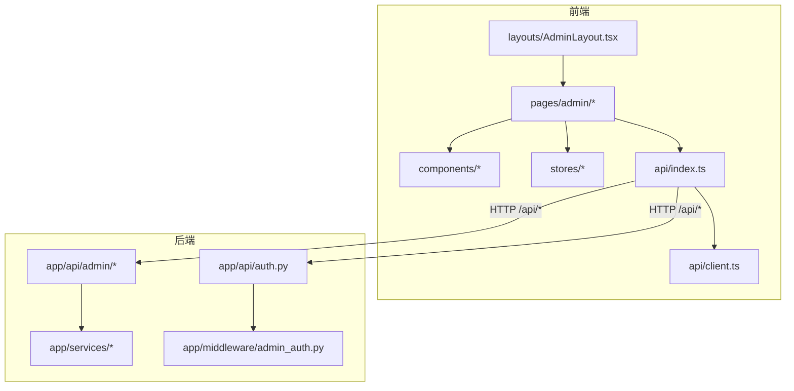
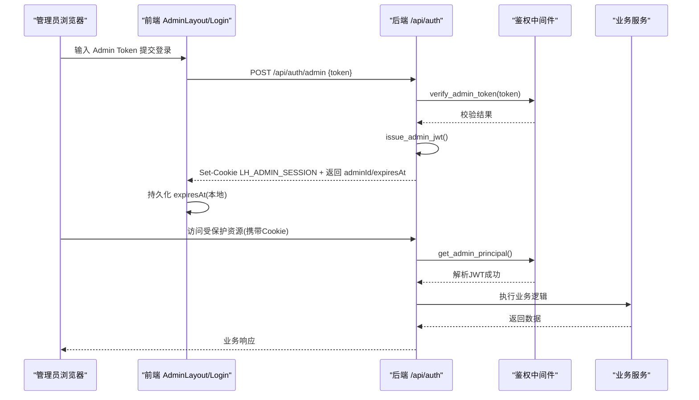
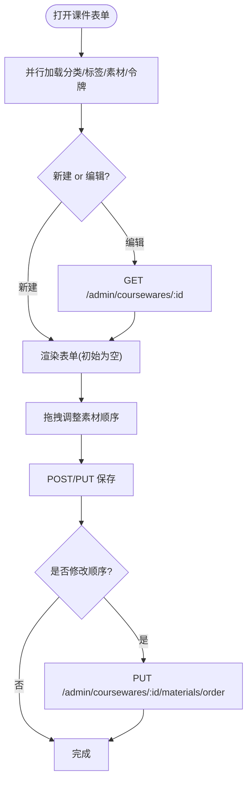
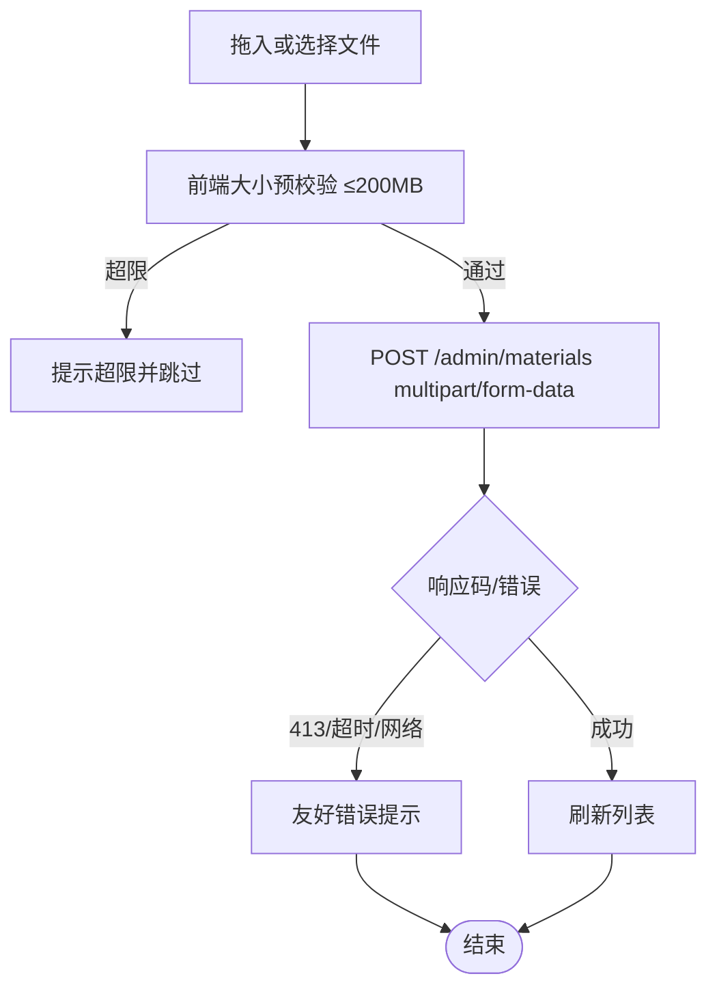
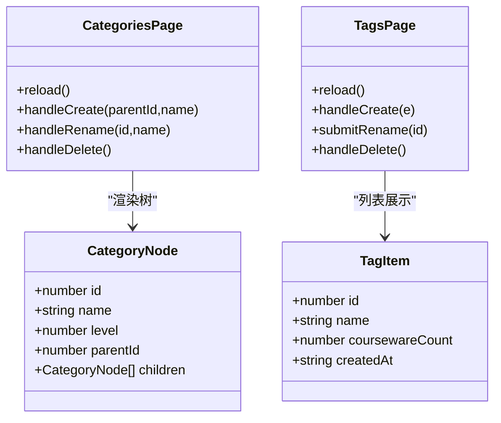
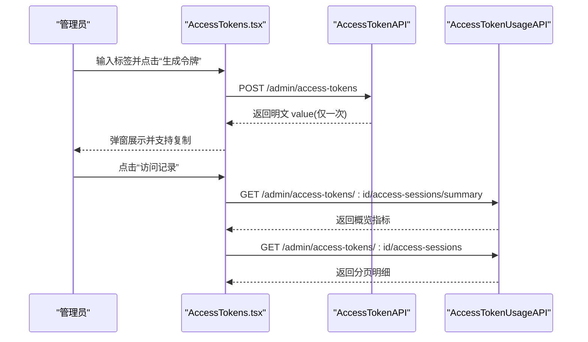
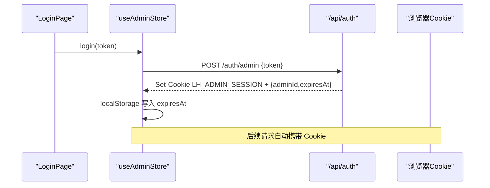
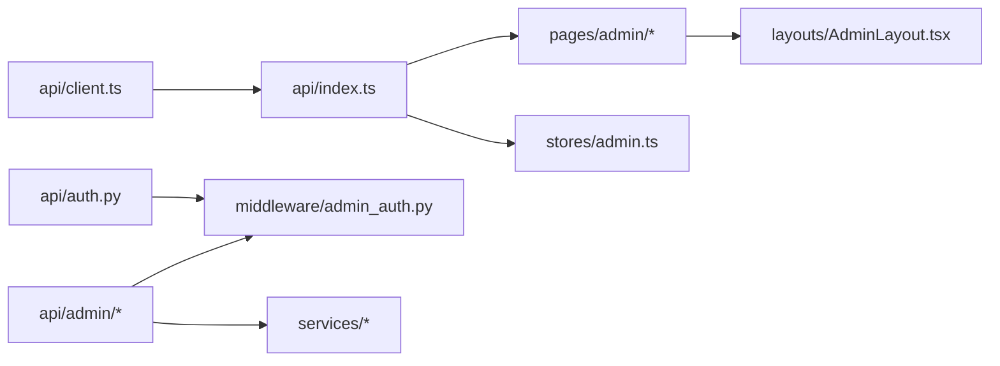

# 管理后台页面开发

<cite>
**本文引用的文件**   
- [Coursewares.tsx](file://frontend/src/pages/admin/Coursewares.tsx)
- [Materials.tsx](file://frontend/src/pages/admin/Materials.tsx)
- [Categories.tsx](file://frontend/src/pages/admin/Categories.tsx)
- [Tags.tsx](file://frontend/src/pages/admin/Tags.tsx)
- [AccessTokens.tsx](file://frontend/src/pages/admin/AccessTokens.tsx)
- [AccessTokenUsage.tsx](file://frontend/src/pages/admin/AccessTokenUsage.tsx)
- [Login.tsx](file://frontend/src/pages/admin/Login.tsx)
- [AdminLayout.tsx](file://frontend/src/layouts/AdminLayout.tsx)
- [api/index.ts](file://frontend/src/api/index.ts)
- [api/client.ts](file://frontend/src/api/client.ts)
- [stores/admin.ts](file://frontend/src/stores/admin.ts)
- [ConfirmDialog.tsx](file://frontend/src/components/ConfirmDialog.tsx)
- [auth.py](file://backend/app/api/auth.py)
- [admin_auth.py](file://backend/app/middleware/admin_auth.py)
- [coursewares.py](file://backend/app/api/admin/coursewares.py)
- [materials.py](file://backend/app/api/admin/materials.py)
- [categories.py](file://backend/app/api/admin/categories.py)
</cite>

## 目录
1. [引言](#引言)
2. [项目结构](#项目结构)
3. [核心组件](#核心组件)
4. [架构总览](#架构总览)
5. [详细组件分析](#详细组件分析)
6. [依赖关系分析](#依赖关系分析)
7. [性能与体验优化](#性能与体验优化)
8. [故障排查指南](#故障排查指南)
9. [结论](#结论)

## 引言
本指南面向 Learning Hub 管理后台的页面开发者，聚焦以下目标：
- 统一 CRUD 页面的开发模式（列表、新增/编辑表单、删除确认、批量操作）
- 课件管理复杂表单（分类树选择、标签多选、素材拖拽排序、访问令牌绑定）
- 素材管理上传（类型检测、大小限制、错误友好提示）
- 分类与标签的树形结构与关联维护
- 访问令牌生成、配置与使用统计
- 登录认证与安全会话管理
- 权限控制、数据验证与用户体验优化方案

## 项目结构
前端采用 React + TypeScript + Tailwind 的组合，按“功能页 + 通用组件 + API 封装 + 状态存储”组织；后端基于 FastAPI，路由按模块划分，统一鉴权中间件。

图表来源
- [AdminLayout.tsx:1-61](file://frontend/src/layouts/AdminLayout.tsx#L1-L61)
- [api/index.ts:1-443](file://frontend/src/api/index.ts#L1-L443)
- [api/client.ts:1-52](file://frontend/src/api/client.ts#L1-L52)
- [auth.py:1-49](file://backend/app/api/auth.py#L1-L49)
- [admin_auth.py:1-66](file://backend/app/middleware/admin_auth.py#L1-L66)
- [coursewares.py:1-115](file://backend/app/api/admin/coursewares.py#L1-L115)
- [materials.py:1-74](file://backend/app/api/admin/materials.py#L1-L74)
- [categories.py:1-81](file://backend/app/api/admin/categories.py#L1-L81)

章节来源
- [AdminLayout.tsx:1-61](file://frontend/src/layouts/AdminLayout.tsx#L1-L61)
- [api/index.ts:1-443](file://frontend/src/api/index.ts#L1-L443)
- [api/client.ts:1-52](file://frontend/src/api/client.ts#L1-L52)
- [auth.py:1-49](file://backend/app/api/auth.py#L1-L49)
- [admin_auth.py:1-66](file://backend/app/middleware/admin_auth.py#L1-L66)
- [coursewares.py:1-115](file://backend/app/api/admin/coursewares.py#L1-L115)
- [materials.py:1-74](file://backend/app/api/admin/materials.py#L1-L74)
- [categories.py:1-81](file://backend/app/api/admin/categories.py#L1-L81)

## 核心组件
- 统一请求客户端：统一 baseURL、withCredentials、业务信封解包、错误映射、X-Request-Id 注入
- 通用确认弹窗：可复用 destructive/warning/primary 风格
- 管理布局：导航、退出登录、全局 Toast 挂载点
- 各管理页：遵循“加载辅助数据 → 列表分页 → 新增/编辑 → 删除确认”的统一流程

章节来源
- [api/client.ts:1-52](file://frontend/src/api/client.ts#L1-L52)
- [ConfirmDialog.tsx:1-92](file://frontend/src/components/ConfirmDialog.tsx#L1-L92)
- [AdminLayout.tsx:1-61](file://frontend/src/layouts/AdminLayout.tsx#L1-L61)

## 架构总览
管理后台整体交互流程：浏览器通过 Axios 客户端调用 /api 前缀接口，后端路由受 admin 鉴权中间件保护；登录成功后由后端签发 JWT 并写入 HttpOnly Cookie，后续请求自动携带。

图表来源
- [auth.py:1-49](file://backend/app/api/auth.py#L1-L49)
- [admin_auth.py:1-66](file://backend/app/middleware/admin_auth.py#L1-L66)
- [stores/admin.ts:1-71](file://frontend/src/stores/admin.ts#L1-L71)
- [api/client.ts:1-52](file://frontend/src/api/client.ts#L1-L52)

## 详细组件分析

### 统一 CRUD 页面开发模式
- 列表展示
  - 统一分页参数 page/size，支持关键词与筛选条件
  - 加载态与空态处理一致
  - 示例路径：[Coursewares.tsx:475-800](file://frontend/src/pages/admin/Coursewares.tsx#L475-L800)、[Materials.tsx:43-276](file://frontend/src/pages/admin/Materials.tsx#L43-L276)
- 新增/编辑表单
  - 新建跳转 /new，编辑跳转 /:id/edit，进入编辑时再拉取详情避免闪烁
  - 保存成功后 toast 提示并返回列表
  - 示例路径：[Coursewares.tsx:475-638](file://frontend/src/pages/admin/Coursewares.tsx#L475-L638)
- 删除确认
  - 使用 ConfirmDialog 二次确认，destructive 风格
  - 示例路径：[ConfirmDialog.tsx:1-92](file://frontend/src/components/ConfirmDialog.tsx#L1-L92)
- 批量操作
  - 当前素材管理支持多文件上传；其他页面可扩展为批量勾选+批量删除
  - 示例路径：[Materials.tsx:76-100](file://frontend/src/pages/admin/Materials.tsx#L76-L100)

章节来源
- [Coursewares.tsx:475-800](file://frontend/src/pages/admin/Coursewares.tsx#L475-L800)
- [Materials.tsx:43-276](file://frontend/src/pages/admin/Materials.tsx#L43-L276)
- [ConfirmDialog.tsx:1-92](file://frontend/src/components/ConfirmDialog.tsx#L1-L92)

### 课件管理（复杂表单与素材顺序）
- 分类树选择器
  - 递归渲染树节点，显示层级色块与路径回显，支持清空
  - 示例路径：[Coursewares.tsx:68-202](file://frontend/src/pages/admin/Coursewares.tsx#L68-L202)
- 标签与访问令牌多选
  - 从 API 预加载标签与令牌，供表单选择
  - 示例路径：[Coursewares.tsx:514-525](file://frontend/src/pages/admin/Coursewares.tsx#L514-L525)
- 素材拖拽排序（v1.5+）
  - 左侧素材库过滤添加，右侧已选顺序支持拖拽与键盘操作
  - 提交后调用专用 reorder 接口更新 sortOrder
  - 示例路径：[Coursewares.tsx:204-473](file://frontend/src/pages/admin/Coursewares.tsx#L204-L473)
- 后端对应接口
  - 列表/详情/创建/更新/删除/重排
  - 示例路径：[coursewares.py:1-115](file://backend/app/api/admin/coursewares.py#L1-L115)

图表来源
- [Coursewares.tsx:475-638](file://frontend/src/pages/admin/Coursewares.tsx#L475-L638)
- [Coursewares.tsx:204-473](file://frontend/src/pages/admin/Coursewares.tsx#L204-L473)
- [coursewares.py:100-115](file://backend/app/api/admin/coursewares.py#L100-L115)

章节来源
- [Coursewares.tsx:68-202](file://frontend/src/pages/admin/Coursewares.tsx#L68-L202)
- [Coursewares.tsx:204-473](file://frontend/src/pages/admin/Coursewares.tsx#L204-L473)
- [Coursewares.tsx:475-638](file://frontend/src/pages/admin/Coursewares.tsx#L475-L638)
- [coursewares.py:1-115](file://backend/app/api/admin/coursewares.py#L1-L115)

### 素材管理（上传、预览与错误处理）
- 拖拽/点击上传，支持 MP4/PDF/PPT/PPTX，单文件上限 200MB
- 前端预校验大小，失败直接提示不发起请求
- 上传错误友好映射：413/超时/网络异常等
- 列表支持搜索与类型筛选，提供下载链接与删除（被引用不可删）
- 示例路径：[Materials.tsx:1-276](file://frontend/src/pages/admin/Materials.tsx#L1-L276)

图表来源
- [Materials.tsx:1-276](file://frontend/src/pages/admin/Materials.tsx#L1-L276)
- [api/index.ts:88-115](file://frontend/src/api/index.ts#L88-L115)
- [materials.py:35-74](file://backend/app/api/admin/materials.py#L35-L74)

章节来源
- [Materials.tsx:1-276](file://frontend/src/pages/admin/Materials.tsx#L1-L276)
- [api/index.ts:88-115](file://frontend/src/api/index.ts#L88-L115)
- [materials.py:1-74](file://backend/app/api/admin/materials.py#L1-L74)

### 分类管理与标签管理（树形结构与关联）
- 分类管理
  - 根级新建入口，行内重命名，子分类最多 3 层，删除触发缓存失效
  - 示例路径：[Categories.tsx:1-270](file://frontend/src/pages/admin/Categories.tsx#L1-L270)
- 标签管理
  - 列表展示关联课件数，双击/按钮进入行内编辑，删除提示将自动解绑
  - 示例路径：[Tags.tsx:1-197](file://frontend/src/pages/admin/Tags.tsx#L1-L197)
- 后端接口
  - 分类树查询、增删改；标签分页/增删改
  - 示例路径：[categories.py:1-81](file://backend/app/api/admin/categories.py#L1-L81)

图表来源
- [Categories.tsx:1-270](file://frontend/src/pages/admin/Categories.tsx#L1-L270)
- [Tags.tsx:1-197](file://frontend/src/pages/admin/Tags.tsx#L1-L197)
- [api/index.ts:35-68](file://frontend/src/api/index.ts#L35-L68)
- [categories.py:1-81](file://backend/app/api/admin/categories.py#L1-L81)

章节来源
- [Categories.tsx:1-270](file://frontend/src/pages/admin/Categories.tsx#L1-L270)
- [Tags.tsx:1-197](file://frontend/src/pages/admin/Tags.tsx#L1-L197)
- [api/index.ts:35-68](file://frontend/src/api/index.ts#L35-L68)
- [categories.py:1-81](file://backend/app/api/admin/categories.py#L1-L81)

### 访问令牌管理（生成、配置与使用统计）
- 生成与重新生成
  - 仅管理员可见，明文仅一次性返回，支持复制与关闭提示
  - 示例路径：[AccessTokens.tsx:1-269](file://frontend/src/pages/admin/AccessTokens.tsx#L1-L269)
- 使用统计
  - 概览指标（总停留时长、次数、覆盖课件/素材）
  - 按素材汇总与明细台账，支持日期范围与快捷区间
  - 示例路径：[AccessTokenUsage.tsx:1-530](file://frontend/src/pages/admin/AccessTokenUsage.tsx#L1-L530)
- 前端 API 封装
  - 列表/创建/重新生成/删除/使用统计
  - 示例路径：[api/index.ts:117-298](file://frontend/src/api/index.ts#L117-L298)

图表来源
- [AccessTokens.tsx:1-269](file://frontend/src/pages/admin/AccessTokens.tsx#L1-L269)
- [AccessTokenUsage.tsx:1-530](file://frontend/src/pages/admin/AccessTokenUsage.tsx#L1-L530)
- [api/index.ts:117-298](file://frontend/src/api/index.ts#L117-L298)

章节来源
- [AccessTokens.tsx:1-269](file://frontend/src/pages/admin/AccessTokens.tsx#L1-L269)
- [AccessTokenUsage.tsx:1-530](file://frontend/src/pages/admin/AccessTokenUsage.tsx#L1-L530)
- [api/index.ts:117-298](file://frontend/src/api/index.ts#L117-L298)

### 登录认证与会话管理
- 登录流程
  - 输入 Admin Token，后端校验通过后签发 JWT 并写入 HttpOnly Cookie
  - 前端持久化 expiresAt，用于本地过期判断
  - 示例路径：[Login.tsx:1-72](file://frontend/src/pages/admin/Login.tsx#L1-L72)、[stores/admin.ts:1-71](file://frontend/src/stores/admin.ts#L1-L71)
- 鉴权中间件
  - 优先 Authorization: Bearer，其次 Cookie LH_ADMIN_SESSION
  - 未登录/过期/无效均抛 401
  - 示例路径：[admin_auth.py:1-66](file://backend/app/middleware/admin_auth.py#L1-L66)
- 登出
  - 清除 Cookie 并清理本地状态
  - 示例路径：[auth.py:42-45](file://backend/app/api/auth.py#L42-L45)、[stores/admin.ts:60-68](file://frontend/src/stores/admin.ts#L60-L68)

图表来源
- [Login.tsx:1-72](file://frontend/src/pages/admin/Login.tsx#L1-L72)
- [stores/admin.ts:1-71](file://frontend/src/stores/admin.ts#L1-L71)
- [auth.py:1-49](file://backend/app/api/auth.py#L1-L49)
- [admin_auth.py:1-66](file://backend/app/middleware/admin_auth.py#L1-L66)

章节来源
- [Login.tsx:1-72](file://frontend/src/pages/admin/Login.tsx#L1-L72)
- [stores/admin.ts:1-71](file://frontend/src/stores/admin.ts#L1-L71)
- [auth.py:1-49](file://backend/app/api/auth.py#L1-L49)
- [admin_auth.py:1-66](file://backend/app/middleware/admin_auth.py#L1-L66)

## 依赖关系分析
- 前端
  - api/index.ts 聚合所有业务 API，统一解包 envelope
  - api/client.ts 提供 axios 实例与拦截器
  - stores/admin.ts 管理登录态与本地过期
  - 各页面依赖 api/index.ts 提供的 API 方法
- 后端
  - 所有 /api/admin/* 路由通过 get_admin_principal 依赖进行鉴权
  - auth.py 负责登录/登出与 Cookie 设置
  - 各业务路由调用 services 层实现

图表来源
- [api/client.ts:1-52](file://frontend/src/api/client.ts#L1-L52)
- [api/index.ts:1-443](file://frontend/src/api/index.ts#L1-L443)
- [AdminLayout.tsx:1-61](file://frontend/src/layouts/AdminLayout.tsx#L1-L61)
- [stores/admin.ts:1-71](file://frontend/src/stores/admin.ts#L1-L71)
- [auth.py:1-49](file://backend/app/api/auth.py#L1-L49)
- [admin_auth.py:1-66](file://backend/app/middleware/admin_auth.py#L1-L66)

章节来源
- [api/client.ts:1-52](file://frontend/src/api/client.ts#L1-L52)
- [api/index.ts:1-443](file://frontend/src/api/index.ts#L1-L443)
- [AdminLayout.tsx:1-61](file://frontend/src/layouts/AdminLayout.tsx#L1-L61)
- [stores/admin.ts:1-71](file://frontend/src/stores/admin.ts#L1-L71)
- [auth.py:1-49](file://backend/app/api/auth.py#L1-L49)
- [admin_auth.py:1-66](file://backend/app/middleware/admin_auth.py#L1-L66)

## 性能与体验优化
- 列表分页
  - 统一 SIZE=15/页，减少首屏数据量，提升滚动性能
  - 参考：[Coursewares.tsx:503-504](file://frontend/src/pages/admin/Coursewares.tsx#L503-L504)、[Materials.tsx:44-49](file://frontend/src/pages/admin/Materials.tsx#L44-L49)
- 并发加载
  - 课件表单并行加载分类/标签/素材/令牌，缩短等待时间
  - 参考：[Coursewares.tsx:514-525](file://frontend/src/pages/admin/Coursewares.tsx#L514-L525)
- 大文件上传
  - 延长客户端超时至 15 分钟，配合后端/nginx 600s 对齐
  - 参考：[api/index.ts:101-110](file://frontend/src/api/index.ts#L101-L110)
- 交互反馈
  - 统一的 toast 提示与 ConfirmDialog 二次确认，降低误操作
  - 参考：[ConfirmDialog.tsx:1-92](file://frontend/src/components/ConfirmDialog.tsx#L1-L92)

## 故障排查指南
- 登录失败
  - 检查 Admin Token 是否正确；查看后端返回的错误码与消息
  - 参考：[auth.py:22-39](file://backend/app/api/auth.py#L22-L39)
- 会话过期/未登录
  - 中间件会抛出未认证错误，需重新登录
  - 参考：[admin_auth.py:26-42](file://backend/app/middleware/admin_auth.py#L26-L42)
- 上传失败
  - 413/超时/网络异常均有友好提示；检查文件大小与网络状况
  - 参考：[Materials.tsx:22-41](file://frontend/src/pages/admin/Materials.tsx#L22-L41)
- 列表加载异常
  - 检查分页参数与筛选条件；查看统一错误拦截器的 code/status
  - 参考：[api/client.ts:25-49](file://frontend/src/api/client.ts#L25-L49)

章节来源
- [auth.py:22-39](file://backend/app/api/auth.py#L22-L39)
- [admin_auth.py:26-42](file://backend/app/middleware/admin_auth.py#L26-L42)
- [Materials.tsx:22-41](file://frontend/src/pages/admin/Materials.tsx#L22-L41)
- [api/client.ts:25-49](file://frontend/src/api/client.ts#L25-L49)

## 结论
通过统一的 API 封装、鉴权中间件与一致的页面模式，Learning Hub 管理后台在可读性、可维护性与用户体验方面具备良好的工程基础。建议在后续迭代中：
- 扩展批量操作能力（如批量删除、批量移动）
- 增加更丰富的上传进度可视化
- 完善权限粒度（角色/菜单级）与审计日志
- 对复杂表单引入更严格的字段校验与错误定位