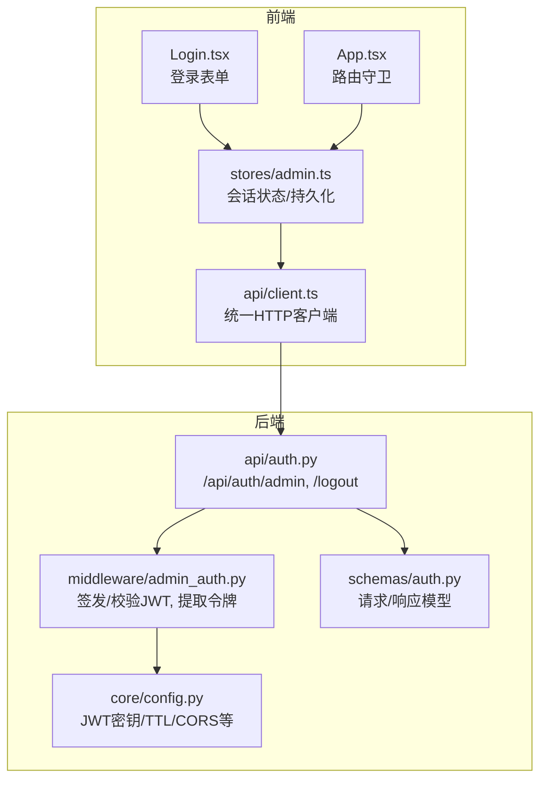
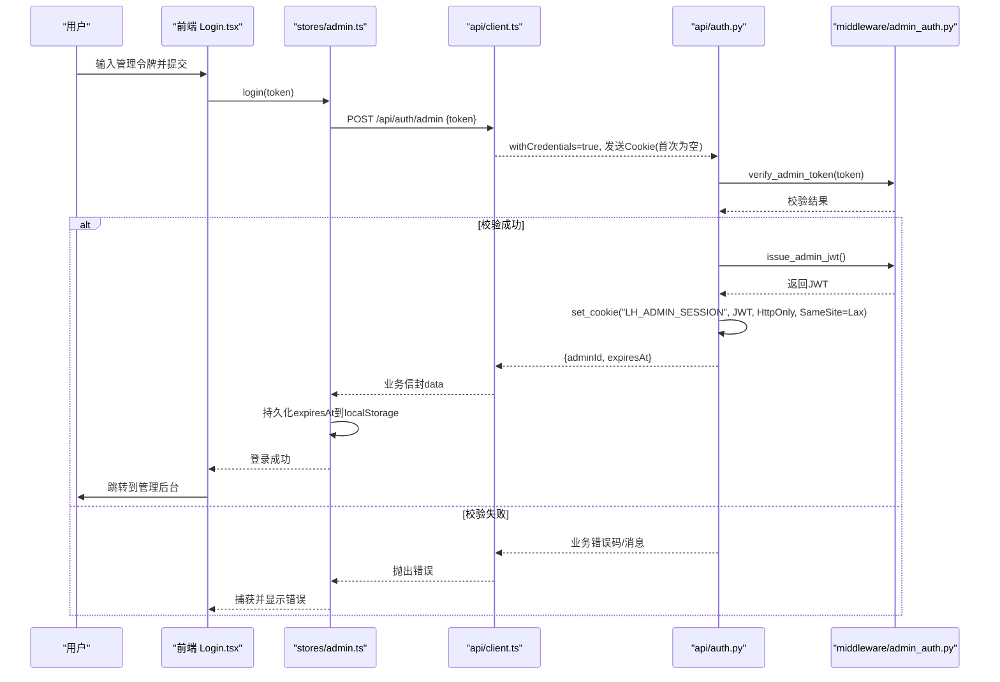
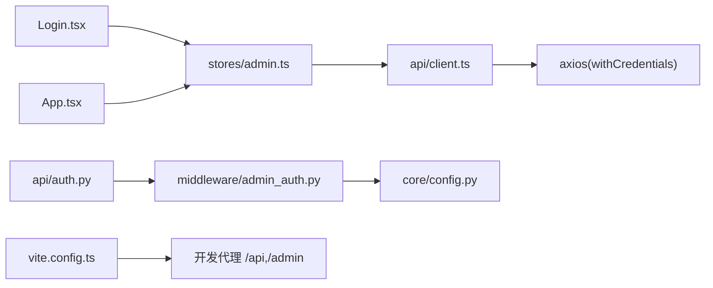
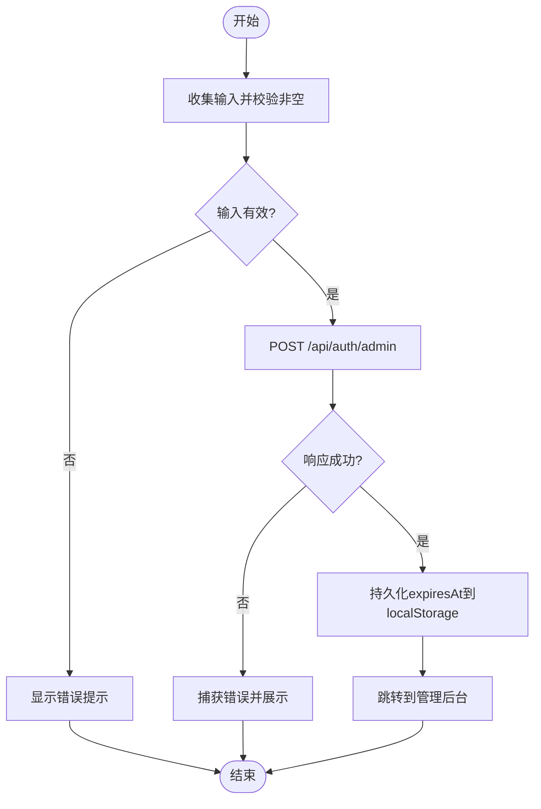

# 管理员登录页面

<cite>
**本文引用的文件**
- [frontend/src/pages/admin/Login.tsx](file://frontend/src/pages/admin/Login.tsx)
- [frontend/src/stores/admin.ts](file://frontend/src/stores/admin.ts)
- [frontend/src/api/client.ts](file://frontend/src/api/client.ts)
- [backend/app/api/auth.py](file://backend/app/api/auth.py)
- [backend/app/middleware/admin_auth.py](file://backend/app/middleware/admin_auth.py)
- [backend/app/schemas/auth.py](file://backend/app/schemas/auth.py)
- [backend/app/core/config.py](file://backend/app/core/config.py)
- [frontend/src/App.tsx](file://frontend/src/App.tsx)
- [frontend/vite.config.ts](file://frontend/vite.config.ts)
</cite>

## 目录
1. [简介](#简介)
2. [项目结构](#项目结构)
3. [核心组件](#核心组件)
4. [架构总览](#架构总览)
5. [详细组件分析](#详细组件分析)
6. [依赖关系分析](#依赖关系分析)
7. [性能与安全考虑](#性能与安全考虑)
8. [故障排查指南](#故障排查指南)
9. [结论](#结论)
10. [附录](#附录)

## 简介
本指南面向“管理员登录页面”的安全实现，围绕 JWT 认证机制的前后端协作展开，覆盖以下要点：
- 登录请求流程、Token 存储与会话管理
- 密码（管理令牌）加密传输与安全性保障
- 登录状态持久化与自动刷新策略
- 登出流程与 Token 清理策略
- 登录失败处理与用户反馈
- 跨域请求配置与安全考量
- 登录界面用户体验优化与错误提示

说明：当前实现采用“管理令牌 + HttpOnly Cookie 的 JWT”模式。前端不直接持有 JWT，JWT 由后端通过 Set-Cookie 写入浏览器；前端仅维护会话过期时间用于本地判断。

## 项目结构
与管理员登录相关的关键文件分布如下：
- 前端登录页与状态管理：Login.tsx、admin.ts、client.ts
- 后端鉴权路由与中间件：auth.py、admin_auth.py、schemas/auth.py
- 应用配置与路由守卫：config.py、App.tsx
- 开发期代理配置：vite.config.ts

图表来源
- [frontend/src/pages/admin/Login.tsx:1-72](file://frontend/src/pages/admin/Login.tsx#L1-L72)
- [frontend/src/stores/admin.ts:1-71](file://frontend/src/stores/admin.ts#L1-L71)
- [frontend/src/api/client.ts:1-52](file://frontend/src/api/client.ts#L1-L52)
- [backend/app/api/auth.py:1-49](file://backend/app/api/auth.py#L1-L49)
- [backend/app/middleware/admin_auth.py:1-66](file://backend/app/middleware/admin_auth.py#L1-L66)
- [backend/app/schemas/auth.py:1-17](file://backend/app/schemas/auth.py#L1-L17)
- [backend/app/core/config.py:1-88](file://backend/app/core/config.py#L1-L88)
- [frontend/src/App.tsx:1-110](file://frontend/src/App.tsx#L1-L110)

章节来源
- [frontend/src/pages/admin/Login.tsx:1-72](file://frontend/src/pages/admin/Login.tsx#L1-L72)
- [frontend/src/stores/admin.ts:1-71](file://frontend/src/stores/admin.ts#L1-L71)
- [frontend/src/api/client.ts:1-52](file://frontend/src/api/client.ts#L1-L52)
- [backend/app/api/auth.py:1-49](file://backend/app/api/auth.py#L1-L49)
- [backend/app/middleware/admin_auth.py:1-66](file://backend/app/middleware/admin_auth.py#L1-L66)
- [backend/app/schemas/auth.py:1-17](file://backend/app/schemas/auth.py#L1-L17)
- [backend/app/core/config.py:1-88](file://backend/app/core/config.py#L1-L88)
- [frontend/src/App.tsx:1-110](file://frontend/src/App.tsx#L1-L110)

## 核心组件
- 登录页面组件：负责收集输入、调用登录接口、展示错误信息并跳转。
- 管理员会话 Store：封装登录/登出/恢复逻辑，维护本地会话过期时间，触发导航守卫。
- HTTP 客户端：统一 baseURL、withCredentials、业务信封解析与错误包装。
- 后端鉴权路由：验证管理令牌、签发 JWT、设置 HttpOnly Cookie、返回会话元信息。
- 鉴权中间件：从 Authorization 或 Cookie 提取 JWT，解码校验，提供受保护资源访问凭据。
- 配置中心：集中管理 JWT 密钥、算法、TTL、CORS 白名单等。

章节来源
- [frontend/src/pages/admin/Login.tsx:1-72](file://frontend/src/pages/admin/Login.tsx#L1-L72)
- [frontend/src/stores/admin.ts:1-71](file://frontend/src/stores/admin.ts#L1-L71)
- [frontend/src/api/client.ts:1-52](file://frontend/src/api/client.ts#L1-L52)
- [backend/app/api/auth.py:1-49](file://backend/app/api/auth.py#L1-L49)
- [backend/app/middleware/admin_auth.py:1-66](file://backend/app/middleware/admin_auth.py#L1-L66)
- [backend/app/core/config.py:1-88](file://backend/app/core/config.py#L1-L88)

## 架构总览
下图展示了管理员登录的端到端流程：前端提交管理令牌，后端校验后签发 JWT 并通过 Set-Cookie 下发，后续请求携带该 Cookie 完成鉴权。

图表来源
- [frontend/src/pages/admin/Login.tsx:1-72](file://frontend/src/pages/admin/Login.tsx#L1-L72)
- [frontend/src/stores/admin.ts:1-71](file://frontend/src/stores/admin.ts#L1-L71)
- [frontend/src/api/client.ts:1-52](file://frontend/src/api/client.ts#L1-L52)
- [backend/app/api/auth.py:1-49](file://backend/app/api/auth.py#L1-L49)
- [backend/app/middleware/admin_auth.py:1-66](file://backend/app/middleware/admin_auth.py#L1-L66)

## 详细组件分析

### 登录页面组件（Login.tsx）
- 职责
  - 渲染登录表单，聚焦输入框，禁用重复提交。
  - 调用 store.login 发起登录，成功后跳转至课程管理页。
  - 捕获异常并在 UI 中展示错误信息。
- 交互细节
  - 空值校验：未输入时立即提示。
  - 加载态：提交期间按钮禁用并显示“验证中...”。
  - 错误提示：以醒目样式展示错误消息。
- 安全注意
  - 输入类型为 password，避免明文回显。
  - 不直接操作 Cookie，交由后端 Set-Cookie 下发。

章节来源
- [frontend/src/pages/admin/Login.tsx:1-72](file://frontend/src/pages/admin/Login.tsx#L1-L72)

### 管理员会话 Store（stores/admin.ts）
- 职责
  - 登录：调用 /api/auth/admin，保存 expiresAt 到 localStorage，更新内存 session。
  - 登出：调用 /api/logout 清理服务端 Cookie，同时移除本地记录并清空 session。
  - 恢复：应用启动时从 localStorage 读取 expiresAt 并恢复 session。
- 持久化策略
  - 仅持久化 expiresAt，不持久化 JWT 本身（JWT 在 HttpOnly Cookie 中）。
  - 过期判断：若 expiresAt 已过期则清除本地记录并视为未登录。
- 与路由守卫联动
  - App.tsx 中的 AdminGuard 根据 session 是否存在决定重定向到登录页。

章节来源
- [frontend/src/stores/admin.ts:1-71](file://frontend/src/stores/admin.ts#L1-L71)
- [frontend/src/App.tsx:31-35](file://frontend/src/App.tsx#L31-L35)

### HTTP 客户端（api/client.ts）
- 特性
  - baseURL 指向 /api，便于同源部署与反向代理。
  - withCredentials=true，确保跨域场景下携带 Cookie（包括 HttpOnly Cookie）。
  - 请求拦截器注入 X-Request-Id 便于追踪。
  - 响应拦截器对业务信封进行解包与错误标准化，将 code !== ok 的情况转为 Error 对象。
- 与登录的关系
  - 登录请求使用 withCredentials，使后端 Set-Cookie 能正确写入浏览器。
  - 后续受保护接口无需手动附加 Authorization，浏览器会自动带上 LH_ADMIN_SESSION。

章节来源
- [frontend/src/api/client.ts:1-52](file://frontend/src/api/client.ts#L1-L52)

### 后端鉴权路由（api/auth.py）
- 登录接口 /api/auth/admin
  - 校验管理令牌（常量时间比较），通过后签发 JWT。
  - 通过 Response.set_cookie 写入 LH_ADMIN_SESSION，设置 max_age、httponly、samesite=lax、path=/。
  - 返回 adminId 与 expiresAt（ISO-8601），供前端持久化过期时间。
- 登出接口 /api/auth/logout
  - 删除 LH_ADMIN_SESSION Cookie，返回成功。

章节来源
- [backend/app/api/auth.py:1-49](file://backend/app/api/auth.py#L1-L49)
- [backend/app/schemas/auth.py:1-17](file://backend/app/schemas/auth.py#L1-L17)

### 鉴权中间件（middleware/admin_auth.py）
- 令牌提取
  - 优先从 Authorization: Bearer 头提取。
  - 其次从 Cookie LH_ADMIN_SESSION 提取。
- JWT 校验
  - 使用配置的 jwt_secret 与 jwt_algorithm 解码。
  - 要求 exp 与 sub 字段存在，否则拒绝。
  - 过期或无效时抛出未认证错误。
- 签发与验证
  - issue_admin_jwt：生成带 iat/exp/sub 的 JWT。
  - verify_admin_token：对管理令牌进行常量时间比较，防止时序攻击。

章节来源
- [backend/app/middleware/admin_auth.py:1-66](file://backend/app/middleware/admin_auth.py#L1-L66)

### 配置中心（core/config.py）
- 关键配置项
  - admin_token：管理令牌（生产环境需替换为强随机值）。
  - jwt_secret/jwt_algorithm/jwt_ttl_hours：JWT 签名密钥、算法与有效期。
  - cors_allow_origins：允许的来源列表（默认 *，生产建议精确配置）。
- 作用范围
  - 影响登录校验、JWT 签发与校验、跨域策略等。

章节来源
- [backend/app/core/config.py:1-88](file://backend/app/core/config.py#L1-L88)

### 路由守卫（App.tsx）
- 行为
  - 应用初始化时恢复管理员会话。
  - 对 /admin/* 路由添加 AdminGuard，未登录时重定向到 /admin。
- 与登录流程配合
  - 登录成功后进入受保护路由；登出后回到登录页。

章节来源
- [frontend/src/App.tsx:60-110](file://frontend/src/App.tsx#L60-L110)

## 依赖关系分析
- 前端
  - Login.tsx 依赖 stores/admin.ts 与 react-router-dom。
  - stores/admin.ts 依赖 api/client.ts 与 localStorage。
  - api/client.ts 基于 axios，启用 withCredentials。
- 后端
  - api/auth.py 依赖 middleware/admin_auth.py 与 schemas/auth.py。
  - middleware/admin_auth.py 依赖 core/config.py 提供的 JWT 参数。
- 运行时
  - vite.config.ts 在开发环境代理 /api 与 /admin 到后端服务。

图表来源
- [frontend/src/pages/admin/Login.tsx:1-72](file://frontend/src/pages/admin/Login.tsx#L1-L72)
- [frontend/src/stores/admin.ts:1-71](file://frontend/src/stores/admin.ts#L1-L71)
- [frontend/src/api/client.ts:1-52](file://frontend/src/api/client.ts#L1-L52)
- [backend/app/api/auth.py:1-49](file://backend/app/api/auth.py#L1-L49)
- [backend/app/middleware/admin_auth.py:1-66](file://backend/app/middleware/admin_auth.py#L1-L66)
- [backend/app/core/config.py:1-88](file://backend/app/core/config.py#L1-L88)
- [frontend/src/App.tsx:1-110](file://frontend/src/App.tsx#L1-L110)
- [frontend/vite.config.ts:1-39](file://frontend/vite.config.ts#L1-L39)

章节来源
- [frontend/vite.config.ts:1-39](file://frontend/vite.config.ts#L1-L39)

## 性能与安全考虑

### 登录请求与网络
- 使用 withCredentials=true 保证跨域时携带 Cookie，减少额外头部传递开销。
- 统一拦截器注入 X-Request-Id，便于链路追踪与问题定位。

### 令牌传输与存储
- 管理令牌在前端以密码输入方式提交，避免明文回显。
- JWT 通过 HttpOnly Cookie 下发，前端无法通过脚本读取，降低 XSS 窃取风险。
- 前端仅持久化 expiresAt，避免将敏感凭证落盘。

### 会话管理与自动刷新
- 当前实现未包含自动刷新逻辑。建议在以下时机检查过期：
  - 应用启动时 restore 阶段。
  - 每次发起受保护请求前，若 expiresAt 已过期则主动登出并重定向。
- 可选增强：在响应拦截器中检测 401 或特定业务错误码，触发静默刷新或引导重新登录。

### 跨域配置与安全
- 开发环境通过 Vite 代理转发 /api 与 /admin，规避 CORS 问题。
- 生产环境应：
  - 配置严格的 CORS 白名单（cors_allow_origins）。
  - 使用 HTTPS，确保 Cookie 标记 Secure（可在后端扩展）。
  - 保持 SameSite=Lax 或根据业务调整为 Strict。

### 用户体验优化
- 输入校验即时反馈，避免无效请求。
- 提交期间禁用按钮并显示“验证中...”，防止重复提交。
- 错误信息清晰可读，支持重试。

章节来源
- [frontend/src/api/client.ts:1-52](file://frontend/src/api/client.ts#L1-L52)
- [backend/app/api/auth.py:1-49](file://backend/app/api/auth.py#L1-L49)
- [backend/app/core/config.py:1-88](file://backend/app/core/config.py#L1-L88)
- [frontend/src/pages/admin/Login.tsx:1-72](file://frontend/src/pages/admin/Login.tsx#L1-L72)

## 故障排查指南
- 登录失败
  - 现象：提交后出现错误提示，未跳转。
  - 排查：确认管理令牌是否正确；查看后端日志与错误码；检查浏览器是否收到 Set-Cookie。
- 会话失效
  - 现象：访问受保护路由被重定向到登录页。
  - 排查：检查 expiresAt 是否过期；确认 Cookie 是否被浏览器策略阻止（如隐私模式或第三方 Cookie 限制）。
- 跨域问题
  - 现象：开发环境正常，生产环境报错。
  - 排查：核对 CORS 配置；确认 withCredentials 与 Access-Control-Allow-Credentials 匹配；检查域名与端口。
- 调试技巧
  - 使用浏览器开发者工具查看 Network 面板，确认请求头与响应头。
  - 关注 X-Request-Id，结合后端日志定位问题。

章节来源
- [frontend/src/stores/admin.ts:1-71](file://frontend/src/stores/admin.ts#L1-L71)
- [frontend/src/api/client.ts:1-52](file://frontend/src/api/client.ts#L1-L52)
- [backend/app/api/auth.py:1-49](file://backend/app/api/auth.py#L1-L49)

## 结论
当前管理员登录实现遵循“管理令牌 + HttpOnly Cookie 的 JWT”模式，具备较好的安全性与可维护性。前端不直接持有 JWT，降低了泄露风险；后端集中管理签发与校验，便于统一策略。建议在生产环境中强化 CORS、HTTPS 与 Cookie 安全属性，并补充会话自动刷新与更完善的错误提示，以提升用户体验与系统健壮性。

## 附录

### 登录流程图（算法视角）

图表来源
- [frontend/src/pages/admin/Login.tsx:1-72](file://frontend/src/pages/admin/Login.tsx#L1-L72)
- [frontend/src/stores/admin.ts:1-71](file://frontend/src/stores/admin.ts#L1-L71)
- [backend/app/api/auth.py:1-49](file://backend/app/api/auth.py#L1-L49)