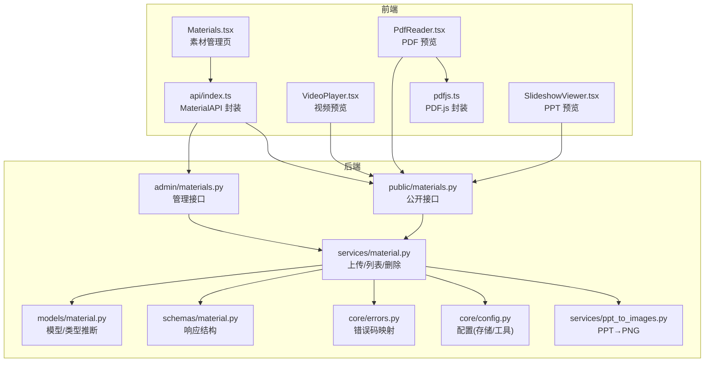
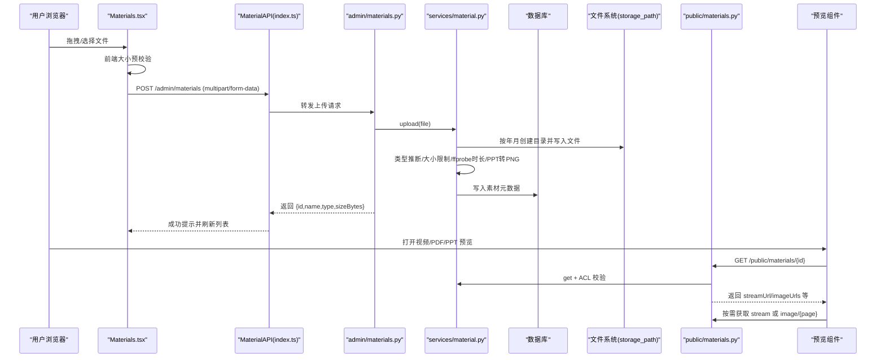
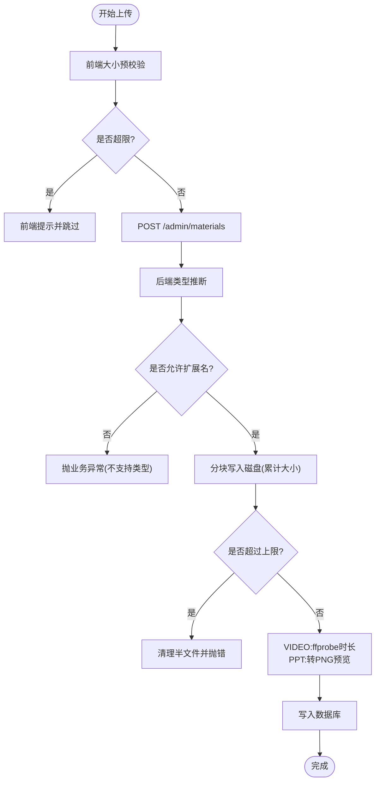
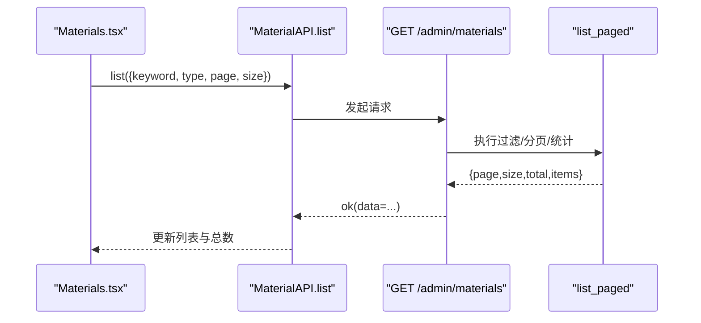
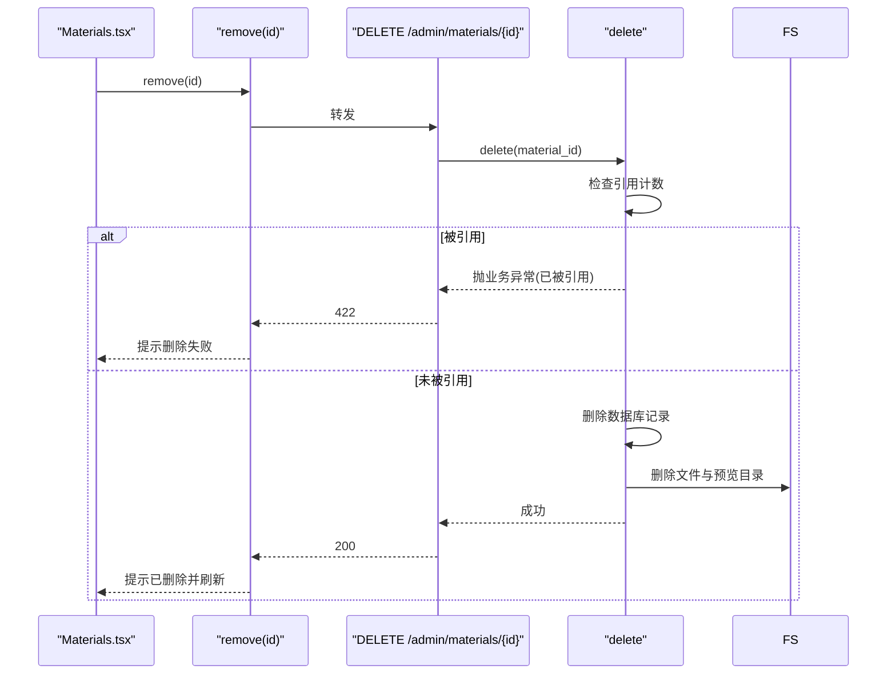
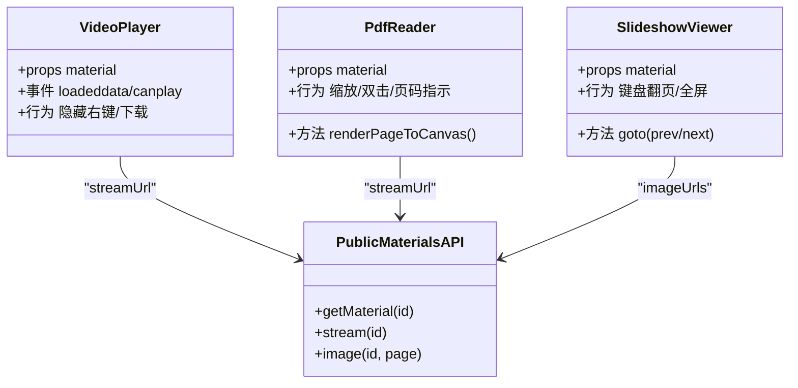
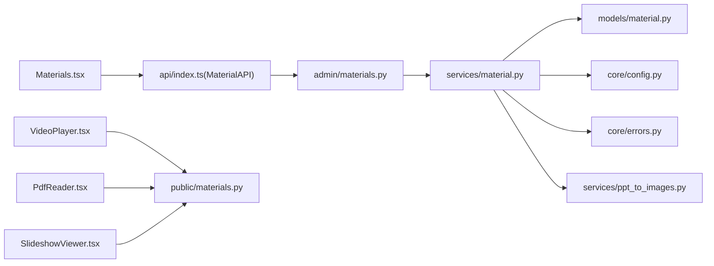

# 素材管理页面

<cite>
**本文引用的文件**
- [frontend/src/pages/admin/Materials.tsx](file://frontend/src/pages/admin/Materials.tsx)
- [frontend/src/api/index.ts](file://frontend/src/api/index.ts)
- [backend/app/api/admin/materials.py](file://backend/app/api/admin/materials.py)
- [backend/app/services/material.py](file://backend/app/services/material.py)
- [backend/app/models/material.py](file://backend/app/models/material.py)
- [backend/app/schemas/material.py](file://backend/app/schemas/material.py)
- [backend/app/core/errors.py](file://backend/app/core/errors.py)
- [backend/app/core/config.py](file://backend/app/core/config.py)
- [backend/app/services/ppt_to_images.py](file://backend/app/services/ppt_to_images.py)
- [backend/app/api/public/materials.py](file://backend/app/api/public/materials.py)
- [frontend/src/pages/public/viewer/VideoPlayer.tsx](file://frontend/src/pages/public/viewer/VideoPlayer.tsx)
- [frontend/src/pages/public/viewer/PdfReader.tsx](file://frontend/src/pages/public/viewer/PdfReader.tsx)
- [frontend/src/pages/public/viewer/SlideshowViewer.tsx](file://frontend/src/pages/public/viewer/SlideshowViewer.tsx)
- [frontend/src/lib/pdfjs.ts](file://frontend/src/lib/pdfjs.ts)
</cite>

## 目录
1. [简介](#简介)
2. [项目结构](#项目结构)
3. [核心组件](#核心组件)
4. [架构总览](#架构总览)
5. [详细组件分析](#详细组件分析)
6. [依赖关系分析](#依赖关系分析)
7. [性能与容量规划](#性能与容量规划)
8. [故障排查指南](#故障排查指南)
9. [结论](#结论)
10. [附录：API 契约与交互模式](#附录api-契约与交互模式)

## 简介
本指南面向“素材管理页面”的完整开发，覆盖多媒体文件上传、类型检测、进度显示、错误处理；视频、PDF、PPT 三类素材的差异化处理与预览；批量操作、筛选过滤与搜索；元数据管理与存储路径策略；以及大文件上传的分片与断点续传方案。同时说明前端与后端 API 的交互模式、错误码映射与安全校验要点。

## 项目结构
- 前端管理页：提供拖拽/选择上传、列表分页、关键词搜索、类型筛选、删除确认等能力。
- 前端公共播放器：视频、PDF、幻灯片三种类型的在线预览实现。
- 后端管理接口：素材列表、上传、删除、下载。
- 后端公共服务：公开流式预览、单条查询、PPT 图片预览图接口。
- 业务服务层：上传流程（含大小限制、类型推断、时长探测、PPT 转图片）、删除逻辑（引用保护）。
- 模型与 Schema：素材表结构、枚举类型、前后端共享的数据结构。
- 配置与错误：存储路径、外部工具路径、统一错误码与 HTTP 状态映射。

图表来源
- [frontend/src/pages/admin/Materials.tsx:1-276](file://frontend/src/pages/admin/Materials.tsx#L1-L276)
- [frontend/src/api/index.ts:70-115](file://frontend/src/api/index.ts#L70-L115)
- [backend/app/api/admin/materials.py:1-74](file://backend/app/api/admin/materials.py#L1-L74)
- [backend/app/api/public/materials.py:1-224](file://backend/app/api/public/materials.py#L1-L224)
- [backend/app/services/material.py:1-234](file://backend/app/services/material.py#L1-L234)
- [backend/app/models/material.py:1-69](file://backend/app/models/material.py#L1-L69)
- [backend/app/schemas/material.py:1-28](file://backend/app/schemas/material.py#L1-L28)
- [backend/app/core/errors.py:1-144](file://backend/app/core/errors.py#L1-L144)
- [backend/app/core/config.py:1-88](file://backend/app/core/config.py#L1-L88)
- [backend/app/services/ppt_to_images.py:1-185](file://backend/app/services/ppt_to_images.py#L1-L185)
- [frontend/src/pages/public/viewer/VideoPlayer.tsx:1-250](file://frontend/src/pages/public/viewer/VideoPlayer.tsx#L1-L250)
- [frontend/src/pages/public/viewer/PdfReader.tsx:1-270](file://frontend/src/pages/public/viewer/PdfReader.tsx#L1-L270)
- [frontend/src/pages/public/viewer/SlideshowViewer.tsx:1-277](file://frontend/src/pages/public/viewer/SlideshowViewer.tsx#L1-L277)
- [frontend/src/lib/pdfjs.ts:1-57](file://frontend/src/lib/pdfjs.ts#L1-L57)

章节来源
- [frontend/src/pages/admin/Materials.tsx:1-276](file://frontend/src/pages/admin/Materials.tsx#L1-L276)
- [backend/app/api/admin/materials.py:1-74](file://backend/app/api/admin/materials.py#L1-L74)
- [backend/app/services/material.py:1-234](file://backend/app/services/material.py#L1-L234)
- [backend/app/models/material.py:1-69](file://backend/app/models/material.py#L1-L69)
- [backend/app/schemas/material.py:1-28](file://backend/app/schemas/material.py#L1-L28)
- [backend/app/core/errors.py:1-144](file://backend/app/core/errors.py#L1-L144)
- [backend/app/core/config.py:1-88](file://backend/app/core/config.py#L1-L88)
- [backend/app/services/ppt_to_images.py:1-185](file://backend/app/services/ppt_to_images.py#L1-L185)
- [backend/app/api/public/materials.py:1-224](file://backend/app/api/public/materials.py#L1-L224)
- [frontend/src/pages/public/viewer/VideoPlayer.tsx:1-250](file://frontend/src/pages/public/viewer/VideoPlayer.tsx#L1-L250)
- [frontend/src/pages/public/viewer/PdfReader.tsx:1-270](file://frontend/src/pages/public/viewer/PdfReader.tsx#L1-L270)
- [frontend/src/pages/public/viewer/SlideshowViewer.tsx:1-277](file://frontend/src/pages/public/viewer/SlideshowViewer.tsx#L1-L277)
- [frontend/src/lib/pdfjs.ts:1-57](file://frontend/src/lib/pdfjs.ts#L1-L57)

## 核心组件
- 素材管理页（Materials.tsx）
  - 支持拖拽/点击多选上传，前端预校验文件大小，调用 MaterialAPI.upload 逐个上传。
  - 列表分页加载，支持关键词搜索与类型筛选（VIDEO/PDF/PPT），展示名称、类型、大小、上传时间、是否被引用、下载与删除按钮。
  - 删除前弹出确认框，若被引用则禁用删除。
- API 封装（api/index.ts）
  - MaterialAPI.list/upload/remove/fileUrl 统一包装，upload 设置长超时并预留 onUploadProgress 回调位置。
- 管理接口（admin/materials.py）
  - GET /api/admin/materials：分页列表（keyword/type/page/size）。
  - POST /api/admin/materials：上传单个文件。
  - DELETE /api/admin/materials/{id}：删除素材。
  - GET /api/admin/materials/{id}/file：管理员下载原文件。
- 业务服务（services/material.py）
  - 上传：按月份分目录落盘，生成唯一文件名；累计大小超过上限抛错并清理半文件；写入数据库；对 VIDEO 用 ffprobe 探测时长；对 PPT 调用 ppt_to_images 转换 PNG 预览图。
  - 列表：支持 keyword/type 过滤，计算 total，附带 referenced 标记与 downloadUrl。
  - 删除：检查引用计数，物理删除文件及预览图片目录。
- 模型与类型推断（models/material.py）
  - 定义 MaterialType 枚举（VIDEO/PDF/PPT），根据扩展名推断类型，非法扩展抛出业务异常。
- 公共接口（public/materials.py）
  - GET /api/public/materials/{id}：返回 streamUrl/downloadUrl/imageUrls 等，PPT 时返回每页 PNG URL。
  - GET /api/public/materials/{id}/stream：按类型 inline 返回视频/PDF/PPT 预览（优先 PDF 预览或降级原文件）。
  - GET /api/public/materials/{id}/image/{page_no}：返回第 N 张 PNG。
  - 所有公开接口均进行 ACL 校验（令牌解锁）。
- 预览组件
  - VideoPlayer：HTML5 video 播放，隐藏右键与下载控件，首帧占位过渡。
  - PdfReader：基于 pdfjs 渲染多页到 canvas，缩放与滚动定位。
  - SlideshowViewer：直接加载 PPT 生成的 PNG 序列，键盘翻页与全屏。

章节来源
- [frontend/src/pages/admin/Materials.tsx:1-276](file://frontend/src/pages/admin/Materials.tsx#L1-L276)
- [frontend/src/api/index.ts:70-115](file://frontend/src/api/index.ts#L70-L115)
- [backend/app/api/admin/materials.py:1-74](file://backend/app/api/admin/materials.py#L1-L74)
- [backend/app/services/material.py:1-234](file://backend/app/services/material.py#L1-L234)
- [backend/app/models/material.py:1-69](file://backend/app/models/material.py#L1-L69)
- [backend/app/api/public/materials.py:1-224](file://backend/app/api/public/materials.py#L1-L224)
- [frontend/src/pages/public/viewer/VideoPlayer.tsx:1-250](file://frontend/src/pages/public/viewer/VideoPlayer.tsx#L1-L250)
- [frontend/src/pages/public/viewer/PdfReader.tsx:1-270](file://frontend/src/pages/public/viewer/PdfReader.tsx#L1-L270)
- [frontend/src/pages/public/viewer/SlideshowViewer.tsx:1-277](file://frontend/src/pages/public/viewer/SlideshowViewer.tsx#L1-L277)

## 架构总览
下图展示了从前端上传到后端落盘、元数据处理、再到公开预览的端到端流程。

图表来源
- [frontend/src/pages/admin/Materials.tsx:76-100](file://frontend/src/pages/admin/Materials.tsx#L76-L100)
- [frontend/src/api/index.ts:92-115](file://frontend/src/api/index.ts#L92-L115)
- [backend/app/api/admin/materials.py:35-48](file://backend/app/api/admin/materials.py#L35-L48)
- [backend/app/services/material.py:129-202](file://backend/app/services/material.py#L129-L202)
- [backend/app/api/public/materials.py:183-221](file://backend/app/api/public/materials.py#L183-L221)

## 详细组件分析

### 上传与类型检测
- 前端预校验
  - 限制单文件大小（与后端一致），避免触发网关 413。
  - 支持多选，逐个上传，失败友好提示。
- 后端上传流程
  - 类型推断：仅允许 mp4/pdf/ppt/pptx，否则拒绝。
  - 大小限制：累计读取 chunk，超过阈值主动清理半文件并抛错。
  - 存储路径：按年月上分子目录，文件名加入时间戳+随机串，避免冲突。
  - 元数据增强：
    - VIDEO：调用 ffprobe 解析时长，写入 duration_or_pages。
    - PPT：调用 LibreOffice → PDF → pdftoppm 生成 page-N.png，记录 preview_images_dir 与页数。
  - 事务性入库：失败回滚并清理已写文件。
- 安全与健壮性
  - 外部工具调用带超时与异常捕获，不阻断上传主流程。
  - 删除时检查引用计数，防止误删。

图表来源
- [frontend/src/pages/admin/Materials.tsx:76-100](file://frontend/src/pages/admin/Materials.tsx#L76-L100)
- [backend/app/services/material.py:129-202](file://backend/app/services/material.py#L129-L202)
- [backend/app/models/material.py:31-41](file://backend/app/models/material.py#L31-L41)

章节来源
- [frontend/src/pages/admin/Materials.tsx:76-100](file://frontend/src/pages/admin/Materials.tsx#L76-L100)
- [backend/app/services/material.py:129-202](file://backend/app/services/material.py#L129-L202)
- [backend/app/models/material.py:31-41](file://backend/app/models/material.py#L31-L41)

### 列表、筛选与搜索
- 列表接口
  - 支持 keyword（模糊匹配 name）、type（VIDEO/PDF/PPT）、page/size 分页。
  - 返回 items 数组与 total，并附带 referenced 标记与 downloadUrl。
- 前端交互
  - 输入关键词或切换类型后重置为第一页并重新拉取。
  - 表格展示名称、类型、大小、上传时间、是否被引用、下载与删除。
  - 当 total > size 时显示分页控件。

图表来源
- [frontend/src/pages/admin/Materials.tsx:57-74](file://frontend/src/pages/admin/Materials.tsx#L57-L74)
- [backend/app/api/admin/materials.py:23-32](file://backend/app/api/admin/materials.py#L23-L32)
- [backend/app/services/material.py:78-119](file://backend/app/services/material.py#L78-L119)

章节来源
- [frontend/src/pages/admin/Materials.tsx:150-261](file://frontend/src/pages/admin/Materials.tsx#L150-L261)
- [backend/app/api/admin/materials.py:23-32](file://backend/app/api/admin/materials.py#L23-L32)
- [backend/app/services/material.py:78-119](file://backend/app/services/material.py#L78-L119)

### 删除与引用保护
- 删除前判断 referenced 标记，前端禁用或删除按钮不可用。
- 后端再次校验引用计数，若被课件引用则拒绝删除。
- 删除成功后物理删除文件与预览图片目录。

图表来源
- [frontend/src/pages/admin/Materials.tsx:102-112](file://frontend/src/pages/admin/Materials.tsx#L102-L112)
- [backend/app/api/admin/materials.py:51-54](file://backend/app/api/admin/materials.py#L51-L54)
- [backend/app/services/material.py:205-231](file://backend/app/services/material.py#L205-L231)

章节来源
- [frontend/src/pages/admin/Materials.tsx:102-112](file://frontend/src/pages/admin/Materials.tsx#L102-L112)
- [backend/app/services/material.py:205-231](file://backend/app/services/material.py#L205-L231)

### 预览：视频、PDF、PPT
- 视频（VideoPlayer）
  - 使用 HTML5 video，关闭右键与下载控件，首帧出现前显示占位，自动隐藏光标。
  - 通过 public/stream 以 video/mp4 inline 返回。
- PDF（PdfReader）
  - 使用 pdfjs 将每页渲染到 canvas，支持缩放与双击放大，右下角显示当前页码。
  - 通过 public/stream 以 application/pdf inline 返回。
- PPT（SlideshowViewer）
  - 后端在上传时生成 page-N.png，公开接口返回 imageUrls 列表。
  - 前端按页加载 PNG，支持键盘翻页与全屏，无下载入口。

图表来源
- [frontend/src/pages/public/viewer/VideoPlayer.tsx:1-250](file://frontend/src/pages/public/viewer/VideoPlayer.tsx#L1-L250)
- [frontend/src/pages/public/viewer/PdfReader.tsx:1-270](file://frontend/src/pages/public/viewer/PdfReader.tsx#L1-L270)
- [frontend/src/pages/public/viewer/SlideshowViewer.tsx:1-277](file://frontend/src/pages/public/viewer/SlideshowViewer.tsx#L1-L277)
- [backend/app/api/public/materials.py:183-221](file://backend/app/api/public/materials.py#L183-L221)

章节来源
- [frontend/src/pages/public/viewer/VideoPlayer.tsx:1-250](file://frontend/src/pages/public/viewer/VideoPlayer.tsx#L1-L250)
- [frontend/src/pages/public/viewer/PdfReader.tsx:1-270](file://frontend/src/pages/public/viewer/PdfReader.tsx#L1-L270)
- [frontend/src/pages/public/viewer/SlideshowViewer.tsx:1-277](file://frontend/src/pages/public/viewer/SlideshowViewer.tsx#L1-L277)
- [backend/app/api/public/materials.py:183-221](file://backend/app/api/public/materials.py#L183-L221)

### 元数据与存储路径
- 元数据字段
  - id/name/type/sizeBytes/duration_or_pages/storage_path/preview_images_dir/uploaded_at/referenced/downloadUrl。
- 存储路径策略
  - storage_path 指向实际二进制文件绝对路径。
  - preview_images_dir 存放 PPT 生成的 PNG 序列，命名约定 page-N.png。
  - 删除时同步清理 preview_images_dir。
- 配置项
  - storage_path、libreoffice_path、poppler_path、ppt_convert_timeout 等由 Settings 集中管理。

章节来源
- [backend/app/models/material.py:44-69](file://backend/app/models/material.py#L44-L69)
- [backend/app/services/material.py:29-33](file://backend/app/services/material.py#L29-L33)
- [backend/app/core/config.py:54-61](file://backend/app/core/config.py#L54-L61)

### 大文件上传：分片与断点续传方案
当前实现为单文件直传，未内置分片与断点续传。建议方案如下（概念性指导，非现有代码）：
- 分片上传
  - 前端按固定大小（如 5MB）切分 File，逐片 POST /admin/materials/chunk，携带 file_id、chunk_index、total_chunks。
  - 服务端按 file_id 聚合分片至临时目录，全部到达后合并并校验完整性（哈希）。
- 断点续传
  - 首次上传生成 file_id 并持久化元信息（文件名、总大小、MD5）。
  - 上传前先查询已存在分片，跳过已完成片段。
  - 合并完成后进入常规上传流程（类型推断、时长探测、PPT 转图等）。
- 进度显示
  - 前端维护每个分片的上传进度，汇总显示整体百分比。
- 并发与限流
  - 控制并发分片数，避免阻塞服务器；结合后端速率限制与队列机制。
- 失败重试与幂等
  - 分片上传需幂等，重复提交不产生副作用；失败可重试。
- 安全校验
  - 合并前校验 MD5/SHA256；限制最大分片数量与总大小；白名单扩展名。

[本节为概念性方案说明，无需源码引用]

## 依赖关系分析
- 前端依赖
  - Materials.tsx 依赖 api/index.ts 中的 MaterialAPI。
  - 预览组件依赖 public/materials.py 提供的 stream/image 接口。
- 后端依赖
  - admin/materials.py 依赖 services/material.py。
  - services/material.py 依赖 models/material.py（类型推断）、core/config.py（路径/超时）、core/errors.py（错误码）。
  - PPT 预览依赖外部工具 libreoffice 与 pdftoppm。
- 错误处理
  - 统一 BusinessError 映射到 HTTP 状态码，前端据此给出友好提示。

图表来源
- [frontend/src/pages/admin/Materials.tsx:1-276](file://frontend/src/pages/admin/Materials.tsx#L1-L276)
- [frontend/src/api/index.ts:70-115](file://frontend/src/api/index.ts#L70-L115)
- [backend/app/api/admin/materials.py:1-74](file://backend/app/api/admin/materials.py#L1-L74)
- [backend/app/services/material.py:1-234](file://backend/app/services/material.py#L1-L234)
- [backend/app/models/material.py:1-69](file://backend/app/models/material.py#L1-L69)
- [backend/app/core/config.py:1-88](file://backend/app/core/config.py#L1-L88)
- [backend/app/core/errors.py:1-144](file://backend/app/core/errors.py#L1-L144)
- [backend/app/services/ppt_to_images.py:1-185](file://backend/app/services/ppt_to_images.py#L1-L185)
- [backend/app/api/public/materials.py:1-224](file://backend/app/api/public/materials.py#L1-L224)
- [frontend/src/pages/public/viewer/VideoPlayer.tsx:1-250](file://frontend/src/pages/public/viewer/VideoPlayer.tsx#L1-L250)
- [frontend/src/pages/public/viewer/PdfReader.tsx:1-270](file://frontend/src/pages/public/viewer/PdfReader.tsx#L1-L270)
- [frontend/src/pages/public/viewer/SlideshowViewer.tsx:1-277](file://frontend/src/pages/public/viewer/SlideshowViewer.tsx#L1-L277)

章节来源
- [backend/app/core/errors.py:73-127](file://backend/app/core/errors.py#L73-L127)
- [backend/app/services/material.py:129-202](file://backend/app/services/material.py#L129-L202)

## 性能与容量规划
- 上传
  - 前端设置较长超时以适配慢网络；后端按 8MB 分块写入，减少内存占用。
  - 建议在生产环境调整 nginx client_max_body_size 与后端 MAX_SIZE_BYTES 保持一致。
- 预览
  - 视频采用 inline 流式传输，浏览器原生缓冲。
  - PDF 使用 pdfjs 渲染，注意 worker 路径与缓存版本。
  - PPT 图片预览避免 PDF 渲染开销，提升移动端体验。
- 外部工具
  - LibreOffice 与 pdftoppm 调用设置超时，失败不阻断上传。
- 存储
  - 按月分目录，便于归档与清理；删除时级联清理预览目录。

[本节为通用性能建议，无需源码引用]

## 故障排查指南
- 上传失败
  - 前端友好错误映射：413/超时/网络异常分别提示。
  - 后端错误码：MATERIAL_SIZE_EXCEEDED、MATERIAL_EXTENSION_INVALID、MATERIAL_UPLOAD_FAILED 等。
- 预览失败
  - PDF：检查 pdfjs worker 路径与权限；查看控制台错误原因（密码保护/401/403）。
  - PPT：确认 preview_images_dir 是否存在且包含 page-N.png。
  - 视频：检查 streamUrl 可达性与媒体类型。
- 删除失败
  - 检查 referenced 标记与后端引用计数；确认文件与预览目录可删除。
- 配置问题
  - storage_path、libreoffice_path、poppler_path 是否正确；ppt_convert_timeout 是否合理。

章节来源
- [frontend/src/pages/admin/Materials.tsx:22-41](file://frontend/src/pages/admin/Materials.tsx#L22-L41)
- [backend/app/core/errors.py:45-51](file://backend/app/core/errors.py#L45-L51)
- [backend/app/api/public/materials.py:183-221](file://backend/app/api/public/materials.py#L183-L221)
- [frontend/src/pages/public/viewer/PdfReader.tsx:49-68](file://frontend/src/pages/public/viewer/PdfReader.tsx#L49-L68)

## 结论
素材管理页面实现了从上传、类型检测、元数据增强到多类型预览的完整闭环。通过严格的前后端校验、清晰的错误码映射与友好的用户体验设计，保障了稳定性与可用性。针对大文件场景，建议引入分片与断点续传以提升可靠性与吞吐。

[本节为总结，无需源码引用]

## 附录：API 契约与交互模式
- 管理接口
  - GET /api/admin/materials?keyword=&type=&page=&size=
    - 返回 {page,size,total,items[]}
  - POST /api/admin/materials (multipart/form-data: file)
    - 返回 {id,name,type,sizeBytes}
  - DELETE /api/admin/materials/{material_id}
    - 返回空 data
  - GET /api/admin/materials/{material_id}/file
    - 返回原文件下载
- 公开接口
  - GET /api/public/materials/{material_id}
    - 返回 {id,name,type,sizeBytes,duration,streamUrl,downloadUrl,imageUrls,imageCount,previewReady}
  - GET /api/public/materials/{material_id}/stream
    - 按类型 inline 返回视频/PDF/PPT 预览
  - GET /api/public/materials/{material_id}/image/{page_no}
    - 返回第 N 张 PNG（仅 PPT）
- 错误处理
  - 统一 BusinessError 映射到 HTTP 状态码，前端据此提示。

章节来源
- [backend/app/api/admin/materials.py:23-70](file://backend/app/api/admin/materials.py#L23-L70)
- [backend/app/api/public/materials.py:64-221](file://backend/app/api/public/materials.py#L64-L221)
- [backend/app/core/errors.py:73-127](file://backend/app/core/errors.py#L73-L127)
- [frontend/src/api/index.ts:88-115](file://frontend/src/api/index.ts#L88-L115)