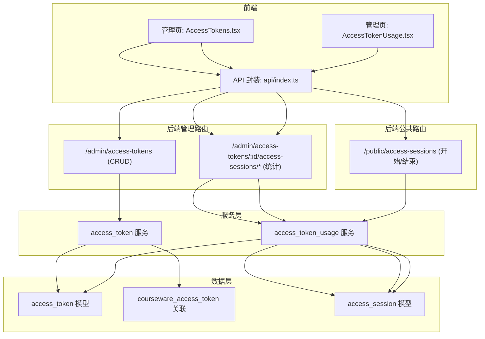
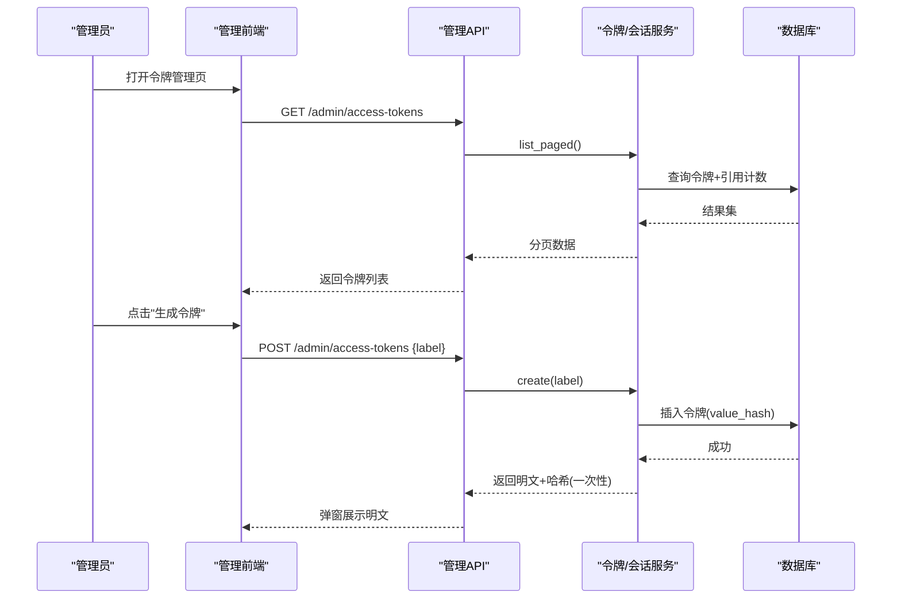
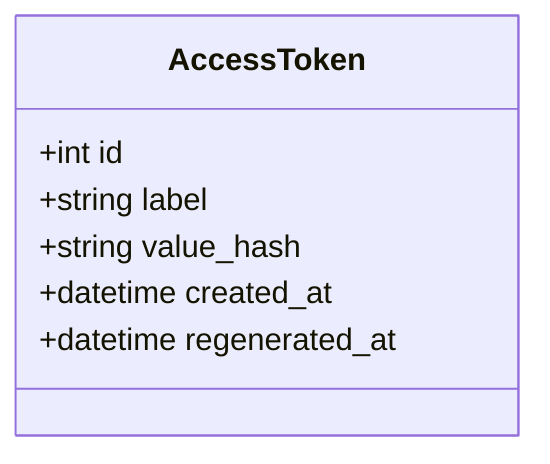
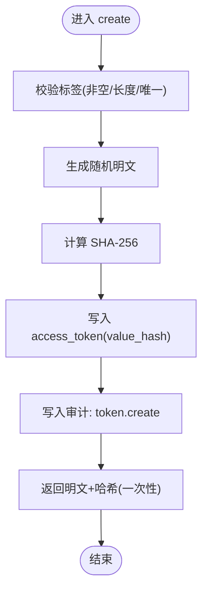
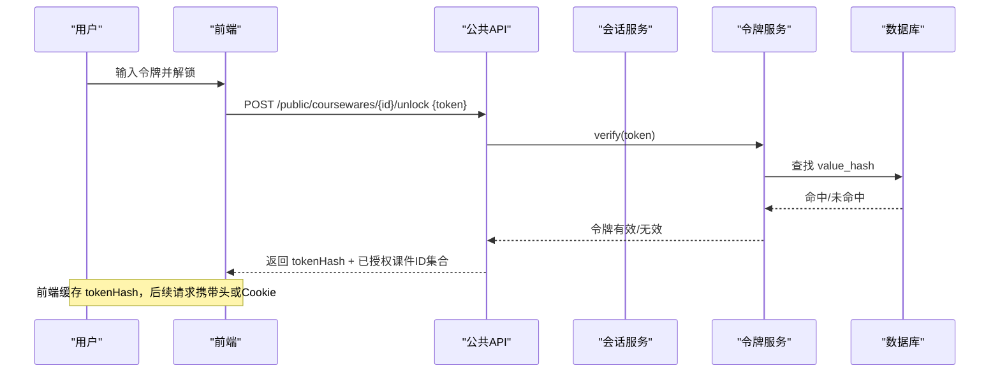
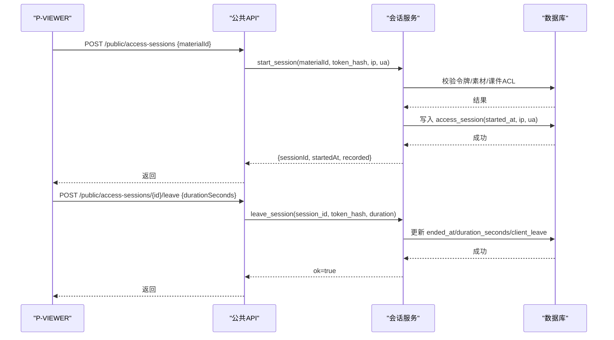
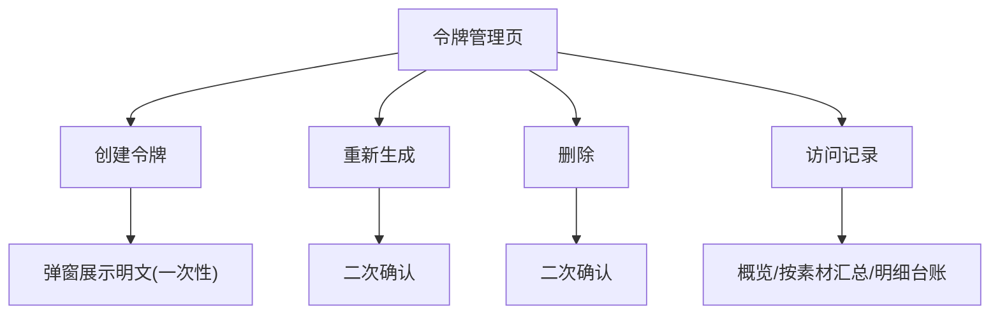
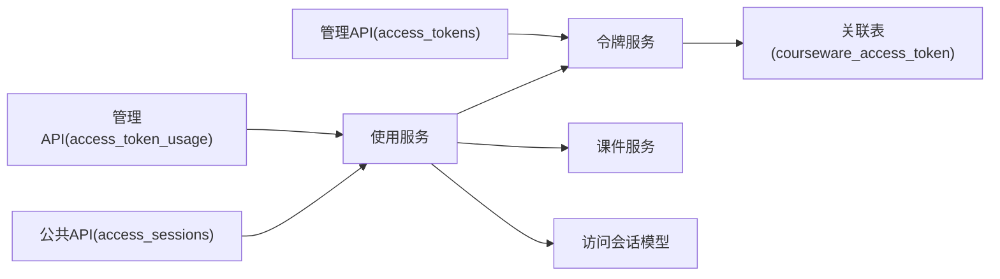

# 访问令牌管理页面

<cite>
**本文引用的文件**   
- [backend/app/models/access_token.py](file://backend/app/models/access_token.py)
- [backend/app/schemas/access_token.py](file://backend/app/schemas/access_token.py)
- [backend/app/services/access_token.py](file://backend/app/services/access_token.py)
- [backend/app/api/admin/access_tokens.py](file://backend/app/api/admin/access_tokens.py)
- [backend/app/models/association.py](file://backend/app/models/association.py)
- [backend/app/models/access_session.py](file://backend/app/models/access_session.py)
- [backend/app/schemas/access_token_usage.py](file://backend/app/schemas/access_token_usage.py)
- [backend/app/services/access_token_usage.py](file://backend/app/services/access_token_usage.py)
- [backend/app/api/public/access_sessions.py](file://backend/app/api/public/access_sessions.py)
- [backend/app/api/admin/access_token_usage.py](file://backend/app/api/admin/access_token_usage.py)
- [frontend/src/pages/admin/AccessTokens.tsx](file://frontend/src/pages/admin/AccessTokens.tsx)
- [frontend/src/pages/admin/AccessTokenUsage.tsx](file://frontend/src/pages/admin/AccessTokenUsage.tsx)
- [frontend/src/api/index.ts](file://frontend/src/api/index.ts)
- [backend/app/core/errors.py](file://backend/app/core/errors.py)
</cite>

## 更新摘要
**变更内容**   
- 移除了访问令牌使用台账表格中的IP地址显示列，体现隐私优先的设计理念
- 后端数据收集功能保持不变，仅在前端界面层面隐藏IP地址信息
- 更新了相关的数据模型和Schema定义说明

## 目录
1. [简介](#简介)
2. [项目结构](#项目结构)
3. [核心组件](#核心组件)
4. [架构总览](#架构总览)
5. [详细组件分析](#详细组件分析)
6. [依赖关系分析](#依赖关系分析)
7. [性能与可扩展性](#性能与可扩展性)
8. [故障排查指南](#故障排查指南)
9. [结论](#结论)
10. [附录：API 定义与数据模型](#附录api-定义与数据模型)

## 简介
本文件面向"访问令牌管理页面"的完整开发文档，覆盖令牌的生成、配置与管理；有效期与权限控制策略；令牌与课件的绑定与解锁机制；使用统计与审计日志；生命周期管理与自动过期处理；安全策略与防滥用；分享分发流程；以及实时监控与告警建议。文档同时提供前后端实现要点、关键流程图与时序图，帮助开发者快速理解并扩展该功能。

**更新** 基于隐私保护考虑，已移除访问令牌使用台账表格中的IP地址显示列，但后端数据收集功能保持不变。

## 项目结构
围绕访问令牌的管理与使用，系统包含以下关键层次：
- 前端管理页：令牌列表、创建/重新生成/删除、访问记录与按素材汇总
- 后端管理 API：令牌 CRUD、访问会话聚合查询
- 公共 API：P-VIEWER 埋点（开始/结束访问会话）
- 业务服务层：令牌校验、会话开启/结束、聚合统计
- 数据模型：令牌、关联表、访问会话

图表来源
- [backend/app/api/admin/access_tokens.py:1-120](file://backend/app/api/admin/access_tokens.py#L1-L120)
- [backend/app/api/admin/access_token_usage.py:1-101](file://backend/app/api/admin/access_token_usage.py#L1-L101)
- [backend/app/api/public/access_sessions.py:1-137](file://backend/app/api/public/access_sessions.py#L1-L137)
- [backend/app/services/access_token.py:1-235](file://backend/app/services/access_token.py#L1-L235)
- [backend/app/services/access_token_usage.py:1-518](file://backend/app/services/access_token_usage.py#L1-L518)
- [backend/app/models/access_token.py:1-34](file://backend/app/models/access_token.py#L1-L34)
- [backend/app/models/association.py:1-41](file://backend/app/models/association.py#L1-L41)
- [backend/app/models/access_session.py:1-129](file://backend/app/models/access_session.py#L1-L129)
- [frontend/src/pages/admin/AccessTokens.tsx:1-269](file://frontend/src/pages/admin/AccessTokens.tsx#L1-L269)
- [frontend/src/pages/admin/AccessTokenUsage.tsx:1-530](file://frontend/src/pages/admin/AccessTokenUsage.tsx#L1-L530)
- [frontend/src/api/index.ts:1-443](file://frontend/src/api/index.ts#L1-L443)

章节来源
- [backend/app/api/admin/access_tokens.py:1-120](file://backend/app/api/admin/access_tokens.py#L1-L120)
- [backend/app/api/admin/access_token_usage.py:1-101](file://backend/app/api/admin/access_token_usage.py#L1-L101)
- [backend/app/api/public/access_sessions.py:1-137](file://backend/app/api/public/access_sessions.py#L1-L137)
- [backend/app/services/access_token.py:1-235](file://backend/app/services/access_token.py#L1-L235)
- [backend/app/services/access_token_usage.py:1-518](file://backend/app/services/access_token_usage.py#L1-L518)
- [backend/app/models/access_token.py:1-34](file://backend/app/models/access_token.py#L1-L34)
- [backend/app/models/association.py:1-41](file://backend/app/models/association.py#L1-L41)
- [backend/app/models/access_session.py:1-129](file://backend/app/models/access_session.py#L1-L129)
- [frontend/src/pages/admin/AccessTokens.tsx:1-269](file://frontend/src/pages/admin/AccessTokens.tsx#L1-L269)
- [frontend/src/pages/admin/AccessTokenUsage.tsx:1-530](file://frontend/src/pages/admin/AccessTokenUsage.tsx#L1-L530)
- [frontend/src/api/index.ts:1-443](file://frontend/src/api/index.ts#L1-L443)

## 核心组件
- 令牌模型与 Schema
  - 令牌仅存储 value_hash（SHA-256），明文仅在创建/重新生成时一次性返回
  - label 全局唯一，长度限制，支持分页与引用计数
- 令牌服务
  - 创建、重新生成、删除、分页查询、哈希验证、按 ID 批量获取
  - 删除保护：被课件引用不可删；至少保留一个 active token
- 访问会话服务
  - 开始/结束会话，OPEN 课件跳过记录，RESTRICTED 课件需授权
  - 区间聚合与按素材聚合，跨方言时间差计算
- 管理 API
  - 令牌 CRUD；按时间段查询访问台账与聚合指标
- 公共 API
  - P-VIEWER 埋点接口，进程内 IP 限流，容错降级不阻塞前台
- 前端管理页
  - 令牌列表、创建弹窗、重新生成确认、删除确认、跳转访问记录
  - 访问记录页：概览卡片、按素材汇总、明细台账、快捷时间范围

**更新** 访问台账表格已移除IP地址显示列，体现隐私保护设计理念，但后端仍继续收集IP地址数据用于内部分析。

章节来源
- [backend/app/models/access_token.py:1-34](file://backend/app/models/access_token.py#L1-L34)
- [backend/app/schemas/access_token.py:1-53](file://backend/app/schemas/access_token.py#L1-L53)
- [backend/app/services/access_token.py:1-235](file://backend/app/services/access_token.py#L1-L235)
- [backend/app/api/admin/access_tokens.py:1-120](file://backend/app/api/admin/access_tokens.py#L1-L120)
- [backend/app/services/access_token_usage.py:1-518](file://backend/app/services/access_token_usage.py#L1-L518)
- [backend/app/api/public/access_sessions.py:1-137](file://backend/app/api/public/access_sessions.py#L1-L137)
- [frontend/src/pages/admin/AccessTokens.tsx:1-269](file://frontend/src/pages/admin/AccessTokens.tsx#L1-L269)
- [frontend/src/pages/admin/AccessTokenUsage.tsx:1-530](file://frontend/src/pages/admin/AccessTokenUsage.tsx#L1-L530)
- [frontend/src/api/index.ts:1-443](file://frontend/src/api/index.ts#L1-L443)

## 架构总览
访问令牌体系由"管理面 + 使用面"组成：
- 管理面：管理员在后台创建/维护令牌，查看使用统计
- 使用面：P-VIEWER 通过公开接口上报访问会话，服务端基于令牌与课件 ACL 进行鉴权与记录

图表来源
- [backend/app/api/admin/access_tokens.py:60-77](file://backend/app/api/admin/access_tokens.py#L60-L77)
- [backend/app/services/access_token.py:73-99](file://backend/app/services/access_token.py#L73-L99)
- [frontend/src/pages/admin/AccessTokens.tsx:36-51](file://frontend/src/pages/admin/AccessTokens.tsx#L36-L51)

## 详细组件分析

### 令牌模型与持久化
- 字段设计
  - id、label（唯一）、value_hash（索引）、created_at、regenerated_at
- 安全策略
  - 仅存 SHA-256 摘要，明文不在数据库中留存
  - 标签长度与唯一性约束，避免冲突与注入风险
- 复杂度
  - 单条查询 O(1)，列表分页 O(N log N)（排序）

图表来源
- [backend/app/models/access_token.py:13-31](file://backend/app/models/access_token.py#L13-L31)

章节来源
- [backend/app/models/access_token.py:1-34](file://backend/app/models/access_token.py#L1-34)

### 令牌服务（创建/重新生成/删除/校验）
- 创建
  - 生成 24 位 base36 随机值，计算 hash 落库，返回明文一次
- 重新生成
  - 更新 value_hash 与 regenerated_at，旧值立即失效
- 删除
  - 若被课件引用则拒绝；且至少保留一个 active token
- 校验
  - verify 使用常量时间比较，防止时序攻击
- 审计
  - 创建/重新生成/删除均写入审计日志

图表来源
- [backend/app/services/access_token.py:73-99](file://backend/app/services/access_token.py#L73-L99)

章节来源
- [backend/app/services/access_token.py:1-235](file://backend/app/services/access_token.py#L1-L235)
- [backend/app/core/errors.py:53-64](file://backend/app/core/errors.py#L53-L64)

### 令牌与课件的绑定与解锁机制
- 绑定关系
  - 多对多关联表 courseware_access_token，记录课件与令牌的授权关系
- 解锁流程
  - 用户输入令牌 → 调用 unlock → 服务端校验令牌是否授权当前课件 → 成功后返回 tokenHash 并设置 Cookie
  - 后续请求携带 X-Token-Hash 或 cookie lh_token_hash，用于鉴权与埋点
- 权限控制
  - OPEN 课件无需令牌即可访问
  - RESTRICTED 课件必须拥有对应令牌授权

图表来源
- [backend/app/services/access_token.py:193-205](file://backend/app/services/access_token.py#L193-L205)
- [backend/app/models/association.py:28-33](file://backend/app/models/association.py#L28-L33)
- [frontend/src/api/index.ts:422-428](file://frontend/src/api/index.ts#L422-L428)

章节来源
- [backend/app/models/association.py:1-41](file://backend/app/models/association.py#L1-L41)
- [backend/app/services/access_token.py:193-205](file://backend/app/services/access_token.py#L193-L205)
- [frontend/src/api/index.ts:422-428](file://frontend/src/api/index.ts#L422-L428)

### 访问会话埋点与统计
- 开始会话
  - 校验令牌有效性；若素材仅被 OPEN 课件引用则不记录
  - 若被 RESTRICTED 课件引用但令牌无权，返回 403
- 结束会话
  - 幂等；客户端 duration 与服务端时间偏差超过阈值则校正
- 统计能力
  - 全时段聚合（GET /admin/access-tokens/:id?withUsage=1）
  - 区间聚合（总停留/次数/课件数/素材数）
  - 按素材聚合（总停留/次数/最近访问时间）
  - 明细台账（分页）

**更新** 访问会话数据在后端继续收集IP地址和用户代理信息，但管理界面的访问台账表格不再显示IP地址列，以符合隐私保护要求。

图表来源
- [backend/app/api/public/access_sessions.py:65-106](file://backend/app/api/public/access_sessions.py#L65-L106)
- [backend/app/services/access_token_usage.py:64-125](file://backend/app/services/access_token_usage.py#L64-L125)
- [backend/app/services/access_token_usage.py:128-171](file://backend/app/services/access_token_usage.py#L128-L171)

章节来源
- [backend/app/api/public/access_sessions.py:1-137](file://backend/app/api/public/access_sessions.py#L1-L137)
- [backend/app/services/access_token_usage.py:1-518](file://backend/app/services/access_token_usage.py#L1-L518)
- [backend/app/models/access_session.py:1-129](file://backend/app/models/access_session.py#L1-L129)

### 管理端令牌页面交互
- 列表加载：分页拉取令牌，显示引用课件数、创建/重新生成时间
- 创建令牌：输入标签，提交后弹窗展示明文一次，支持一键复制
- 重新生成：二次确认后更新令牌，旧值即刻失效
- 删除令牌：二次确认，受引用与"至少保留一个"规则保护
- 访问记录：跳转到访问记录页，默认近 7 天，支持本月/近 30 天快捷筛选

**更新** 访问台账表格已移除IP地址显示列，但仍保留其他重要信息如开始时间、结束时间、停留时长、课件信息、素材信息和状态。

图表来源
- [frontend/src/pages/admin/AccessTokens.tsx:1-269](file://frontend/src/pages/admin/AccessTokens.tsx#L1-L269)
- [frontend/src/pages/admin/AccessTokenUsage.tsx:1-530](file://frontend/src/pages/admin/AccessTokenUsage.tsx#L1-L530)

章节来源
- [frontend/src/pages/admin/AccessTokens.tsx:1-269](file://frontend/src/pages/admin/AccessTokens.tsx#L1-L269)
- [frontend/src/pages/admin/AccessTokenUsage.tsx:1-530](file://frontend/src/pages/admin/AccessTokenUsage.tsx#L1-L530)
- [frontend/src/api/index.ts:117-154](file://frontend/src/api/index.ts#L117-L154)

## 依赖关系分析
- 模块耦合
  - 管理 API 依赖令牌服务与使用服务
  - 公共 API 依赖使用服务与令牌服务
  - 使用服务依赖令牌服务、课件服务、材料/课件模型
- 外部依赖
  - 数据库：SQLAlchemy ORM，PostgreSQL/SQLite 兼容
  - 审计：统一审计写入
- 潜在循环
  - 无直接循环依赖；服务间为单向调用

图表来源
- [backend/app/api/admin/access_tokens.py:1-120](file://backend/app/api/admin/access_tokens.py#L1-L120)
- [backend/app/api/admin/access_token_usage.py:1-101](file://backend/app/api/admin/access_token_usage.py#L1-L101)
- [backend/app/api/public/access_sessions.py:1-137](file://backend/app/api/public/access_sessions.py#L1-L137)
- [backend/app/services/access_token.py:1-235](file://backend/app/services/access_token.py#L1-L235)
- [backend/app/services/access_token_usage.py:1-518](file://backend/app/services/access_token_usage.py#L1-L518)
- [backend/app/models/association.py:1-41](file://backend/app/models/association.py#L1-L41)
- [backend/app/models/access_session.py:1-129](file://backend/app/models/access_session.py#L1-L129)

章节来源
- [backend/app/api/admin/access_tokens.py:1-120](file://backend/app/api/admin/access_tokens.py#L1-L120)
- [backend/app/api/admin/access_token_usage.py:1-101](file://backend/app/api/admin/access_token_usage.py#L1-L101)
- [backend/app/api/public/access_sessions.py:1-137](file://backend/app/api/public/access_sessions.py#L1-L137)
- [backend/app/services/access_token.py:1-235](file://backend/app/services/access_token.py#L1-L235)
- [backend/app/services/access_token_usage.py:1-518](file://backend/app/services/access_token_usage.py#L1-L518)
- [backend/app/models/association.py:1-41](file://backend/app/models/association.py#L1-L41)
- [backend/app/models/access_session.py:1-129](file://backend/app/models/access_session.py#L1-L129)

## 性能与可扩展性
- 查询优化
  - 列表页按需附加 usageSummary，避免 N+1
  - 按素材聚合使用窗口函数与子查询减少多次往返
- 时间差计算
  - 自定义表达式适配 PostgreSQL/SQLite，保证跨方言一致
- 并发与限流
  - 公共接口进程内滑动窗口限流（60/分钟/IP），多进程部署可结合网关层限流
- 可扩展点
  - 令牌有效期：可在令牌模型增加 expires_at，并在校验逻辑中增加过期判断
  - 审计与监控：在审计写入处接入指标采集与告警通道

[本节为通用指导，不直接分析具体文件]

## 故障排查指南
- 常见错误码
  - missing_token、invalid_token、courseware_acl_locked、token_not_found、last_token_required、token_referenced
- 定位步骤
  - 检查令牌是否存在且未被删除
  - 检查课件是否 RESTRICTED 且已绑定该令牌
  - 检查访问会话是否因限流降级未记录
  - 核对时间范围参数格式与起止顺序
- 日志与审计
  - 关注 token.create/regenerate/delete 审计事件
  - 关注 access_session.start_failed/leave_failed 异常审计

**更新** 虽然前端不再显示IP地址，但后端仍继续收集IP地址数据，可通过数据库直接查询或内部日志系统进行IP地址相关的分析和审计。

章节来源
- [backend/app/core/errors.py:53-64](file://backend/app/core/errors.py#L53-L64)
- [backend/app/services/access_token_usage.py:114-119](file://backend/app/services/access_token_usage.py#L114-119)
- [backend/app/services/access_token_usage.py:163-170](file://backend/app/services/access_token_usage.py#L163-170)

## 结论
访问令牌管理页面实现了从令牌生成、绑定到使用统计的全链路闭环。通过哈希存储、最小权限原则、审计与限流，系统在安全性与可用性之间取得平衡。最新的隐私保护改进移除了管理界面中的IP地址显示，体现了对用户隐私的重视，同时保持了后端数据收集的完整性。未来可在此基础上增强有效期控制、细粒度权限与实时告警，进一步提升运营与风控能力。

[本节为总结，不直接分析具体文件]

## 附录：API 定义与数据模型

### 管理端令牌 API
- GET /api/admin/access-tokens
  - 查询令牌列表（分页、关键词过滤）
- POST /api/admin/access-tokens
  - 创建令牌，返回明文与哈希（一次性）
- GET /api/admin/access-tokens/{id}?withUsage=1
  - 获取令牌详情，可选附带全时段使用概览
- POST /api/admin/access-tokens/{id}/regenerate
  - 重新生成令牌，旧值立即失效
- DELETE /api/admin/access-tokens/{id}
  - 删除令牌（受引用与"至少保留一个"规则保护）

章节来源
- [backend/app/api/admin/access_tokens.py:60-116](file://backend/app/api/admin/access_tokens.py#L60-L116)
- [backend/app/schemas/access_token.py:9-53](file://backend/app/schemas/access_token.py#L9-L53)

### 管理端访问记录 API
- GET /api/admin/access-tokens/{id}/access-sessions
  - 分页访问台账（支持 materialId/coursewareId 过滤）
- GET /api/admin/access-tokens/{id}/access-sessions/summary
  - 区间聚合指标（总停留/次数/课件数/素材数）
- GET /api/admin/access-tokens/{id}/access-sessions/material-summary
  - 按素材聚合（总停留/次数/最近访问时间）

**更新** 访问台账API仍返回完整的会话数据包括IP地址和用户代理，但前端管理界面选择性地隐藏了IP地址列以符合隐私保护要求。

章节来源
- [backend/app/api/admin/access_token_usage.py:32-97](file://backend/app/api/admin/access_token_usage.py#L32-L97)
- [backend/app/schemas/access_token_usage.py:9-91](file://backend/app/schemas/access_token_usage.py#L9-L91)

### 公共端访问会话 API
- POST /api/public/access-sessions
  - 开始访问会话（需要 token_hash，OPEN 课件跳过记录）
- POST /api/public/access-sessions/{session_id}/leave
  - 结束访问会话（幂等，时长校正）

章节来源
- [backend/app/api/public/access_sessions.py:65-133](file://backend/app/api/public/access_sessions.py#L65-L133)

### 数据模型
- access_token
  - id、label、value_hash、created_at、regenerated_at
- courseware_access_token
  - courseware_id、access_token_id（多对多）
- access_session
  - id、token_id、courseware_id、material_id、started_at、ended_at、duration_seconds、client_leave、ip、ua、created_at

**更新** access_session模型仍包含ip和ua字段用于后端数据收集和分析，但管理界面不再显示这些敏感信息。

章节来源
- [backend/app/models/access_token.py:13-31](file://backend/app/models/access_token.py#L13-L31)
- [backend/app/models/association.py:28-33](file://backend/app/models/association.py#L28-L33)
- [backend/app/models/access_session.py:56-126](file://backend/app/models/access_session.py#L56-L126)