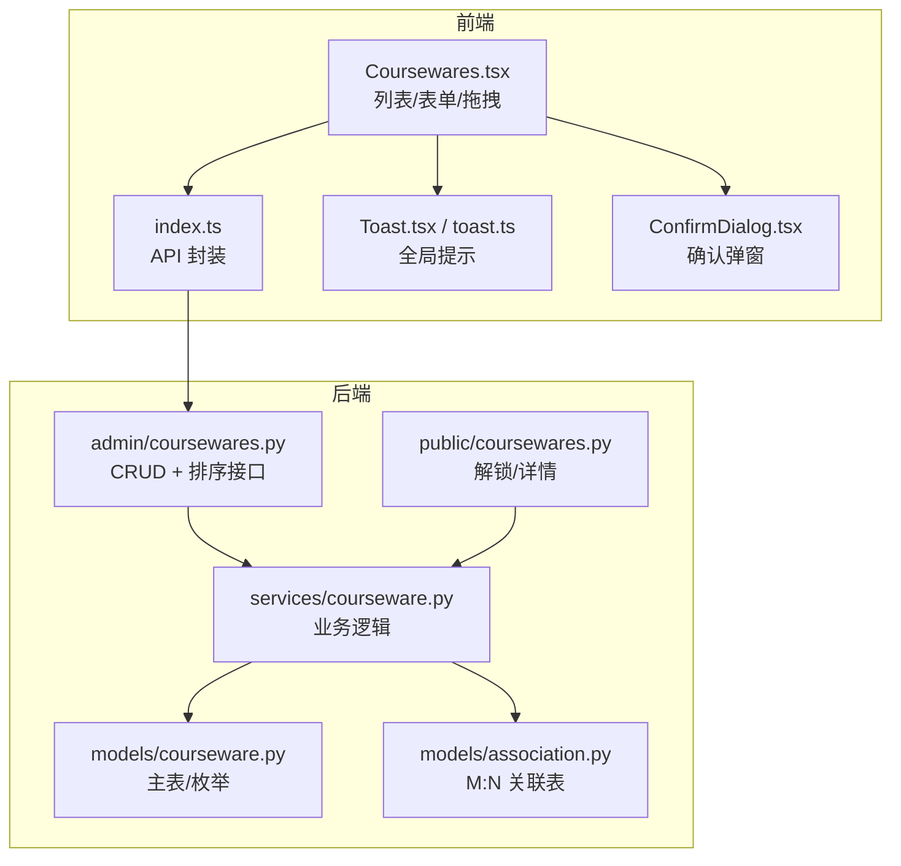
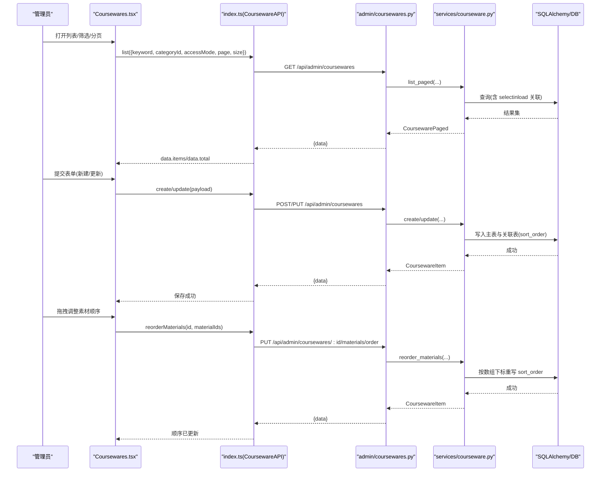
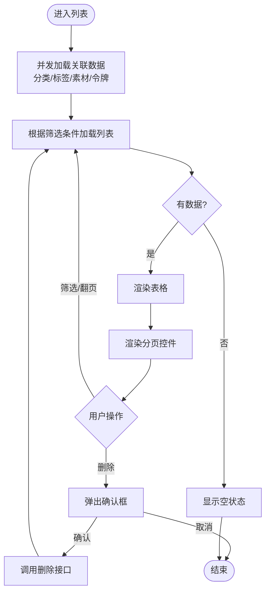
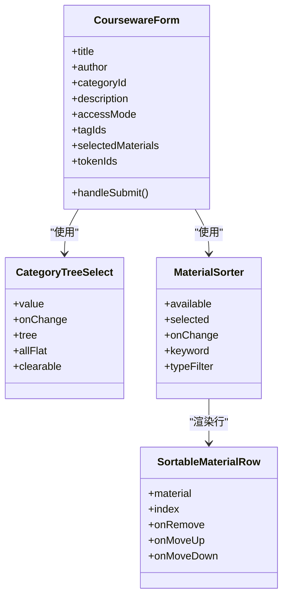
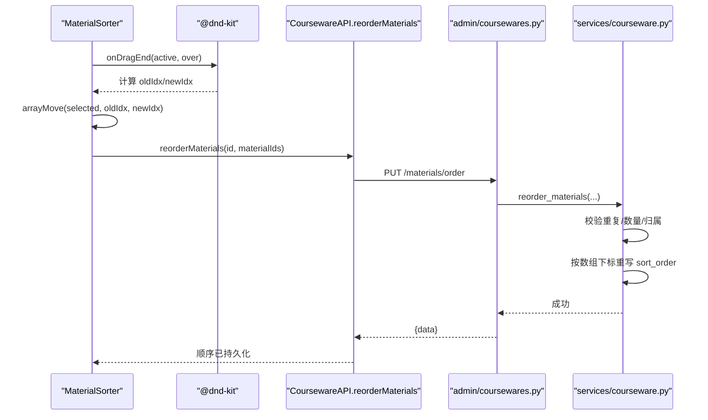
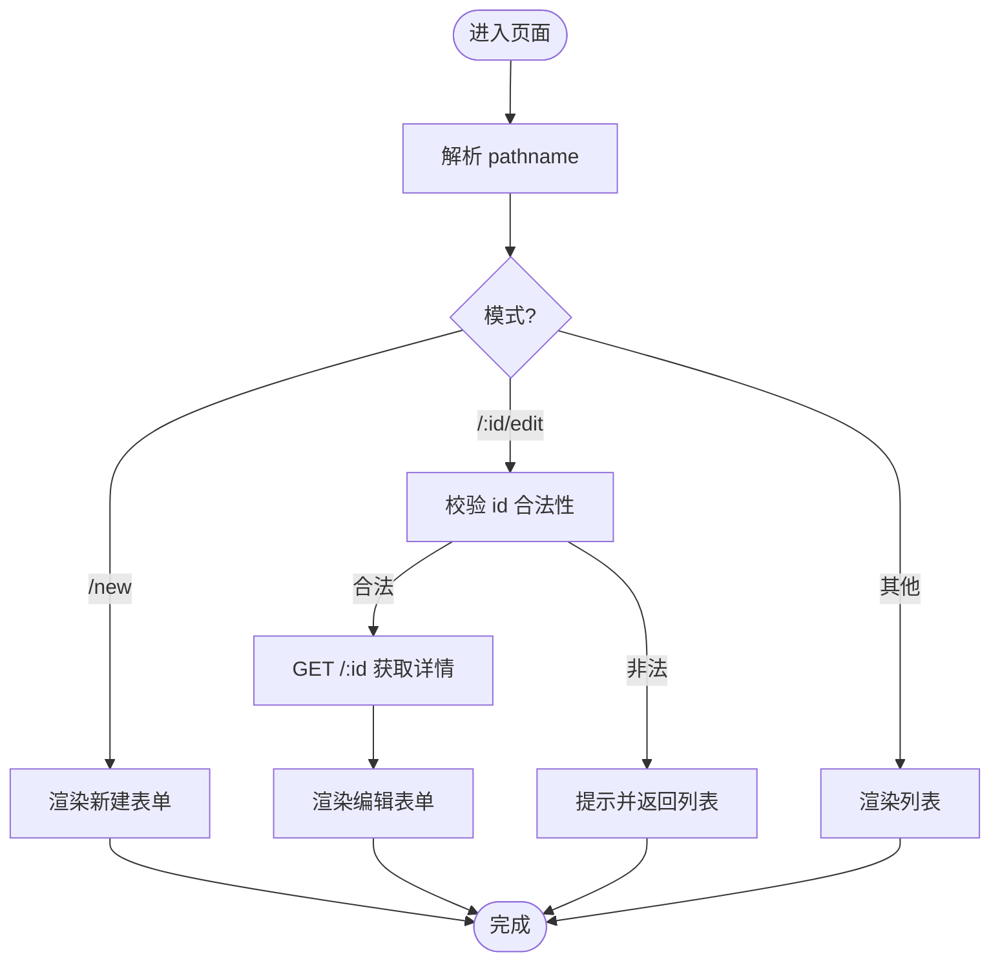
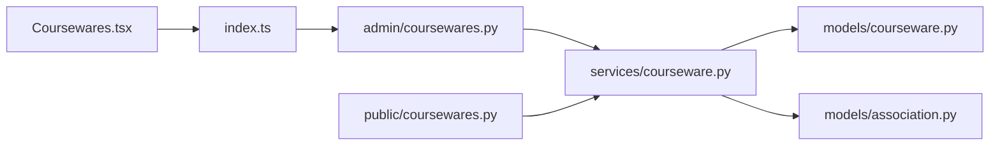

# 课件管理页面

<cite>
**本文引用的文件**   
- [Coursewares.tsx](file://frontend/src/pages/admin/Coursewares.tsx)
- [coursewares.py（管理端）](file://backend/app/api/admin/coursewares.py)
- [courseware.py（模型）](file://backend/app/models/courseware.py)
- [association.py（关联表）](file://backend/app/models/association.py)
- [courseware.py（服务层）](file://backend/app/services/courseware.py)
- [courseware.py（Schema）](file://backend/app/schemas/courseware.py)
- [material.py（模型）](file://backend/app/models/material.py)
- [material.py（Schema）](file://backend/app/schemas/material.py)
- [index.ts（前端 API 封装）](file://frontend/src/api/index.ts)
- [public_coursewares.py（公共端）](file://backend/app/api/public/coursewares.py)
- [view.ts（前台视图状态）](file://frontend/src/stores/view.ts)
- [toast.ts（全局提示）](file://frontend/src/stores/toast.ts)
- [Toast.tsx（提示组件）](file://frontend/src/components/Toast.tsx)
- [ConfirmDialog.tsx（确认弹窗）](file://frontend/src/components/ConfirmDialog.tsx)
</cite>

## 目录
1. [简介](#简介)
2. [项目结构](#项目结构)
3. [核心组件](#核心组件)
4. [架构总览](#架构总览)
5. [详细组件分析](#详细组件分析)
6. [依赖关系分析](#依赖关系分析)
7. [性能考虑](#性能考虑)
8. [故障排查指南](#故障排查指南)
9. [结论](#结论)
10. [附录](#附录)

## 简介
本文件面向“课件管理”页面的前后端实现，覆盖以下目标：
- 列表展示、搜索过滤、分页加载与状态管理
- 复杂表单处理：分类树选择器、标签多选、访问令牌绑定、素材顺序拖拽排序
- 基于 @dnd-kit 的可视化排序集成
- URL 路由模式切换（列表/新建/编辑）的实现机制
- 关联数据预加载策略与并发请求优化
- 错误处理、用户反馈与用户体验优化最佳实践
- 完整代码示例路径与组件复用模式说明

## 项目结构
该功能横跨前端页面、API 封装、后端接口与服务层、数据库模型与关联表。整体组织如下：
- 前端页面：包含列表、筛选、分页、删除确认、新建/编辑表单、素材拖拽排序等
- 前端 API 封装：统一解包 envelope、类型定义、并发调用
- 后端管理端 API：提供 CRUD、专用排序接口
- 后端服务层：业务规则校验、N+1 优化、排序重写逻辑
- 数据库模型与关联表：主从表、多对多关联、排序字段索引

图表来源
- [Coursewares.tsx:475-813](file://frontend/src/pages/admin/Coursewares.tsx#L475-L813)
- [index.ts:357-402](file://frontend/src/api/index.ts#L357-L402)
- [coursewares.py（管理端）:17-115](file://backend/app/api/admin/coursewares.py#L17-L115)
- [courseware.py（服务层）:288-447](file://backend/app/services/courseware.py#L288-L447)
- [courseware.py（模型）:21-67](file://backend/app/models/courseware.py#L21-L67)
- [association.py（关联表）:16-26](file://backend/app/models/association.py#L16-L26)
- [public_coursewares.py（公共端）:57-76](file://backend/app/api/public/coursewares.py#L57-L76)

章节来源
- [Coursewares.tsx:475-813](file://frontend/src/pages/admin/Coursewares.tsx#L475-L813)
- [index.ts:357-402](file://frontend/src/api/index.ts#L357-L402)
- [coursewares.py（管理端）:17-115](file://backend/app/api/admin/coursewares.py#L17-L115)
- [courseware.py（服务层）:288-447](file://backend/app/services/courseware.py#L288-L447)
- [courseware.py（模型）:21-67](file://backend/app/models/courseware.py#L21-L67)
- [association.py（关联表）:16-26](file://backend/app/models/association.py#L16-L26)
- [public_coursewares.py（公共端）:57-76](file://backend/app/api/public/coursewares.py#L57-L76)

## 核心组件
- 列表页与筛选
  - 关键词搜索、分类树筛选、访问模式筛选
  - 分页加载（SIZE=15），支持上一页/下一页
- 新建/编辑表单
  - 标题/作者/描述输入
  - 分类树选择器（任意层级可选）
  - 标签多选
  - 访问模式与令牌绑定（受限模式至少一个令牌）
  - 素材顺序拖拽排序（@dnd-kit）
- 删除确认
  - 二次确认弹窗，成功后刷新列表
- 辅助组件
  - 全局 Toast 提示
  - 通用确认弹窗

章节来源
- [Coursewares.tsx:475-813](file://frontend/src/pages/admin/Coursewares.tsx#L475-L813)
- [Coursewares.tsx:815-1167](file://frontend/src/pages/admin/Coursewares.tsx#L815-L1167)
- [toast.ts:15-29](file://frontend/src/stores/toast.ts#L15-L29)
- [Toast.tsx:9-37](file://frontend/src/components/Toast.tsx#L9-L37)
- [ConfirmDialog.tsx:19-91](file://frontend/src/components/ConfirmDialog.tsx#L19-L91)

## 架构总览
下图展示了从前端到后端的完整调用链，包括列表查询、新建/更新、删除以及专用排序接口。

图表来源
- [Coursewares.tsx:475-813](file://frontend/src/pages/admin/Coursewares.tsx#L475-L813)
- [index.ts:357-402](file://frontend/src/api/index.ts#L357-L402)
- [coursewares.py（管理端）:24-115](file://backend/app/api/admin/coursewares.py#L24-L115)
- [courseware.py（服务层）:105-278](file://backend/app/services/courseware.py#L105-L278)
- [courseware.py（服务层）:335-393](file://backend/app/services/courseware.py#L335-L393)

## 详细组件分析

### 列表页：搜索、过滤、分页与状态管理
- 状态设计
  - keyword/filterCat/filterMode/page/size/items/total/loading
  - 通过 useEffect 监听筛选条件变化触发 reload
- 并发预加载
  - 进入页面时并行加载分类树、标签、素材、令牌，减少首屏等待
- 列表渲染
  - 表格展示 ID/标题/分类/访问模式/标签/绑定令牌数
  - 操作列：编辑/删除
- 分页控件
  - 上一页/下一页按钮，禁用边界态
- 删除流程
  - 弹出确认对话框，确认后调用删除接口并刷新列表

图表来源
- [Coursewares.tsx:475-813](file://frontend/src/pages/admin/Coursewares.tsx#L475-L813)
- [index.ts:357-366](file://frontend/src/api/index.ts#L357-L366)
- [coursewares.py（管理端）:24-41](file://backend/app/api/admin/coursewares.py#L24-L41)
- [courseware.py（服务层）:396-447](file://backend/app/services/courseware.py#L396-L447)

章节来源
- [Coursewares.tsx:475-813](file://frontend/src/pages/admin/Coursewares.tsx#L475-L813)
- [index.ts:357-366](file://frontend/src/api/index.ts#L357-L366)
- [coursewares.py（管理端）:24-41](file://backend/app/api/admin/coursewares.py#L24-L41)
- [courseware.py（服务层）:396-447](file://backend/app/services/courseware.py#L396-L447)

### 新建/编辑表单：分类树、标签、令牌、素材排序
- 分类树选择器
  - 自定义 CategoryTreeSelect 组件，递归渲染树节点，支持清除选项
  - 支持任意层级节点作为课件挂载点
- 标签多选
  - 复选框列表，维护 tagIds 集合
- 访问模式与令牌绑定
  - OPEN/RESTRICTED 单选；受限模式必须至少绑定一个令牌
  - 令牌列表支持关键字筛选，显示引用计数
- 素材顺序拖拽排序
  - MaterialSorter 组件：左侧可用素材库，右侧已选顺序
  - 使用 @dnd-kit/core + sortable 实现拖拽与键盘排序
  - 提交时将 selectedMaterials 的顺序导出为 materialIds 数组
- 表单验证与提交
  - 必填项校验（标题、分类、受限模式的令牌）
  - 新建/更新分别调用不同接口
  - 保存中禁用提交按钮，完成后返回或提示错误

图表来源
- [Coursewares.tsx:815-1167](file://frontend/src/pages/admin/Coursewares.tsx#L815-L1167)
- [Coursewares.tsx:68-202](file://frontend/src/pages/admin/Coursewares.tsx#L68-L202)
- [Coursewares.tsx:204-473](file://frontend/src/pages/admin/Coursewares.tsx#L204-L473)

章节来源
- [Coursewares.tsx:815-1167](file://frontend/src/pages/admin/Coursewares.tsx#L815-L1167)
- [Coursewares.tsx:68-202](file://frontend/src/pages/admin/Coursewares.tsx#L68-L202)
- [Coursewares.tsx:204-473](file://frontend/src/pages/admin/Coursewares.tsx#L204-L473)

### @dnd-kit 拖拽排序集成
- 传感器配置
  - PointerSensor 设置最小移动距离避免误触
  - KeyboardSensor 启用键盘导航（Tab 聚焦手柄 → Space 抓取 → ↑/↓ 移动 → Space 释放 → Esc 取消）
- 碰撞检测
  - closestCenter 提升交互体验
- 排序策略
  - verticalListSortingStrategy 垂直列表排序
- 本地状态更新
  - arrayMove 在内存中调整 selectedMaterials 顺序
  - 提交时以当前顺序生成 materialIds 数组
- 专用排序接口
  - 前端也可调用 reorderMaterials 直接持久化顺序（用于即时同步场景）

图表来源
- [Coursewares.tsx:204-473](file://frontend/src/pages/admin/Coursewares.tsx#L204-L473)
- [index.ts:392-399](file://frontend/src/api/index.ts#L392-L399)
- [coursewares.py（管理端）:100-112](file://backend/app/api/admin/coursewares.py#L100-L112)
- [courseware.py（服务层）:335-393](file://backend/app/services/courseware.py#L335-L393)

章节来源
- [Coursewares.tsx:204-473](file://frontend/src/pages/admin/Coursewares.tsx#L204-L473)
- [index.ts:392-399](file://frontend/src/api/index.ts#L392-L399)
- [coursewares.py（管理端）:100-112](file://backend/app/api/admin/coursewares.py#L100-L112)
- [courseware.py（服务层）:335-393](file://backend/app/services/courseware.py#L335-L393)

### URL 路由模式切换（列表/新建/编辑）
- 模式判定
  - 基于 location.pathname 判断：/new → 新建；/:id/edit → 编辑；默认 → 列表
- 编辑模式数据加载
  - 进入编辑页时通过 get(id) 拉取待编辑对象，避免表单闪烁
- 导航控制
  - startCreate/startEdit/backToList 使用 useNavigate 进行跳转
- 无效 id 处理
  - 非数字或非法 id 时提示并回退到列表页

图表来源
- [Coursewares.tsx:475-598](file://frontend/src/pages/admin/Coursewares.tsx#L475-L598)
- [Coursewares.tsx:554-574](file://frontend/src/pages/admin/Coursewares.tsx#L554-L574)

章节来源
- [Coursewares.tsx:475-598](file://frontend/src/pages/admin/Coursewares.tsx#L475-L598)
- [Coursewares.tsx:554-574](file://frontend/src/pages/admin/Coursewares.tsx#L554-L574)

### 关联数据预加载与并发优化
- 并发加载
  - Promise.all 同时请求分类树、标签、素材、令牌，降低首屏延迟
- 列表查询优化
  - 后端使用 selectinload 预加载 tags/materials/access_tokens/category，避免 N+1
- 排序字段读取
  - _to_item 在 downloadable=True 时从关联表读取 sort_order，确保顺序准确

章节来源
- [Coursewares.tsx:514-525](file://frontend/src/pages/admin/Coursewares.tsx#L514-L525)
- [courseware.py（服务层）:290-332](file://backend/app/services/courseware.py#L290-L332)
- [courseware.py（服务层）:396-447](file://backend/app/services/courseware.py#L396-L447)

### 错误处理、用户反馈与用户体验优化
- 前端
  - 使用 toast 统一提示（info/success/error）
  - 删除前使用 ConfirmDialog 二次确认
  - 保存中禁用提交按钮，防止重复提交
- 后端
  - 业务异常（BusinessError）携带错误码与消息
  - 参数校验失败返回明确错误信息
- 公共端解锁
  - 受限课件需携带 X-Token-Hash 或 Cookie lh_token_hash，否则返回 403

章节来源
- [toast.ts:15-29](file://frontend/src/stores/toast.ts#L15-L29)
- [Toast.tsx:9-37](file://frontend/src/components/Toast.tsx#L9-L37)
- [ConfirmDialog.tsx:19-91](file://frontend/src/components/ConfirmDialog.tsx#L19-L91)
- [public_coursewares.py（公共端）:57-76](file://backend/app/api/public/coursewares.py#L57-L76)

## 依赖关系分析
- 前端依赖
  - Coursewares.tsx 依赖 index.ts 的 CoursewareAPI/MaterialAPI/TagAPI/AccessTokenAPI
  - 使用 @dnd-kit 实现拖拽排序
- 后端依赖
  - admin/coursewares.py 依赖 services/courseware.py
  - services/courseware.py 依赖 models/courseware.py 与 models/association.py
  - public/coursewares.py 依赖 services/courseware.py 进行解锁校验

图表来源
- [Coursewares.tsx:475-813](file://frontend/src/pages/admin/Coursewares.tsx#L475-L813)
- [index.ts:357-402](file://frontend/src/api/index.ts#L357-L402)
- [coursewares.py（管理端）:17-115](file://backend/app/api/admin/coursewares.py#L17-L115)
- [courseware.py（服务层）:288-447](file://backend/app/services/courseware.py#L288-L447)
- [courseware.py（模型）:21-67](file://backend/app/models/courseware.py#L21-L67)
- [association.py（关联表）:16-26](file://backend/app/models/association.py#L16-L26)
- [public_coursewares.py（公共端）:57-76](file://backend/app/api/public/coursewares.py#L57-L76)

章节来源
- [Coursewares.tsx:475-813](file://frontend/src/pages/admin/Coursewares.tsx#L475-L813)
- [index.ts:357-402](file://frontend/src/api/index.ts#L357-L402)
- [coursewares.py（管理端）:17-115](file://backend/app/api/admin/coursewares.py#L17-L115)
- [courseware.py（服务层）:288-447](file://backend/app/services/courseware.py#L288-L447)
- [courseware.py（模型）:21-67](file://backend/app/models/courseware.py#L21-L67)
- [association.py（关联表）:16-26](file://backend/app/models/association.py#L16-L26)
- [public_coursewares.py（公共端）:57-76](file://backend/app/api/public/coursewares.py#L57-L76)

## 性能考虑
- 前端
  - 并发预加载关联数据，减少首屏等待
  - 列表筛选变更重置页码，避免脏数据
  - 大文件上传超时与进度回调预留
- 后端
  - selectinload 预加载关联，避免 N+1
  - 子树过滤：分类筛选时收集子树 ID，一次性 IN 查询
  - 排序字段直写关联表，避免 ORM 二次同步导致的错位
- 数据库
  - courseware_material 表建立 (courseware_id, sort_order) 索引，加速有序读取

章节来源
- [Coursewares.tsx:514-525](file://frontend/src/pages/admin/Coursewares.tsx#L514-L525)
- [index.ts:92-115](file://frontend/src/api/index.ts#L92-L115)
- [courseware.py（服务层）:396-447](file://backend/app/services/courseware.py#L396-L447)
- [association.py（关联表）:16-26](file://backend/app/models/association.py#L16-L26)

## 故障排查指南
- 列表为空
  - 检查筛选条件是否过严；确认后端 total 是否为 0
- 拖拽顺序未生效
  - 确认前端是否正确调用 reorderMaterials 或提交表单时传递了正确的 materialIds
  - 检查后端 reorder_materials 校验是否通过（重复/数量/归属）
- 受限课件无法访问
  - 确认是否携带 X-Token-Hash 或 lh_token_hash Cookie
  - 校验 token 是否被该课件绑定
- 表单提交失败
  - 检查必填项（标题、分类、受限模式的令牌）
  - 查看 toast 错误信息与后端返回的错误码

章节来源
- [Coursewares.tsx:894-936](file://frontend/src/pages/admin/Coursewares.tsx#L894-L936)
- [courseware.py（服务层）:335-393](file://backend/app/services/courseware.py#L335-L393)
- [public_coursewares.py（公共端）:57-76](file://backend/app/api/public/coursewares.py#L57-L76)

## 结论
课件管理页面实现了完整的 CRUD 能力，并通过分类树选择器、标签多选、令牌绑定与素材拖拽排序提升了管理效率。前后端协作采用并发预加载、selectinload 优化与专用排序接口，保证了良好的用户体验与系统性能。错误处理与用户反馈贯穿全流程，确保可观测性与易用性。

## 附录
- 关键类型与接口路径参考
  - 前端类型：CoursewareItem、MaterialItem、AccessTokenItem、CategoryNode
  - 管理端接口：/api/admin/coursewares（CRUD）、/api/admin/coursewares/:id/materials/order（排序）
  - 公共端接口：/api/public/coursewares/search、/api/public/coursewares/:id、/api/public/coursewares/:id/unlock

章节来源
- [index.ts:333-402](file://frontend/src/api/index.ts#L333-L402)
- [coursewares.py（管理端）:24-115](file://backend/app/api/admin/coursewares.py#L24-L115)
- [public_coursewares.py（公共端）:32-76](file://backend/app/api/public/coursewares.py#L32-L76)