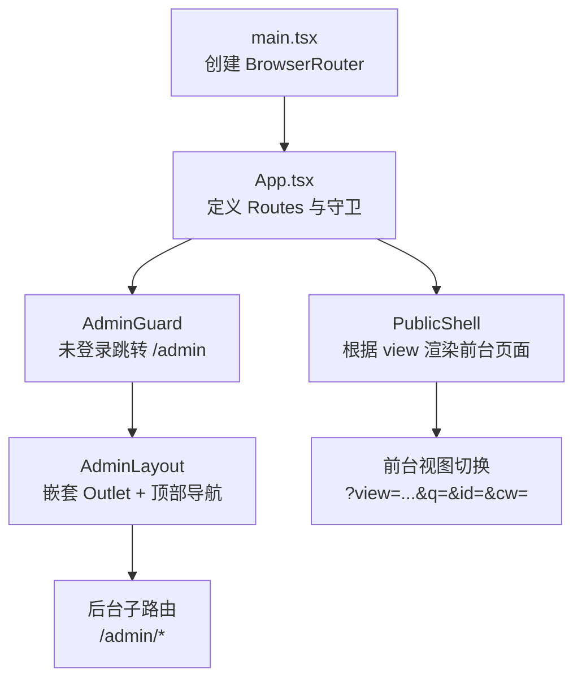
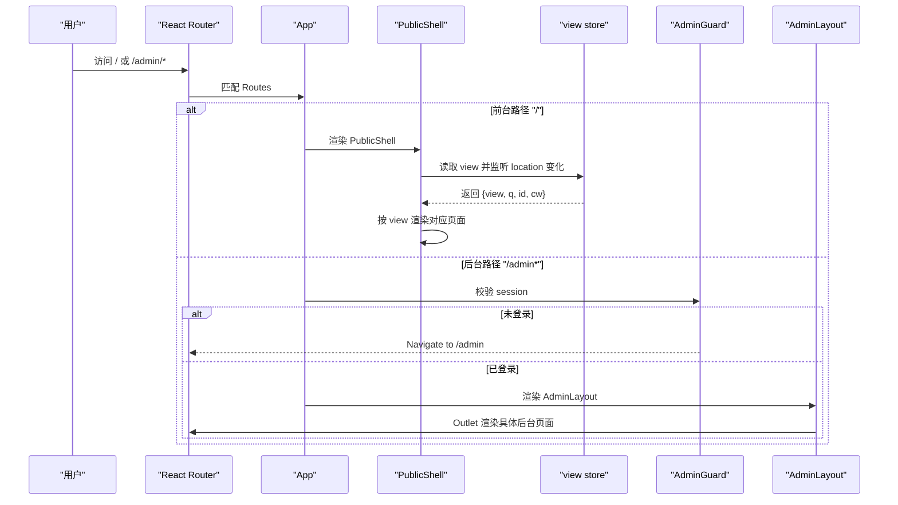
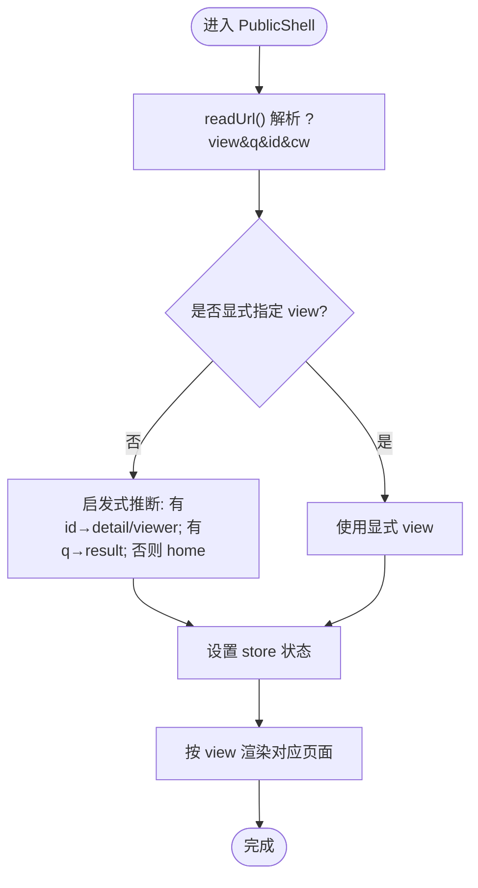
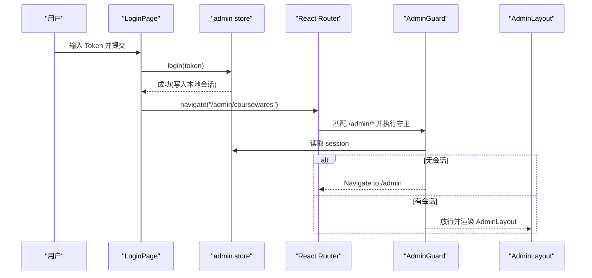
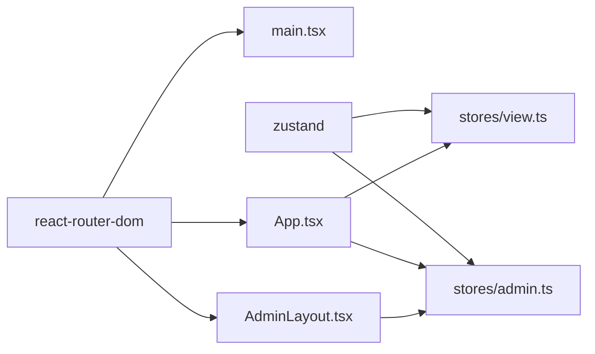

# 路由与导航

<cite>
**本文引用的文件**
- [frontend/src/main.tsx](file://frontend/src/main.tsx)
- [frontend/src/App.tsx](file://frontend/src/App.tsx)
- [frontend/src/stores/view.ts](file://frontend/src/stores/view.ts)
- [frontend/src/stores/admin.ts](file://frontend/src/stores/admin.ts)
- [frontend/src/layouts/AdminLayout.tsx](file://frontend/src/layouts/AdminLayout.tsx)
- [frontend/src/pages/public/Home.tsx](file://frontend/src/pages/public/Home.tsx)
- [frontend/src/pages/public/Detail.tsx](file://frontend/src/pages/public/Detail.tsx)
- [frontend/src/pages/admin/Login.tsx](file://frontend/src/pages/admin/Login.tsx)
</cite>

## 目录
1. [简介](#简介)
2. [项目结构](#项目结构)
3. [核心组件](#核心组件)
4. [架构总览](#架构总览)
5. [详细组件分析](#详细组件分析)
6. [依赖分析](#依赖分析)
7. [性能考虑](#性能考虑)
8. [故障排查指南](#故障排查指南)
9. [结论](#结论)
10. [附录](#附录)

## 简介
本指南面向 Learning Hub 前端的路由与导航系统，聚焦于 React Router 的配置与实践，涵盖：
- 静态路由、动态路由与嵌套路由的组织方式
- 路由守卫与权限控制（管理员认证检查）
- 面包屑导航的实现思路与动态路径生成策略
- 路由参数传递、查询字符串处理与 URL 同步策略
- 懒加载与代码分割的落地方案
- 路由测试编写与调试技巧
- SEO 优化与浏览器历史记录处理的最佳实践

## 项目结构
Learning Hub 的前端采用单页应用（SPA）模式，使用 React Router 进行页面级路由管理。前台多个视图通过单一根路径配合查询参数实现“多视图合一”，后台管理模块则采用独立子路由与布局包裹。



图示来源
- [frontend/src/main.tsx:1-26](file://frontend/src/main.tsx#L1-L26)
- [frontend/src/App.tsx:60-110](file://frontend/src/App.tsx#L60-L110)
- [frontend/src/layouts/AdminLayout.tsx:1-61](file://frontend/src/layouts/AdminLayout.tsx#L1-L61)

章节来源
- [frontend/src/main.tsx:1-26](file://frontend/src/main.tsx#L1-L26)
- [frontend/src/App.tsx:1-110](file://frontend/src/App.tsx#L1-L110)

## 核心组件
- 路由入口与顶层配置
  - 在应用启动时创建 BrowserRouter，并挂载 App。
  - App 中集中声明所有 Route，包含前台根路径与后台管理子路由。
- 前台视图状态与 URL 同步
  - 使用 store 维护当前视图与关键查询参数，并提供 go 方法将状态同步到 URL。
  - 提供从 URL 初始化与同步的方法，确保浏览器前进/后退行为一致。
- 管理员会话与守卫
  - 管理员会话持久化与恢复，未登录时守卫将重定向至登录页。
- 后台布局与导航
  - AdminLayout 提供顶部导航与 Outlet 占位，承载后台各功能页面。

章节来源
- [frontend/src/main.tsx:1-26](file://frontend/src/main.tsx#L1-L26)
- [frontend/src/App.tsx:1-110](file://frontend/src/App.tsx#L1-L110)
- [frontend/src/stores/view.ts:1-127](file://frontend/src/stores/view.ts#L1-L127)
- [frontend/src/stores/admin.ts:1-71](file://frontend/src/stores/admin.ts#L1-L71)
- [frontend/src/layouts/AdminLayout.tsx:1-61](file://frontend/src/layouts/AdminLayout.tsx#L1-L61)

## 架构总览
下图展示了前台“单 URL 多视图”与后台“嵌套路由+守卫”的整体交互关系。



图示来源
- [frontend/src/App.tsx:60-110](file://frontend/src/App.tsx#L60-L110)
- [frontend/src/stores/view.ts:58-97](file://frontend/src/stores/view.ts#L58-L97)
- [frontend/src/layouts/AdminLayout.tsx:14-61](file://frontend/src/layouts/AdminLayout.tsx#L14-L61)

## 详细组件分析

### 路由入口与顶层配置
- 应用启动
  - main.tsx 创建 QueryClient 与 BrowserRouter，并将 App 注入。
- 路由表组织
  - App.tsx 中集中定义 Routes：
    - 前台根路径 "/" 由 PublicShell 统一接管，内部基于 view 参数切换页面。
    - 后台路径 "/admin" 为登录页；"/admin/*" 受 AdminGuard 保护，并由 AdminLayout 包裹。
    - 通配符 "*" 重定向回首页，避免无效路径。

章节来源
- [frontend/src/main.tsx:1-26](file://frontend/src/main.tsx#L1-L26)
- [frontend/src/App.tsx:60-110](file://frontend/src/App.tsx#L60-L110)

### 前台“单 URL 多视图”机制
- 视图状态模型
  - view: 当前视图标识（home/result/locked/detail/viewer）。
  - q: 搜索关键词。
  - id: 课件/素材 ID。
  - coursewareId: 课件 ID（用于 viewer 返回 P-DETAIL）。
- URL 与状态双向同步
  - hydrateViewFromUrl：应用启动时将 URL 解析到的值灌入 store。
  - syncViewFromUrl：监听 location 变化后重新同步 store。
  - bindViewToPopState：监听 popstate，保证前进/后退与 URL 一致。
  - go：更新 store 并同步写入 URL（replaceState），避免异步时序问题。
- 启发式推断
  - 当 view 未显式设置时，根据是否存在 id/q/cw 等参数推断目标视图。



图示来源
- [frontend/src/stores/view.ts:26-56](file://frontend/src/stores/view.ts#L26-L56)
- [frontend/src/stores/view.ts:58-97](file://frontend/src/stores/view.ts#L58-L97)
- [frontend/src/App.tsx:40-58](file://frontend/src/App.tsx#L40-L58)

章节来源
- [frontend/src/stores/view.ts:1-127](file://frontend/src/stores/view.ts#L1-L127)
- [frontend/src/App.tsx:40-58](file://frontend/src/App.tsx#L40-L58)

### 路由守卫与权限控制（管理员）
- 会话存储与恢复
  - admin store 负责登录/登出、会话持久化与过期判断，并在应用启动时恢复。
- 守卫逻辑
  - AdminGuard 在未检测到有效会话时，重定向到 /admin。
- 登录流程
  - LoginPage 提交 token 调用后端接口，成功后跳转到后台首页。



图示来源
- [frontend/src/stores/admin.ts:34-71](file://frontend/src/stores/admin.ts#L34-L71)
- [frontend/src/App.tsx:31-35](file://frontend/src/App.tsx#L31-L35)
- [frontend/src/pages/admin/Login.tsx:11-32](file://frontend/src/pages/admin/Login.tsx#L11-L32)

章节来源
- [frontend/src/stores/admin.ts:1-71](file://frontend/src/stores/admin.ts#L1-L71)
- [frontend/src/App.tsx:31-35](file://frontend/src/App.tsx#L31-L35)
- [frontend/src/pages/admin/Login.tsx:1-72](file://frontend/src/pages/admin/Login.tsx#L1-L72)

### 后台布局与嵌套路由
- AdminLayout 提供顶部导航与 Outlet 占位，后台各功能页面以嵌套 Route 形式挂载。
- 导航项集中配置，便于统一样式与高亮状态。

```mermaid
classDiagram
class AdminLayout {
+NAV : Array<{to : string,label : string}>
+onLogout() : Promise<void>
}
class AdminRoutes {
+"/admin/categories"
+"/admin/tags"
+"/admin/materials"
+"/admin/access-tokens"
+"/admin/access-tokens/ : id/usage"
+"/admin/coursewares"
+"/admin/coursewares/new"
+"/admin/coursewares/ : id/edit"
}
AdminLayout --> AdminRoutes : "Outlet 渲染"
```

图示来源
- [frontend/src/layouts/AdminLayout.tsx:6-12](file://frontend/src/layouts/AdminLayout.tsx#L6-L12)
- [frontend/src/App.tsx:86-104](file://frontend/src/App.tsx#L86-L104)

章节来源
- [frontend/src/layouts/AdminLayout.tsx:1-61](file://frontend/src/layouts/AdminLayout.tsx#L1-L61)
- [frontend/src/App.tsx:86-104](file://frontend/src/App.tsx#L86-L104)

### 面包屑导航与动态路径生成
- 现状
  - 前台 Detail 页面根据课件类目名称展示轻量“面包屑”文本。
- 建议扩展
  - 可抽象一个 Breadcrumb 组件，依据当前路由与数据源动态生成层级链接。
  - 对于后台，可在 AdminLayout 中根据当前激活菜单项构建面包屑。

章节来源
- [frontend/src/pages/public/Detail.tsx:62-66](file://frontend/src/pages/public/Detail.tsx#L62-L66)

### 路由参数传递、查询字符串与 URL 同步策略
- 前台
  - 通过 useViewStore.go 更新状态并同步到 URL，保证分享链接与浏览器历史可用。
  - Home 页面提交搜索时同时调用 router 与 go，确保 URL 与 store 一致。
- 后台
  - 使用 React Router 的动态路由参数（如 :id）与嵌套路由组织复杂页面。

章节来源
- [frontend/src/stores/view.ts:58-97](file://frontend/src/stores/view.ts#L58-L97)
- [frontend/src/pages/public/Home.tsx:17-23](file://frontend/src/pages/public/Home.tsx#L17-L23)
- [frontend/src/App.tsx:91-103](file://frontend/src/App.tsx#L91-L103)

### 懒加载与代码分割（推荐实践）
说明：以下为实现建议，非当前仓库已有实现。
- 使用 React.lazy 与 Suspense 对后台大页面进行按需加载，减少首屏体积。
- 结合 Vite 的 import() 语法，按路由维度拆分 chunk。
- 示例思路（概念性）：
  - 将后台页面改为 lazy 导入，并在 Route element 中使用 Suspense 包裹。
  - 对公共组件与第三方库进行合理分包，提升缓存命中率。

[本节为概念性指导，不直接分析具体文件，故无章节来源]

### 路由测试与调试技巧
- 单元测试
  - 使用 react-router-dom 提供的 MemoryRouter 与 renderHook/useNavigate 模拟导航。
  - 针对守卫与嵌套路由，分别构造登录态与非登录态场景。
- 端到端测试
  - 使用 Playwright 验证前台搜索跳转、后台登录与页面可达性。
- 调试技巧
  - 打开浏览器开发者工具的网络面板，确认 URL 变更与 API 请求顺序。
  - 在 view store 的 go 处打点，观察 replaceState 与 useEffect 同步时机。

章节来源
- [frontend/src/App.tsx:40-58](file://frontend/src/App.tsx#L40-L58)
- [frontend/src/stores/view.ts:119-127](file://frontend/src/stores/view.ts#L119-L127)

## 依赖分析
- 外部依赖
  - react-router-dom：提供 BrowserRouter、Route、Routes、Link、NavLink、Navigate、useNavigate、Outlet 等能力。
  - zustand：用于前台视图状态与管理员会话的状态管理。
- 内部耦合
  - App 依赖 view store 与 admin store，作为路由与业务状态的协调者。
  - AdminLayout 依赖 react-router-dom 的 NavLink 与 Outlet，承担导航与嵌套渲染职责。



图示来源
- [frontend/src/main.tsx:1-26](file://frontend/src/main.tsx#L1-L26)
- [frontend/src/App.tsx:1-30](file://frontend/src/App.tsx#L1-L30)
- [frontend/src/stores/view.ts:1-25](file://frontend/src/stores/view.ts#L1-L25)
- [frontend/src/stores/admin.ts:1-16](file://frontend/src/stores/admin.ts#L1-L16)
- [frontend/src/layouts/AdminLayout.tsx:1-5](file://frontend/src/layouts/AdminLayout.tsx#L1-L5)

章节来源
- [frontend/src/main.tsx:1-26](file://frontend/src/main.tsx#L1-L26)
- [frontend/src/App.tsx:1-30](file://frontend/src/App.tsx#L1-L30)
- [frontend/src/stores/view.ts:1-25](file://frontend/src/stores/view.ts#L1-L25)
- [frontend/src/stores/admin.ts:1-16](file://frontend/src/stores/admin.ts#L1-L16)
- [frontend/src/layouts/AdminLayout.tsx:1-5](file://frontend/src/layouts/AdminLayout.tsx#L1-L5)

## 性能考虑
- 首屏优化
  - 前台根路径仅渲染壳组件与必要状态，避免一次性加载全部后台页面。
  - 后台页面可采用懒加载与代码分割，降低初始包体。
- 状态同步
  - view store 的 go 使用 replaceState 同步 URL，避免多余 history 条目。
- 网络请求
  - 详情页在获取数据前做必要校验（如 id 存在），失败快速降级。

[本节为通用性能建议，不直接分析具体文件，故无章节来源]

## 故障排查指南
- 前台视图跳转异常
  - 检查 view store 的 readUrl 与 go 是否正确解析/写入 URL。
  - 确认 PublicShell 的 useEffect 是否在 pathname/search 变化时触发同步。
- 后台无法进入
  - 检查 AdminGuard 的 session 判定逻辑与登录流程是否成功持久化会话。
- 面包屑显示不正确
  - 核对 Detail 页面计算 breadcrumb 的数据源与依赖项。

章节来源
- [frontend/src/stores/view.ts:26-56](file://frontend/src/stores/view.ts#L26-L56)
- [frontend/src/stores/view.ts:58-97](file://frontend/src/stores/view.ts#L58-L97)
- [frontend/src/App.tsx:40-58](file://frontend/src/App.tsx#L40-L58)
- [frontend/src/stores/admin.ts:34-71](file://frontend/src/stores/admin.ts#L34-L71)
- [frontend/src/pages/public/Detail.tsx:62-66](file://frontend/src/pages/public/Detail.tsx#L62-L66)

## 结论
本项目在前台采用“单 URL + 查询参数”的多视图模式，结合 view store 实现与 URL 的双向同步；后台采用嵌套路由与守卫，保障管理功能的访问安全。整体结构清晰、职责明确，具备良好的可扩展性与可维护性。后续可按需引入懒加载与更完善的面包屑组件，进一步提升用户体验与性能。

[本节为总结性内容，不直接分析具体文件，故无章节来源]

## 附录
- 最佳实践清单
  - 始终保证 URL 与状态一致，优先使用 go 而非直接操作 window.history。
  - 对敏感页面使用守卫，避免未授权访问。
  - 后台页面按需加载，减少首屏压力。
  - 为关键路由编写单元与端到端测试用例。
  - 关注 SEO：前台重要页面可通过服务端渲染或预渲染增强可索引性（视部署方案而定）。

[本节为通用建议，不直接分析具体文件，故无章节来源]