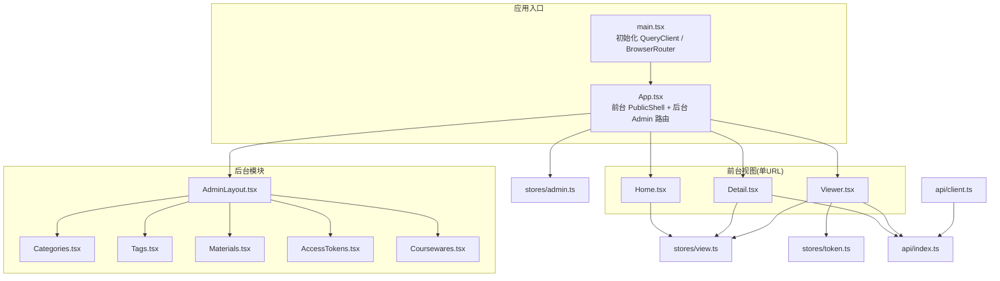
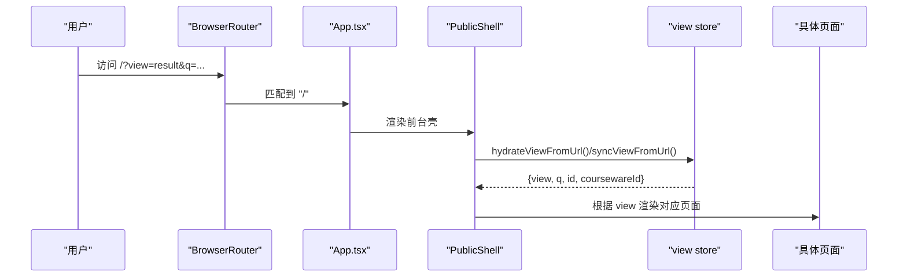
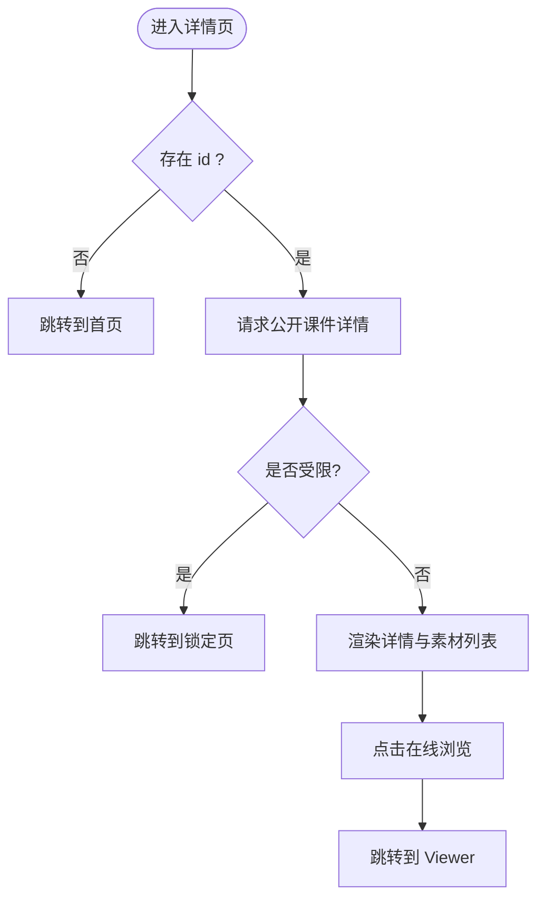
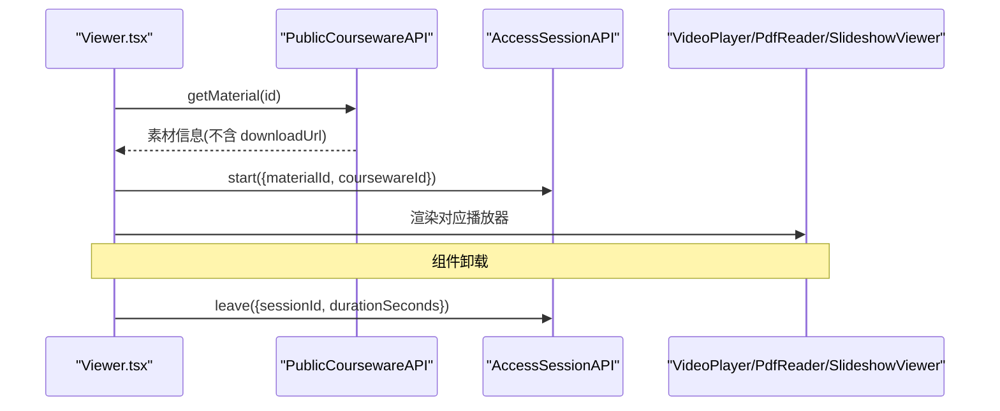
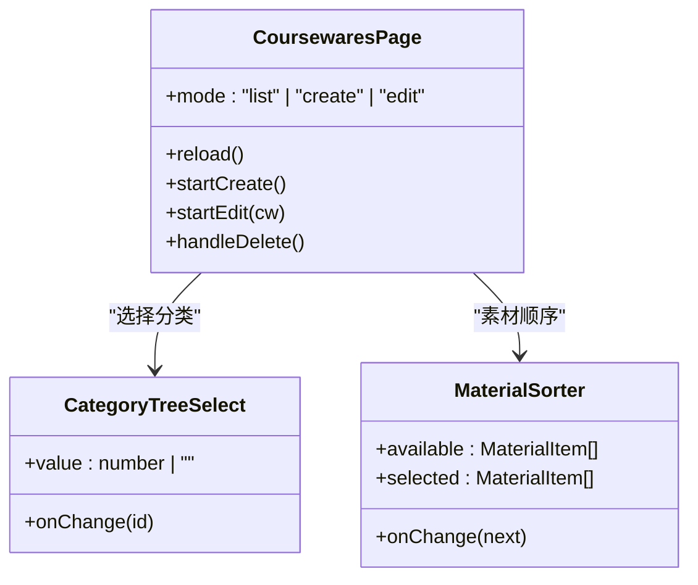
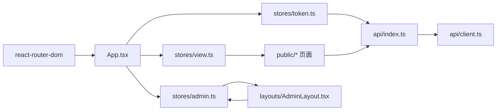

# 页面开发

<cite>
**本文引用的文件**   
- [frontend/src/main.tsx](file://frontend/src/main.tsx)
- [frontend/src/App.tsx](file://frontend/src/App.tsx)
- [frontend/src/stores/view.ts](file://frontend/src/stores/view.ts)
- [frontend/src/stores/token.ts](file://frontend/src/stores/token.ts)
- [frontend/src/stores/admin.ts](file://frontend/src/stores/admin.ts)
- [frontend/src/api/client.ts](file://frontend/src/api/client.ts)
- [frontend/src/api/index.ts](file://frontend/src/api/index.ts)
- [frontend/src/pages/public/Home.tsx](file://frontend/src/pages/public/Home.tsx)
- [frontend/src/pages/public/Detail.tsx](file://frontend/src/pages/public/Detail.tsx)
- [frontend/src/pages/public/Viewer.tsx](file://frontend/src/pages/public/Viewer.tsx)
- [frontend/src/layouts/AdminLayout.tsx](file://frontend/src/layouts/AdminLayout.tsx)
- [frontend/src/pages/admin/Categories.tsx](file://frontend/src/pages/admin/Categories.tsx)
- [frontend/src/pages/admin/Tags.tsx](file://frontend/src/pages/admin/Tags.tsx)
- [frontend/src/pages/admin/Materials.tsx](file://frontend/src/pages/admin/Materials.tsx)
- [frontend/src/pages/admin/AccessTokens.tsx](file://frontend/src/pages/admin/AccessTokens.tsx)
- [frontend/src/pages/admin/Coursewares.tsx](file://frontend/src/pages/admin/Coursewares.tsx)
</cite>

## 目录
1. [简介](#简介)
2. [项目结构](#项目结构)
3. [核心组件](#核心组件)
4. [架构总览](#架构总览)
5. [详细组件分析](#详细组件分析)
6. [依赖分析](#依赖分析)
7. [性能考虑](#性能考虑)
8. [故障排查指南](#故障排查指南)
9. [结论](#结论)
10. [附录](#附录)

## 简介
本指南面向 Learning Hub 前端页面开发，覆盖前台与后台两大场景：
- 前台页面：首页搜索、课件详情、在线播放器（视频/PPT/PDF）
- 管理后台：分类、标签、素材、访问令牌、课件的 CRUD 统一模式
- 路由与导航：单 URL 视图切换、动态路由、守卫、面包屑
- 状态与数据：Zustand 全局状态、React Query 客户端配置、请求拦截与错误处理
- 表单与上传：表单校验、拖拽上传、进度反馈
- 性能优化：懒加载、虚拟滚动、图片优化
- 测试：单元测试与端到端测试示例

## 项目结构
前端采用 React + TypeScript + Vite + TailwindCSS。前台以“单 URL + query 参数”驱动视图切换；后台使用独立子路由并配合布局与守卫。

图表来源
- [frontend/src/main.tsx:1-26](file://frontend/src/main.tsx#L1-L26)
- [frontend/src/App.tsx:1-110](file://frontend/src/App.tsx#L1-L110)
- [frontend/src/stores/view.ts:1-127](file://frontend/src/stores/view.ts#L1-L127)
- [frontend/src/stores/token.ts:1-54](file://frontend/src/stores/token.ts#L1-L54)
- [frontend/src/stores/admin.ts:1-71](file://frontend/src/stores/admin.ts#L1-L71)
- [frontend/src/api/index.ts:1-443](file://frontend/src/api/index.ts#L1-L443)
- [frontend/src/api/client.ts:1-52](file://frontend/src/api/client.ts#L1-L52)

章节来源
- [frontend/src/main.tsx:1-26](file://frontend/src/main.tsx#L1-L26)
- [frontend/src/App.tsx:1-110](file://frontend/src/App.tsx#L1-L110)

## 核心组件
- 前台视图状态 store：通过 URL 查询参数同步 view/q/id/cw，提供 go() 方法统一更新并替换历史
- 令牌记忆 store：持久化已解锁课件的 tokenHash，供公开接口附加 X-Token-Hash 头
- 管理员会话 store：登录/登出、本地持久化、恢复
- API 客户端：统一 baseURL、X-Request-Id、业务 envelope 解包与错误转换
- 公共 API 封装：按领域聚合接口，自动注入 tokenHash 头，屏蔽下载链接泄露

章节来源
- [frontend/src/stores/view.ts:1-127](file://frontend/src/stores/view.ts#L1-L127)
- [frontend/src/stores/token.ts:1-54](file://frontend/src/stores/token.ts#L1-L54)
- [frontend/src/stores/admin.ts:1-71](file://frontend/src/stores/admin.ts#L1-L71)
- [frontend/src/api/client.ts:1-52](file://frontend/src/api/client.ts#L1-L52)
- [frontend/src/api/index.ts:1-443](file://frontend/src/api/index.ts#L1-L443)

## 架构总览
前台 SPA 壳在根路径下根据 view 参数渲染不同页面；后台使用嵌套路由与守卫。

图表来源
- [frontend/src/App.tsx:40-58](file://frontend/src/App.tsx#L40-L58)
- [frontend/src/stores/view.ts:99-117](file://frontend/src/stores/view.ts#L99-L117)

## 详细组件分析

### 前台首页（搜索入口）
- 行为：提交后设置 view=result 并携带关键词，同时更新 URL
- 交互：居中布局、品牌 Logo、输入框与按钮
- 可测性：data-testid 覆盖输入与按钮

章节来源
- [frontend/src/pages/public/Home.tsx:1-55](file://frontend/src/pages/public/Home.tsx#L1-L55)
- [frontend/src/stores/view.ts:63-96](file://frontend/src/stores/view.ts#L63-L96)

### 课件详情页（受限访问与顺序提示）
- 数据获取：根据 ?id 调用公开课件接口；若返回受限则跳转锁定页
- 展示：标题、作者、标签、简介、素材列表（按 sortOrder 升序），多于一个素材时显示学习顺序提示
- 交互：点击“在线浏览”进入 Viewer，携带 materialId 与 coursewareId

图表来源
- [frontend/src/pages/public/Detail.tsx:18-60](file://frontend/src/pages/public/Detail.tsx#L18-L60)
- [frontend/src/pages/public/Detail.tsx:136-182](file://frontend/src/pages/public/Detail.tsx#L136-L182)

章节来源
- [frontend/src/pages/public/Detail.tsx:1-188](file://frontend/src/pages/public/Detail.tsx#L1-188)
- [frontend/src/api/index.ts:405-440](file://frontend/src/api/index.ts#L405-L440)

### 在线播放器（Viewer）
- 分发逻辑：根据素材类型渲染 VideoPlayer/PdfReader/SlideshowViewer
- 安全策略：剥离 downloadUrl，避免子组件误用导致下载入口泄露
- 访问埋点：加载成功 start 会话，离开 leave 会话（优先 sendBeacon，回退 keepalive）

图表来源
- [frontend/src/pages/public/Viewer.tsx:45-116](file://frontend/src/pages/public/Viewer.tsx#L45-L116)
- [frontend/src/api/index.ts:168-216](file://frontend/src/api/index.ts#L168-L216)

章节来源
- [frontend/src/pages/public/Viewer.tsx:1-170](file://frontend/src/pages/public/Viewer.tsx#L1-L170)
- [frontend/src/api/index.ts:156-216](file://frontend/src/api/index.ts#L156-L216)

### 管理后台布局与导航
- 顶部导航：课程管理、分类、标签、素材、访问令牌
- 退出登录：调用登出接口并跳转登录页
- 内容区：Outlet 渲染子路由页面

章节来源
- [frontend/src/layouts/AdminLayout.tsx:1-61](file://frontend/src/layouts/AdminLayout.tsx#L1-L61)
- [frontend/src/stores/admin.ts:34-70](file://frontend/src/stores/admin.ts#L34-L70)

### 分类管理（CRUD）
- 树形结构：支持最多三层，新增根/子分类、重命名、删除
- 交互：双击编辑名称、展开添加子分类、确认删除弹窗

章节来源
- [frontend/src/pages/admin/Categories.tsx:1-270](file://frontend/src/pages/admin/Categories.tsx#L1-L270)
- [frontend/src/api/index.ts:34-50](file://frontend/src/api/index.ts#L34-L50)

### 标签管理（CRUD）
- 列表：分页加载、搜索、创建、重命名、删除
- 关联统计：显示关联课件数量

章节来源
- [frontend/src/pages/admin/Tags.tsx:1-197](file://frontend/src/pages/admin/Tags.tsx#L1-L197)
- [frontend/src/api/index.ts:52-68](file://frontend/src/api/index.ts#L52-L68)

### 素材管理（上传/列表/删除）
- 上传：拖拽或选择文件，预校验大小，失败友好提示
- 列表：分页、筛选类型、下载、删除（被引用不可删）
- 进度：onUploadProgress 回调预留，便于扩展 UI

章节来源
- [frontend/src/pages/admin/Materials.tsx:1-276](file://frontend/src/pages/admin/Materials.tsx#L1-L276)
- [frontend/src/api/index.ts:88-115](file://frontend/src/api/index.ts#L88-L115)

### 访问令牌管理（CRUD/重新生成/查看记录）
- 创建/重新生成：仅一次返回明文，需保存
- 列表：搜索、删除、查看访问记录
- 访问记录：跳转至专用页面

章节来源
- [frontend/src/pages/admin/AccessTokens.tsx:1-269](file://frontend/src/pages/admin/AccessTokens.tsx#L1-L269)
- [frontend/src/api/index.ts:117-154](file://frontend/src/api/index.ts#L117-L154)

### 课件管理（列表/新建/编辑/排序）
- 列表：分页、搜索、分类过滤、访问模式过滤
- 新建/编辑：表单包含分类树选择、标签、素材绑定与排序
- 素材排序：左右栏选择 + 拖拽/键盘调整顺序，提交 reorder 接口

图表来源
- [frontend/src/pages/admin/Coursewares.tsx:475-638](file://frontend/src/pages/admin/Coursewares.tsx#L475-L638)
- [frontend/src/pages/admin/Coursewares.tsx:204-379](file://frontend/src/pages/admin/Coursewares.tsx#L204-L379)

章节来源
- [frontend/src/pages/admin/Coursewares.tsx:1-800](file://frontend/src/pages/admin/Coursewares.tsx#L1-L800)
- [frontend/src/api/index.ts:357-402](file://frontend/src/api/index.ts#L357-L402)

## 依赖分析
- 路由层：BrowserRouter 包裹 App；App 内定义前台 PublicShell 与后台 Admin 路由
- 状态层：view store 负责前台视图与 URL 同步；token store 管理已解锁课件哈希；admin store 管理后台会话
- 网络层：axios 客户端统一拦截器；API 模块按领域聚合，自动注入 X-Token-Hash 头
- 页面层：前台页面依赖 view store 与公共 API；后台页面依赖各自 API 与通用组件（Toast/ConfirmDialog）

图表来源
- [frontend/src/App.tsx:60-109](file://frontend/src/App.tsx#L60-L109)
- [frontend/src/stores/view.ts:1-127](file://frontend/src/stores/view.ts#L1-L127)
- [frontend/src/stores/token.ts:1-54](file://frontend/src/stores/token.ts#L1-L54)
- [frontend/src/stores/admin.ts:1-71](file://frontend/src/stores/admin.ts#L1-L71)
- [frontend/src/api/index.ts:1-443](file://frontend/src/api/index.ts#L1-L443)
- [frontend/src/api/client.ts:1-52](file://frontend/src/api/client.ts#L1-L52)
- [frontend/src/layouts/AdminLayout.tsx:1-61](file://frontend/src/layouts/AdminLayout.tsx#L1-L61)

章节来源
- [frontend/src/App.tsx:1-110](file://frontend/src/App.tsx#L1-L110)
- [frontend/src/api/index.ts:1-443](file://frontend/src/api/index.ts#L1-L443)
- [frontend/src/api/client.ts:1-52](file://frontend/src/api/client.ts#L1-L52)

## 性能考虑
- 懒加载与代码分割：对后台大页面（如课件管理）可按路由懒加载，减少首屏体积
- 虚拟滚动：素材/课件列表较大时使用虚拟滚动（例如 react-window/react-virtualized）
- 图片优化：PPT 预览图按需加载、懒加载、WebP/AVIF 格式、响应式尺寸
- 请求优化：React Query 默认关闭 refetchOnWindowFocus 与重试，结合缓存键与 staleTime 控制刷新
- 上传体验：分片上传、断点续传、进度条可视化（当前 onUploadProgress 已预留）

[本节为通用建议，不直接分析具体文件]

## 故障排查指南
- 受限课件无法打开：检查是否已记忆 tokenHash 且请求附带 X-Token-Hash 头；确认 unlock 成功后再访问详情
- 上传失败：区分 413/超时/网络异常，参考友好错误映射提示
- 前台页面跳转异常：检查 view store 的 go() 是否正确清空 home 时的 id/cw 参数，避免 URL 残留导致推断错误
- 后台未授权：确认 admin store 的 session 是否存在，路由守卫是否放行

章节来源
- [frontend/src/api/index.ts:18-23](file://frontend/src/api/index.ts#L18-L23)
- [frontend/src/pages/admin/Materials.tsx:22-41](file://frontend/src/pages/admin/Materials.tsx#L22-L41)
- [frontend/src/stores/view.ts:71-96](file://frontend/src/stores/view.ts#L71-L96)
- [frontend/src/stores/admin.ts:34-70](file://frontend/src/stores/admin.ts#L34-L70)

## 结论
本项目以前台单 URL 视图切换与后台嵌套路由相结合，配合 Zustand 全局状态与 axios 统一拦截，形成清晰的前后台开发范式。通过统一的 API 封装、错误处理与可测性标记，提升了可维护性与可测试性。建议在后续迭代中引入路由级懒加载与虚拟滚动，进一步优化大数据量场景下的性能表现。

## 附录

### 路由与导航规范
- 前台：/ 根路径下通过 ?view 切换页面，go() 同步更新 URL 与 store
- 后台：/admin/* 嵌套路由，AdminGuard 保护，AdminLayout 提供导航与 Outlet
- 面包屑：详情页根据 categoryName 作为面包屑上下文

章节来源
- [frontend/src/App.tsx:77-105](file://frontend/src/App.tsx#L77-L105)
- [frontend/src/pages/public/Detail.tsx:62-66](file://frontend/src/pages/public/Detail.tsx#L62-L66)

### 表单与上传模式
- 表单：受控组件 + 提交前校验 + toast 反馈
- 上传：拖拽区域 + 预校验大小 + 友好错误映射 + 可选进度回调
- 确认操作：统一 ConfirmDialog 组件

章节来源
- [frontend/src/pages/admin/Materials.tsx:76-100](file://frontend/src/pages/admin/Materials.tsx#L76-L100)
- [frontend/src/pages/admin/Tags.tsx:36-50](file://frontend/src/pages/admin/Tags.tsx#L36-L50)
- [frontend/src/pages/admin/Categories.tsx:36-55](file://frontend/src/pages/admin/Categories.tsx#L36-L55)

### 端到端测试要点
- 前台：首页搜索输入与按钮、详情页加载与错误、播放器加载与返回
- 后台：登录态、分类/标签/素材/令牌的增删改查、课件排序
- 选择器：使用 data-testid 定位关键元素，确保稳定可测

章节来源
- [frontend/src/pages/public/Home.tsx:32-51](file://frontend/src/pages/public/Home.tsx#L32-L51)
- [frontend/src/pages/public/Detail.tsx:78-85](file://frontend/src/pages/public/Detail.tsx#L78-L85)
- [frontend/src/pages/public/Viewer.tsx:122-135](file://frontend/src/pages/public/Viewer.tsx#L122-L135)
- [frontend/src/pages/admin/Materials.tsx:116-148](file://frontend/src/pages/admin/Materials.tsx#L116-L148)