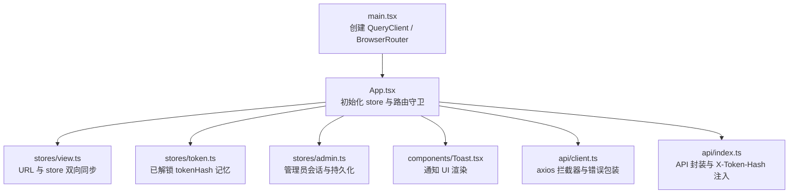
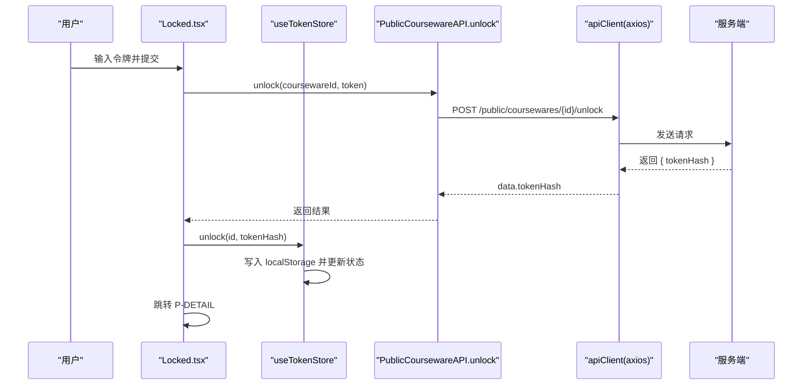
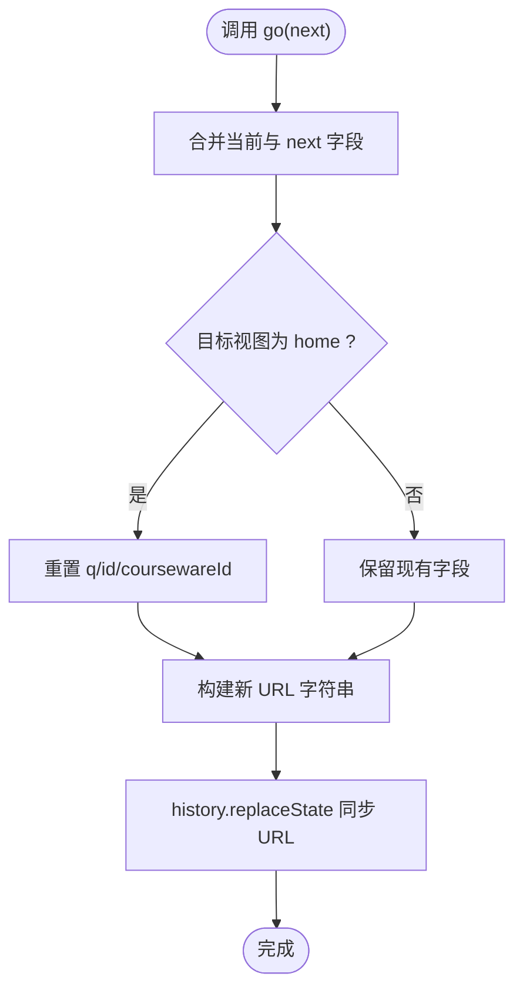
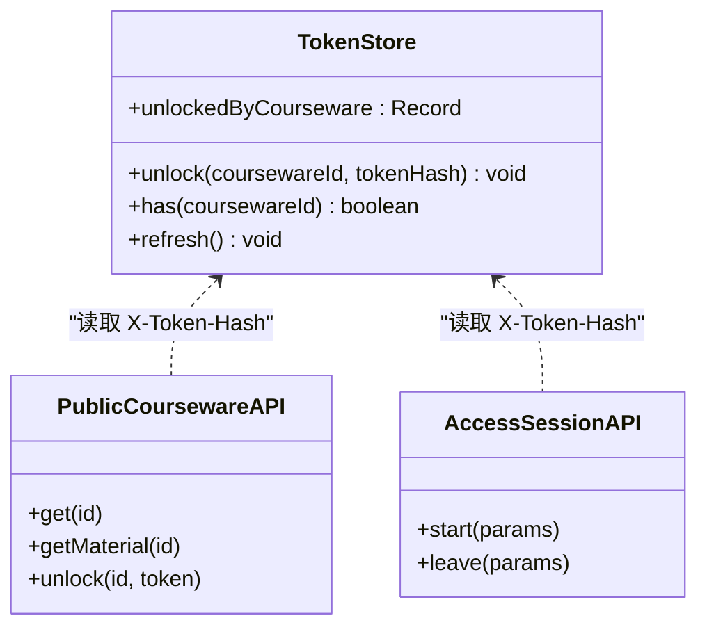
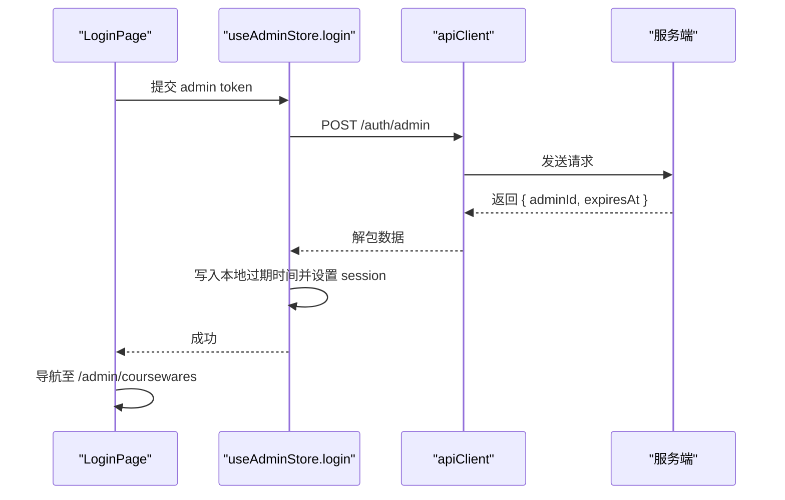
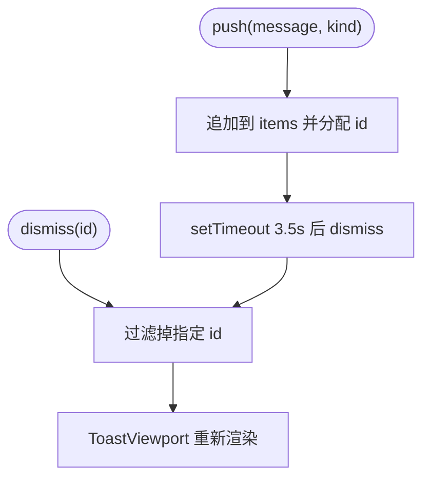
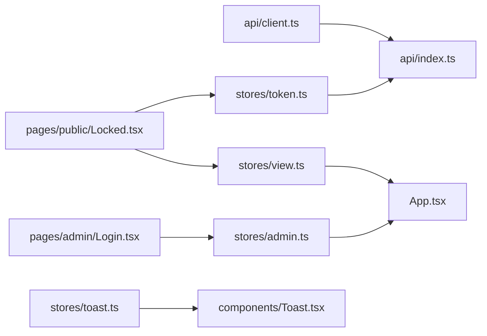

# 页面状态管理

<cite>
**本文引用的文件**   
- [frontend/src/stores/admin.ts](file://frontend/src/stores/admin.ts)
- [frontend/src/stores/token.ts](file://frontend/src/stores/token.ts)
- [frontend/src/stores/view.ts](file://frontend/src/stores/view.ts)
- [frontend/src/stores/toast.ts](file://frontend/src/stores/toast.ts)
- [frontend/src/api/client.ts](file://frontend/src/api/client.ts)
- [frontend/src/api/index.ts](file://frontend/src/api/index.ts)
- [frontend/src/App.tsx](file://frontend/src/App.tsx)
- [frontend/src/main.tsx](file://frontend/src/main.tsx)
- [frontend/src/pages/public/Locked.tsx](file://frontend/src/pages/public/Locked.tsx)
- [frontend/src/pages/admin/Login.tsx](file://frontend/src/pages/admin/Login.tsx)
- [frontend/src/components/Toast.tsx](file://frontend/src/components/Toast.tsx)
</cite>

## 目录
1. [引言](#引言)
2. [项目结构](#项目结构)
3. [核心组件](#核心组件)
4. [架构总览](#架构总览)
5. [详细组件分析](#详细组件分析)
6. [依赖关系分析](#依赖关系分析)
7. [性能与缓存策略](#性能与缓存策略)
8. [故障排查指南](#故障排查指南)
9. [结论](#结论)
10. [附录：调试与测试方法](#附录调试与测试方法)

## 引言
本指南聚焦 Learning Hub 前台页面的状态管理，围绕 Zustand 的使用模式展开，覆盖以下主题：
- Store 定义、状态更新与订阅机制
- 视图状态（当前页面、搜索参数、UI 状态）的管理
- 认证状态（管理员登录、权限检查、会话持久化）
- 令牌存储与自动刷新机制（受限课件解锁与访问记录）
- 通知系统（消息队列、显示控制、用户交互）
- 状态持久化、缓存策略与性能优化最佳实践
- 状态调试工具与测试方法

## 项目结构
前端采用单页应用（SPA），通过 React Router 与自定义 store/view 协同实现“单 URL 多视图”的路由方案。全局初始化时完成：
- 从 URL 同步视图状态到 store
- 从 localStorage 恢复已解锁的课件令牌哈希
- 监听浏览器前进/后退事件以同步 store
- 恢复管理员会话（基于 Cookie + 本地过期时间）

图表来源
- [frontend/src/main.tsx:1-26](file://frontend/src/main.tsx#L1-L26)
- [frontend/src/App.tsx:60-109](file://frontend/src/App.tsx#L60-L109)
- [frontend/src/stores/view.ts:1-127](file://frontend/src/stores/view.ts#L1-L127)
- [frontend/src/stores/token.ts:1-54](file://frontend/src/stores/token.ts#L1-L54)
- [frontend/src/stores/admin.ts:1-71](file://frontend/src/stores/admin.ts#L1-L71)
- [frontend/src/components/Toast.tsx:1-38](file://frontend/src/components/Toast.tsx#L1-L38)
- [frontend/src/api/client.ts:1-52](file://frontend/src/api/client.ts#L1-L52)
- [frontend/src/api/index.ts:1-443](file://frontend/src/api/index.ts#L1-L443)

章节来源
- [frontend/src/main.tsx:1-26](file://frontend/src/main.tsx#L1-L26)
- [frontend/src/App.tsx:60-109](file://frontend/src/App.tsx#L60-L109)

## 核心组件
本节对四个核心 store 进行概览，说明职责边界与关键能力。

- 视图状态 store（view）
  - 负责当前视图、搜索词、资源 ID、课件 ID 等与 URL 同步的状态
  - 提供 go() 方法统一变更并同步 URL；提供 hydrate/sync/bind 生命周期函数
- 令牌记忆 store（token）
  - 维护 coursewareId -> tokenHash 的映射，用于受限课件解锁后的快速访问
  - 支持持久化到 localStorage，并提供 refresh/hydrate 入口
- 管理员会话 store（admin）
  - 管理管理员登录态、加载状态、登录/登出流程与会话恢复
  - 将后端 Set-Cookie 的会话与本地过期时间结合，避免在内存中保存敏感 token
- 通知 store（toast）
  - 维护消息队列，支持 push/dismiss 与自动消失

章节来源
- [frontend/src/stores/view.ts:1-127](file://frontend/src/stores/view.ts#L1-L127)
- [frontend/src/stores/token.ts:1-54](file://frontend/src/stores/token.ts#L1-L54)
- [frontend/src/stores/admin.ts:1-71](file://frontend/src/stores/admin.ts#L1-L71)
- [frontend/src/stores/toast.ts:1-30](file://frontend/src/stores/toast.ts#L1-L30)

## 架构总览
下图展示了请求链路中状态管理与 API 层的协作方式，特别是受限课件解锁与访问记录的流程。

图表来源
- [frontend/src/pages/public/Locked.tsx:29-44](file://frontend/src/pages/public/Locked.tsx#L29-L44)
- [frontend/src/api/index.ts:422-428](file://frontend/src/api/index.ts#L422-L428)
- [frontend/src/stores/token.ts:38-48](file://frontend/src/stores/token.ts#L38-L48)
- [frontend/src/api/client.ts:13-49](file://frontend/src/api/client.ts#L13-L49)

## 详细组件分析

### 视图状态管理（view store）
- 设计要点
  - 单一事实源：URL query 为权威，store 与其双向同步
  - 白名单校验 view 值，防止非法路由
  - go() 内部合并字段并同步 URL，避免多次点击返回首页时的竞态问题
  - 提供 hydrateViewFromUrl、syncViewFromUrl、bindViewToPopState 三个生命周期钩子
- 复杂度与性能
  - 每次 go() 仅做一次 URLSearchParams 构建与 history.replaceState，O(1)
  - popstate 监听仅在挂载时绑定一次，卸载时移除
- 典型用法
  - 首页搜索后跳转到 result 视图
  - 详情页进入 viewer 视图并携带 coursewareId
  - 返回 home 时清空 q/id/cw，确保下次 readUrl 推断正确

图表来源
- [frontend/src/stores/view.ts:63-96](file://frontend/src/stores/view.ts#L63-L96)

章节来源
- [frontend/src/stores/view.ts:1-127](file://frontend/src/stores/view.ts#L1-L127)
- [frontend/src/App.tsx:40-58](file://frontend/src/App.tsx#L40-L58)

### 令牌记忆与受限课件解锁（token store）
- 设计要点
  - 使用 coursewareId -> tokenHash 的映射作为“已解锁”记忆
  - 持久化到 localStorage，隐私模式下回退到内存
  - 提供 unlock/has/refresh 等方法
- 与 API 层联动
  - PublicCoursewareAPI.get/getMaterial 会在请求头附加 X-Token-Hash，避免依赖 Set-Cookie 的时序
  - AccessSessionAPI.leave 优先使用 sendBeacon，失败回退 fetch keepalive
- 复杂度与性能
  - unlock 操作 O(1)，localStorage 写开销可忽略
  - has 查询 O(1)

图表来源
- [frontend/src/stores/token.ts:1-54](file://frontend/src/stores/token.ts#L1-L54)
- [frontend/src/api/index.ts:18-23](file://frontend/src/api/index.ts#L18-L23)
- [frontend/src/api/index.ts:405-440](file://frontend/src/api/index.ts#L405-L440)
- [frontend/src/api/index.ts:168-216](file://frontend/src/api/index.ts#L168-L216)

章节来源
- [frontend/src/stores/token.ts:1-54](file://frontend/src/stores/token.ts#L1-L54)
- [frontend/src/api/index.ts:18-23](file://frontend/src/api/index.ts#L18-L23)
- [frontend/src/api/index.ts:405-440](file://frontend/src/api/index.ts#L405-L440)
- [frontend/src/api/index.ts:168-216](file://frontend/src/api/index.ts#L168-L216)

### 管理员认证与会话持久化（admin store）
- 设计要点
  - login(token) 调用 /auth/admin，成功后将 expiresAt 持久化到 localStorage，实际会话由后端 Set-Cookie 管理
  - logout 调用 /auth/logout 清理 Cookie，并移除本地过期时间
  - restore 在应用启动时尝试恢复 session
- 安全考虑
  - 不在前端内存或本地存储明文 admin token，仅存过期时间占位
  - 所有管理后台路由受 AdminGuard 保护
- 复杂度与性能
  - login/logout 均为网络 I/O，无复杂计算
  - restore 仅读 localStorage，O(1)

图表来源
- [frontend/src/pages/admin/Login.tsx:18-32](file://frontend/src/pages/admin/Login.tsx#L18-L32)
- [frontend/src/stores/admin.ts:34-59](file://frontend/src/stores/admin.ts#L34-L59)
- [frontend/src/api/index.ts:26-32](file://frontend/src/api/index.ts#L26-L32)

章节来源
- [frontend/src/stores/admin.ts:1-71](file://frontend/src/stores/admin.ts#L1-L71)
- [frontend/src/pages/admin/Login.tsx:1-72](file://frontend/src/pages/admin/Login.tsx#L1-L72)
- [frontend/src/App.tsx:31-35](file://frontend/src/App.tsx#L31-L35)

### 通知系统（toast store）
- 设计要点
  - items 数组维护消息队列，push 自动 3.5s 后 dismiss
  - 提供 dismiss 手动关闭
  - 顶层 ToastViewport 渲染所有消息
- 复杂度与性能
  - push/dismiss 均为浅拷贝数组，O(n) 但 n 通常很小
  - 定时器在 push 时注册，dismiss 时移除对应项

图表来源
- [frontend/src/stores/toast.ts:15-25](file://frontend/src/stores/toast.ts#L15-L25)
- [frontend/src/components/Toast.tsx:9-37](file://frontend/src/components/Toast.tsx#L9-L37)

章节来源
- [frontend/src/stores/toast.ts:1-30](file://frontend/src/stores/toast.ts#L1-L30)
- [frontend/src/components/Toast.tsx:1-38](file://frontend/src/components/Toast.tsx#L1-L38)

## 依赖关系分析
- api/client.ts
  - 提供 axios 实例，统一 baseURL、withCredentials、超时
  - 请求拦截器注入 X-Request-Id
  - 响应拦截器处理业务 envelope，非 ok 抛错并附带 code/status
- api/index.ts
  - 封装各模块 API，统一解包 data
  - 根据 useTokenStore 动态注入 X-Token-Hash 头
  - 暴露 AccessSessionAPI 的 start/leave，后者优先 sendBeacon
- App.tsx
  - 初始化 view/token/admin store 的 hydrate/restore
  - 注册 popstate 监听，保证浏览器前进/后退与 store 一致
  - 使用 AdminGuard 保护管理后台路由

图表来源
- [frontend/src/api/client.ts:1-52](file://frontend/src/api/client.ts#L1-L52)
- [frontend/src/api/index.ts:1-443](file://frontend/src/api/index.ts#L1-L443)
- [frontend/src/stores/view.ts:1-127](file://frontend/src/stores/view.ts#L1-L127)
- [frontend/src/stores/token.ts:1-54](file://frontend/src/stores/token.ts#L1-L54)
- [frontend/src/stores/admin.ts:1-71](file://frontend/src/stores/admin.ts#L1-L71)
- [frontend/src/stores/toast.ts:1-30](file://frontend/src/stores/toast.ts#L1-L30)
- [frontend/src/components/Toast.tsx:1-38](file://frontend/src/components/Toast.tsx#L1-L38)
- [frontend/src/pages/public/Locked.tsx:1-113](file://frontend/src/pages/public/Locked.tsx#L1-L113)
- [frontend/src/pages/admin/Login.tsx:1-72](file://frontend/src/pages/admin/Login.tsx#L1-L72)
- [frontend/src/App.tsx:1-110](file://frontend/src/App.tsx#L1-L110)

章节来源
- [frontend/src/api/client.ts:1-52](file://frontend/src/api/client.ts#L1-L52)
- [frontend/src/api/index.ts:1-443](file://frontend/src/api/index.ts#L1-L443)
- [frontend/src/App.tsx:1-110](file://frontend/src/App.tsx#L1-L110)

## 性能与缓存策略
- 视图状态
  - 使用 URL 作为权威源，减少重复渲染与状态不一致风险
  - go() 同步更新 URL，避免 useEffect 竞争导致二次跳转
- 令牌记忆
  - 使用 localStorage 持久化，避免重复解锁；隐私模式降级到内存
  - 通过 X-Token-Hash 头直接传递，规避 Set-Cookie 时序窗口导致的 403
- 通知系统
  - 消息自动消失，避免长时间占用 UI；必要时提供手动关闭
- API 客户端
  - withCredentials=true 配合后端 Cookie 鉴权
  - 统一错误包装，便于上层统一处理与提示
- 建议
  - 对高频只读数据可使用 React Query 的 staleTime/gcTime 做缓存（本项目 main.tsx 已禁用 refetchOnWindowFocus）
  - 大文件上传已在 MaterialAPI.upload 中设置长超时与进度回调预留点

[本节为通用指导，不直接分析具体文件]

## 故障排查指南
- 登录后仍被重定向到登录页
  - 检查后端是否下发 LH_ADMIN_SESSION Cookie，以及本地过期时间是否有效
  - 确认 App 启动时调用了 restore()
- 受限课件需要两次输入才能打开
  - 确认 unlock 成功后已将 tokenHash 写入 useTokenStore 与 localStorage
  - 确认后续 get/getMaterial 请求是否携带 X-Token-Hash 头
- 离开 P-VIEWER 未记录停留时长
  - 检查 leave 是否优先使用 sendBeacon，失败是否回退 fetch keepalive
  - 查看控制台是否有跨域或网络异常
- 通知消息不消失或不显示
  - 检查 toast.push 是否被调用，ToastViewport 是否在根树渲染
  - 确认 dismiss 逻辑未被误删

章节来源
- [frontend/src/stores/admin.ts:34-70](file://frontend/src/stores/admin.ts#L34-L70)
- [frontend/src/api/index.ts:168-216](file://frontend/src/api/index.ts#L168-L216)
- [frontend/src/stores/token.ts:38-48](file://frontend/src/stores/token.ts#L38-L48)
- [frontend/src/components/Toast.tsx:9-37](file://frontend/src/components/Toast.tsx#L9-L37)

## 结论
Learning Hub 的前台状态管理以 Zustand 为核心，结合 URL 权威源与 localStorage 持久化，实现了清晰、可预测且高性能的状态模型。通过统一的 API 客户端与拦截器，保证了鉴权、错误处理与埋点的一致性。整体架构具备良好的扩展性与可维护性，适合在企业级学习平台中持续演进。

[本节为总结，不直接分析具体文件]

## 附录：调试与测试方法
- 调试技巧
  - 在浏览器 DevTools 的 Application 面板查看 localStorage 中的 lh_admin_session 与 lh_unlocked_tokens
  - 在 Network 面板检查请求头是否包含 X-Request-Id 与 X-Token-Hash
  - 在 Console 中临时调用 useViewStore.getState()/useTokenStore.getState() 观察当前状态
- 单元测试建议
  - 针对 store 的纯函数部分（如 readUrl、load/save）编写断言
  - 模拟 apiClient 的响应，验证 login/logout/unlock 的流程分支
- E2E 建议
  - 使用 Playwright 模拟登录与解锁流程，断言页面跳转与 UI 元素可见性
  - 验证 popstate 行为：前进/后退应正确同步 store 与 URL

[本节为通用指导，不直接分析具体文件]