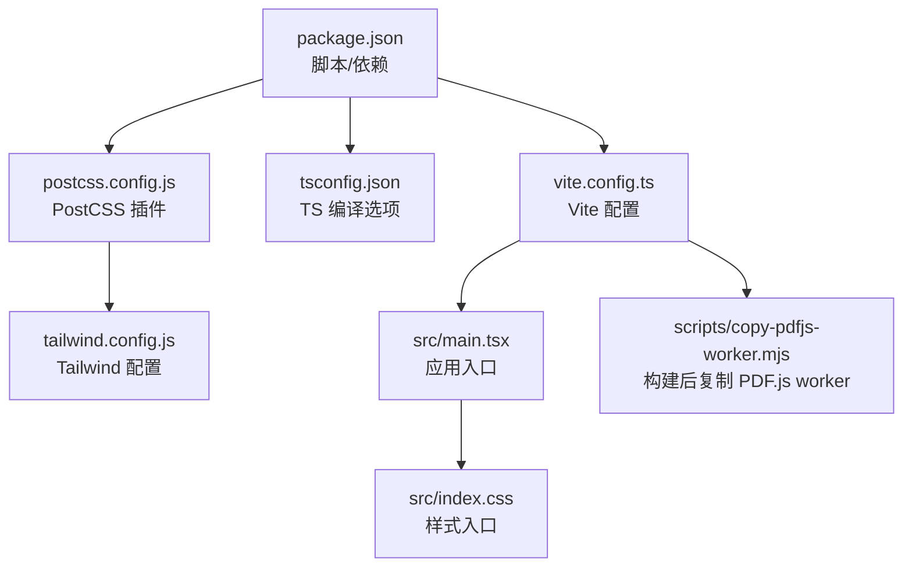
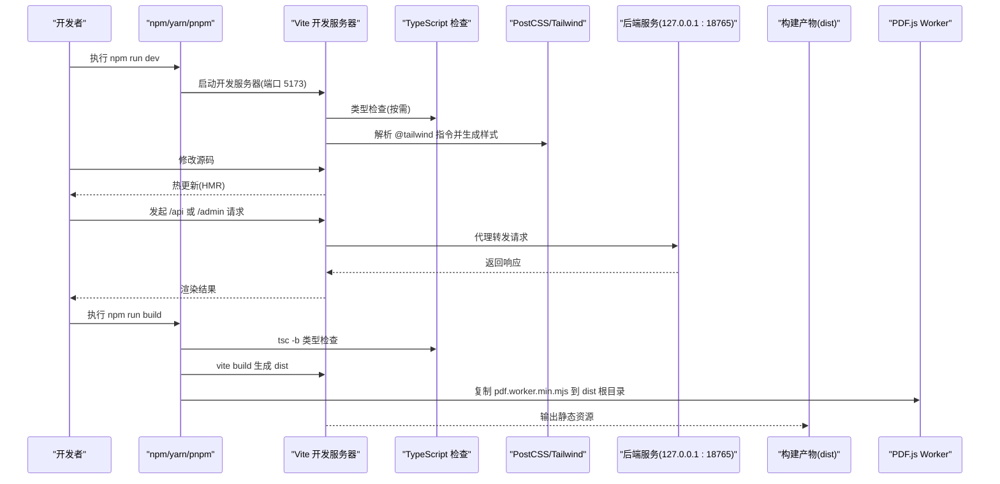
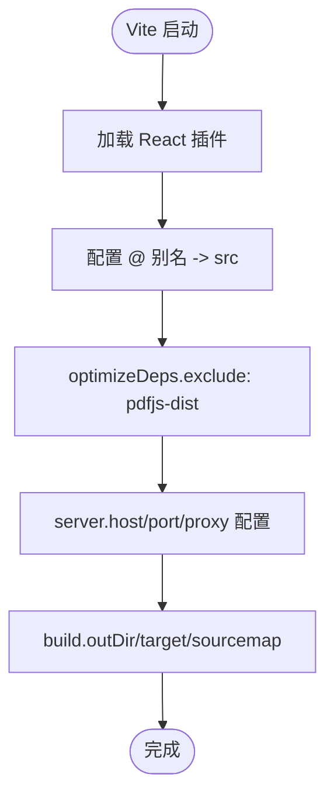
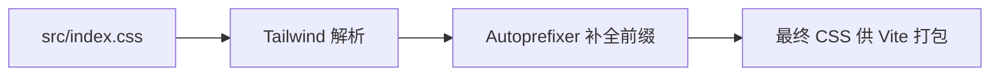
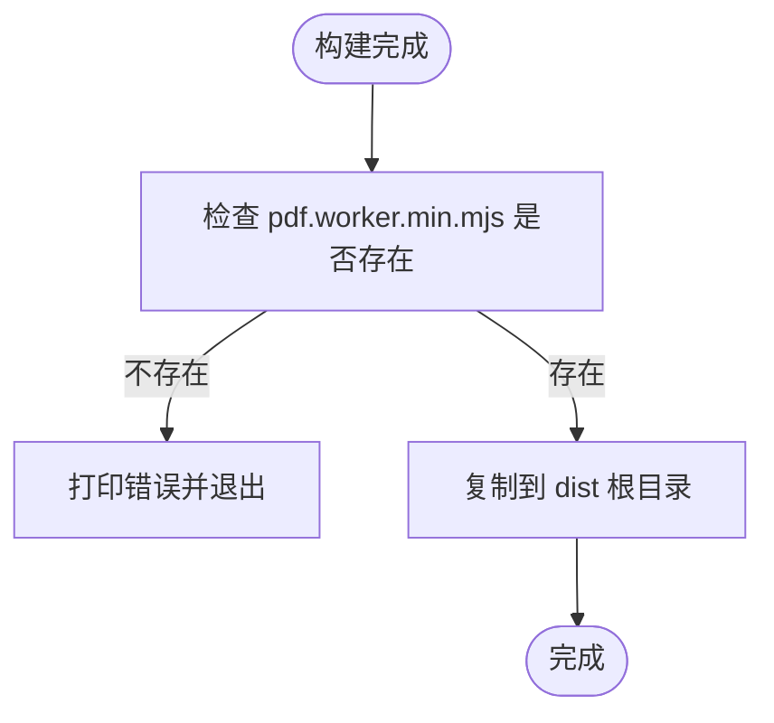
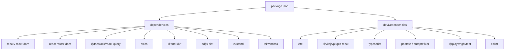

# 项目搭建与配置

<cite>
**本文引用的文件**   
- [frontend/package.json](file://frontend/package.json)
- [frontend/vite.config.ts](file://frontend/vite.config.ts)
- [frontend/tsconfig.json](file://frontend/tsconfig.json)
- [frontend/tailwind.config.js](file://frontend/tailwind.config.js)
- [frontend/postcss.config.js](file://frontend/postcss.config.js)
- [frontend/src/index.css](file://frontend/src/index.css)
- [frontend/src/main.tsx](file://frontend/src/main.tsx)
- [frontend/scripts/copy-pdfjs-worker.mjs](file://frontend/scripts/copy-pdfjs-worker.mjs)
</cite>

## 目录
1. [简介](#简介)
2. [项目结构](#项目结构)
3. [核心组件](#核心组件)
4. [架构总览](#架构总览)
5. [详细组件分析](#详细组件分析)
6. [依赖关系分析](#依赖关系分析)
7. [性能考虑](#性能考虑)
8. [故障排查指南](#故障排查指南)
9. [结论](#结论)
10. [附录](#附录)

## 简介
本指南面向 Learning Hub 前端项目的本地开发与构建，覆盖 Node.js 环境要求、依赖安装、开发工具链配置；详解 Vite 构建配置（开发服务器、代理、优化、插件）、TypeScript 编译选项与路径映射、TailwindCSS 样式架构与主题扩展、PostCSS 处理流程；并提供热重载与调试技巧、环境变量管理与多环境策略建议。

## 项目结构
前端工程位于 frontend 目录，采用 Vite + React + TypeScript + TailwindCSS 的现代前端技术栈。关键入口与配置文件如下：
- 应用入口：src/main.tsx
- 全局样式：src/index.css
- 构建与开发：vite.config.ts、postcss.config.js、tailwind.config.js、tsconfig.json
- 脚本与产物后处理：scripts/copy-pdfjs-worker.mjs
- 包与脚本定义：package.json

图表来源
- [frontend/package.json:1-40](file://frontend/package.json#L1-L40)
- [frontend/vite.config.ts:1-39](file://frontend/vite.config.ts#L1-L39)
- [frontend/tsconfig.json:1-27](file://frontend/tsconfig.json#L1-L27)
- [frontend/postcss.config.js:1-7](file://frontend/postcss.config.js#L1-L7)
- [frontend/tailwind.config.js:1-21](file://frontend/tailwind.config.js#L1-L21)
- [frontend/src/main.tsx:1-26](file://frontend/src/main.tsx#L1-L26)
- [frontend/src/index.css:1-25](file://frontend/src/index.css#L1-L25)
- [frontend/scripts/copy-pdfjs-worker.mjs:1-30](file://frontend/scripts/copy-pdfjs-worker.mjs#L1-L30)

章节来源
- [frontend/package.json:1-40](file://frontend/package.json#L1-L40)
- [frontend/vite.config.ts:1-39](file://frontend/vite.config.ts#L1-L39)
- [frontend/tsconfig.json:1-27](file://frontend/tsconfig.json#L1-L27)
- [frontend/postcss.config.js:1-7](file://frontend/postcss.config.js#L1-L7)
- [frontend/tailwind.config.js:1-21](file://frontend/tailwind.config.js#L1-L21)
- [frontend/src/main.tsx:1-26](file://frontend/src/main.tsx#L1-L26)
- [frontend/src/index.css:1-25](file://frontend/src/index.css#L1-L25)
- [frontend/scripts/copy-pdfjs-worker.mjs:1-30](file://frontend/scripts/copy-pdfjs-worker.mjs#L1-L30)

## 核心组件
本节聚焦前端工程的核心构建与运行组件及其职责：
- 包管理与脚本：定义 dev/build/preview/lint/typecheck/e2e 等命令，统一开发体验。
- Vite 构建器：启用 React 插件、别名、依赖预构建优化、开发服务器与代理、构建目标与输出目录。
- TypeScript：ESNext 模块、React JSX 支持、严格模式、路径映射、类型声明引用。
- TailwindCSS：内容扫描范围、主题扩展（颜色、字体族）。
- PostCSS：串联 Tailwind 与 Autoprefixer。
- 应用入口：初始化 React Query、路由与应用根组件。
- 构建后处理：将 PDF.js worker 复制到 dist 根目录以便静态资源访问。

章节来源
- [frontend/package.json:1-40](file://frontend/package.json#L1-L40)
- [frontend/vite.config.ts:1-39](file://frontend/vite.config.ts#L1-L39)
- [frontend/tsconfig.json:1-27](file://frontend/tsconfig.json#L1-L27)
- [frontend/tailwind.config.js:1-21](file://frontend/tailwind.config.js#L1-L21)
- [frontend/postcss.config.js:1-7](file://frontend/postcss.config.js#L1-L7)
- [frontend/src/main.tsx:1-26](file://frontend/src/main.tsx#L1-L26)
- [frontend/scripts/copy-pdfjs-worker.mjs:1-30](file://frontend/scripts/copy-pdfjs-worker.mjs#L1-L30)

## 架构总览
下图展示了从开发到构建的关键流程与组件交互：

图表来源
- [frontend/package.json:1-40](file://frontend/package.json#L1-L40)
- [frontend/vite.config.ts:1-39](file://frontend/vite.config.ts#L1-L39)
- [frontend/scripts/copy-pdfjs-worker.mjs:1-30](file://frontend/scripts/copy-pdfjs-worker.mjs#L1-L30)

## 详细组件分析

### Node.js 环境与依赖安装
- 版本要求
  - 当前依赖对 Node.js 的最低版本要求为 14.17 及以上（由部分依赖声明）。建议使用较新的 LTS 版本以获得更好的兼容性与性能。
- 安装步骤
  - 进入 frontend 目录，执行包管理器安装依赖。
  - 推荐使用与 package-lock.json 一致的包管理器（npm）以确保锁文件一致性。
- 常用脚本
  - 开发：启动 Vite 开发服务器。
  - 构建：先进行 TypeScript 联合构建，再执行 Vite 构建，最后复制 PDF.js worker 到 dist。
  - 预览：本地预览生产构建产物。
  - 类型检查：仅做类型检查不输出文件。
  - 端到端测试：使用 Playwright 执行 e2e 用例。

章节来源
- [frontend/package.json:1-40](file://frontend/package.json#L1-L40)

### Vite 构建工具配置与优化
- 插件
  - 启用 @vitejs/plugin-react，提供 React 支持与 JSX 转换。
- 模块解析与别名
  - 设置 @ 指向 src 目录，简化导入路径。
- 依赖预构建优化
  - 排除 pdfjs-dist，避免其大体积与 .mjs worker 导致 HMR 卡顿，交由运行时动态加载。
- Worker 格式
  - 指定 worker 输出为 ES 模块，提升兼容性。
- 开发服务器
  - 监听 0.0.0.0:5173，便于容器或局域网访问。
  - 代理 /api 与 /admin 至 http://127.0.0.1:18765，并开启 changeOrigin。
- 构建
  - 输出目录 dist，关闭 sourcemap，目标平台 es2022。

图表来源
- [frontend/vite.config.ts:1-39](file://frontend/vite.config.ts#L1-L39)

章节来源
- [frontend/vite.config.ts:1-39](file://frontend/vite.config.ts#L1-L39)

### TypeScript 配置
- 目标与库
  - target: ES2022，lib 包含 ES2022、DOM、DOM.Iterable，匹配现代浏览器能力。
- 模块系统
  - module: ESNext，moduleResolution: bundler，适配 Vite 打包器。
- JSX
  - jsx: react-jsx，启用新版 JSX 转换。
- 严格性与检查
  - strict: true，noFallthroughCasesInSwitch: true；关闭 noUnusedLocals/noUnusedParameters 以兼顾开发体验。
- 路径映射
  - baseUrl: "."，paths["@/*": ["src/*"]]，配合 Vite 别名一致。
- 类型声明
  - types: ["vite/client"]，引入 Vite 客户端类型。
- 包含与排除
  - include: src, e2e；exclude: node_modules, dist。

章节来源
- [frontend/tsconfig.json:1-27](file://frontend/tsconfig.json#L1-L27)

### TailwindCSS 样式架构与主题扩展
- 内容扫描
  - content 覆盖 index.html 与 src 下所有 ts/tsx 文件，确保按需生成工具类。
- 主题扩展
  - colors.primary 扩展了 50/500/600/700 色阶。
  - fontFamily.sans 自定义中文字体优先顺序。
- 插件
  - 未启用额外插件，保持轻量。

章节来源
- [frontend/tailwind.config.js:1-21](file://frontend/tailwind.config.js#L1-L21)

### PostCSS 配置与 CSS 处理流程
- 插件链
  - tailwindcss：解析 @tailwind 指令并生成样式。
  - autoprefixer：根据浏览器目标自动添加前缀。
- 样式入口
  - src/index.css 通过 @tailwind base/components/utilities 注入基础、组件与工具类，并定义全局变量与品牌标题样式。

图表来源
- [frontend/postcss.config.js:1-7](file://frontend/postcss.config.js#L1-L7)
- [frontend/src/index.css:1-25](file://frontend/src/index.css#L1-L25)

章节来源
- [frontend/postcss.config.js:1-7](file://frontend/postcss.config.js#L1-L7)
- [frontend/src/index.css:1-25](file://frontend/src/index.css#L1-L25)

### 应用入口与运行时初始化
- main.tsx 负责创建 React 根节点、注入 React Query 客户端、包裹 BrowserRouter 并挂载 App。
- 默认查询策略：禁用重试与窗口聚焦时重新拉取，适合学习资源浏览场景。

章节来源
- [frontend/src/main.tsx:1-26](file://frontend/src/main.tsx#L1-L26)

### 构建后处理：PDF.js Worker 复制
- 目的：将 pdfjs-dist 的 worker 文件复制到 dist 根目录，使生产环境可通过静态资源直接访问。
- 行为：在构建完成后校验源文件存在并复制到 dist/pdf.worker.min.mjs，失败则退出并提示安装依赖。

图表来源
- [frontend/scripts/copy-pdfjs-worker.mjs:1-30](file://frontend/scripts/copy-pdfjs-worker.mjs#L1-L30)

章节来源
- [frontend/scripts/copy-pdfjs-worker.mjs:1-30](file://frontend/scripts/copy-pdfjs-worker.mjs#L1-L30)

## 依赖关系分析
- 运行时依赖
  - React 生态：react、react-dom、react-router-dom
  - 数据请求与缓存：axios、@tanstack/react-query
  - UI 与拖拽：classnames、@dnd-kit/*
  - PDF 阅读：pdfjs-dist
  - 状态管理：zustand
  - 样式：tailwindcss
- 开发依赖
  - 构建与转译：vite、@vitejs/plugin-react、typescript、postcss、autoprefixer
  - 测试：@playwright/test
  - 代码质量：eslint

图表来源
- [frontend/package.json:1-40](file://frontend/package.json#L1-L40)

章节来源
- [frontend/package.json:1-40](file://frontend/package.json#L1-L40)

## 性能考虑
- 依赖预构建优化
  - 通过 exclude 排除 pdfjs-dist，避免大型依赖参与预构建，减少 HMR 延迟。
- 构建目标
  - 使用 es2022 作为构建目标，充分利用现代语法与特性，减小产物体积。
- 资源处理
  - 关闭 sourcemap 可进一步缩小产物体积，适用于生产环境。
- 静态资源
  - 将 PDF.js worker 独立复制到 dist 根目录，避免内联导致的体积膨胀与加载阻塞。

[本节为通用性能建议，无需特定文件来源]

## 故障排查指南
- 开发服务器无法访问
  - 确认 server.host 设置为 0.0.0.0，且端口未被占用。
- 代理无效
  - 检查 /api 与 /admin 是否被正确代理至 http://127.0.0.1:18765，并确保后端服务已启动。
- PDF.js 相关报错
  - 若出现 worker 缺失错误，请确认构建流程已执行 scripts/copy-pdfjs-worker.mjs，且 dist 根目录存在对应 worker 文件。
- 类型检查失败
  - 使用 typecheck 脚本定位问题；必要时调整 tsconfig 中的严格性选项。
- 样式未生效
  - 确认 src/index.css 已被应用入口引入，且 tailwind.config.js 的 content 路径覆盖了实际使用的文件。

章节来源
- [frontend/vite.config.ts:1-39](file://frontend/vite.config.ts#L1-L39)
- [frontend/scripts/copy-pdfjs-worker.mjs:1-30](file://frontend/scripts/copy-pdfjs-worker.mjs#L1-L30)
- [frontend/src/index.css:1-25](file://frontend/src/index.css#L1-L25)

## 结论
本项目基于 Vite + React + TypeScript + TailwindCSS 构建了高效的前端开发体验。通过合理的依赖优化、清晰的构建流程与完善的样式体系，既保证了开发效率，也兼顾了生产环境的性能与稳定性。建议在后续迭代中持续完善环境变量管理与多环境策略，进一步提升部署灵活性。

[本节为总结性内容，无需特定文件来源]

## 附录

### 环境变量管理与多环境配置策略
- 现状
  - 仓库中未发现 .env* 文件，当前未显式使用 Vite 环境变量。
- 建议方案
  - 在 frontend 目录下创建以下文件并按需写入变量：
    - .env.development：开发环境变量
    - .env.production：生产环境变量
    - .env.local：本地覆盖（不参与版本控制）
  - 在 Vite 中使用 import.meta.env.VITE_XXX 读取变量。
  - 结合构建脚本在不同环境中切换变量文件，实现差异化配置。
- 安全注意
  - 不要将敏感信息提交到版本库，使用 .gitignore 忽略 .env.local 及任何包含密钥的文件。

[本节为概念性指导，无需特定文件来源]