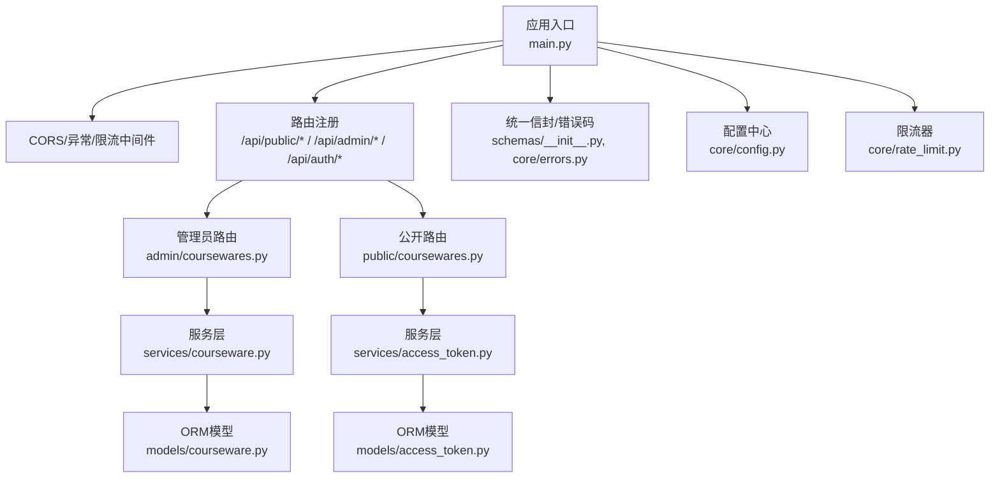
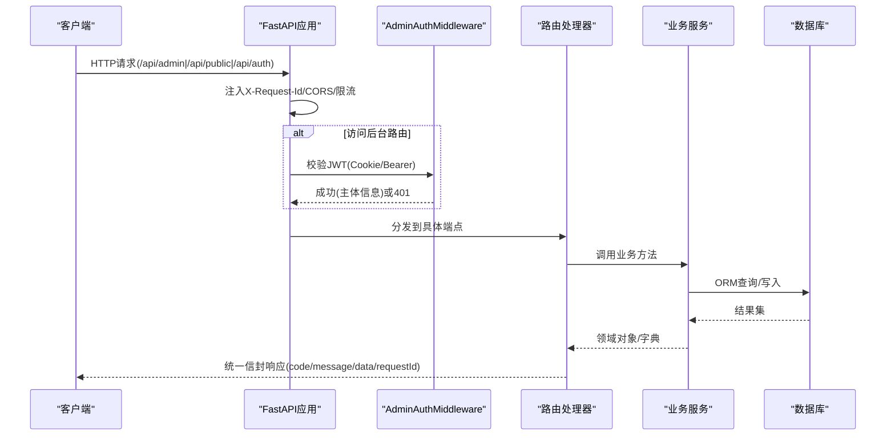
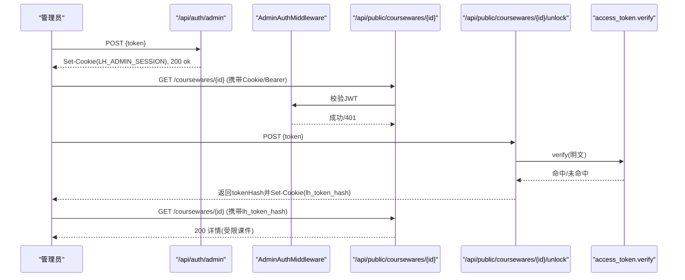
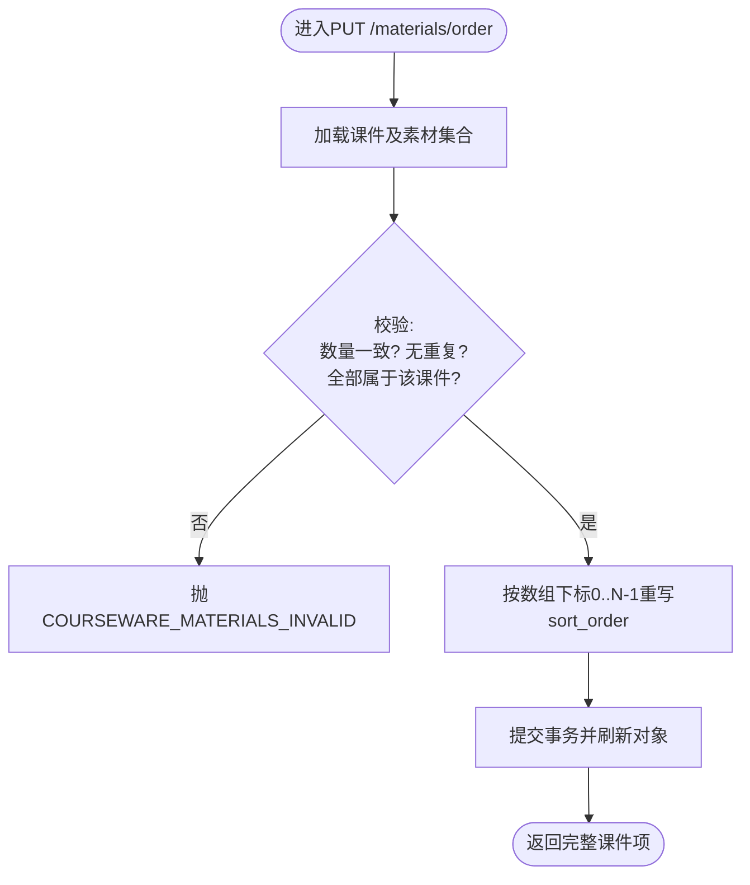
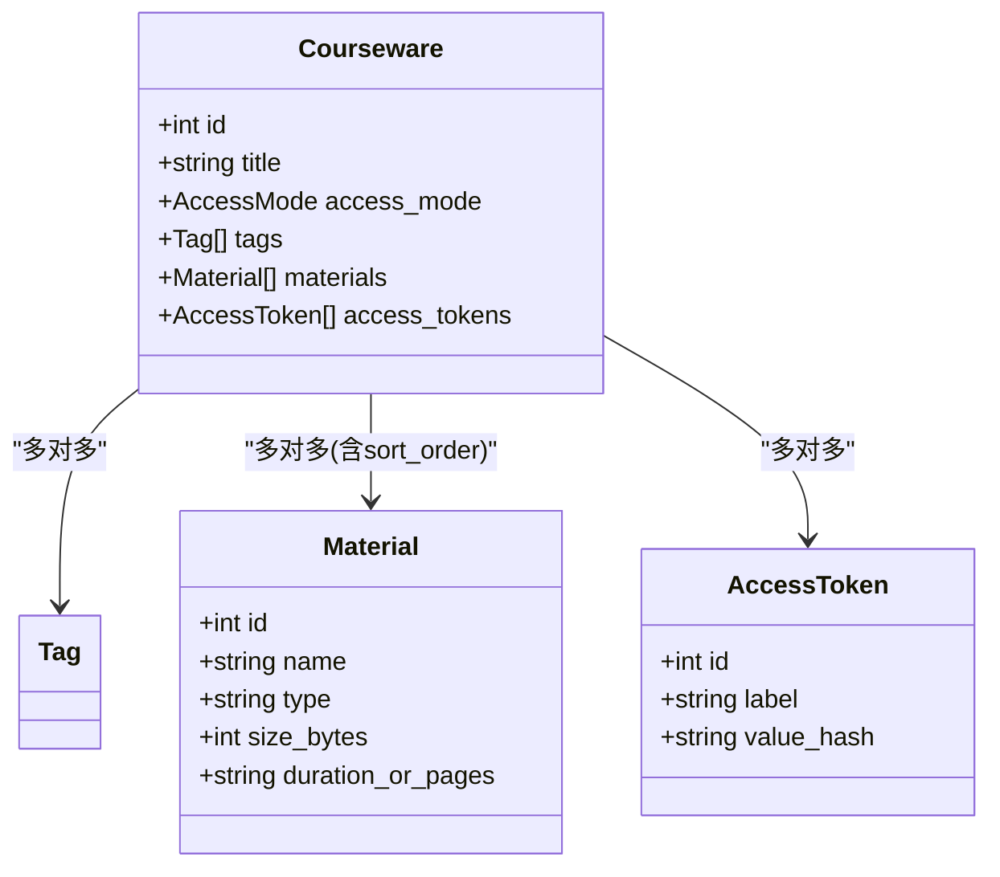
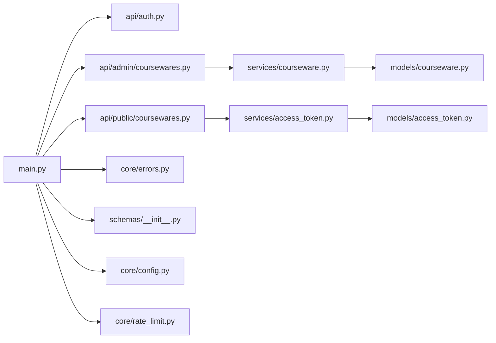

# API接口开发

<cite>
**本文引用的文件**   
- [backend/app/main.py](file://backend/app/main.py)
- [doc/spec/10-API设计规范.md](file://doc/spec/10-API设计规范.md)
- [backend/app/api/auth.py](file://backend/app/api/auth.py)
- [backend/app/middleware/admin_auth.py](file://backend/app/middleware/admin_auth.py)
- [backend/app/core/config.py](file://backend/app/core/config.py)
- [backend/app/schemas/__init__.py](file://backend/app/schemas/__init__.py)
- [backend/app/core/errors.py](file://backend/app/core/errors.py)
- [backend/app/api/public/coursewares.py](file://backend/app/api/public/coursewares.py)
- [backend/app/services/access_token.py](file://backend/app/services/access_token.py)
- [backend/app/models/access_token.py](file://backend/app/models/access_token.py)
- [backend/app/api/admin/coursewares.py](file://backend/app/api/admin/coursewares.py)
- [backend/app/services/courseware.py](file://backend/app/services/courseware.py)
- [backend/app/models/courseware.py](file://backend/app/models/courseware.py)
- [backend/app/core/rate_limit.py](file://backend/app/core/rate_limit.py)
- [backend/tests/test_auth.py](file://backend/tests/test_auth.py)
- [backend/tests/conftest.py](file://backend/tests/conftest.py)
</cite>

## 目录
1. [引言](#引言)
2. [项目结构](#项目结构)
3. [核心组件](#核心组件)
4. [架构总览](#架构总览)
5. [详细组件分析](#详细组件分析)
6. [依赖关系分析](#依赖关系分析)
7. [性能与限流](#性能与限流)
8. [错误处理与排障](#错误处理与排障)
9. [结论](#结论)
10. [附录：测试与Mock最佳实践](#附录测试与mock最佳实践)

## 引言
本指南面向Learning Hub后端API开发者，系统化阐述RESTful API设计、认证授权（Admin JWT + AccessToken）、管理后台与公开API的开发模式、Pydantic Schema规范、版本管理与向后兼容策略，以及测试与Mock数据准备的最佳实践。文档以仓库中的实际实现为依据，确保可落地执行。

## 项目结构
后端采用FastAPI分层组织：入口装配中间件与路由；鉴权与限流作为横切能力；业务逻辑下沉至services层；数据模型位于models；请求/响应契约由schemas定义；API按admin与public分域挂载。

图表来源
- [backend/app/main.py:40-116](file://backend/app/main.py#L40-L116)
- [backend/app/api/admin/coursewares.py:17-21](file://backend/app/api/admin/coursewares.py#L17-L21)
- [backend/app/api/public/coursewares.py:19](file://backend/app/api/public/coursewares.py#L19)
- [backend/app/services/courseware.py:10-26](file://backend/app/services/courseware.py#L10-L26)
- [backend/app/services/access_token.py:10-26](file://backend/app/services/access_token.py#L10-L26)
- [backend/app/models/courseware.py:21-74](file://backend/app/models/courseware.py#L21-L74)
- [backend/app/models/access_token.py:13-34](file://backend/app/models/access_token.py#L13-L34)
- [backend/app/schemas/__init__.py:24-65](file://backend/app/schemas/__init__.py#L24-L65)
- [backend/app/core/errors.py:9-144](file://backend/app/core/errors.py#L9-L144)
- [backend/app/core/config.py:9-88](file://backend/app/core/config.py#L9-L88)
- [backend/app/core/rate_limit.py:1-55](file://backend/app/core/rate_limit.py#L1-L55)

章节来源
- [backend/app/main.py:40-116](file://backend/app/main.py#L40-L116)
- [doc/spec/10-API设计规范.md:1-132](file://doc/spec/10-API设计规范.md#L1-L132)

## 核心组件
- 应用装配与全局中间件：CORS、请求ID注入、统一异常处理、限流集成、OpenAPI文档挂载。
- 鉴权体系：
  - Admin登录/登出：基于明文Token校验后签发JWT，写入HttpOnly Cookie；后续通过Cookie或Authorization头校验。
  - 课件ACL：AccessToken明文仅创建时返回，数据库存储SHA-256哈希；解锁接口比对哈希并下发Cookie供后续自动鉴权。
- 统一响应信封与错误码：所有响应使用{code,message,data,requestId}信封；BusinessError将业务码映射到HTTP状态码。
- 限流：SlowAPI适配，支持IP与会话维度Key构造，Redis/内存双后端。
- Pydantic Schema：集中定义请求/响应结构与校验规则，驱动参数验证与OpenAPI自动生成。

章节来源
- [backend/app/main.py:57-112](file://backend/app/main.py#L57-L112)
- [backend/app/api/auth.py:21-45](file://backend/app/api/auth.py#L21-L45)
- [backend/app/middleware/admin_auth.py:16-66](file://backend/app/middleware/admin_auth.py#L16-L66)
- [backend/app/schemas/__init__.py:24-65](file://backend/app/schemas/__init__.py#L24-L65)
- [backend/app/core/errors.py:9-144](file://backend/app/core/errors.py#L9-L144)
- [backend/app/core/rate_limit.py:18-55](file://backend/app/core/rate_limit.py#L18-L55)

## 架构总览
系统遵循“路由→依赖(鉴权/限流)→服务→模型”的清晰分层，并通过统一信封与错误码对外暴露一致的JSON契约。

图表来源
- [backend/app/main.py:70-112](file://backend/app/main.py#L70-L112)
- [backend/app/middleware/admin_auth.py:26-43](file://backend/app/middleware/admin_auth.py#L26-L43)
- [backend/app/api/admin/coursewares.py:24-41](file://backend/app/api/admin/coursewares.py#L24-L41)
- [backend/app/services/courseware.py:396-447](file://backend/app/services/courseware.py#L396-L447)

## 详细组件分析

### 认证与授权机制（Admin JWT + AccessToken）
- Admin登录流程：校验明文Token → 签发JWT → 设置Cookie → 返回会话过期时间。
- 后台鉴权：从Authorization或Cookie提取JWT，校验exp/sub，失败返回401。
- 课件ACL：解锁接口对明文Token计算SHA-256并与数据库value_hash常量时间比较；成功后下发tokenHash Cookie，后续GET详情自动鉴权。

图表来源
- [backend/app/api/auth.py:21-45](file://backend/app/api/auth.py#L21-L45)
- [backend/app/middleware/admin_auth.py:26-43](file://backend/app/middleware/admin_auth.py#L26-L43)
- [backend/app/api/public/coursewares.py:79-130](file://backend/app/api/public/coursewares.py#L79-L130)
- [backend/app/services/access_token.py:193-205](file://backend/app/services/access_token.py#L193-L205)

章节来源
- [backend/app/api/auth.py:21-45](file://backend/app/api/auth.py#L21-L45)
- [backend/app/middleware/admin_auth.py:16-66](file://backend/app/middleware/admin_auth.py#L16-L66)
- [backend/app/api/public/coursewares.py:24-76](file://backend/app/api/public/coursewares.py#L24-L76)
- [backend/app/services/access_token.py:193-205](file://backend/app/services/access_token.py#L193-L205)
- [backend/app/models/access_token.py:13-34](file://backend/app/models/access_token.py#L13-L34)

### 管理后台API开发模式（权限、校验、批量/排序）
- 权限校验：路由级依赖注入get_admin_principal，缺失或失效返回401。
- 参数校验：Pydantic Request Schema强制字段类型、长度、枚举等约束。
- 批量与顺序：
  - 更新课件时materialIds按数组下标重写sortOrder（增删+重排）。
  - 专用排序接口仅调整顺序，严格校验数量一致、无重复、全部属于该课件。

图表来源
- [backend/app/api/admin/coursewares.py:100-112](file://backend/app/api/admin/coursewares.py#L100-L112)
- [backend/app/services/courseware.py:335-393](file://backend/app/services/courseware.py#L335-L393)

章节来源
- [backend/app/api/admin/coursewares.py:17-21](file://backend/app/api/admin/coursewares.py#L17-L21)
- [backend/app/api/admin/coursewares.py:71-98](file://backend/app/api/admin/coursewares.py#L71-L98)
- [backend/app/services/courseware.py:170-278](file://backend/app/services/courseware.py#L170-L278)
- [backend/app/services/courseware.py:335-393](file://backend/app/services/courseware.py#L335-L393)

### 公开API设计原则（访问控制、缓存、性能）
- 访问控制：OPEN直接返回；RESTRICTED需携带已解锁的tokenHash（Header或Cookie），否则403。
- 限流：搜索、解锁、详情分别按IP或组合Key限流，防止滥用。
- 性能优化：
  - 列表/详情按需selectinload关联，避免N+1。
  - 排序字段直接从关联表读取，保证一致性。
  - 可选降级：AI搜索不可用时回退关键词匹配。

图表来源
- [backend/app/models/courseware.py:21-74](file://backend/app/models/courseware.py#L21-L74)
- [backend/app/models/access_token.py:13-34](file://backend/app/models/access_token.py#L13-L34)

章节来源
- [backend/app/api/public/coursewares.py:57-76](file://backend/app/api/public/coursewares.py#L57-L76)
- [backend/app/core/rate_limit.py:40-55](file://backend/app/core/rate_limit.py#L40-L55)
- [backend/app/services/courseware.py:290-332](file://backend/app/services/courseware.py#L290-L332)

### Pydantic Schema设计与使用
- 请求Schema：集中定义必填/可选、长度、枚举、去重与清洗（strip）。
- 响应Schema：统一Envelope封装，配合ok/fail工具函数快速构造响应体。
- OpenAPI生成：FastAPI自动根据Schema生成/docs与/redoc文档。

章节来源
- [backend/app/schemas/courseware.py:22-120](file://backend/app/schemas/courseware.py#L22-L120)
- [backend/app/schemas/__init__.py:24-65](file://backend/app/schemas/__init__.py#L24-L65)
- [backend/app/main.py:48-55](file://backend/app/main.py#L48-L55)

### API版本管理与向后兼容
- 路径前缀区分功能域（/api/admin、/api/public、/api/auth），便于未来引入/v1等版本前缀而不破坏现有契约。
- 幂等性：写操作可携带Idempotency-Key，服务端在窗口内去重；删除类操作幂等返回。
- 兼容性策略：新增字段默认值兼容旧客户端；废弃字段保留一段时间并记录变更日志；重大变更通过新路由或版本号发布。

章节来源
- [doc/spec/10-API设计规范.md:124-132](file://doc/spec/10-API设计规范.md#L124-L132)
- [backend/app/main.py:92-102](file://backend/app/main.py#L92-L102)

## 依赖关系分析
- main.py负责中间件与路由装配，依赖auth、admin、public路由模块。
- admin路由依赖admin_auth中间件进行JWT校验。
- public路由依赖限流与access_token服务进行ACL校验。
- services层依赖models与外部服务（如LLM搜索）。
- schemas与errors贯穿各层，提供统一契约与错误语义。

图表来源
- [backend/app/main.py:92-102](file://backend/app/main.py#L92-L102)
- [backend/app/api/admin/coursewares.py:17-21](file://backend/app/api/admin/coursewares.py#L17-L21)
- [backend/app/api/public/coursewares.py:19](file://backend/app/api/public/coursewares.py#L19)
- [backend/app/services/courseware.py:10-26](file://backend/app/services/courseware.py#L10-L26)
- [backend/app/services/access_token.py:10-26](file://backend/app/services/access_token.py#L10-L26)
- [backend/app/models/courseware.py:21-74](file://backend/app/models/courseware.py#L21-L74)
- [backend/app/models/access_token.py:13-34](file://backend/app/models/access_token.py#L13-L34)
- [backend/app/core/errors.py:9-144](file://backend/app/core/errors.py#L9-L144)
- [backend/app/schemas/__init__.py:24-65](file://backend/app/schemas/__init__.py#L24-L65)
- [backend/app/core/config.py:9-88](file://backend/app/core/config.py#L9-L88)
- [backend/app/core/rate_limit.py:1-55](file://backend/app/core/rate_limit.py#L1-L55)

章节来源
- [backend/app/main.py:92-102](file://backend/app/main.py#L92-L102)

## 性能与限流
- 限流策略：
  - 前台AI搜索：按IP 30次/分钟。
  - 前台解锁：按IP+Token哈希 10次/分钟。
  - 前台详情：按IP 120次/分钟。
  - 后台写接口：按会话 60次/分钟。
  - 素材上传：按会话 10次/小时。
- 存储后端：生产建议Redis共享计数；开发可用内存。
- 查询优化：selectinload减少N+1；排序字段直读关联表保障一致性。

章节来源
- [doc/spec/10-API设计规范.md:109-123](file://doc/spec/10-API设计规范.md#L109-L123)
- [backend/app/core/rate_limit.py:40-55](file://backend/app/core/rate_limit.py#L40-L55)
- [backend/app/services/courseware.py:290-332](file://backend/app/services/courseware.py#L290-L332)

## 错误处理与排障
- 统一信封：所有响应包含code/message/data/requestId。
- 业务异常：BusinessError将业务码映射为HTTP状态码，并由全局处理器包装为信封。
- 常见排查：
  - 401 unauthenticated：检查JWT是否过期或缺失。
  - 403 courseware_acl_locked：确认已解锁并携带正确tokenHash。
  - 429 rate_limited：降低频率或等待冷却。
  - requestId：用于前后端日志对位。

章节来源
- [backend/app/schemas/__init__.py:35-65](file://backend/app/schemas/__init__.py#L35-L65)
- [backend/app/core/errors.py:130-144](file://backend/app/core/errors.py#L130-L144)
- [backend/app/main.py:78-90](file://backend/app/main.py#L78-L90)

## 结论
本指南基于仓库实现，总结了Learning Hub API的设计与开发要点：清晰的REST契约、双轨鉴权、统一信封与错误码、严格的Schema校验、完善的限流与性能优化策略，以及可落地的版本与兼容性方案。遵循本文档可显著提升API质量与团队协作效率。

## 附录：测试与Mock最佳实践
- 测试环境：
  - 使用SQLite内存数据库，覆盖DATABASE_URL与JWT_SECRET。
  - 通过dependency_overrides注入测试Session，避免真实DB依赖。
- 基础用例：
  - 健康检查信封校验。
  - Admin登录/登出流程与Cookie行为。
  - 未登录访问后台路由应返回401。
- Mock建议：
  - 使用TestClient模拟HTTP请求，断言status_code与response.code。
  - 对第三方服务（如LLM）可通过依赖注入替换为Mock实现。
  - 针对限流场景，可在测试中重置内部桶或使用独立实例隔离。

章节来源
- [backend/tests/conftest.py:23-76](file://backend/tests/conftest.py#L23-L76)
- [backend/tests/test_auth.py:7-35](file://backend/tests/test_auth.py#L7-L35)