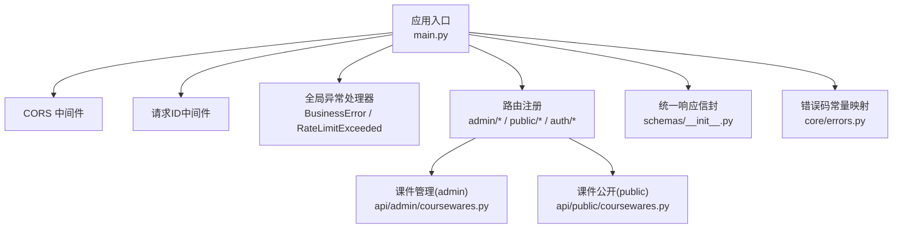
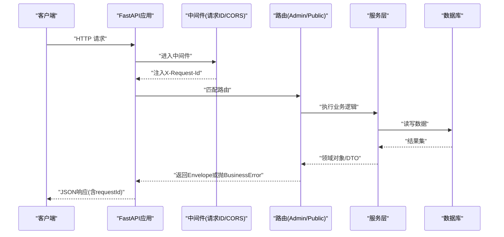
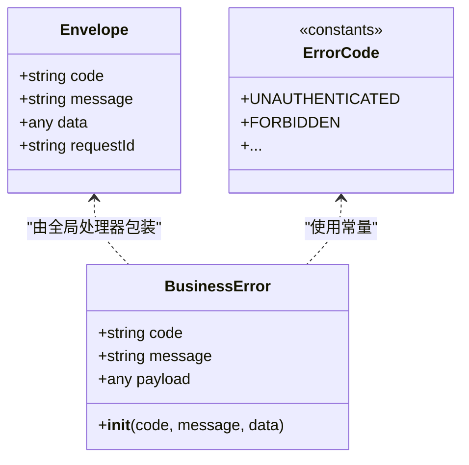
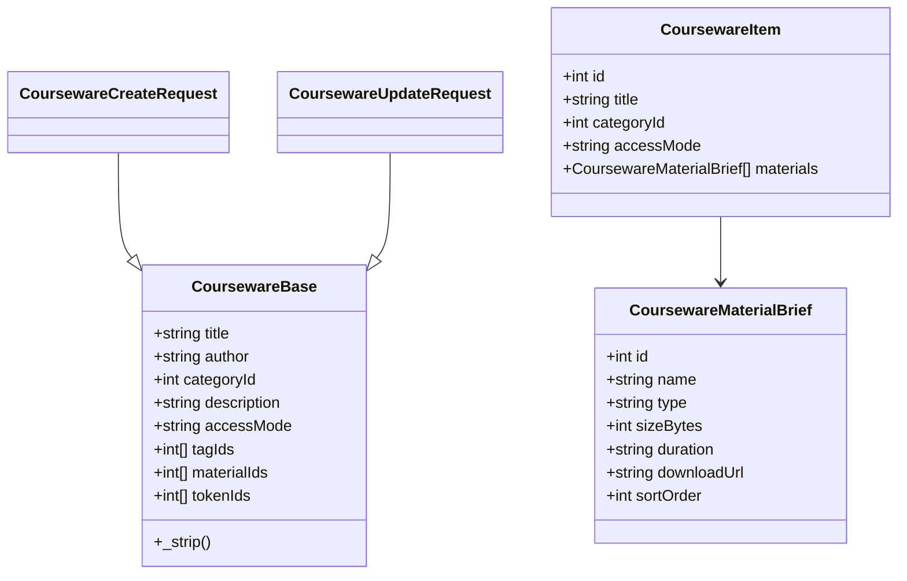
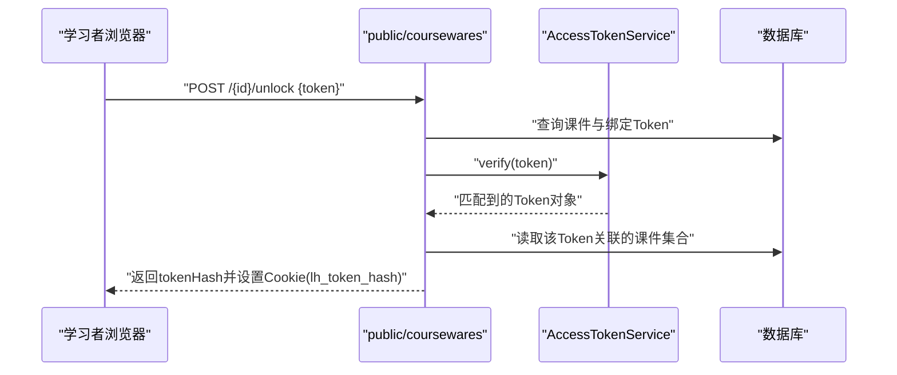
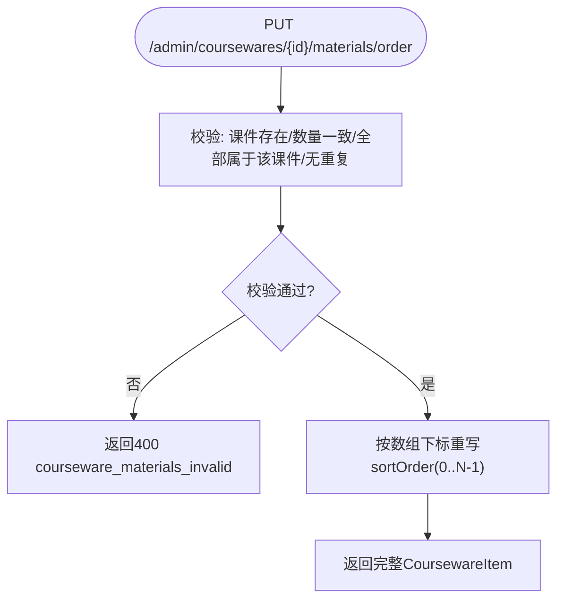
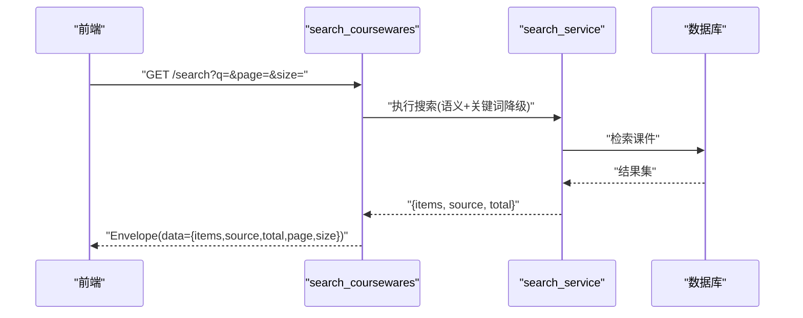
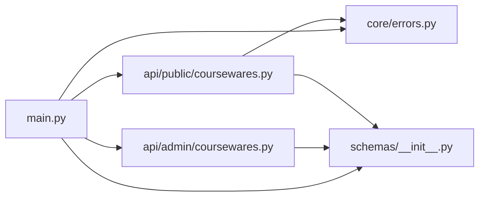

# API设计规范

<cite>
**本文引用的文件**
- [backend/app/main.py](file://backend/app/main.py)
- [backend/app/core/errors.py](file://backend/app/core/errors.py)
- [backend/app/schemas/__init__.py](file://backend/app/schemas/__init__.py)
- [backend/app/schemas/auth.py](file://backend/app/schemas/auth.py)
- [backend/app/schemas/courseware.py](file://backend/app/schemas/courseware.py)
- [backend/app/schemas/category.py](file://backend/app/schemas/category.py)
- [backend/app/schemas/tag.py](file://backend/app/schemas/tag.py)
- [backend/app/schemas/material.py](file://backend/app/schemas/material.py)
- [backend/app/schemas/access_token.py](file://backend/app/schemas/access_token.py)
- [backend/app/schemas/access_token_usage.py](file://backend/app/schemas/access_token_usage.py)
- [backend/app/api/admin/coursewares.py](file://backend/app/api/admin/coursewares.py)
- [backend/app/api/public/coursewares.py](file://backend/app/api/public/coursewares.py)
- [doc/spec/10-API设计规范.md](file://doc/spec/10-API设计规范.md)
</cite>

## 目录
1. [引言](#引言)
2. [项目结构](#项目结构)
3. [核心组件](#核心组件)
4. [架构总览](#架构总览)
5. [详细组件分析](#详细组件分析)
6. [依赖关系分析](#依赖关系分析)
7. [性能与限流](#性能与限流)
8. [错误处理与排障](#错误处理与排障)
9. [结论](#结论)
10. [附录：版本管理与兼容性](#附录：版本管理与兼容性)

## 引言
本规范面向 Learning Hub 的 RESTful API，统一约定 URL 命名、HTTP 方法语义、状态码与错误响应格式；定义 Pydantic Schema 的设计模式（验证规则、字段类型、嵌套模型、文档生成配置）；明确统一响应信封与分页格式；给出鉴权双轨模型、幂等性与限流策略；并提供最佳实践与示例路径，确保团队开发一致性与可维护性。

## 项目结构
后端采用 FastAPI 分层组织：入口装配中间件、路由与全局异常处理；业务路由按 admin/public 分域；Schema 集中管理请求/响应契约；服务层封装领域逻辑；错误码与统一信封集中定义。

图示来源
- [backend/app/main.py:40-112](file://backend/app/main.py#L40-L112)
- [backend/app/schemas/__init__.py:24-61](file://backend/app/schemas/__init__.py#L24-L61)
- [backend/app/core/errors.py:130-141](file://backend/app/core/errors.py#L130-L141)

章节来源
- [backend/app/main.py:1-116](file://backend/app/main.py#L1-L116)
- [backend/app/schemas/__init__.py:1-65](file://backend/app/schemas/__init__.py#L1-L65)
- [backend/app/core/errors.py:1-144](file://backend/app/core/errors.py#L1-L144)

## 核心组件
- 统一响应信封：所有接口返回 {code, message, data, requestId}，成功时 code="ok"，错误时携带业务码与人类可读消息。
- 错误码体系：ErrorCode 常量集中定义，并映射到 HTTP 状态码；通过 BusinessError 抛出并由全局处理器包装为信封。
- 鉴权双轨：后台 Admin 会话 + 前台课件 AccessToken 解锁；两者互不干扰。
- 幂等与限流：写入类接口支持 Idempotency-Key；按 IP/会话维度限流，命中返回 429 与 rate_limited。
- 分页约定：page/size/total/items 标准结构，默认 size=20，最大受各接口约束。

章节来源
- [backend/app/schemas/__init__.py:24-61](file://backend/app/schemas/__init__.py#L24-L61)
- [backend/app/core/errors.py:9-127](file://backend/app/core/errors.py#L9-L127)
- [doc/spec/10-API设计规范.md:57-131](file://doc/spec/10-API设计规范.md#L57-L131)

## 架构总览
下图展示从客户端到路由、服务层、数据库与统一响应的调用链，以及关键中间件的作用点。

图示来源
- [backend/app/main.py:70-90](file://backend/app/main.py#L70-L90)
- [backend/app/api/admin/coursewares.py:24-98](file://backend/app/api/admin/coursewares.py#L24-L98)
- [backend/app/api/public/coursewares.py:32-76](file://backend/app/api/public/coursewares.py#L32-L76)

## 详细组件分析

### 统一响应信封与错误封装
- Envelope 模型定义 code/message/data/requestId 四字段，提供 ok/fail 构造器与 BusinessError 转换函数。
- 全局异常处理器将 BusinessError 转换为信封响应；限流异常也统一包装为 envelope。

图示来源
- [backend/app/schemas/__init__.py:24-61](file://backend/app/schemas/__init__.py#L24-L61)
- [backend/app/core/errors.py:9-127](file://backend/app/core/errors.py#L9-L127)
- [backend/app/core/errors.py:130-141](file://backend/app/core/errors.py#L130-L141)

章节来源
- [backend/app/schemas/__init__.py:1-65](file://backend/app/schemas/__init__.py#L1-L65)
- [backend/app/core/errors.py:1-144](file://backend/app/core/errors.py#L1-L144)
- [backend/app/main.py:78-90](file://backend/app/main.py#L78-L90)

### Pydantic Schema 设计模式
- 字段校验：使用 Field(min_length/max_length/ge/le) 与 model_validator 做 strip 与自定义校验。
- 嵌套模型：如 CoursewareItem 内嵌 materials 列表；CategoryNode 递归 children。
- 文档生成：OpenAPI 自动基于 Pydantic 模型生成请求/响应体描述，配合 FastAPI 的 docs/redoc/openapi_url。

图示来源
- [backend/app/schemas/courseware.py:22-89](file://backend/app/schemas/courseware.py#L22-L89)
- [backend/app/schemas/courseware.py:9-20](file://backend/app/schemas/courseware.py#L9-L20)

章节来源
- [backend/app/schemas/courseware.py:1-120](file://backend/app/schemas/courseware.py#L1-L120)
- [backend/app/schemas/category.py:9-40](file://backend/app/schemas/category.py#L9-L40)
- [backend/app/schemas/tag.py:9-30](file://backend/app/schemas/tag.py#L9-L30)
- [backend/app/schemas/material.py:9-24](file://backend/app/schemas/material.py#L9-L24)
- [backend/app/schemas/access_token.py:9-45](file://backend/app/schemas/access_token.py#L9-L45)
- [backend/app/schemas/access_token_usage.py:9-78](file://backend/app/schemas/access_token_usage.py#L9-L78)
- [backend/app/main.py:48-55](file://backend/app/main.py#L48-L55)

### 鉴权与访问控制
- 后台 Admin 鉴权：AdminAuthMiddleware 作为 Depends 拦截 /api/admin/*，支持 Cookie/JWT。
- 前台课件 ACL：GET 详情需 X-Token-Hash 或 Cookie lh_token_hash；POST unlock 校验明文 token 并下发哈希。

图示来源
- [backend/app/api/public/coursewares.py:79-130](file://backend/app/api/public/coursewares.py#L79-L130)

章节来源
- [backend/app/api/public/coursewares.py:24-76](file://backend/app/api/public/coursewares.py#L24-L76)
- [backend/app/api/public/coursewares.py:79-130](file://backend/app/api/public/coursewares.py#L79-L130)
- [doc/spec/10-API设计规范.md:38-56](file://doc/spec/10-API设计规范.md#L38-L56)

### 课件管理 API（后台）
- 列表/详情/创建/更新/删除/素材顺序重排均遵循统一信封与分页约定。
- 更新时 materialIds 按数组下标重写 sort_order；专用排序接口仅调整顺序。

图示来源
- [backend/app/api/admin/coursewares.py:100-112](file://backend/app/api/admin/coursewares.py#L100-L112)
- [backend/app/schemas/courseware.py:100-108](file://backend/app/schemas/courseware.py#L100-L108)

章节来源
- [backend/app/api/admin/coursewares.py:1-115](file://backend/app/api/admin/coursewares.py#L1-L115)
- [backend/app/schemas/courseware.py:100-108](file://backend/app/schemas/courseware.py#L100-L108)

### 课件公开 API（前台）
- 搜索：embedding 召回 + 关键词回退，返回 items/source/total/page/size。
- 详情：OPEN 直接返回；RESTRICTED 校验已解锁 token 哈希，否则 403。
- 解锁：校验明文 token，成功后返回 tokenHash 并写 Cookie。

图示来源
- [backend/app/api/public/coursewares.py:32-54](file://backend/app/api/public/coursewares.py#L32-L54)

章节来源
- [backend/app/api/public/coursewares.py:32-76](file://backend/app/api/public/coursewares.py#L32-L76)

### 分类/标签/素材/访问令牌 Schema
- 分类：树形节点 CategoryNode 递归 children；创建/改名带长度与去空校验。
- 标签：名称唯一性校验，列表项包含引用计数。
- 素材：类型枚举、大小、时长/页数、下载链接与引用标记。
- 访问令牌：创建返回明文+哈希，列表仅暴露哈希与引用计数。

章节来源
- [backend/app/schemas/category.py:9-40](file://backend/app/schemas/category.py#L9-L40)
- [backend/app/schemas/tag.py:9-30](file://backend/app/schemas/tag.py#L9-L30)
- [backend/app/schemas/material.py:9-24](file://backend/app/schemas/material.py#L9-L24)
- [backend/app/schemas/access_token.py:9-45](file://backend/app/schemas/access_token.py#L9-L45)

## 依赖关系分析
- main.py 负责中间件、异常处理与路由注册，耦合于 schemas 与 core.errors。
- admin/public 路由分别依赖各自的服务层与共享的 db/session。
- 错误码与信封被多处复用，形成稳定的契约边界。

图示来源
- [backend/app/main.py:91-102](file://backend/app/main.py#L91-L102)
- [backend/app/api/admin/coursewares.py:1-21](file://backend/app/api/admin/coursewares.py#L1-L21)
- [backend/app/api/public/coursewares.py:1-19](file://backend/app/api/public/coursewares.py#L1-L19)

章节来源
- [backend/app/main.py:91-102](file://backend/app/main.py#L91-L102)

## 性能与限流
- 限流范围：AI 搜索、解锁、详情、后台写接口、素材上传等，按 IP/会话维度限制。
- 存储：单实例内存，多 worker 切换 Redis；SlowAPI 集成在 app.state.limiter。
- 建议：对热点接口开启缓存；大文件上传走分块与断点续传；避免 N+1 查询。

章节来源
- [backend/app/main.py:67-69](file://backend/app/main.py#L67-L69)
- [doc/spec/10-API设计规范.md:109-123](file://doc/spec/10-API设计规范.md#L109-L123)

## 错误处理与排障
- 统一错误信封：BusinessError 抛出后由全局处理器转为 {code,message,data,requestId}。
- 常见错误码：认证失败、参数非法、资源冲突、资源不存在、限流、内部错误等。
- 排查要点：
  - 检查 X-Request-Id 是否回填，便于日志定位。
  - 关注 429 限流提示，必要时放宽阈值或引入队列。
  - 410 token_revoked 表示令牌撤销，前端应清除本地记忆并重试解锁。

章节来源
- [backend/app/core/errors.py:130-141](file://backend/app/core/errors.py#L130-L141)
- [backend/app/main.py:78-90](file://backend/app/main.py#L78-L90)
- [doc/spec/10-API设计规范.md:285-408](file://doc/spec/10-API设计规范.md#L285-L408)

## 结论
本规范以统一信封与错误码为核心，结合 Pydantic 强校验与 OpenAPI 自动生成，确保接口契约清晰、前后端协作高效。通过双轨鉴权、幂等与限流策略，兼顾安全与稳定性。建议团队严格遵循本规范进行开发与联调，并在变更时同步更新 Schema 与文档。

## 附录：版本管理与兼容性
- 向后兼容原则：新增字段保持可选且默认值稳定；废弃字段保留一段时间并标注弃用。
- 路径版本化：如需破坏性变更，优先通过前缀 /v1/ 引入新版本，旧版本并行运行并逐步下线。
- 文档与契约：任何变更需同步更新 Schema 与 OpenAPI 文档，并通过自动化测试覆盖兼容用例。
- 废弃策略：提前公告、灰度发布、监控错误码与调用量，最终移除旧接口。

[本节为概念性说明，无需源码引用]